# سند توسعه فاز دوم شهاب — نسخه ۱.۵

**شناسه سند:** `SHAHAB-PHASE2-DEV-DOC`  
**نسخه:** `V1.5`  
**تاریخ به‌روزرسانی:** ۲۰۲۶-۱۱-۰۹\
**وضعیت:** ۴۰ تصمیم اصولی معماری فصل نخست تأیید شده؛ جزئیات اجرایی، آستانه‌ها و برنامه انتشار همچنان نیازمند اعتبارسنجی و تصویب مستقل  
**ساختار:** فصل نخست — شبکه دانش و بازیابی مقررات؛ فصل دوم — معماری کلان محصول؛ فصل سوم — معماری تفصیلی ایجنت‌ها و گزینه‌های معماری استقرار؛ فصل پنجم — پیش‌نویس غیرمصوب راهبرد اجرای تدریجی (شماره فصل چهارم برای تکمیل بعدی محفوظ است)

> **یادداشت ویرایشی:** فصل نخست از نسخه ۰.۱ حفظ شده است؛ فصل دوم از نسخه ۰.۲ فقط در نقاط تعارض با تصمیم‌های جدید اصلاح شده و فصل سوم برای طراحی تفصیلی افزوده شده و در نسخه ۰.۴ یک بخش مستقل درباره گزینه معماری قابل‌استخراج و مهاجرت تدریجی به آن اضافه شده است. تصمیم‌های محصولی صریح، پیشنهادهای فنی و مسائل باز از هم تفکیک شده‌اند. فصل پنجم در نسخه ۰.۵ صرفاً به‌عنوان Draft نیازمند بررسی اضافه شده است؛ شماره فصل چهارم برای تکمیل بعدی محفوظ است. این نسخه به معنی تصویب پیاده‌سازی، ایجاد تسک یا تغییر کد نیست. در نسخه ۰.۸، ۴۰ تصمیم اصولی معماری فصل نخست و پیامدهای وابسته به آن‌ها با حفظ وضعیت پیشنهادی فصل‌های دیگر یکپارچه شده‌اند.

> **مبنای نسخه ۱.۰ و کنترل تغییر:** این نسخه، متن کامل نسخه ۰.۹ را حفظ کرده و پیوست ممیزی یکپارچگی فاز اول و دوم را اضافه می‌کند. نسخه مبنای انتشار نرم‌افزار طبق اعلام صریح مالک پروژه **`v.1.08`** است؛ این شناسه با نسخه سند توسعه تفاوت دارد. ارجاع به `v0.1.8` یا نسخه‌های قدیمی در مستندات تاریخی، مجوز تغییر این خط مبنا نیست. برای تأیید تطابق tag، commit و digestهای محیط عملیاتی باید شواهد مستقل جمع‌آوری شود. هیچ‌یک از ADR-RAG-01 تا ADR-RAG-40 تغییر یا لغو نشده‌اند.

> **منابع کنترل‌شده:** کد شاخه `main`، `docs/PROJECT_CONTINUITY_DOCUMENT_SHAHAB_FINANCE_DEMO.md` (نسخه ۲۰.۰)، `docs/project-current-state.md`، `docs/SHAHAB_PROJECT_DEVELOPMENT_CANONICAL_GUIDE.md`، `docs/TASK_EXECUTION_PROTOCOL.md` و PR #176 (Draft و ادغام‌نشده هنگام ممیزی). PR #176 منبع پیشنهادی قواعد انتقال فاز است، نه بخشی از baseline ادغام‌شده. در تعارض «وضعیت جاری» با تاریخچه، کد و شواهد نسخه جاری مقدم‌اند؛ تصمیم‌های مصوب محصول و معماری فقط با تأیید مالک قابل تغییرند.

### تصمیم سراسری A01 — معماری هدف و استقرار تدریجی (مصوب ۲۰۲۶-۱۱-۰۹)

**وضعیت: مصوب مالک پروژه در سطح معماری هدف؛ بدون مجوز اجرای کد، انتشار یا تغییر زیرساخت.** این تصمیم بر فصل‌های دوم، سوم و پنجم و برنامه‌های اجرایی استخراج‌شده از سند مادر حاکم است و هیچ‌یک از ۴۰ ADR فصل نخست را تغییر نمی‌دهد.

- **Core:** هسته محصول، مونولیت ماژولار با مرزهای داخلی روشن.
- **Adviser:** سرویس مستقل مشاور هوشمند و RAG با چرخه استقرار مستقل از Core.
- **Assistant:** سرویس مستقل دستیار اجرایی در معماری هدف؛ در انتشار RAG R1 فقط مرزها و قراردادهای آن طراحی می‌شوند و خود سرویس پیاده‌سازی یا مستقر نمی‌شود.
- **انتشار RAG R1:** فقط Core و Adviser واحدهای استقرار فعال این انتشارند؛ جزئیات Release Plan همچنان نیازمند تصویب مستقل است.
- **زیرساخت اولیه:** VM فعلی و زیرساخت PostgreSQL/Redis موجود مبنا هستند. سه سرویس به معنی الزام به سه VM یا سه نمونه مستقل PostgreSQL نیست. تفکیک منطقی مالکیت داده ضروری است؛ تفکیک فیزیکی با شواهد امنیت، ظرفیت یا تاب‌آوری و تصویب جداگانه انجام می‌شود.
- **قراردادها و مشاهده‌پذیری:** مرز ارتباط، نسخه قراردادها، ردیابی سرتاسری، Timeout و مدیریت خطا باید پیش از اتصال اجرایی روشن شوند. روش دقیق دسترسی متقابل به داده‌ها و پروتکل ارتباطی در A02 و تصمیم‌های بعدی باز است.
- **تقدم تفسیر:** متن‌های قدیمیِ «یک مونولیت برای همه قابلیت‌ها»، «میکروسرویس کامل» یا «باز بودن اصل انتخاب معماری هدف» دیگر گزینه اجرایی مصوب نیستند؛ صرفاً سابقه تحلیل به‌شمار می‌روند.

## فصل نخست — شبکه دانش، بازیابی مبتنی بر تقاضا و پایش مقررات

**نسخه مبنا (Original baseline):** V0.1؛ **بازنگری تصمیم‌های معماری:** V0.8  
**تاریخ (Date):** 2026-10-21  
**وضعیت (Status):** تصمیم‌های معماری در سطح اصول مصوب؛ جزئیات فنی و سنجه‌های پذیرش نیازمند اعتبارسنجی  
**دامنه (Scope):** معماری RAG مبتنی بر تقاضا، کشف انتشارهای جدید، بازاعتبارسنجی اسناد و کشف روابط حقوقی  
**پروژه (Project):** شهاب (SHAHAB)

> **محدوده فصل اول:** این فصل، طراحی مفهومی و جریان عملیاتی RAG فاز دوم را مشخص می‌کند؛ نه پیاده‌سازی نهایی، نه تأیید دسترسی فنی به وب‌سایت‌های مرجع، و نه تضمین صحت حقوقی پاسخ‌ها. تمام عنوان‌ها، شناسه‌ها، تاریخ‌ها و رویدادهای مثال انتهای سند فرضی‌اند.

### 1. هدف و اصول طراحی

هدف، ساخت یک مخزن دانش مقرراتی برای دستیار هوشمند شهاب است که **عمدتاً بر اساس پرسش و تقاضای واقعی کاربران رشد کند**، اما با یک لایه سبک کشف انتشارهای جدید، از تغییرات احتمالی مؤثر بر اسناد ذخیره‌شده نیز آگاه شود.

اصول:

1. **Demand-first:** دریافت و نمایه‌سازی کامل اسناد عمدتاً در پاسخ به نیاز کاربران یا شواهد مشخصِ اثرگذاری بر دانش موجود انجام می‌شود؛ نه خزش کامل تمام قوانین.
2. **Discovery ≠ Ingestion:** کشف عنوان و فراداده یک سند، به معنی ورود متن کامل آن به مخزن RAG نیست.
3. **Version awareness:** متن، نسخه، زمان دریافت، زمان بررسی و شواهد تغییرات هر سند مستقل ثبت می‌شود.
4. **Evidence before legal effect:** شباهت معنایی، به‌تنهایی اثبات‌کننده اصلاح، نسخ یا جایگزینی یک مقرره نیست.
5. **Conservative answers:** اگر وضعیت حقوقی منبع قابل احراز نباشد، پاسخ باید محدودیت را اعلام کند؛ وجود متن در مخزن به‌تنهایی کافی نیست.
6. **Selective processing:** اسناد جدید ابتدا با روش‌های کم‌هزینه غربال و فقط نامزدهای مرتبط برای دریافت متن کامل انتخاب می‌شوند.
7. **Auditability:** هر پاسخ، رابطه و تصمیم به‌روزرسانی باید قابل ردیابی به منبع، نسخه و شواهد باشد.

### 2. دامنه و فرضیات

#### 2.1 منابع بالقوه

- `qavanin.ir` به‌عنوان یکی از منابع رسمی موردنظر.
- وب‌سایت بانک مرکزی و سایر مراجع رسمی مرتبط با مقررات بانکی.
- افزودن هر منبع منوط به بررسی شرایط دسترسی، ساختار انتشار، سیاست‌های استفاده و قابلیت بازیابی مستندات است.

**فرض تأییدنشده:** مشخص نیست این سایت‌ها API، فهرست تغییرات، شناسه پایدار، فراداده ساختاریافته یا امکان استخراج روابط مقرراتی را با کیفیت لازم ارائه می‌کنند. بنابراین پیاده‌سازی Source Discovery و Live Retrieval باید با آزمون فنی هر منبع آغاز شود.

#### 2.2 خارج از محدوده V0.1

- خزش کامل و دائمی همه اسناد کشور.
- تضمین کشف تمام روابط حقوقی پنهان.
- تصمیم حقوقی قطعی صرفاً توسط LLM.
- اتصال عملیاتی به سامانه‌های بانک برای ارسال درخواست تسهیلات.
- انتخاب نهایی مدل‌های Embedding، Reranker یا پایگاه داده گراف مستقل.

### 3. اجزای معماری

#### 3.1 Query Understanding & Retrieval Router

**ورودی:** پرسش کاربر، زمینه گفت‌وگو و سطح حساسیت تصمیم.  
**وظیفه:** تبدیل پرسش به موضوعات، کلیدواژه‌ها، موجودیت‌ها و نیازهای استنادی؛ جست‌وجوی اولیه مخزن؛ ارزیابی کفایت شواهد، تازگی و ریسک؛ انتخاب پاسخ داخلی یا جست‌وجوی زنده.  
**خروجی:** تصمیم مسیریابی به همراه دلیل ثبت‌شده.

قواعد پایه:

- شواهد مرتبط و کافی + وضعیت بازبینی قابل قبول + ریسک مجاز → پاسخ مبتنی بر مخزن.
- نبود پوشش کافی → Live Retrieval.
- وجود سند با وضعیت `stale`، تغییر کشف‌شده یا رابطه حل‌نشده → بررسی زنده/بازاعتبارسنجی پیش از ادعای جاری بودن.
- حساسیت بالا یا الزام به تأیید وضعیت روز → کنترل زنده در صورت امکان، حتی با وجود سند داخلی.
- عدم دسترسی به منبع → عدم ادعای تأیید جاری؛ پاسخ مشروط یا توقف، متناسب با ریسک.

**نکته:** امتیاز شباهت برداری، به‌تنهایی معیار کفایت پاسخ نیست.

##### 3.1.1 مثال تشریحی — پرسش درباره رد ضامن در طرح مهربانی

> **وضعیت مثال:** سناریوی آموزشی و فرضی برای روشن‌کردن رفتار `Query Understanding & Retrieval Router` است؛ نه گزارش وضعیت واقعی مقررات، شرایط روز طرح مهربانی یا نتیجه پرونده یک مشتری. شناسه اسناد، زمان‌های بازبینی، تصمیم‌ها و خروجی JSON نمونه‌اند و هیچ Schema یا سیاست اجرایی جدیدی را تصویب نمی‌کنند.

**پرسش فرضی کاربر در حوزه «مشاور تسهیلات»:**

> «من می‌خوام از بانک ملی وام مهربانی بگیرم. ضامنم کارمند رسمی هست، چک برگشتی هم نداره، ولی شعبه می‌گه ضامنت تأیید نشده. مگه طبق قوانین بانک مرکزی، ضامن کارمند رسمی نباید قبول بشه؟ می‌تونن ضامن دوم هم بخوان؟»

این پرسش یک نیاز اطلاعاتی واحد نیست. دست‌کم پنج مسئله دارد: (۱) شرایط اختصاصی محصول، (۲) مقررات بالادستی تضامین، (۳) اثر اشتغال رسمی و نبود چک برگشتی بر پذیرش ضامن، (۴) وضعیت اعتبار و تغییرات احتمالی منابع در زمان درخواست، و (۵) علت خاص رد ضامن در پرونده کاربر. Router نباید ادعای کاربر درباره ضامن را به‌جای داده اعتبارسنجی تأییدشده تلقی کند.

**الف) فهم پرسش و استخراج نیازهای استنادی**

| ویژگی | برداشت اولیه از پرسش |
|---|---|
| حوزه فعال | تسهیلات بانکی (`loans`) |
| بانک و محصول | بانک ملی ایران؛ طرح مهربانی |
| مسئله اصلی | رد صلاحیت ضامن |
| مسائل فرعی | اعتبارسنجی، چک برگشتی، ضامن دوم، اختیارات بانک |
| نوع نیاز | شرایط محصول + مقررات + تحلیل مشروط وضعیت کاربر |
| حساسیت | بالا؛ پاسخ ممکن است بر تصمیم مالی و پیگیری حقوقی کاربر اثر بگذارد |
| نیاز زمانی | اعتبار مقررات و شرایط محصول در زمان موردنظر کاربر |
| شواهد لازم | متن و نسخه مقررات رسمی، شرایط معتبر محصول، و برای تشخیص علت خاص، اطلاعات تکمیلی پرونده |

**ب) تجزیه احتمالی به پرسش‌های قابل‌بازیابی**

| شناسه | پرسش فرعی |
|---|---|
| Q1 | شرایط رسمی پذیرش ضامن در طرح مهربانی چیست؟ |
| Q2 | مقررات بالادستی درباره تعداد و شرایط ضامنان چه می‌گویند؟ |
| Q3 | آیا کارمند رسمی بودن یا نداشتن چک برگشتی، پذیرش ضامن را الزامی می‌کند؟ |
| Q4 | آیا شرایط محصول یا مقررات مرتبط اخیراً تغییر کرده‌اند؟ |
| Q5 | برای تشخیص علت ردشدن این ضامن، چه اطلاعات دیگری لازم است؟ |

**ج) بازیابی اولیه از مخزن — داده‌های کاملاً فرضی**

| سند نمونه | وضعیت فرضی | نقش در پاسخ |
|---|---|---|
| `D-101` — شرایط طرح مهربانی | بازبینی‌شده ۲۰ روز پیش | شرایط محصول؛ نیازمند بررسی اعتبار جاری |
| `D-102` — مقررات عمومی اعتبارسنجی | بازبینی‌شده ۵ روز پیش | ارزیابی عمومی ضامن |
| `D-103` — دستورالعمل تضامین | `stale` | تعداد و نوع تضامین؛ نیازمند بازاعتبارسنجی |
| `D-104` — راهنمای قدیمی محصول | نسخه قدیمی | احتمالاً مرتبط، اما نامناسب برای ادعای شرایط جاری |
| `D-105` — مقررات حقوق مشتریان بانکی | بازبینی‌شده ۱۰ روز پیش | اطلاع‌رسانی و پیگیری |

در بازیابی اولیه می‌توان از تطبیق واژگانی، معنایی، فراداده و روابط اسناد استفاده کرد. اگر `D-104` برای عبارت «ضامن دوم» بالاترین امتیاز شباهت را داشته باشد، **این امتیاز به‌تنهایی مجوز استناد به آن به‌عنوان مقرره جاری نیست**. همچنین «تاریخ انتشار قدیمی» لزوماً به معنی «منسوخ» نیست و «بازبینی تازه» لزوماً به معنی «کفایت برای پاسخ» نیست.

**د) ارزیابی کفایت شواهد و تصمیم مسیریابی — نمونه**

| پرسش | ارزیابی نمونه | اقدام پیشنهادی Router |
|---|---|---|
| Q1 | سند محصول موجود است؛ وضعیت روز آن احراز نشده | بررسی زنده شرایط رسمی محصول |
| Q2 | سند مرتبط با وضعیت `stale` | ارجاع به بازاعتبارسنجی سند |
| Q3 | شواهد عمومی وجود دارد، اما وضعیت فردی احراز نشده | بازیابی داخلی و پاسخ مشروط، بدون نتیجه‌گیری درباره پرونده |
| Q4 | تغییرات احتمالی باید بررسی شوند | Live Retrieval از منابع مجاز و معتبر |
| Q5 | علت رد ضامن از پرسش قابل استخراج نیست | درخواست اطلاعات تکمیلی از کاربر؛ بدون دسترسی خودسرانه به داده‌های محرمانه |

Router در این مثال به **مسیر ترکیبی** می‌رسد: استفاده از شواهد داخلیِ قابل‌اتکا برای بخشی از پاسخ، بررسی زنده برای شرایط روز، بازاعتبارسنجی سند مشکوک و درخواست شفاف‌سازی برای بخش وابسته به پرونده شخصی. Live Retrieval از طریق ابزارهای متصل (برای نمونه MCP) انجام می‌شود؛ خود MCP موتور خزیدن یا جست‌وجو نیست و ابزار پشت آن ممکن است API، HTTP یا اتوماسیون مرورگر باشد.

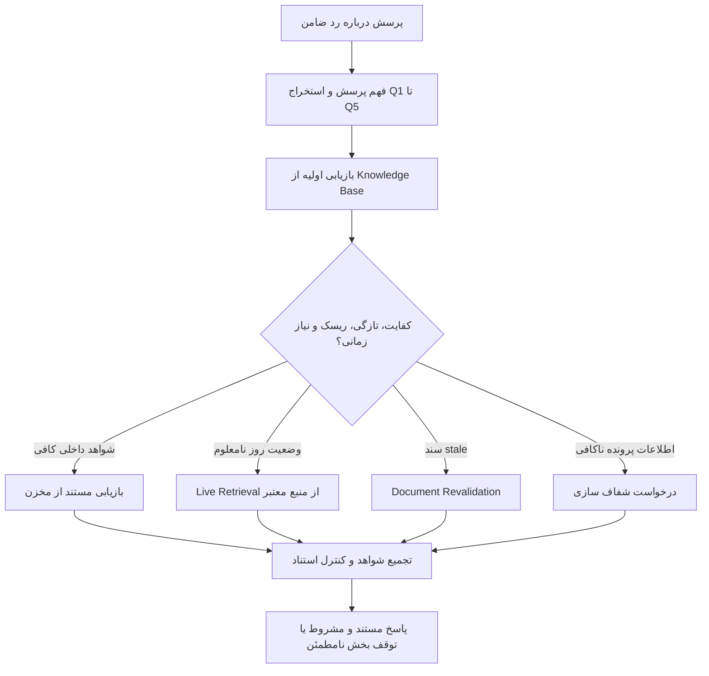

**هـ) نمونه خروجی منطقی Router (غیرمصوب و صرفاً توضیحی)**

```json
{
  "domain": "loans",
  "intent": "guarantor_rejection_regulatory_guidance",
  "entities": {
    "bank": "Bank Melli Iran",
    "product": "Mehrabani",
    "subject": "guarantor"
  },
  "risk_level": "high",
  "retrieval_plan": [
    {"question": "Q1", "action": "live_verify", "reason": "Current product terms require verification"},
    {"question": "Q2", "action": "revalidate_document", "document_id": "D-103", "reason": "Document marked stale"},
    {"question": "Q3", "action": "retrieve_internal", "document_id": "D-102", "reason": "Relevant general evidence available"},
    {"question": "Q4", "action": "live_retrieve", "reason": "Possible regulatory changes"},
    {"question": "Q5", "action": "request_clarification", "reason": "Actual rejection reason is unknown"}
  ],
  "decision": "hybrid_retrieval",
  "requires_current_verification": true
}
```

این خروجی فقط نشان می‌دهد **تصمیم مسیریابی و دلیل آن باید قابل‌ردیابی باشند**؛ تعیین ساختار داده، سطح جزئیات ثبت و قرارداد API به طراحی و تصمیم‌گیری بعدی وابسته است.

**و) دو نتیجه ممکن بازیابی زنده**

- **بازیابی موفق:** منشأ، نسخه، تاریخ مشاهده و شواهد به دست آمده ثبت می‌شوند؛ تعارض‌های احتمالی بررسی می‌شوند؛ پاسخ فقط در محدوده شواهد کافی تولید می‌شود. حتی در این حالت، بدون اطلاعات پرونده نمی‌توان علت قطعی رد ضامن را تعیین کرد.
- **بازیابی ناموفق:** سیستم نباید ادعا کند که وضعیت روز را تأیید کرده است. در صورت مجازبودن از نظر ریسک، اطلاعات تاریخی با ذکر تاریخ و محدودیت عرضه می‌شوند؛ در غیر این صورت پاسخ بخش پرریسک متوقف یا به پیگیری از مرجع رسمی ارجاع می‌شود.

**ز) مرزبندی مسئولیت‌ها:** `Query Understanding` نیازهای اطلاعاتی را استخراج می‌کند؛ `Retrieval Router` مسیر و دلیل انتخاب را تعیین می‌کند؛ `Knowledge Base` شواهد داخلی را فراهم می‌کند؛ `DDI` ورود دانش جدیدِ مبتنی بر تقاضا را مدیریت می‌کند؛ `DRS` بازاعتبارسنجی اسناد شناخته‌شده را انجام می‌دهد؛ `Source Discovery / RDE` به کشف انتشارهای جدید و روابط احتمالی کمک می‌کنند؛ و `Answer Generation & Citation Guard` پاسخ مستند و محدودیت ادعاها را کنترل می‌کند. این مثال به‌معنای واگذاری همه این مسئولیت‌ها به Router نیست.

##### 3.1.2 چالش معماری باز — سطح تصمیم‌گیری Retrieval Router

مثال بالا یک مسئله **نیازمند بررسی و تصمیم‌گیری** را آشکار می‌کند: Router باید برای *کل پرسش* یک مسیر انتخاب کند یا بتواند برای *هر پرسش فرعی* مسیر مستقلی تعیین کند؟

| گزینه | تعریف | مزیت بالقوه | هزینه و ریسک بالقوه |
|---|---|---|---|
| **A — مسیریابی در سطح کل پرسش** | کل پرسش عمدتاً از مخزن یا مسیر زنده پاسخ داده شود | سادگی هماهنگی و اجرا | بازیابی زائد، یا نادیده‌گرفتن تفاوت تازگی و کفایت میان بخش‌های پرسش |
| **B — مسیریابی در سطح پرسش‌های فرعی** | هر نیاز اطلاعاتی مسیر جداگانه داشته باشد و شواهد در انتها تجمیع شوند | تناسب بیشتر شواهد با هر ادعا؛ استفاده انتخابی از بازیابی زنده | پیچیدگی هماهنگی، هزینه، تأخیر، رفع تعارض و ردیابی استناد |

در سناریوی ضامن، گزینه B از نظر مفهومی انعطاف بیشتری نشان می‌دهد، اما **این مشاهده به‌معنای تصویب آن نیست**. برای تصمیم باید حداقل دقت و پوشش پاسخ، هزینه و تأخیر، نرخ بازیابی زنده، رفتار در تعارض اسناد، قابلیت ممیزی و امکان اجرای مرحله‌ای هر دو گزینه ارزیابی شود. همچنین باید مشخص شود آیا راهکار ترکیبی/تطبیقی قابل توجیه است یا نه.

**وضعیت تصمیم:** `OPEN — نیازمند ارزیابی در بازبینی فصل اول`؛ بدون تغییر در معماری مصوب، بدون تعریف تسک اجرایی و بدون تبدیل مثال به الزام پیاده‌سازی.

#### 3.2 Demand-Driven Ingestion (DDI)

**محرک:** پرسش کاربر که مخزن نتواند با شواهد کافی پاسخ دهد.  
**وظیفه:** اجرای جست‌وجوی زنده در منبع رسمی از طریق ابزارهای ارائه‌شده به Agent، دریافت اسناد مرتبط، استخراج و نرمال‌سازی متن، حذف تکرار، ثبت منشأ و نسخه، بخش‌بندی و نمایه‌سازی.  
**خروجی:** سند نسخه‌دار و قابل بازیابی در Knowledge Base.

پروتکل MCP **لایه رابط ابزار** است، نه موتور جست‌وجو یا خزنده. ابزار پشت MCP ممکن است از API، HTTP یا اتوماسیون مرورگر استفاده کند؛ امکان واقعی آن باید برای هر سایت آزموده شود.

**الزام تکمیلی دسترسی غیرمستقیم:** در نبود API رسمی/مستقیم، Source Access Layer باید امکان ارزیابی و استفاده از **API غیرمستقیم (Indirect/Unofficial API)** را نیز داشته باشد؛ مانند endpointهای مورد استفاده رابط وب یا اپلیکیشن، یا APIهای واسطی که یک ارائه‌دهنده ثالث با مجوز معتبر عرضه می‌کند. این مسیر در کنار MCP، خزشگر/استخراج‌گر، HTTP و اتوماسیون مرورگر قرار می‌گیرد و **صرفاً پس از بررسی مجوز استفاده، احراز هویت، پایداری، امنیت، محدودیت نرخ و حقوق داده** قابل فعال‌سازی است. نمونه مورد اشاره برای مطالعه الگو: `MCPFARSI.IR`؛ ذکر نام آن به معنای تأیید فنی، حقوقی یا امنیتی سرویس نیست.

MCP می‌تواند ابزارهای نوع‌دار و اختصاصی برای هر منبع منتشر کند؛ از جمله `search_website`، `get_product_details`، `check_order_status` و در دامنه اجرایی مجاز `submit_order`. پیاده‌سازی پشت ابزار می‌تواند API مستقیم، API غیرمستقیم مجاز، خزشگر/Browser یا ترکیبی از آن‌ها باشد؛ **MCP خود API غیرمستقیم تولید نمی‌کند**. ابزارهای نوشتنی/تراکنشی از ابزارهای فقط‌خواندنی جدا هستند و به مجوز صریح کاربر، کنترل دامنه و دسترسی، تأیید قبل از اقدام حساس، کلید یکتای جلوگیری از ثبت تکراری، ثبت نتیجه و امکان توقف امن نیاز دارند. فقدان API مستقیم نباید به‌تنهایی مانع بررسی مسیرهای جایگزین شود؛ اما فقدان مجوز معتبر یا قابلیت فنی، استفاده از آن مسیر را متوقف می‌کند.

#### 3.3 Source Discovery & Metadata Catalog

**محرک:** اجرای دوره‌ای، مثلاً هر ۲۴ ساعت *به‌عنوان مقدار پیشنهادی اولیه، نه تعهد نهایی*.  
**وظیفه:** بررسی فهرست انتشارهای جدید یا تغییرات قابل مشاهده در منابع، دریافت فراداده سبک مانند شناسه، عنوان، نوع، مرجع صادرکننده، تاریخ، لینک، کلیدواژه و ارجاعات صریح در صورت وجود.  
**خروجی:** رکوردهای جدید یا تغییرکرده در `Source Catalog`، بدون الزام به دریافت متن کامل.

این لایه با **Document Revalidation** متفاوت است: Source Discovery دامنه انتشارهای جدید را می‌بیند؛ Revalidation فقط اسناد شناخته‌شده مخزن را بررسی می‌کند. اگر سایت فهرست قابل اتکایی نداشته باشد، پوشش این لایه محدود یا هزینه‌بر خواهد بود.

#### 3.4 Relationship Discovery Engine (RDE)

**محرک:** ورود فراداده سند جدید به Catalog یا کشف تغییر مرتبط.  
**وظیفه:** یافتن اسناد موجود که ممکن است با سند جدید ارتباط موضوعی یا حقوقی داشته باشند.

**مراحل:**

1. **تطبیق قطعی/ساختاری:** شناسه رسمی، شماره مصوبه، تاریخ، ارجاع صریح، مرجع صادرکننده و قالب عنوان.
2. **بازیابی واژگانی:** نرمال‌سازی فارسی، مترادف‌ها، BM25 / full-text search و کلیدواژه‌ها.
3. **بازیابی معنایی:** Embedding عنوان و فراداده و مقایسه با عنوان، خلاصه و نمایه اسناد مخزن.
4. **طبقه‌بندی موضوعی:** استفاده از واژگان کنترل‌شده / Ontology سبک حوزه بانکی؛ مانند ضمانت، تضامین، اعتبارسنجی و تسهیلات خرد.
5. **رتبه‌بندی نامزدها:** ترکیب شواهد ساختاری، واژگانی و معنایی و در صورت نیاز Reranker/LLM.
6. **تأیید رابطه:** برای نامزدهای منتخب، دریافت متن کامل سند جدید و استخراج شواهد صریح یا ضمنیِ قابل ارزیابی؛ تمایز «موضوع مشابه» از «اثر حقوقی».

**اصل محدودکننده:** عنوان مشابه فقط `candidate_relation` ایجاد می‌کند. روابطی مانند `AMENDS` یا `REPEALS` باید با شواهد متن و کنترل مناسب ثبت شوند. در صورت ابهام، وضعیت `needs_review` حفظ می‌شود.

#### 3.5 Selective Document Ingestion

**محرک:** نامزد ارتباطی دارای شواهد کافی، ارجاع صریح، یا ریسک بالقوه بالا.  
**وظیفه:** دریافت فقط متن کامل اسناد منتخب؛ استخراج بندها و ارجاعات؛ سنجش رابطه با سند موجود؛ ذخیره سند در صورت تأیید نیاز عملیاتی.  
**خروجی:** سند کامل، شواهد رابطه، یا پرونده بررسی ناموفق/نامطمئن.

برای جلوگیری از انباشت بی‌رویه، اسناد صرفاً «موضوعاً مشابه» لزوماً وارد مخزن کامل نمی‌شوند؛ ممکن است فقط فراداده و نتیجه بررسی آن‌ها در Catalog باقی بماند.

#### 3.6 Document Revalidation Service (DRS)

**محرک:** زمان‌بندی بازبینی اسناد موجود، تغییر شناخته‌شده در همان سند، یا ارجاع حقوقی مؤثرِ تأییدشده/محتمل.  
**وظیفه:** مراجعه به مرجع سند ذخیره‌شده، مقایسه نسخه و متن، ثبت تغییرات و انتشار نسخه جدید پس از کنترل کیفیت.  
**خروجی:** وضعیت `current_as_checked`، `stale`، `changed_pending_validation` یا `verification_failed` همراه با زمان و شواهد.

این سرویس **نمی‌تواند به‌تنهایی** سند جدید ناشناخته‌ای را کشف کند که بدون تغییر متن سند قبلی، اثر حقوقی بر آن گذاشته است. همین خلأ انگیزه افزودن Source Discovery و RDE است.

#### 3.7 Knowledge Base, Catalog & Relationship Store

- **Knowledge Base:** متن کامل، بخش‌ها، نسخه‌ها، نمایه واژگانی/برداری و شواهد منبع.
- **Source Catalog:** فهرست سبک اسناد کشف‌شده، حتی اگر متن کاملشان ذخیره نشده باشد.
- **Relationship Store:** یال‌های بین اسناد، نوع رابطه، شواهد، درجه اطمینان و وضعیت بررسی.
- **Event / Audit Log:** ثبت رویداد کشف، جست‌وجو، دانلود، تغییر، تأیید و انتشار پاسخ.

برای V0.1، PostgreSQL به همراه full-text search و `pgvector` یک گزینه اولیه قابل ارزیابی است. روابط را می‌توان در جدول رابطه‌ای نگهداری کرد؛ **Neo4j الزامی نیست**. انتخاب قطعی پس از ارزیابی حجم، عملکرد و نیازهای پرس‌وجوی گرافی انجام می‌شود.

#### 3.8 Answer Generation & Citation Guard

پاسخ باید از شواهد بازیابی‌شده تولید شود و در صورت امکان عنوان، شناسه، منبع، تاریخ/نسخه و بندهای مرتبط را ذکر کند. وضعیت «آخرین نسخه مشاهده‌شده» با «تمام آثار حقوقی بررسی‌شده» یکسان نیست. در تعارض یا ابهام، سیستم باید عدم قطعیت را آشکار کند.

### 3.9 معماری مصوب تکمیلی و نگاشت تصمیم‌های ۴۰گانه (V0.8)

> **سطح تصویب:** گزینه‌های معماری زیر در سطح اصل و جهت طراحی تأیید شده‌اند. این تصویب، انتخاب قطعی فناوری، آستانه، زمان‌بندی، ایجاد Task/PR یا استقرار را شامل نمی‌شود. بندهای 3.1 تا 3.8 همچنان مبنای مفهومی هستند؛ در تعارض احتمالی، قیود دقیق‌تر این بخش ملاک بازنگری طراحی‌اند.

#### 3.9.1 دفتر تصمیم‌های معماری (Architecture Decision Register)

##### ADR-RAG-01 — کنترل پذیرش خدمت و مسیریابی تطبیقی
**تصمیم تأییدشده:** پیش از تحلیل بازیابی، Service Scope & Admission Control باید ارتباط درخواست با خدمات مالی/حقوقی قابل ارائه را بر اساس کاتالوگ خدمت بسنجد؛ پرسش عمومی نامرتبط رد/به دامنه قابل پشتیبانی هدایت شود، اما توضیح مفاهیم در متن یک خدمت مجاز است. Router برای درخواست ساده مسیر مستقیم و برای درخواست پیچیده تجزیه به زیرپرسش، مسیرهای ترکیبی و تجمیع شواهد را انتخاب کند.
**مرز و قید:** رد درخواست خارج از دامنه نباید با فقدان شواهد در درخواست داخل دامنه اشتباه شود؛ تصمیم و علت مسیریابی ثبت گردد.
**مالکیت منطقی:** Admission Gate، Query Understanding، Retrieval Router.

##### ADR-RAG-02 — بازیابی زنده ریسک‌محور
**تصمیم تأییدشده:** Live Retrieval تابع ریسک اعتبار حقوقی، حساسیت تصمیم، تغییر مقررات، تعارض، تازگی، دامنه بانک/محصول، سطح شواهد و هشدارهای SCM باشد؛ صرف وجود نتیجه در کش داخلی برای پاسخ قطعی کافی نیست.
**مرز و قید:** وزن‌ها و آستانه‌های ریسک پس از آزمون تعیین می‌شوند؛ معیار واحد شباهت برداری کافی نیست.
**مالکیت منطقی:** Risk Policy، Retrieval Router.

##### ADR-RAG-03 — PostgreSQL-first و آمادگی گراف
**تصمیم تأییدشده:** دانش، شناسه‌های پایدار، روابط و تاریخچه در معماری سازگار با PostgreSQL موجود مدل شود؛ مدل رابطه‌ای و پیوندهای گراف‌پذیر مبنای اولیه‌اند و پایگاه گراف مستقل تنها با آزمون سود/هزینه و نیاز واقعی قابل انتخاب است.
**مرز و قید:** تصمیم به معنای ممنوعیت دائمی Neo4j یا الزام به نصب آن نیست.
**مالکیت منطقی:** Knowledge Store، Relation Store.

##### ADR-RAG-04 — لایه دسترسی ترکیبی و قرارداد مشترک منابع
**تصمیم تأییدشده (تکمیل‌شده):** Source Access Layer واسط واحد MCP، **API مستقیم و API غیرمستقیم مجاز** (از جمله endpointهای قابل‌استفاده رابط وب/اپ و API واسط ثالث)، HTTP، Browser/Crawler مجاز و Adapter ویژه منبع باشد؛ خروجی نرمال شامل هویت/نشانی منبع، زمان، روش استخراج، وضعیت/خطا، متن یا فایل و منشأ داده باشد. برای ابزارهای عملیاتی، قرارداد نوع‌دار ورودی/خروجی، وضعیت اقدام، شناسه درخواست و شواهد نتیجه نیز لازم است.
**مرز و قید:** MCP پروتکل اتصال است، نه جایگزین دریافت واقعی داده؛ ابزارهای آن می‌توانند جست‌وجوی وب‌سایت، دریافت اطلاعات، استعلام و ـ در صورت احراز مجوز و کنترل‌های اجرایی ـ ثبت سفارش را از طریق API مستقیم/غیرمستقیم یا Browser پیاده کنند. API غیرمستقیم به معنای مجازبودن مهندسی معکوس، دورزدن احراز هویت، CAPTCHA، محدودیت دسترسی یا شرایط استفاده نیست. ابزارهای تراکنشی به سیاست فصل سوم وابسته‌اند و تصویب این قابلیت، تغییر خودکار ستون فقرات Computer Use نیست.
**مالکیت منطقی:** Source Access Layer.

##### ADR-RAG-05 — هماهنگی رویدادمحور DDI/SR/SCM
**تصمیم تأییدشده:** DDI مبتنی بر تقاضا، SR بازاعتبارسنجی دوره‌ای و SCM پایش تغییر منبع از طریق رویدادهای پایدار و وضعیت دانش مشترک هماهنگ شوند؛ کشف، تغییر، شکست و انتشار باید اثر قابل ردیابی داشته باشند.
**مرز و قید:** SR و SCM غالباً شبانه و هر چند روز یک‌بار اجرا می‌شوند؛ سازگاری بین اجراهای غیرهم‌زمان مهم‌تر از هم‌زمانی لحظه‌ای است.
**مالکیت منطقی:** Event/Job Coordination، Knowledge State.

##### ADR-RAG-06 — حل تعارض چندمعیاره حقوقی
**تصمیم تأییدشده:** تعارض ابتدا از تفاوت قلمرو، تاریخ اجرا، بانک/محصول و استثنا جدا شود؛ سپس سلسله‌مراتب مقررات، صلاحیت صادرکننده، اعتبار زمانی، اصالت و شواهد سنجیده شوند.
**مرز و قید:** تعارض حل‌نشده نباید به یک حکم قطعی مصنوعی تبدیل شود.
**مالکیت منطقی:** Legal Relation & Conflict Resolver.

##### ADR-RAG-07 — پاسخ‌گویی مبتنی بر کفایت شواهد
**تصمیم تأییدشده:** برای هر ادعا پوشش و کفایت شواهد ارزیابی شود؛ پاسخ جزئیِ مستند مجاز است، ادعای فاقد پشتوانه باید حذف/مشروط شود و در موارد لازم سؤال تکمیلی یا بازیابی هدفمند انجام گیرد.
**مرز و قید:** چند قطعه تکراری از یک منبع به‌عنوان تأیید مستقل شمرده نشوند.
**مالکیت منطقی:** Evidence Sufficiency، Answer Guard.

##### ADR-RAG-08 — اعتبار زمانی دوگانه
**تصمیم تأییدشده:** زمان اعتبار حقوقی/اجرایی (valid time) از زمان مشاهده و ثبت در شهاب (system/recorded time) تفکیک شود؛ پاسخ تاریخی از نسخه و دانش قابل دسترس در همان نقطه زمانی بازسازی‌پذیر باشد.
**مرز و قید:** مدل دو‌زمانه فقط بر موجودیت‌های نیازمند تاریخچه اعمال شود، نه اجباراً همه جدول‌ها.
**مالکیت منطقی:** Versioning، Temporal Knowledge.

##### ADR-RAG-09 — بازیابی شکست‌خورده و بازیابی ایمن
**تصمیم تأییدشده:** در شکست Live Retrieval، Retry محدود، روش جایگزین، منبع معتبر جایگزین و در شرایط مجاز نسخه ذخیره‌شده با اعلام محدودیت بررسی شوند؛ در نبود اطمینان، ادعای قطعی متوقف شود.
**مرز و قید:** Fallback نباید با کاهش خاموش کیفیت یا ادعای «تأیید امروز» همراه باشد.
**مالکیت منطقی:** Retrieval Recovery Policy.

##### ADR-RAG-10 — بودجه بازیابی و کاتالوگ خدمت پویا
**تصمیم تأییدشده:** بودجه زمان/هزینه/تعداد منبع متناسب با پیچیدگی و ریسک تخصیص یابد؛ مسیریابی از کاتالوگ خدمت استفاده کند و بازیابی عمومی جای منطق تخصصی هر خدمت را نگیرد.
**مرز و قید:** قراردادهای خدمت، موتورهای تخصصی و توصیه‌گر در فصل دوم/سوم تفصیل می‌یابند؛ بودجه نباید ایمنی را قربانی کند.
**مالکیت منطقی:** Budget Policy، Service Catalog Interface.

##### ADR-RAG-11 — ارزیابی چندلایه RAG
**تصمیم تأییدشده:** ارزیابی مستقل پوشش و رتبه‌بندی بازیابی، استخراج، روابط، مسیر، پاسخ، استناد، امتناع، اعتبار زمانی، امنیت، هزینه و پیامد خدمت انجام شود؛ داده آزمون شامل سناریوهای منفی و تغییر مقررات باشد.
**مرز و قید:** آستانه‌ها و بنچمارک واقعی هنوز تعیین نشده‌اند.
**مالکیت منطقی:** Evaluation Harness.

##### ADR-RAG-12 — چرخه عمر وابسته دانش
**تصمیم تأییدشده:** وابستگی سند خام به نسخه استخراج، قطعه، Embedding، ایندکس، رابطه، کاتالوگ، قاعده و پاسخ قابل ردیابی باشد؛ تغییر منبع فقط مشتقات متأثر را بازاعتبارسنجی/بی‌اعتبار کند.
**مرز و قید:** تاریخچه برای ممیزی حفظ شود؛ حذف سراسری بی‌دلیل ممنوع.
**مالکیت منطقی:** Knowledge Lineage، Invalidation.

##### ADR-RAG-13 — امنیت چندلایه و مقابله با Prompt Injection
**تصمیم تأییدشده:** محتوای منابع خارجی داده غیرقابل اعتماد است؛ دستورهای داخل صفحه/PDF نباید اختیار ابزار یا سیاست را تغییر دهند؛ مجوز ابزار، دامنه دسترسی، جداسازی داده و کنترل خروجی اعمال شود.
**مرز و قید:** جزئیات اقدام ایجنت و Computer Use متعلق به فصل سوم است؛ لاگ‌ها فاقد داده حساس غیرضروری باشند.
**مالکیت منطقی:** Security Boundary، Tool Policy.

##### ADR-RAG-14 — ردیابی سرتاسری با رعایت حریم خصوصی
**تصمیم تأییدشده:** از پذیرش درخواست تا انتخاب مسیر، نسخه شواهد، محاسبه، تصمیم پاسخ و خطا شناسه ردیابی ساختاریافته وجود داشته باشد.
**مرز و قید:** Chain-of-thought یا داده شخصی غیرضروری ذخیره نشود؛ سیاست نگهداری و دسترسی لازم است.
**مالکیت منطقی:** Trace & Audit.

##### ADR-RAG-15 — تشخیص تغییر ساختار و کیفیت استخراج
**تصمیم تأییدشده:** تغییر قالب HTML/PDF، افت کیفیت OCR/Parsing، جابه‌جایی جدول/بند و ناسازگاری معنایی تشخیص داده شود؛ داده مشکوک قرنطینه یا برای بررسی علامت‌گذاری گردد.
**مرز و قید:** مقادیر غیرعادی لزوماً خطا نیستند؛ حذف خودکار داده بدون شاهد ممنوع.
**مالکیت منطقی:** Extraction QA، Schema Drift Monitor.

##### ADR-RAG-16 — پوشش ساختاری و شکاف‌یابی
**تصمیم تأییدشده:** برای هر خدمت، نیازهای شواهد و فیلدهای ضروری به‌صورت قرارداد قابل بررسی تعریف شود؛ شکاف‌ها منجر به بازیابی هدفمند یا پاسخ محدود شوند.
**مرز و قید:** فیلدهای تخصصی وام و سایر خدمات در فصل دوم تعیین می‌شوند؛ داده چند محصول نباید ادغام اشتباه شود.
**مالکیت منطقی:** Coverage Checker، Service Evidence Contract.

##### ADR-RAG-17 — کش چندلایه آگاه از اعتبار
**تصمیم تأییدشده:** کش در لایه دریافت منبع، استخراج، بازیابی، شواهد و پاسخ بر اساس نسخه، اعتبار زمانی، هشدار تغییر، خدمت و مرز کاربر مدیریت شود.
**مرز و قید:** پاسخ شخصی نباید در کش عمومی نشت کند؛ TTL واحد برای همه ادعاها کافی نیست.
**مالکیت منطقی:** Cache & Invalidation.

##### ADR-RAG-18 — ارجاع به پشتیبانی در موارد نیازمند کارشناس
**تصمیم تأییدشده:** در ریسک یا ابهام حقوقی، سامانه محدودیت را اعلام و به کاربر پیشنهاد تماس با پشتیبانی شهاب برای بررسی کارشناسی بدهد.
**مرز و قید:** در وضعیت فعلی تیم کارشناسی داخلی یا ایجاد خودکار پرونده/ارجاع تضمین یا فرض نمی‌شود.
**مالکیت منطقی:** Answer UX، Support Referral.

##### ADR-RAG-19 — انتشار نسخه‌دار و بازگشت‌پذیر
**تصمیم تأییدشده:** تغییر مدل، Prompt، تنظیمات بازیابی و قواعد باید نسخه‌دار، آزموده، قابل انتشار محدود و قابل Rollback باشد.
**مرز و قید:** Rollback نرم‌افزار نباید مقررات منسوخ را به‌عنوان قانون جاری احیا کند.
**مالکیت منطقی:** Release Governance.

##### ADR-RAG-20 — حاکمیت انتشار دانش با وضعیت‌های تفکیکی
**تصمیم تأییدشده:** دانش معتبرِ منتشرشده، داده مشکوک/نامعتبر و محتوای «نیازمند تأیید کارشناسی» از هم تفکیک شوند؛ محتوای دسته سوم می‌تواند با برچسب روشن به کاربر نمایش داده شود.
**مرز و قید:** داده نیازمند تأیید نباید مبنای محاسبه، توصیه قطعی یا ادعای حقوقی تأییدشده قرار گیرد؛ ارجاع خودکار به کارشناس ایجاد نشود.
**مالکیت منطقی:** Knowledge Publication Policy.

##### ADR-RAG-21 — کنترل بار و Backpressure
**تصمیم تأییدشده:** برای درخواست‌های تعاملی و کارهای شبانه صف، محدودیت هم‌زمانی، اولویت، Rate Limit و سهمیه منبع/کاربر/نشست تعریف شود.
**مرز و قید:** Worker و Queue می‌توانند در مونولیت ماژولار باشند؛ میکروسرویس اجباری نیست.
**مالکیت منطقی:** Workload Control.

##### ADR-RAG-22 — اجرای پایدار و Idempotent گردش‌کار
**تصمیم تأییدشده:** Jobها دارای شناسه، وضعیت پایدار، Retry ایمن، قفل/نسخه‌سنجی و نقطه انتشار کنترل‌شده باشند تا اجرای مجدد داده تکراری یا انتشار نیمه‌تمام ایجاد نکند.
**مرز و قید:** سازگاری DB، ایندکس و Snapshot باید آزمون شود؛ معماری توزیع‌شده الزامی نیست.
**مالکیت منطقی:** Durable Jobs، Publishing Coordinator.

##### ADR-RAG-23 — اعتماد چندبعدی به منبع در سطح ادعا
**تصمیم تأییدشده:** اعتبار مرجع، اصالت، تازگی، کیفیت استخراج، پوشش ادعا، دسترس‌پذیری و سابقه اصلاح مستقل ارزیابی شوند.
**مرز و قید:** امتیاز دسترس‌پذیری بالا جای صلاحیت حقوقی ضعیف را نمی‌گیرد؛ یک عدد واحد نباید معیار قطعی باشد.
**مالکیت منطقی:** Source Trust Policy.

##### ADR-RAG-24 — چرخه عمر کنترل‌شده منابع
**تصمیم تأییدشده:** منبع از کشف، بررسی هویت و مجوز، فعال‌سازی، تعلیق تا بازنشستگی وضعیت و تاریخچه داشته باشد.
**مرز و قید:** کشف خودکار منبع به معنی تأیید خودکار آن نیست.
**مالکیت منطقی:** Source Registry & Governance.

##### ADR-RAG-25 — قرارداد داده کاننیکال نسخه‌دار
**تصمیم تأییدشده:** خروجی Source Access و داده‌های سند/بند/رابطه قرارداد نسخه‌دار با قواعد اعتبارسنجی، مهاجرت و سازگاری عقب‌رو داشته باشند.
**مرز و قید:** Schema عمومی در فصل اول؛ قراردادهای محصول/خدمت در فصل دوم.
**مالکیت منطقی:** Canonical Contracts.

##### ADR-RAG-26 — جداسازی دانش عمومی از زمینه کاربر
**تصمیم تأییدشده:** دانش عمومی حقوقی/مالی از داده شخصی، مجوزها، تاریخچه نشست و محاسبات شخصی در دسترسی، نگهداری، کش و ممیزی جدا شود.
**مرز و قید:** جداسازی منطقی مبناست؛ جداسازی فیزیکی فقط با توجیه ریسک؛ سیاست نگهداری پرسشنامه یک‌ساعته موجود خودسرانه تغییر نکند.
**مالکیت منطقی:** Data Boundaries.

##### ADR-RAG-27 — تحلیل اثر تغییر مقررات
**تصمیم تأییدشده:** تغییر معنایی مقرره به اسناد وابسته، قواعد محاسبه، شرایط خدمت، محصولات و توصیه‌گر مرتبط نگاشت شود؛ انتشار اثر تغییر کنترل‌شده باشد.
**مرز و قید:** تفسیر حقوقی مبهم نیازمند احتیاط و در صورت لزوم توصیه به بررسی کارشناسی است.
**مالکیت منطقی:** Regulatory Impact Analyzer.

##### ADR-RAG-28 — Snapshot سازگار و فعال‌سازی اتمیک
**تصمیم تأییدشده:** هر پاسخ/محاسبه به نسخه سازگار مقررات، کاتالوگ، قواعد و ایندکس اشاره کند؛ تغییرات پس از اعتبارسنجی به‌صورت اتمیک فعال شوند.
**مرز و قید:** نسخه‌های تاریخی حفظ شوند؛ فعال‌سازی یا Rollback نباید داده منسوخ را جاری جلوه دهد؛ تکثیر فیزیکی کامل الزام نیست.
**مالکیت منطقی:** Knowledge Snapshot Registry.

##### ADR-RAG-29 — حل هویت مستند موجودیت‌های مالی
**تصمیم تأییدشده:** شناسه پایدار بانک، طرح، محصول و نسخه از نام نمایشی و نام‌های مستعار جدا شود؛ ادغام فقط با شواهد صادرکننده، مشخصات و زمان معتبر انجام گیرد.
**مرز و قید:** شباهت نام طرح‌ها مجوز ادغام خودکار نیست.
**مالکیت منطقی:** Entity Resolution.

##### ADR-RAG-30 — مدل صریح دامنه شمول و وابستگی قواعد
**تصمیم تأییدشده:** قواعد حقوقی با مرجع، سلسله‌مراتب، شرایط شمول، استثنا، تاریخ و وابستگی به قواعد دیگر مدل شوند.
**مرز و قید:** شرایط اختصاصی بانک نمی‌تواند الزام بالادستی معتبر را بی‌اثر کند.
**مالکیت منطقی:** Rule Applicability Graph.

##### ADR-RAG-31 — انتشار عدم قطعیت مرحله‌ای
**تصمیم تأییدشده:** عدم قطعیت استخراج، هویت، اعتبار حقوقی، زمان، پوشش و استنتاج جداگانه حفظ و در تصمیم نهایی لحاظ شود.
**مرز و قید:** درصد اطمینان بدون کالیبراسیون و آزمون نباید نمایش داده شود.
**مالکیت منطقی:** Uncertainty Policy.

##### ADR-RAG-32 — محاسبه مالی قطعی و مستند
**تصمیم تأییدشده:** LLM در کشف/توضیح کمک می‌کند اما محاسبه اقساط، نرخ و سناریوهای مالی در ابزار قطعی، آزموده و نسخه‌دار با ورودی و قاعده قابل ردیابی اجرا شود؛ توصیه‌گر موجود بازاستفاده شود.
**مرز و قید:** محاسبه عددی، احراز شرایط دریافت و رتبه‌بندی پیشنهاد سه مسئله متمایزند.
**مالکیت منطقی:** Deterministic Calculation Adapter.

##### ADR-RAG-33 — زمینه گفت‌وگوی ساختاریافته و وضعیت بازیابی
**تصمیم تأییدشده:** داده تأییدشده کاربر، فرضیه‌های تأییدنشده، موضوع فعال، خدمت، موجودیت و نسخه شواهد در وضعیت نشست جدا شوند؛ تغییر بانک/محصول مستلزم بررسی مجدد شواهد است.
**مرز و قید:** زمینه موقت مکالمه معادل حافظه دائمی نیست؛ محدودیت نگهداری فعلی خودسرانه عوض نشود.
**مالکیت منطقی:** Conversation Context Manager.

##### ADR-RAG-34 — حاکمیت مجوز و شرایط استفاده منابع
**تصمیم تأییدشده:** پیش از دریافت/ذخیره/بازنشر، مجوز قانونی و شرایط استفاده، نرخ، احراز هویت، Attribution و حدود نگهداری هر منبع کنترل و در لایه دسترسی اعمال شود.
**مرز و قید:** قابلیت فنی دسترسی به معنی مجاز بودن آن نیست؛ ابهام حقوقی باید پیش از استفاده حل شود.
**مالکیت منطقی:** Source Usage Policy.

##### ADR-RAG-35 — تضمین تازگی متناسب با ریسک
**تصمیم تأییدشده:** اعتبار اجرایی مقرره، آخرین زمان بررسی و میزان اطمینان از نبود تغییر سه مفهوم مستقل‌اند؛ سیاست تازگی برای خدمت و نوع ادعا تنظیم شود.
**مرز و قید:** اگر بررسی روز لازم اما ممکن نیست، ادعای «قانون فعلی» نباید قطعی بیان شود.
**مالکیت منطقی:** Freshness Assurance.

##### ADR-RAG-36 — Failover تأییدشده و تاب‌آوری بازیابی
**تصمیم تأییدشده:** در اختلال روش دریافت، مسیر جایگزین و در اختلال منبع، فقط منبع هم‌صلاحیت و دارای پوشش/تازگی کافی جایگزین شود؛ زنجیره دلیل ثبت گردد.
**مرز و قید:** این تصمیم تکمیل‌کننده تصمیم ۹ است و نباید زیرسامانه موازی و تکراری بسازد.
**مالکیت منطقی:** Source Access Failover.

##### ADR-RAG-37 — اصالت شواهد و استناد در سطح ادعا
**تصمیم تأییدشده:** هر ادعای مؤثر مالی/حقوقی به بند/جدول دقیق، نسخه سند، مرجع، بازه اعتبار، Hash و شناسه پایدار مرتبط شود؛ رابطه «مستقیم/استنتاجی/متعارض» و پشتیبانی واقعی ادعا بررسی شود.
**مرز و قید:** ارتباط موضوعی معادل اثبات ادعا نیست؛ URL یا نسخه جدید نباید استناد تاریخی را بی‌صدا بازنویسی کند.
**مالکیت منطقی:** Claim Evidence Ledger، Citation Guard.

##### ADR-RAG-38 — حلقه کنترل‌شده بهبود کیفیت بازیابی
**تصمیم تأییدشده:** خطاها و بازخوردهای کاربر/ارزیاب به دسته‌های ریشه‌ای مانند فهم پرسش، Extraction، Chunking، Ranking، Routing و Citation تبدیل شوند؛ تغییر پیشنهادی با مجموعه آزمون نسخه‌دار و سنجش رگرسیون ارزیابی و سپس طبق تصمیم ۱۹ منتشر شود.
**مرز و قید:** بازخورد کاربر به‌تنهایی حقیقت حقوقی نیست؛ یادگیری از داده شخصی بدون مبنای مجاز/رضایت انجام نشود؛ این تصمیم مکمل ۱۱ و ۱۹ است.
**مالکیت منطقی:** Quality Feedback Loop.

##### ADR-RAG-39 — بازیابی پس از بحران و بازسازی دانش
**تصمیم تأییدشده:** از داده کاننیکال، نسخه خام/مجاز اسناد، روابط، پیکربندی منبع، سیاست مجوز، وضعیت انتشار و Snapshot پشتیبان معتبر نگهداری شود؛ ایندکس‌ها و Embeddingهای مشتق در صورت امکان به‌شکل بازتولیدپذیر بازسازی و بازیابی دوره‌ای آزمون شود.
**مرز و قید:** RPO/RTO و فناوری پشتیبان بعداً تعیین می‌شود؛ بازسازی از وب به‌تنهایی کافی نیست؛ نسخه قدیمی قانون نباید خودکار فعال شود.
**مالکیت منطقی:** Backup/Restore، Index Rebuild.

##### ADR-RAG-40 — تثبیت معماری و آمادگی پیاده‌سازی مرحله‌ای
**تصمیم تأییدشده:** ۴۰ تصمیم به اجزای مشخص، قراردادها، وابستگی‌ها، معیار پذیرش، ریسک و ترتیب اعتبارسنجی نگاشت شوند؛ حداقل هسته ایمن ابتدا و قابلیت‌های پیشرفته در گام‌های وابسته و آزمون‌پذیر اضافه شوند.
**مرز و قید:** تصویب اصول معماری مجوز اجرای یکجای ۴۰ قابلیت، تغییر کد، ایجاد تسک یا تصویب نقشه راه نیست؛ مونولیت ماژولار نقطه شروع پیشنهادی است.
**مالکیت منطقی:** Architecture Decision Baseline.

#### 3.9.2 زنجیره اجرایی یکپارچه و مرز ماژول‌ها

جریان مرجع: **Service Admission → Context/Intent → Risk & Budget Policy → Query Decomposition → Hybrid Retrieval (Knowledge Store / Live Source Access) → Extraction & Quality Gate → Entity/Temporal/Applicability Resolution → Coverage & Evidence Sufficiency → Deterministic Tool (در صورت نیاز) → Claim-Level Citation Guard → Response/Abstention → Privacy-aware Audit**. در مسیر دریافت، رویدادهای DDI/SR/SCM به Job پایدار، بررسی مجوز منبع، ثبت نسخه، Lineage، بازاعتبارسنجی و انتشار Snapshot سازگار متصل می‌شوند. هیچ مرحله‌ای حق ندارد به‌تنهایی محتوای مشکوک را به دانش قطعی تبدیل کند.

مرزهای پیشنهادی مونولیت ماژولار عبارت‌اند از: `service-admission`، `query-routing`، `source-access`، `ingestion-extraction`، `source-registry`، `knowledge-versioning`، `legal-relations`، `evidence-policy`، `calculation-adapters`، `answer-citation`، `job-orchestration`، `observability-evaluation` و `backup-recovery`. این‌ها **مرز منطقی** هستند، نه تعهد به سرویس یا دیتابیس مستقل.

#### 3.9.3 قراردادهای مشترک و حداقل فیلدهای الزامی

| قرارداد منطقی | حداقل محتوا | مصرف‌کننده/کنترل |
|---|---|---|
| `SourceAccessResult` | `source_id`, `source_uri`, `access_method`, `retrieved_at`, `status`, `error`, `content_hash`, `permission_policy_ref`, `raw_artifact_ref` | استخراج، ممیزی و کنترل مجوز؛ قالب واقعی نسخه‌دار |
| `DocumentIdentity/Version` | `document_id`, `version_id`, `issuer_id`, `published_at`, `valid_from/to`, `recorded_from/to`, `content_hash`, `status` | حل هویت، تاریخچه و اعتبار زمانی |
| `EvidenceUnit` | `evidence_id`, `version_id`, `section/table_ref`, `text_span`, `extraction_quality`, `source_trust_dimensions` | کفایت شواهد و استناد در سطح ادعا |
| `ClaimEvidenceLink` | `claim_id`, `evidence_id`, `support_type`, `entailment_status`, `verified_at`, `citation_snapshot_ref` | کنترل استناد و بازسازی پاسخ تاریخی |
| `KnowledgeSnapshot` | `snapshot_id`, `activated_at`, `document_set_version`, `rules_version`, `catalog_version`, `index_version`, `validation_status` | پاسخ/محاسبه سازگار و انتشار اتمیک |
| `RetrievalDecisionTrace` | `trace_id`, `admission_decision`, `route`, `risk_reasons`, `budget`, `evidence_ids`, `freshness_status`, `fallback_reason`, `response_policy` | ممیزی حداقلی و ارزیابی کیفیت |
| `SourceLifecyclePolicy` | `source_id`, `authority_scope`, `usage_rights`, `rate_limits`, `attribution`, `lifecycle_status`, `last_checked_at` | کنترل دسترسی، استفاده و اعتماد |
| `Job/Event` | `job_id`, `idempotency_key`, `event_type`, `entity_version`, `attempt`, `state`, `created_at` | DDI/SR/SCM و بازیابی ایمن |

فیلدها **قرارداد مفهومی** هستند؛ نام جداول، نوع داده، API، مهاجرت و نسخه‌بندی دقیق در طراحی تفصیلی مشخص می‌شوند. قرارداد خدمت و محصول در فصل دوم تکمیل می‌شود.

#### 3.9.4 سیاست انتشار، نمایش و تصمیم در وضعیت عدم قطعیت

| وضعیت شواهد/دانش | رفتار مجاز | رفتار ممنوع |
|---|---|---|
| معتبر، مرتبط، به‌روز در سطح ریسک و منتشرشده | پاسخ مستند با نسخه و محدوده اعتبار؛ محاسبه قطعی با ابزار آزموده | تعمیم به محصول/زمان دیگر بدون بررسی |
| ناقص اما دارای بخشی از شواهد معتبر | پاسخ جزئی، اعلام شکاف، سؤال تکمیلی یا بازیابی هدفمند | تکمیل حدسی بخش‌های فاقد شواهد |
| نیازمند تأیید کارشناسی | نمایش اختیاری با برچسب آشکار «نیازمند تأیید کارشناسی» و توصیه تماس با پشتیبانی شهاب | استفاده در حکم قطعی، محاسبه یا توصیه نهایی؛ ادعای تشکیل پرونده کارشناسی |
| تغییر کشف‌شده/منبع غیرقابل بررسی/تعارض حل‌نشده | کنترل زنده، محدودسازی ادعا یا امتناع متناسب با ریسک | ادعای جاری‌بودن قطعی یا مخفی‌کردن تعارض |
| نامعتبر یا خارج از قلمرو خدمت | عدم استفاده به‌عنوان مبنای پاسخ؛ توضیح محدودیت دامنه در صورت نیاز | انتشار به‌عنوان حقیقت معتبر |

#### 3.9.5 سازگاری زمانی، وابستگی‌ها و انتشار

هر تغییر مقرره ابتدا با ثبت نسخه و زمان مشاهده وارد فضای ارزیابی می‌شود، سپس هویت، دامنه شمول، روابط و اثر آن بر قواعد/محصولات تعیین می‌گردد. مشتقات متأثر در Lineage بازسازی یا علامت‌گذاری می‌شوند؛ پس از کنترل کیفیت، **Snapshot سازگار** به‌صورت اتمیک فعال می‌شود. پاسخ‌های قبلی باید به شواهد و Snapshot زمان خود متصل بمانند. بازگشت نرم‌افزار یا بازیابی پشتیبان به معنی احیای خودکار حکم منسوخ نیست.

#### 3.9.6 حداقل کنترل‌های کیفیت و پذیرش پیش از استقرار

آزمون‌های لازم شامل: پذیرش/رد دامنه خدمت، تفکیک پرسش ساده و چندمرحله‌ای، بازیابی فارسی و روابط مقرراتی، استخراج بند و جدول، تغییر ساختار منبع، تعارض و شمول حقوقی، نسخه/زمان، کفایت شواهد، انتساب ادعا به بند واقعی، حمله Prompt Injection، جداسازی داده شخصی، Failover مجاز، Idempotency، انتشار اتمیک، محاسبات مالی، Regression، Rollback و Restore است. معیارها و آستانه‌های عددی باید پس از Baseline واقعی و با تصویب مستقل تعیین شوند.

#### 3.9.7 توالی وابستگی برای طراحی و اعتبارسنجی (نه برنامه اجرایی مصوب)

1. **بنیاد کنترل و قرارداد:** پذیرش خدمت (۱)، مرز داده (۲۶)، حاکمیت منابع (۲۴ و ۳۴)، قراردادها (۲۵)، هویت (۲۹)، زمان (۸) و ردیابی (۱۴).
2. **دسترسی و دانش قابل اتکا:** لایه منبع (۴)، هماهنگی DDI/SR/SCM (۵)، کیفیت استخراج (۱۵)، Trust (۲۳)، انتشار دانش (۲۰)، Lineage (۱۲)، Snapshot (۲۸) و استناد ادعایی (۳۷).
3. **بازیابی و پاسخ ایمن:** مسیریابی (۱)، ریسک (۲)، بودجه/کاتالوگ (۱۰)، شکاف (۱۶)، شمول/تعارض (۶ و ۳۰)، عدم قطعیت (۳۱)، تازگی (۳۵)، کش (۱۷)، پاسخ (۷)، Fallback/Failover (۹ و ۳۶).
4. **عملیات و اتصال خدمت:** محاسبه قطعی (۳۲)، زمینه نشست (۳۳)، ارجاع پشتیبانی (۱۸)، صف (۲۱)، Job پایدار (۲۲)، امنیت (۱۳)، تحلیل اثر مقررات (۲۷) و پایگاه گراف‌پذیر (۳).
5. **تثبیت و بهبود:** ارزیابی (۱۱)، انتشار بازگشت‌پذیر (۱۹)، حلقه کیفیت (۳۸)، بازیابی بحران (۳۹) و دروازه آمادگی (۴۰).

این ترتیب وابستگی **فهرست تسک و تعهد تحویل نیست**؛ برخی کنترل‌های ایمنی باید از نخستین نمونه عملیاتی حاضر باشند و برخی قابلیت‌ها می‌توانند در همان مرز ماژول به‌تدریج کامل شوند.

#### 3.9.8 نقاط تصمیم بازِ اجرایی

فهرست باز باقی‌مانده: فهرست و مجوز منابع واقعی؛ معیار و آستانه Risk/Freshness؛ SLA و بودجه هر خدمت؛ الگوریتم و مدل فارسی؛ قالب فیزیکی ذخیره خام؛ ابزار صف و زمان‌بند؛ روش Snapshot اتمیک؛ طراحی Schema و Migration؛ مرز و TTL نشست و داده شخصی با حفظ سیاست فعلی؛ سازوکار نمایش برچسب تأیید کارشناسی؛ سنجه‌های ارزیابی و مجموعه آزمون؛ RPO/RTO و آزمایش Restore؛ حجم بار و هزینه؛ مراحل انتشار و مالکیت اجرایی. هیچ‌یک از این پارامترها با تأیید اصول ۴۰گانه خودبه‌خود تصویب نشده‌اند.

---


### 4. شماتیک کلان معماری

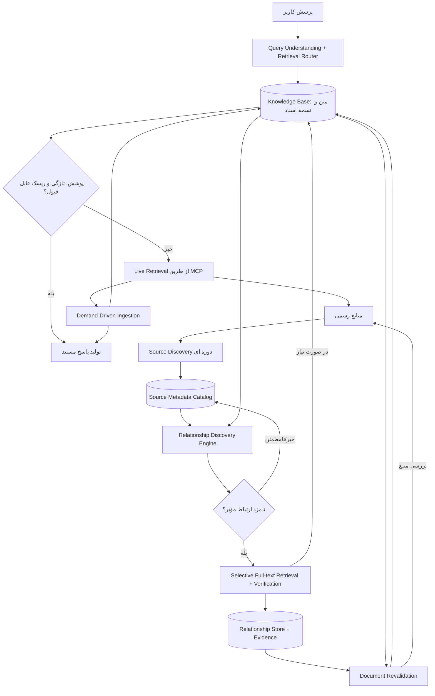

**توضیح مسیرها:** مسیر بالایی پاسخ‌گویی در لحظه و ورود دانش مبتنی بر تقاضاست؛ مسیر میانی کشف فراداده انتشارهای جدید و ارتباط احتمالی آن‌هاست؛ مسیر پایینی نگهداری و بازاعتبارسنجی اسناد موجود است. هیچ‌کدام از این مسیرها به‌تنهایی کشف کامل تمام روابط را تضمین نمی‌کند.

### 5. منطق تصمیم‌گیری برای اسناد جدید

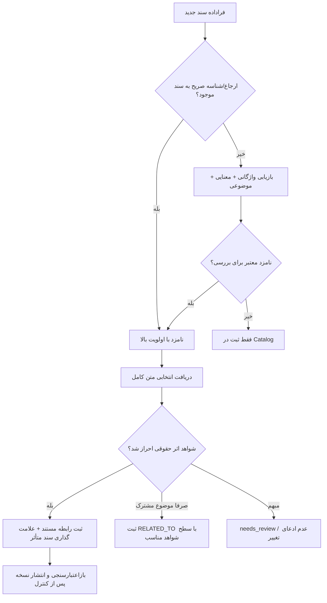

#### 5.1 نمونه قواعد تصمیم

| شواهد | اقدام | مجاز به ادعای اصلاح/نسخ؟ |
|---|---|---|
| ارجاع رسمی قابل تطبیق در فراداده | اولویت بالا برای دریافت متن و بررسی | خیر، پیش از بررسی نوع رابطه |
| عنوان مشابه + امتیاز معنایی بالا | ایجاد نامزد، دریافت انتخابی در صورت عبور از آستانه | خیر |
| متن جدید صریحاً ماده‌ای از سند قبلی را اصلاح می‌کند | ثبت `AMENDS` با ارجاع به بند و بررسی وضعیت نسخه | پس از کنترل شواهد |
| متن جدید فقط درباره همان موضوع است | رابطه `RELATED_TO` در صورت احراز | خیر |
| فراداده بسیار کلی و بدون سرنخ | باقی‌ماندن در Catalog یا بررسی نمونه‌ای/ریسک‌محور | خیر |

**آستانه‌ها در V0.1 عددگذاری نشده‌اند** و باید با داده برچسب‌خورده و ارزیابی Recall/Precision تعیین شوند.

### 6. مثال کامل و مرحله‌به‌مرحله (کاملاً فرضی)

#### 6.1 وضعیت اولیه

- **سند A / شماره ۱:** «آیین‌نامه شرایط پذیرش ضمانت در تسهیلات بانکی»؛ شناسه فرضی `REG-1001`، نسخه `v1`، ذخیره‌شده در Knowledge Base.
- **سند B / شماره ۲:** «اصلاح ضوابط اخذ تضامین در اعطای تسهیلات خرد»؛ شناسه فرضی `REG-2042`؛ ابتدا فقط در فهرست انتشارهای منبع ظاهر می‌شود.
- **رابطه واقعی فرضی:** ماده ۳ سند B بند ۲ سند A را اصلاح می‌کند. این رابطه در ابتدای فرایند برای شهاب ناشناخته است.

#### 6.2 روز اول: سؤال و ورود سند A

**پرسش کاربر:** «برای دریافت تسهیلات خرد چه نوع ضمانتی لازم است؟»

1. مسیریاب Router مخزن داخلی را جست‌وجو می‌کند؛ پوشش کافی ندارد.
2. بازیابی زنده Live Retrieval از طریق MCP به جست‌وجوی منبع رسمی متصل می‌شود (مشروط به قابلیت فنی سایت).
3. سند A بازیابی می‌شود. سامانه URL، شناسه، عنوان، تاریخ منبع، متن استخراج‌شده، زمان دریافت و هش محتوا را ثبت می‌کند.
4. متن به بخش‌های قابل استناد تقسیم و در نمایه واژگانی/برداری وارد می‌شود.
5. پاسخ فقط بر مبنای مفاد بازیابی‌شده، با استناد و توضیح محدودیت اعتبار تولید می‌شود.
6. سرویس DRS سند A را در برنامه بازبینی بعدی قرار می‌دهد.

**وضعیت پس از روز اول:**

| مخزن | محتوا |
|---|---|
| Knowledge Base | سند A، نسخه v1، متن کامل |
| Source Catalog | فراداده A، در صورت موجود بودن |
| Relationship Store | هنوز رابطه‌ای با B وجود ندارد |

#### 6.3 روز پنجم: کشف سند B بدون پرسش کاربر

1. سامانه Source Discovery فهرست انتشارهای منبع را بررسی می‌کند.
2. سند B را به‌عنوان انتشار جدید می‌بیند و فقط فراداده آن را ذخیره می‌کند: `REG-2042`، عنوان، تاریخ انتشار، مرجع صادرکننده و URL.
3. در این مرحله **متن کامل B هنوز در Knowledge Base وجود ندارد**.
4. موتور RDE عنوان و فراداده B را با اسناد موجود مقایسه می‌کند.
5. تطبیق واژگانی «ضمانت/تضامین» و «تسهیلات بانکی/تسهیلات خرد» نامزد A را پیشنهاد می‌کند؛ Embedding نیز ممکن است نزدیکی موضوعی نشان دهد.
6. این شواهد فقط برای **بررسی بیشتر** کافی‌اند؛ هنوز رابطه `AMENDS` اثبات نشده است.

#### 6.4 روز پنجم: بررسی انتخابی سند B

1. به‌دلیل ارتباط احتمالی با A، فرایند Selective Ingestion متن کامل B را دریافت می‌کند.
2. استخراج‌گر متن فرضاً عبارت زیر را در ماده ۳ پیدا می‌کند:

   > «بند (۲) ماده (...) آیین‌نامه شماره REG-1001 به شرح زیر اصلاح می‌شود ...»

   این نقل‌قول **ساختگی و صرفاً آموزشی** است، نه متن یک قانون واقعی.

3. سیستم شناسه `REG-1001` را با A تطبیق می‌دهد.
4. اعتبارسنج Relationship Verifier رابطه `B --AMENDS--> A` را همراه با بند استناد، URL و نسخه متن B ثبت می‌کند.
5. سند A به وضعیت `changed_pending_validation` یا «نیازمند ارزیابی اثر اصلاحیه» منتقل می‌شود.
6. سرویس DRS بررسی می‌کند کدام بندهای A تحت تأثیر قرار گرفته‌اند. **متن اصلی تاریخی A نباید بی‌ردپا بازنویسی شود**؛ نسخه و وضعیت حقوقی جدید باید به‌صورت جداگانه ثبت شوند.
7. پس از کنترل شواهد، نسخه قابل استنادِ وضعیت جاری یا مجموعه مقررات قابل اعمال منتشر می‌شود. اگر ارزیابی قطعی ممکن نباشد، وضعیت `needs_review` حفظ می‌شود.

**وضعیت پس از بررسی:**

| مخزن | محتوا |
|---|---|
| Knowledge Base | A/v1، B/نسخه دریافت‌شده، بخش‌ها و شواهد |
| Source Catalog | فراداده A و B |
| Relationship Store | `B --AMENDS--> A` با شاهد ماده ۳ و وضعیت بررسی |
| Audit Log | زمان کشف، علت انتخاب B، نتیجه تطبیق و زمان تأیید |

#### 6.5 روز ششم: سؤال مجدد کاربر

**پرسش:** «آیا هنوز همان ضمانت قبلی برای تسهیلات خرد پذیرفته می‌شود؟»

1. مسیریاب Router اسناد A و B و رابطه ثبت‌شده را بازیابی می‌کند.
2. وضعیت بازبینی و تاریخ شواهد را بررسی می‌کند.
3. اگر رابطه و وضعیت جاری احراز شده باشد، پاسخ تفاوت مقرره قبلی و اصلاحیه را با استناد توضیح می‌دهد.
4. اگر بررسی هنوز نهایی نشده باشد، **از ادعای قطعی درباره شرایط جاری خودداری می‌کند** و در صورت امکان کنترل زنده انجام می‌دهد.

#### 6.6 حالت شکست: عنوان مبهم

فرض کنیم عنوان B فقط «مصوبه جلسه شماره ۱۲» باشد و فراداده هیچ ارجاع یا کلیدواژه‌ای نداشته باشد. در این حالت ممکن است RDE نتواند B را به A مرتبط کند؛ سند فقط در Catalog باقی می‌ماند و اصلاحیه از دید شهاب پنهان می‌ماند. این **محدودیت ساختاری معماری کم‌هزینه** است. راهکارهای کاهنده خطر عبارت‌اند از: دریافت گزینشی خلاصه/چکیده در صورت وجود، بررسی نمونه‌ای انتشارهای مبهم، اولویت‌بندی منابع پرریسک و آزمون Recall؛ هیچ‌یک تضمین پوشش صددرصدی نیست.

### 7. مدل داده پیشنهادی اولیه

| موجودیت | فیلدهای کلیدی | هدف |
|---|---|---|
| `source_documents` | `source_id`, `external_id`, `title`, `url`, `issuer`, `published_at`, `discovered_at`, `metadata_json` | فهرست فراداده اسناد منتشرشده |
| `document_versions` | `document_id`, `version_id`, `content_hash`, `retrieved_at`, `verified_at`, `raw_text`, `status` | نسخه‌های کامل و قابل ردیابی |
| `document_chunks` | `version_id`, `section_ref`, `chunk_text`, `embedding` | بازیابی بخش‌های قابل استناد |
| `document_relations` | `source_document_id`, `target_document_id`, `relation_type`, `evidence_ref`, `confidence`, `review_status` | گراف روابط و شواهد |
| `discovery_events` | `source_id`, `external_id`, `event_type`, `observed_at`, `payload` | تاریخچه کشف انتشارها |
| `revalidation_jobs` | `document_id`, `reason`, `priority`, `state`, `last_attempt_at` | صف بازبینی و کنترل خطا |
| `retrieval_audit` | `query_id`, `route`, `evidence_ids`, `freshness_decision`, `created_at` | ردیابی تصمیم پاسخ |

**توجه:** این جدول‌ها طرح مفهومی‌اند، نه قرارداد نهایی دیتابیس. برای اسناد حقوقی، شناسه سند، شناسه نسخه و شناسه بند باید از یکدیگر تفکیک شوند.

**توسعه مدل داده بر اساس تصمیم‌های V0.8:** علاوه بر موجودیت‌های اولیه، در طراحی تفصیلی باید `source_registry/usage_policies`، `entity_aliases`، `rule_applicability`، `claim_evidence_links`، `knowledge_snapshots`، `dependency_lineage`، `job_events/idempotency_keys`، `quality_feedback_cases` و `recovery_manifests` نیز به‌عنوان موجودیت/قرارداد منطقی بررسی شوند. `document_versions` باید زمان حقوقی و زمان ثبت را تفکیک کند و `retrieval_audit` به نسخه Snapshot و شناسه ادعاها پیوند یابد. این نام‌ها الزام به ساخت جدول مستقل برای هر مورد نیستند.

### 8. وضعیت‌ها و سیاست‌های اطمینان

- `metadata_only`: سند فقط در Catalog وجود دارد.
- `candidate_relation`: ارتباط احتمالی کشف شده است.
- `needs_review`: شواهد برای اثر حقوقی قطعی کافی نیست.
- `current_as_checked`: نسخه یا منبع در زمان مشخص بررسی شده؛ **نه تضمین نبود همه اصلاحیه‌های بیرونی**.
- `stale`: زمان بازبینی از حد قابل قبول گذشته یا نشانه تغییر وجود دارد.
- `changed_pending_validation`: تغییر شناسایی شده ولی اثر آن هنوز تأیید نشده است.
- `verification_failed`: تلاش برای بررسی منبع موفق نبوده است.

در صورت تغییر کشف‌شده، انتشار پاسخ قطعی مبتنی بر نسخه قدیمی باید متناسب با ریسک مسدود یا مشروط شود. تاریخچه نسخه‌ها برای حسابرسی حفظ می‌شود.

**تکمیل سیاست انتشار V0.8:** وضعیت «نیازمند تأیید کارشناسی» به‌معنی ممنوعیت مطلق نمایش نیست: نمایش با برچسب صریح و توصیه تماس با پشتیبانی ممکن است، اما استناد قطعی، محاسبه و توصیه نهایی بر پایه آن مجاز نیست. وضعیت `current_as_checked` فقط آخرین مشاهده را بیان می‌کند و با «اطمینان از نبود تغییر» یکسان نیست.

### 9. اجزای فنی پیشنهادی (غیرقطعی)

- **Backend و پردازش:** Python، FastAPI، HTTPX و ابزار استخراج متناسب با قالب صفحات/فایل‌ها.
- **دسترسی منابع:** ابزارهای MCP با پیاده‌سازی API/HTTP/Browser Automation در صورت مجاز و عملی بودن.
- **Storage:** PostgreSQL، full-text search، pgvector، ذخیره‌سازی متن خام/فایل در صورت نیاز.
- **Jobs:** صف و زمان‌بند مانند Celery یا راهکار ساده‌تر متناسب با مقیاس.
- **NLP:** نرمال‌سازی فارسی، واژگان حوزه بانکداری، Embedding چندزبانه/فارسی، Reranker و LLM برای استخراج رابطه همراه با شواهد.
- **Observability:** لاگ ساختاریافته، آمار پوشش، تأخیر جست‌وجو، خطاهای منابع و هزینه پردازش.

انتخاب قطعی ابزارها باید با آزمون کیفیت فارسی، حجم داده و هزینه واقعی صورت گیرد.

### 10. معیارهای ارزیابی و پذیرش اولیه

| معیار | روش سنجش |
|---|---|
| Retrieval coverage | سهم پرسش‌هایی که شواهد کافی از مخزن دریافت می‌کنند |
| Live retrieval rate | سهم پرسش‌هایی که نیازمند مراجعه زنده‌اند |
| Relationship Recall@K | درصد روابط حقوقی شناخته‌شده که در نامزدهای Kتایی کشف می‌شوند |
| Relationship Precision | سهم روابط پیشنهادی/تأییدشده که واقعاً معتبرند |
| Legal-effect classification accuracy | تفکیک درست `RELATED_TO` از `AMENDS`، `REPEALS` و غیره |
| Discovery lag | فاصله انتشار واقعی تا مشاهده در Catalog |
| Revalidation lag | فاصله کشف تغییر تا تعیین وضعیت معتبر سند |
| Citation correctness | صحت انتساب پاسخ به بند و نسخه منبع |
| Source failure rate | درصد شکست دریافت/بررسی سایت‌های مرجع |
| Cost per resolved query | هزینه جست‌وجو، دریافت، نمایه‌سازی و پاسخ به ازای پرسش |

**پیش‌نیاز:** مجموعه آزمون دارای اسناد واقعی و روابط برچسب‌خورده توسط ارزیاب آشنا به مقررات، به‌ویژه نمونه‌های «عنوان مبهم»، «اصلاح غیرمستقیم» و «موضوع مشابه بدون اثر حقوقی». آستانه پذیرش باید پس از خط مبنا تعیین شود.

**گسترش ارزیابی V0.8:** افزون بر جدول فوق، سنجه‌های `claim entailment accuracy`، `abstention appropriateness`، `scope admission accuracy`، `temporal applicability accuracy`، `entity resolution error`، `snapshot consistency`، `source usage compliance`، `prompt injection resistance`، `failover validity`، `extraction drift detection`، `feedback regression rate` و `restore success` باید در طراحی Harness لحاظ شوند. مقادیر هدف تعیین نشده‌اند.

### 11. ریسک‌ها و اقدامات کاهنده

| ریسک | پیامد | کنترل پیشنهادی |
|---|---|---|
| نبود فهرست انتشار قابل اتکا در منبع | کشف ناقص اسناد جدید | آزمون فنی منبع؛ اعلام دامنه پوشش؛ روش جایگزین متناسب |
| عنوان/فراداده مبهم | از دست رفتن رابطه واقعی | بازیابی چندروشی، نمونه‌برداری و بررسی ریسک‌محور |
| تشابه موضوعی کاذب | ثبت رابطه حقوقی اشتباه | جداسازی نامزد از رابطه تأییدشده؛ الزام شواهد |
| اصلاحیه بدون تغییر سند اصلی | پاسخ بر اساس وضعیت منسوخ | Source Discovery + RDE؛ اعلام محدودیت پوشش |
| خطا در استخراج PDF/HTML | استناد نادرست | کنترل کیفیت متن، نگهداری نسخه خام و تطبیق بندها |
| تغییر ساختار سایت یا محدودیت دسترسی | توقف دریافت | پایش خطا، Retry محدود، سیاست احترام به سایت و fallback |
| حجم زیاد نامزدهای معنایی | افزایش هزینه | فیلتر مرحله‌ای، بودجه پردازش و صف اولویت‌دار |
| وابستگی بیش از حد به LLM | ادعای بی‌پشتوانه | استخراج شواهد، قواعد قطعی، بررسی انسانی موارد حساس |

### 12. مسیر اعتبارسنجی پیش از پیاده‌سازی گسترده

1. **آزمون منابع:** بررسی عملی صفحات جست‌وجو، فهرست انتشارها، شناسه‌ها، تاریخ‌ها، لینک‌ها، امکان بازیابی متن و سیاست‌های دسترسی `qavanin.ir` و منابع اولویت‌دار.
2. **نمونه داده:** گردآوری محدود اسناد واقعی با روابط حقوقی معلوم و نمونه‌های منفی.
3. **Baseline:** ساخت بازیابی واژگانی + تطبیق شناسه/ارجاع؛ اندازه‌گیری کیفیت.
4. **Semantic layer:** افزودن Embedding و در صورت لزوم Reranker؛ مقایسه با Baseline.
5. **Verification:** آزمون استخراج شواهد و طبقه‌بندی روابط با کنترل انسانی موارد مبهم.
6. **End-to-end pilot:** اجرای پرسش → مخزن → MCP → Ingestion و Discovery → RDE → Revalidation روی دامنه محدود.
7. **تصمیم توسعه:** تعیین آستانه‌ها، دوره‌های اجرا، بودجه و سطح پوشش قابل ادعا بر اساس نتایج آزمون.

### 13. تصمیم‌های باز و پارامترهای نیازمند تعیین

> **توضیح وضعیت V0.8:** ۴۰ انتخاب اصولی در بخش 3.9 تصویب شده‌اند. پرسش‌های زیر دیگر «باز بودن جهت معماری» نیستند؛ عمدتاً تعیین مصداق منبع، آستانه، قرارداد، ابزار و روش اعتبارسنجی‌اند و همچنان نیازمند بررسی و تصویب مستقل هستند.


1. منابع رسمی اولویت‌دار و دامنه مقررات فاز اول RAG کدام‌اند؟
2. آیا `qavanin.ir` فهرست تغییرات و فراداده قابل استخراج ارائه می‌کند؟
3. چه موضوعات و تصمیم‌هایی الزام به کنترل زنده دارند؟
4. فاصله مجاز بازاعتبارسنجی برای هر رده سند چقدر است؟
5. آستانه انتخاب اسناد برای دریافت کامل چگونه با Recall و هزینه تنظیم شود؟
6. چه سطحی از رابطه حقوقی را می‌توان خودکار ثبت کرد و کدام موارد بررسی انسانی می‌خواهند؟
7. چه سیاستی برای پاسخ هنگام عدم دسترسی به منابع اتخاذ می‌شود؟

### 14. جمع‌بندی تصمیم معماری فصل اول (مبنای ۰.۱ + تصمیم‌های V0.8)

معماری منتخب، **Demand-Driven Hybrid RAG with Lightweight Source Discovery, Selective Relationship Verification and Document Revalidation** است. ورود دانش جدید عمدتاً مبتنی بر تقاضاست؛ انتشارهای جدید ابتدا فقط در Catalog ثبت می‌شوند؛ موتور کشف روابط، نامزدهای مؤثر بر دانش موجود را با ترکیب شواهد ساختاری، واژگانی و معنایی شناسایی می‌کند؛ متن کامل صرفاً به‌صورت انتخابی دریافت می‌شود؛ و اسناد موجود مستقل از تقاضا بازاعتبارسنجی می‌شوند. این طراحی **پوشش کامل و تضمین کشف همه روابط حقوقی را ادعا نمی‌کند** و برای استقرار به آزمون واقعی منابع و ارزیابی کیفیت نیاز دارد. **تکمیل مصوب V0.8:** این معماری با دروازه پذیرش خدمت، بازیابی ریسک‌محور، قراردادهای نسخه‌دار، کنترل منشأ و مجوز، اعتبار دو‌زمانه، انتشار Snapshot سازگار، استناد در سطح ادعا، محاسبات قطعی، حفاظت از زمینه شخصی، بازخورد کنترل‌شده و بازیابی بحران تکمیل می‌شود. دفتر ۴۰ تصمیم و قیود هر یک در بخش 3.9 مرجع حاکم است.

---

## فصل دوم — معماری محصول، ایجنت‌ها و اجرای خدمات مالی

> **الحاق معماری مصوب A01 (۲۰۲۶-۱۱-۰۹):** مرز استقرار هدف سه واحد Core (مونولیت ماژولار)، Adviser (سرویس مستقل مشاور) و Assistant (سرویس مستقل دستیار) است. در RAG R1 تنها Core و Adviser مستقر می‌شوند؛ Assistant در این انتشار صرفاً قرارداد و مرز معماری دارد. نمودارهای منطقی این فصل به معنی یکسان‌بودن محل استقرار اجزا نیستند. جزئیات مالکیت داده و قراردادهای ارتباطی در A02 باز است.


> **الحاق سازگاری V0.8 با فصل نخست:** هر خدمت مالی باید در Service Catalog دامنه پذیرش، فیلدهای شواهد لازم، مرز اطلاعات عمومی/شخصی، شناسه پایدار بانک/محصول/نسخه، قواعد شمول، سیاست تازگی و اتصال به ابزار محاسبه قطعی را تعریف کند. کاتالوگ و قواعد فعال باید با Snapshot دانش حقوقی سازگار باشند؛ توصیه‌گر تسهیلات موجود بازاستفاده می‌شود. این الحاق تصویب جزئیات خدمت یا برنامه توسعه فصل دوم نیست؛ مرجع اصول RAG بخش 3.9 فصل نخست است.


> **وضعیت فصل:** پیشنویس طراحی و الحاقیه بحث‌های محصول و معماری؛ این فصل هنوز برنامه اجرای مصوب نیست. مواردی که «پیشنهادی» یا «باز» نامیده شده‌اند نباید تصمیم نهایی تلقی شوند. نمودارها معماری منطقی‌اند، نه نقشه استقرار قطعی.

### ۱. هدف و جایگاه فصل دوم

فصل نخست بر زیرساخت دانش حقوقی و مقرراتی، بازیابی مبتنی بر تقاضا، کشف منابع تازه و کشف روابط متمرکز بود. فصل دوم کاربرد آن دانش را در محصولی چنددامنه‌ای شرح می‌دهد که علاوه بر پاسخ‌گویی، می‌تواند خدمات مالی و بانکی را در محدوده مجوز مشتری اجرا و پیگیری کند.

دو نقش اصلی شهاب عبارت‌اند از **مشاور هوشمند**، برای پرسش‌وپاسخ و تحلیل شبیه حالت گفت‌وگو، و **دستیار هوشمند**، برای انجام و پیگیری کار شبیه حالت واگذاری کار. زیرساخت دانش مشترک است؛ ابزارهای مجاز، وضعیت عملیات و صورتحساب این دو نقش متفاوت‌اند.

اصول توافق‌شده: دامنه خدمات پلن‌های بالاتر شامل پلن‌های پایین‌تر است؛ قیمت یک خدمت در تمام پلن‌ها ثابت است؛ عضویت سالانه، هزینه خدمت و کیف پول مشاوره سه جریان مستقل مالی‌اند؛ پلن نقره‌ای فیدبک و پلن طلایی علاوه بر آن فیدفوروارد دارد؛ هیچ رمز بانکی ذخیره نمی‌شود؛ اقدامات مؤثر تابع مجوز مشتری‌اند؛ بازطراحی سوپراپ در اولویت انتهایی است.

### ۲. معماری مرجع یکپارچه

معماری در سه سطح تعریف می‌شود: **اصول** (دامنه‌محور، رویدادمحور، تفکیک مسئولیت‌ها و امنیت)، **مؤلفه‌های منطقی** (مسیریاب تجربه، هماهنگ‌کننده ایجنت، موتور گردش‌کار، موتورهای تحلیل و سرویس‌های مشترک) و **داده و زیرساخت** (PostgreSQL، Neo4j، اسناد، پردازش رویداد و نظارت).

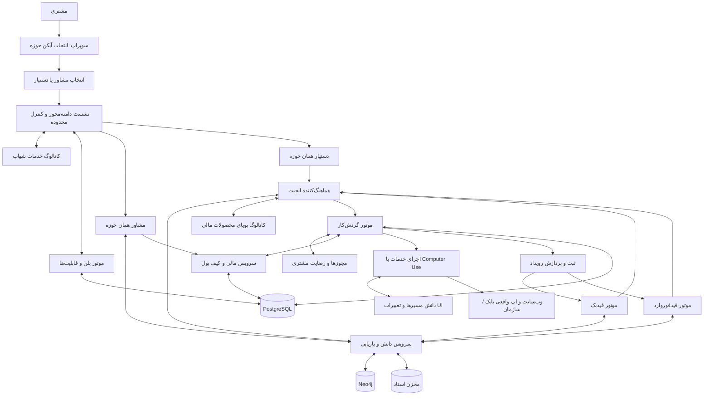

در این نمودار پیکان‌ها مسیرهای همکاری را نشان می‌دهند و به معنای اختیار اجرای پرداخت یا اقدام بانکی بدون کنترل مجوز نیستند. این مؤلفه‌ها الزاماً میکروسرویس‌های مستقل نیستند؛ مطابق A01، هویت، توصیه‌گر قطعی، کاتالوگ محصول، پلن و سیاست و مالی در ماژول‌های Core قرار می‌گیرند؛ دانش، بازیابی و گفت‌وگوی مشاوره‌ای در Adviser؛ و گردش‌کار اجرایی و Computer Use در Assistant آتی. نمودار جریان منطقی را نشان می‌دهد و استقرار Assistant در R1 را تجویز نمی‌کند.

### ۳. معماری دامنه‌محور

**معماری دامنه‌محور (Domain-Based Architecture)** مبنای سازمان‌دهی شهاب است. دامنه‌های کسب‌وکار شامل تسهیلات، مالیات، ضمانت‌نامه، اعتبارسنجی و خدمات ارزی هستند؛ این فهرست نمونه است و هنوز نهایی نشده است.

هر دامنه می‌تواند کاتالوگ خدمات، شرایط و مدارک، قواعد مقرراتی، گردش‌کارها، ابزارهای Computer Use و قواعد تحلیل اختصاصی داشته باشد. قابلیت‌های مشترک مانند عضویت، پرداخت، کیف پول، مجوز، دانش، رویداد و اجرای گردش‌کار نباید در هر دامنه دوباره ساخته شوند.

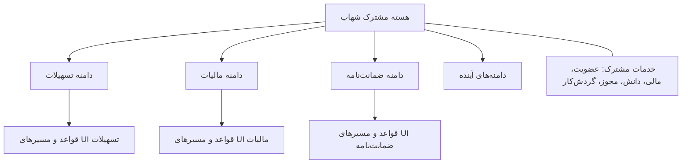

اصل جداسازی: دامنه‌ها از طریق قراردادهای سرویس و رویداد همکاری می‌کنند و نباید به جزئیات داخلی یکدیگر وابسته شوند.

### ۴. کاتالوگ خدمات و مسیریاب تجربه

**کاتالوگ خدمات و مسیریاب تجربه (Service Catalog & Experience Router)** حوزه‌ها، خدمات، وضعیت دسترسی و تعرفه را تعریف می‌کند. **حوزه از انتخاب آیکن سوپراپ و نقش از انتخاب مشاور/دستیار تعیین می‌شود؛ مدل زبانی حق تغییر خودکار حوزه نشست را ندارد.** این منطق باید در Backend قرار گیرد. کاتالوگ خدمات شهاب با کاتالوگ پویای محصولات و خدمات واقعی بانک‌ها متفاوت است (فصل سوم).

| مفهوم | نمونه | کاربرد |
|---|---|---|
| حوزه | تسهیلات | گروه‌بندی خدمات |
| خدمت | ثبت درخواست وام خرید کالا | واحد اجرای گردش‌کار و قیمت‌گذاری |
| تجربه | مشاور / دستیار | تعیین نوع تعامل |
| قابلیت | فیدفوروارد | رفتار وابسته به پلن |

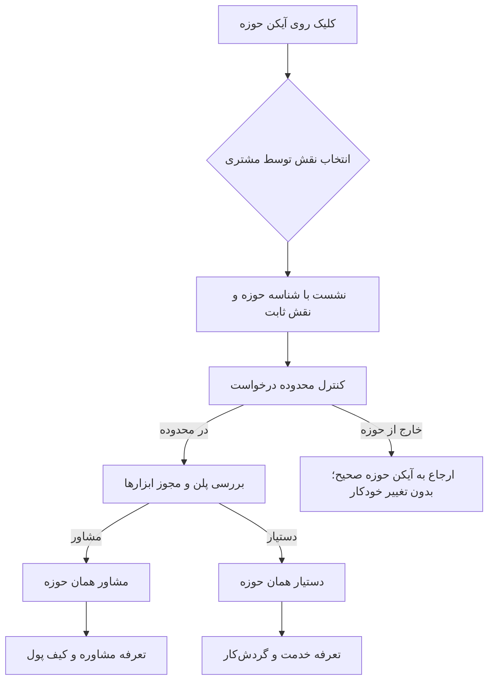

**قاعده مصوب محصول:** هیچ مشاور یا دستیاری نباید درخواست نامرتبط یا درخواست متعلق به حوزه دیگر را در همان نشست اجرا یا پاسخ تخصصی دهد؛ فقط راهنمایی برای مراجعه به آیکن حوزه درست مجاز است. اشاره به مفاهیم حوزه‌های دیگر در چارچوب هدف همان حوزه مجاز است. **موضوع باز مستقل:** میزان دسترسی به مشاوره *همان حوزه* در هر پلن چگونه است؟

### ۵. هماهنگ‌کننده ایجنت

**هماهنگ‌کننده ایجنت (Agent Orchestrator)** هدف مشتری و زمینه پرونده را دریافت می‌کند و فراخوانی ابزارهای مجاز، بازیابی دانش، تحلیل‌های فیدبک/فیدفوروارد و تعامل با مشتری را هماهنگ می‌سازد.

هماهنگ‌کننده درخواست را فقط در دامنه و نقش تثبیت‌شده نشست پردازش می‌کند؛ کنترل حوزه و فهرست ابزارهای مجاز در Backend اعمال می‌شود، نه فقط در پرامپت. هماهنگ‌کننده نباید مرجع نهایی قیمت، مجوز، نتیجه پرداخت یا وضعیت معتبر پرونده باشد. این اطلاعات از سرویس‌های تخصصی خوانده می‌شوند. مدل زبانی می‌تواند ابزار یا اقدام را پیشنهاد کند، اما عبور از کنترل‌های قطعی پیش از اجرا الزامی است.

### ۶. موتور گردش‌کار

**موتور گردش‌کار (Workflow Engine)** مسئول اجرای پایدار فرایند چندمرحله‌ای است: ایجاد پرونده، ثبت وضعیت، توقف و ادامه، انتظار برای مشتری، مدیریت خطا، تلاش مجدد، جلوگیری از تکرار اقدام، انقضا، لغو و حسابرسی.

**مرز مسئولیت:** هماهنگ‌کننده ایجنت انتخاب و هماهنگی هوشمند را انجام می‌دهد؛ موتور گردش‌کار وضعیت معتبر و اجرای قابل اتکا را مدیریت می‌کند. گردش‌کارها باید نسخه‌دار باشند تا تغییر فرایند، پرونده‌های جاری را بدون تصمیم مشخص مختل نکند.

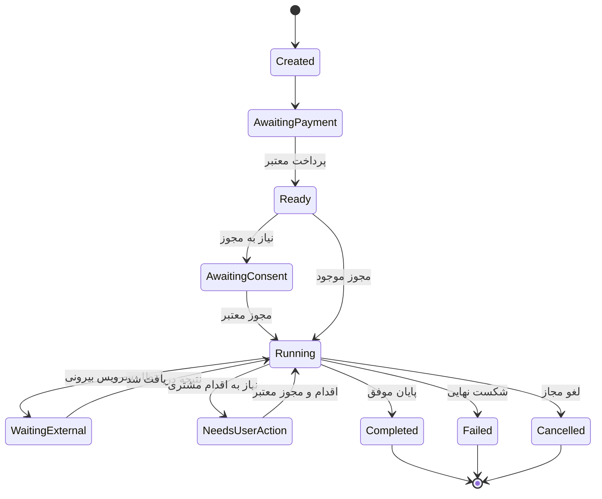

این وضعیت‌ها پیشنهادی هستند؛ نام‌گذاری و جزئیات انتقال باید در طراحی تفصیلی تثبیت شود.

### ۷. معماری ایجنت رویدادمحور

**ایجنت رویدادمحور (Event-Driven Agent)** فقط با پیام مستقیم مشتری فعال نمی‌شود. رویدادهایی مانند پاسخ اعتبارسنجی، خطای بانک، نقص مدرک، تغییر وضعیت، رسیدن به مرحله حساس یا انتشار مقرره مرتبط می‌توانند بررسی هوشمند را آغاز کنند.

رویداد ابتدا ثبت، اعتبارسنجی و از نظر پلن و مجوز ارزیابی می‌شود. **وقوع رویداد به‌تنهایی مجوز اجرای اقدام بانکی نیست.**

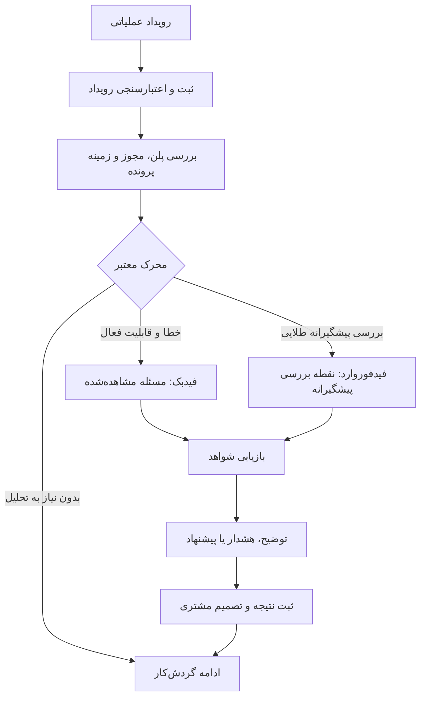

زیرساخت رویداد باید امکان پردازش مجدد امن، شناسه یکتا، جلوگیری از تکرار اثر، ترتیب موردنیاز و مشاهده‌پذیری داشته باشد. انتخاب فناوری صف یا پیام‌رسان هنوز باز است.

### ۸. فیدبک و فیدفوروارد

**فیدبک (Feedback)** در نقره‌ای و طلایی به مسئله‌ای واکنش نشان می‌دهد که واقعاً مشاهده شده است؛ مثلاً بانک مدرکی را رد کرده یا مرحله‌ای با خطا مواجه شده است. خروجی باید توضیح مستند و راهکار قابل اجرا باشد.

**فیدفوروارد (Feedforward)** مخصوص طلایی است و بدون نیاز به وقوع خطا، در نقاط مناسب فرایند ریسک آینده را بررسی می‌کند. مثلاً اعتبارسنجی ضامن موفق است، اما شواهد معتبر مربوط به همان بانک و خدمت احتمال مانع در مرحله بعد را نشان می‌دهند. سن بالای ۶۰ سال صرفاً یک مثال فرضی است و نباید بدون سند، شرط عمومی بانک‌ها فرض شود.

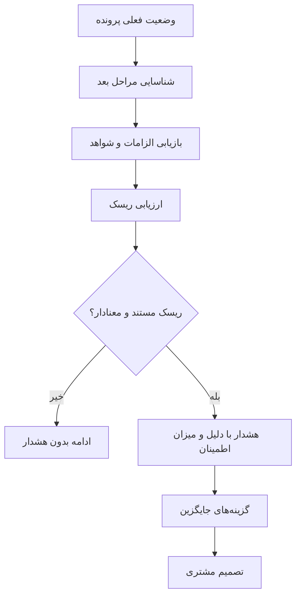

هشدارها باید میان مانع قطعی و ریسک احتمالی تمایز بگذارند، منبع و نسخه شواهد را نشان دهند و از ادعای احتمال عددی بدون داده معتبر خودداری کنند. کنترل هشدارهای تکراری و نادرست الزامی است.

### ۹. مدل محصول و سطوح عضویت

پلن‌ها دو بُعد را تعیین می‌کنند: **دامنه خدمات قابل اجرا** و **سطح هوشمندی دستیار**.

| قابلیت | برنزی | نقره‌ای | طلایی |
|---|---|---|---|
| اجرای خدمات مجاز | بله | بله | بله |
| مشاور مستقل | بله | بله | بله |
| مشاوره یکپارچه در عملیات | خیر | بله | بله |
| تحلیل خودکار مشکل رخ‌داده | خیر | بله | بله |
| هشدار پیشگیرانه | خیر | خیر | بله |
| پوشش خدمات | پایه | شامل برنزی و بیشتر | شامل هر دو و بدون محدودیت پلنی |

رابطه شمول دامنه خدمات: **برنزی ⊆ نقره‌ای ⊆ طلایی**. «بدون محدودیت پلنی» به معنای نبود محدودیت فنی، حقوقی یا قراردادی نیست.

موتور قابلیت‌ها (**Entitlement Engine**) باید داده‌محور باشد؛ تغییر ترکیب پلن‌ها نباید مستلزم بازنویسی هسته ایجنت شود.

### ۱۰. مدل تجاری و معماری مالی

سه جریان مستقل مالی وجود دارد:

۱. **حق عضویت سالانه** برای دسترسی به دامنه خدمات و سطح هوشمندی؛ قیمت‌های نمونه یک، دو و سه میلیون تومان هنوز فرضی‌اند.

۲. **تعرفه ثابت هر خدمت** مستقل از پلن؛ مثلاً ثبت درخواست وام برای تمام پلن‌ها ۵۰۰ هزار تومان، صرفاً به‌عنوان مثال. بخشی از آن هزینه APIهای ثالث را پوشش می‌دهد.

۳. **کیف پول مشاوره** با کسر هزینه به‌ازای هر پرامپت مشاور عمومی.

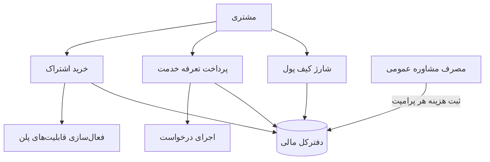

الزامات مالی شامل سفارش، رسید پرداخت، دفترکل تراکنش‌ها، مانده قابل تطبیق، جلوگیری از کسر تکراری، هزینه API ثالث، بازپرداخت و رسیدگی به مغایرت است.

**تصمیم باز:** آیا تعامل ضروری دستیار حین انجام خدمت در تعرفه ثابت آن خدمت لحاظ شود یا از کیف پول کسر شود؟ پیشنهاد اولیه، لحاظ آن در تعرفه خدمت است؛ این موضوع هنوز تصویب نشده است.

### ۱۰.۱. تصمیم باز FD-01 — توسعه کیف پول

**وضعیت: OPEN / نیازمند بررسی و تصمیم مالک؛ خارج از دامنه اولین انتشار RAG.** این موضوع ذیل مدل تجاری و معماری مالی فصل دوم ثبت می‌شود و وجود کیف پول در مدل مفهومی §۱۰ به‌معنای تصویب توسعه آن نیست.

**مسئله تصمیم:** آیا شهاب به کیف پول داخلی نیاز دارد و اگر بله، در چه سطحی و در کدام انتشار؟

**محورهای بررسی:**
- تعریف دقیق کیف پول: اعتبار داخلی، موجودی پیش‌پرداخت، اعتبار تبلیغاتی/هدیه، مانده قابل استرداد یا ترکیبی؛ تمایز آن با صرفاً «تاریخچه پرداخت».
- موارد استفاده: پرداخت اشتراک، خرید خدمات، شارژ، کسر اعتبار، بازگشت وجه، اعتبار تشویقی و تسویه؛ هر مورد فقط به‌عنوان گزینه بررسی شود.
- مدل نگهداری ارزش و مالک وجوه: نگهداری مستقیم توسط شهاب یا استفاده از ارائه‌دهنده مجاز؛ الزامات حقوقی و عملیاتی مربوط.
- مدل مالی: ledger دوطرفه یا معادل قابل حسابرسی، موجودی قابل‌محاسبه، تراکنش‌های تغییرناپذیر، idempotency، کنترل همزمانی، مغایرت‌گیری، بازپرداخت و اصلاح تراکنش.
- امنیت و حریم خصوصی، تقلب، محدودیت‌ها، پشتیبانی، چرخه عمر حساب و قابلیت گزارش‌گیری.
- وابستگی به پلن‌ها، درگاه پرداخت، حسابداری و خدمات آینده ایجنت.

**خروجی تصمیم:** `Wallet Required / Wallet Deferred / No Wallet` به‌همراه نوع کیف پول، حدود MVP، وابستگی‌ها، هزینه/ریسک و اثر بر انتشار مستقل آینده. تا تصمیم نهایی، هیچ جدول/سرویس کیف پولی صرفاً بر اساس این پیوست تصویب نمی‌شود.

### ۱۰.۲. تصمیم باز FD-02 — زیرساخت و مقدمات فنی پلن‌های پرداختی

**وضعیت: OPEN / نیازمند بررسی و تصمیم مالک؛ خارج از دامنه اولین انتشار RAG.** مدل پلن‌های §۹ یک تعریف مفهومی است؛ زمان و میزان پیاده‌سازی آن هنوز تعیین نشده است.

**مسئله تصمیم:** آیا برای انتشار مالی مستقل باید زیرساخت پلن‌های پرداختی آماده یا فعال شود؟ دامنه و زمان فعال‌سازی چیست؟

**محورهای بررسی:**
- مدل تجاری و دسترسی: پلن رایگان/پرداختی، برنزی/نقره‌ای/طلایی به‌عنوان مفاهیم پیشنهادی قبلی؛ تفکیک `Plan`, `Price`, `Subscription`, `Entitlement`, `Usage`, `Billing`.
- تعیین قابلیت‌ها و سقف‌های مصرف هر پلن؛ زمان شروع/پایان، تمدید، ارتقا/تنزل، تعلیق، انقضا و لغو.
- تعریف منبع حقیقت وضعیت اشتراک و مجوز قابلیت‌ها؛ enforce در backend، نه صرفاً frontend.
- مدل تعرفه: دوره‌ای، یک‌باره، مبتنی بر مصرف یا ترکیبی؛ قیمت‌گذاری، تغییر نسخه قیمت، تخفیف، مالیات و قواعد بازپرداخت.
- رخدادها و قراردادهای یکپارچه‌سازی با پرداخت/کیف پول/اسناد مالی؛ idempotency و سازگاری وضعیت‌ها.
- مهاجرت حساب‌های فعلی، احراز هویت، کنترل دسترسی، امنیت، مانیتورینگ و آزمون.
- امکان ساخت «زیرساخت آماده ولی غیرفعال» با feature flag، بدون ایجاد تعهد مالی یا تجربه خرید ناقص.

**خروجی تصمیم:** ماتریس `Plan × Entitlement × Billing Event`، مرز MVP و زیرساخت مقدماتی، وابستگی به حساب کاربری/OTP و پرداخت، و تصمیم `Enable Now / Prepare Only / Defer`.

### ۱۰.۳. تصمیم باز FD-03 — درگاه پرداخت و صدور خودکار اسناد حسابداری

**وضعیت: OPEN / نیازمند بررسی و تصمیم مالک؛ خارج از دامنه اولین انتشار RAG.** پرداخت و سند حسابداری دو موضوع وابسته اما متمایزند و نباید بدون تعیین دامنه به یک تسک واحد تبدیل شوند.

**مسئله تصمیم:** چه زمانی و با چه معماری پرداخت واقعی و ثبت حسابداری خودکار به شهاب افزوده شود؟

**محورهای بررسی:**
- انتخاب الگوی ارائه‌دهنده پرداخت و الزامات قرارداد، تسویه، کارمزد، بازگشت وجه، پرداخت ناموفق و مغایرت.
- چرخه پرداخت: `payment intent → redirect/initiation → callback/webhook → server-side verification → settlement/reconciliation`؛ callback به‌تنهایی اثبات پرداخت نیست.
- طراحی رویدادهای مالی با شناسه یکتا، idempotency، retry، dead-letter/recovery، ثبت audit و جداسازی وضعیت پرداخت از وضعیت ارائه خدمت.
- تعیین معنای «سند حسابداری»: سند داخلی دفترکل، سند قابل صدور به نرم‌افزار حسابداری، فاکتور/صورتحساب مشتری و صورتحساب الکترونیکی مالیاتی **چهار خروجی متفاوت‌اند**؛ باید مشخص شود کدام‌یک مدنظر است.
- قواعد ثبت حسابداری به‌صورت ماتریس رویداد→ثبت: دریافت وجه، درآمد تحقق‌یافته/درآمد انتقالی، کارمزد درگاه، مالیات/عوارض، برگشت وجه، شارژ و مصرف کیف پول (در صورت تصویب کیف پول). سرفصل‌ها و زمان شناسایی درآمد باید توسط مسئول مالی/حسابداری تأیید شوند.
- شماره‌گذاری و اصلاح سند، جلوگیری از صدور تکراری، دوره مالی، گزارش مغایرت، تطبیق تسویه درگاه/بانک و خروجی قابل حسابرسی.
- بررسی الزامات صدور صورتحساب و سامانه مودیان، فقط اگر نوع معامله و تکالیف شهاب آن را ایجاب کند؛ از پیش فرض نشود که هر سند داخلی همان صورتحساب مالیاتی است.
- محیط sandbox درگاه، آزمون‌های failure/refund/duplicate/out-of-order و برنامه rollout/rollback.

**خروجی تصمیم:** تعریف نوع اسناد، قرارداد رویدادهای مالی، الگوی یکپارچه‌سازی درگاه و حسابداری، ماتریس رخداد→ثبت، نقش تأییدکننده مالی و تصمیم `Integrate Now / Design Only / Defer`.

### ۱۰.۴. مدل درآمدی شهاب — پیش‌نویس اولیه (Draft)

**وضعیت:** فرضیه و جهت‌گیری محصولی ارائه‌شده توسط مالک؛ نیازمند تحلیل اقتصادی، طراحی سازوکار قیمت‌گذاری و تصویب جداگانه. **این بخش به معنی تصویب تعرفه، کیف پول، پلن‌ها، توسعه یا افزودن این قابلیت‌ها به اولین انتشار RAG نیست.** نام‌های برنزی، نقره‌ای و طلایی موقت‌اند.

#### ۱۰.۴.۱. منطق کلان کسب درآمد

شهاب دو کارکرد متمایز **مشاور (Adviser)** و **دستیار (Assistant)** دارد که منطق درآمدی متفاوتی دارند:

| بعد | مشاور | دستیار |
|---|---|---|
| مبنای درآمد | پرداخت به‌اندازه استفاده (`Pay-as-you-go`) | ترکیب هزینه عضویت در پلن و تعرفه نوع خدمت |
| مبنای محاسبه | هزینه متغیر هر درخواست بر اساس پردازش و مصرف منابع واقعی/قابل‌اندازه‌گیری | سطح قابلیت‌های پلن + تعرفه مستقل برای هر خدمت اجراشده |
| ابزار پرداخت مفهومی | کیف پول شارژشده مشتری؛ کسر مبلغ قابل محاسبه از مانده | پرداخت اشتراک و هزینه خدمت؛ ابزار پرداخت نهایی هنوز تصمیم‌گیری نشده |
| وضعیت | مدل درآمدی پیشنهادی؛ مکانیزم محاسبه و تسویه باز | ساختار پیشنهادی؛ قیمت، ترکیب قابلیت‌ها و قواعد صورتحساب باز |

**مشاور:** کاربر کیف پول را شارژ می‌کند و هزینه هر درخواستِ مشاوره بر اساس **میزان پردازش و منابعی که سیستم برای پاسخ صرف کرده** محاسبه و از کیف پول کسر می‌شود. قیمت هر درخواست **ثابت نیست**؛ مثلاً «هر پرامپت ۱۰۰۰ تومان» قاعده مدل نیست. درخواست‌های ساده و پیچیده ممکن است هزینه متفاوت داشته باشند. «پرامپت» در این مدل باید به‌صورت یک **واحد قابل صورتحساب (Billable Request)** با شناسه و مرز روشن تعریف شود؛ پیام کاربر، فراخوانی‌های درونی، تلاش مجدد و درخواست چندمرحله‌ای نباید به‌صورت مبهم یا تکراری صورتحساب شوند.

**دستیار:** کاربر بر اساس پلن عضویت به مجموعه‌ای از قابلیت‌ها دسترسی می‌یابد و علاوه بر آن، **متناسب با نوع خدمت درخواست‌شده** تعرفه می‌پردازد. مثال اولیه: ثبت درخواست هر وام **۵۰۰٬۰۰۰ تومان**، مستقل از نام پلن؛ این عدد صرفاً نمونه است و تعرفه مصوب نیست. تفاوت پلن‌ها عمدتاً در دامنه قابلیت‌های دستیار است: برای مثال، **نقره‌ای دارای Feedback** و **طلایی دارای Feedback و Feedforward** است. ترکیب نهایی قابلیت‌های برنزی و دیگر تفاوت‌ها باید در ماتریس پلن‌ها تصمیم‌گیری شود. حق عضویت و تعرفه خدمت دو رویداد مالی جدا هستند.

#### ۱۰.۴.۲. مسئله اصلی: سنجش مصرف و قیمت‌گذاری پویای مشاور

برای محاسبه هزینه هر درخواست باید یک **مقیاس قابل‌اندازه‌گیری، قابل‌توضیح و قابل حسابرسی برای پردازش و مصرف منابع** تعریف شود. موارد زیر **نامزدهای بررسی** هستند، نه فرمول مصوب:

- مصرف مدل‌های هوش مصنوعی: توکن‌های ورودی/خروجی، مدل انتخاب‌شده، تعداد فراخوانی‌ها و عملیات استدلالی در حدی که ارائه‌دهنده اندازه‌گیری معتبر ارائه کند.
- عملیات بازیابی و دانش: جست‌وجو، retrieval، دریافت زنده اسناد، پردازش/تبدیل متن، استفاده از ابزارها و APIهای دارای هزینه.
- منابع محاسباتی و زیرساختی: زمان و ظرفیت پردازش، حافظه/ذخیره‌سازی و سرویس‌های ثالث، فقط با معیارهایی که واقعاً قابل انتساب به درخواست باشند.
- سربار و هزینه مشترک: نحوه تخصیص هزینه ثابت یا مشترک، در صورت تصمیم به لحاظ‌کردن آن در قیمت.
- قواعد تجاری: حاشیه سود، حداقل/حداکثر هزینه، گردکردن، تخفیف، مالیات احتمالی و سیاست تغییر تعرفه.

**اصل تفکیک:** `Measured Resource Usage` (مصرف سنجیده‌شده) ≠ `Internal Cost` (هزینه تمام‌شده) ≠ `Customer Price` (مبلغ دریافتی). این سه باید در مدل داده و گزارش مالی قابل تفکیک باشند. قیمت‌گذاری پویا لزوماً به معنی انتقال مستقیم و بدون ضریب هزینه تأمین‌کننده به مشتری نیست.

**چارچوب مفهومی، نه فرمول نهایی:**

`Request Usage → Cost Attribution → Pricing Policy (versioned) → Charge Amount → Wallet Ledger`

برای هر درخواست، شناسه یکتا، زمان، منابع اندازه‌گیری‌شده، نسخه سیاست قیمت، مبلغ محاسبه‌شده، وضعیت نهایی و ارتباط آن با تراکنش کیف پول باید قابل ردیابی باشد. مقدار مصرفِ غیرقابل اندازه‌گیری نباید با قطعیت ساختگی گزارش شود.

#### ۱۰.۴.۳. تجربه مشتری و قواعد مالی نیازمند تصمیم

- آیا پیش از اجرا **برآورد قیمت یا سقف مجاز هزینه** نمایش داده شود؟ در صورت نامشخص‌بودن هزینه نهایی، رضایت کاربر و رفتار توقف چگونه باشد؟
- آیا مبلغ از کیف پول **رزرو** و پس از اندازه‌گیری واقعی **تسویه** شود، یا روش دیگری مناسب است؟ با موجودی ناکافی، قطع ارتباط و درخواست نیمه‌تمام چه شود؟
- هزینه درخواست ناموفق، پاسخ بدون شاهد، امتناع از پاسخ، خطای داخلی، تلاش مجدد خودکار و استفاده از cache بر عهده چه کسی باشد؟
- آیا هزینه پردازش داخلی چندمرحله‌ای، استفاده از ابزار و retrieval به کاربر منتقل شود؟ چه سطحی از جزئیات هزینه در رسید نمایش داده شود؟
- سازوکار کنترل هزینه غیرمنتظره، جلوگیری از کسر تکراری، اعتراض، اصلاح و استرداد وجه چیست؟
- آیا تعامل مشاور در جریان اجرای یک خدمت دستیار داخل تعرفه همان خدمت است یا جداگانه محاسبه می‌شود؟ **تصمیم باز موجود §۱۰ حفظ می‌شود.**
- تفاوت قیمت پلن‌ها، قیمت خدمات، سیاست تغییر قیمت، سودآوری واحد و هزینه پشتیبانی چگونه ارزیابی می‌شود؟

#### ۱۰.۴.۴. خروجی‌های لازم برای تصمیم و طراحی بعدی

۱. **مدل اقتصادی و واحدهای درآمدی:** تعریف هر رویداد درآمدزا، روش محاسبه، هزینه متغیر/ثابت، فرضیات سودآوری و سناریوهای نمونه.

۲. **تعریف Metering و Pricing:** فهرست متریک‌های واقعاً قابل اندازه‌گیری، واحدها، نحوه انتساب به درخواست، نسخه‌بندی تعرفه، روش برآورد/تسویه و سیاست خطا.

۳. **ماتریس پلن و خدمت:** `Plan × Entitlement × Service Type × Service Fee`، با تمایز حق عضویت و تعرفه هر خدمت و ثبت نمونه‌های Feedback/Feedforward.

۴. **الزامات کیف پول و صورتحساب:** ثبت رویداد مصرف، رزرو/کسر/استرداد، idempotency، مانده و رسید، بدون پیش‌داوری درباره معماری نهایی.

۵. **آزمون‌پذیری و تصمیم:** سناریوهای هزینه کم/زیاد، مصرف ناموفق، درخواست چندمرحله‌ای، قطع ارتباط، مغایرت و کنترل سقف؛ بررسی اثر بر FD-01، FD-02 و FD-03؛ تصویب مالک و مسئول مالی پیش از تبدیل به PRD/RFC و تسک.

**مرز فازبندی:** این مدل درآمدی برای طراحی تجاری و مالی انتشارهای آتی ثبت می‌شود. **هیچ‌یک از کیف پول، پرداخت اشتراک، اخذ هزینه خدمات یا محاسبه و کسر پویا در دامنه اولین انتشار RAG قرار نمی‌گیرد.** توسعه فنی و زمان عرضه آن‌ها نیازمند تصمیم جداگانه است.

### ۱۱. مجوز مشتری و امنیت

هر اقدام مؤثر سه دروازه دارد: **دسترسی ناشی از پلن/خرید، مجوز معتبر مشتری و امکان قانونی/فنی اجرای اقدام**.

| سطح اقدام | مثال | کنترل |
|---|---|---|
| مشاهده | دریافت وضعیت اقساط | رضایت و دسترسی مجاز |
| آماده‌سازی | تکمیل پیش‌نویس فرم | مجوز محدوده‌دار |
| ارسال مؤثر | ثبت نهایی درخواست | تأیید صریح مناسب |
| پرداخت یا امضا | پرداخت کارمزد / تعهد | ترجیحاً اقدام مستقیم در محیط امن ارائه‌دهنده |

رمز عبور بانکی ذخیره نمی‌شود. توکن‌ها، نشست‌ها، مدارک هویتی و سوابق عملیات نیز داده حساس‌اند و به حداقل‌سازی، رمزنگاری، انقضا، کنترل دسترسی و حسابرسی نیاز دارند.

### ۱۱.۱. الزامات تکمیلی ابزارهای MCP و API غیرمستقیم

**اصل طراحی:** نبود API مستقیم یا عمومی یک وب‌سایت نباید باعث حذف پیش‌فرض آن منبع یا خدمت از امکان‌سنجی شود. برای هر قابلیت، روش‌های **API رسمی، API غیرمستقیم مجاز، واسط ثالث مجاز، HTTP/خزشگر، و Computer Use** به‌صورت مستقل از نظر مجوز، قابلیت فنی، امنیت، پایداری، هزینه و پوشش بررسی می‌شوند. در صورت امکان، ابزار نوع‌دار MCP رابط مشترک این روش‌ها خواهد بود.

- **ابزارهای خواندنی:** جست‌وجوی وب‌سایت، فهرست خدمات، دریافت جزئیات محصول، جست‌وجوی مقررات و استعلام وضعیت.
- **ابزارهای نوشتنی:** ثبت سفارش/درخواست، ارسال فرم یا تغییر وضعیت؛ فقط در دامنه مجاز، با رضایت صریح، احراز مجوز، تأیید کاربر پیش از اقدام حساس، کنترل تکرار، گزارش نتیجه و ممیزی.
- **انتخاب روش:** انتخاب بر مبنای قرارداد قابلیت و سیاست دسترسی انجام می‌شود، نه بر مبنای فرض وجود API رسمی. شکست روش منتخب فقط در صورت وجود جایگزین **مجاز و معادل** به Failover منجر می‌شود.
- **حد فنی و حقوقی:** endpoint غیرمستقیم ممکن است خصوصی، ناپایدار یا ممنوع‌الاستفاده باشد؛ مشاهده آن در ترافیک مرورگر به‌تنهایی مجوز فراخوانی یا استفاده مجدد از توکن/نشست نیست.
- **مرز فصل‌ها:** بازیابی و استخراج داده و قراردادهای Source Access در فصل اول؛ ابزارهای اجرای درخواست و ثبت سفارش، گردش‌کار، رضایت و کنترل عملیات در فصل سوم؛ خدمات و کاتالوگ در فصل دوم تعریف می‌شوند.

**موضوع باز برای آزمون:** برای هر منبع و ابزار باید دسترسی قانونی، نوع احراز هویت، محدوده مجاز، نیاز به تعامل انسانی، سیاست تغییر رابط/API، SLA احتمالی و رفتار توقف امن اثبات شود. `MCPFARSI.IR` صرفاً نمونه پیشنهادی برای بررسی الگوی پیاده‌سازی است و قابلیت‌های مشخص آن در این سند احرازشده فرض نمی‌شوند.

### ۱۲. اتصال به منابع خارجی و اصل استقلال عملیاتی

دو مسیر مستقل داریم:

- **دریافت دانش و اطلاعات محصولات:** اتصال به منابع رسمی برای کشف و بازاعتبارسنجی مقررات و محصولات؛ مسیرهای قابل‌ارزیابی شامل مشاهده و استخراج کنترل‌شده از وب/اپ، API رسمی، **API غیرمستقیم مجاز** و API واسط ثالث مجاز از طریق ابزارهای MCP هستند؛ روش اصلی باید برای هر منبع بر اساس مجوز و شواهد فنی انتخاب شود. **دریافت داده از API رسمی بانک‌ها یا مؤسسات، اگر در آینده در دسترس باشد، گزینه مکمل و مزیت رقابتی تجاری است**: می‌تواند تازگی، دقت، پوشش و سرعت به‌روزرسانی کاتالوگ را افزایش دهد و همکاری‌های تجاری را تقویت کند. اما هیچ وابستگی حیاتی به ارائه API یا همکاری بانک نباید ایجاد شود؛ نبود یا قطع API نباید مسیر اصلی کشف و اجرای خدمت را متوقف کند.
- **اجرای عملیات مشتری:** **ستون فقرات معماری، Computer Use بر روی رابط واقعی وب، اندروید یا iOS است**. اتصال مستقیم به API بانکی مسیر اصلی یا پیش‌شرط اجرای خدمات نیست. استفاده از رابط نیز مشروط به مجازبودن روش، امکان فنی و کنترل رضایت مشتری است.

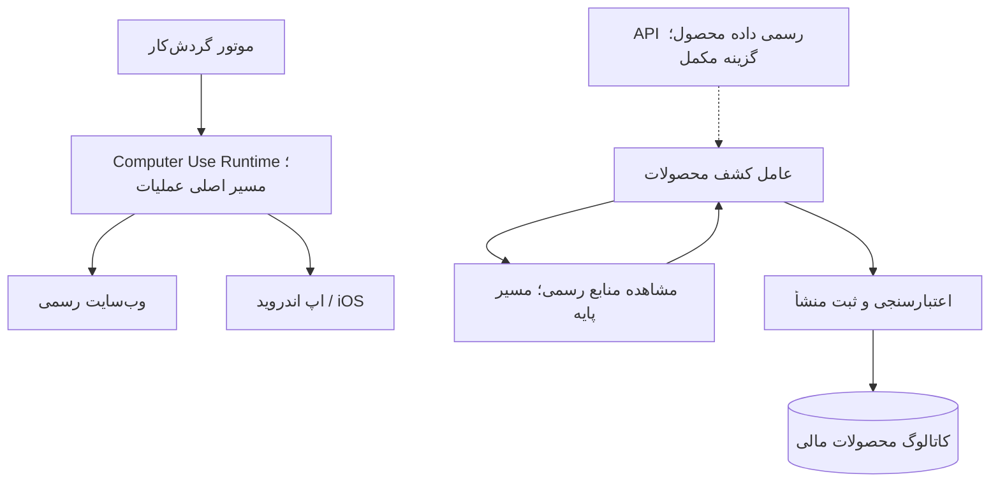

**اصل عدم وابستگی:** خرابی، نبود دسترسی یا توقف همکاری API نباید گردش‌کار اجرایی مبتنی بر Computer Use را از کار بیندازد؛ در مسیر کاتالوگ نیز داده‌های قبلی باید با برچسب تازگی و اطمینان مدیریت شوند، نه اینکه اطلاعات منقضی به‌عنوان قطعی ارائه شوند. جزئیات در فصل سوم آمده است.

### ۱۳. اثر بر طراحی دیتابیس و سرویس‌ها

**قید مصوب A01:** «مسئول منطقی» در جدول زیر الزاماً «سرویس قابل‌استقرار مستقل» نیست. حوزه‌های مشترک محصول در Core ماژولار، قابلیت‌های مشاوره و دانش RAG در Adviser و قابلیت‌های اجرای عملیات در Assistant هدف قرار می‌گیرند؛ تقسیم دقیق مالکیت و دسترسی به داده هنوز موضوع تصمیم A02 است. در R1 فقط Core و Adviser مستقر می‌شوند و می‌توانند از یک میزبان و زیرساخت PostgreSQL/Redis موجود با جداسازی منطقی استفاده کنند.

| دامنه داده | مسئول منطقی | محل اصلی پیشنهادی |
|---|---|---|
| کاربران و حساب‌ها | حساب و هویت | PostgreSQL |
| اشتراک و قابلیت‌ها | عضویت و سیاست دسترسی | PostgreSQL |
| حوزه‌ها، خدمات و تعرفه‌ها | کاتالوگ خدمات شهاب | PostgreSQL |
| محصولات مالی، ویژگی‌ها، نسخه‌ها و شواهد | کاتالوگ پویای محصولات | PostgreSQL و مخزن اسناد |
| نقشه‌های UI، اثرانگشت‌ها و نتایج آزمون | دانش رابط و کشف تغییرات | ذخیره‌سازی نسخه‌دار؛ انتخاب فناوری باز |
| سفارش، پرداخت، کیف پول و دفترکل | سرویس مالی | PostgreSQL |
| پرونده‌ها و مراحل | موتور گردش‌کار | PostgreSQL |
| مجوزها و تاریخچه تأیید | سرویس مجوز | PostgreSQL |
| رویدادها و وضعیت پردازش | زیرساخت رویداد | PostgreSQL و Worker / سامانه پیام |
| موجودیت‌ها و روابط مقرراتی | سرویس دانش | Neo4j |
| متن و نسخه مستندات | سرویس اسناد | مخزن اسناد |
| نمایه‌های بازیابی | سرویس دانش | لایه بازیابی |

**PostgreSQL** مبنای داده عملیاتی و مسیر PostgreSQL-first دانش مطابق ADRهای فصل اول است؛ اشاره به **Neo4j** در جدول بالا صرفاً گزینه تاریخی/قابل‌بررسی برای روابط دانش است، نه فناوری مصوب یا پیش‌نیاز RAG R1. **مخزن اسناد** متن کامل و نسخه‌ها را نگه می‌دارد. استفاده مشترک Core و Adviser از سرور PostgreSQL/Redis موجود در R1 به‌معنای مالکیت مشترک جداول نیست؛ الگوی مالکیت و خواندن داده میان‌سرویسی تا A02 باز است. ارتباط با شناسه‌های پایدار، API و رویدادها انجام می‌شود، نه کلید خارجی مستقیم بین دو دیتابیس.

برای سازگاری نهایی، الگوهایی مانند **Transactional Outbox**، پردازش تکرارپذیر، تلاش مجدد و تطبیق دوره‌ای پیشنهاد می‌شوند. انتخاب قطعی باید با Schema و زیرساخت موجود تطبیق داده شود.

### ۱۴. جریان جامع اجرای درخواست

مثال: مشتری طلایی برای یک تسهیلات درخواست ثبت می‌کند.

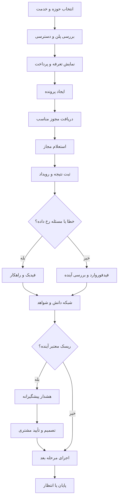

این نمودار جریان طلایی را ساده می‌کند؛ در حالت واقعی بررسی مجوز پیش از هر اقدام حساس تکرار می‌شود. نقره‌ای فقط در صورت بروز مسئله فیدبک دارد؛ برنزی گزارش وضعیت پایه دریافت می‌کند.

**رفتار در درخواست‌های چندوامی:** اگر یک وام انتخاب‌شده قابل ادامه نبود، دستیار می‌تواند وام جایگزین پیشنهاد کند؛ افزودن جایگزین فقط با تأیید مشتری انجام می‌شود و جریان وام‌های باقی‌مانده متوقف نمی‌شود. نبود مدرک، عدم احراز شرط و عدم دسترسی به سرویس بانک باید از هم تفکیک شوند.

### ۱۵. تجربه کاربری و سوپراپ

صفحه اصلی سوپراپ حوزه‌هایی مانند تسهیلات، مالیات و ضمانت‌نامه را به‌صورت آیکن مستقل نمایش می‌دهد. وضعیت فعال یا قفل‌شده از پلن می‌آید. پس از انتخاب حوزه، کاربر **مشاور هوشمند** (پرداخت به‌ازای پرامپت) یا **دستیار هوشمند** (پرداخت به‌ازای خدمت) را انتخاب می‌کند.

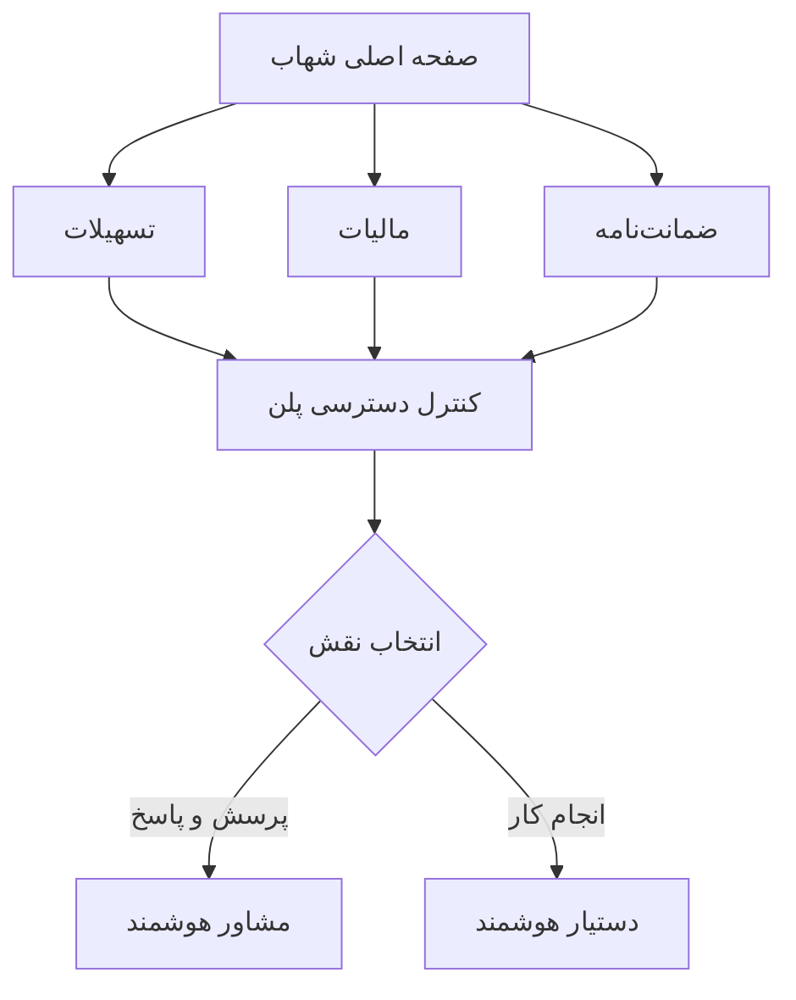

**اصل تعامل:** پس از انتخاب آیکن و نقش، شناسه حوزه نشست ثابت است؛ درخواست‌های خارج از حوزه رد و به آیکن صحیح ارجاع می‌شوند. چت محل نمایش فرم، انتخاب محصول، درخواست مجوز و وضعیت اجراست؛ در مواردی که بانک یا سیستم‌عامل تعامل مستقیم را الزام کند، استثنا باید صریح اعلام شود. **اولویت توسعه:** بازطراحی کامل صفحه اصلی در انتهای مسیر است و هسته می‌تواند ابتدا با فرانت فعلی آزموده شود.

### ۱۶. الزامات کیفیت و قابلیت اطمینان

| بخش | الزامات |
|---|---|
| مشاور | استناد معتبر، اعلام عدم قطعیت، کنترل هزینه پرامپت، حفظ محرمانگی |
| دستیار | وضعیت پایدار، مجوز معتبر، اجرای بدون تکرار اثر، مدیریت توقف و ادامه |
| گردش‌کار | نسخه‌بندی، خطاپذیری کنترل‌شده، تلاش مجدد، حسابرسی |
| فیدبک | تشخیص مسئله واقعی، شواهد و راهکار قابل اجرا |
| فیدفوروارد | شواهد ریسک، کنترل هشدار کاذب، جلوگیری از هشدار تکراری |
| مالی | صحت دفترکل، جلوگیری از برداشت تکراری، بازپرداخت و مغایرت |
| دانش | نسخه منبع، تازگی، ردیابی رابطه و عدم ادعای حقوقی بی‌پشتوانه |

### ۱۷. شاخص‌های ارزیابی پیشنهادی

| حوزه | شاخص |
|---|---|
| شبکه دانش | کیفیت بازیابی و صحت استناد |
| کشف روابط | دقت و فراخوانی روابط |
| مشاور | نرخ پاسخ مستند، هزینه پاسخ |
| دستیار | نرخ تکمیل موفق خدمت |
| گردش‌کار | شکست، بازیابی و تکرار ناخواسته |
| فیدبک | نرخ تشخیص و حل مسئله |
| فیدفوروارد | دقت هشدار، هشدار کاذب، پیشگیری قابل سنجش |
| اتصال‌دهنده‌ها | موفقیت فراخوانی و زمان پاسخ |
| مالی | مغایرت دفترکل و خطاهای پرداخت |
| محصول | استفاده، تبدیل و تمدید عضویت |

آستانه‌های پذیرش، روش نمونه‌گیری و مقادیر هدف پس از آزمایش واقعی تعیین می‌شوند.

### ۱۸. موضوعات باز و تصمیم‌های نیازمند بررسی

۱. قیمت نهایی پلن‌ها، خدمات و هر پرامپت چیست؟

۲. فهرست دقیق خدمات و دامنه هر پلن چیست؟

۳. سطح دسترسی مشاور به دانش و محصولات **همان حوزه انتخاب‌شده** در هر پلن چیست؟ درخواست خارج از حوزه در تمام پلن‌ها ممنوع است.

۴. تعامل‌های ضروری دستیار عملیاتی چگونه قیمت‌گذاری می‌شوند؟

۵. آیا فیدفوروارد صرفاً در پرونده فعال اجرا می‌شود یا با رضایت جداگانه در زمان غیرفعال‌بودن مشتری نیز پایش دارد؟

۶. سطوح مجوز و نمایندگی مشتری برای انواع اقدامات چیست؟

۷. کدام بانک‌ها و سازمان‌ها اجازه و امکان Computer Use در وب یا اپ را فراهم می‌کنند؟ آیا API داده محصولات به‌عنوان گزینه مکمل تجاری در دسترس است؟

۸. چه فناوری برای موتور گردش‌کار و انتقال رویداد مناسب است؟

۹. مدل دقیق داده، استقرار و هزینه عملیاتی Neo4j چیست؟

۱۰. سیاست نگهداری و حذف داده حساس و تاریخچه ایجنت چیست؟

۱۱. **جزئیات اجرای معماری مصوب A01 چگونه تعیین و اعتبارسنجی می‌شوند؟** انتخاب معماری هدف بسته شده است: Core مونولیت ماژولار، Adviser سرویس مستقل و Assistant سرویس مستقل آتی است. موارد باز فقط شامل تعیین مرزهای اجرایی ماژول‌ها، قراردادهای نسخه‌دار، مالکیت و دسترسی داده (A02)، هزینه CPU/RAM و عملیات، تاب‌آوری، آزمون استقرار Core و Adviser روی زیرساخت موجود و معیارهای احتمالی جداسازی فیزیکی یا مهاجرت بعدی‌اند. بررسی الگوهای تاریخی ماکروسرویس و مونولیت قابل‌استخراج در فصل سوم §۲۲ صرفاً برای ارزیابی هزینه و روش اجراست، نه انتخاب مجدد معماری هدف.

### ۱۹. مسیر پیشنهادی توسعه

۱. بررسی ساختار واقعی فاز اول، تثبیت مرز دامنه‌ها و قراردادهای داده.

۲. توسعه شبکه دانش، مخزن اسناد، بازیابی و اتصال منابع.

۳. ایجاد کاتالوگ خدمات، عضویت، قابلیت‌ها، پرداخت و کیف پول.

۴. توسعه مشاور هوشمند و محاسبه مصرف.

۵. توسعه هماهنگ‌کننده دامنه‌محور، موتور گردش‌کار، مجوزها و زیرساخت Computer Use با ارزیابی مستقل وب، اندروید و iOS.

۶. ایجاد زیرساخت رویداد و فیدبک.

۷. توسعه فیدفوروارد و ارزیابی هشدارها.

۸. افزودن دامنه‌ها و خدمات جدید.

۹. بازطراحی صفحه اصلی به شکل سوپراپ.

این توالی فهرست تاریخی وابستگی‌های مفهومی است، نه ترتیب الزام‌آور انتشار و نه User Story یا Task مصوب. مطابق A01، نخستین انتشار RAG تنها Core و Adviser را روی زیرساخت موجود مستقر می‌کند؛ ایجاد کیف پول/پرداخت/پلن تجاری، اجرای Assistant و بازطراحی کامل سوپراپ پیش‌نیاز این انتشار نیستند. برنامه انتشار در فصل پنجم و تصمیم‌های مالی FD-01 تا FD-04 تعیین تکلیف می‌شوند.

### ۲۰. الزامات الحاق و سازگاری با سند قبلی

- فصل نخست بدون حذف معماری Demand-Driven Hybrid RAG، کشف انتشار، بازاعتبارسنجی و کشف روابط حفظ می‌شود.
- مفاهیم دامنه‌محور، رویدادمحور، کاتالوگ خدمات، هماهنگ‌کننده ایجنت و موتور گردش‌کار باید در قراردادهای معماری صریح باشند.
- پلن‌ها، کیف پول، تعرفه و مجوزها جزئی از معماری محصول‌اند، نه صرفاً تنظیمات رابط کاربری.
- تفکیک مشاور و دستیار باید در ابزارها، داده‌ها، امنیت، صورتحساب و تجربه کاربر منعکس شود.
- دامنه از انتخاب آیکن تعیین و در Backend قفل می‌شود؛ درخواست خارج از حوزه، حتی در پلن طلایی، مجاز نیست.
- Computer Use ستون فقرات اجرای عملیات است؛ API بانک فقط گزینه مکمل برای به‌روزرسانی داده کاتالوگ و فرصت تجاری است.
- جزئیات عملیاتی، کاتالوگ خودتوسعه‌دهنده و قیود امکان‌سنجی در فصل سوم آمده‌اند.
- تغییر فرانت پیش‌نیاز اجرای هسته فاز دوم نیست.
- پیش از تبدیل این متن به سند اجرایی معتبر، اصول سند جامع فاز اول، پروتکل اجرای تسک‌ها، سند تداوم و درس‌آموخته‌های رتروسپکتیو باید با آن تطبیق داده شوند.
- تعارض‌ها باید گزارش شوند؛ هیچ اصل موجودی بدون بررسی و تصویب تغییر نکند.
- هر تصمیم باید با وضعیت «توافق‌شده»، «پیشنهادی»، «نیازمند اعتبارسنجی» یا «باز» ثبت شود.

### ۲۱. نتیجه معماری فصل دوم

فاز دوم شهاب بر چهار ستون **دانش، اقدام، حاکمیت و اقتصاد محصول** استوار است. معماری دامنه‌محور چارچوب سازمان‌دهنده این ستون‌هاست؛ ایجنت رویدادمحور و هماهنگ‌کننده ایجنت، قابلیت هوشمند را فراهم می‌کنند؛ موتور گردش‌کار وضعیت پایدار و اجرای قابل اتکا را تضمین می‌کند؛ و سرویس‌های مالی، مجوز و دانش مرجع تخصصی تصمیم‌های خود باقی می‌مانند.

**اصل نهایی:** شهاب نباید به یک ایجنت یکپارچه تبدیل شود که به‌تنهایی قانون تفسیر کند، مجوز بدهد، وجه کسر کند و عملیات بانکی انجام دهد. هوش مصنوعی هماهنگ‌کننده و تحلیل‌گر است؛ کنترل‌های حساس در سرویس‌های قطعی، قابل آزمون و قابل حسابرسی باقی می‌مانند.

---


## فصل سوم — معماری تفصیلی ایجنت‌های دامنه‌محور و اجرای خدمات

> **الحاق معماری مصوب A01 (۲۰۲۶-۱۱-۰۹):** طراحی تفصیلی این فصل باید با سه مرز Core / Adviser / Assistant سازگار باشد. استقلال Adviser از Core برای RAG R1 لازم است؛ Assistant تا انتشار مربوط به خود مستقر نمی‌شود. همه نمودارهای قبلی، از جمله نمودارهای مونولیت قابل‌استخراج، باید به‌عنوان نمایش منطقی یا سابقه گزینه‌های مطالعاتی خوانده شوند، نه نقشه استقرار جایگزین تصمیم A01.


> **الحاق سازگاری V0.8 با فصل نخست:** ایجنت و ابزارهای اجرایی تنها شواهدی را به‌عنوان حکم معتبر مصرف می‌کنند که سیاست انتشار، مجوز، شمول، زمان و Claim-Level Citation Guard فصل نخست اجازه داده باشد. محتوای وب/اسناد دستور اجرایی محسوب نمی‌شود. محاسبات مالی از ابزار قطعی نسخه‌دار عبور می‌کنند؛ مجوز اقدام کاربر و توقف امن مستقل از صحت شواهد RAG لازم‌اند. ارجاع احتمالی به پشتیبانی، وعده تشکیل پرونده کارشناسی یا وجود تیم داخلی نیست. این قیود جایگزین تصویب جداگانه تصمیم‌های Computer Use نمی‌شوند.


**وضعیت فصل:** طراحی تفصیلی پیشنهادی مبتنی بر تصمیم‌های محصولی این گفت‌وگو؛ انتخاب ابزارها، قابلیت‌های سیستم‌عامل و مجازبودن تعامل با بانک‌ها نیازمند اعتبارسنجی‌اند. **این فصل دستور پیاده‌سازی یا تأیید حقوقی هیچ روش اجرایی نیست.**

### ۱. دامنه، اهداف و تفکیک وضعیت تصمیم‌ها

هدف، اجرای خدمات مالی و اداری در قالب سوپراپ و چت شهاب است؛ مشتری **ابتدا آیکن حوزه** (مانند تسهیلات، ضمانت‌نامه، مالیات) و سپس **مشاور** یا **دستیار** را انتخاب می‌کند. ایجنت صرفاً هدف و اقدام را **در محدوده همان حوزه** تفسیر می‌کند. مشاور برای پاسخ مستند و دستیار برای انتخاب و اجرای خدمت است. هر دو از همان محیط چت استفاده می‌کنند و با پلن و مجوزهای مشتری محدود می‌شوند.

| موضوع | وضعیت | توضیح |
|---|---|---|
| انتخاب حوزه با آیکن و انتخاب نقش | تصمیم محصول | نقطه شروع هر نشست |
| ممنوعیت درخواست خارج از حوزه | تصمیم محصول | کنترل قطعی در Backend، نه فقط پرامپت |
| چت به‌عنوان محیط اصلی تعامل | تصمیم محصول | فرم، رضایت، پیشرفت، انتخاب و نتیجه |
| Computer Use به‌عنوان ستون فقرات عملیات | تصمیم معماری هدف | وب، اندروید، iOS با قید امکان فنی و مجازبودن |
| کاتالوگ پویا و خودتوسعه‌دهنده | رویکرد منتخب | کشف، استخراج، اعتبارسنجی و انتشار نسخه‌دار |
| API رسمی برای دریافت داده کاتالوگ | گزینه مکمل / فرصت تجاری | بدون وابستگی حیاتی به همکاری بانک |
| اجرای روی گوشی مشتری یا زیرساخت شهاب | باز | نیازمند اثبات فنی، امنیتی و اقتصادی |
| کنترل اپ‌های iOS و نصب/مجوز | نیازمند امکان‌سنجی | رضایت کاربر محدودیت سیستم‌عامل را رفع نمی‌کند |
| ورود کد بانکی در چت | هدف تجربه با قید امنیت و مجازبودن | نباید به متن مدل یا تاریخچه مکالمه برسد |
| تعامل صوتی | جهت‌گیری آینده | بدون حذف کنترل‌های حساس و ایمنی |

### ۲. معماری سوپراپ و نشست دامنه‌محور

شناسه `domain_id` از آیکن انتخاب‌شده و شناسه `experience_mode` از انتخاب مشاور/دستیار در Backend ثبت می‌شود. مدل زبانی این مقادیر را از متن مشتری حدس نمی‌زند و حق تغییر خودکار آن‌ها را ندارد. هر نشست به دامنه، نقش، هویت مشتری، پلن، فهرست ابزارهای مجاز و سیاست‌های داده مقید است. تغییر حوزه فقط با اقدام صریح مشتری در ناوبری سوپراپ و ایجاد یا انتقال کنترل‌شده نشست ممکن است.

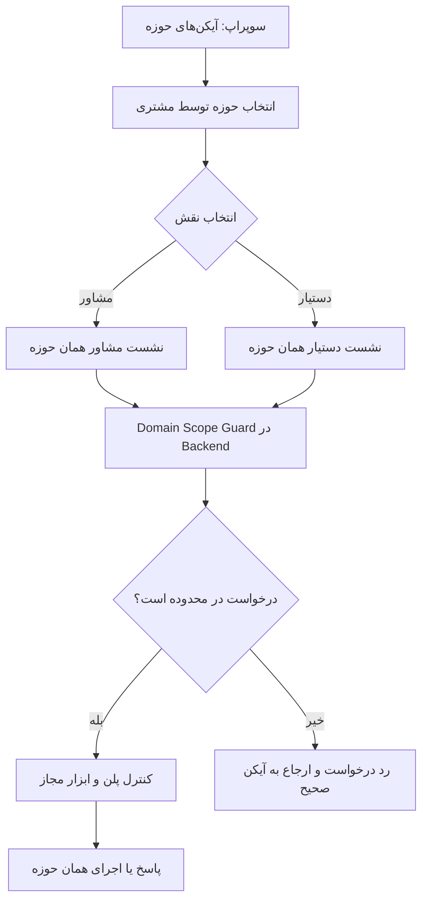

**معیار مرز دامنه، هدف درخواست است نه کلمات آن.** سؤال درباره نقش اعتبارسنجی در ضمانت‌نامه می‌تواند در حوزه ضمانت‌نامه مجاز باشد؛ درخواست مستقل برای وام خرید خودرو از همان نشست مجاز نیست. در حالت نامطمئن، ایجنت باید برای روشن‌کردن قصد مشتری سؤال کند و تا تعیین محدوده از فراخوانی ابزار عملیاتی خودداری کند.

**کنترل چندلایه:** (۱) اعتبارسنجی حوزه در درگاه درخواست؛ (۲) محدودسازی دسترسی بازیابی و کاتالوگ به همان دامنه؛ (۳) فهرست ابزار و گردش‌کار مجاز همان دامنه؛ (۴) اعتبارسنجی دوباره قبل از هر عمل مؤثر؛ (۵) آزمون‌های عبور از مرز و تزریق پرامپت. صرف دستور سیستمی مدل کافی نیست. داده بازیابی‌شده از بانک نیز نباید بتواند حوزه یا مجوزها را تغییر دهد.

### ۳. دو نقش مشاور و دستیار و رابطه آن‌ها با پلن

**مشاور:** پاسخ مستند، مقایسه و تبیین شرایط در حوزه انتخاب‌شده با RAG، کاتالوگ محصولات و قواعد پلن؛ به‌خودی‌خود مجوز اجرای اقدام بانکی ندارد. **دستیار:** علاوه بر تحلیل همان حوزه، گزینه مناسب را با مشتری نهایی و گردش‌کار عملیاتی را از طریق Computer Use آغاز و پیگیری می‌کند. مشاور و دستیار از کنترل دامنه مشترک اما اختیارات اجرایی متفاوت استفاده می‌کنند.

پلن‌های برنزی، نقره‌ای و طلایی بر **گستره خدمات قابل دسترس، فیدبک و فیدفوروارد** اثر دارند؛ پلن بالاتر هرگز قفل حوزه را لغو نمی‌کند. مطابق فصل دوم، برنزی اجرای پایه، نقره‌ای فیدبک واکنشی و طلایی فیدفوروارد پیشگیرانه را پوشش می‌دهد. دامنه دقیق خدمات و شیوه محاسبه هزینه مکالمات ضروری داخل گردش‌کار همچنان موضوع باز است. کیف پول پرامپت مشاور از تعرفه ثابت اجرای خدمت تفکیک می‌شود.

### ۴. معماری چت تعاملی و تولید مؤلفه‌های رابط

چت شهاب سطح واحد تعامل است: متن، کارت محصول، انتخاب گزینه، فرم پویا، بارگذاری مدرک، درخواست مجوز، نمایش پیشرفت، تأیید حساس، خطا، رسید و اعلان فیدبک/فیدفوروارد در همان جریان نمایش داده می‌شوند. فرم‌ها باید **بر اساس قرارداد نوع‌دار و اعتبارسنجی‌شده** از Backend به فرانت ارسال شوند؛ مدل زبانی نباید کد اجرایی دلخواه، اسکریپت یا مؤلفه ناامن به کلاینت تزریق کند.

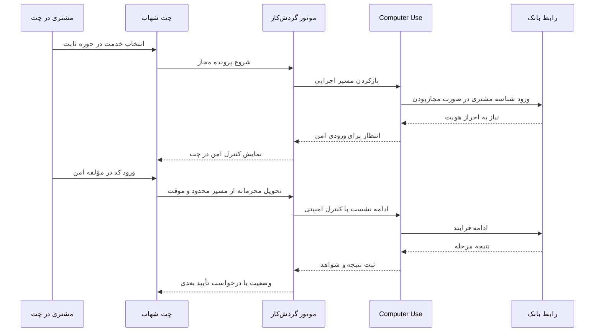

**مرز امنیتی کد تأیید:** کد یک‌بارمصرف، رمز، کلید یا توکن نباید وارد متن چت قابل مشاهده برای مدل، لاگ عمومی، تحلیل مکالمه یا حافظه RAG شود. کنترل امن باید ارتباط محافظت‌شده، محدود به نشست و دارای انقضا با مؤلفه اجرایی داشته باشد. امکان و مجازبودن ورود کد بانک از طریق واسط ثالث برای هر ارائه‌دهنده جداگانه بررسی می‌شود؛ ممکن است الزام به تعامل مستقیم در محیط رسمی بانک وجود داشته باشد. تجربه «همه‌چیز در چت» **هدف محصول** است، نه تضمین عبور از محدودیت‌های بانکی و سیستم‌عامل.

### ۵. معماری Computer Use و چرخه تصمیم اجرایی

مدل زبانی یا مدل چندوجهی، مشاهده و تفسیر رابط را انجام می‌دهد؛ ابزار اجرایی کلیک، تایپ، پیمایش و دریافت نتیجه را انجام می‌دهد؛ موتور گردش‌کار مرجع معتبر وضعیت پرونده است. اتکا به مختصات ثابت یا فلوهای شکننده ممنوع به‌عنوان تنها سازوکار است. نقشه‌های مسیر ذخیره‌شده نقش راهنما دارند و **مشاهده زنده صفحه قبل از عمل** لازم است.

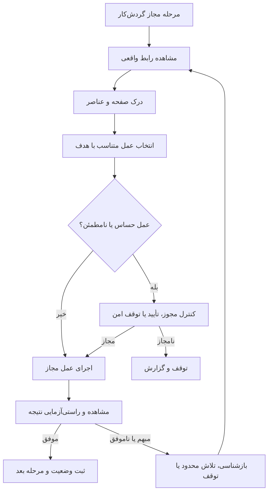

ابزارهای قابل **بررسی** شامل Playwright برای وب، ابزارهای مجاز UI Automation برای اندروید و Appium/XCUITest برای محیط‌های سازگار iOS هستند؛ انتخاب ابزار تصویب نشده است. مدل نباید خودسرانه از CAPTCHA، محدودیت ضدربات یا کنترل احراز هویت عبور کند.

### ۶. تشخیص اپ نصب‌شده، انتخاب مسیر و نصب با مجوز

پس از انتخاب خدمت، دستیار قابلیت‌های واقعی و مسیرهای شناخته‌شده آن خدمت را بررسی می‌کند: وب، اندروید، iOS. در صورت امکان فنی و مجوز، نصب اپ را بررسی می‌کند؛ در غیر این صورت از مشتری سؤال می‌پرسد. اگر اپ نصب و کنترل مجاز آن ممکن باشد، مسیر اپ بررسی می‌شود؛ اگر نه و خدمت وب دارد، مسیر مرورگر انتخاب می‌شود؛ اگر خدمت صرفاً اپی است، دستیار با تأیید مشتری **درخواست نصب** را مطرح می‌کند و پس از نصب، قابلیت اجرا را دوباره می‌سنجد. هیچ نصب پنهانی یا اعطای خودکار مجوز فرض نمی‌شود.

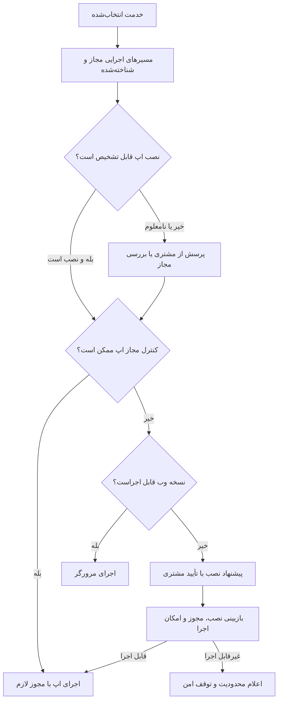

**محدودیت‌های واقعی:** مشاهده فهرست برنامه‌ها در اندروید محدود به مجوزها و سیاست‌های سیستم‌عامل است؛ iOS امکان فهرست‌کردن عمومی برنامه‌ها یا کنترل آزادانه رابط اپ دیگر را به اپ عادی نمی‌دهد. نصب و تأیید مجوز غالباً به تعامل مستقیم مشتری با سیستم‌عامل نیاز دارد. هیچ معماری نباید فرض کند رضایت مشتری این محدودیت‌ها را حذف می‌کند.

### ۷. محل اجرا، مدیریت دستگاه و ایزوله‌سازی نشست

سه گزینه برای بررسی وجود دارد: **اجرای محلی روی دستگاه مشتری**، **اجرای کنترل‌شده در زیرساخت شهاب** و **مدل ترکیبی**. تصمیم نهایی وابسته به قابلیت کنترل اپ، سیاست سیستم‌عامل، هزینه، امنیت، تجربه کاربر، مدیریت نشست و تداوم اجرای طولانی است.

| گزینه | مزیت بالقوه | محدودیت / خطر |
|---|---|---|
| روی گوشی مشتری | نزدیکی به اپ و نشست خود مشتری | محدودیت شدید کنترل بین‌اپی، خاموشی دستگاه، مجوزها |
| زیرساخت شهاب | زمان‌بندی و مدیریت متمرکز | هزینه دستگاه/مرورگر، انتقال امن احراز هویت، مجازبودن دسترسی |
| ترکیبی | جداسازی هماهنگی ابری از مراحل محلی حساس | پیچیدگی همگام‌سازی، بازیابی و تأیید |

**Session & Device Orchestrator** پیشنهادی باید تخصیص محیط، جداسازی مشتریان، انقضا، پاک‌سازی، اتصال به پرونده، بازیابی خطا و محدودیت نرخ را مدیریت کند. یک نشست بانکی هرگز نباید میان مشتریان مشترک شود. اجرای iOS در سرور لینوکسی با فرض شبیه‌سازی آزاد اپ‌های واقعی قابل اتکا نیست و به امکان‌سنجی مستقل نیاز دارد.

### ۸. کشف، آزمون و پایش تغییرات رابط کاربری

زیرسیستم **UI Discovery & Change Monitoring** در زمان کم‌ترافیک (مثلاً ساعت ۳ بامداد به‌عنوان نمونه، نه زمان‌بندی مصوب) مسیرهای رسمی و مجاز را با محیط و حساب آزمون مجاز بررسی می‌کند. هدف، شناسایی تغییر نسخه، جابه‌جایی عناصر، تغییر مراحل و انتشار نقشه‌های آزموده‌شده است. حساب واقعی مشتری برای پیمایش شبانه استفاده نمی‌شود. آزمون باید غیرمخرب باشد؛ ثبت درخواست واقعی، پرداخت یا تعهد ممنوع است مگر محیط آزمون رسمی و مجوز صریح مربوط وجود داشته باشد.

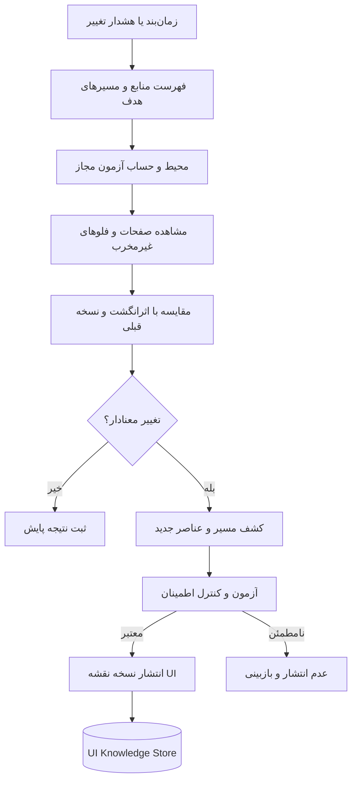

مخزن مسیر UI شامل شناسه ارائه‌دهنده، خدمت، پلتفرم، نسخه/اثر انگشت رابط، مسیر مرحله‌ای، نقش عناصر، نقاط احراز هویت و تأیید، زمان مشاهده، شواهد و نتیجه آزمون است. پایش دوره‌ای جایگزین **تشخیص لحظه‌ای هنگام اجرای درخواست مشتری** نمی‌شود؛ رابط ممکن است بعد از پایش تغییر کند یا بر اساس کاربر متفاوت باشد.

### ۹. کاتالوگ پویا و خودتوسعه‌دهنده محصولات مالی

**تصمیم محصولی منتخب: رویکرد دوم، کاتالوگ خودتوسعه‌دهنده.** شهاب نباید برای هر درخواست ضمانت‌نامه یا تسهیلات، جست‌وجوی آزاد و بی‌قاعده اینترنت را مبنای توصیه قرار دهد. عامل کشف، منابع رسمی شناخته‌شده را به‌صورت زمان‌بندی‌شده، مبتنی بر تقاضا و مبتنی بر تغییر پایش می‌کند؛ محصول یا تغییر را استخراج و ساختاریافته می‌کند؛ شواهد، منشأ، تاریخ و نسخه را ثبت می‌کند؛ سپس فقط داده عبورکرده از اعتبارسنجی را در کاتالوگ قابل توصیه منتشر می‌کند.

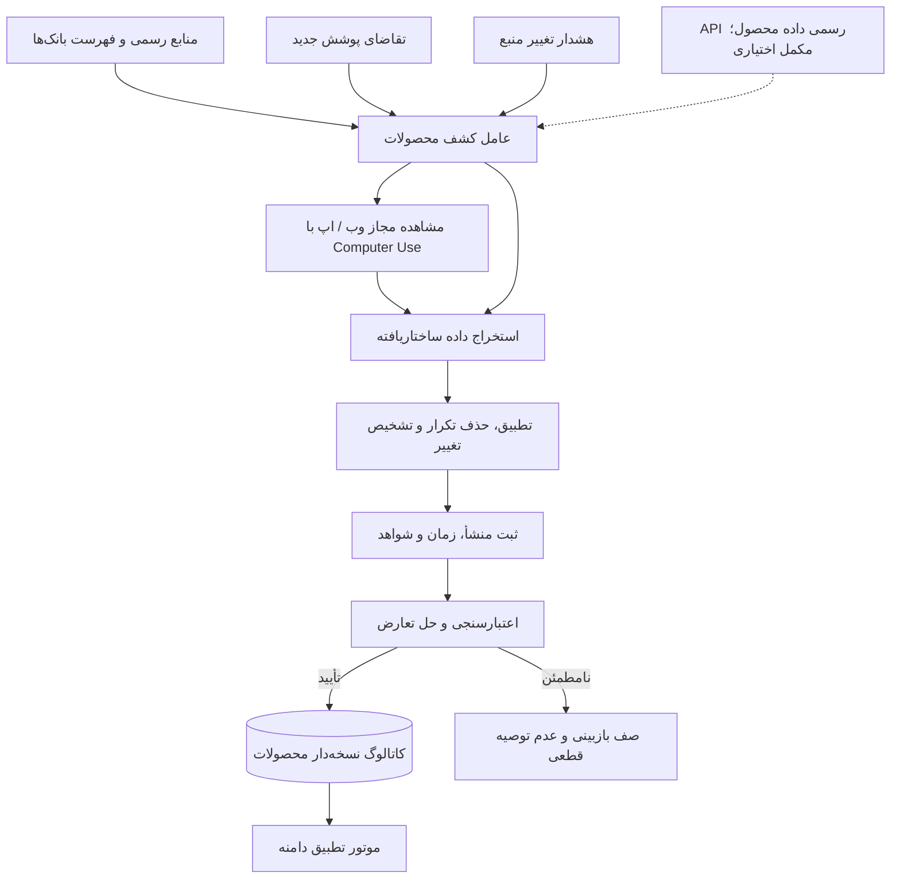

**منابع کشف:** صفحات رسمی عمومی، اسناد رسمی و در صورت مجازبودن و وجود حساب آزمون، بخش‌های احراز هویت‌شده وب/اپ. پوشش اطلاعاتی که فقط برای حساب خاص قابل مشاهده است نباید به‌عنوان شرایط عمومی محصول تعمیم داده شود. وضعیت‌های داده شامل **تأییدشده با تاریخ مشاهده**، **نیازمند بازاعتبارسنجی** و **نامطمئن/متعارض** است. تأیید کاتالوگ به معنی تضمین عرضه یا پذیرش درخواست در لحظه نیست.

### ۱۰. API کاتالوگ: مزیت رقابتی بدون وابستگی عملیاتی

**تمایز قطعی دو کاربرد API:**

۱. **API برای اجرای عملیات بانکی مشتری:** در معماری هدف انتخاب نشده است؛ ستون فقرات اجرای خدمات **Computer Use** است.

۲. **API برای دریافت یا به‌روزرسانی اطلاعات محصولات و خدمات:** **گزینه مکمل و فرصت رقابتی/تجاری** است. اگر بانکی داده رسمی و به‌روز از محصولات، نرخ‌ها، شرایط یا وضعیت ارائه خدمت در اختیار شهاب بگذارد، این همکاری می‌تواند پوشش، سرعت، دقت و اعتمادپذیری کاتالوگ را افزایش دهد و زمینه همکاری تجاری فراهم کند. این مزیت بالقوه است و تا زمانی که قرارداد، دسترسی و کیفیت داده اثبات نشده‌اند نباید قطعی فرض شود.

**تکمیل معماری ابزارها:** در نبود API رسمی، ابزارهای MCP می‌توانند از API غیرمستقیم یا واسط ثالث **مجاز و آزموده‌شده** برای جست‌وجوی وب‌سایت، دریافت اطلاعات، استعلام و حتی ثبت سفارش استفاده کنند. قابلیت ثبت سفارش فقط با کنترل‌های فصل سوم و تأیید کاربر مجاز است؛ مسیر پایه Computer Use همچنان حفظ می‌شود و جایگزینی آن با API عملیاتی، تصمیمی مستقل و نیازمند ارزیابی است.

**اصل تاب‌آوری:** نبود، قطع، محدودیت یا عدم همکاری API نباید اجرای خدمات مشتری را مختل کند. مسیر پایه کشف، مشاهده کنترل‌شده منابع رسمی و مسیر پایه اجرا، Computer Use است. در صورت قطع API داده، آخرین داده معتبر فقط مطابق سیاست تازگی و با هشدار مناسب قابل استفاده است؛ داده نامطمئن نباید توصیه قطعی شود. API مکمل نباید تنها منبع یک محصول حیاتی باشد مگر جایگزین معتبر و سیاست توقف امن تعیین شده باشد.

| معیار | مسیر پایه Computer Use / منابع رسمی | API داده محصول (اختیاری) |
|---|---|---|
| وابستگی به همکاری بانک | ممکن است برای مجازبودن خودکارسازی نیاز به موافقت باشد، اما به ارائه API وابسته نیست | نیازمند دسترسی و شرایط ارائه‌دهنده |
| به‌روزرسانی کاتالوگ | مشاهده و استخراج کنترل‌شده | دریافت داده ساختاریافته در صورت دسترسی |
| اجرای درخواست مشتری | مسیر اصلی هدف | خارج از ستون فقرات اجرایی |
| تاب‌آوری | پایش، اعتبارسنجی و توقف امن | شکست API نباید فرایند اصلی را متوقف کند |
| ارزش تجاری | پوشش مستقل‌تر از API | همکاری، کیفیت و تازگی بالقوه بهتر |

### ۱۱. تفکیک سه نوع دانش و مدل داده

سه دارایی متفاوت باید با شناسه‌های پایدار به هم متصل باشند:

- **دانش مقرراتی:** قوانین، بخشنامه‌ها، اسناد، رابطه‌ها و اعتبار زمانی؛ معماری RAG و Neo4j فصل نخست.
- **دانش محصول:** شناسه بانک/مؤسسه، شناسه محصول، نوع خدمت، شرایط، مدارک، نرخ‌ها، محدودیت‌ها، منبع، نسخه، تاریخ مشاهده و وضعیت اعتبار؛ کاتالوگ ساختاریافته.
- **دانش رابط:** شناسه ارائه‌دهنده و خدمت، پلتفرم، نسخه UI، مسیرها، نقش عناصر، نقاط مجوز/احراز هویت، شواهد و آزمون؛ مخزن نقشه UI.

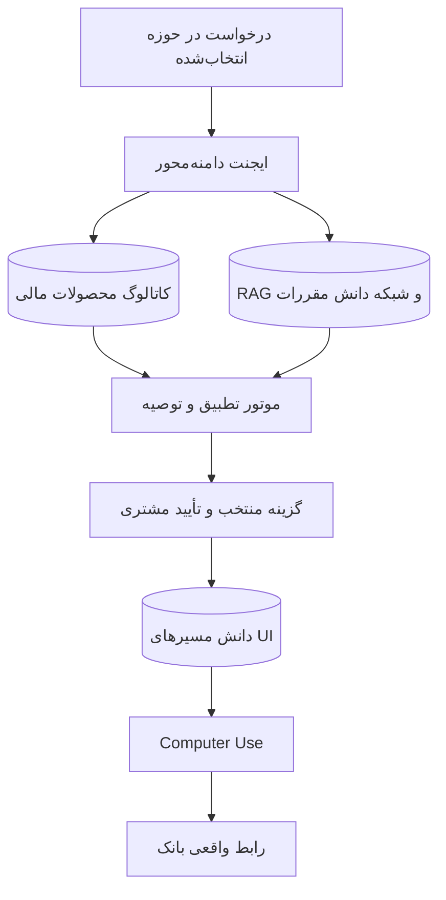

PostgreSQL مرجع عملیاتی پرونده، مجوز و کاتالوگ ساختاریافته پیشنهادی است؛ Neo4j روابط دانش را نگه می‌دارد؛ مخزن اسناد متن و شواهد را نگه می‌دارد. فناوری نهایی UI Knowledge Store و قرارداد همگام‌سازی نیازمند طراحی تفصیلی است. از ادغام بی‌قاعده سه نوع دانش در یک RAG عمومی اجتناب شود.

### ۱۲. موتور توصیه دامنه‌ای و استفاده از توصیه‌گر فعلی تسهیلات

در تسهیلات، توصیه‌گر موجود شهاب سرنخ‌های اولیه می‌دهد؛ مثلاً چهار وام مشخص و بانک‌های ارائه‌دهنده را شناسایی می‌کند. دستیار باید این خروجی را **ورودی آغازین** بداند، نه تضمین پذیرش بانک. پیش از اقدام، شرایط جاری و مسیر اجرایی بررسی می‌شود. اگر یکی از چند درخواست وام متوقف شد، سایر پرونده‌های مستقل ادامه می‌یابند؛ پیشنهاد جایگزین فقط با تأیید مشتری افزوده می‌شود.

در ضمانت‌نامه، چون ممکن است هنوز داده جامع وجود نداشته باشد، عامل کشف ابتدا محصولات رسمی را در کاتالوگ پویا فراهم می‌کند. موتور تطبیق اختصاصی ضمانت‌نامه با توجه به نوع ضمانت‌نامه، مبلغ، ذی‌نفع، وثایق، شرایط مشتری و مقررات، گزینه‌های معتبر را ارزیابی می‌کند. **منطق تخصصی وام بدون ارزیابی به ضمانت‌نامه تعمیم داده نمی‌شود.** موتور تطبیق می‌تواند چارچوب مشترک داشته باشد، ولی قواعد هر حوزه مستقل است.

### ۱۳. سناریوی سرتاسری ضمانت‌نامه

۱. مشتری آیکن «ضمانت‌نامه» و سپس «دستیار» را انتخاب می‌کند؛ شناسه حوزه و نقش تثبیت می‌شوند.

۲. دستیار درخواست ضمانت‌نامه شرکت در مناقصه را در همان حوزه تفسیر می‌کند؛ درخواست وام نامرتبط را رد و به حوزه تسهیلات ارجاع می‌دهد.

۳. بر اساس پلن، نوع خدمات و توانایی فیدبک/فیدفوروارد بررسی می‌شود؛ اطلاعات ضروری مانند نوع ضمانت‌نامه، مبلغ، زمان و ذی‌نفع در چت دریافت می‌شود.

۴. کاتالوگ پویای محصولات و RAG مقرراتی گزینه‌های دارای شواهد معتبر را برمی‌گردانند؛ در صورت پوشش ناکافی، کشف کنترل‌شده از منابع رسمی فعال می‌شود، نه جست‌وجوی بی‌قاعده و توصیه حدسی.

۵. موتور تطبیق دامنه‌ای گزینه‌ها را ارزیابی می‌کند و دستیار تفاوت‌ها و محدودیت‌ها را نمایش می‌دهد؛ مشتری گزینه را انتخاب می‌کند.

۶. پس از کنترل تعرفه، پلن و رضایت، موتور گردش‌کار پرونده را ایجاد می‌کند و مسیر وب/اپ را بر اساس قابلیت واقعی و مجازبودن انتخاب می‌کند.

۷. در صورت نیاز به اپ، نصب و مجوز با اقدام مشتری بررسی می‌شود؛ در صورت نیاز به کد ورود، کنترل امن در چت نمایش داده می‌شود، مشروط به امکان فنی و سیاست بانک.

۸. ایجنت رابط را مشاهده و مرحله‌به‌مرحله اجرا می‌کند؛ پیش از ارسال نهایی یا ایجاد تعهد، تأیید صریح و مناسب مشتری را می‌گیرد.

۹. نتیجه، شماره پیگیری و وضعیت معتبر ثبت می‌شود. رویدادها متناسب با پلن، فیدبک واکنشی یا فیدفوروارد پیشگیرانه را فعال می‌کنند.

```mermaid
sequenceDiagram
    participant U as مشتری
    participant CHAT as چت دامنه ضمانت‌نامه
    participant CAT as کاتالوگ و RAG
    participant MATCH as تطبیق دامنه
    participant WF as گردش‌کار
    participant CU as Computer Use
    participant BANK as بانک
    U->>CHAT: انتخاب ضمانت‌نامه / دستیار
    CHAT->>CAT: دریافت گزینه‌ها و شرایط معتبر
    CAT-->>CHAT: محصولات دارای منشأ و وضعیت اعتبار
    CHAT->>MATCH: شرایط مشتری و گزینه‌ها
    MATCH-->>CHAT: پیشنهادهای قابل توضیح
    CHAT-->>U: نمایش و مقایسه گزینه‌ها
    U->>CHAT: انتخاب و تأیید آغاز
    CHAT->>WF: ایجاد پرونده مجاز
    WF->>CU: انتخاب و اجرای مسیر UI
    CU->>BANK: اقدام از طریق رابط واقعی
    BANK-->>CU: وضعیت یا درخواست تأیید
    CU-->>WF: وضعیت و شواهد
    WF-->>CHAT: فرم/تأیید/نتیجه
    CHAT-->>U: ادامه تعامل در چت
```

### ۱۴. رویدادها، فیدبک و فیدفوروارد

رویدادهای «تغییر محصول»، «تغییر UI»، «توقف نشست»، «درخواست مجوز»، «عدم احراز شرط»، «ثبت موفق»، «تغییر مقررات» و «ریسک آینده» از هم تفکیک می‌شوند. تغییر UI می‌تواند پایش مجدد نقشه را فعال کند؛ تغییر محصول بازاعتبارسنجی کاتالوگ را؛ شکست واقعی پرونده فیدبک نقره‌ای/طلایی را؛ ریسک پیش‌بینی‌شده و دارای شواهد، فیدفوروارد طلایی را. **هیچ رویدادی به‌تنهایی مجوز اجرای اقدام حساس ایجاد نمی‌کند.** تصمیم‌های حساس همچنان از دروازه پلن، حوزه، رضایت و امکان مجاز عبور می‌کنند.

### ۱۵. امنیت، رضایت، احراز هویت و توقف امن

- **حداقل اختیار:** مجوزها برای یک مشتری، حوزه، خدمت، نشست، نوع عمل و بازه زمانی محدود شوند.
- **تأیید حساس:** ارسال نهایی، تعهد، امضا، پرداخت و تغییر مؤثر نیازمند کنترل متناسب و تأیید صریح‌اند؛ تأیید کلی اولیه کافی نیست.
- **اسرار:** رمز و OTP به مدل، حافظه RAG، لاگ مکالمه یا عامل کشف منتقل نشوند؛ نشست‌ها رمزنگاری، محدود و منقضی شوند.
- **عدم دورزدن:** CAPTCHA، محدودیت ضدربات، احراز هویت و سیاست ارائه‌دهنده نباید دور زده شوند؛ رضایت مشتری به‌تنهایی مجوز خودکارسازی سامانه بانک نیست.
- **جداسازی:** محیط آزمون و حساب کشف محصولات از محیط و نشست واقعی مشتری جدا باشند.
- **قابلیت حسابرسی:** هر اقدام مؤثر دارای شناسه پرونده، علت، مجوز، زمان، نتیجه و شواهد حداقلی با حذف داده حساس باشد.
- **توقف امن:** تغییر غیرمنتظره UI، ابهام درباره مقصد، عدم انطباق مبلغ/گیرنده، عدم قطعیت وضعیت ثبت و محدودیت سیستم‌عامل باید توقف یا ارجاع به مشتری ایجاد کند؛ از ارسال تکراری درخواست بدون کلید تکرارناپذیری و بررسی وضعیت جلوگیری شود.

### ۱۵.۱. الزامات فنی نیازمند تصمیم برای قابلیت‌های مالی آتی (FD-01 تا FD-03)

**وضعیت: بررسی فنی، نه معماری اجرایی مصوب و نه پیش‌نیاز اولین انتشار RAG.** پس از تعیین دامنه محصول در فصل دوم، این موضوعات باید با وضعیت واقعی Backend فاز اول و اسناد حاکمیت پروژه تطبیق داده شوند:

| شناسه | بررسی فنی لازم | خروجی مورد انتظار پیش از توسعه مستقل |
|---|---|---|
| FD-01 — کیف پول | مرز دامنه Wallet/Ledger، مدل مانده و تراکنش تغییرناپذیر، idempotency، کنترل همزمانی، تسویه/بازپرداخت، مغایرت‌گیری و نگهداری ارزش | RFC کیف پول، مدل داده و رویدادها، تهدیدشناسی، آزمون‌های مالی و برنامه مهاجرت |
| FD-02 — پلن‌های پرداختی | تفکیک Plan/Price/Subscription/Entitlement/Usage/Billing، کنترل مجوز در Backend، تغییر قیمت، تمدید و انقضا، feature flag و سازگاری با هویت کاربر | قراردادهای داده و API، ماتریس دسترسی و چرخه عمر اشتراک، معیار پذیرش |
| FD-03 — پرداخت و حسابداری | پرداخت و تأیید سمت سرور، callback/webhook، ثبت رویداد قابل بازیابی، تطبیق تسویه، جلوگیری از سند تکراری، خروجی دفترکل/نرم‌افزار حسابداری/صورتحساب و آزمون sandbox | RFC یکپارچه‌سازی، ماتریس رویداد مالی به ثبت حسابداری، کنترل‌های audit و تأیید مسئول مالی |

**مرزهای معماری:** نیاز به سرویس مستقل، جداول جدید، موتور دفترکل، درگاه مشخص یا ابزار حسابداری مشخص هنوز تصمیم‌گیری نشده است. قراردادها باید از وابستگی ناخواسته RAG به پرداخت جلوگیری کنند. سند حسابداری داخلی، فاکتور مشتری و صورتحساب الکترونیکی مالیاتی یکسان فرض نشوند. فعال‌سازی واقعی مستلزم PRD، طراحی، PoC مرتبط و تسک مصوب مستقل است.

**ارجاع به مدل درآمدی Draft فصل دوم §۱۰.۴:** برای انتشارهای مالی آینده، طراحی فنی باید پس از تصویب مدل اقتصادی، `Usage Metering`، `Cost Attribution`، `Versioned Pricing Policy`، `Billable Request` و اتصال رویداد مصرف به `Wallet Ledger` را ارزیابی کند. تفکیک هزینه واقعی از قیمت مشتری، برآورد/سقف هزینه، کسر تکراری، رزرو/تسویه و شکست عملیات موضوع بررسی RFC مستقل است؛ این متن انتخاب معماری یا آغاز پیاده‌سازی نیست و خارج از اولین انتشار RAG باقی می‌ماند.

### ۱۶. کیفیت، آزمون و معیارهای پذیرش پیشنهادی

| محور | آزمون ضروری | خروجی مورد انتظار |
|---|---|---|
| قفل دامنه | درخواست تسهیلات در چت ضمانت‌نامه؛ تلاش تزریق پرامپت | رد/ارجاع بدون ابزار حوزه دیگر |
| پلن | اجرای قابلیت طلایی با پلن برنزی | جلوگیری در Backend |
| کاتالوگ | محصول جدید، تغییر نرخ، داده متعارض، منبع منقضی | نسخه‌گذاری و عدم توصیه قطعی داده نامطمئن |
| قطع API کاتالوگ | قطع کامل اتصال مکمل | ادامه مسیر اصلی و اعمال سیاست تازگی |
| تغییر UI | جابه‌جایی دکمه، تغییر ترتیب فرم، صفحه ناشناخته | بازشناسی یا توقف امن؛ نه کلیک حدسی |
| نشست | انقضا، قطع ارتباط، اجرای موازی مشتریان | جداسازی و بازیابی قابل حسابرسی |
| احراز هویت | ورود کد از کنترل امن؛ عدم نشت به لاگ و مدل | عدم افشای داده حساس |
| اقدام حساس | ارسال بدون تأیید، تکرار ارسال، نتیجه نامعلوم | توقف یا کنترل تکرار و استعلام وضعیت |
| اندروید و iOS | نبود مجوز، نصب‌نبودن اپ، عدم امکان کنترل | مسیر جایگزین یا اعلام عدم پشتیبانی |
| صوت آینده | درخواست مالی حساس هنگام رانندگی | تعویق تأیید حساس تا شرایط ایمن |

آستانه‌های کمی موفقیت، پوشش بانک‌ها، نرخ بازیابی، هزینه هر نشست و سطح خدمات باید پس از پایلوت واقعی تعیین شوند؛ هیچ نرخ موفقیت یا امکان فراگیر برای بانک‌ها از پیش مفروض نیست.

### ۱۷. تعامل صوتی آینده

لایه تعامل صوتی باید صرفاً یک کانال ورودی/خروجی جدید روی همان نشست دامنه‌محور باشد؛ Domain Scope Guard، پلن، مجوز و موتور گردش‌کار بدون تغییر بنیادی باقی می‌مانند. تبدیل گفتار به متن، تولید گفتار، تأیید هویت و نمایش/خواندن وضعیت به طراحی جداگانه نیاز دارند. انجام امور بانکی هنگام رانندگی به معنای مجازبودن تأیید مالی حساس، ورود OTP یا توجه به فرم نیست؛ این مراحل باید تا توقف ایمن مشتری معلق شوند.

### ۱۸. تصمیم‌های باز و آزمایش‌های امکان‌سنجی

۱. اجرای Computer Use در گوشی مشتری، زیرساخت شهاب یا معماری ترکیبی چگونه امکان‌پذیر و اقتصادی است؟

۲. در اندروید و iOS کدام اپ‌های بانکی واقعاً اجازه تشخیص نصب، کنترل UI، ورود و ادامه نشست را می‌دهند؟ تفاوت نسخه‌ها و سیاست‌های سیستم‌عامل چیست؟

۳. برای کدام بانک‌ها انتقال OTP از کنترل امن درون چت به نشست اجرایی از نظر امنیتی و شرایط استفاده مجاز است؟ اگر مجاز نباشد، تجربه جایگزین چیست؟

۴. برای پایش شبانه، چه حساب‌های آزمون و محیط‌های غیرمخرب و مجازی در دسترس‌اند؟ کدام مسیرها فقط بعد از احراز هویت مشاهده می‌شوند؟

۵. منبع رسمی و معیار تأیید هر محصول چیست؟ در تعارض دو منبع یا تغییر بدون تاریخ، چه سیاست انتشار و بازبینی داریم؟

۶. آیا API رسمی داده محصولات در برخی بانک‌ها قابل دریافت است و چه مزیت تجاری، SLA، حق استفاده و محدودیت انتشار دارد؟ **پاسخ منفی نباید اجرای محصول را مسدود کند.**

۷. مدل داده مشترک محصول، منشأ، نسخه، ارتباط مقررات و نقشه UI چگونه طراحی می‌شود؟

۸. ابزارهای Computer Use، موتور گردش‌کار، محیط دستگاه و سامانه رویداد با زیرساخت فعلی فاز اول چه سازگاری دارند؟

۹. **برای تحقق A01، کدام جزئیات استقرار و مهاجرت باید آزموده شوند؟** معماری هدف مصوب است و مقایسه با ماکروسرویس یا میکروسرویس‌های ریزدانه فقط سابقه مطالعاتی محسوب می‌شود. موارد باز عبارت‌اند از هزینه و ظرفیت استقرار Core و Adviser، مرزبندی و مالکیت داده مطابق A02، آزمون قراردادها، تاب‌آوری، امکان استخراج تدریجی ماژول‌ها در صورت نیاز و معیارهای تفکیک زیرساخت. تحلیل گزینه‌های تاریخی و شواهد آزمون در §۲۲ آمده است.

۱۰. فهرست دقیق حوزه‌ها، محصولات قابل توصیه، ابزارهای مجاز و قابلیت‌های هر پلن چیست؟

### ۱۹. مسیر اعتبارسنجی پیشنهادی، بدون تبدیل به تسک مصوب

**گام مفهومی اول:** تعریف قرارداد دامنه، نقش، ابزار و درخواست خارج از حوزه؛ **دوم:** نمونه آزمایشی چت با فرم نوع‌دار و کنترل امن؛ **سوم:** پایلوت غیرمخرب Computer Use وب؛ **چهارم:** امکان‌سنجی جداگانه اندروید و iOS؛ **پنجم:** کشف و اعتبارسنجی نسخه‌دار محصولات یک حوزه جدید مانند ضمانت‌نامه؛ **ششم:** سنجش تاب‌آوری در قطع API مکمل و تغییر UI؛ **هفتم:** اتصال کنترل‌شده به گردش‌کار و توصیه‌گر فعلی تسهیلات؛ **هشتم:** آزمون امنیت، مجوز و خطا؛ **نهم:** تصمیم درباره مقیاس‌پذیری و محل اجرا. این ترتیب **نقشه آزمون معماری** است و هیچ User Story یا PR جدیدی ایجاد نمی‌کند.

### ۲۰. سازگاری با فصل‌های اول و دوم و اسناد مرجع

- فصل اول مسئول معماری بازیابی مقررات، کشف منبع، بازاعتبارسنجی و روابط است؛ عامل کشف محصولات از همان اصول منشأ و تازگی بهره می‌گیرد اما کاتالوگ محصول را جایگزین RAG نمی‌کند.
- فصل دوم مسئول معماری کلان دامنه، نقش، پلن، گردش‌کار، رویداد، مدل تجاری و حاکمیت است؛ فصل سوم روش اجرای تفصیلی و محدودیت‌های آن را توضیح می‌دهد.
- توصیه‌گر تسهیلات فاز اول حفظ می‌شود و فقط از طریق قراردادهای مشخص به دستیار متصل می‌شود؛ تغییر UI موجود یا بازنویسی توصیه‌گر بدون تصمیم مستقل مجاز نیست.
- قبل از تصویب معماری اجرایی باید سند جامع فاز اول، پروتکل اجرای تسک، رتروسپکتیو و سند تداوم بررسی شوند. مغایرت‌ها **گزارش** می‌شوند، نه اینکه بی‌صدا حذف یا بازنویسی شوند.
- انتخاب ابزار، امکان کنترل اپ‌ها، رضایت و مجوز بانک‌ها، قیمت‌گذاری نهایی و معماری استقرار هنوز نیازمند تصمیم مستقل‌اند.

### ۲۱. نتیجه فصل سوم

شهاب از **ورود دامنه‌محور در سوپراپ** آغاز می‌کند، با **مشاور یا دستیار محدود به همان حوزه** در چت ادامه می‌یابد، از **دانش مقرراتی و کاتالوگ خودتوسعه‌دهنده محصولات** برای انتخاب گزینه معتبر استفاده می‌کند و عملیات را با **Computer Use** بر رابط واقعی وب/اپ، تحت کنترل گردش‌کار و مجوز مشتری، انجام می‌دهد. کشف شبانه UI و کشف محصولات به‌صورت مستقل و نسخه‌دار به این فرایند کمک می‌کنند. **API رسمی داده کاتالوگ فرصت مکمل و مزیت تجاری بالقوه است، نه پیش‌شرط و نه ستون فقرات عملیات.**


### ۲۲. تصمیم مصوب A01 و ارزیابی فنی مهاجرت و استخراج سرویس

**وضعیت پس از A01:** انتخاب معماری هدف Core + Adviser + Assistant و استقرار تدریجی **مصوب** است. مقایسه‌های این بخش صرفاً سابقه مطالعاتی و مبنای ارزیابی شیوه استخراج، منابع و مهاجرت‌اند؛ نه گزینه‌های باز برای تغییر خودکار معماری مصوب و نه مجوز پیاده‌سازی. این بخش برای پاسخ به پرسش باز فصل دوم درباره معماری ماکروسرویس تدوین شده است. منظور از «ماکروسرویس» در این بررسی، **واحد استقرار نسبتاً درشت‌دانه با مسئولیت و مالکیت مشخص** است؛ این اصطلاح برخلاف میکروسرویس تعریف استاندارد و واحدی ندارد. رشد کاربران یا حجم کد به‌تنهایی مهاجرت به ماکروسرویس را اجتناب‌ناپذیر نمی‌کند؛ استقلال مقیاس‌پذیری، استقرار، داده، امنیت و تاب‌آوری باید نیاز را توجیه کنند.

#### ۲۲.۱. گزینه تاریخی قابل آزمون در برابر تصمیم مصوب A01

**گزینه تاریخیِ بررسی‌شده، نه معماری هدف فعلی:** «مونولیت ماژولار با مرزهای سخت‌گیرانه و قابل استخراج، به‌همراه زیرساخت‌های اجرایی ایزوله برای بارهای سنگین» (*Extractable Modular Monolith + Isolated Execution Services*). هدف این است که **استقلال منطقی ماژول‌ها را اکنون ایجاد کنیم، اما هزینه استقلال استقرار را تنها در صورت اثبات نیاز بپردازیم**. این گزینه باید در کنار مونولیت ماژولار ساده، ماکروسرویس‌های درشت‌دانه از ابتدا و میکروسرویس‌های ریزدانه مقایسه شود؛ این مقایسه برای فهم هزینه و ریسک مهاجرت نگه داشته شده است؛ معماری هدف A01 از پیش تصویب شده و مقایسه حاضر مجوز بازگشایی آن نیست.

```mermaid
flowchart TD
    UI["سوپراپ و چت دامنه‌محور شهاب"]
    G["درگاه و کنترل حوزه، نقش و پلن"]
    subgraph CORE["هسته ماژولار قابل استخراج — استقرار مشترک پیشنهادی"]
      ID["هویت، مجوز و پلن"]
      CAT["کاتالوگ محصولات"]
      DOMAIN["دامنه‌ها و توصیه‌گرها"]
      CASE["پرونده و گردش‌کار منطقی"]
      AGENT["هماهنگی ایجنت و قرارداد ابزار"]
      BILL["پرداخت و حسابداری خدمات"]
    end
    subgraph ISO["محیط‌های اجرایی ایزوله؛ محل استقرار نیازمند آزمون"]
      CU["نشست‌های Computer Use وب و موبایل"]
      DISC["کشف محصول و پایش تغییرات UI"]
    end
    DATA["پایگاه داده عملیاتی با مالکیت منطقی ماژول‌ها"]
    UI --> G
    G --> ID
    G --> DOMAIN
    DOMAIN --> CAT
    DOMAIN --> CASE
    CASE --> AGENT
    AGENT --> CU
    CAT --> DISC
    ID --> DATA
    CAT --> DATA
    CASE --> DATA
    BILL --> DATA
```

**توضیح شماتیک:** استقلال منطقی به معنای ایجاد سرور مستقل برای هر ماژول نیست. همچنین Computer Use ممکن است به‌دلیل نیاز امنیتی و منابع پردازشی از ابتدا در فرایند یا محیط اجرایی جدا قرار گیرد، حتی اگر هسته اصلی هنوز مونولیت ماژولار باشد. قرارگرفتن مؤلفه‌ها در یک کادر، تصویب مالکیت یا استقرار نهایی آن‌ها نیست.

#### ۲۲.۲. مقایسه گزینه‌های اولیه از منظر مهاجرت

| گزینه | سربار عملیاتی آغازین | قابلیت استخراج آینده | ریسک کلیدی | وضعیت |
|---|---|---|---|---|
| مونولیت سنتی با وابستگی آزاد | معمولاً پایین | ضعیف در صورت درهم‌تنیدگی | گره‌خوردن داده و منطق | فقط مبنای مقایسه |
| مونولیت ماژولار معمولی | پایین تا متوسط | وابسته به کیفیت مرزها | وابستگی پنهان میان ماژول‌ها | قابل بررسی |
| **مونولیت ماژولار قابل استخراج + اجرای ایزوله** | **پایین‌تر از جداسازی گسترده، در صورت طراحی مناسب** | **بالقوه بالا** | هزینه انضباط معماری، آزمون مرزها و طراحی قرارداد | **پیشنهاد برای آزمون** |
| ماکروسرویس درشت‌دانه از ابتدا | متوسط تا بالا | استخراج کمتری لازم است | هزینه زودهنگام و مرزهای ناپخته | قابل بررسی |
| میکروسرویس ریزدانه از ابتدا | معمولاً بالا | استقلال استقرار از ابتدا | شبکه، هماهنگی، رصدپذیری و داده توزیع‌شده | قابل بررسی |

این مقایسه **کیفی و مشروط** است؛ رتبه‌بندی قطعی هزینه یا زمان مهاجرت نیست. هزینه واقعی به بار کاری، تعداد تیم‌ها، الزامات امنیتی و کیفیت طراحی بستگی دارد.

#### ۲۲.۳. قواعد پیشنهادی برای کاهش هزینه مهاجرت

۱. **مالکیت داده:** هر ماژول مالک منطقی داده و تغییرات آن باشد. PostgreSQL مشترک در آغاز مجاز است، اما خواندن و نوشتن مستقیم جداول خصوصی ماژول دیگر ممنوع شود. امکان تفکیک schema یا مالکیت جداول باید آزمون شود؛ جداکردن پایگاه داده در آینده خودکار و بدون هزینه نخواهد بود.

۲. **قرارداد عمومی و نسخه‌دار:** ارتباط ماژول‌ها از طریق رابط‌های تعریف‌شده انجام شود، نه فراخوانی توابع داخلی یا مدل‌های ORM خصوصی. قرارداد محلی می‌تواند بعداً به قرارداد شبکه‌ای تبدیل شود، اما تأخیر، خطای شبکه، نسخه‌بندی و سازگاری عقب‌رو نیازمند طراحی مستقل‌اند.

۳. **ممنوعیت وابستگی چرخه‌ای:** گراف وابستگی ماژول‌ها باید جهت‌دار و بدون چرخه باشد و در آزمون‌های معماری/CI بررسی شود.

۴. **جداسازی گردش‌کار از رابط بانک:** Workflow Engine وضعیت و هدف کسب‌وکار را نگه دارد؛ Computer Use جزئیات پیمایش UI را اجرا کند. تغییر UI نباید منطق پرونده را بازنویسی کند.

۵. **رویدادهای قراردادمحور:** رویدادهایی مانند `ProductCatalogUpdated`، `BankUIChanged`، `LoanApplicationSubmitted` و `GuaranteeApplicationFailed` دارای شناسه، نسخه، زمان، منشأ و کلید همبستگی باشند. استفاده از صف پیام مستقل برای همه رویدادها از روز اول الزام نیست؛ برای انتقال قابل اتکا، الگوهایی مانند transactional outbox باید ارزیابی شوند.

۶. **وضعیت پایدار و بازیابی:** فرایندهای بانکی طولانی‌مدت به state پایدار، idempotency، retry کنترل‌شده، audit و امکان ادامه پس از خرابی نیاز دارند. عملیات مالی و ثبت درخواست نباید با تکرار ناخواسته اجرا شوند.

۷. **رصدپذیری در سطح ماژول:** پیش از استخراج، زمان پاسخ، نرخ خطا، مصرف CPU/RAM، شمار نشست‌ها، هزینه هر پرونده تکمیل‌شده و وابستگی‌های ماژول باید قابل اندازه‌گیری باشند.

```mermaid
flowchart LR
    G["ماژول ضمانت‌نامه"] --> P["قرارداد عمومی نسخه‌دار کاتالوگ"]
    P --> LOCAL["پیاده‌سازی محلی در هسته امروز"]
    P -. "گزینه مهاجرت آینده" .-> REMOTE["ماکروسرویس مستقل کاتالوگ"]
    REMOTE --> OWN["داده با مالکیت مستقل"]
```

**قید:** حفظ قرارداد کاربردی، هزینه انتقال را کاهش می‌دهد اما آن را صفر نمی‌کند؛ سازگاری تراکنش، امنیت شبکه، latency و خطاهای توزیع‌شده باید دوباره ارزیابی شوند.

#### ۲۲.۴. مسیر پیشنهادی مهاجرت تدریجی، بدون تعهد زمانی

```mermaid
flowchart TD
    S1["مرحله ۱: هسته ماژولار و مرزهای آزمون‌پذیر"]
    S2["مرحله ۲: جداسازی محیط‌های پرمصرف و حساس Computer Use"]
    GATE{"آیا شواهد عملیاتی استخراج را توجیه می‌کنند؟"}
    S3["مرحله ۳: استخراج انتخابی ماکروسرویس با الگوی مهاجرت تدریجی"]
    HOLD["حفظ معماری فعلی و بهبود مرزها"]
    S4["مرحله ۴: سنجش دوباره و تکامل مبتنی بر نیاز"]
    S1 --> S2 --> GATE
    GATE -->|بله| S3 --> S4
    GATE -->|خیر| HOLD --> S4
    S4 -. "بازبینی دوره‌ای" .-> GATE
```

این مسیر از ایده **Strangler Fig Migration** الهام می‌گیرد: قابلیت‌ها به‌تدریج پشت قراردادهای پایدار به واحدهای مستقل منتقل می‌شوند، نه با بازنویسی هم‌زمان کل محصول. ترتیب و زمان اجرای مراحل هنوز تصویب نشده است.

#### ۲۲.۵. معیارهای تصمیم برای استخراج هر ماژول

| شواهد موردنیاز | پرسش ارزیابی | نتیجه احتمالی، نه قطعی |
|---|---|---|
| مصرف مستقل منابع | آیا یک زیرسیستم به CPU/RAM بسیار متفاوتی نیاز دارد؟ | بررسی مقیاس‌پذیری مستقل |
| اثر خرابی | آیا خرابی آن سایر خدمات را مختل می‌کند؟ | بررسی ایزوله‌سازی |
| چرخه انتشار | آیا انتشار یک حوزه به انتشار کل هسته وابسته است؟ | بررسی استقرار مستقل |
| مالکیت تیمی | آیا تیم و چرخه توسعه مستقل شکل گرفته است؟ | بررسی مرز سرویس |
| هزینه واقعی | آیا هزینه اجرای مشترک از هزینه جداسازی بیشتر است؟ | بررسی توجیه اقتصادی |
| امنیت و انطباق | آیا داده، مجوز یا محیط اجرایی مرز سخت‌تری می‌خواهد؟ | بررسی جداسازی امنیتی |
| تراکنش و سازگاری | آیا استخراج باعث تراکنش توزیع‌شده پرریسک می‌شود؟ | ممکن است استخراج به تعویق بیفتد |

**شرط تصمیم:** استخراج سرویس باید بر اساس اندازه‌گیری و تحلیل هزینه–فایده انجام شود؛ افزایش تعداد کاربران به‌تنهایی معیار کافی نیست.

#### ۲۲.۶. هزینه منابع و زیرساخت: چالش مستقل ماکروسرویس

**چالش پنجم در کنار مرز دامنه، مالکیت داده، گردش‌کار طولانی و پیچیدگی عملیاتی، مصرف منابع و هزینه زیرساخت است.** باید دو هزینه را از هم تفکیک کنیم:

- **سربار معماری توزیع‌شده:** پردازش‌ها و سرویس‌های پایه، RAM/CPU رزروشده، ارتباطات شبکه، observability، مدیریت پیکربندی و استقرار.
- **هزینه ذاتی بار اجرایی:** نشست‌های مرورگر، اجرای اندروید/iOS، مدل‌های بینایی، کشف محصول و پایش UI؛ این هزینه حتی در مونولیت نیز وجود دارد.

```mermaid
flowchart TD
    T["هزینه کل فاز دوم"]
    A["هزینه پایه معماری و استقرار"]
    B["هزینه بار واقعی Computer Use و پردازش هوشمند"]
    C["هزینه توسعه، نگهداری و عملیات"]
    D["هزینه ذخیره‌سازی، شبکه و رصدپذیری"]
    T --> A
    T --> B
    T --> C
    T --> D
    A --> E["سربار تعداد واحدهای مستقل"]
    B --> F["تعداد نشست‌های هم‌زمان و زمان اجرای هر نشست"]
```

**خط مبنای شناخته‌شده:** زیرساخت تولید فاز اول شهاب یک VM با ۲ vCPU و ۴ GB RAM بوده است. این عدد **ظرفیت تأییدشده فاز دوم نیست** و بدون benchmark نمی‌توان ادعا کرد چه تعداد نشست Computer Use را پشتیبانی می‌کند. شاخص‌های لازم: مصرف پایه RAM/CPU، مصرف در اوج، ظرفیت نشست هم‌زمان، زمان و هزینه هر پرونده تکمیل‌شده، هزینه بازیابی خطا و هزینه افزایش ظرفیت. مقایسه باید با بار کاری یکسان انجام شود.

#### ۲۲.۷. آزمون‌های معماری پیشنهادی پیش از تصویب

۱. **آزمون مرز ماژول:** بررسی واردکردن مستقیم مدل/جدول خصوصی ماژول دیگر، چرخه وابستگی و نقض قراردادها.

۲. **آزمون استخراج آزمایشی:** انتخاب یک ماژول کم‌ریسک و اجرای نمونه انتقال پشت قرارداد ثابت؛ اندازه‌گیری تغییرات لازم در کد، داده، تست و استقرار.

۳. **آزمون بار همسان:** مقایسه هسته ماژولار، ترکیبی و چند سرویس مستقل با workload برابر؛ ثبت p95 latency، CPU/RAM، throughput و هزینه.

۴. **آزمون خرابی:** قطع Computer Use یا عامل کشف و بررسی اینکه مشاور، کاتالوگ و پرونده‌های دیگر بدون اختلال ناموجه ادامه می‌یابند.

۵. **آزمون سازگاری داده:** شبیه‌سازی قطعی ارتباط و تکرار رویداد برای جلوگیری از ثبت دوباره درخواست و از دست رفتن وضعیت.

۶. **آزمون هزینه عملیات:** مقایسه تعداد واحدهای استقرار، بار CI/CD، پشتیبانی، مشاهده‌پذیری، بکاپ و بازیابی.

#### ۲۲.۸. معیار پذیرش یا رد پیشنهاد

**پذیرش گزینه ترکیبی فقط در صورتی قابل دفاع است** که مرزها واقعاً قابل آزمون باشند، هزینه زیرساخت در مقیاس فعلی کنترل شود، Computer Use از هسته ایزوله بماند و شواهد نشان دهند استخراج بعدی بدون بازنویسی گسترده منطق و داده امکان‌پذیر است. اگر این فرضیه‌ها در آزمایش رد شوند، باید گزینه ماکروسرویس زودهنگام یا طراحی متفاوت مرزها بررسی شود.

**وضعیت نهایی:** معماری استقرار فاز دوم هنوز انتخاب نشده است. این بخش صرفاً مبنای تصمیم‌گیری فنی–اقتصادی بعدی است و نباید به‌عنوان تأیید معماری، تسک اجرایی یا اجازه تغییر کد تفسیر شود.

---

## فصل پنجم — پیش‌نویس اولیه راهبرد اجرای تدریجی، انتشار و مدیریت پروژه فاز دوم

> **الحاق وابستگی V0.8:** دفتر ۴۰ تصمیم بخش 3.9 فصل نخست اکنون خط مبنای *اصول معماری* است. هنگام تدوین نقشه راه باید وابستگی‌های 3.9.7، آزمون‌های 3.9.6، کنترل‌های حریم خصوصی و مجوز منابع، بودجه واقعی، معیارهای Rollback و Restore و مرزهای فصل دوم/سوم به ماتریس تصمیم و WBS نگاشت شوند. این الحاق سه مرحله پیشنهادی فصل پنجم را تصویب نمی‌کند و هیچ تسک/PR یا تاریخ تحویل جدید ایجاد نمی‌کند.


> **وضعیت فصل: DRAFT / نیازمند بحث، بررسی و اعتبارسنجی بیشتر — غیرمصوب.** تمام مرحله‌بندی‌ها، مرزبندی‌ها، توالی‌ها، خروجی‌ها و معیارهای این فصل **پیشنهاد اولیه برای تصمیم‌سازی** هستند؛ نه معماری تصویب‌شده، نه برنامه زمان‌بندی قطعی، نه مجوز تغییر محصول یا کد، و نه User Story/Task/PR مصوب. افزودن این فصل به معنی تأیید هیچ‌یک از گزینه‌ها نیست. تا زمان تصمیم صریح، اختلاف‌های احتمالی با فصل‌های پیشین باید در «دفتر تعارض‌ها و پرسش‌های باز» ثبت و بررسی شوند؛ متن فصل‌های پیشین به‌صورت خاموش اصلاح نمی‌شود.

### ۵.۱. مسئله، هدف و مرز فصل

فاز دوم شهاب چند فناوری و جریان ارزش متفاوت دارد: شبکه دانش RAG/MCP و پایش منابع، تجربه سوپراپ، کاتالوگ پویای محصولات مالی، دستیار اجرایی مبتنی بر Computer Use در مرورگر و اپ، Feedback و Feedforward، و انتخاب/تکامل معماری استقرار. اگر همه این اجزا شرط یک انتشار نهایی شوند، ورود به بازار، یادگیری از مشتری و بازگشت سرمایه به تأخیر می‌افتد. در مقابل، شکستن افراطی کار به نسخه‌های نمایشیِ فاقد کیفیت یا کنارگذاشتن اجزای تعریف‌شده در معماری نیز هدف نیست.

**هدف پیشنهادی:** طراحی مسیر اجرای قابل‌کنترل و قابل‌انتشار که هم «دامنه کامل قابلیت‌های موردنظر هر مرحله» را پیگیری کند و هم درون هر مرحله انتشارهای کوچک‌تر و معنادار داشته باشد؛ همراه با مدیریت هزینه، ریسک، ظرفیت تیم، امنیت، کیفیت و تصمیم‌های معماری باز.

**تفکیک ضروری:** «فاز دوم» نام برنامه کلان است؛ «مرحله» خوشه‌ای پیشنهادی از اهداف توسعه است؛ «افزونه/قابلیت قابل‌انتشار (Release Increment)» واحد تحویل ارزش و یادگیری است؛ «User Story / Task / Subtask» فقط پس از تصویب و تطبیق با پروتکل پروژه تعریف می‌شود. مرحله و انتشار هم‌معنا نیستند.

### ۵.۲. اصول پیشنهادی برنامه‌ریزی و قواعد غیرقابل‌چشم‌پوشی

۱. **عرضه زودهنگام ارزش:** هر جا انتشار مستقل از نظر کیفیت، امنیت و سازگاری ممکن است، تکمیل تمام فاز دوم شرط عرضه نباشد.

۲. **پوشش کامل دامنه مرحله:** انتشار زودهنگام به معنی حذف خاموش تعهدات معماری نیست. برای هر مرحله «حداقل انتشار» و «معیار پایان مرحله» جداگانه تعریف شود.

۳. **تقدم ارزش بر نمایش فنی:** خروجی هر انتشار باید مسئله مشخص مشتری یا عملیات را حل کند؛ PoC داخلی به‌تنهایی عرضه محصول نیست.

۴. **استقلال و مرزهای دامنه:** مشاور و دستیار در محدوده خدمت انتخاب‌شده کار کنند؛ استفاده از داده میان‌حوزه‌ای در صورت نیاز نباید مجوز اجرای عملیات خارج از حوزه شود.

۵. **استفاده مجدد از فناوری، نه فرض آماده‌بودن خدمات:** تمثیل مطرح‌شده درباره توسعه یک دستیار و امکان بهره‌برداری از فناوری آن در خدمات دیگر، صرفاً توضیحی برای کاهش احتمالی هزینه نهایی و منحنی یادگیری است؛ **هیچ الگوی معماری خاص، موتور واحد اجباری یا آمادگی خودکار سایر خدمات را اثبات یا تصویب نمی‌کند**. هر خدمت همچنان نیازمند داده، دانش، جریان، مجوز و آزمون است.

۶. **حداقل وابستگی حیاتی به بیرون:** API رسمی بانک‌ها برای دریافت/تازه‌سازی اطلاعات کاتالوگ فرصت مکمل است؛ دستیار اجرایی بر Computer Use تکیه می‌کند، نه الزام به API عملیاتی بانک.

۷. **معماری مصوب A01 و تکامل کنترل‌شده:** Core مونولیت ماژولار، Adviser مستقل و Assistant مستقل آتی مبنای برنامه‌اند؛ فصل سوم §۲۲ فقط شواهد لازم برای تحقق، مهاجرت و استخراج را ارزیابی می‌کند. تغییر معماری مصوب مستلزم تصمیم جدید مالک است.

۸. **انضباط پروژه:** قوانین طلایی، سند جامع فاز اول، پروتکل اجرای تسک، رتروسپکتیو و handoff باید پیش از تبدیل پیش‌نویس به برنامه اجرایی استخراج و تطبیق شوند؛ هیچ تسک ساختگی یا تغییر طراحی بدون تأیید مجاز نیست.

### ۵.۳. سه مرحله پیشنهادی — فرضیه برنامه‌ریزی، نه نقشه راه مصوب

| مرحله پیشنهادی | دامنه توسعه مورد بحث | خروجی و معیار پایان مرحله — هنوز نیازمند تعریف دقیق | وضعیت |
|---|---|---|---|
| **۱. RAG + سوپراپ + آغاز پایه معماری** | **پیاده‌سازی تمام دامنه فصل اول** درباره RAG، نه فقط نمونه اولیه بازیابی؛ همراه با تغییر تجربه صفحه نخست به سوپراپ مالی، انتخاب حوزه، نمایش مشاور فعال و دستیار غیرفعال/«به‌زودی»؛ ایجاد پایه معماری ماژولارِ مورد بررسی | عرضه تدریجی مشاوره دانشی و سپس پوشش و اعتبارسنجی تمام الزامات فصل اول؛ تجربه سوپراپ قابل استفاده | پیشنهاد اولیه، نیازمند سنجش حجم و ترتیب |
| **۲. کاتالوگ پویا با API و توسعه خودکار** | ایجاد/گسترش کاتالوگ محصولات و خدمات مالی، مسیر API داده، کشف و اعتبارسنجی خودکار، نسخه‌بندی، پایش تازگی، اتصال به توصیه‌گر فعلی؛ تکامل مرزهای ماژولار | کاتالوگ عملیاتی با محصولات معتبر و قابلیت جست‌وجو/مقایسه/توصیه بهبودیافته؛ سنجش تاب‌آوری بدون API | پیشنهاد اولیه، نیازمند بررسی وابستگی‌ها |
| **۳. دستیار اجرایی مرورگر و اپ + Feedback/Feedforward** | پیاده‌سازی Computer Use برای **یک نوع خدمت** در مرورگر و اپ‌های قابل پشتیبانی، با مجوز، تأیید انسانی، گردش‌کار، بازیابی خطا و نظارت؛ Feedback و Feedforward؛ تکمیل دامنه هدف معماری ماژولار | اجرای کنترل‌شده یک خدمت، سنجه‌های موفقیت و ایمنی، بازخورد و پیش‌نگری قابل‌آزمون؛ ارزیابی تکمیل معماری | پیشنهاد اولیه، مشروط به امکان‌سنجی پلتفرم‌ها |

**توضیح مرزها:** این جدول جایگزین فهرست تفصیلی فصل‌های اول تا سوم نیست. برای مثال، فصل اول در مرحله ۱ **به‌صورت کامل** در دامنه پیاده‌سازی فرض می‌شود: Demand-Driven Ingestion، RAG/MCP، Scheduled Revalidation، Source Change Monitoring، New Source Catalog، Linking Logic، گراف دانش، منشأ و اعتبار اسناد، استناد، تاریخ اعتبار، آزمون و کنترل عدم قطعیت. اینکه هر جزء در کدام انتشار داخل مرحله ۱ قرار گیرد **باز است**. همچنین واژه «اپ» در مرحله ۳ به معنی تضمین دسترسی عملیاتی به Android/iOS نیست؛ امکان‌پذیری، محدودیت سیستم‌عامل، مجوز و سیاست بانک باید جداگانه اثبات شود.

**جایگاه رابط سوپراپ:** پیشنهاد جدید کاربر، RAG و بازطراحی صفحه نخست را **هر دو در مرحله اول** قرار می‌دهد؛ این موضوع با اولویت پایین بازطراحی در گفت‌وگوهای پیشین الزاماً به معنی انجام هم‌زمان یا بلوکه‌کردن نخستین انتشار RAG نیست. باید مشخص شود بازطراحی چه زمانی درون مرحله ۱ انجام و منتشر شود. هیچ ترتیب ریزتری در این نسخه تصویب نشده است.

### ۵.۴. اصل محوری: دامنه کامل مرحله در برابر انتشارهای تدریجی

دو معیار جداگانه باید تعریف شود:

- **Release Readiness:** آیا این برش مستقل، ارزش واقعی، کیفیت، کنترل امنیت و بازگشت امن دارد و می‌توان آن را به گروهی از کاربران ارائه کرد؟
- **Stage Completion:** آیا تمام قابلیت‌ها و معیارهای پذیرش **دامنه مصوب آن مرحله** پیاده‌سازی و تأیید شده‌اند؟

نمونه صرفاً برای بحث در مرحله ۱: یک انتشار نخست می‌تواند پاسخ مستند و محدود مشاور را ارائه کند؛ انتشارهای بعدی پایش تغییرات، کشف منابع تازه، ارتباط‌دهی در گراف و بازاعتبارسنجی را کامل کنند؛ و تجربه سوپراپ در یکی از انتشارهای مرحله ارائه شود. **این مثال نه تقسیم‌بندی قطعی فصل اول است و نه اجازه حذف هر جزء از پایان مرحله.** ترتیب به وابستگی واقعی، ایمنی و ظرفیت بستگی دارد.

```mermaid
flowchart TD
    S1["مرحله ۱: دامنه کامل فصل اول RAG + سوپراپ"]
    S2["مرحله ۲: کاتالوگ پویا و API داده"]
    S3["مرحله ۳: Computer Use یک خدمت + Feedback/Feedforward"]
    S1 --> S2 --> S3
    R1["انتشارهای مستقل و کنترل‌شده درون هر مرحله"]
    R2["معیار پایان مرحله مستقل از نخستین انتشار"]
    S1 -.-> R1
    S2 -.-> R1
    S3 -.-> R1
    R1 --> R2
```

**هشدار تفسیری:** فلش‌ها فقط ترتیب پیشنهادی سه مرحله را نشان می‌دهند، نه ممنوعیت تحقیق موازی یا اثبات وابستگی فنی سخت. ممکن است زیرکارهای مرحله ۲ یا ۳ پیش از بسته‌شدن تمام اقلام مرحله قبلی به‌صورت تحقیقاتی یا مستقل آغاز شوند؛ این موضوع نیازمند برنامه‌ریزی و تصویب جداگانه است.

### ۵.۵. تحقق تدریجی معماری مصوب A01 در سه مرحله

در پیشنهاد کاربر، پایه معماری ماژولار از **آغاز مرحله ۱** شکل می‌گیرد و در **پایان مرحله ۳** تکمیل می‌شود. طبق تصمیم مصوب A01، Core مونولیت ماژولار و Adviser سرویس مستقل است؛ در RAG R1 این دو روی VM فعلی و با PostgreSQL/Redis موجود (با مرز منطقی) مستقر می‌شوند. Assistant سرویس مستقل هدف است، اما در R1 صرفاً قرارداد آن تعریف می‌شود و مستقر نمی‌شود. «پایه» و «تکمیل» به معنی اثبات قراردادها، جداسازی مسئولیت و معیارهای پذیرش هستند، نه الزام به سه VM یا سه پایگاه داده. مالکیت دقیق داده و الگوی ارتباط Adviser با Core تا تصمیم A02 باز است.

| زمان پیشنهادی | تمرکز معماری قابل بررسی | شاهد موردنیاز |
|---|---|---|
| مرحله ۱ | شناسایی مرزهای دامنه، قراردادهای داده و API داخلی، مالکیت داده، جلوگیری از وابستگی دوری، جداسازی مسئولیت RAG از هسته فعلی | آزمون مرز ماژول، سازگاری با فاز اول، هزینه پایه |
| مرحله ۲ | اتصال کاتالوگ پویا و توصیه‌گر از طریق قراردادها؛ جداسازی منطق کشف/اعتبارسنجی از تجربه کاربر؛ رصدپذیری | آزمون قرارداد، سازگاری داده، سنجش هزینه و خرابی |
| مرحله ۳ | ایزوله‌سازی بار اجرایی Computer Use در صورت توجیه؛ مدیریت نشست و رویداد، تاب‌آوری و بازیابی؛ آزمون استخراج احتمالی ماژول | آزمون بار، خرابی، امنیت، بازیابی و هزینه کل عملیات |

**پرسش باز اجرایی:** معیارهای آزمون قرارداد و جداسازی منطقی Core/Adviser، آمادگی قرارداد Assistant و شرایط احتمالی جداسازی زیرساخت چیست؟ استقلال استقرار Adviser و معماری هدف Assistant با A01 مصوب است؛ فقط نحوه تحقق و زمان توسعه Assistant باز است. پاسخ باید از آزمون‌های بخش ۲۲ فصل سوم و ظرفیت واقعی زیرساخت به دست آید؛ مقیاس‌پذیری آینده مجوز مهاجرت زودهنگام و پرهزینه نیست.

### ۵.۶. محتوای تخصصی و محدودیت‌های هر مرحله

**مرحله ۱ — RAG:** منابع قانونی و مالی باید منشأ، تاریخ اعتبار، نسخه، رابطه با منابع جدید، مسیر استناد و وضعیت اطمینان داشته باشند. بازیابی اولیه از مخزن، مراجعه زنده MCP در صورت نیاز، کشف تغییرات، ثبت منبع جدید و پیوند به گراف دانش باید مطابق فصل اول طراحی و آزمایش شوند. کیفیت مشاور باید در چند حوزه قابل سنجش باشد؛ پاسخ خارج از حوزه انتخاب‌شده، ارجاع به مقررات منسوخ و قطعیت کاذب آزمون منفی داشته باشند. تکمیل همه اجزای فصل اول در **دامنه مرحله** به معنای تعیین فناوری نهایی یا آستانه کیفیت بدون آزمایش نیست.

**مرحله ۱ — تجربه سوپراپ:** صفحه نخست خدمات مالی را نشان دهد؛ پس از انتخاب حوزه، «مشاور» فعال و «دستیار» تا زمان آمادگی غیرفعال باشد. حفظ قابلیت‌های فعلی فاز اول، سازگاری مسیرها، دسترس‌پذیری و پرهیز از تغییر سلیقه‌ای طراحی لازم است. وضعیت زمان‌بندی انتشار رابط نسبت به نخستین انتشار RAG هنوز باز است.

**مرحله ۲ — کاتالوگ:** بین «کاتالوگ خدمات»، «کاتالوگ محصولات مالی»، «دانش مقرراتی» و «دانش رابط کاربری بانک‌ها» تفکیک شود. داده محصول از API رسمی (در صورت دسترسی) یا کشف کنترل‌شده و منابع معتبر جمع‌آوری، نرمال‌سازی، اعتبارسنجی، نسخه‌بندی، بازاعتبارسنجی و در صورت احراز شرایط منتشر شود. داده نامطمئن نباید بی‌صدا به‌عنوان محصول معتبر وارد توصیه‌گر شود. اتصال به توصیه‌گر تسهیلات فعلی باید قراردادمند و بدون بازنویسی بی‌دلیل باشد. استقلال از API در مسیر عملیات و امکان ادامه کار هنگام قطع API داده آزموده شود.

**مرحله ۳ — دستیار:** اجرای مرورگری و اپلیکیشنی برای **یک نوع خدمت مشخص** باید از نظر امکانات واقعی سیستم‌عامل و بانک جداگانه آزموده شود؛ «یک نوع خدمت» الزاماً به معنی یک بانک یا یک رابط ثابت نیست و باید تعریف گردد. گردش‌کار باید وضعیت‌دار، قابل توقف، دارای ثبت وقایع، تأیید پیش از اقدامات حساس، مدیریت هویت بیرون از متن مدل و سازوکار بازیابی خطا باشد. پایش تغییرات UI، کشف شکست و نسخه‌بندی مسیرهای اجرایی بررسی شود. Feedback از نتایج و تجربه واقعی برای اصلاح فرایند استفاده کند؛ Feedforward پیش از اقدام بعدی خطر یا نیاز احتمالی را با سطح اطمینان و اختیار کاربر مطرح کند. هیچ اجرای حساس بدون رضایت و مجوز معتبر مفروض گرفته نشود.

### ۵.۷. دو مسیر موازی اجرا و تحقیق

- **Delivery Track:** تولید خروجی قابل استفاده، تست پذیرش، انتشار محدود/عمومی، پایش کیفیت و بازگشت ایمن.
- **Discovery / Risk Reduction Track:** امکان‌سنجی RAG و منابع، سنجش دسترسی API کاتالوگ، آزمایش Computer Use وب/Android/iOS، بنچمارک منابع و گزینه‌های معماری، بررسی محدودیت حقوقی و بانکی.

نتیجه Discovery باید تصمیم Go/No-Go یا اصلاح دامنه باشد؛ آزمایش ناموفق نباید به‌صورت پنهان به تعهد انتشار تبدیل شود. این دو مسیر می‌توانند هم‌پوشانی زمانی داشته باشند؛ اما ظرفیت و بودجه آن‌ها باید قابل مشاهده باشد.

### ۵.۸. قالب پیشنهادی برای هر قابلیت قابل‌انتشار

پیش از تبدیل هر برش به برنامه اجرایی، شناسنامه زیر تهیه و بررسی شود؛ **هنوز هیچ فهرست تسک یا شماره User Story تصویب نشده است**:

| فیلد | محتوای لازم |
|---|---|
| مسئله و ارزش | مشتری/فرایند هدف، نیاز قابل اثبات، ارزش مستقل انتشار |
| دامنه و عدم‌دامنه | خروجی دقیق، محدودیت‌ها، حوزه مالی، رابط‌های درگیر |
| ارتباط با سند | بندهای فصل ۱/۲/۳ و اصول فاز اول که باید پوشش داده شوند |
| وابستگی واقعی | پیش‌نیازهای فنی، داده، قانونی و قراردادی؛ تفکیک سخت/نرم |
| پذیرش | آزمون‌های عملکردی، امنیتی، کیفیت داده/پاسخ، عدم رگرسیون |
| منابع و هزینه | نفر-زمان، CPU/RAM، ذخیره‌سازی، مدل، اجرای نشست، عملیات |
| موفقیت و یادگیری | معیار استفاده، کیفیت، هزینه واحد، رضایت، نرخ تکمیل |
| ریسک و مجوز | سناریوهای شکست، حریم خصوصی، رضایت و سطح نظارت انسانی |
| انتشار و بازگشت | گروه آزمایشی، Feature Flag در صورت نیاز، توقف، rollback |
| وضعیت تصمیم | ایده / در بررسی / آزمایش‌شده / مصوب / ردشده، با دلیل و مالک تصمیم |

### ۵.۹. شاخص‌های ارزیابی و دروازه‌های تصمیم — بدون آستانه‌سازی فرضی

| حوزه | شاخص‌های پیشنهادی | تصمیمی که پشتیبانی می‌کند |
|---|---|---|
| RAG | دقت پاسخ، کیفیت استناد، تازگی منبع، پوشش حوزه، نرخ امتناع صحیح، تأخیر و هزینه هر پاسخ | آمادگی انتشار و پایان دامنه فصل اول |
| سوپراپ | موفقیت انتخاب حوزه، کشف‌پذیری مشاور، نرخ خطا، عدم رگرسیون توصیه‌گر فعلی | آمادگی تجربه کاربر |
| کاتالوگ | پوشش محصولات معتبر، زمان کشف تا انتشار، نرخ داده منسوخ/اشتباه، منشأ، عملکرد هنگام قطع API | آمادگی کاتالوگ و اتصال به توصیه‌گر |
| Computer Use | نرخ تکمیل صحیح، دخالت انسانی، نرخ شکست UI، بازیابی، مدت و هزینه هر پرونده، رخدادهای امنیتی | گسترش پایلوت یا توقف |
| Feedback/Feedforward | صحت و سودمندی بازخورد، کیفیت پیش‌بینی/هشدار، نرخ هشدار بی‌مورد، رضایت و اختیار کاربر | اجازه فعال‌سازی تدریجی |
| معماری/عملیات | CPU/RAM، هم‌زمانی، p95 latency، هزینه نگهداری، ایزوله‌سازی خرابی، آزمون قرارداد و استخراج | انتخاب معماری و زمان احتمالی تفکیک استقرار |

آستانه‌ها، گروه آزمایش، زمان‌بندی و مالک شاخص‌ها هنوز تعیین نشده‌اند. VM فاز اول با ۲ vCPU و ۴GB RAM صرفاً **خط مبنای تاریخی** است، نه تضمین ظرفیت فاز دوم. دروازه‌های Go/No-Go باید به شواهد، امنیت، ارزش و هزینه متکی باشند، نه تاریخ یا درصد پیشرفت ظاهری.

### ۵.۱۰. کنترل هزینه، پیچیدگی، رقابت و استفاده مجدد از فناوری

برآوردها باید **هزینه ساخت نخستین قابلیت فنی** را از **هزینه تطبیق برای خدمات بعدی** جدا کنند؛ صرفه‌جویی ناشی از استفاده مجدد یک فرضیه قابل‌اندازه‌گیری است، نه عدد تضمینی. برای RAG، کاتالوگ و Computer Use هزینه توسعه، مدل/پردازش، ذخیره‌سازی، مرورگر/دستگاه، پایش، امنیت، خطا و پشتیبانی جداگانه محاسبه شود. شاخص «هزینه هر پاسخ معتبر»، «هزینه هر محصول به‌روز» و «هزینه هر پرونده موفق» می‌تواند برای تصمیم‌گیری مهم‌تر از هزینه سرور به‌تنهایی باشد.

برنامه باید قابلیت کاهش دامنه **انتشار** بدون حذف خاموش دامنه **مرحله** را داشته باشد؛ اگر شواهد نشان دهند اجرای کامل مرحله بیش از حد پرهزینه یا غیرممکن است، دامنه مرحله تنها با تصمیم و نسخه‌بندی صریح بازنگری شود. فشار رقابتی دلیل کاهش کنترل‌های امنیتی، صحت مقررات یا مجوز مشتری نیست.

### ۵.۱۱. ساختار شکست کار و سازگاری با فرایند فعلی پروژه

پیشنهاد مفهومی برای ردیابی: **مرحله پیشنهادی ← قابلیت قابل‌انتشار ← Epic/User Story ← Task/Subtask ← آزمون/پذیرش/انتشار**. این ساختار فقط برای بحث است؛ شماره‌گذاری، تعریف دقیق تسک و شیوه PR باید با `docs/SHAHAB_PROJECT_DEVELOPMENT_CANONICAL_GUIDE.md`، `docs/TASK_EXECUTION_PROTOCOL.md`، سند تداوم و قوانین طلایی تطبیق داده شود. هیچ «ساب‌تسک» بدون ثبت و تأیید در سند مرجع ساخته نشود.

برای هر مرحله باید ماتریس پوشش بندهای معماری به قابلیت‌های قابل‌انتشار ایجاد شود تا هیچ الزام فصل اول در مرحله ۱، کاتالوگ در مرحله ۲ یا کنترل اجرایی مرحله ۳ فراموش نشود. پایان User Story و به‌روزرسانی handoff مطابق پروتکل مصوب باشد؛ زمان و شیوه آن نباید از این پیش‌نویس حدس زده شود.

### ۵.۱۲. کنترل تغییرات، رتروسپکتیو و مدیریت تعارض

رتروسپکتیو فاز اول باید از روایت تجربه به **معیار آزمون سند و برنامه** تبدیل شود: جلوگیری از تغییر بدون مجوز UI، افزودن تسک یا شماره نامعتبر، جابه‌جایی دامنه، ادعای تست‌نشده، وابستگی ناخواسته و نقض قراردادهای فنی. هر پیشنهاد جدید از فیلتر «سازگاری با قوانین، درس‌آموخته‌ها، قابلیت آزمون و اثر بر منابع» عبور کند. سند تداوم باید به handoff قابل استفاده برای فاز دوم تبدیل شود؛ تا انجام این تطبیق، وضعیت پیش‌نویس باقی می‌ماند.

**قاعده تعارض:** در اختلاف با توالی تاریخی فصل دوم §۱۹ یا گزینه‌های مطالعاتی فصل سوم §۲۲، تصمیم مصوب A01 بر تفسیر معماری هدف حاکم است؛ سایر تعارض‌های مربوط به زمان‌بندی، الزامات فصل اول و تصمیم‌های باز باید با محل دقیق و پیامد ثبت و جداگانه تصویب شوند. هیچ تصمیم جدیدی از این اصلاح نتیجه گرفته نمی‌شود.

### ۵.۱۲.۱. موضوعات باز مالی در برنامه‌ریزی مراحل بعد (FD-01 تا FD-03)

**تصمیم قطعی دامنه:** هیچ‌یک از سه موضوع زیر **در اولین انتشار RAG قرار ندارند** و **پیش‌نیاز استخراج دامنه آن انتشار، تدوین PRD آن یا شروع توسعه RAG نیستند**. آن‌ها در دفتر برنامه‌ریزی مراحل/انتشارهای بعدی باقی می‌مانند. زمان اجرا و ترتیب آن‌ها هنوز مصوب نشده است.

| شناسه | موضوع | وضعیت تصمیم | بررسی‌های لازم و خروجی |
|---|---|---|---|
| FD-01 | توسعه کیف پول | OPEN؛ انتشار آتی نامشخص | تعیین نوع کیف پول، موارد مصرف، مالکیت وجوه، دفترکل، مجوزها، هزینه و ضرورت آن؛ تصمیم مستقل مالک |
| FD-02 | زیرساخت و مقدمات فنی پلن‌های پرداختی | OPEN؛ انتشار آتی نامشخص | دامنه Plan/Entitlement/Subscription/Billing، معماری، چرخه عمر و امکان آماده‌سازی غیرفعال؛ تصمیم مستقل مالک |
| FD-03 | اتصال درگاه پرداخت و صدور خودکار اسناد حسابداری | OPEN؛ انتشار آتی نامشخص | انتخاب الگوی درگاه، تأیید پرداخت، تسویه، انواع اسناد، ماتریس ثبت و الزامات مالیاتی؛ تصمیم مستقل مالک و مسئول مالی |

**وابستگی‌ها:** کیف پول پیش‌نیاز پیش‌فرض فروش اشتراک نیست؛ پرداخت، فعال‌سازی پلن و ثبت حسابداری باید از نظر زمان رویداد و مسئولیت تفکیک شوند. ارتباط این سه موضوع با `O5-13` (پوشش قابلیت‌های مالی در نقشه راه) ثبت می‌شود، **نه با گیت‌های Go/No-Go اولین انتشار RAG**. بررسی این موضوعات می‌تواند بعداً و مستقل از برنامه RAG انجام شود؛ هیچ تسک اجرایی تا تصویب PRD/RFC و Backlog مربوط تعریف نمی‌شود.

**موضوع باز تکمیلی `FD-04` — مدل درآمدی و قیمت‌گذاری پویا:** فصل دوم §۱۰.۴ به‌عنوان Draft، مدل دوگانه مشاور (پرداخت به‌اندازه مصرف با کیف پول و تعرفه پویا) و دستیار (پلن + تعرفه خدمت) را ثبت می‌کند. تصمیم‌های باز عبارت‌اند از معیار سنجش مصرف، مدل هزینه و قیمت، سیاست برآورد/سقف و تسویه، قواعد کسر/استرداد، ماتریس قابلیت و تعرفه و زمان عرضه. این بررسی با `FD-01` تا `FD-03` مرتبط است اما **پیش‌نیاز انتشار اول RAG نیست** و تا تصویب مستقل، تسک توسعه ایجاد نمی‌کند.

### ۵.۱۳. دفتر پرسش‌های باز و تصمیم‌های موردنیاز پیش از تصویب

| شناسه | پرسش نیازمند بررسی | دلیل اهمیت |
|---|---|---|
| O5-01 | آیا اجرای **تمام فصل اول** در مرحله ۱ از نظر منابع و زمان عملی است؟ معیار «کامل» چیست؟ | جلوگیری از تبدیل مرحله به پروژه بی‌انتها |
| O5-02 | چه انتشارهای مستقل و ایمنی درون مرحله ۱ ممکن‌اند و سوپراپ دقیقاً در کدام انتشار می‌آید؟ | رفع تنش بین سرعت عرضه و تکمیل RAG |
| O5-03 | کدام بخش‌های کاتالوگ برای مشاور مرحله ۱ لازم‌اند و کدام بخش‌ها واقعاً قابل تعویق تا مرحله ۲ هستند؟ | جلوگیری از وابستگی دوری و کاتالوگ پنهان |
| O5-04 | آیا API داده برای کاتالوگ در دسترس است؟ مسیر جایگزین و اعتبارسنجی چیست؟ | پرهیز از وابستگی بیرونی حیاتی |
| O5-05 | «یک نوع خدمت» در مرحله ۳ چگونه انتخاب و مرزبندی می‌شود؟ | تعریف آزمایش معتبر و ارزش بازار |
| O5-06 | اجرای وب، Android و iOS هرکدام چه سطح امکان‌پذیری، مجوز و محدودیت دارند؟ | پرهیز از وعده غیرقابل اجرا |
| O5-07 | حداقل نسخه معتبر Feedback و Feedforward در مرحله ۳ چیست؟ | پرهیز از تعریف مبهم و بیش‌ازحد گسترده |
| O5-08 | معماری هدف با A01 مصوب است؛ معیار تحقق مرزها، استقرار تدریجی و جداسازی احتمالی چیست؟ | اصل انتخاب معماری بسته؛ جزئیات اجرایی و آزمون‌ها باز |
| O5-09 | آیا اجرای موازی Discovery مراحل بعدی با منابع موجود توجیه دارد؟ | ظرفیت و هزینه فرصت |
| O5-10 | معیار Go/No-Go، بودجه، آستانه کیفیت و مالک تصمیم هر انتشار چیست؟ | کنترل ریسک و انتشار |
| O5-11 | کدام بندهای فصل دوم §۱۹ و سوم §۱۹ نیازمند بازنگری پس از تصویب نقشه راه هستند؟ | سازگاری بین‌فصلی بدون اصلاح خاموش |
| O5-12 | الزامات سند جامع فاز اول، پروتکل، رترو و handoff چه تعارض یا محدودیتی ایجاد می‌کنند؟ | یکپارچگی حاکمیت پروژه |
| O5-13 | کدام قابلیت‌های فصل دوم (پلن، پرداخت، کیف پول، عضویت و غیره) پیش‌نیاز هر مرحله‌اند و کدام‌ها خارج از این سه‌مرحله‌بندی مانده‌اند؟ | جلوگیری از حذف ناخواسته دامنه محصول |
| O5-14 | پس از مرحله ۳، گسترش خدمات و مقیاس‌پذیری چگونه مدیریت می‌شود بدون تحمیل مرحله جدیدِ مصوب؟ | تداوم محصول پس از پایلوت |

### ۵.۱۴. ماتریس وابستگی تصمیم‌ها (Decision Dependency Matrix) — پیش‌نویس تحلیلی

> **وضعیت: DRAFT / برای بررسی، نه تصویب.** این ماتریس، پرسش‌های O5-01 تا O5-14 بخش ۵.۱۳ را به مبانی طراحی و تصمیم‌های پیش‌نیاز پیوند می‌دهد. «وابستگی» به معنی تصویب آن مبنا نیست. ارجاعات به فصل‌های ۱ تا ۳ بر اساس **متن همین نسخه** هستند؛ تطبیق با کد، اسناد جامع فاز اول، رتروسپکتیو و handoff هنوز انجام نشده است. ستون «وضعیت» بیانگر وضعیت تصمیم *برای برنامه‌ریزی فصل پنجم* است، نه نفی یا تصویب تصمیم‌های محصولی ثبت‌شده در فصل‌های قبل.

| شناسه | مسئله تصمیم | مبنا و وابستگی در سند | وضعیت پیش‌نیاز / خلأ شواهد | بررسی یا شواهد لازم پیش از تصمیم | اثر تصمیم بر برنامه اجرایی |
|---|---|---|---|---|---|
| **O5-01** | آیا اجرای کل فصل اول در مرحله ۱ شدنی است و «تکمیل» چه معنایی دارد؟ | فصل ۱، به‌ویژه اجزای RAG/MCP، Ingestion، Revalidation، SCM، New Source Catalog و گراف دانش؛ فصل ۵ §۵.۳–۵.۴ | **باز**؛ دامنه مفهومی توصیف شده، اما برآورد و معیار تکمیل مرحله مصوب نیست | ماتریس بندبه‌بند پوشش فصل ۱؛ شناسایی پیش‌نیازها؛ برآورد ظرفیت، هزینه، ریسک و آزمون جامع | مرز مرحله ۱، شروط پایان آن و امکان تقسیم انتشارها |
| **O5-02** | نخستین انتشارهای امن RAG و زمان انتشار سوپراپ چه باشند؟ | فصل ۲ §۱۵ و §۱۹؛ فصل ۳ §۲–۴؛ فصل ۵ §۵.۳–۵.۴ | **باز**؛ تجربه هدف توصیف شده، اما ترتیب انتشار تعیین نشده | تعریف سناریوهای قابل استفاده، وابستگی UI به Backend، قابلیت rollback و سنجه ارزش | زمان ورود به بازار، ترتیب انتشارهای مرحله ۱ |
| **O5-03** | مرز داده لازم برای مشاور مرحله ۱ و کاتالوگ کامل مرحله ۲ کجاست؟ | فصل ۱ (منابع و دانش)؛ فصل ۲ §۴ و §۱۲؛ فصل ۳ §۹–۱۲ | **نیازمند حل مرزبندی**؛ احتمال هم‌پوشانی دانش محصول و کاتالوگ | ترسیم جریان داده و قراردادها؛ شناسایی داده حداقلی لازم؛ آزمون وابستگی دوری | جلوگیری از انتقال ناخواسته دامنه مرحله ۲ به مرحله ۱ |
| **O5-04** | API کاتالوگ چه نقشی دارد و جایگزین مستقل آن چیست؟ | فصل ۲ §۱۲؛ فصل ۳ §۹–۱۰ | **اصل عدم وابستگی حیاتی در متن مطرح است**؛ دسترسی و کیفیت APIها احراز نشده | ارزیابی منابع و مجوز استفاده؛ آزمایش دریافت/تطبیق داده؛ آزمون قطع API و کیفیت جایگزین | دامنه، ریسک و هزینه مرحله ۲؛ معیار تاب‌آوری |
| **O5-05** | خدمت نمونه مرحله ۳ با چه معیارهایی انتخاب شود؟ | فصل ۲ §۳، §۶ و §۱۹؛ فصل ۳ §۲، §۵، §۱۳ و §۱۹ | **باز**؛ «یک نوع خدمت» تعیین نشده | مقایسه ارزش بازار، پیچیدگی، مجوز، ریسک، دسترسی محیط آزمون و قابلیت سنجش | دامنه پایلوت Computer Use و برآورد مرحله ۳ |
| **O5-06** | سطح واقعی پشتیبانی مرورگر، Android و iOS چیست؟ | فصل ۳ §۵–۸، §۱۵، §۱۸–۱۹ | **نیازمند امکان‌سنجی فنی و حقوقی مستقل برای هر پلتفرم** | PoC غیرمخرب؛ آزمون سیاست OS و بانک، احراز هویت، محل اجرا، امنیت و هزینه | وعده محصول، محیط اجرا، ترتیب انتشار و شروط Go/No-Go مرحله ۳ |
| **O5-07** | حداقل Feedback و Feedforward معتبر در مرحله ۳ چیست؟ | فصل ۲ §۷–۹ و §۱۷؛ فصل ۳ §۱۴ و §۱۶ | **مفهوم و نقش‌ها توصیف شده‌اند؛ معیار دامنه و پذیرش باز است** | تعریف رویدادها، داده و شواهد لازم، کنترل رضایت، معیار سنجش سودمندی و خطای پیش‌بینی | دامنه مرحله ۳، آزمون‌ها، هزینه داده و قابلیت انتشار |
| **O5-08** | «پایه» و «تکمیل» معماری ماژولار چگونه سنجیده می‌شود؟ | فصل ۲ §۱۳ و §۱۸؛ فصل ۳ §۲۲، به‌ویژه §۲۲.۵–۲۲.۸ | **A01 مصوب:** Core مونولیت ماژولار؛ Adviser مستقل در R1؛ Assistant مستقل در هدف و بدون استقرار R1. آزمون‌ها و جزئیات اجرایی بازند | مقایسه گزینه‌ها؛ آزمون قرارداد ماژول‌ها، مالکیت داده، جداسازی اجرا، منابع و هزینه مهاجرت | معماری پایه مرحله ۱، تکامل در مرحله ۲، معیار پایان مرحله ۳ |
| **O5-09** | چه مقدار Discovery موازی با Delivery ممکن است؟ | فصل ۵ §۵.۷ و §۵.۱۰؛ وابسته به ریسک‌های فصل ۱ و فصل ۳ | **باز**؛ ظرفیت و بودجه واقعی تثبیت نشده | ظرفیت‌سنجی تیم، اولویت ریسک‌ها، بودجه آزمایش، هزینه فرصت و توقف آزمایش | هم‌پوشانی زمانی فعالیت‌ها و سرعت عرضه |
| **O5-10** | آستانه‌های Go/No-Go، کیفیت، بودجه و مالک تصمیم چیست؟ | فصل ۲ §۱۶–۱۷؛ فصل ۳ §۱۶؛ فصل ۵ §۵.۸–۵.۱۰ | **باز**؛ شاخص‌ها پیشنهاد شده‌اند، آستانه و مسئول تصویب مشخص نیست | خط مبنا، آزمون کیفیت/امنیت/کارایی، برآورد هزینه واحد و تعیین اختیار تصمیم | دروازه‌های انتشار، پذیرش، rollback و پایش |
| **O5-11** | تعارض توالی‌های قبلی با سه مرحله پیشنهادی چگونه حل شود؟ | فصل ۲ §۱۹؛ فصل ۳ §۱۹؛ فصل ۵ §۵.۳ و §۵.۱۲ | **تعارض/ناهمخوانی بالقوه ثبت‌شده؛ حل نشده** | مقایسه بندبه‌بند؛ تفکیک «مسیر اعتبارسنجی» از «نقشه راه اجرا»؛ تصمیم و ثبت دلیل | انسجام بین‌فصلی؛ جلوگیری از تصویب ضمنی یا بازنویسی خاموش |
| **O5-12** | کدام قوانین فاز اول، رترو و handoff محدودیت الزام‌آور ایجاد می‌کنند؟ | فصل ۵ §۵.۲، §۵.۱۱–۵.۱۲؛ اسناد مرجع فاز اول خارج از متن حاضر | **نیازمند بررسی منبع اصلی**؛ تطبیق کامل انجام نشده | خواندن Canonical Guide، TASK_EXECUTION_PROTOCOL، رترو و سند تداوم؛ استخراج آزمون‌های انطباق | قواعد شکست کار، کنترل تغییر، کیفیت و مجوز اجرا |
| **O5-13** | تکلیف پلن‌ها، کیف پول، پرداخت و دیگر قابلیت‌های فصل دوم در سه مرحله چیست؟ | فصل ۲ §۹–۱۰ و §۱۸؛ فصل ۳ §۳ و §۱۱؛ فصل ۵ §۵.۳ | **باز**؛ خطر جاافتادن قابلیت‌های محصول از تقسیم‌بندی | ماتریس پوشش همه قابلیت‌های فصل ۲ و ۳؛ تعیین پیش‌نیاز، تعویق یا خروج از دامنه با تصمیم صریح | کامل‌بودن نقشه راه و جلوگیری از حذف پنهان دامنه |
| **O5-14** | گسترش خدمات و مقیاس بعد از مرحله ۳ چگونه برنامه‌ریزی شود؟ | فصل ۲ §۱۹؛ فصل ۳ §۲۲؛ فصل ۵ §۵.۳ و §۵.۱۰ | **باز**؛ سه مرحله صرفاً پیشنهادند و برنامه پس از آن تصویب نشده | تعریف معیار تقاضا، هزینه هر خدمت، قابلیت استفاده مجدد، محرک استخراج سرویس و انتشار مستقل | تداوم محصول بدون افزودن خودکار مرحله یا تعهد جدید |

#### ۵.۱۴.۱. ترتیب رسیدگی پیشنهادی به وابستگی‌ها

۱. **ابتدا صحت مبانی را بررسی کنیم:** پوشش کامل فصل ۱ (**O5-01**)، مرز RAG/کاتالوگ (**O5-03**)، تعارض بین‌فصلی (**O5-11**)، انطباق با اسناد فاز اول (**O5-12**) و پوشش سایر قابلیت‌های محصول (**O5-13**).
۲. **سپس امکان‌پذیری گزینه‌های پرریسک را بسنجیم:** API و مسیر جایگزین (**O5-04**)، انتخاب خدمت نمونه (**O5-05**)، اجرای وب/اپ (**O5-06**)، Feedback/Feedforward (**O5-07**) و آزمون تحقق معماری مصوب A01 (**O5-08**).
۳. **بعد قیود اجرایی را مشخص کنیم:** ظرفیت تحقیق موازی (**O5-09**)، کیفیت و اختیار تصمیم (**O5-10**)، انتشارهای مرحله ۱ (**O5-02**) و برنامه پس از مرحله ۳ (**O5-14**).
۴. **تنها پس از حل وابستگی‌ها و تأیید صریح صاحب پروژه**، درباره اصل سه‌مرحله‌ای‌بودن، مرز مراحل و زمان‌بندی تصمیم بگیریم؛ **پس از آن** Epic، User Story، Task/Subtask، Test، Acceptance Criteria و Definition of Done تدوین شوند. ترتیب بالا مسیر بررسی است، نه حکم به توالی خشک؛ مسائل مستقل می‌توانند موازی بررسی شوند.

#### ۵.۱۴.۲. قاعده ثبت و بستن هر تصمیم

برای هر شناسه، «گزینه‌ها، شواهد و آزمون‌ها، پیامد هزینه/زمان/امنیت، تعارض‌ها، تصمیم‌گیر، نتیجه، تاریخ و ارجاع به بندهای متأثر» ثبت شود. تا زمان ارائه شواهد و **تأیید صریح**، وضعیت آن **باز/نیازمند اعتبارسنجی** باقی می‌ماند. این ماتریس هیچ معماری، مرحله‌بندی، تسک یا تغییر کدی را تصویب نمی‌کند.

### ۵.۱۵. شرایط ارتقای فصل از Draft به برنامه مصوب

این فصل تنها پس از (الف) بررسی دامنه واقعی فصل‌های ۱ تا ۳ و ماتریس پوشش؛ (ب) امکان‌سنجی فنی و حقوقی و ارزیابی منابع؛ (ج) تعیین انتشارهای درون مراحل و وابستگی‌ها؛ (د) تعیین معیارهای پذیرش، هزینه و بازگشت؛ (هـ) تطبیق با اسناد فاز اول و رتروسپکتیو؛ (و) ثبت و حل تعارض‌ها؛ و **(ز) تأیید صریح صاحب پروژه** می‌تواند مبنای برنامه اجرایی قرار گیرد. حتی پس از تصویب فصل، ایجاد Task/PR یا تغییر طراحی نیازمند مجوز و فرایند مستقل است.

**جمع‌بندی وضعیت:** سه مرحله فوق **پیشنهاد کاربر برای بحث بیشتر** هستند. ارزش آن‌ها در آزمودن این فرضیه است که می‌توان فصل اول RAG را کامل پیاده کرد، هم‌زمان زودتر منتشر شد، کاتالوگ را در مرحله دوم توسعه داد و در مرحله سوم فناوری دستیار و حلقه‌های Feedback/Feedforward را اثبات کرد؛ در تمام مسیر نیز پایه معماری ماژولار را از ابتدا شکل داد و تا پایان مرحله سوم تکمیل کرد. این فرضیه هنوز **تأیید یا رد نشده است**.

---

## پیوست A — ممیزی یکپارچگی فاز اول و دوم و اصلاحات اجرایی نسخه ۱.۰

**نوع تغییر:** الحاق توضیحات انطباق و شواهد؛ بدون بازنویسی فصل‌های ۱ تا ۳، بدون تغییر ۴۰ ADR مصوب، بدون تصویب WBS یا انتشار. **زمان مبنا:** ۲۰۲۶-۱۱-۰۴. **دامنه شواهد:** خواندن ساختار و فایل‌های منتخب `main` و اسناد پروژه؛ اجرای تست، دسترسی به دیتابیس عملیاتی و ممیزی زنده VM انجام نشده است.

### A.1. خط مبنا، تقدم منابع و وضعیت ادعاها

| موضوع | خط مبنا / شاهد | سطح اطمینان و اقدام لازم |
|---|---|---|
| نسخه انتشار فاز اول | `v.1.08` طبق تأیید مالک | مرجع نام نسخه؛ تطبیق Git tag، SHA، image digest و runtime هنوز لازم است |
| تداوم پروژه | `docs/PROJECT_CONTINUITY_DOCUMENT_SHAHAB_FINANCE_DEMO.md` نسخه ۲۰.۰ | مبنای تاریخچه و وضعیت ثبت‌شده؛ بندهای تاریخی نباید جایگزین شواهد جاری شوند |
| وضعیت اجرای پروژه | `docs/project-current-state.md` | وضعیت ثبت‌شده؛ نیازمند تطبیق با آخرین کد و شواهد اجرا |
| قواعد مشترک فازها | PR #176 و سند پیشنهادی `docs/SHAHAB_PROJECT_DEVELOPMENT_PHASE2_CANONICAL_GUIDE.md` | PR در زمان بررسی Draft و ادغام‌نشده؛ مرجع تطبیق، نه قانون ادغام‌شده |
| کد فعلی | `main` و فایل‌های backend/frontend/CI/Compose | شاهد ساختار؛ به‌تنهایی اثبات عملکرد production نیست |
| معماری هدف | فصل‌های ۱–۳ همین سند و ADR-RAG-01 تا ADR-RAG-40 | اصول فصل نخست مصوب؛ گزینه‌ها و پارامترهای اجرایی باز |

**قاعده حل تعارض:** تفاوت شماره نسخه، مسیر فایل، شمارش migration، وضعیت PR یا استقرار باید در دفتر مغایرت با شاهد و تصمیم‌گیر ثبت شود؛ هیچ اصلاح حدسی در کد یا سند منبع مجاز نیست. آدرس سند تداوم در `main` داخل `docs/` است، نه ریشه مخزن.

### A.2. نقشه استفاده مجدد و مرز مالکیت

| قابلیت فاز دوم | دارایی واقعی فاز اول | تصمیم اتصال و ممنوعیت |
|---|---|---|
| RAG API و مشاور | `backend/app/main.py` و `backend/app/api/v1/router.py` | روتر/قرارداد جدید با نسخه‌بندی و خطاهای سازگار؛ عدم قراردادن منطق بازیابی در لایه HTTP |
| دانش و فراداده حقوقی | PostgreSQL، SQLAlchemy و `alembic/versions/` | جداول و migrationهای مستقل دامنه دانش؛ عدم تغییر خاموش جداول وام و حساب؛ Alembic مالک DDL |
| cache و هماهنگی | Redis موجود؛ `questionnaire/infrastructure/redis_cache.py` | namespace و TTL مستقل RAG؛ PostgreSQL منبع حقیقت نشست پرسشنامه است؛ Redis cache نباید authority شود |
| توصیه مبتنی بر دانش | `recommendation/application/use_cases.py`، `engine/canonical_scoring.py`، snapshot و قراردادهای توصیه | موتور امتیازدهی قطعی و داده `PUBLISHED` مرجع رتبه‌بندی؛ RAG صرفاً توضیح مستند و دانش مکمل ارائه کند؛ تغییر امتیاز/ضرایب ممنوع مگر از فرایند مصوب |
| ورود داده و انتشار | `data_pipeline/application/publish_serving_version.py`، audit و عملیات | الگوی draft/approval/atomic publish/rollback قابل الگوبرداری است؛ سرویس انتشار وام مستقیماً ناشر مقررات نمی‌شود |
| هویت، نشست و حریم خصوصی | `accounts/`، API حساب، proof پرسشنامه، history | استفاده از authority فعلی، کنترل مالکیت، حداقل‌سازی و سیاست‌های retention؛ ساخت هویت موازی ممنوع |
| سوپراپ و مشاور | `src/home page.jsx` و `src/features/` | تغییر تدریجی و قابل بازگشت، حفظ مسیرهای فعلی و طراحی تأییدشده؛ تغییر محصول از refactor US-13 جدا شود |
| کیفیت و انتشار | `backend/tests/`، `tests/`، `.github/workflows/quality.yml` و `security.yml`، Docker Compose | افزودن آزمون‌های RAG و CI بدون حذف گیت‌های قبلی؛ تغییرات production نیازمند مجوز مستقل |

**تفکیک داده:** اطلاعات حقوقی عمومی، اطلاعات محصول مالی منتشرشده، و داده شخصی/نشست کاربر سه مرز مالکیت متفاوت‌اند. بازیابی سند حقوقی به‌معنای تأیید خودکار تغییر شرایط وام نیست. انتقال داده خصوصی به مدل یا ابزار ثالث فقط با سیاست، رضایت و کنترل دسترسی مصوب مجاز است.

### A.3. یافته‌ها و مغایرت‌های ثبت‌شده

1. **RAG مستقل شناسایی نشد:** در فهرست کامل ۷۱۷ فایل مخزن (در زمان ممیزی، بدون truncation)، فایل/ماژول مشخص RAG، MCP، embedding، crawler یا vector store شناسایی نشد؛ روتر `api/v1/router.py` نیز مسیر RAG ندارد. این نتیجه ساختاری است، نه ادعای اثبات نبود هر تابع مشابه.
2. **زیرساخت مشترک موجود است:** FastAPI، PostgreSQL 16، Redis 7، SQLAlchemy، Alembic، React/Vite، API نسخه‌دار، آزمون و CI وجود دارند؛ فعال‌بودن `pgvector`، موتور جست‌وجوی ترکیبی، صف worker و ظرفیت عملیاتی تأیید نشده است.
3. **شمارش migration نیازمند رفع مغایرت است:** `docs/database/README.md` از ۱۸ migration و ۳۵ جدول ORM می‌گوید، درحالی‌که در فهرست `main` هنگام ممیزی ۲۰ فایل زیر `alembic/versions/` مشاهده شد. شمارش فایل معادل تعداد revision مؤثر یا head معتبر نیست؛ `alembic heads/history` و schema inspection باید اجرا شوند.
4. **اختلاف Compose و انتشار:** `docker-compose.prod.yml` دارای digestهای pinشده‌ای است که در گزارش ممیزی با وضعیت انتشار اعلام‌شده همخوانی قطعی نداشتند. بدون بررسی VM، manifest و image digest واقعی، نه به‌روزبودن Compose و نه drift عملیاتی اثبات نمی‌شود.
5. **شواهد تست و تولید متفاوت‌اند:** `docs/api/coverage.md` نتایج محلی و محدودیت آزمون آنلاین را تفکیک می‌کند. سبزبودن تست محلی/CI، اثبات امنیت یا سلامت production و آماده‌بودن RAG نیست.
6. **مستندات معماری دارای تاریخچه‌اند:** `docs/architecture/module-map.md` بعضی وضعیت‌های اولیه را تاریخی نگه داشته است. مسیر فعال فرانت `src/` است؛ `frontend/src/` scaffold مهاجرتی است، نه دومین فرانت فعال.

### A.4. قراردادهای اجرایی پیشنهادی برای طراحی مرحله سوم آماده‌سازی

این‌ها **نقاط قرارداد برای طراحی** هستند، نه API/schema نهایی یا مجوز پیاده‌سازی:

- **SourceAccessPort:** کشف، دریافت و استعلام منبع با ثبت شناسه مرجع، مجوز، روش دسترسی (وب/API مستقیم یا غیرمستقیم/MCP)، زمان، خطا و provenance؛ ابزار خواندنی از ابزار تراکنشی جدا باشد.
- **DocumentLifecyclePort:** raw evidence غیرقابل‌تغییر، hash، نسخه سند، وضعیت بررسی و اعتبار حقوقی/زمانی؛ draft/approval/publish/retire و rollback با audit مستقل از serving وام.
- **RetrievalPort:** بازیابی ترکیبی، ارزیابی کفایت، ریسک، تازگی، citation و abstention؛ پاسخ بدون شاهد کافی نباید قطعیت حقوقی ادعا کند.
- **AdvisorIntegrationPort:** قرارداد مشاور با RAG و توصیه‌گر قطعی؛ شناسه نسخه کاتالوگ و پیکربندی در پاسخ قابل ردیابی باشد، بدون کپی داده شخصی به مخزن دانش.
- **IdentityPrivacyBoundary:** مالکیت حساب، consent، retention، redaction و منع انتشار token/phone/raw answers در لاگ، analytics و ابزار خارجی.
- **OperationalBoundary:** jobهای refresh/SCM/DDI با idempotency، rate limit، retry، backoff، isolation و audit؛ عدم اتصال مستقیم عملیات حساس به روتر عمومی.

### A.5. برنامه موازی RAG و فرانت‌اند — وابستگی‌محور، غیرمصوب

| مسیر | کار قابل شروع پس از تصویب تسک | وابستگی پیش از فعال‌سازی | شرط حفاظت از فاز اول |
|---|---|---|---|
| هسته RAG | رجیستری منابع، نمونه دریافت مجاز، مدل سند، retrieval و ارزیابی | اعتبارسنجی منبع و قراردادهای داده | بدون تغییر امتیازدهی وام یا انتشار خودکار کاتالوگ |
| پوسته سوپراپ | طراحی و تفکیک تدریجی ناوبری و ورودی خدمات | طرح UI و معیار پذیرش تصویب‌شده | حفظ پرسشنامه، توصیه، حساب، OTP، RTL و دسترس‌پذیری |
| مشاور هوشمند | طراحی حالت‌های UI و API client | API امن و پاسخ مستند RAG + کنترل دسترسی | عدم نمایش پاسخ ساختگی به‌عنوان نتیجه واقعی |
| کاتالوگ پویا | طراحی اتصال دانش و محصول | تصمیم‌های فصل دوم و سازگاری publication | مرجع حقیقت داده محصول وام همچنان مسیر مصوب فاز اول |
| دستیار اجرایی | فقط نمایش وضعیت «به‌زودی» در صورت تصویب UI | امنیت، مجوز، workflow و اثبات فصل سوم | بدون ابزار نوشتنی/تراکنشی فعال در مرحله RAG |

### A.6. ماتریس حداقل آزمون انطباق و گیت‌ها

| محور | آزمون/شاهد لازم | گیت تصمیم |
|---|---|---|
| موتور توصیه | golden scoring، snapshot نسخه‌دار، عدم تغییر خروجی در برابر تغییرات RAG | عدم رگرسیون الزامی |
| API و نشست | contract/schema، احراز هویت، proof، دسترسی حساب دوم، انقضا و خطا | عدم افشای داده یا شکستن مصرف‌کننده |
| دیتابیس | migration روی PostgreSQL 16، upgrade/downgrade، حفظ داده، rollback و restore آزمایشی | قبل از migration production |
| RAG حقوقی | اعتبار منبع، زمان اعتبار، سند ناسخ/اصلاحیه، تعارض، citation، abstention و پاسخ با منبع ناموجود | قبل از انتشار پاسخ حقوقی عمومی |
| ابزارها | قطع API/MCP، محدودیت نرخ، SSRF/redirect، prompt injection، idempotency و عدم اجرای نوشتنی بدون مجوز | قبل از فعال‌سازی هر اتصال |
| فرانت | baseline بصری، مسیرهای موجود، mobile/desktop، RTL، a11y و عملکرد | قبل از انتشار پوسته سوپراپ |
| استقرار | SHA/tag/digest، CI، health، rollback، observability، عدم ارسال داده حساس به Clarity | قبل از هر release |

هیچ آستانه عددی یا pass/fail جدیدی در این نسخه جعل نشده است. معیارهای عددی و مالک تأیید باید در طراحی اجرایی و برنامه انتشار تصویب شوند.

### A.7. گیت‌های ورود به مرحله دوم آماده‌سازی: اعتبارسنجی منابع

**ورود به مرحله ۲ آماده‌سازی مجاز است** زیرا ممیزی ساختاری، نقشه بازاستفاده و فهرست شکاف‌ها ثبت شده‌اند؛ این به معنی بسته‌شدن آزمون‌های runtime نیست. مرحله ۲ باید برای هر منبع اولویت‌دار شواهد زیر را ارائه کند: مرجع و اعتبار رسمی، شرایط استفاده و مجوز، نوع سند، URL/شناسه پایدار، دسترسی مستقیم/غیرمستقیم/API/MCP، نرخ و محدودیت، کیفیت استخراج، نسخه و زمان اعتبار، هزینه و قابلیت آزمون/پایش. خروجی آن ماتریس منابع **Verified / Conditional / Rejected / Unknown** با دلیل و شواهد است.

**موضوعات باز پیش از تصویب Epic/User Story/Task:** رفع مغایرت migration، تطبیق tag `v.1.08` با SHA/digest و VM، بررسی pgvector و ظرفیت، اجرای تست‌های واقعی، انتخاب منابع و قراردادهای فیزیکی، حل O5-01/O5-03/O5-11/O5-12/O5-13 و تصویب صریح مالک. PR #176 باید قبل از merge با تصمیم‌های فاز دوم تطبیق و متن تاریخی آن تعیین تکلیف شود.

**محدودیت ممیزی:** این پیوست جایگزین audit اجرایی PostgreSQL/VM، ارزیابی امنیتی یا پذیرش release نیست. تمام موارد باز، باز باقی می‌مانند.

---

## تاریخچه تغییرات و وضعیت سند

| **A01 — ۲۰۲۶-۱۱-۰۹** | **تصویب معماری هدف Core / Adviser / Assistant با استقرار تدریجی؛ هماهنگی متن فصل‌های دوم و سوم و وضعیت O5-08؛ بدون تغییر ۴۰ ADR و بدون مجوز اجرا.** |

| نسخه | تغییر |
|---|---|
| ۰.۱ | معماری مفهومی شبکه دانش، بازیابی مبتنی بر تقاضا، کشف منابع و روابط |
| ۰.۲ | حفظ کامل فصل نخست و افزودن فصل دوم ۲۱‌بخشی درباره معماری محصول، مشاور و دستیار، گردش‌کار، رویدادها، پلن‌ها، مالی و سؤال باز معماری ماکروسرویس |
| ۰.۳ | اصلاح هدفمند فصل دوم: انتخاب صریح حوزه و نقش، قفل دامنه، Computer Use به‌عنوان مسیر اصلی، تفکیک کاتالوگ و API مکمل؛ افزودن فصل سوم ۲۱‌بخشی با نمودارهای فنی، قیود امنیتی و مسائل باز |
| ۰.۴ | افزودن بخش ۲۲ فصل سوم: پیشنهاد مونولیت ماژولار قابل استخراج با اجرای ایزوله، اصول کاهش هزینه مهاجرت، مقایسه گزینه‌ها، مسیر تدریجی، سنجه‌های منابع و آزمون‌های تصمیم؛ ارجاع در سؤال باز فصل دوم |
| ۰.۵ | حفظ فصل‌های پیشین بدون بازنویسی و افزودن فصل پنجم به‌عنوان پیش‌نویس غیرمصوب سه‌مرحله‌ای؛ تفکیک انتشار از پایان مرحله، تکامل معماری ماژولار، شاخص‌ها، ریسک‌ها و دفتر تصمیم‌های باز |
| ۰.۶ | افزودن ماتریس وابستگی ۱۴ تصمیم باز فصل پنجم به مبانی فصل‌های ۱ تا ۳ و اسناد فاز اول؛ تعیین شواهد لازم، اثر بر برنامه و ترتیب بررسی؛ بدون تصویب مرحله‌بندی یا ایجاد تسک |
| ۰.۷ | نسخه مبنای ارائه‌شده برای بازنگری ۴۰ تصمیم؛ محتوای نسخه حفظ شد |
| **۰.۸** | **ثبت ۴۰ تصمیم مصوب اصولی فصل نخست** با قیود و مالکیت منطقی؛ افزودن جریان سرتاسری، قراردادهای مفهومی، سیاست انتشار و عدم قطعیت، سازگاری زمانی، آزمون‌ها، وابستگی‌ها، پارامترهای باز؛ تکمیل مدل داده/ارزیابی و ارجاعات سازگاری فصل‌های ۲، ۳ و ۵؛ بدون تصویب برنامه اجرایی یا تغییر کد |

| **۰.۹** | **تکمیل ADR-RAG-04 و قرارداد Source Access** با API غیرمستقیم و واسط ثالث مجاز؛ تعریف ابزارهای MCP خواندنی و نوشتنی (جست‌وجو، استعلام، ثبت سفارش)، کنترل مجوز/رضایت/امنیت/تکرار، ارتباط با فصل‌های ۲ و ۳ و ثبت موضوعات باز آزمون فنی؛ بدون تغییر تصمیم ۴۰گانه یا تصویب اجرای عملیاتی |

| **۱.۰** | **تطبیق با ممیزی فاز اول**: اصلاح شناسنامه، ثبت baseline انتشار `v.1.08` به اعلام مالک، افزودن پیوست A شامل تقدم منابع، نقشه بازاستفاده، شکاف‌ها، مغایرت‌ها، مرزهای قرارداد، مسیر موازی فرانت/RAG، آزمون‌های انطباق و گیت مرحله اعتبارسنجی منابع؛ بدون تغییر ۴۰ ADR یا تصویب WBS. |

**وضعیت نسخه ۱.۰:** نسخه ۰.۹ حفظ شده و یافته‌های ممیزی در پیوست A افزوده شده‌اند. ارجاعات تاریخی به وضعیت نسخه‌های پیشین در متن، تاریخچه محسوب می‌شوند. جزئیات اجرایی و برنامه فصل پنجم همچنان غیرمصوب‌اند.

**وضعیت نسخه ۰.۹:** ۴۰ تصمیم جهت‌گیری معماری فصل نخست در سطح اصول تصویب شده‌اند؛ انتخاب ابزار، قراردادهای فیزیکی، سنجه‌های عددی، آزمون واقعی منابع، برنامه انتشار، WBS و تصویب اجرای فاز دوم همچنان باز است. فصل پنجم همچنان Draft است و شماره فصل چهارم محفوظ می‌ماند. این سند مجوز تغییر کد یا ایجاد Task/PR نیست.


---

## پیوست تکمیلی V1.1 — ممیزی اکتشافی منابع حقوقی و برنامه اعتبارسنجی در Work

**تاریخ ثبت:** ۲۰۲۶-۱۱-۰۴  
**وضعیت:** یافته‌های اکتشافی و برنامه آزمون؛ **نه تأیید اتصال تولیدی، نه مجوز خزش، نه تغییر معماری مصوب**.  
**منبع شواهد:** بررسی‌های گفتگو تا تاریخ فوق. یافته‌های قابل مشاهده، گزارش‌های آزمون قبلی و ادعاهای معرفی‌شده توسط کاربر از هم تفکیک شده‌اند؛ تمام موارد نیازمند بازآزمایی باید در Work با شواهد مستقل ثبت شوند.

### الف. دامنه و فهرست منابع کاندیدا (نسخه ۰.۲)

| ردیف | منبع / گروه منبع | نشانی پایه یا وضعیت | نوع محتوا / نقش احتمالی |
|---|---|---|---|
| ۱ | بانک مرکزی جمهوری اسلامی ایران | https://www.cbi.ir/ | بخشنامه‌ها و مقررات پولی، بانکی، اعتباری و ارزی |
| ۲ | سامانه ملی قوانین و مقررات | https://qavanin.ir/ | متن قوانین و مقررات، وضعیت اعتبار احتمالی |
| ۳ | پایگاه اطلاع‌رسانی قوانین و مقررات کشور | https://dotic.ir/ | مصوبات و مقررات اجرایی، فراداده و تنقیح |
| ۴ | مرکز پژوهش‌های مجلس | https://rc.majlis.ir/fa/law | سوابق تقنینی و متن مصوبات |
| ۵ | دستیار پژوهش قانون‌گذاری و تنقیح | https://ilaws.net/ | کشف سند، مراجع تصویب، دستگاه‌ها و جست‌وجو |
| ۶ | سامانه ملی آرا | https://ara.jri.ac.ir/ | آرای قضایی و مستندات حقوقی |
| ۷ | وب‌سایت‌های رسمی بانک‌ها | گروه منبع؛ تعیین اعضا باز است | شرایط محصولات و تسهیلات |
| ۸ | مراجع مصوبات و ابلاغیه‌های اجرایی | گروه منبع؛ تعیین اعضا باز است | مصوبات و ابلاغیه‌ها؛ بررسی روزنامه رسمی نیز لازم است |
| ۹ | مراجع مالیاتی و مبارزه با پول‌شویی | گروه منبع؛ تعیین اعضا باز است | مقررات مالیاتی و انطباق |
| ۱۰ | مراجع اعتبارسنجی و خدمات مالی | گروه منبع؛ تعیین اعضا باز است | الزامات اعتبارسنجی و خدمات مالی |

**تذکر شمارش:** این فهرست شامل شش منبع مشخص و چهار *گروه منبع* است؛ به معنی شناسایی ۱۰ وب‌سایت مستقل نیست. هم‌پوشانی گروه‌ها باید در فهرست نهایی رفع شود.

**چهار مسیر ilaws.net که جداگانه باید آزمایش شوند:**
- https://ilaws.net/ComprehensiveRulesList — فهرست جامع قوانین (عنوان و عملکرد نیازمند تأیید عملی)
- https://ilaws.net/ExecutiveDevices — دستگاه‌های اجرایی
- https://ilaws.net/ApprovalAuthorities — مراجع تصویب
- https://ilaws.net/AdvanceSearch — جست‌وجوی پیشرفته

این چهار نشانی **مسیرهای یک دامنه** هستند، نه ساب‌دامین و نه چهار منبع مستقل.

### ب. ماتریس وضعیت شواهد تا V1.1

| منبع | شواهد گزارش‌شده در ممیزی اکتشافی | API رسمی / MCP رسمی | مجوز استفاده تجاری و خزش | وضعیت پایش تغییر |
|---|---|---|---|---|
| بانک مرکزی | بخش‌های مقررات و بخشنامه‌ها شناسایی شدند؛ RSS اخبار/ارز معرفی شده است، نه RSS اختصاصی مقررات | مستندات عمومی تأیید نشده؛ RSS جایگزین API مقررات نیست | شرایط استفاده گزارش شده که استفاده شخصی/غیرتجاری را مجاز می‌داند؛ مجوز استفاده تجاری گسترده **احراز نشده** | مسیرهای فهرست و RSS نیازمند آزمون محتوا و تناوب |
| qavanin.ir | تلاش دریافت صفحه اصلی در بررسی قبلی با timeout مواجه شد | نامشخص | نامشخص | نامشخص |
| dotic.ir | صفحه فهرست و نمونه سند با فراداده گزارش شده؛ بازیابی متن کامل نیازمند بررسی | نامشخص | نامشخص | فهرست انتشار قابل آزمون؛ تشخیص اصلاح سند هنوز اثبات نشده |
| rc.majlis.ir | تلاش دریافت مسیر قوانین در بررسی قبلی با خطای 502 مواجه شد | نامشخص | نامشخص | نامشخص |
| ilaws.net | برخی صفحات پاسخ داده‌اند اما متن استخراج‌پذیر کافی مشاهده نشده؛ نیازمند مرورگر تعاملی | نامشخص | نامشخص | نامشخص |
| ara.jri.ac.ir | جست‌وجو و صفحه رأی نمونه گزارش شده است | نامشخص | نامشخص | فراداده تاریخ و شناسه قابل آزمون؛ تغییر متن نامشخص |
| گروه‌های ۷ تا ۱۰ | فهرست نهادها هنوز نهایی نشده است | نامشخص | نامشخص | نامشخص |

**اصل تفسیر:** «نامشخص» و «مستندات عمومی پیدا نشد» معادل «وجود ندارد» نیستند. پاسخ HTML یا امکان بازدید دستی نیز به معنی مجوز برداشت انبوه، بازنشر، ذخیره‌سازی تجاری یا اتصال تولیدی نیست. `robots.txt` به‌تنهایی مجوز حقوقی استفاده از محتوا نیست. ادعاهای کمی درباره تعداد اسناد و قدمت آرشیو تا راستی‌آزمایی مستقل نباید به‌عنوان واقعیت قطعی ثبت شوند.

### ج. الزامات ممیزی تعاملی در Work

برای هر **منبع مشخص** و هر یک از چهار مسیر `ilaws.net`:

1. **هویت و اصالت:** دامنه رسمی، مالک/ناشر، نوع و اعتبار حقوقی سند، شناسه پایدار، مرجع وضع، تاریخ تصویب، ابلاغ، انتشار و لازم‌الاجراشدن؛ تفکیک پیش‌نویس از سند معتبر، رأی قضایی از قانون، و ابزار کمکی تنقیح از مرجع رسمی.
2. **دسترسی:** آزمون GET/HEAD در حد مجاز، وضعیت HTTP، redirect، TLS، نوع محتوا، encoding، فایل ضمیمه و PDF، ساختار جست‌وجو و صفحه جزئیات، رفتار pagination، نیاز به JavaScript، CAPTCHA یا ورود. از دورزدن محدودیت‌ها خودداری شود.
3. **API / MCP:** جست‌وجوی مستندات رسمی، پیوندهای قابل استناد، endpointهای آشکار در شبکه مرورگر، شرایط احراز هویت، rate limit و ثبات قرارداد. درخواست‌های داخلیِ مشاهده‌شده را تا احراز اجازه استفاده، «API رسمی و مجاز» ننامید. نبود مستندات عمومی را «عدم تأیید» ثبت کنید.
4. **مجوزها:** شرایط استفاده، حق نشر/بازنشر، `robots.txt`، محدودیت نرخ، مجوز استفاده تجاری و ذخیره متن کامل؛ ثبت URL و تاریخ شواهد. در صورت ابهام، وضعیت «نیازمند مجوز/نظر حقوقی» بماند.
5. **SCM / SR / DDI:** کشف سند جدید، تغییر متن همان سند، اصلاحیه، نسخ، رابطه سند-مرجع، تغییر وضعیت حقوقی و منابع متعارض؛ آزمون حداقل یک سند دارای سابقه اصلاح در دو منبع مستقل. تفاوت hash متن و تغییر اعتبار حقوقی باید حفظ شود.
6. **آزمون داده:** یک نمونه واقعی با متن کامل، فراداده، لینک منبع و زمان دریافت؛ در صورت مجازبودن، ثبت نمونه حداقلی بدون جمع‌آوری انبوه. خطاها و عدم‌دسترسی نیز با زمان، روش و محیط آزمون ثبت شوند.
7. **خروجی هر منبع:** شناسنامه منبع، جدول endpoint/روش دسترسی، شواهد حقوقی، ماتریس DDI/SR/SCM، محدودیت‌ها، ریسک، تصمیم `Eligible / Conditional / Blocked / Unknown` و اقدامات باز.

**شرایط محیطی:** آزمون‌ها از مرورگر تعاملی و در صورت نیاز محیط شبکه‌ای مجاز انجام شوند؛ اختلاف دسترسی ناشی از شبکه/جغرافیا باید ثبت شود، نه اینکه به قطعی‌بودن خرابی سایت تعبیر شود. هیچ اقدام مخرب، دورزدن احراز هویت، استخراج اطلاعات شخصی یا بارگذاری سنگین مجاز نیست.

### د. گیت‌های ورود به طراحی کانکتور و اجرا

- **Gate-S1 — اصالت و استناد:** دست‌کم یک سند نمونه و فراداده کلیدی با URL پایدار و مرجع معتبر برای منبع منتخب تأیید شود.
- **Gate-S2 — حق دسترسی:** روش استفاده و حدود مجوز تجاری/خزش روشن باشد؛ در غیر این صورت اتصال تولیدی مسدود بماند.
- **Gate-S3 — روش فنی:** API رسمی یا روش جایگزین مجاز با محدودیت‌های قابل رعایت شناسایی و آزمایش شود.
- **Gate-S4 — تغییرات:** روش کشف انتشار و اصلاح، به همراه تفکیک تغییر متن از تغییر اثر حقوقی، آزمایش شود.
- **Gate-S5 — امنیت و یکپارچگی:** حفاظت از داده شخصی، جداسازی دانش حقوقی از موتور امتیازدهی قطعی و عدم رگرسیون فاز اول قابل آزمون باشد.

**قاعده تصمیم:** هیچ منبعی با وضعیت `Unknown` یا `Blocked` نباید وارد خزش انبوه یا اتصال تولیدی شود. «پیشنهاد کانکتور» به معنی «تصویب پیاده‌سازی» نیست.

### هـ. تحویل مورد انتظار از چت Work به چت برنامه‌ریزی

1. گزارش ممیزی مستند با تاریخ، نشانی‌های بررسی‌شده، شواهد قابل کلیک، وضعیت آزمون‌ها و محدودیت‌های مشاهده.
2. فایل ماتریس منابع با یک ردیف برای هر سامانه/گروه و زیربخش‌های `ilaws.net`، شامل API، MCP، robots/ToS، مجوز تجاری، قالب داده، DDI، SR، SCM، ریسک و اولویت.
3. نمونه‌های حداقلی و مجاز برای سنجش کیفیت استخراج و استناد؛ بدون خزش انبوه.
4. فهرست ابهامات نیازمند مکاتبه با مالک سایت یا بررسی حقوقی.
5. پیشنهاد مرحله‌بندی اتصال و گیت‌های قابل آزمون، بدون ایجاد PR، تغییر کد، merge یا deploy.

**حدود اختیار Work:** فقط تحقیق و آزمون خواندنی/کم‌بار و تولید گزارش. تغییر معماری ADR-RAG-01..40، تغییر نسخه مبنای `v.1.08`، تغییر کد، ایجاد PR، اتصال تولیدی و انتشار نیازمند مجوز مستقل مالک پروژه است.


---

## پیوست تکمیلی V1.2 — نتایج ممیزی مرحله اول و دوم و دروازه ورود به توسعه

**تاریخ ثبت:** ۲۰۲۶-۱۱-۰۸  
**منابع شواهد:** `shahab-rag-source-audit-stage-1(1).md` و `shahab-rag-source-audit-stage-2(1).md`، به‌ویژه «الحاقیهٔ نهایی اجرای مأموریت مرحلهٔ دوم».  
**نوع تغییر:** به‌روزرسانی وضعیت شواهد و فرآیند تصمیم‌گیری؛ بدون تغییر `ADR-RAG-01` تا `ADR-RAG-40`، بدون تصویب WBS و بدون مجوز تغییر کد. **در صورت تعارض وضعیت آزمون‌ها، الحاقیهٔ نهایی مرحله دوم بر یافته‌های اکتشافی V1.1 مقدم است.**

### ۱. فرض مالک درباره عمومی‌بودن منابع و مرز تصمیم

مالک محصول اعلام کرده است که همه منابع منتخب عمومی‌اند و استفاده از آن‌ها برای عموم آزاد است. این اعلام به‌عنوان **فرض و موضع مالک محصول** ثبت می‌شود و مبنای اولویت‌دادن به بررسی روش‌های فنی دسترسی است؛ اما «دسترسی عمومی برای مطالعه» و «مجوز خودکار برای برداشت ماشینی، ذخیره کامل، ساخت embedding، بازنشر و بهره‌برداری تجاری» از نظر دامنه عمل یکسان نیستند. این پیوست نه ممنوعیت کلی منابع عمومی را فرض می‌کند و نه مجوز نامحدود آن‌ها را احراز‌شده می‌نامد.

برای بانک مرکزی، متن شرایط استفاده در گزارش مرحله دوم مشخصاً استفاده شخصی و غیرتجاری و استفاده از گزیده با ذکر منبع را مطرح کرده و برای دیگر مجوزها ارجاع به تماس داده است؛ این شاهد نباید حذف یا به مجوز تجاری نامحدود تعبیر شود. برای سایر منابع، تا زمانی که مجوز یا مبنای حقوقی مناسب برای **روش مصرف انتخاب‌شده** مستند نشده، وضعیت همان روش `Unknown/Conditional` می‌ماند. این موضوع مانع تحلیل معماری، ساخت داده آزمایشی و طراحی قراردادها نیست؛ صرفاً مانع ادعای مجازبودن اتصال تولیدی بدون بررسی دامنه استفاده است.

**تفکیک روش‌ها:** (الف) مرور و ارجاع به صفحه عمومی، (ب) بازیابی محدود سند، (ج) دریافت ماشینی دوره‌ای، (د) نگهداری/نمایه‌سازی متن کامل، (هـ) نمایش یا بازنشر تجاری. وضعیت حق استفاده برای هر مورد جداگانه ثبت شود. ارزیابی حقوقی نهایی در صلاحیت مسئول مربوط است.

### ۲. یافته‌های مستند مرحله دوم

| منبع/گروه | شاهد فنی ثبت‌شده | نتیجه و محدودیت |
|---|---|---|
| بانک مرکزی `cbi.ir` | مسیر فهرست بخشنامه‌های اعتباری `/category/7226.aspx` به سند نمونه `/page/36023.aspx`؛ PDF یک‌صفحه‌ای مورخ ۱۴۰۵/۰۶/۰۴ و شناسه روی فایل `8806452` | بازیابی دستی یک سند کامل با متن و فراداده تأیید شد؛ اعتبار جاری/نسخ و روش ماشینی پایدار اثبات نشد |
| RSS بانک مرکزی | `NewsRss.aspx?ln=fa` با ساختار RSS 2.0 و ۱۰ آیتم در یک snapshot؛ عنوان/پیوند/تاریخ | **فید اخبار** و سیگنال Discovery است، نه فید رسمی نسخه‌های مقررات؛ تناوب و تاریخچه آزموده نشد |
| سامانه ملی آرا | متن رأی بدوی `https://ara.jri.ac.ir/Judge/Text/43539` و فراداده `Judge/Attribute/43539` | متن کامل یک رأی بازیابی شد؛ این رأی **خود رأی وحدت رویه ۸۱۱ نیست** |
| مرکز پژوهش‌های مجلس | متن و فراداده رکورد `https://rc.majlis.ir/fa/law/show/97851` | سند نمونه خوانده شد؛ زنجیره اصلاح/نسخ و نسخه جاری هنوز بررسی نشده |
| `qavanin.ir` | رابط جست‌وجو و صفحه‌بندی در مرورگر قابل مشاهده | نمونه سند کامل، API رسمی، مجوز و نسخه‌بندی تأیید نشده |
| `dotic.ir` | فهرست‌های تاریخ‌دار، مسیرهای `/news/{id}`، robots با `Allow: /` و sitemap | برای Discovery مناسب جهت آزمون؛ مجوز بازنشر و تشخیص تغییر حقوقی اثبات نشده |
| `ilaws.net` | چهار مسیر `ComprehensiveRulesList`، `ExecutiveDevices`، `ApprovalAuthorities` و `AdvanceSearch` باز شدند؛ برخی رکوردها به `/ViewText/{id}` می‌رسند | ابزار جست‌وجو/تنقیح؛ خروجی تنقیح جای سند مصوب و منبع حقیقت را نمی‌گیرد |
| بانک‌ها | بانک ملی به‌عنوان نمونه و فهرست نهادهای مجاز CBI | شرایط محصول بانکی باید از مقررات بالادستی تفکیک شود؛ فهرست نهایی بانک‌ها باز است |
| مصوبات اجرایی | روزنامه رسمی `rrk.ir`، dotic و qavanin | هویت منبع، نسخه رسمی و اولویت در تعارض باید برای هر نوع سند مشخص شود |
| مالیات/AML | `tax.gov.ir`، `intamedia.ir`، `afiu.ir` و مقررات CBI | فقط نماینده‌ها بررسی شده‌اند؛ پوشش، نسخه‌بندی و دسترسی تولیدی باز است |
| اعتبارسنجی/خدمات مالی | نامزدهای عمومی شناسایی شدند، اما دامنه رسمی و داده مجاز قطعی نشد | اطلاعات اعتباری شخصی خارج از دامنه ممیزی عمومی و نیازمند مجوز/رضایت مستقل است |

**API/MCP:** در ممیزی مستندات عمومی، API یا MCP رسمی برای شش منبع اصلی احراز نشد؛ این امر نبود آن‌ها را ثابت نمی‌کند. `qavanin-mcp` یک پروژه شخص ثالث است و رسمی یا مجاز بودن استفاده از آن اثبات نشده است.

**robots:** در آزمون مرحله دوم، `dotic.ir` دارای `Allow: /` و `rc.majlis.ir` و `ilaws.net` دارای `Disallow:` خالی گزارش شدند؛ `qavanin.ir` به صفحه انتقال رسید، `cbi.ir` پاسخ رد داد، و `ara.jri.ac.ir` برای مسیر robots پاسخ 404 داد. robots به‌تنهایی درباره حقوق محتوا تصمیم نمی‌گیرد.

### ۳. وضعیت گیت‌های S1 تا S5 در تاریخ ثبت

| گیت | وضعیت | شاهد / مانع |
|---|---|---|
| **S1 — اصالت و استناد** | **جزئیِ تقویت‌شده** | متن و فراداده سه نمونه CBI، Ara و مجلس؛ هنوز نه برای همه منابع و نه برای اعتبار حقوقی جاری |
| **S2 — دامنه حق استفاده** | **مشروط به روش استفاده** | عمومی‌بودن منابع به اعلام مالک ثبت شد؛ دامنه استفاده ماشینی/ذخیره/تجاری برای روش‌های مشخص باید مستند شود |
| **S3 — دسترسی فنی** | **جزئی** | HTML/PDF و XML نمونه بازیابی شدند؛ API/Adapter پایدار و مجاز، rate limit و fallback آزموده نشد |
| **S4 — SR/SCM** | **باز** | فقط سیگنال کشف؛ هیچ مقایسه معتبر دو نسخه، اصلاحیه یا نسخ اجرا نشد |
| **S5 — امنیت/عدم رگرسیون** | **باز** | هیچ کانکتور و آزمون امنیتی/رگرسیون ساخته یا اجرا نشده است |

**گیت‌ها به‌ازای هر منبع و روش دسترسی بسته می‌شوند، نه یک‌بار برای کل RAG.** وضعیت S2 مانع طراحی و نمونه‌سازی غیرتولیدی نیست. اتصال واقعی تولیدی نیازمند رعایت S2، S3، S4 متناسب با سطح خدمت و S5 است.

### ۴. تصمیم درباره «تست یا توسعه»

مسیر دوم از این نقطه **ورود به فاز تعریف و طراحی توسعه (Delivery Preparation / Design)** است، نه آغاز بی‌قیدوشرط کدنویسی. آزمون‌ها حذف نمی‌شوند؛ بلکه از «ممیزی اکتشافی وب‌سایت‌ها» به «PoC مهندسی و آزمون پذیرش» منتقل می‌شوند.

ترتیب گام‌ها:
1. **تعریف دامنه انتشار نخست:** یک سناریوی ارزش‌آفرین RAG، منابع منتخب، مرز فاز اول و معیارهای پاسخ مستند/امتناع از پاسخ؛ تصویب مالک.
2. **سند محصول (PRD) و قراردادهای پذیرش:** مسئله، کاربر، journey، دامنه و خارج از دامنه، نیازمندی‌ها، ریسک‌ها، معیار موفقیت، سناریوهای مثبت/منفی، رفتار خطا و وابستگی‌ها. PRD باید به ADRها و اسناد حاکمیت فاز اول ارجاع دهد، نه آن‌ها را بازنویسی کند.
3. **طراحی فنی (Technical Design / RFC):** معماری ماژول‌ها، Source Adapter، ingestion، فراداده و provenance، نسخه‌بندی دو‌زمانه، Router، Citation Guard، ذخیره‌سازی، امنیت، هزینه و observability؛ تعیین trade-off و نقاط تصمیم باز.
4. **PoC محدود:** با اسناد مجاز/نمونه ساختگی و بدون اتصال تولیدی، مسیر `retrieve → normalize → index → answer with citation/abstain` و یک سناریوی SR/SCM مصنوعی آزموده شود؛ معیارهای اندازه‌گیری و شکست ثبت شوند.
5. **Backlog و WBS:** پس از روشن‌شدن PRD و طراحی، Epic → User Story → Task/Subtask، وابستگی، معیار پذیرش، تخمین، اولویت، تست، rollout و rollback؛ هیچ تسک خارج از سند جامع/پروتکل تصویب‌شده ایجاد نشود.
6. **گیت تصویب اجرای کد:** مالک PRD، طراحی، اولویت تسک‌ها و برنامه انتشار را تأیید کند؛ سپس توسعه در شاخه و PR مطابق قوانین طلایی، `docs/SHAHAB_PROJECT_DEVELOPMENT_CANONICAL_GUIDE.md` و `docs/TASK_EXECUTION_PROTOCOL.md` آغاز شود.

**دو مسیر موازی:** (الف) شفاف‌سازی دامنه استفاده از منابع و روش اتصال، (ب) طراحی محصول/فنی و PoC ایزوله. مسیر (ب) منتظر تکمیل همه استعلام‌ها نمی‌ماند، ولی از دسترسی نامجاز یا استقرار تولیدی استفاده نمی‌کند.

### ۵. وضعیت پرسش‌های باز O5-01 تا O5-14

گزارش مرحله دوم برای هر ۱۴ پرسش ماتریس پاسخ موقت دارد؛ **هیچ پرسش به‌عنوان تصمیم اجرایی بسته نشده است**. شواهد جدید به O5-01 (امکان بازیابی محدود)، O5-03 (تفکیک مقررات از شرایط محصول) و O5-04 (عدم تأیید API رسمی و وجود مسیر HTML/PDF) کمک کرده‌اند. O5-12 نیازمند تطبیق واقعی با سند جامع فاز اول و وضعیت مخزن است. تصمیم‌های انتشار، پلتفرم، بودجه، محدوده محصول و مراحل بعد همچنان نیازمند PRD/طراحی/تصویب مالک هستند.

### ۶. خروجی‌های لازم پیش از اولین PR اجرایی

- PRD مصوب برای انتشار نخست RAG، شامل scope، non-goals، معیارهای پذیرش و معیار Go/No-Go.
- RFC/Technical Design و قراردادهای داده/Source Adapter با traceability به ADR-RAG-01..40.
- ماتریس منبع × روش استفاده × وضعیت S1..S5 و محدودیت‌های مجاز.
- طرح PoC و گزارش آزمون‌های مثبت/منفی، Citation Guard، abstention، SR/SCM و security.
- Backlog/WBS رسمی با وابستگی، تخمین، تست و rollback؛ تطبیق با اسناد حاکمیت و baseline `v.1.08`.
- تأیید صریح مالک برای شروع پیاده‌سازی؛ هیچ موردی از موارد فوق با ثبت این پیوست خودکار تصویب نمی‌شود.

### ۷. ثبت تغییر نسخه

| نسخه | تاریخ | تغییر |
|---|---|---|
| V1.2 | ۲۰۲۶-۱۱-۰۸ | ثبت نتایج ممیزی مرحله اول و دوم، اصلاح یافته RSS و نمونه اسناد، ثبت فرض مالک درباره عمومی‌بودن منابع و تفکیک دامنه استفاده، وضعیت گیت‌ها، تعریف گذار از ممیزی به PRD/طراحی/PoC و شرایط آغاز توسعه؛ بدون تغییر ۴۰ ADR یا تصویب تسک اجرایی. |

**یادداشت:** جدول‌های قدیمی در پیوست V1.1 وضعیت تاریخی همان زمان هستند. برای تصمیم‌های فعلی درباره منابع، این پیوست V1.2 مرجع جدیدتر است.

---

## یادداشت اصلاحی V1.4 — اصلاح جانمایی موضوعات مالی

**تاریخ:** ۲۰۲۶-۱۱-۰۸. در این نسخه، سه موضوع `FD-01`، `FD-02` و `FD-03` از پیوست انتهایی V1.3 به بخش‌های موضوعی **فصل دوم §۱۰.۱–۱۰.۳، فصل سوم §۱۵.۱ و فصل پنجم §۵.۱۲.۱** منتقل شدند. ترتیب نادرست قبلی که بررسی آن‌ها را مقدم بر استخراج دامنه اولین انتشار RAG می‌دانست **لغو شد**. هر سه موضوع از اولین انتشار RAG خارج‌اند؛ زمان‌بندی آن‌ها باز است. سایر مطالب، تصمیم‌های مصوب و ۴۰ ADR بدون تغییر باقی مانده‌اند.

---

## یادداشت تغییر V1.5 — افزودن مدل درآمدی

**تاریخ:** ۲۰۲۶-۱۱-۰۸. فصل دوم §۱۰.۴ «مدل درآمدی شهاب — پیش‌نویس اولیه» افزوده شد: دو مسیر مشاور Pay-as-you-go با کیف پول و قیمت‌گذاری مبتنی بر پردازش/مصرف منابع، و دستیار با پلن قابلیت‌محور به‌علاوه تعرفه نوع خدمت. مثال ۵۰۰٬۰۰۰ تومان برای ثبت درخواست وام، **غیرمصوب** است. ارجاع نیازمندی‌های فنی در فصل سوم §۱۵.۱ و موضوع باز `FD-04` در فصل پنجم §۵.۱۲.۱ ثبت شد. هیچ ADR تغییر نکرد؛ هیچ قابلیت مالی وارد دامنه اولین انتشار RAG نشده و هیچ توسعه‌ای تصویب نشده است.