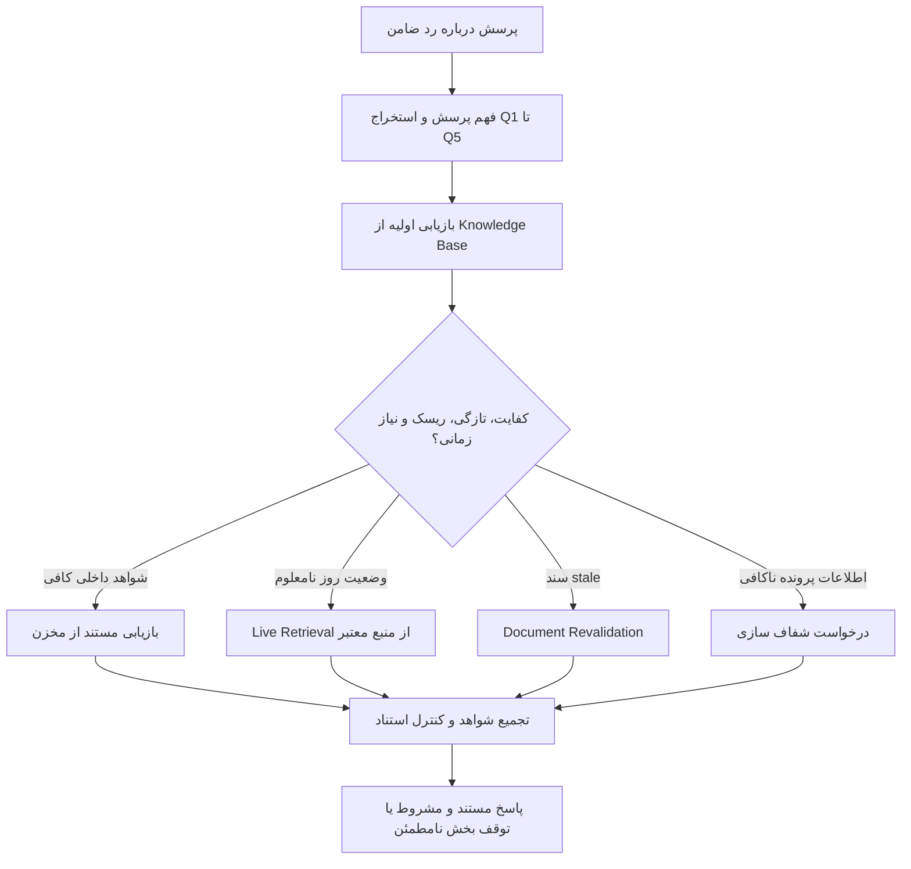

# سند توسعه فاز دوم شهاب — نسخه ۱.۵

**شناسه سند:** `SHAHAB-PHASE2-DEV-DOC`  
**نسخه:** `V1.5`  
**تاریخ به‌روزرسانی:** ۲۰۲۶-۱۱-۰۸  
**وضعیت:** ۴۰ تصمیم اصولی معماری فصل نخست تأیید شده؛ جزئیات اجرایی، آستانه‌ها و برنامه انتشار همچنان نیازمند اعتبارسنجی و تصویب مستقل  
**ساختار:** فصل نخست — شبکه دانش و بازیابی مقررات؛ فصل دوم — معماری کلان محصول؛ فصل سوم — معماری تفصیلی ایجنت‌ها و گزینه‌های معماری استقرار؛ فصل پنجم — پیش‌نویس غیرمصوب راهبرد اجرای تدریجی (شماره فصل چهارم برای تکمیل بعدی محفوظ است)

> **یادداشت ویرایشی:** فصل نخست از نسخه ۰.۱ حفظ شده است؛ فصل دوم از نسخه ۰.۲ فقط در نقاط تعارض با تصمیم‌های جدید اصلاح شده و فصل سوم برای طراحی تفصیلی افزوده شده و در نسخه ۰.۴ یک بخش مستقل درباره گزینه معماری قابل‌استخراج و مهاجرت تدریجی به آن اضافه شده است. تصمیم‌های محصولی صریح، پیشنهادهای فنی و مسائل باز از هم تفکیک شده‌اند. فصل پنجم در نسخه ۰.۵ صرفاً به‌عنوان Draft نیازمند بررسی اضافه شده است؛ شماره فصل چهارم برای تکمیل بعدی محفوظ است. این نسخه به معنی تصویب پیاده‌سازی، ایجاد تسک یا تغییر کد نیست. در نسخه ۰.۸، ۴۰ تصمیم اصولی معماری فصل نخست و پیامدهای وابسته به آن‌ها با حفظ وضعیت پیشنهادی فصل‌های دیگر یکپارچه شده‌اند.

> **مبنای نسخه ۱.۰ و کنترل تغییر:** این نسخه، متن کامل نسخه ۰.۹ را حفظ کرده و پیوست ممیزی یکپارچگی فاز اول و دوم را اضافه می‌کند. نسخه مبنای انتشار نرم‌افزار طبق اعلام صریح مالک پروژه **`v.1.08`** است؛ این شناسه با نسخه سند توسعه تفاوت دارد. ارجاع به `v0.1.8` یا نسخه‌های قدیمی در مستندات تاریخی، مجوز تغییر این خط مبنا نیست. برای تأیید تطابق tag، commit و digestهای محیط عملیاتی باید شواهد مستقل جمع‌آوری شود. هیچ‌یک از ADR-RAG-01 تا ADR-RAG-40 تغییر یا لغو نشده‌اند.

> **منابع کنترل‌شده:** کد شاخه `main`، `docs/PROJECT_CONTINUITY_DOCUMENT_SHAHAB_FINANCE_DEMO.md` (نسخه ۲۰.۰)، `docs/project-current-state.md`، `docs/SHAHAB_PROJECT_DEVELOPMENT_CANONICAL_GUIDE.md`، `docs/TASK_EXECUTION_PROTOCOL.md` و PR #176 (Draft و ادغام‌نشده هنگام ممیزی). PR #176 منبع پیشنهادی قواعد انتقال فاز است، نه بخشی از baseline ادغام‌شده. در تعارض «وضعیت جاری» با تاریخچه، کد و شواهد نسخه جاری مقدم‌اند؛ تصمیم‌های مصوب محصول و معماری فقط با تأیید مالک قابل تغییرند.

### تصمیم سراسری A01 — مرز سرویس‌ها و استقرار تدریجی (مصوب ۲۰۲۶-۱۱-۰۹)

**وضعیت:** مصوب مالک پروژه در سطح معماری هدف؛ نه مجوز پیاده‌سازی، انتشار یا تغییر زیرساخت. این تصمیم برای تمام فصل‌ها و برنامه‌های اجرایی استخراج‌شده از این Blueprint لازم‌الاتباع است و جایگزین فرضیه‌های ناسازگارِ گزینه استقرار در فصل‌های دوم، سوم و پنجم می‌شود؛ ۴۰ تصمیم `ADR-RAG-01` تا `ADR-RAG-40` بدون تغییر باقی می‌مانند.

1. **معماری هدف:** سه مرز سرویس مستقل `Core`، `Adviser` و `Assistant`. استقلال در این بند به معنای قابلیت توسعه، استقرار و مقیاس‌دهی جداگانه است، نه الزام به سه VM یا سه نمونه مستقل PostgreSQL.
2. **Core:** هسته محصول به‌صورت **مونولیت ماژولار** حفظ می‌شود؛ مالک قابلیت‌های مشترک و مرکزی محصول است. جزئیات دقیق مالکیت داده، احراز هویت و قراردادهای ارتباطی در تصمیم‌های بعدی تعیین می‌شوند.
3. **Adviser:** سرویس مستقل مشاور هوشمند، با مسئولیت‌های مربوط به گفت‌وگو، بازیابی و پاسخ مستند؛ طراحی داخلی RAG باید با ADRهای مصوب فصل اول سازگار باشد.
4. **Assistant:** مرز مستقل دستیار اجرایی با قابلیت استقرار مستقل در معماری هدف؛ در انتشار `RAG R1` **فقط مرزها و قراردادهای موردنیاز آن تعریف می‌شوند** و خود سرویس دستیار مستقر یا پیاده‌سازی نمی‌شود.
5. **استقرار `RAG R1`:** فقط `Core` و `Adviser` به‌عنوان دو واحد استقرار در نظر گرفته می‌شوند؛ استخراج `RAG_R1_RELEASE_PLAN.md` باید از این قید پیروی کند. جزئیات دامنه، هزینه، آزمون و زمان‌بندی R1 هنوز نیازمند تصمیم مستقل‌اند.
6. **زیرساخت اولیه:** استفاده از VM فعلی و زیرساخت PostgreSQL/Redis موجود مبنای برنامه‌ریزی است؛ جداسازی فیزیکی میزبان یا موتور پایگاه داده **الزام اولیه نیست** و تنها با شواهد ظرفیت، امنیت، تاب‌آوری یا نیاز عملیاتی و تصویب جداگانه انجام می‌شود.
7. **الزامات بین‌سرویسی:** قراردادهای صریح و نسخه‌دار، مرزبندی مالکیت منطقی داده، کنترل دسترسی، ردیابی سرتاسری درخواست‌ها و مدیریت خطا/Timeout پیش از اتصال عملیاتی سرویس‌ها مشخص شوند. **روش دقیق ارتباط، سیاست دسترسی به داده و جزئیات استقرار هنوز مصوب نیستند** و نباید از این بند استنتاج شوند.
8. **قاعده تفسیر:** هر جا متن پیشین «مونولیت ماژولار واحد برای همه اجزا»، «میکروسرویس کامل»، «سه VM/سه DB اجباری» یا «باز بودن اصل انتخاب معماری استقرار» را القا می‌کند، این تصمیم مرجع است. گزینه‌های تاریخی فصل سوم همچنان برای تحلیل هزینه/مهاجرت حفظ می‌شوند، اما انتخاب هدف دیگر باز نیست.

**پیامد مستندسازی:** تصمیم `A01`، بخش معماری کلان فصل دوم، تحلیل گزینه‌ها در فصل سوم §۲۲، و پرسش `O5-08` فصل پنجم را مقید می‌کند. استخراج برنامه‌های اجرایی سایر فصل‌ها باید همین مرزها را حفظ کند؛ هیچ تسک اجرایی صرفاً با تصویب این تصمیم ایجاد نشده است.

## فصل نخست — شبکه دانش، بازیابی مبتنی بر تقاضا و پایش مقررات

**نسخه مبنا (Original baseline):** V0.1؛ **بازنگری تصمیم‌های معماری:** V0.8  
**تاریخ (Date):** 2026-10-21  
**وضعیت (Status):** تصمیم‌های معماری در سطح اصول مصوب؛ جزئیات فنی و سنجه‌های پذیرش نیازمند اعتبارسنجی  
**دامنه (Scope):** معماری RAG مبتنی بر تقاضا، کشف انتشارهای جدید، بازاعتبارسنجی اسناد و کشف روابط حقوقی  
**پروژه (Project):** شهاب (SHAHAB)

> **محدوده فصل اول:** این فصل، طراحی مفهومی و جریان عملیاتی RAG فاز دوم را مشخص می‌کند؛ نه پیاده‌سازی نهایی، نه تأیید دسترسی فنی به وب‌سایت‌های مرجع، و نه تضمین صحت حقوقی پاسخ‌ها. تمام عنوان‌ها، شناسه‌ها، تاریخ‌ها و رویدادهای مثال انتهای سند فرضی‌اند.

### 1. هدف و اصول طراحی

هدف، ساخت یک مخزن دانش مقرراتی برای دستیار هوشمند شهاب است که **عمدتاً بر اساس پرسش و تقاضای واقعی کاربران رشد کند**، اما با یک لایه سبک کشف انتشارهای جدید، از تغییرات احتمالی مؤثر بر اسناد ذخیره‌شده نیز آگاه شود.

اصول:

1. **Demand-first:** دریافت و نمایه‌سازی کامل اسناد عمدتاً در پاسخ به نیاز کاربران یا شواهد مشخصِ اثرگذاری بر دانش موجود انجام می‌شود؛ نه خزش کامل تمام قوانین.
2. **Discovery ≠ Ingestion:** کشف عنوان و فراداده یک سند، به معنی ورود متن کامل آن به مخزن RAG نیست.
3. **Version awareness:** متن، نسخه، زمان دریافت، زمان بررسی و شواهد تغییرات هر سند مستقل ثبت می‌شود.
4. **Evidence before legal effect:** شباهت معنایی، به‌تنهایی اثبات‌کننده اصلاح، نسخ یا جایگزینی یک مقرره نیست.
5. **Conservative answers:** اگر وضعیت حقوقی منبع قابل احراز نباشد، پاسخ باید محدودیت را اعلام کند؛ وجود متن در مخزن به‌تنهایی کافی نیست.
6. **Selective processing:** اسناد جدید ابتدا با روش‌های کم‌هزینه غربال و فقط نامزدهای مرتبط برای دریافت متن کامل انتخاب می‌شوند.
7. **Auditability:** هر پاسخ، رابطه و تصمیم به‌روزرسانی باید قابل ردیابی به منبع، نسخه و شواهد باشد.

### 2. دامنه و فرضیات

#### 2.1 منابع بالقوه

- `qavanin.ir` به‌عنوان یکی از منابع رسمی موردنظر.
- وب‌سایت بانک مرکزی و سایر مراجع رسمی مرتبط با مقررات بانکی.
- افزودن هر منبع منوط به بررسی شرایط دسترسی، ساختار انتشار، سیاست‌های استفاده و قابلیت بازیابی مستندات است.

**فرض تأییدنشده:** مشخص نیست این سایت‌ها API، فهرست تغییرات، شناسه پایدار، فراداده ساختاریافته یا امکان استخراج روابط مقرراتی را با کیفیت لازم ارائه می‌کنند. بنابراین پیاده‌سازی Source Discovery و Live Retrieval باید با آزمون فنی هر منبع آغاز شود.

#### 2.2 خارج از محدوده V0.1

- خزش کامل و دائمی همه اسناد کشور.
- تضمین کشف تمام روابط حقوقی پنهان.
- تصمیم حقوقی قطعی صرفاً توسط LLM.
- اتصال عملیاتی به سامانه‌های بانک برای ارسال درخواست تسهیلات.
- انتخاب نهایی مدل‌های Embedding، Reranker یا پایگاه داده گراف مستقل.

### 3. اجزای معماری

#### 3.1 Query Understanding & Retrieval Router

**ورودی:** پرسش کاربر، زمینه گفت‌وگو و سطح حساسیت تصمیم.  
**وظیفه:** تبدیل پرسش به موضوعات، کلیدواژه‌ها، موجودیت‌ها و نیازهای استنادی؛ جست‌وجوی اولیه مخزن؛ ارزیابی کفایت شواهد، تازگی و ریسک؛ انتخاب پاسخ داخلی یا جست‌وجوی زنده.  
**خروجی:** تصمیم مسیریابی به همراه دلیل ثبت‌شده.

قواعد پایه:

- شواهد مرتبط و کافی + وضعیت بازبینی قابل قبول + ریسک مجاز → پاسخ مبتنی بر مخزن.
- نبود پوشش کافی → Live Retrieval.
- وجود سند با وضعیت `stale`، تغییر کشف‌شده یا رابطه حل‌نشده → بررسی زنده/بازاعتبارسنجی پیش از ادعای جاری بودن.
- حساسیت بالا یا الزام به تأیید وضعیت روز → کنترل زنده در صورت امکان، حتی با وجود سند داخلی.
- عدم دسترسی به منبع → عدم ادعای تأیید جاری؛ پاسخ مشروط یا توقف، متناسب با ریسک.

**نکته:** امتیاز شباهت برداری، به‌تنهایی معیار کفایت پاسخ نیست.

##### 3.1.1 مثال تشریحی — پرسش درباره رد ضامن در طرح مهربانی

> **وضعیت مثال:** سناریوی آموزشی و فرضی برای روشن‌کردن رفتار `Query Understanding & Retrieval Router` است؛ نه گزارش وضعیت واقعی مقررات، شرایط روز طرح مهربانی یا نتیجه پرونده یک مشتری. شناسه اسناد، زمان‌های بازبینی، تصمیم‌ها و خروجی JSON نمونه‌اند و هیچ Schema یا سیاست اجرایی جدیدی را تصویب نمی‌کنند.

**پرسش فرضی کاربر در حوزه «مشاور تسهیلات»:**

> «من می‌خوام از بانک ملی وام مهربانی بگیرم. ضامنم کارمند رسمی هست، چک برگشتی هم نداره، ولی شعبه می‌گه ضامنت تأیید نشده. مگه طبق قوانین بانک مرکزی، ضامن کارمند رسمی نباید قبول بشه؟ می‌تونن ضامن دوم هم بخوان؟»

این پرسش یک نیاز اطلاعاتی واحد نیست. دست‌کم پنج مسئله دارد: (۱) شرایط اختصاصی محصول، (۲) مقررات بالادستی تضامین، (۳) اثر اشتغال رسمی و نبود چک برگشتی بر پذیرش ضامن، (۴) وضعیت اعتبار و تغییرات احتمالی منابع در زمان درخواست، و (۵) علت خاص رد ضامن در پرونده کاربر. Router نباید ادعای کاربر درباره ضامن را به‌جای داده اعتبارسنجی تأییدشده تلقی کند.

**الف) فهم پرسش و استخراج نیازهای استنادی**

| ویژگی | برداشت اولیه از پرسش |
|---|---|
| حوزه فعال | تسهیلات بانکی (`loans`) |
| بانک و محصول | بانک ملی ایران؛ طرح مهربانی |
| مسئله اصلی | رد صلاحیت ضامن |
| مسائل فرعی | اعتبارسنجی، چک برگشتی، ضامن دوم، اختیارات بانک |
| نوع نیاز | شرایط محصول + مقررات + تحلیل مشروط وضعیت کاربر |
| حساسیت | بالا؛ پاسخ ممکن است بر تصمیم مالی و پیگیری حقوقی کاربر اثر بگذارد |
| نیاز زمانی | اعتبار مقررات و شرایط محصول در زمان موردنظر کاربر |
| شواهد لازم | متن و نسخه مقررات رسمی، شرایط معتبر محصول، و برای تشخیص علت خاص، اطلاعات تکمیلی پرونده |

**ب) تجزیه احتمالی به پرسش‌های قابل‌بازیابی**

| شناسه | پرسش فرعی |
|---|---|
| Q1 | شرایط رسمی پذیرش ضامن در طرح مهربانی چیست؟ |
| Q2 | مقررات بالادستی درباره تعداد و شرایط ضامنان چه می‌گویند؟ |
| Q3 | آیا کارمند رسمی بودن یا نداشتن چک برگشتی، پذیرش ضامن را الزامی می‌کند؟ |
| Q4 | آیا شرایط محصول یا مقررات مرتبط اخیراً تغییر کرده‌اند؟ |
| Q5 | برای تشخیص علت ردشدن این ضامن، چه اطلاعات دیگری لازم است؟ |

**ج) بازیابی اولیه از مخزن — داده‌های کاملاً فرضی**

| سند نمونه | وضعیت فرضی | نقش در پاسخ |
|---|---|---|
| `D-101` — شرایط طرح مهربانی | بازبینی‌شده ۲۰ روز پیش | شرایط محصول؛ نیازمند بررسی اعتبار جاری |
| `D-102` — مقررات عمومی اعتبارسنجی | بازبینی‌شده ۵ روز پیش | ارزیابی عمومی ضامن |
| `D-103` — دستورالعمل تضامین | `stale` | تعداد و نوع تضامین؛ نیازمند بازاعتبارسنجی |
| `D-104` — راهنمای قدیمی محصول | نسخه قدیمی | احتمالاً مرتبط، اما نامناسب برای ادعای شرایط جاری |
| `D-105` — مقررات حقوق مشتریان بانکی | بازبینی‌شده ۱۰ روز پیش | اطلاع‌رسانی و پیگیری |

در بازیابی اولیه می‌توان از تطبیق واژگانی، معنایی، فراداده و روابط اسناد استفاده کرد. اگر `D-104` برای عبارت «ضامن دوم» بالاترین امتیاز شباهت را داشته باشد، **این امتیاز به‌تنهایی مجوز استناد به آن به‌عنوان مقرره جاری نیست**. همچنین «تاریخ انتشار قدیمی» لزوماً به معنی «منسوخ» نیست و «بازبینی تازه» لزوماً به معنی «کفایت برای پاسخ» نیست.

**د) ارزیابی کفایت شواهد و تصمیم مسیریابی — نمونه**

| پرسش | ارزیابی نمونه | اقدام پیشنهادی Router |
|---|---|---|
| Q1 | سند محصول موجود است؛ وضعیت روز آن احراز نشده | بررسی زنده شرایط رسمی محصول |
| Q2 | سند مرتبط با وضعیت `stale` | ارجاع به بازاعتبارسنجی سند |
| Q3 | شواهد عمومی وجود دارد، اما وضعیت فردی احراز نشده | بازیابی داخلی و پاسخ مشروط، بدون نتیجه‌گیری درباره پرونده |
| Q4 | تغییرات احتمالی باید بررسی شوند | Live Retrieval از منابع مجاز و معتبر |
| Q5 | علت رد ضامن از پرسش قابل استخراج نیست | درخواست اطلاعات تکمیلی از کاربر؛ بدون دسترسی خودسرانه به داده‌های محرمانه |

Router در این مثال به **مسیر ترکیبی** می‌رسد: استفاده از شواهد داخلیِ قابل‌اتکا برای بخشی از پاسخ، بررسی زنده برای شرایط روز، بازاعتبارسنجی سند مشکوک و درخواست شفاف‌سازی برای بخش وابسته به پرونده شخصی. Live Retrieval از طریق ابزارهای متصل (برای نمونه MCP) انجام می‌شود؛ خود MCP موتور خزیدن یا جست‌وجو نیست و ابزار پشت آن ممکن است API، HTTP یا اتوماسیون مرورگر باشد.



**هـ) نمونه خروجی منطقی Router (غیرمصوب و صرفاً توضیحی)**

```json
{
  "domain": "loans",
  "intent": "guarantor_rejection_regulatory_guidance",
  "entities": {
    "bank": "Bank Melli Iran",
    "product": "Mehrabani",
    "subject": "guarantor"
  },
  "risk_level": "high",
  "retrieval_plan": [
    {"question": "Q1", "action": "live_verify", "reason": "Current product terms require verification"},
    {"question": "Q2", "action": "revalidate_document", "document_id": "D-103", "reason": "Document marked stale"},
    {"question": "Q3", "action": "retrieve_internal", "document_id": "D-102", "reason": "Relevant general evidence available"},
    {"question": "Q4", "action": "live_retrieve", "reason": "Possible regulatory changes"},
    {"question": "Q5", "action": "request_clarification", "reason": "Actual rejection reason is unknown"}
  ],
  "decision": "hybrid_retrieval",
  "requires_current_verification": true
}
```

این خروجی فقط نشان می‌دهد **تصمیم مسیریابی و دلیل آن باید قابل‌ردیابی باشند**؛ تعیین ساختار داده، سطح جزئیات ثبت و قرارداد API به طراحی و تصمیم‌گیری بعدی وابسته است.

**و) دو نتیجه ممکن بازیابی زنده**

- **بازیابی موفق:** منشأ، نسخه، تاریخ مشاهده و شواهد به دست آمده ثبت می‌شوند؛ تعارض‌های احتمالی بررسی می‌شوند؛ پاسخ فقط در محدوده شواهد کافی تولید می‌شود. حتی در این حالت، بدون اطلاعات پرونده نمی‌توان علت قطعی رد ضامن را تعیین کرد.
- **بازیابی ناموفق:** سیستم نباید ادعا کند که وضعیت روز را تأیید کرده است. در صورت مجازبودن از نظر ریسک، اطلاعات تاریخی با ذکر تاریخ و محدودیت عرضه می‌شوند؛ در غیر این صورت پاسخ بخش پرریسک متوقف یا به پیگیری از مرجع رسمی ارجاع می‌شود.

**ز) مرزبندی مسئولیت‌ها:** `Query Understanding` نیازهای اطلاعاتی را استخراج می‌کند؛ `Retrieval Router` مسیر و دلیل انتخاب را تعیین می‌کند؛ `Knowledge Base` شواهد داخلی را فراهم می‌کند؛ `DDI` ورود دانش جدیدِ مبتنی بر تقاضا را مدیریت می‌کند؛ `DRS` بازاعتبارسنجی اسناد شناخته‌شده را انجام می‌دهد؛ `Source Discovery / RDE` به کشف انتشارهای جدید و روابط احتمالی کمک می‌کنند؛ و `Answer Generation & Citation Guard` پاسخ مستند و محدودیت ادعاها را کنترل می‌کند. این مثال به‌معنای واگذاری همه این مسئولیت‌ها به Router نیست.

##### 3.1.2 چالش معماری باز — سطح تصمیم‌گیری Retrieval Router

مثال بالا یک مسئله **نیازمند بررسی و تصمیم‌گیری** را آشکار می‌کند: Router باید برای *کل پرسش* یک مسیر انتخاب کند یا بتواند برای *هر پرسش فرعی* مسیر مستقلی تعیین کند؟

| گزینه | تعریف | مزیت بالقوه | هزینه و ریسک بالقوه |
|---|---|---|---|
| **A — مسیریابی در سطح کل پرسش** | کل پرسش عمدتاً از مخزن یا مسیر زنده پاسخ داده شود | سادگی هماهنگی و اجرا | بازیابی زائد، یا نادیده‌گرفتن تفاوت تازگی و کفایت میان بخش‌های پرسش |
| **B — مسیریابی در سطح پرسش‌های فرعی** | هر نیاز اطلاعاتی مسیر جداگانه داشته باشد و شواهد در انتها تجمیع شوند | تناسب بیشتر شواهد با هر ادعا؛ استفاده انتخابی از بازیابی زنده | پیچیدگی هماهنگی، هزینه، تأخیر، رفع تعارض و ردیابی استناد |

در سناریوی ضامن، گزینه B از نظر مفهومی انعطاف بیشتری نشان می‌دهد، اما **این مشاهده به‌معنای تصویب آن نیست**. برای تصمیم باید حداقل دقت و پوشش پاسخ، هزینه و تأخیر، نرخ بازیابی زنده، رفتار در تعارض اسناد، قابلیت ممیزی و امکان اجرای مرحله‌ای هر دو گزینه ارزیابی شود. همچنین باید مشخص شود آیا راهکار ترکیبی/تطبیقی قابل توجیه است یا نه.

**وضعیت تصمیم:** `OPEN — نیازمند ارزیابی در بازبینی فصل اول`؛ بدون تغییر در معماری مصوب، بدون تعریف تسک اجرایی و بدون تبدیل مثال به الزام پیاده‌سازی.

#### 3.2 Demand-Driven Ingestion (DDI)

**محرک:** پرسش کاربر که مخزن نتواند با شواهد کافی پاسخ دهد.  
**وظیفه:** اجرای جست‌وجوی زنده در منبع رسمی از طریق ابزارهای ارائه‌شده به Agent، دریافت اسناد مرتبط، استخراج و نرمال‌سازی متن، حذف تکرار، ثبت منشأ و نسخه، بخش‌بندی و نمایه‌سازی.  
**خروجی:** سند نسخه‌دار و قابل بازیابی در Knowledge Base.

پروتکل MCP **لایه رابط ابزار** است، نه موتور جست‌وجو یا خزنده. ابزار پشت MCP ممکن است از API، HTTP یا اتوماسیون مرورگر استفاده کند؛ امکان واقعی آن باید برای هر سایت آزموده شود.

**الزام تکمیلی دسترسی غیرمستقیم:** در نبود API رسمی/مستقیم، Source Access Layer باید امکان ارزیابی و استفاده از **API غیرمستقیم (Indirect/Unofficial API)** را نیز داشته باشد؛ مانند endpointهای مورد استفاده رابط وب یا اپلیکیشن، یا APIهای واسطی که یک ارائه‌دهنده ثالث با مجوز معتبر عرضه می‌کند. این مسیر در کنار MCP، خزشگر/استخراج‌گر، HTTP و اتوماسیون مرورگر قرار می‌گیرد و **صرفاً پس از بررسی مجوز استفاده، احراز هویت، پایداری، امنیت، محدودیت نرخ و حقوق داده** قابل فعال‌سازی است. نمونه مورد اشاره برای مطالعه الگو: `MCPFARSI.IR`؛ ذکر نام آن به معنای تأیید فنی، حقوقی یا امنیتی سرویس نیست.

MCP می‌تواند ابزارهای نوع‌دار و اختصاصی برای هر منبع منتشر کند؛ از جمله `search_website`، `get_product_details`، `check_order_status` و در دامنه اجرایی مجاز `submit_order`. پیاده‌سازی پشت ابزار می‌تواند API مستقیم، API غیرمستقیم مجاز، خزشگر/Browser یا ترکیبی از آن‌ها باشد؛ **MCP خود API غیرمستقیم تولید نمی‌کند**. ابزارهای نوشتنی/تراکنشی از ابزارهای فقط‌خواندنی جدا هستند و به مجوز صریح کاربر، کنترل دامنه و دسترسی، تأیید قبل از اقدام حساس، کلید یکتای جلوگیری از ثبت تکراری، ثبت نتیجه و امکان توقف امن نیاز دارند. فقدان API مستقیم نباید به‌تنهایی مانع بررسی مسیرهای جایگزین شود؛ اما فقدان مجوز معتبر یا قابلیت فنی، استفاده از آن مسیر را متوقف می‌کند.

#### 3.3 Source Discovery & Metadata Catalog

**محرک:** اجرای دوره‌ای، مثلاً هر ۲۴ ساعت *به‌عنوان مقدار پیشنهادی اولیه، نه تعهد نهایی*.  
**وظیفه:** بررسی فهرست انتشارهای جدید یا تغییرات قابل مشاهده در منابع، دریافت فراداده سبک مانند شناسه، عنوان، نوع، مرجع صادرکننده، تاریخ، لینک، کلیدواژه و ارجاعات صریح در صورت وجود.  
**خروجی:** رکوردهای جدید یا تغییرکرده در `Source Catalog`، بدون الزام به دریافت متن کامل.

این لایه با **Document Revalidation** متفاوت است: Source Discovery دامنه انتشارهای جدید را می‌بیند؛ Revalidation فقط اسناد شناخته‌شده مخزن را بررسی می‌کند. اگر سایت فهرست قابل اتکایی نداشته باشد، پوشش این لایه محدود یا هزینه‌بر خواهد بود.

#### 3.4 Relationship Discovery Engine (RDE)

**محرک:** ورود فراداده سند جدید به Catalog یا کشف تغییر مرتبط.  
**وظیفه:** یافتن اسناد موجود که ممکن است با سند جدید ارتباط موضوعی یا حقوقی داشته باشند.

**مراحل:**

1. **تطبیق قطعی/ساختاری:** شناسه رسمی، شماره مصوبه، تاریخ، ارجاع صریح، مرجع صادرکننده و قالب عنوان.
2. **بازیابی واژگانی:** نرمال‌سازی فارسی، مترادف‌ها، BM25 / full-text search و کلیدواژه‌ها.
3. **بازیابی معنایی:** Embedding عنوان و فراداده و مقایسه با عنوان، خلاصه و نمایه اسناد مخزن.
4. **طبقه‌بندی موضوعی:** استفاده از واژگان کنترل‌شده / Ontology سبک حوزه بانکی؛ مانند ضمانت، تضامین، اعتبارسنجی و تسهیلات خرد.
5. **رتبه‌بندی نامزدها:** ترکیب شواهد ساختاری، واژگانی و معنایی و در صورت نیاز Reranker/LLM.
6. **تأیید رابطه:** برای نامزدهای منتخب، دریافت متن کامل سند جدید و استخراج شواهد صریح یا ضمنیِ قابل ارزیابی؛ تمایز «موضوع مشابه» از «اثر حقوقی».

**اصل محدودکننده:** عنوان مشابه فقط `candidate_relation` ایجاد می‌کند. روابطی مانند `AMENDS` یا `REPEALS` باید با شواهد متن و کنترل مناسب ثبت شوند. در صورت ابهام، وضعیت `needs_review` حفظ می‌شود.

#### 3.5 Selective Document Ingestion

**محرک:** نامزد ارتباطی دارای شواهد کافی، ارجاع صریح، یا ریسک بالقوه بالا.  
**وظیفه:** دریافت فقط متن کامل اسناد منتخب؛ استخراج بندها و ارجاعات؛ سنجش رابطه با سند موجود؛ ذخیره سند در صورت تأیید نیاز عملیاتی.  
**خروجی:** سند کامل، شواهد رابطه، یا پرونده بررسی ناموفق/نامطمئن.

برای جلوگیری از انباشت بی‌رویه، اسناد صرفاً «موضوعاً مشابه» لزوماً وارد مخزن کامل نمی‌شوند؛ ممکن است فقط فراداده و نتیجه بررسی آن‌ها در Catalog باقی بماند.

#### 3.6 Document Revalidation Service (DRS)

**محرک:** زمان‌بندی بازبینی اسناد موجود، تغییر شناخته‌شده در همان سند، یا ارجاع حقوقی مؤثرِ تأییدشده/محتمل.  
**وظیفه:** مراجعه به مرجع سند ذخیره‌شده، مقایسه نسخه و متن، ثبت تغییرات و انتشار نسخه جدید پس از کنترل کیفیت.  
**خروجی:** وضعیت `current_as_checked`، `stale`، `changed_pending_validation` یا `verification_failed` همراه با زمان و شواهد.

این سرویس **نمی‌تواند به‌تنهایی** سند جدید ناشناخته‌ای را کشف کند که بدون تغییر متن سند قبلی، اثر حقوقی بر آن گذاشته است. همین خلأ انگیزه افزودن Source Discovery و RDE است.

#### 3.7 Knowledge Base, Catalog & Relationship Store

- **Knowledge Base:** متن کامل، بخش‌ها، نسخه‌ها، نمایه واژگانی/برداری و شواهد منبع.
- **Source Catalog:** فهرست سبک اسناد کشف‌شده، حتی اگر متن کاملشان ذخیره نشده باشد.
- **Relationship Store:** یال‌های بین اسناد، نوع رابطه، شواهد، درجه اطمینان و وضعیت بررسی.
- **Event / Audit Log:** ثبت رویداد کشف، جست‌وجو، دانلود، تغییر، تأیید و انتشار پاسخ.

برای V0.1، PostgreSQL به همراه full-text search و `pgvector` یک گزینه اولیه قابل ارزیابی است. روابط را می‌توان در جدول رابطه‌ای نگهداری کرد؛ **Neo4j الزامی نیست**. انتخاب قطعی پس از ارزیابی حجم، عملکرد و نیازهای پرس‌وجوی گرافی انجام می‌شود.

#### 3.8 Answer Generation & Citation Guard

پاسخ باید از شواهد بازیابی‌شده تولید شود و در صورت امکان عنوان، شناسه، منبع، تاریخ/نسخه و بندهای مرتبط را ذکر کند. وضعیت «آخرین نسخه مشاهده‌شده» با «تمام آثار حقوقی بررسی‌شده» یکسان نیست. در تعارض یا ابهام، سیستم باید عدم قطعیت را آشکار کند.

### 3.9 معماری مصوب تکمیلی و نگاشت تصمیم‌های ۴۰گانه (V0.8)

> **سطح تصویب:** گزینه‌های معماری زیر در سطح اصل و جهت طراحی تأیید شده‌اند. این تصویب، انتخاب قطعی فناوری، آستانه، زمان‌بندی، ایجاد Task/PR یا استقرار را شامل نمی‌شود. بندهای 3.1 تا 3.8 همچنان مبنای مفهومی هستند؛ در تعارض احتمالی، قیود دقیق‌تر این بخش ملاک بازنگری طراحی‌اند.

#### 3.9.1 دفتر تصمیم‌های معماری (Architecture Decision Register)

##### ADR-RAG-01 — کنترل پذیرش خدمت و مسیریابی تطبیقی
**تصمیم تأییدشده:** پیش از تحلیل بازیابی، Service Scope & Admission Control باید ارتباط درخواست با خدمات مالی/حقوقی قابل ارائه را بر اساس کاتالوگ خدمت بسنجد؛ پرسش عمومی نامرتبط رد/به دامنه قابل پشتیبانی هدایت شود، اما توضیح مفاهیم در متن یک خدمت مجاز است. Router برای درخواست ساده مسیر مستقیم و برای درخواست پیچیده تجزیه به زیرپرسش، مسیرهای ترکیبی و تجمیع شواهد را انتخاب کند.
**مرز و قید:** رد درخواست خارج از دامنه نباید با فقدان شواهد در درخواست داخل دامنه اشتباه شود؛ تصمیم و علت مسیریابی ثبت گردد.
**مالکیت منطقی:** Admission Gate، Query Understanding، Retrieval Router.

##### ADR-RAG-02 — بازیابی زنده ریسک‌محور
**تصمیم تأییدشده:** Live Retrieval تابع ریسک اعتبار حقوقی، حساسیت تصمیم، تغییر مقررات، تعارض، تازگی، دامنه بانک/محصول، سطح شواهد و هشدارهای SCM باشد؛ صرف وجود نتیجه در کش داخلی برای پاسخ قطعی کافی نیست.
**مرز و قید:** وزن‌ها و آستانه‌های ریسک پس از آزمون تعیین می‌شوند؛ معیار واحد شباهت برداری کافی نیست.
**مالکیت منطقی:** Risk Policy، Retrieval Router.

##### ADR-RAG-03 — PostgreSQL-first و آمادگی گراف
**تصمیم تأییدشده:** دانش، شناسه‌های پایدار، روابط و تاریخچه در معماری سازگار با PostgreSQL موجود مدل شود؛ مدل رابطه‌ای و پیوندهای گراف‌پذیر مبنای اولیه‌اند و پایگاه گراف مستقل تنها با آزمون سود/هزینه و نیاز واقعی قابل انتخاب است.
**مرز و قید:** تصمیم به معنای ممنوعیت دائمی Neo4j یا الزام به نصب آن نیست.
**مالکیت منطقی:** Knowledge Store، Relation Store.

##### ADR-RAG-04 — لایه دسترسی ترکیبی و قرارداد مشترک منابع
**تصمیم تأییدشده (تکمیل‌شده):** Source Access Layer واسط واحد MCP، **API مستقیم و API غیرمستقیم مجاز** (از جمله endpointهای قابل‌استفاده رابط وب/اپ و API واسط ثالث)، HTTP، Browser/Crawler مجاز و Adapter ویژه منبع باشد؛ خروجی نرمال شامل هویت/نشانی منبع، زمان، روش استخراج، وضعیت/خطا، متن یا فایل و منشأ داده باشد. برای ابزارهای عملیاتی، قرارداد نوع‌دار ورودی/خروجی، وضعیت اقدام، شناسه درخواست و شواهد نتیجه نیز لازم است.
**مرز و قید:** MCP پروتکل اتصال است، نه جایگزین دریافت واقعی داده؛ ابزارهای آن می‌توانند جست‌وجوی وب‌سایت، دریافت اطلاعات، استعلام و ـ در صورت احراز مجوز و کنترل‌های اجرایی ـ ثبت سفارش را از طریق API مستقیم/غیرمستقیم یا Browser پیاده کنند. API غیرمستقیم به معنای مجازبودن مهندسی معکوس، دورزدن احراز هویت، CAPTCHA، محدودیت دسترسی یا شرایط استفاده نیست. ابزارهای تراکنشی به سیاست فصل سوم وابسته‌اند و تصویب این قابلیت، تغییر خودکار ستون فقرات Computer Use نیست.
**مالکیت منطقی:** Source Access Layer.

##### ADR-RAG-05 — هماهنگی رویدادمحور DDI/SR/SCM
**تصمیم تأییدشده:** DDI مبتنی بر تقاضا، SR بازاعتبارسنجی دوره‌ای و SCM پایش تغییر منبع از طریق رویدادهای پایدار و وضعیت دانش مشترک هماهنگ شوند؛ کشف، تغییر، شکست و انتشار باید اثر قابل ردیابی داشته باشند.
**مرز و قید:** SR و SCM غالباً شبانه و هر چند روز یک‌بار اجرا می‌شوند؛ سازگاری بین اجراهای غیرهم‌زمان مهم‌تر از هم‌زمانی لحظه‌ای است.
**مالکیت منطقی:** Event/Job Coordination، Knowledge State.

##### ADR-RAG-06 — حل تعارض چندمعیاره حقوقی
**تصمیم تأییدشده:** تعارض ابتدا از تفاوت قلمرو، تاریخ اجرا، بانک/محصول و استثنا جدا شود؛ سپس سلسله‌مراتب مقررات، صلاحیت صادرکننده، اعتبار زمانی، اصالت و شواهد سنجیده شوند.
**مرز و قید:** تعارض حل‌نشده نباید به یک حکم قطعی مصنوعی تبدیل شود.
**مالکیت منطقی:** Legal Relation & Conflict Resolver.

##### ADR-RAG-07 — پاسخ‌گویی مبتنی بر کفایت شواهد
**تصمیم تأییدشده:** برای هر ادعا پوشش و کفایت شواهد ارزیابی شود؛ پاسخ جزئیِ مستند مجاز است، ادعای فاقد پشتوانه باید حذف/مشروط شود و در موارد لازم سؤال تکمیلی یا بازیابی هدفمند انجام گیرد.
**مرز و قید:** چند قطعه تکراری از یک منبع به‌عنوان تأیید مستقل شمرده نشوند.
**مالکیت منطقی:** Evidence Sufficiency، Answer Guard.

##### ADR-RAG-08 — اعتبار زمانی دوگانه
**تصمیم تأییدشده:** زمان اعتبار حقوقی/اجرایی (valid time) از زمان مشاهده و ثبت در شهاب (system/recorded time) تفکیک شود؛ پاسخ تاریخی از نسخه و دانش قابل دسترس در همان نقطه زمانی بازسازی‌پذیر باشد.
**مرز و قید:** مدل دو‌زمانه فقط بر موجودیت‌های نیازمند تاریخچه اعمال شود، نه اجباراً همه جدول‌ها.
**مالکیت منطقی:** Versioning، Temporal Knowledge.

##### ADR-RAG-09 — بازیابی شکست‌خورده و بازیابی ایمن
**تصمیم تأییدشده:** در شکست Live Retrieval، Retry محدود، روش جایگزین، منبع معتبر جایگزین و در شرایط مجاز نسخه ذخیره‌شده با اعلام محدودیت بررسی شوند؛ در نبود اطمینان، ادعای قطعی متوقف شود.
**مرز و قید:** Fallback نباید با کاهش خاموش کیفیت یا ادعای «تأیید امروز» همراه باشد.
**مالکیت منطقی:** Retrieval Recovery Policy.

##### ADR-RAG-10 — بودجه بازیابی و کاتالوگ خدمت پویا
**تصمیم تأییدشده:** بودجه زمان/هزینه/تعداد منبع متناسب با پیچیدگی و ریسک تخصیص یابد؛ مسیریابی از کاتالوگ خدمت استفاده کند و بازیابی عمومی جای منطق تخصصی هر خدمت را نگیرد.
**مرز و قید:** قراردادهای خدمت، موتورهای تخصصی و توصیه‌گر در فصل دوم/سوم تفصیل می‌یابند؛ بودجه نباید ایمنی را قربانی کند.
**مالکیت منطقی:** Budget Policy، Service Catalog Interface.

##### ADR-RAG-11 — ارزیابی چندلایه RAG
**تصمیم تأییدشده:** ارزیابی مستقل پوشش و رتبه‌بندی بازیابی، استخراج، روابط، مسیر، پاسخ، استناد، امتناع، اعتبار زمانی، امنیت، هزینه و پیامد خدمت انجام شود؛ داده آزمون شامل سناریوهای منفی و تغییر مقررات باشد.
**مرز و قید:** آستانه‌ها و بنچمارک واقعی هنوز تعیین نشده‌اند.
**مالکیت منطقی:** Evaluation Harness.

##### ADR-RAG-12 — چرخه عمر وابسته دانش
**تصمیم تأییدشده:** وابستگی سند خام به نسخه استخراج، قطعه، Embedding، ایندکس، رابطه، کاتالوگ، قاعده و پاسخ قابل ردیابی باشد؛ تغییر منبع فقط مشتقات متأثر را بازاعتبارسنجی/بی‌اعتبار کند.
**مرز و قید:** تاریخچه برای ممیزی حفظ شود؛ حذف سراسری بی‌دلیل ممنوع.
**مالکیت منطقی:** Knowledge Lineage، Invalidation.

##### ADR-RAG-13 — امنیت چندلایه و مقابله با Prompt Injection
**تصمیم تأییدشده:** محتوای منابع خارجی داده غیرقابل اعتماد است؛ دستورهای داخل صفحه/PDF نباید اختیار ابزار یا سیاست را تغییر دهند؛ مجوز ابزار، دامنه دسترسی، جداسازی داده و کنترل خروجی اعمال شود.
**مرز و قید:** جزئیات اقدام ایجنت و Computer Use متعلق به فصل سوم است؛ لاگ‌ها فاقد داده حساس غیرضروری باشند.
**مالکیت منطقی:** Security Boundary، Tool Policy.

##### ADR-RAG-14 — ردیابی سرتاسری با رعایت حریم خصوصی
**تصمیم تأییدشده:** از پذیرش درخواست تا انتخاب مسیر، نسخه شواهد، محاسبه، تصمیم پاسخ و خطا شناسه ردیابی ساختاریافته وجود داشته باشد.
**مرز و قید:** Chain-of-thought یا داده شخصی غیرضروری ذخیره نشود؛ سیاست نگهداری و دسترسی لازم است.
**مالکیت منطقی:** Trace & Audit.

##### ADR-RAG-15 — تشخیص تغییر ساختار و کیفیت استخراج
**تصمیم تأییدشده:** تغییر قالب HTML/PDF، افت کیفیت OCR/Parsing، جابه‌جایی جدول/بند و ناسازگاری معنایی تشخیص داده شود؛ داده مشکوک قرنطینه یا برای بررسی علامت‌گذاری گردد.
**مرز و قید:** مقادیر غیرعادی لزوماً خطا نیستند؛ حذف خودکار داده بدون شاهد ممنوع.
**مالکیت منطقی:** Extraction QA، Schema Drift Monitor.

##### ADR-RAG-16 — پوشش ساختاری و شکاف‌یابی
**تصمیم تأییدشده:** برای هر خدمت، نیازهای شواهد و فیلدهای ضروری به‌صورت قرارداد قابل بررسی تعریف شود؛ شکاف‌ها منجر به بازیابی هدفمند یا پاسخ محدود شوند.
**مرز و قید:** فیلدهای تخصصی وام و سایر خدمات در فصل دوم تعیین می‌شوند؛ داده چند محصول نباید ادغام اشتباه شود.
**مالکیت منطقی:** Coverage Checker، Service Evidence Contract.

##### ADR-RAG-17 — کش چندلایه آگاه از اعتبار
**تصمیم تأییدشده:** کش در لایه دریافت منبع، استخراج، بازیابی، شواهد و پاسخ بر اساس نسخه، اعتبار زمانی، هشدار تغییر، خدمت و مرز کاربر مدیریت شود.
**مرز و قید:** پاسخ شخصی نباید در کش عمومی نشت کند؛ TTL واحد برای همه ادعاها کافی نیست.
**مالکیت منطقی:** Cache & Invalidation.

##### ADR-RAG-18 — ارجاع به پشتیبانی در موارد نیازمند کارشناس
**تصمیم تأییدشده:** در ریسک یا ابهام حقوقی، سامانه محدودیت را اعلام و به کاربر پیشنهاد تماس با پشتیبانی شهاب برای بررسی کارشناسی بدهد.
**مرز و قید:** در وضعیت فعلی تیم کارشناسی داخلی یا ایجاد خودکار پرونده/ارجاع تضمین یا فرض نمی‌شود.
**مالکیت منطقی:** Answer UX، Support Referral.

##### ADR-RAG-19 — انتشار نسخه‌دار و بازگشت‌پذیر
**تصمیم تأییدشده:** تغییر مدل، Prompt، تنظیمات بازیابی و قواعد باید نسخه‌دار، آزموده، قابل انتشار محدود و قابل Rollback باشد.
**مرز و قید:** Rollback نرم‌افزار نباید مقررات منسوخ را به‌عنوان قانون جاری احیا کند.
**مالکیت منطقی:** Release Governance.

##### ADR-RAG-20 — حاکمیت انتشار دانش با وضعیت‌های تفکیکی
**تصمیم تأییدشده:** دانش معتبرِ منتشرشده، داده مشکوک/نامعتبر و محتوای «نیازمند تأیید کارشناسی» از هم تفکیک شوند؛ محتوای دسته سوم می‌تواند با برچسب روشن به کاربر نمایش داده شود.
**مرز و قید:** داده نیازمند تأیید نباید مبنای محاسبه، توصیه قطعی یا ادعای حقوقی تأییدشده قرار گیرد؛ ارجاع خودکار به کارشناس ایجاد نشود.
**مالکیت منطقی:** Knowledge Publication Policy.

##### ADR-RAG-21 — کنترل بار و Backpressure
**تصمیم تأییدشده:** برای درخواست‌های تعاملی و کارهای شبانه صف، محدودیت هم‌زمانی، اولویت، Rate Limit و سهمیه منبع/کاربر/نشست تعریف شود.
**مرز و قید:** Worker و Queue می‌توانند در مونولیت ماژولار باشند؛ میکروسرویس اجباری نیست.
**مالکیت منطقی:** Workload Control.

##### ADR-RAG-22 — اجرای پایدار و Idempotent گردش‌کار
**تصمیم تأییدشده:** Jobها دارای شناسه، وضعیت پایدار، Retry ایمن، قفل/نسخه‌سنجی و نقطه انتشار کنترل‌شده باشند تا اجرای مجدد داده تکراری یا انتشار نیمه‌تمام ایجاد نکند.
**مرز و قید:** سازگاری DB، ایندکس و Snapshot باید آزمون شود؛ معماری توزیع‌شده الزامی نیست.
**مالکیت منطقی:** Durable Jobs، Publishing Coordinator.

##### ADR-RAG-23 — اعتماد چندبعدی به منبع در سطح ادعا
**تصمیم تأییدشده:** اعتبار مرجع، اصالت، تازگی، کیفیت استخراج، پوشش ادعا، دسترس‌پذیری و سابقه اصلاح مستقل ارزیابی شوند.
**مرز و قید:** امتیاز دسترس‌پذیری بالا جای صلاحیت حقوقی ضعیف را نمی‌گیرد؛ یک عدد واحد نباید معیار قطعی باشد.
**مالکیت منطقی:** Source Trust Policy.

##### ADR-RAG-24 — چرخه عمر کنترل‌شده منابع
**تصمیم تأییدشده:** منبع از کشف، بررسی هویت و مجوز، فعال‌سازی، تعلیق تا بازنشستگی وضعیت و تاریخچه داشته باشد.
**مرز و قید:** کشف خودکار منبع به معنی تأیید خودکار آن نیست.
**مالکیت منطقی:** Source Registry & Governance.

##### ADR-RAG-25 — قرارداد داده کاننیکال نسخه‌دار
**تصمیم تأییدشده:** خروجی Source Access و داده‌های سند/بند/رابطه قرارداد نسخه‌دار با قواعد اعتبارسنجی، مهاجرت و سازگاری عقب‌رو داشته باشند.
**مرز و قید:** Schema عمومی در فصل اول؛ قراردادهای محصول/خدمت در فصل دوم.
**مالکیت منطقی:** Canonical Contracts.

##### ADR-RAG-26 — جداسازی دانش عمومی از زمینه کاربر
**تصمیم تأییدشده:** دانش عمومی حقوقی/مالی از داده شخصی، مجوزها، تاریخچه نشست و محاسبات شخصی در دسترسی، نگهداری، کش و ممیزی جدا شود.
**مرز و قید:** جداسازی منطقی مبناست؛ جداسازی فیزیکی فقط با توجیه ریسک؛ سیاست نگهداری پرسشنامه یک‌ساعته موجود خودسرانه تغییر نکند.
**مالکیت منطقی:** Data Boundaries.

##### ADR-RAG-27 — تحلیل اثر تغییر مقررات
**تصمیم تأییدشده:** تغییر معنایی مقرره به اسناد وابسته، قواعد محاسبه، شرایط خدمت، محصولات و توصیه‌گر مرتبط نگاشت شود؛ انتشار اثر تغییر کنترل‌شده باشد.
**مرز و قید:** تفسیر حقوقی مبهم نیازمند احتیاط و در صورت لزوم توصیه به بررسی کارشناسی است.
**مالکیت منطقی:** Regulatory Impact Analyzer.

##### ADR-RAG-28 — Snapshot سازگار و فعال‌سازی اتمیک
**تصمیم تأییدشده:** هر پاسخ/محاسبه به نسخه سازگار مقررات، کاتالوگ، قواعد و ایندکس اشاره کند؛ تغییرات پس از اعتبارسنجی به‌صورت اتمیک فعال شوند.
**مرز و قید:** نسخه‌های تاریخی حفظ شوند؛ فعال‌سازی یا Rollback نباید داده منسوخ را جاری جلوه دهد؛ تکثیر فیزیکی کامل الزام نیست.
**مالکیت منطقی:** Knowledge Snapshot Registry.

##### ADR-RAG-29 — حل هویت مستند موجودیت‌های مالی
**تصمیم تأییدشده:** شناسه پایدار بانک، طرح، محصول و نسخه از نام نمایشی و نام‌های مستعار جدا شود؛ ادغام فقط با شواهد صادرکننده، مشخصات و زمان معتبر انجام گیرد.
**مرز و قید:** شباهت نام طرح‌ها مجوز ادغام خودکار نیست.
**مالکیت منطقی:** Entity Resolution.

##### ADR-RAG-30 — مدل صریح دامنه شمول و وابستگی قواعد
**تصمیم تأییدشده:** قواعد حقوقی با مرجع، سلسله‌مراتب، شرایط شمول، استثنا، تاریخ و وابستگی به قواعد دیگر مدل شوند.
**مرز و قید:** شرایط اختصاصی بانک نمی‌تواند الزام بالادستی معتبر را بی‌اثر کند.
**مالکیت منطقی:** Rule Applicability Graph.

##### ADR-RAG-31 — انتشار عدم قطعیت مرحله‌ای
**تصمیم تأییدشده:** عدم قطعیت استخراج، هویت، اعتبار حقوقی، زمان، پوشش و استنتاج جداگانه حفظ و در تصمیم نهایی لحاظ شود.
**مرز و قید:** درصد اطمینان بدون کالیبراسیون و آزمون نباید نمایش داده شود.
**مالکیت منطقی:** Uncertainty Policy.

##### ADR-RAG-32 — محاسبه مالی قطعی و مستند
**تصمیم تأییدشده:** LLM در کشف/توضیح کمک می‌کند اما محاسبه اقساط، نرخ و سناریوهای مالی در ابزار قطعی، آزموده و نسخه‌دار با ورودی و قاعده قابل ردیابی اجرا شود؛ توصیه‌گر موجود بازاستفاده شود.
**مرز و قید:** محاسبه عددی، احراز شرایط دریافت و رتبه‌بندی پیشنهاد سه مسئله متمایزند.
**مالکیت منطقی:** Deterministic Calculation Adapter.

##### ADR-RAG-33 — زمینه گفت‌وگوی ساختاریافته و وضعیت بازیابی
**تصمیم تأییدشده:** داده تأییدشده کاربر، فرضیه‌های تأییدنشده، موضوع فعال، خدمت، موجودیت و نسخه شواهد در وضعیت نشست جدا شوند؛ تغییر بانک/محصول مستلزم بررسی مجدد شواهد است.
**مرز و قید:** زمینه موقت مکالمه معادل حافظه دائمی نیست؛ محدودیت نگهداری فعلی خودسرانه عوض نشود.
**مالکیت منطقی:** Conversation Context Manager.

##### ADR-RAG-34 — حاکمیت مجوز و شرایط استفاده منابع
**تصمیم تأییدشده:** پیش از دریافت/ذخیره/بازنشر، مجوز قانونی و شرایط استفاده، نرخ، احراز هویت، Attribution و حدود نگهداری هر منبع کنترل و در لایه دسترسی اعمال شود.
**مرز و قید:** قابلیت فنی دسترسی به معنی مجاز بودن آن نیست؛ ابهام حقوقی باید پیش از استفاده حل شود.
**مالکیت منطقی:** Source Usage Policy.

##### ADR-RAG-35 — تضمین تازگی متناسب با ریسک
**تصمیم تأییدشده:** اعتبار اجرایی مقرره، آخرین زمان بررسی و میزان اطمینان از نبود تغییر سه مفهوم مستقل‌اند؛ سیاست تازگی برای خدمت و نوع ادعا تنظیم شود.
**مرز و قید:** اگر بررسی روز لازم اما ممکن نیست، ادعای «قانون فعلی» نباید قطعی بیان شود.
**مالکیت منطقی:** Freshness Assurance.

##### ADR-RAG-36 — Failover تأییدشده و تاب‌آوری بازیابی
**تصمیم تأییدشده:** در اختلال روش دریافت، مسیر جایگزین و در اختلال منبع، فقط منبع هم‌صلاحیت و دارای پوشش/تازگی کافی جایگزین شود؛ زنجیره دلیل ثبت گردد.
**مرز و قید:** این تصمیم تکمیل‌کننده تصمیم ۹ است و نباید زیرسامانه موازی و تکراری بسازد.
**مالکیت منطقی:** Source Access Failover.

##### ADR-RAG-37 — اصالت شواهد و استناد در سطح ادعا
**تصمیم تأییدشده:** هر ادعای مؤثر مالی/حقوقی به بند/جدول دقیق، نسخه سند، مرجع، بازه اعتبار، Hash و شناسه پایدار مرتبط شود؛ رابطه «مستقیم/استنتاجی/متعارض» و پشتیبانی واقعی ادعا بررسی شود.
**مرز و قید:** ارتباط موضوعی معادل اثبات ادعا نیست؛ URL یا نسخه جدید نباید استناد تاریخی را بی‌صدا بازنویسی کند.
**مالکیت منطقی:** Claim Evidence Ledger، Citation Guard.

##### ADR-RAG-38 — حلقه کنترل‌شده بهبود کیفیت بازیابی
**تصمیم تأییدشده:** خطاها و بازخوردهای کاربر/ارزیاب به دسته‌های ریشه‌ای مانند فهم پرسش، Extraction، Chunking، Ranking، Routing و Citation تبدیل شوند؛ تغییر پیشنهادی با مجموعه آزمون نسخه‌دار و سنجش رگرسیون ارزیابی و سپس طبق تصمیم ۱۹ منتشر شود.
**مرز و قید:** بازخورد کاربر به‌تنهایی حقیقت حقوقی نیست؛ یادگیری از داده شخصی بدون مبنای مجاز/رضایت انجام نشود؛ این تصمیم مکمل ۱۱ و ۱۹ است.
**مالکیت منطقی:** Quality Feedback Loop.

##### ADR-RAG-39 — بازیابی پس از بحران و بازسازی دانش
**تصمیم تأییدشده:** از داده کاننیکال، نسخه خام/مجاز اسناد، روابط، پیکربندی منبع، سیاست مجوز، وضعیت انتشار و Snapshot پشتیبان معتبر نگهداری شود؛ ایندکس‌ها و Embeddingهای مشتق در صورت امکان به‌شکل بازتولیدپذیر بازسازی و بازیابی دوره‌ای آزمون شود.
**مرز و قید:** RPO/RTO و فناوری پشتیبان بعداً تعیین می‌شود؛ بازسازی از وب به‌تنهایی کافی نیست؛ نسخه قدیمی قانون نباید خودکار فعال شود.
**مالکیت منطقی:** Backup/Restore، Index Rebuild.

##### ADR-RAG-40 — تثبیت معماری و آمادگی پیاده‌سازی مرحله‌ای
**تصمیم تأییدشده:** ۴۰ تصمیم به اجزای مشخص، قراردادها، وابستگی‌ها، معیار پذیرش، ریسک و ترتیب اعتبارسنجی نگاشت شوند؛ حداقل هسته ایمن ابتدا و قابلیت‌های پیشرفته در گام‌های وابسته و آزمون‌پذیر اضافه شوند.
**مرز و قید:** تصویب اصول معماری مجوز اجرای یکجای ۴۰ قابلیت، تغییر کد، ایجاد تسک یا تصویب نقشه راه نیست؛ مونولیت ماژولار نقطه شروع پیشنهادی است.
**مالکیت منطقی:** Architecture Decision Baseline.

#### 3.9.2 زنجیره اجرایی یکپارچه و مرز ماژول‌ها

جریان مرجع: **Service Admission → Context/Intent → Risk & Budget Policy → Query Decomposition → Hybrid Retrieval (Knowledge Store / Live Source Access) → Extraction & Quality Gate → Entity/Temporal/Applicability Resolution → Coverage & Evidence Sufficiency → Deterministic Tool (در صورت نیاز) → Claim-Level Citation Guard → Response/Abstention → Privacy-aware Audit**. در مسیر دریافت، رویدادهای DDI/SR/SCM به Job پایدار، بررسی مجوز منبع، ثبت نسخه، Lineage، بازاعتبارسنجی و انتشار Snapshot سازگار متصل می‌شوند. هیچ مرحله‌ای حق ندارد به‌تنهایی محتوای مشکوک را به دانش قطعی تبدیل کند.

مرزهای پیشنهادی مونولیت ماژولار عبارت‌اند از: `service-admission`، `query-routing`، `source-access`، `ingestion-extraction`، `source-registry`، `knowledge-versioning`، `legal-relations`، `evidence-policy`، `calculation-adapters`، `answer-citation`، `job-orchestration`، `observability-evaluation` و `backup-recovery`. این‌ها **مرز منطقی داخلی Adviser** هستند، نه تعهد به سرویس یا دیتابیس مستقل برای هر ماژول. مطابق تصمیم سراسری **A01**، خود Adviser یک واحد استقرار مستقل از Core است؛ Assistant نیز مرز مستقلِ هدف است اما در RAG R1 مستقر نمی‌شود.

#### 3.9.3 قراردادهای مشترک و حداقل فیلدهای الزامی

| قرارداد منطقی | حداقل محتوا | مصرف‌کننده/کنترل |
|---|---|---|
| `SourceAccessResult` | `source_id`, `source_uri`, `access_method`, `retrieved_at`, `status`, `error`, `content_hash`, `permission_policy_ref`, `raw_artifact_ref` | استخراج، ممیزی و کنترل مجوز؛ قالب واقعی نسخه‌دار |
| `DocumentIdentity/Version` | `document_id`, `version_id`, `issuer_id`, `published_at`, `valid_from/to`, `recorded_from/to`, `content_hash`, `status` | حل هویت، تاریخچه و اعتبار زمانی |
| `EvidenceUnit` | `evidence_id`, `version_id`, `section/table_ref`, `text_span`, `extraction_quality`, `source_trust_dimensions` | کفایت شواهد و استناد در سطح ادعا |
| `ClaimEvidenceLink` | `claim_id`, `evidence_id`, `support_type`, `entailment_status`, `verified_at`, `citation_snapshot_ref` | کنترل استناد و بازسازی پاسخ تاریخی |
| `KnowledgeSnapshot` | `snapshot_id`, `activated_at`, `document_set_version`, `rules_version`, `catalog_version`, `index_version`, `validation_status` | پاسخ/محاسبه سازگار و انتشار اتمیک |
| `RetrievalDecisionTrace` | `trace_id`, `admission_decision`, `route`, `risk_reasons`, `budget`, `evidence_ids`, `freshness_status`, `fallback_reason`, `response_policy` | ممیزی حداقلی و ارزیابی کیفیت |
| `SourceLifecyclePolicy` | `source_id`, `authority_scope`, `usage_rights`, `rate_limits`, `attribution`, `lifecycle_status`, `last_checked_at` | کنترل دسترسی، استفاده و اعتماد |
| `Job/Event` | `job_id`, `idempotency_key`, `event_type`, `entity_version`, `attempt`, `state`, `created_at` | DDI/SR/SCM و بازیابی ایمن |

فیلدها **قرارداد مفهومی** هستند؛ نام جد…44574 tokens truncated…رزش بازار |
| O5-06 | اجرای وب، Android و iOS هرکدام چه سطح امکان‌پذیری، مجوز و محدودیت دارند؟ | پرهیز از وعده غیرقابل اجرا |
| O5-07 | حداقل نسخه معتبر Feedback و Feedforward در مرحله ۳ چیست؟ | پرهیز از تعریف مبهم و بیش‌ازحد گسترده |
| O5-08 | معماری هدف طبق A01 مصوب است؛ معیارهای سنجش مرزها، استقرار تدریجی، منابع و زمان استخراج/جداسازی چیست؟ | **اصل انتخاب معماری بسته شد؛** معیارهای اجرایی و آزمون‌ها همچنان بازند |
| O5-09 | آیا اجرای موازی Discovery مراحل بعدی با منابع موجود توجیه دارد؟ | ظرفیت و هزینه فرصت |
| O5-10 | معیار Go/No-Go، بودجه، آستانه کیفیت و مالک تصمیم هر انتشار چیست؟ | کنترل ریسک و انتشار |
| O5-11 | کدام بندهای فصل دوم §۱۹ و سوم §۱۹ نیازمند بازنگری پس از تصویب نقشه راه هستند؟ | سازگاری بین‌فصلی بدون اصلاح خاموش |
| O5-12 | الزامات سند جامع فاز اول، پروتکل، رترو و handoff چه تعارض یا محدودیتی ایجاد می‌کنند؟ | یکپارچگی حاکمیت پروژه |
| O5-13 | کدام قابلیت‌های فصل دوم (پلن، پرداخت، کیف پول، عضویت و غیره) پیش‌نیاز هر مرحله‌اند و کدام‌ها خارج از این سه‌مرحله‌بندی مانده‌اند؟ | جلوگیری از حذف ناخواسته دامنه محصول |
| O5-14 | پس از مرحله ۳، گسترش خدمات و مقیاس‌پذیری چگونه مدیریت می‌شود بدون تحمیل مرحله جدیدِ مصوب؟ | تداوم محصول پس از پایلوت |

### ۵.۱۴. ماتریس وابستگی تصمیم‌ها (Decision Dependency Matrix) — پیش‌نویس تحلیلی

> **وضعیت: DRAFT / برای بررسی، نه تصویب.** این ماتریس، پرسش‌های O5-01 تا O5-14 بخش ۵.۱۳ را به مبانی طراحی و تصمیم‌های پیش‌نیاز پیوند می‌دهد. «وابستگی» به معنی تصویب آن مبنا نیست. ارجاعات به فصل‌های ۱ تا ۳ بر اساس **متن همین نسخه** هستند؛ تطبیق با کد، اسناد جامع فاز اول، رتروسپکتیو و handoff هنوز انجام نشده است. ستون «وضعیت» بیانگر وضعیت تصمیم *برای برنامه‌ریزی فصل پنجم* است، نه نفی یا تصویب تصمیم‌های محصولی ثبت‌شده در فصل‌های قبل.

| شناسه | مسئله تصمیم | مبنا و وابستگی در سند | وضعیت پیش‌نیاز / خلأ شواهد | بررسی یا شواهد لازم پیش از تصمیم | اثر تصمیم بر برنامه اجرایی |
|---|---|---|---|---|---|
| **O5-01** | آیا اجرای کل فصل اول در مرحله ۱ شدنی است و «تکمیل» چه معنایی دارد؟ | فصل ۱، به‌ویژه اجزای RAG/MCP، Ingestion، Revalidation، SCM، New Source Catalog و گراف دانش؛ فصل ۵ §۵.۳–۵.۴ | **باز**؛ دامنه مفهومی توصیف شده، اما برآورد و معیار تکمیل مرحله مصوب نیست | ماتریس بندبه‌بند پوشش فصل ۱؛ شناسایی پیش‌نیازها؛ برآورد ظرفیت، هزینه، ریسک و آزمون جامع | مرز مرحله ۱، شروط پایان آن و امکان تقسیم انتشارها |
| **O5-02** | نخستین انتشارهای امن RAG و زمان انتشار سوپراپ چه باشند؟ | فصل ۲ §۱۵ و §۱۹؛ فصل ۳ §۲–۴؛ فصل ۵ §۵.۳–۵.۴ | **باز**؛ تجربه هدف توصیف شده، اما ترتیب انتشار تعیین نشده | تعریف سناریوهای قابل استفاده، وابستگی UI به Backend، قابلیت rollback و سنجه ارزش | زمان ورود به بازار، ترتیب انتشارهای مرحله ۱ |
| **O5-03** | مرز داده لازم برای مشاور مرحله ۱ و کاتالوگ کامل مرحله ۲ کجاست؟ | فصل ۱ (منابع و دانش)؛ فصل ۲ §۴ و §۱۲؛ فصل ۳ §۹–۱۲ | **نیازمند حل مرزبندی**؛ احتمال هم‌پوشانی دانش محصول و کاتالوگ | ترسیم جریان داده و قراردادها؛ شناسایی داده حداقلی لازم؛ آزمون وابستگی دوری | جلوگیری از انتقال ناخواسته دامنه مرحله ۲ به مرحله ۱ |
| **O5-04** | API کاتالوگ چه نقشی دارد و جایگزین مستقل آن چیست؟ | فصل ۲ §۱۲؛ فصل ۳ §۹–۱۰ | **اصل عدم وابستگی حیاتی در متن مطرح است**؛ دسترسی و کیفیت APIها احراز نشده | ارزیابی منابع و مجوز استفاده؛ آزمایش دریافت/تطبیق داده؛ آزمون قطع API و کیفیت جایگزین | دامنه، ریسک و هزینه مرحله ۲؛ معیار تاب‌آوری |
| **O5-05** | خدمت نمونه مرحله ۳ با چه معیارهایی انتخاب شود؟ | فصل ۲ §۳، §۶ و §۱۹؛ فصل ۳ §۲، §۵، §۱۳ و §۱۹ | **باز**؛ «یک نوع خدمت» تعیین نشده | مقایسه ارزش بازار، پیچیدگی، مجوز، ریسک، دسترسی محیط آزمون و قابلیت سنجش | دامنه پایلوت Computer Use و برآورد مرحله ۳ |
| **O5-06** | سطح واقعی پشتیبانی مرورگر، Android و iOS چیست؟ | فصل ۳ §۵–۸، §۱۵، §۱۸–۱۹ | **نیازمند امکان‌سنجی فنی و حقوقی مستقل برای هر پلتفرم** | PoC غیرمخرب؛ آزمون سیاست OS و بانک، احراز هویت، محل اجرا، امنیت و هزینه | وعده محصول، محیط اجرا، ترتیب انتشار و شروط Go/No-Go مرحله ۳ |
| **O5-07** | حداقل Feedback و Feedforward معتبر در مرحله ۳ چیست؟ | فصل ۲ §۷–۹ و §۱۷؛ فصل ۳ §۱۴ و §۱۶ | **مفهوم و نقش‌ها توصیف شده‌اند؛ معیار دامنه و پذیرش باز است** | تعریف رویدادها، داده و شواهد لازم، کنترل رضایت، معیار سنجش سودمندی و خطای پیش‌بینی | دامنه مرحله ۳، آزمون‌ها، هزینه داده و قابلیت انتشار |
| **O5-08** | «پایه» و «تکمیل» معماری ماژولار چگونه سنجیده می‌شود؟ | فصل ۲ §۱۳ و §۱۸؛ فصل ۳ §۲۲، به‌ویژه §۲۲.۵–۲۲.۸ | **A01 مصوب:** Core مونولیت ماژولار؛ Adviser مستقل در R1؛ Assistant مستقل در معماری هدف و بدون استقرار در R1؛ معیارهای استخراج و سنجه‌های اجرایی هنوز بازند | مقایسه گزینه‌ها؛ آزمون قرارداد ماژول‌ها، مالکیت داده، جداسازی اجرا، منابع و هزینه مهاجرت | معماری پایه مرحله ۱، تکامل در مرحله ۲، معیار پایان مرحله ۳ |
| **O5-09** | چه مقدار Discovery موازی با Delivery ممکن است؟ | فصل ۵ §۵.۷ و §۵.۱۰؛ وابسته به ریسک‌های فصل ۱ و فصل ۳ | **باز**؛ ظرفیت و بودجه واقعی تثبیت نشده | ظرفیت‌سنجی تیم، اولویت ریسک‌ها، بودجه آزمایش، هزینه فرصت و توقف آزمایش | هم‌پوشانی زمانی فعالیت‌ها و سرعت عرضه |
| **O5-10** | آستانه‌های Go/No-Go، کیفیت، بودجه و مالک تصمیم چیست؟ | فصل ۲ §۱۶–۱۷؛ فصل ۳ §۱۶؛ فصل ۵ §۵.۸–۵.۱۰ | **باز**؛ شاخص‌ها پیشنهاد شده‌اند، آستانه و مسئول تصویب مشخص نیست | خط مبنا، آزمون کیفیت/امنیت/کارایی، برآورد هزینه واحد و تعیین اختیار تصمیم | دروازه‌های انتشار، پذیرش، rollback و پایش |
| **O5-11** | تعارض توالی‌های قبلی با سه مرحله پیشنهادی چگونه حل شود؟ | فصل ۲ §۱۹؛ فصل ۳ §۱۹؛ فصل ۵ §۵.۳ و §۵.۱۲ | **تعارض/ناهمخوانی بالقوه ثبت‌شده؛ حل نشده** | مقایسه بندبه‌بند؛ تفکیک «مسیر اعتبارسنجی» از «نقشه راه اجرا»؛ تصمیم و ثبت دلیل | انسجام بین‌فصلی؛ جلوگیری از تصویب ضمنی یا بازنویسی خاموش |
| **O5-12** | کدام قوانین فاز اول، رترو و handoff محدودیت الزام‌آور ایجاد می‌کنند؟ | فصل ۵ §۵.۲، §۵.۱۱–۵.۱۲؛ اسناد مرجع فاز اول خارج از متن حاضر | **نیازمند بررسی منبع اصلی**؛ تطبیق کامل انجام نشده | خواندن Canonical Guide، TASK_EXECUTION_PROTOCOL، رترو و سند تداوم؛ استخراج آزمون‌های انطباق | قواعد شکست کار، کنترل تغییر، کیفیت و مجوز اجرا |
| **O5-13** | تکلیف پلن‌ها، کیف پول، پرداخت و دیگر قابلیت‌های فصل دوم در سه مرحله چیست؟ | فصل ۲ §۹–۱۰ و §۱۸؛ فصل ۳ §۳ و §۱۱؛ فصل ۵ §۵.۳ | **باز**؛ خطر جاافتادن قابلیت‌های محصول از تقسیم‌بندی | ماتریس پوشش همه قابلیت‌های فصل ۲ و ۳؛ تعیین پیش‌نیاز، تعویق یا خروج از دامنه با تصمیم صریح | کامل‌بودن نقشه راه و جلوگیری از حذف پنهان دامنه |
| **O5-14** | گسترش خدمات و مقیاس بعد از مرحله ۳ چگونه برنامه‌ریزی شود؟ | فصل ۲ §۱۹؛ فصل ۳ §۲۲؛ فصل ۵ §۵.۳ و §۵.۱۰ | **باز**؛ سه مرحله صرفاً پیشنهادند و برنامه پس از آن تصویب نشده | تعریف معیار تقاضا، هزینه هر خدمت، قابلیت استفاده مجدد، محرک استخراج سرویس و انتشار مستقل | تداوم محصول بدون افزودن خودکار مرحله یا تعهد جدید |

#### ۵.۱۴.۱. ترتیب رسیدگی پیشنهادی به وابستگی‌ها

۱. **ابتدا صحت مبانی را بررسی کنیم:** پوشش کامل فصل ۱ (**O5-01**)، مرز RAG/کاتالوگ (**O5-03**)، تعارض بین‌فصلی (**O5-11**)، انطباق با اسناد فاز اول (**O5-12**) و پوشش سایر قابلیت‌های محصول (**O5-13**).
۲. **سپس امکان‌پذیری گزینه‌های پرریسک را بسنجیم:** API و مسیر جایگزین (**O5-04**)، انتخاب خدمت نمونه (**O5-05**)، اجرای وب/اپ (**O5-06**)، Feedback/Feedforward (**O5-07**) و آزمون‌های تحقق معماری مصوب **A01** (**O5-08**).
۳. **بعد قیود اجرایی را مشخص کنیم:** ظرفیت تحقیق موازی (**O5-09**)، کیفیت و اختیار تصمیم (**O5-10**)، انتشارهای مرحله ۱ (**O5-02**) و برنامه پس از مرحله ۳ (**O5-14**).
۴. **تنها پس از حل وابستگی‌ها و تأیید صریح صاحب پروژه**، درباره اصل سه‌مرحله‌ای‌بودن، مرز مراحل و زمان‌بندی تصمیم بگیریم؛ **پس از آن** Epic، User Story، Task/Subtask، Test، Acceptance Criteria و Definition of Done تدوین شوند. ترتیب بالا مسیر بررسی است، نه حکم به توالی خشک؛ مسائل مستقل می‌توانند موازی بررسی شوند.

#### ۵.۱۴.۲. قاعده ثبت و بستن هر تصمیم

برای هر شناسه، «گزینه‌ها، شواهد و آزمون‌ها، پیامد هزینه/زمان/امنیت، تعارض‌ها، تصمیم‌گیر، نتیجه، تاریخ و ارجاع به بندهای متأثر» ثبت شود. **استثنا/به‌روزرسانی وضعیت:** اصل معماری هدف در موضوع O5-08 با تصمیم سراسری مصوب A01 بسته شده است؛ فقط معیارهای عملیاتی و قراردادهای تفصیلی آن باز مانده‌اند. تا زمان ارائه شواهد و **تأیید صریح**، وضعیت آن **باز/نیازمند اعتبارسنجی** باقی می‌ماند. این ماتریس هیچ معماری، مرحله‌بندی، تسک یا تغییر کدی را تصویب نمی‌کند.

### ۵.۱۵. شرایط ارتقای فصل از Draft به برنامه مصوب

این فصل تنها پس از (الف) بررسی دامنه واقعی فصل‌های ۱ تا ۳ و ماتریس پوشش؛ (ب) امکان‌سنجی فنی و حقوقی و ارزیابی منابع؛ (ج) تعیین انتشارهای درون مراحل و وابستگی‌ها؛ (د) تعیین معیارهای پذیرش، هزینه و بازگشت؛ (هـ) تطبیق با اسناد فاز اول و رتروسپکتیو؛ (و) ثبت و حل تعارض‌ها؛ و **(ز) تأیید صریح صاحب پروژه** می‌تواند مبنای برنامه اجرایی قرار گیرد. حتی پس از تصویب فصل، ایجاد Task/PR یا تغییر طراحی نیازمند مجوز و فرایند مستقل است.

**جمع‌بندی وضعیت:** سه مرحله فوق **پیشنهاد کاربر برای بحث بیشتر** هستند. ارزش آن‌ها در آزمودن این فرضیه است که می‌توان فصل اول RAG را کامل پیاده کرد، هم‌زمان زودتر منتشر شد، کاتالوگ را در مرحله دوم توسعه داد و در مرحله سوم فناوری دستیار و حلقه‌های Feedback/Feedforward را اثبات کرد؛ در تمام مسیر نیز پایه معماری ماژولار را از ابتدا شکل داد و تا پایان مرحله سوم تکمیل کرد. این فرضیه هنوز **تأیید یا رد نشده است**.

---

## پیوست A — ممیزی یکپارچگی فاز اول و دوم و اصلاحات اجرایی نسخه ۱.۰

**نوع تغییر:** الحاق توضیحات انطباق و شواهد؛ بدون بازنویسی فصل‌های ۱ تا ۳، بدون تغییر ۴۰ ADR مصوب، بدون تصویب WBS یا انتشار. **زمان مبنا:** ۲۰۲۶-۱۱-۰۴. **دامنه شواهد:** خواندن ساختار و فایل‌های منتخب `main` و اسناد پروژه؛ اجرای تست، دسترسی به دیتابیس عملیاتی و ممیزی زنده VM انجام نشده است.

### A.1. خط مبنا، تقدم منابع و وضعیت ادعاها

| موضوع | خط مبنا / شاهد | سطح اطمینان و اقدام لازم |
|---|---|---|
| نسخه انتشار فاز اول | `v.1.08` طبق تأیید مالک | مرجع نام نسخه؛ تطبیق Git tag، SHA، image digest و runtime هنوز لازم است |
| تداوم پروژه | `docs/PROJECT_CONTINUITY_DOCUMENT_SHAHAB_FINANCE_DEMO.md` نسخه ۲۰.۰ | مبنای تاریخچه و وضعیت ثبت‌شده؛ بندهای تاریخی نباید جایگزین شواهد جاری شوند |
| وضعیت اجرای پروژه | `docs/project-current-state.md` | وضعیت ثبت‌شده؛ نیازمند تطبیق با آخرین کد و شواهد اجرا |
| قواعد مشترک فازها | PR #176 و سند پیشنهادی `docs/SHAHAB_PROJECT_DEVELOPMENT_PHASE2_CANONICAL_GUIDE.md` | PR در زمان بررسی Draft و ادغام‌نشده؛ مرجع تطبیق، نه قانون ادغام‌شده |
| کد فعلی | `main` و فایل‌های backend/frontend/CI/Compose | شاهد ساختار؛ به‌تنهایی اثبات عملکرد production نیست |
| معماری هدف | فصل‌های ۱–۳ همین سند و ADR-RAG-01 تا ADR-RAG-40 | اصول فصل نخست مصوب؛ گزینه‌ها و پارامترهای اجرایی باز |

**قاعده حل تعارض:** تفاوت شماره نسخه، مسیر فایل، شمارش migration، وضعیت PR یا استقرار باید در دفتر مغایرت با شاهد و تصمیم‌گیر ثبت شود؛ هیچ اصلاح حدسی در کد یا سند منبع مجاز نیست. آدرس سند تداوم در `main` داخل `docs/` است، نه ریشه مخزن.

### A.2. نقشه استفاده مجدد و مرز مالکیت

| قابلیت فاز دوم | دارایی واقعی فاز اول | تصمیم اتصال و ممنوعیت |
|---|---|---|
| RAG API و مشاور | `backend/app/main.py` و `backend/app/api/v1/router.py` | روتر/قرارداد جدید با نسخه‌بندی و خطاهای سازگار؛ عدم قراردادن منطق بازیابی در لایه HTTP |
| دانش و فراداده حقوقی | PostgreSQL، SQLAlchemy و `alembic/versions/` | جداول و migrationهای مستقل دامنه دانش؛ عدم تغییر خاموش جداول وام و حساب؛ Alembic مالک DDL |
| cache و هماهنگی | Redis موجود؛ `questionnaire/infrastructure/redis_cache.py` | namespace و TTL مستقل RAG؛ PostgreSQL منبع حقیقت نشست پرسشنامه است؛ Redis cache نباید authority شود |
| توصیه مبتنی بر دانش | `recommendation/application/use_cases.py`، `engine/canonical_scoring.py`، snapshot و قراردادهای توصیه | موتور امتیازدهی قطعی و داده `PUBLISHED` مرجع رتبه‌بندی؛ RAG صرفاً توضیح مستند و دانش مکمل ارائه کند؛ تغییر امتیاز/ضرایب ممنوع مگر از فرایند مصوب |
| ورود داده و انتشار | `data_pipeline/application/publish_serving_version.py`، audit و عملیات | الگوی draft/approval/atomic publish/rollback قابل الگوبرداری است؛ سرویس انتشار وام مستقیماً ناشر مقررات نمی‌شود |
| هویت، نشست و حریم خصوصی | `accounts/`، API حساب، proof پرسشنامه، history | استفاده از authority فعلی، کنترل مالکیت، حداقل‌سازی و سیاست‌های retention؛ ساخت هویت موازی ممنوع |
| سوپراپ و مشاور | `src/home page.jsx` و `src/features/` | تغییر تدریجی و قابل بازگشت، حفظ مسیرهای فعلی و طراحی تأییدشده؛ تغییر محصول از refactor US-13 جدا شود |
| کیفیت و انتشار | `backend/tests/`، `tests/`، `.github/workflows/quality.yml` و `security.yml`، Docker Compose | افزودن آزمون‌های RAG و CI بدون حذف گیت‌های قبلی؛ تغییرات production نیازمند مجوز مستقل |

**تفکیک داده:** اطلاعات حقوقی عمومی، اطلاعات محصول مالی منتشرشده، و داده شخصی/نشست کاربر سه مرز مالکیت متفاوت‌اند. بازیابی سند حقوقی به‌معنای تأیید خودکار تغییر شرایط وام نیست. انتقال داده خصوصی به مدل یا ابزار ثالث فقط با سیاست، رضایت و کنترل دسترسی مصوب مجاز است.

### A.3. یافته‌ها و مغایرت‌های ثبت‌شده

1. **RAG مستقل شناسایی نشد:** در فهرست کامل ۷۱۷ فایل مخزن (در زمان ممیزی، بدون truncation)، فایل/ماژول مشخص RAG، MCP، embedding، crawler یا vector store شناسایی نشد؛ روتر `api/v1/router.py` نیز مسیر RAG ندارد. این نتیجه ساختاری است، نه ادعای اثبات نبود هر تابع مشابه.
2. **زیرساخت مشترک موجود است:** FastAPI، PostgreSQL 16، Redis 7، SQLAlchemy، Alembic، React/Vite، API نسخه‌دار، آزمون و CI وجود دارند؛ فعال‌بودن `pgvector`، موتور جست‌وجوی ترکیبی، صف worker و ظرفیت عملیاتی تأیید نشده است.
3. **شمارش migration نیازمند رفع مغایرت است:** `docs/database/README.md` از ۱۸ migration و ۳۵ جدول ORM می‌گوید، درحالی‌که در فهرست `main` هنگام ممیزی ۲۰ فایل زیر `alembic/versions/` مشاهده شد. شمارش فایل معادل تعداد revision مؤثر یا head معتبر نیست؛ `alembic heads/history` و schema inspection باید اجرا شوند.
4. **اختلاف Compose و انتشار:** `docker-compose.prod.yml` دارای digestهای pinشده‌ای است که در گزارش ممیزی با وضعیت انتشار اعلام‌شده همخوانی قطعی نداشتند. بدون بررسی VM، manifest و image digest واقعی، نه به‌روزبودن Compose و نه drift عملیاتی اثبات نمی‌شود.
5. **شواهد تست و تولید متفاوت‌اند:** `docs/api/coverage.md` نتایج محلی و محدودیت آزمون آنلاین را تفکیک می‌کند. سبزبودن تست محلی/CI، اثبات امنیت یا سلامت production و آماده‌بودن RAG نیست.
6. **مستندات معماری دارای تاریخچه‌اند:** `docs/architecture/module-map.md` بعضی وضعیت‌های اولیه را تاریخی نگه داشته است. مسیر فعال فرانت `src/` است؛ `frontend/src/` scaffold مهاجرتی است، نه دومین فرانت فعال.

### A.4. قراردادهای اجرایی پیشنهادی برای طراحی مرحله سوم آماده‌سازی

این‌ها **نقاط قرارداد برای طراحی** هستند، نه API/schema نهایی یا مجوز پیاده‌سازی:

- **SourceAccessPort:** کشف، دریافت و استعلام منبع با ثبت شناسه مرجع، مجوز، روش دسترسی (وب/API مستقیم یا غیرمستقیم/MCP)، زمان، خطا و provenance؛ ابزار خواندنی از ابزار تراکنشی جدا باشد.
- **DocumentLifecyclePort:** raw evidence غیرقابل‌تغییر، hash، نسخه سند، وضعیت بررسی و اعتبار حقوقی/زمانی؛ draft/approval/publish/retire و rollback با audit مستقل از serving وام.
- **RetrievalPort:** بازیابی ترکیبی، ارزیابی کفایت، ریسک، تازگی، citation و abstention؛ پاسخ بدون شاهد کافی نباید قطعیت حقوقی ادعا کند.
- **AdvisorIntegrationPort:** قرارداد مشاور با RAG و توصیه‌گر قطعی؛ شناسه نسخه کاتالوگ و پیکربندی در پاسخ قابل ردیابی باشد، بدون کپی داده شخصی به مخزن دانش.
- **IdentityPrivacyBoundary:** مالکیت حساب، consent، retention، redaction و منع انتشار token/phone/raw answers در لاگ، analytics و ابزار خارجی.
- **OperationalBoundary:** jobهای refresh/SCM/DDI با idempotency، rate limit، retry، backoff، isolation و audit؛ عدم اتصال مستقیم عملیات حساس به روتر عمومی.

### A.5. برنامه موازی RAG و فرانت‌اند — وابستگی‌محور، غیرمصوب

| مسیر | کار قابل شروع پس از تصویب تسک | وابستگی پیش از فعال‌سازی | شرط حفاظت از فاز اول |
|---|---|---|---|
| هسته RAG | رجیستری منابع، نمونه دریافت مجاز، مدل سند، retrieval و ارزیابی | اعتبارسنجی منبع و قراردادهای داده | بدون تغییر امتیازدهی وام یا انتشار خودکار کاتالوگ |
| پوسته سوپراپ | طراحی و تفکیک تدریجی ناوبری و ورودی خدمات | طرح UI و معیار پذیرش تصویب‌شده | حفظ پرسشنامه، توصیه، حساب، OTP، RTL و دسترس‌پذیری |
| مشاور هوشمند | طراحی حالت‌های UI و API client | API امن و پاسخ مستند RAG + کنترل دسترسی | عدم نمایش پاسخ ساختگی به‌عنوان نتیجه واقعی |
| کاتالوگ پویا | طراحی اتصال دانش و محصول | تصمیم‌های فصل دوم و سازگاری publication | مرجع حقیقت داده محصول وام همچنان مسیر مصوب فاز اول |
| دستیار اجرایی | فقط نمایش وضعیت «به‌زودی» در صورت تصویب UI | امنیت، مجوز، workflow و اثبات فصل سوم | بدون ابزار نوشتنی/تراکنشی فعال در مرحله RAG |

### A.6. ماتریس حداقل آزمون انطباق و گیت‌ها

| محور | آزمون/شاهد لازم | گیت تصمیم |
|---|---|---|
| موتور توصیه | golden scoring، snapshot نسخه‌دار، عدم تغییر خروجی در برابر تغییرات RAG | عدم رگرسیون الزامی |
| API و نشست | contract/schema، احراز هویت، proof، دسترسی حساب دوم، انقضا و خطا | عدم افشای داده یا شکستن مصرف‌کننده |
| دیتابیس | migration روی PostgreSQL 16، upgrade/downgrade، حفظ داده، rollback و restore آزمایشی | قبل از migration production |
| RAG حقوقی | اعتبار منبع، زمان اعتبار، سند ناسخ/اصلاحیه، تعارض، citation، abstention و پاسخ با منبع ناموجود | قبل از انتشار پاسخ حقوقی عمومی |
| ابزارها | قطع API/MCP، محدودیت نرخ، SSRF/redirect، prompt injection، idempotency و عدم اجرای نوشتنی بدون مجوز | قبل از فعال‌سازی هر اتصال |
| فرانت | baseline بصری، مسیرهای موجود، mobile/desktop، RTL، a11y و عملکرد | قبل از انتشار پوسته سوپراپ |
| استقرار | SHA/tag/digest، CI، health، rollback، observability، عدم ارسال داده حساس به Clarity | قبل از هر release |

هیچ آستانه عددی یا pass/fail جدیدی در این نسخه جعل نشده است. معیارهای عددی و مالک تأیید باید در طراحی اجرایی و برنامه انتشار تصویب شوند.

### A.7. گیت‌های ورود به مرحله دوم آماده‌سازی: اعتبارسنجی منابع

**ورود به مرحله ۲ آماده‌سازی مجاز است** زیرا ممیزی ساختاری، نقشه بازاستفاده و فهرست شکاف‌ها ثبت شده‌اند؛ این به معنی بسته‌شدن آزمون‌های runtime نیست. مرحله ۲ باید برای هر منبع اولویت‌دار شواهد زیر را ارائه کند: مرجع و اعتبار رسمی، شرایط استفاده و مجوز، نوع سند، URL/شناسه پایدار، دسترسی مستقیم/غیرمستقیم/API/MCP، نرخ و محدودیت، کیفیت استخراج، نسخه و زمان اعتبار، هزینه و قابلیت آزمون/پایش. خروجی آن ماتریس منابع **Verified / Conditional / Rejected / Unknown** با دلیل و شواهد است.

**موضوعات باز پیش از تصویب Epic/User Story/Task:** رفع مغایرت migration، تطبیق tag `v.1.08` با SHA/digest و VM، بررسی pgvector و ظرفیت، اجرای تست‌های واقعی، انتخاب منابع و قراردادهای فیزیکی، حل O5-01/O5-03/O5-11/O5-12/O5-13 و تصویب صریح مالک. PR #176 باید قبل از merge با تصمیم‌های فاز دوم تطبیق و متن تاریخی آن تعیین تکلیف شود.

**محدودیت ممیزی:** این پیوست جایگزین audit اجرایی PostgreSQL/VM، ارزیابی امنیتی یا پذیرش release نیست. تمام موارد باز، باز باقی می‌مانند.

---

## تاریخچه تغییرات و وضعیت سند

| **A01 — ۲۰۲۶-۱۱-۰۹** | **تصویب معماری هدف Core (مونولیت ماژولار) + Adviser مستقل + Assistant مستقل با استقرار تدریجی؛ R1 فقط Core و Adviser؛ زیرساخت اولیه مشترک؛ به‌روزرسانی وضعیت O5-08؛ بدون تغییر ۴۰ ADR و بدون تصویب اجرا.** |

| نسخه | تغییر |
|---|---|
| ۰.۱ | معماری مفهومی شبکه دانش، بازیابی مبتنی بر تقاضا، کشف منابع و روابط |
| ۰.۲ | حفظ کامل فصل نخست و افزودن فصل دوم ۲۱‌بخشی درباره معماری محصول، مشاور و دستیار، گردش‌کار، رویدادها، پلن‌ها، مالی و سؤال باز معماری ماکروسرویس |
| ۰.۳ | اصلاح هدفمند فصل دوم: انتخاب صریح حوزه و نقش، قفل دامنه، Computer Use به‌عنوان مسیر اصلی، تفکیک کاتالوگ و API مکمل؛ افزودن فصل سوم ۲۱‌بخشی با نمودارهای فنی، قیود امنیتی و مسائل باز |
| ۰.۴ | افزودن بخش ۲۲ فصل سوم: پیشنهاد مونولیت ماژولار قابل استخراج با اجرای ایزوله، اصول کاهش هزینه مهاجرت، مقایسه گزینه‌ها، مسیر تدریجی، سنجه‌های منابع و آزمون‌های تصمیم؛ ارجاع در سؤال باز فصل دوم |
| ۰.۵ | حفظ فصل‌های پیشین بدون بازنویسی و افزودن فصل پنجم به‌عنوان پیش‌نویس غیرمصوب سه‌مرحله‌ای؛ تفکیک انتشار از پایان مرحله، تکامل معماری ماژولار، شاخص‌ها، ریسک‌ها و دفتر تصمیم‌های باز |
| ۰.۶ | افزودن ماتریس وابستگی ۱۴ تصمیم باز فصل پنجم به مبانی فصل‌های ۱ تا ۳ و اسناد فاز اول؛ تعیین شواهد لازم، اثر بر برنامه و ترتیب بررسی؛ بدون تصویب مرحله‌بندی یا ایجاد تسک |
| ۰.۷ | نسخه مبنای ارائه‌شده برای بازنگری ۴۰ تصمیم؛ محتوای نسخه حفظ شد |
| **۰.۸** | **ثبت ۴۰ تصمیم مصوب اصولی فصل نخست** با قیود و مالکیت منطقی؛ افزودن جریان سرتاسری، قراردادهای مفهومی، سیاست انتشار و عدم قطعیت، سازگاری زمانی، آزمون‌ها، وابستگی‌ها، پارامترهای باز؛ تکمیل مدل داده/ارزیابی و ارجاعات سازگاری فصل‌های ۲، ۳ و ۵؛ بدون تصویب برنامه اجرایی یا تغییر کد |

| **۰.۹** | **تکمیل ADR-RAG-04 و قرارداد Source Access** با API غیرمستقیم و واسط ثالث مجاز؛ تعریف ابزارهای MCP خواندنی و نوشتنی (جست‌وجو، استعلام، ثبت سفارش)، کنترل مجوز/رضایت/امنیت/تکرار، ارتباط با فصل‌های ۲ و ۳ و ثبت موضوعات باز آزمون فنی؛ بدون تغییر تصمیم ۴۰گانه یا تصویب اجرای عملیاتی |

| **۱.۰** | **تطبیق با ممیزی فاز اول**: اصلاح شناسنامه، ثبت baseline انتشار `v.1.08` به اعلام مالک، افزودن پیوست A شامل تقدم منابع، نقشه بازاستفاده، شکاف‌ها، مغایرت‌ها، مرزهای قرارداد، مسیر موازی فرانت/RAG، آزمون‌های انطباق و گیت مرحله اعتبارسنجی منابع؛ بدون تغییر ۴۰ ADR یا تصویب WBS. |

**وضعیت نسخه ۱.۰:** نسخه ۰.۹ حفظ شده و یافته‌های ممیزی در پیوست A افزوده شده‌اند. ارجاعات تاریخی به وضعیت نسخه‌های پیشین در متن، تاریخچه محسوب می‌شوند. جزئیات اجرایی و برنامه فصل پنجم همچنان غیرمصوب‌اند.

**وضعیت نسخه ۰.۹:** ۴۰ تصمیم جهت‌گیری معماری فصل نخست در سطح اصول تصویب شده‌اند؛ انتخاب ابزار، قراردادهای فیزیکی، سنجه‌های عددی، آزمون واقعی منابع، برنامه انتشار، WBS و تصویب اجرای فاز دوم همچنان باز است. فصل پنجم همچنان Draft است و شماره فصل چهارم محفوظ می‌ماند. این سند مجوز تغییر کد یا ایجاد Task/PR نیست.


---

## پیوست تکمیلی V1.1 — ممیزی اکتشافی منابع حقوقی و برنامه اعتبارسنجی در Work

**تاریخ ثبت:** ۲۰۲۶-۱۱-۰۴  
**وضعیت:** یافته‌های اکتشافی و برنامه آزمون؛ **نه تأیید اتصال تولیدی، نه مجوز خزش، نه تغییر معماری مصوب**.  
**منبع شواهد:** بررسی‌های گفتگو تا تاریخ فوق. یافته‌های قابل مشاهده، گزارش‌های آزمون قبلی و ادعاهای معرفی‌شده توسط کاربر از هم تفکیک شده‌اند؛ تمام موارد نیازمند بازآزمایی باید در Work با شواهد مستقل ثبت شوند.

### الف. دامنه و فهرست منابع کاندیدا (نسخه ۰.۲)

| ردیف | منبع / گروه منبع | نشانی پایه یا وضعیت | نوع محتوا / نقش احتمالی |
|---|---|---|---|
| ۱ | بانک مرکزی جمهوری اسلامی ایران | https://www.cbi.ir/ | بخشنامه‌ها و مقررات پولی، بانکی، اعتباری و ارزی |
| ۲ | سامانه ملی قوانین و مقررات | https://qavanin.ir/ | متن قوانین و مقررات، وضعیت اعتبار احتمالی |
| ۳ | پایگاه اطلاع‌رسانی قوانین و مقررات کشور | https://dotic.ir/ | مصوبات و مقررات اجرایی، فراداده و تنقیح |
| ۴ | مرکز پژوهش‌های مجلس | https://rc.majlis.ir/fa/law | سوابق تقنینی و متن مصوبات |
| ۵ | دستیار پژوهش قانون‌گذاری و تنقیح | https://ilaws.net/ | کشف سند، مراجع تصویب، دستگاه‌ها و جست‌وجو |
| ۶ | سامانه ملی آرا | https://ara.jri.ac.ir/ | آرای قضایی و مستندات حقوقی |
| ۷ | وب‌سایت‌های رسمی بانک‌ها | گروه منبع؛ تعیین اعضا باز است | شرایط محصولات و تسهیلات |
| ۸ | مراجع مصوبات و ابلاغیه‌های اجرایی | گروه منبع؛ تعیین اعضا باز است | مصوبات و ابلاغیه‌ها؛ بررسی روزنامه رسمی نیز لازم است |
| ۹ | مراجع مالیاتی و مبارزه با پول‌شویی | گروه منبع؛ تعیین اعضا باز است | مقررات مالیاتی و انطباق |
| ۱۰ | مراجع اعتبارسنجی و خدمات مالی | گروه منبع؛ تعیین اعضا باز است | الزامات اعتبارسنجی و خدمات مالی |

**تذکر شمارش:** این فهرست شامل شش منبع مشخص و چهار *گروه منبع* است؛ به معنی شناسایی ۱۰ وب‌سایت مستقل نیست. هم‌پوشانی گروه‌ها باید در فهرست نهایی رفع شود.

**چهار مسیر ilaws.net که جداگانه باید آزمایش شوند:**
- https://ilaws.net/ComprehensiveRulesList — فهرست جامع قوانین (عنوان و عملکرد نیازمند تأیید عملی)
- https://ilaws.net/ExecutiveDevices — دستگاه‌های اجرایی
- https://ilaws.net/ApprovalAuthorities — مراجع تصویب
- https://ilaws.net/AdvanceSearch — جست‌وجوی پیشرفته

این چهار نشانی **مسیرهای یک دامنه** هستند، نه ساب‌دامین و نه چهار منبع مستقل.

### ب. ماتریس وضعیت شواهد تا V1.1

| منبع | شواهد گزارش‌شده در ممیزی اکتشافی | API رسمی / MCP رسمی | مجوز استفاده تجاری و خزش | وضعیت پایش تغییر |
|---|---|---|---|---|
| بانک مرکزی | بخش‌های مقررات و بخشنامه‌ها شناسایی شدند؛ RSS اخبار/ارز معرفی شده است، نه RSS اختصاصی مقررات | مستندات عمومی تأیید نشده؛ RSS جایگزین API مقررات نیست | شرایط استفاده گزارش شده که استفاده شخصی/غیرتجاری را مجاز می‌داند؛ مجوز استفاده تجاری گسترده **احراز نشده** | مسیرهای فهرست و RSS نیازمند آزمون محتوا و تناوب |
| qavanin.ir | تلاش دریافت صفحه اصلی در بررسی قبلی با timeout مواجه شد | نامشخص | نامشخص | نامشخص |
| dotic.ir | صفحه فهرست و نمونه سند با فراداده گزارش شده؛ بازیابی متن کامل نیازمند بررسی | نامشخص | نامشخص | فهرست انتشار قابل آزمون؛ تشخیص اصلاح سند هنوز اثبات نشده |
| rc.majlis.ir | تلاش دریافت مسیر قوانین در بررسی قبلی با خطای 502 مواجه شد | نامشخص | نامشخص | نامشخص |
| ilaws.net | برخی صفحات پاسخ داده‌اند اما متن استخراج‌پذیر کافی مشاهده نشده؛ نیازمند مرورگر تعاملی | نامشخص | نامشخص | نامشخص |
| ara.jri.ac.ir | جست‌وجو و صفحه رأی نمونه گزارش شده است | نامشخص | نامشخص | فراداده تاریخ و شناسه قابل آزمون؛ تغییر متن نامشخص |
| گروه‌های ۷ تا ۱۰ | فهرست نهادها هنوز نهایی نشده است | نامشخص | نامشخص | نامشخص |

**اصل تفسیر:** «نامشخص» و «مستندات عمومی پیدا نشد» معادل «وجود ندارد» نیستند. پاسخ HTML یا امکان بازدید دستی نیز به معنی مجوز برداشت انبوه، بازنشر، ذخیره‌سازی تجاری یا اتصال تولیدی نیست. `robots.txt` به‌تنهایی مجوز حقوقی استفاده از محتوا نیست. ادعاهای کمی درباره تعداد اسناد و قدمت آرشیو تا راستی‌آزمایی مستقل نباید به‌عنوان واقعیت قطعی ثبت شوند.

### ج. الزامات ممیزی تعاملی در Work

برای هر **منبع مشخص** و هر یک از چهار مسیر `ilaws.net`:

1. **هویت و اصالت:** دامنه رسمی، مالک/ناشر، نوع و اعتبار حقوقی سند، شناسه پایدار، مرجع وضع، تاریخ تصویب، ابلاغ، انتشار و لازم‌الاجراشدن؛ تفکیک پیش‌نویس از سند معتبر، رأی قضایی از قانون، و ابزار کمکی تنقیح از مرجع رسمی.
2. **دسترسی:** آزمون GET/HEAD در حد مجاز، وضعیت HTTP، redirect، TLS، نوع محتوا، encoding، فایل ضمیمه و PDF، ساختار جست‌وجو و صفحه جزئیات، رفتار pagination، نیاز به JavaScript، CAPTCHA یا ورود. از دورزدن محدودیت‌ها خودداری شود.
3. **API / MCP:** جست‌وجوی مستندات رسمی، پیوندهای قابل استناد، endpointهای آشکار در شبکه مرورگر، شرایط احراز هویت، rate limit و ثبات قرارداد. درخواست‌های داخلیِ مشاهده‌شده را تا احراز اجازه استفاده، «API رسمی و مجاز» ننامید. نبود مستندات عمومی را «عدم تأیید» ثبت کنید.
4. **مجوزها:** شرایط استفاده، حق نشر/بازنشر، `robots.txt`، محدودیت نرخ، مجوز استفاده تجاری و ذخیره متن کامل؛ ثبت URL و تاریخ شواهد. در صورت ابهام، وضعیت «نیازمند مجوز/نظر حقوقی» بماند.
5. **SCM / SR / DDI:** کشف سند جدید، تغییر متن همان سند، اصلاحیه، نسخ، رابطه سند-مرجع، تغییر وضعیت حقوقی و منابع متعارض؛ آزمون حداقل یک سند دارای سابقه اصلاح در دو منبع مستقل. تفاوت hash متن و تغییر اعتبار حقوقی باید حفظ شود.
6. **آزمون داده:** یک نمونه واقعی با متن کامل، فراداده، لینک منبع و زمان دریافت؛ در صورت مجازبودن، ثبت نمونه حداقلی بدون جمع‌آوری انبوه. خطاها و عدم‌دسترسی نیز با زمان، روش و محیط آزمون ثبت شوند.
7. **خروجی هر منبع:** شناسنامه منبع، جدول endpoint/روش دسترسی، شواهد حقوقی، ماتریس DDI/SR/SCM، محدودیت‌ها، ریسک، تصمیم `Eligible / Conditional / Blocked / Unknown` و اقدامات باز.

**شرایط محیطی:** آزمون‌ها از مرورگر تعاملی و در صورت نیاز محیط شبکه‌ای مجاز انجام شوند؛ اختلاف دسترسی ناشی از شبکه/جغرافیا باید ثبت شود، نه اینکه به قطعی‌بودن خرابی سایت تعبیر شود. هیچ اقدام مخرب، دورزدن احراز هویت، استخراج اطلاعات شخصی یا بارگذاری سنگین مجاز نیست.

### د. گیت‌های ورود به طراحی کانکتور و اجرا

- **Gate-S1 — اصالت و استناد:** دست‌کم یک سند نمونه و فراداده کلیدی با URL پایدار و مرجع معتبر برای منبع منتخب تأیید شود.
- **Gate-S2 — حق دسترسی:** روش استفاده و حدود مجوز تجاری/خزش روشن باشد؛ در غیر این صورت اتصال تولیدی مسدود بماند.
- **Gate-S3 — روش فنی:** API رسمی یا روش جایگزین مجاز با محدودیت‌های قابل رعایت شناسایی و آزمایش شود.
- **Gate-S4 — تغییرات:** روش کشف انتشار و اصلاح، به همراه تفکیک تغییر متن از تغییر اثر حقوقی، آزمایش شود.
- **Gate-S5 — امنیت و یکپارچگی:** حفاظت از داده شخصی، جداسازی دانش حقوقی از موتور امتیازدهی قطعی و عدم رگرسیون فاز اول قابل آزمون باشد.

**قاعده تصمیم:** هیچ منبعی با وضعیت `Unknown` یا `Blocked` نباید وارد خزش انبوه یا اتصال تولیدی شود. «پیشنهاد کانکتور» به معنی «تصویب پیاده‌سازی» نیست.

### هـ. تحویل مورد انتظار از چت Work به چت برنامه‌ریزی

1. گزارش ممیزی مستند با تاریخ، نشانی‌های بررسی‌شده، شواهد قابل کلیک، وضعیت آزمون‌ها و محدودیت‌های مشاهده.
2. فایل ماتریس منابع با یک ردیف برای هر سامانه/گروه و زیربخش‌های `ilaws.net`، شامل API، MCP، robots/ToS، مجوز تجاری، قالب داده، DDI، SR، SCM، ریسک و اولویت.
3. نمونه‌های حداقلی و مجاز برای سنجش کیفیت استخراج و استناد؛ بدون خزش انبوه.
4. فهرست ابهامات نیازمند مکاتبه با مالک سایت یا بررسی حقوقی.
5. پیشنهاد مرحله‌بندی اتصال و گیت‌های قابل آزمون، بدون ایجاد PR، تغییر کد، merge یا deploy.

**حدود اختیار Work:** فقط تحقیق و آزمون خواندنی/کم‌بار و تولید گزارش. تغییر معماری ADR-RAG-01..40، تغییر نسخه مبنای `v.1.08`، تغییر کد، ایجاد PR، اتصال تولیدی و انتشار نیازمند مجوز مستقل مالک پروژه است.


---

## پیوست تکمیلی V1.2 — نتایج ممیزی مرحله اول و دوم و دروازه ورود به توسعه

**تاریخ ثبت:** ۲۰۲۶-۱۱-۰۸  
**منابع شواهد:** `shahab-rag-source-audit-stage-1(1).md` و `shahab-rag-source-audit-stage-2(1).md`، به‌ویژه «الحاقیهٔ نهایی اجرای مأموریت مرحلهٔ دوم».  
**نوع تغییر:** به‌روزرسانی وضعیت شواهد و فرآیند تصمیم‌گیری؛ بدون تغییر `ADR-RAG-01` تا `ADR-RAG-40`، بدون تصویب WBS و بدون مجوز تغییر کد. **در صورت تعارض وضعیت آزمون‌ها، الحاقیهٔ نهایی مرحله دوم بر یافته‌های اکتشافی V1.1 مقدم است.**

### ۱. فرض مالک درباره عمومی‌بودن منابع و مرز تصمیم

مالک محصول اعلام کرده است که همه منابع منتخب عمومی‌اند و استفاده از آن‌ها برای عموم آزاد است. این اعلام به‌عنوان **فرض و موضع مالک محصول** ثبت می‌شود و مبنای اولویت‌دادن به بررسی روش‌های فنی دسترسی است؛ اما «دسترسی عمومی برای مطالعه» و «مجوز خودکار برای برداشت ماشینی، ذخیره کامل، ساخت embedding، بازنشر و بهره‌برداری تجاری» از نظر دامنه عمل یکسان نیستند. این پیوست نه ممنوعیت کلی منابع عمومی را فرض می‌کند و نه مجوز نامحدود آن‌ها را احراز‌شده می‌نامد.

برای بانک مرکزی، متن شرایط استفاده در گزارش مرحله دوم مشخصاً استفاده شخصی و غیرتجاری و استفاده از گزیده با ذکر منبع را مطرح کرده و برای دیگر مجوزها ارجاع به تماس داده است؛ این شاهد نباید حذف یا به مجوز تجاری نامحدود تعبیر شود. برای سایر منابع، تا زمانی که مجوز یا مبنای حقوقی مناسب برای **روش مصرف انتخاب‌شده** مستند نشده، وضعیت همان روش `Unknown/Conditional` می‌ماند. این موضوع مانع تحلیل معماری، ساخت داده آزمایشی و طراحی قراردادها نیست؛ صرفاً مانع ادعای مجازبودن اتصال تولیدی بدون بررسی دامنه استفاده است.

**تفکیک روش‌ها:** (الف) مرور و ارجاع به صفحه عمومی، (ب) بازیابی محدود سند، (ج) دریافت ماشینی دوره‌ای، (د) نگهداری/نمایه‌سازی متن کامل، (هـ) نمایش یا بازنشر تجاری. وضعیت حق استفاده برای هر مورد جداگانه ثبت شود. ارزیابی حقوقی نهایی در صلاحیت مسئول مربوط است.

### ۲. یافته‌های مستند مرحله دوم

| منبع/گروه | شاهد فنی ثبت‌شده | نتیجه و محدودیت |
|---|---|---|
| بانک مرکزی `cbi.ir` | مسیر فهرست بخشنامه‌های اعتباری `/category/7226.aspx` به سند نمونه `/page/36023.aspx`؛ PDF یک‌صفحه‌ای مورخ ۱۴۰۵/۰۶/۰۴ و شناسه روی فایل `8806452` | بازیابی دستی یک سند کامل با متن و فراداده تأیید شد؛ اعتبار جاری/نسخ و روش ماشینی پایدار اثبات نشد |
| RSS بانک مرکزی | `NewsRss.aspx?ln=fa` با ساختار RSS 2.0 و ۱۰ آیتم در یک snapshot؛ عنوان/پیوند/تاریخ | **فید اخبار** و سیگنال Discovery است، نه فید رسمی نسخه‌های مقررات؛ تناوب و تاریخچه آزموده نشد |
| سامانه ملی آرا | متن رأی بدوی `https://ara.jri.ac.ir/Judge/Text/43539` و فراداده `Judge/Attribute/43539` | متن کامل یک رأی بازیابی شد؛ این رأی **خود رأی وحدت رویه ۸۱۱ نیست** |
| مرکز پژوهش‌های مجلس | متن و فراداده رکورد `https://rc.majlis.ir/fa/law/show/97851` | سند نمونه خوانده شد؛ زنجیره اصلاح/نسخ و نسخه جاری هنوز بررسی نشده |
| `qavanin.ir` | رابط جست‌وجو و صفحه‌بندی در مرورگر قابل مشاهده | نمونه سند کامل، API رسمی، مجوز و نسخه‌بندی تأیید نشده |
| `dotic.ir` | فهرست‌های تاریخ‌دار، مسیرهای `/news/{id}`، robots با `Allow: /` و sitemap | برای Discovery مناسب جهت آزمون؛ مجوز بازنشر و تشخیص تغییر حقوقی اثبات نشده |
| `ilaws.net` | چهار مسیر `ComprehensiveRulesList`، `ExecutiveDevices`، `ApprovalAuthorities` و `AdvanceSearch` باز شدند؛ برخی رکوردها به `/ViewText/{id}` می‌رسند | ابزار جست‌وجو/تنقیح؛ خروجی تنقیح جای سند مصوب و منبع حقیقت را نمی‌گیرد |
| بانک‌ها | بانک ملی به‌عنوان نمونه و فهرست نهادهای مجاز CBI | شرایط محصول بانکی باید از مقررات بالادستی تفکیک شود؛ فهرست نهایی بانک‌ها باز است |
| مصوبات اجرایی | روزنامه رسمی `rrk.ir`، dotic و qavanin | هویت منبع، نسخه رسمی و اولویت در تعارض باید برای هر نوع سند مشخص شود |
| مالیات/AML | `tax.gov.ir`، `intamedia.ir`، `afiu.ir` و مقررات CBI | فقط نماینده‌ها بررسی شده‌اند؛ پوشش، نسخه‌بندی و دسترسی تولیدی باز است |
| اعتبارسنجی/خدمات مالی | نامزدهای عمومی شناسایی شدند، اما دامنه رسمی و داده مجاز قطعی نشد | اطلاعات اعتباری شخصی خارج از دامنه ممیزی عمومی و نیازمند مجوز/رضایت مستقل است |

**API/MCP:** در ممیزی مستندات عمومی، API یا MCP رسمی برای شش منبع اصلی احراز نشد؛ این امر نبود آن‌ها را ثابت نمی‌کند. `qavanin-mcp` یک پروژه شخص ثالث است و رسمی یا مجاز بودن استفاده از آن اثبات نشده است.

**robots:** در آزمون مرحله دوم، `dotic.ir` دارای `Allow: /` و `rc.majlis.ir` و `ilaws.net` دارای `Disallow:` خالی گزارش شدند؛ `qavanin.ir` به صفحه انتقال رسید، `cbi.ir` پاسخ رد داد، و `ara.jri.ac.ir` برای مسیر robots پاسخ 404 داد. robots به‌تنهایی درباره حقوق محتوا تصمیم نمی‌گیرد.

### ۳. وضعیت گیت‌های S1 تا S5 در تاریخ ثبت

| گیت | وضعیت | شاهد / مانع |
|---|---|---|
| **S1 — اصالت و استناد** | **جزئیِ تقویت‌شده** | متن و فراداده سه نمونه CBI، Ara و مجلس؛ هنوز نه برای همه منابع و نه برای اعتبار حقوقی جاری |
| **S2 — دامنه حق استفاده** | **مشروط به روش استفاده** | عمومی‌بودن منابع به اعلام مالک ثبت شد؛ دامنه استفاده ماشینی/ذخیره/تجاری برای روش‌های مشخص باید مستند شود |
| **S3 — دسترسی فنی** | **جزئی** | HTML/PDF و XML نمونه بازیابی شدند؛ API/Adapter پایدار و مجاز، rate limit و fallback آزموده نشد |
| **S4 — SR/SCM** | **باز** | فقط سیگنال کشف؛ هیچ مقایسه معتبر دو نسخه، اصلاحیه یا نسخ اجرا نشد |
| **S5 — امنیت/عدم رگرسیون** | **باز** | هیچ کانکتور و آزمون امنیتی/رگرسیون ساخته یا اجرا نشده است |

**گیت‌ها به‌ازای هر منبع و روش دسترسی بسته می‌شوند، نه یک‌بار برای کل RAG.** وضعیت S2 مانع طراحی و نمونه‌سازی غیرتولیدی نیست. اتصال واقعی تولیدی نیازمند رعایت S2، S3، S4 متناسب با سطح خدمت و S5 است.

### ۴. تصمیم درباره «تست یا توسعه»

مسیر دوم از این نقطه **ورود به فاز تعریف و طراحی توسعه (Delivery Preparation / Design)** است، نه آغاز بی‌قیدوشرط کدنویسی. آزمون‌ها حذف نمی‌شوند؛ بلکه از «ممیزی اکتشافی وب‌سایت‌ها» به «PoC مهندسی و آزمون پذیرش» منتقل می‌شوند.

ترتیب گام‌ها:
1. **تعریف دامنه انتشار نخست:** یک سناریوی ارزش‌آفرین RAG، منابع منتخب، مرز فاز اول و معیارهای پاسخ مستند/امتناع از پاسخ؛ تصویب مالک.
2. **سند محصول (PRD) و قراردادهای پذیرش:** مسئله، کاربر، journey، دامنه و خارج از دامنه، نیازمندی‌ها، ریسک‌ها، معیار موفقیت، سناریوهای مثبت/منفی، رفتار خطا و وابستگی‌ها. PRD باید به ADRها و اسناد حاکمیت فاز اول ارجاع دهد، نه آن‌ها را بازنویسی کند.
3. **طراحی فنی (Technical Design / RFC):** معماری ماژول‌ها، Source Adapter، ingestion، فراداده و provenance، نسخه‌بندی دو‌زمانه، Router، Citation Guard، ذخیره‌سازی، امنیت، هزینه و observability؛ تعیین trade-off و نقاط تصمیم باز.
4. **PoC محدود:** با اسناد مجاز/نمونه ساختگی و بدون اتصال تولیدی، مسیر `retrieve → normalize → index → answer with citation/abstain` و یک سناریوی SR/SCM مصنوعی آزموده شود؛ معیارهای اندازه‌گیری و شکست ثبت شوند.
5. **Backlog و WBS:** پس از روشن‌شدن PRD و طراحی، Epic → User Story → Task/Subtask، وابستگی، معیار پذیرش، تخمین، اولویت، تست، rollout و rollback؛ هیچ تسک خارج از سند جامع/پروتکل تصویب‌شده ایجاد نشود.
6. **گیت تصویب اجرای کد:** مالک PRD، طراحی، اولویت تسک‌ها و برنامه انتشار را تأیید کند؛ سپس توسعه در شاخه و PR مطابق قوانین طلایی، `docs/SHAHAB_PROJECT_DEVELOPMENT_CANONICAL_GUIDE.md` و `docs/TASK_EXECUTION_PROTOCOL.md` آغاز شود.

**دو مسیر موازی:** (الف) شفاف‌سازی دامنه استفاده از منابع و روش اتصال، (ب) طراحی محصول/فنی و PoC ایزوله. مسیر (ب) منتظر تکمیل همه استعلام‌ها نمی‌ماند، ولی از دسترسی نامجاز یا استقرار تولیدی استفاده نمی‌کند.

### ۵. وضعیت پرسش‌های باز O5-01 تا O5-14

گزارش مرحله دوم برای هر ۱۴ پرسش ماتریس پاسخ موقت دارد؛ **هیچ پرسش به‌عنوان تصمیم اجرایی بسته نشده است**. شواهد جدید به O5-01 (امکان بازیابی محدود)، O5-03 (تفکیک مقررات از شرایط محصول) و O5-04 (عدم تأیید API رسمی و وجود مسیر HTML/PDF) کمک کرده‌اند. O5-12 نیازمند تطبیق واقعی با سند جامع فاز اول و وضعیت مخزن است. تصمیم‌های انتشار، پلتفرم، بودجه، محدوده محصول و مراحل بعد همچنان نیازمند PRD/طراحی/تصویب مالک هستند.

### ۶. خروجی‌های لازم پیش از اولین PR اجرایی

- PRD مصوب برای انتشار نخست RAG، شامل scope، non-goals، معیارهای پذیرش و معیار Go/No-Go.
- RFC/Technical Design و قراردادهای داده/Source Adapter با traceability به ADR-RAG-01..40.
- ماتریس منبع × روش استفاده × وضعیت S1..S5 و محدودیت‌های مجاز.
- طرح PoC و گزارش آزمون‌های مثبت/منفی، Citation Guard، abstention، SR/SCM و security.
- Backlog/WBS رسمی با وابستگی، تخمین، تست و rollback؛ تطبیق با اسناد حاکمیت و baseline `v.1.08`.
- تأیید صریح مالک برای شروع پیاده‌سازی؛ هیچ موردی از موارد فوق با ثبت این پیوست خودکار تصویب نمی‌شود.

### ۷. ثبت تغییر نسخه

| نسخه | تاریخ | تغییر |
|---|---|---|
| V1.2 | ۲۰۲۶-۱۱-۰۸ | ثبت نتایج ممیزی مرحله اول و دوم، اصلاح یافته RSS و نمونه اسناد، ثبت فرض مالک درباره عمومی‌بودن منابع و تفکیک دامنه استفاده، وضعیت گیت‌ها، تعریف گذار از ممیزی به PRD/طراحی/PoC و شرایط آغاز توسعه؛ بدون تغییر ۴۰ ADR یا تصویب تسک اجرایی. |

**یادداشت:** جدول‌های قدیمی در پیوست V1.1 وضعیت تاریخی همان زمان هستند. برای تصمیم‌های فعلی درباره منابع، این پیوست V1.2 مرجع جدیدتر است.

---

## یادداشت اصلاحی V1.4 — اصلاح جانمایی موضوعات مالی

**تاریخ:** ۲۰۲۶-۱۱-۰۸. در این نسخه، سه موضوع `FD-01`، `FD-02` و `FD-03` از پیوست انتهایی V1.3 به بخش‌های موضوعی **فصل دوم §۱۰.۱–۱۰.۳، فصل سوم §۱۵.۱ و فصل پنجم §۵.۱۲.۱** منتقل شدند. ترتیب نادرست قبلی که بررسی آن‌ها را مقدم بر استخراج دامنه اولین انتشار RAG می‌دانست **لغو شد**. هر سه موضوع از اولین انتشار RAG خارج‌اند؛ زمان‌بندی آن‌ها باز است. سایر مطالب، تصمیم‌های مصوب و ۴۰ ADR بدون تغییر باقی مانده‌اند.

---

## یادداشت تغییر V1.5 — افزودن مدل درآمدی

**تاریخ:** ۲۰۲۶-۱۱-۰۸. فصل دوم §۱۰.۴ «مدل درآمدی شهاب — پیش‌نویس اولیه» افزوده شد: دو مسیر مشاور Pay-as-you-go با کیف پول و قیمت‌گذاری مبتنی بر پردازش/مصرف منابع، و دستیار با پلن قابلیت‌محور به‌علاوه تعرفه نوع خدمت. مثال ۵۰۰٬۰۰۰ تومان برای ثبت درخواست وام، **غیرمصوب** است. ارجاع نیازمندی‌های فنی در فصل سوم §۱۵.۱ و موضوع باز `FD-04` در فصل پنجم §۵.۱۲.۱ ثبت شد. هیچ ADR تغییر نکرد؛ هیچ قابلیت مالی وارد دامنه اولین انتشار RAG نشده و هیچ توسعه‌ای تصویب نشده است.