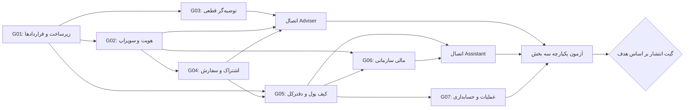
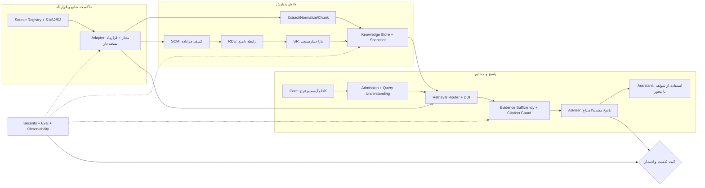

# برنامه پیاده‌سازی فاز دوم شهاب

**وضعیت:** فصل اول — فهرست اجرایی Core، مستقل از اولویت و انتشار.
**مراجع:** [سند جامع فاز دوم](SHAHAB_PHASE_2_DEVELOPMENT_BLUEPRINT.md) نسخه ۱.۶؛ [سند کیف پول](SHAHAB_DIGITAL_WALLET.md) نسخه ۰.۲۰.

## فصل اول — مجموعه تسک های فاز دوم

### ۱.۱. اصول دامنه، مالکیت و ردیابی
- این فصل تمام کارهای Core را مستقل از زمان انتشار پوشش می‌دهد؛ اجرای RAG و Computer Use در سرویس‌های Adviser و Assistant است، ولی قرارداد و مجوز و داده متعلق به Core در همین فصل ثبت می‌شود.
- هر ردیف `CORE-W-xxx` یا `CORE-B-xxx` یک بسته قابلیت مستقل است؛ چهار زیرتسک `.DB`، `.BE`، `.FE` و `.QA` دارد. زیرتسک فاقد کاربرد باید با دلیل فنی مستند شود؛ حذف خاموش مجاز نیست.
- متن مصوب هر بند بر خلاصه این سند مقدم است؛ گزاره‌های تصمیم‌باز با برچسب «باز» از پیاده‌سازی مصوب تفکیک می‌شوند. مثال عددی به‌تنهایی مصوبه نیست.
- [ماتریس ممیزی محتوایی](SHAHAB_PHASE_2_CORE_SEMANTIC_AUDIT.md) مرجع کمکی ردیابی خطوط است، نه جایگزین آزمون‌های اختصاصی زیر.

### ۱.۱.۱. قرارداد توالی‌یابی بین Core، Adviser و Assistant

**اصل الزام‌آور:** فصل اول «فهرست موجودی کار» است و ترتیب سطرها به‌معنای ترتیب اجرا نیست. فصل بعد باید بتواند بدون بازنویسی شناسه‌ها، همه تسک‌های سه بخش را در یک شبکه وابستگی و برحسب هدف و زمان کنار هم قرار دهد. هیچ تسکی نباید فقط با نام یک فاز، Story یا یک وابستگی مبهم مانند «پس از تکمیل Core» توالی‌یابی شود.

**مدل اجباری داده برای هر تسک اجرایی:**

| فیلد | قاعده ثبت و کاربرد در فصل بعد |
|---|---|
| `task_id` | شناسه یکتا و پایدار؛ با جابه‌جایی زمانی تغییر نمی‌کند |
| `component` | `CORE`، `ADVISER`، `ASSISTANT` یا `SHARED`؛ مالک اجرای کار، نه مصرف‌کننده آن |
| `story_id` و `source_refs` | ارتباط با User Story و بندهای مصوب مرجع، قابل ردیابی و ممیزی |
| `objective_ids` | هدف یا خروجی محصول که تسک برای آن ضروری است؛ قابل اشتراک میان سه بخش |
| `deliverable` و `acceptance_tests` | خروجی عینی، معیار اتمام و شاهد آزمون مستقل |
| `hard_dependencies` | شناسه تسک‌های پیش‌نیاز واقعی؛ تا پایان آن‌ها شروع/پایان کار ممکن نیست |
| `soft_dependencies` | وابستگی ترجیحی یا بهینه‌ساز که مانع شروع کار نیست |
| `contract_dependencies` | شناسه قرارداد API، رویداد، schema، مجوز یا داده نسخه‌دار که باید پیش از یکپارچه‌سازی تثبیت شود |
| `provides` و `consumes` | قابلیت، داده یا قرارداد تولیدشده/مصرف‌شده، همراه با مالک و نسخه |
| `parallelizable_with` | کارهای مستقل قابل اجرای هم‌زمان یا امکان کار با mock/contract-first |
| `decision_gates` | تصمیم باز، تصویب حقوقی یا گیت امنیت/مالی که انجام یا انتشار را متوقف می‌کند |
| `estimate` و `capacity_role` | تخمین و تخصص لازم، بعد از تحلیل؛ بدون اعداد ساختگی |
| `release_gate` | شرط ورود به بهره‌برداری؛ جدا از پیش‌نیاز فنی و جدا از اولویت |

**قواعد توالی‌یابی:**

۱. وابستگی باید به **شناسه تسک یا قرارداد مشخص** ارجاع دهد، نه صرفاً نام سرویس. وابستگی دوری ممنوع است و باید پیش از زمان‌بندی تشخیص داده شود.

۲. وابستگی فنی، وابستگی قراردادی، وابستگی تصمیمی و شرط انتشار چهار مفهوم متفاوت‌اند؛ نباید به یک فیلد «پیش‌نیاز» تقلیل یابند.

۳. برای آغاز توسعه موازی Adviser و Assistant، تثبیت قرارداد و mock معتبر ممکن است کافی باشد؛ تکمیل کل Core شرط عمومی آغاز آن‌ها نیست. اما آزمون یکپارچه و بهره‌برداری به اجرای واقعی و کنترل‌های امنیتی وابسته‌اند.

۴. یک قابلیت مشترک فقط یک مالک و یک شناسه اجرایی دارد. مصرف‌کنندگان در بخش‌های دیگر به همان شناسه ارجاع می‌دهند؛ تسک مشابه به نام سه سرویس تکرار نمی‌شود.

۵. هر هدف بین‌سرویسی باید به زنجیره‌ای از تسک‌ها و شواهد پذیرش ختم شود: **زیرساخت/قرارداد → قابلیت هر سرویس → یکپارچه‌سازی → آزمون سرتاسری → گیت انتشار**. این الگو ترتیب اجباری همه کارهای داخلی نیست؛ اجرای موازی در هر گام مجاز است.

۶. فصل بعد مجاز است ترتیب، گروه‌بندی، ظرفیت و زمان‌بندی را تغییر دهد، ولی شناسه و مصوبه مرجع را بدون ثبت تغییر عوض نمی‌کند.

**نکته کنترلی:** فهرست فعلی بسته‌ها و Storyهای این فصل هنوز همه فیلدهای بالا را برای هر تسک به‌صورت تکمیل‌شده ندارد. این بخش قرارداد ساختاری لازم برای تکمیل ماتریس وابستگی است؛ نباید صرف درج این قرارداد به‌عنوان تکمیل واقعی شبکه توالی‌یابی تلقی شود.

### ۱.۲. شاخص ۴۶ User Story و مالکیت بسته‌های اجرایی
هر Story یک هدف محصول/فنی است؛ تسک‌ها در بسته‌های بعدی ثبت شده‌اند. Storyهای بدون بسته اختصاصی در بخش ۱.۵ تسک مستقل دارند و برای آن‌ها ردیابی در سطح Story حفظ می‌شود.

| Story | هدف | بسته‌های مستقیم در این فصل |
|---|---|---|
| CORE-US-01 | مرزبندی ماژول‌های Core | CORE-B-002، CORE-B-003، CORE-B-007، CORE-B-010، CORE-B-016، CORE-B-018، CORE-B-026 و 4 بسته دیگر |
| CORE-US-02 | پیکربندی و مهاجرت داده | تسک سراسری ۱.۶ / نیازمند تخصیص بسته مستقل |
| CORE-US-03 | قراردادهای API نسخه‌دار | تسک سراسری ۱.۶ / نیازمند تخصیص بسته مستقل |
| CORE-US-04 | Job و Outbox | تسک سراسری ۱.۶ / نیازمند تخصیص بسته مستقل |
| CORE-US-05 | مشاهده‌پذیری | تسک سراسری ۱.۶ / نیازمند تخصیص بسته مستقل |
| CORE-US-06 | امنیت پایه | تسک سراسری ۱.۶ / نیازمند تخصیص بسته مستقل |
| CORE-US-07 | حساب و نشست | تسک سراسری ۱.۶ / نیازمند تخصیص بسته مستقل |
| CORE-US-08 | دامنه و نقش و نشست | تسک سراسری ۱.۶ / نیازمند تخصیص بسته مستقل |
| CORE-US-09 | کاتالوگ خدمات | تسک سراسری ۱.۶ / نیازمند تخصیص بسته مستقل |
| CORE-US-10 | مسیریابی درخواست | تسک سراسری ۱.۶ / نیازمند تخصیص بسته مستقل |
| CORE-US-11 | رضایت و مجوز | CORE-W-068، CORE-W-081، CORE-W-083، CORE-B-015، CORE-B-032، CORE-B-041 |
| CORE-US-12 | سوپراپ | تسک سراسری ۱.۶ / نیازمند تخصیص بسته مستقل |
| CORE-US-13 | Snapshot تسهیلات | تسک سراسری ۱.۶ / نیازمند تخصیص بسته مستقل |
| CORE-US-14 | توصیه‌گر قطعی | CORE-B-004، CORE-B-035، CORE-B-036، CORE-B-038 |
| CORE-US-15 | پرسشنامه | تسک سراسری ۱.۶ / نیازمند تخصیص بسته مستقل |
| CORE-US-16 | کاتالوگ پویای محصولات | تسک سراسری ۱.۶ / نیازمند تخصیص بسته مستقل |
| CORE-US-17 | تازگی و اختلاف نسخه | تسک سراسری ۱.۶ / نیازمند تخصیص بسته مستقل |
| CORE-US-18 | پنل مدیریت کاتالوگ | تسک سراسری ۱.۶ / نیازمند تخصیص بسته مستقل |
| CORE-US-19 | پلن و استحقاق | تسک سراسری ۱.۶ / نیازمند تخصیص بسته مستقل |
| CORE-US-20 | نسخه قیمت | تسک سراسری ۱.۶ / نیازمند تخصیص بسته مستقل |
| CORE-US-21 | چرخه اشتراک | CORE-B-012، CORE-B-029 |
| CORE-US-22 | تمدید خودکار | تسک سراسری ۱.۶ / نیازمند تخصیص بسته مستقل |
| CORE-US-23 | سنجش مصرف | تسک سراسری ۱.۶ / نیازمند تخصیص بسته مستقل |
| CORE-US-24 | سفارش، فاکتور و پرداخت | تسک سراسری ۱.۶ / نیازمند تخصیص بسته مستقل |
| CORE-US-25 | مالکیت کیف پول | CORE-W-003، CORE-W-015، CORE-W-018، CORE-W-020، CORE-W-021، CORE-W-022، CORE-W-024 و 50 بسته دیگر |
| CORE-US-26 | دفترکل | CORE-W-071، CORE-W-072، CORE-W-074، CORE-W-080، CORE-W-090 |
| CORE-US-27 | ضدتکرار و هم‌زمانی | تسک سراسری ۱.۶ / نیازمند تخصیص بسته مستقل |
| CORE-US-28 | شارژ نقدی | CORE-W-017، CORE-W-033، CORE-W-034، CORE-W-064، CORE-W-065، CORE-W-066، CORE-B-013 |
| CORE-US-29 | هدیه و تخفیف | CORE-W-036، CORE-W-037، CORE-W-038، CORE-W-039، CORE-W-040، CORE-W-063 |
| CORE-US-30 | موجودی، تاریخچه و رسید | CORE-W-032، CORE-W-098، CORE-W-102 |
| CORE-US-31 | مصرف خدمت | CORE-W-019، CORE-W-026، CORE-W-028، CORE-W-031، CORE-W-041، CORE-W-070، CORE-W-078 و 4 بسته دیگر |
| CORE-US-32 | استرداد | CORE-W-061، CORE-W-062 |
| CORE-US-33 | رزرو | CORE-W-025، CORE-W-042، CORE-W-043، CORE-W-044، CORE-W-045، CORE-W-046، CORE-W-047 و 2 بسته دیگر |
| CORE-US-34 | تطبیق | CORE-W-079، CORE-W-085 |
| CORE-US-35 | کیف پول سازمانی | CORE-W-001، CORE-W-002، CORE-W-004، CORE-W-005، CORE-W-006، CORE-W-007، CORE-W-008 و 12 بسته دیگر |
| CORE-US-36 | بودجه و سقف | تسک سراسری ۱.۶ / نیازمند تخصیص بسته مستقل |
| CORE-US-37 | تأمین مالی سازمان | تسک سراسری ۱.۶ / نیازمند تخصیص بسته مستقل |
| CORE-US-38 | انتقال | CORE-W-011، CORE-W-051، CORE-W-052، CORE-W-058، CORE-W-059 |
| CORE-US-39 | برداشت | CORE-W-023، CORE-W-049، CORE-W-050، CORE-W-053، CORE-W-055، CORE-W-056، CORE-W-057 |
| CORE-US-40 | پرداخت دوره‌ای و شارژ خودکار | تسک سراسری ۱.۶ / نیازمند تخصیص بسته مستقل |
| CORE-US-41 | اعلان | CORE-W-099 |
| CORE-US-42 | پشتیبانی و اختلاف | CORE-W-100 |
| CORE-US-43 | حسابداری | تسک سراسری ۱.۶ / نیازمند تخصیص بسته مستقل |
| CORE-US-44 | پنل عملیات | تسک سراسری ۱.۶ / نیازمند تخصیص بسته مستقل |
| CORE-US-45 | آزمون جامع | تسک سراسری ۱.۶ / نیازمند تخصیص بسته مستقل |
| CORE-US-46 | CI/CD | تسک سراسری ۱.۶ / نیازمند تخصیص بسته مستقل |

### ۱.۲.۱. تسک مستقل و معیار پذیرش برای هر User Story
این ردیف‌ها کارهای اصلی و **غیرتکراری** هر Story هستند؛ بسته‌های مرجع بخش‌های ۱.۳ و ۱.۴ جزئیات پیاده‌سازی و استثناهای آن‌ها را پوشش می‌دهند. اجرای تسک با معیار پذیرش سنجیده می‌شود، نه صرفاً ایجاد فایل یا API.

| شناسه تسک | کار اجرایی | آزمون پذیرش |
|---|---|---|
| CORE-US-01.MAIN | ماژول‌های Identity/Catalog/Recommendation/Plan/Wallet را با dependency rule جدا کن | تست معماری هر import بین ماژول‌ها را کنترل کند |
| CORE-US-02.MAIN | تنظیمات نوع‌دار، migration و feature flag نسخه‌دار بساز | تغییر schema و rollback بدون تخریب داده انجام شود |
| CORE-US-03.MAIN | OpenAPI و DTO قرارداد Core با Adviser و Assistant را نسخه‌دار کن | consumer contract test نسخه ناسازگار را رد کند |
| CORE-US-04.MAIN | Job پایدار و Outbox تراکنشی و پردازش idempotent بساز | restart یا retry پیام اثر مالی تکراری نسازد |
| CORE-US-05.MAIN | Metric/Trace/Log برای API، Job، مالی و وابستگی بساز | داشبورد تأخیر و خطای قرارداد و ledger هشدار دهد |
| CORE-US-06.MAIN | RBAC/ABAC، کنترل نشست، rate limit و audit عملیات حساس بساز | دسترسی افقی و نقش نامعتبر رد شود |
| CORE-US-07.MAIN | ثبت‌نام، ورود، نشست ناشناس و تبدیل مجاز به حساب بساز | انقضای نشست و مهاجرت داده بدون نشت تست شود |
| CORE-US-08.MAIN | مدل زمینه دامنه، نقش، نشست و دسترسی چندسازمانی بساز | جابجایی دامنه بدون مجوز داده شخصی منتقل نکند |
| CORE-US-09.MAIN | کاتالوگ نسخه‌دار حوزه/خدمت/شرایط/شواهد بساز | خدمت ناموجود یا غیرفعال در مسیریابی قابل اجرا نباشد |
| CORE-US-10.MAIN | Router درخواست به مشاور، دستیار یا توصیه قطعی بساز | مسیر انتخابی و علت fallback در trace ثبت شود |
| CORE-US-11.MAIN | رضایت هدفمند، تاریخ انقضا و لغو مجوز بساز | پس از لغو، اقدام هزینه‌زای جدید رد شود |
| CORE-US-12.MAIN | خانه سوپراپ، کارت خدمت و حالت Adviser/Assistant بساز | حالت غیرفعال و دسترسی پلن به‌درستی نمایش یابد |
| CORE-US-13.MAIN | Snapshot و نسخه منبع تسهیلات را با منشأ نگهداری کن | بازیابی نتیجه قدیمی با نسخه داده ممکن باشد |
| CORE-US-14.MAIN | امتیاز تطابق و دلیل توصیه را قطعی و بازتولیدپذیر کن | ورودی و نسخه یکسان نتیجه و درصد یکسان بدهد |
| CORE-US-15.MAIN | پرسشنامه نسخه‌دار با اعتبارسنجی و canonical answer بساز | پاسخ ناقص/نامعتبر از توصیه جلوگیری کند |
| CORE-US-16.MAIN | مدل پویا برای بانک، محصول، ویژگی، شرط و تغییرات بساز | نسخه جدید محصول بدون تخریب تاریخچه ثبت شود |
| CORE-US-17.MAIN | کشف اختلاف Snapshot و سیاست تازگی داده را اجرا کن | داده متعارض با برچسب عدم قطعیت نمایش یابد |
| CORE-US-18.MAIN | پنل تأیید، انتشار و rollback نسخه کاتالوگ بساز | انتشار Snapshot اتمیک و قابل بازگشت باشد |
| CORE-US-19.MAIN | Plan/Entitlement و اعمال سقف و دسترسی در سرور بساز | پلن نامعتبر امکان مصرف خدمت محدود را ندهد |
| CORE-US-20.MAIN | PriceVersion و تثبیت نسخه در سفارش و اجرا بساز | تغییر قیمت، سفارش معتبر قبلی را بازقیمت‌گذاری نکند |
| CORE-US-21.MAIN | ماشین وضعیت اشتراک، ارتقا، تنزل و انقضا بساز | ارتقا تاریخ انقضا را جابجا نکند؛ تنزل به‌موقع اثر کند |
| CORE-US-22.MAIN | رضایت نسخه‌دار تمدید و مدیریت افزایش قیمت بساز | پیش‌فرض خاموش و افزایش بدون رضایت جدید رد شود |
| CORE-US-23.MAIN | ثبت UsageEvent و کنترل سهمیه و اندازه‌گیری دقیق بساز | retry مصرف را دوبار محاسبه نکند |
| CORE-US-24.MAIN | Order/Invoice/Payment و تطبیق نتیجه نامعلوم بساز | سفارش ۱۵ دقیقه و پرداخت معتبر دیررس صحیح رسیدگی شود |
| CORE-US-25.MAIN | یک کیف اصلی برای هر مالک و وضعیت فعال‌سازی بساز | ایجاد مجدد کیف تکراری نسازد |
| CORE-US-26.MAIN | دفترکل دوطرفه و ثبت‌های جبرانی immutable بساز | تراز حساب‌ها و بازسازی مانده دقیق باشد |
| CORE-US-27.MAIN | idempotency، قفل مانده و کنترل مصرف موازی بساز | دو مصرف هم‌زمان از مانده/سقف عبور نکنند |
| CORE-US-28.MAIN | شارژ با درگاه، بانک، تأیید و تطبیق بساز | callback تکراری فقط یک شارژ ایجاد کند |
| CORE-US-29.MAIN | CreditLot هدیه، کد تخفیف و تاریخ انقضا بساز | هدیه قابل برداشت نباشد و کد دوباره مصرف نشود |
| CORE-US-30.MAIN | API و UI موجودی آزاد/رزرو/برداشت، تاریخچه و رسید بساز | مجموع مانده با دفترکل و رسید همخوان باشد |
| CORE-US-31.MAIN | محاسبه و کسر هزینه خدمت با منشأ و نرخ ثابت بساز | کسر از سقف مجاز و هزینه واقعی بیشتر نشود |
| CORE-US-32.MAIN | استرداد کامل/جزئی با تخصیص منشأ و ثبت جبرانی بساز | جمع ریالی دقیق و Largest Remainder رعایت شود |
| CORE-US-33.MAIN | Hold/partial capture/release و انقضا بساز | افزایش بدون مجوز و آزادسازی مازاد ممنوع باشد |
| CORE-US-34.MAIN | تطبیق حداقل روزانه بانک، خدمت و دفترکل بساز | هر مغایرت حل‌نشده پرونده داشته باشد |
| CORE-US-35.MAIN | مدل Org/Membership/Admin و کیف سازمانی بساز | چند ادمین هم‌اختیار و مرز سازمانی رعایت شود |
| CORE-US-36.MAIN | Allowance و کنترل سقف عضو/سازمان و رزرو بساز | سقف بدون موجودی سازمان مجوز خرج نسازد |
| CORE-US-37.MAIN | فاکتور سازمان پیش از پرداخت و واریز بانکی سازمان بساز | بدون فاکتور معتبر شارژ سازمانی شروع نشود |
| CORE-US-38.MAIN | انتقال فردی و سازمانی محدود با lineage بساز | فرد→سازمان و سازمان→سازمان رد شوند |
| CORE-US-39.MAIN | برداشت بانکی فقط از نقدی واجد شرایط با احراز مجدد بساز | حساب غیرمالک و هدیه/انتقالی رد شود |
| CORE-US-40.MAIN | قرارداد شارژ خودکار و پرداخت دوره‌ای با لغو و شکست بساز | شکست قطعی بدون اقدام مشتری retry نشود |
| CORE-US-41.MAIN | اعلان وضعیت مالی و امنیتی و اقدام لازم بساز | پیام به مخاطب نامجاز ارسال نشود |
| CORE-US-42.MAIN | پرونده اختلاف، پشتیبانی، جبران و ممیزی بساز | اصلاح مالی بدون دلیل و عامل ثبت نشود |
| CORE-US-43.MAIN | حسابداری تعهد مشتری، درآمد و بدهی تأمین‌کننده بساز | تسویه تأمین‌کننده کسر دوم مشتری نسازد |
| CORE-US-44.MAIN | داشبورد عملیات مالی، مغایرت، Job و هشدار بساز | اپراتور مجاز بتواند وضعیت نامعلوم را پیگیری کند |
| CORE-US-45.MAIN | تست property-based دفترکل، قرارداد، E2E، بار و fault injection بساز | گیت‌ها تکرار، رقابت و خرابی را کشف کنند |
| CORE-US-46.MAIN | Pipeline CI/CD، migration، rollback و restore را تست کن | استقرار قابل بازگشت و بازیابی قابل تکرار باشد |

### ۱.۳. دامنه کیف پول: بسته‌های مستقل و معیار پذیرش

#### CORE-W-001 — ۳.۱. هر شخص و سازمان چند کیف پول دارد
**مرجع:** کیف پول ۳.۱، خط 130؛ **مالک:** CORE-US-35.
**قواعد لازم برای این بسته:**
- مسئله و هدف: باید صاحب کیف پول و زمان ایجاد آن روشن باشد؛ کیف پول کارمند با منابع سازمانی که اجازهٔ مصرفشان را دارد یک دارایی نیست.
- پاسخ مصوب: هر شخص یک کیف پول شخصی اصلی دارد که با فعال‌شدن حساب او ایجاد می‌شود. هر سازمان نیز پس از ایجاد و تأیید حساب سازمانی، یک کیف پول سازمانی اصلی دارد. مالک آن سازمان است، نه کارمندی که حساب را ساخته یا مدیر فعلی آن.
- جزئیات اجرایی نیازمند تصمیم: قالب و مدارک اجرایی قرارداد رسمی محضری و روش اتصال به سرویس‌های احراز باید نهایی شوند؛ اصل ثبت هویت سازمان، مالک واقعی و نماینده در قرارداد و سیاست فعال‌سازی و بستن حساب مصوب است.
| تسک | خروجی اجرایی | آزمون پذیرش |
|---|---|---|
| CORE-W-001.DB | مدل User/Org/Membership/Allowance با قیود مالکیت و تاریخ مؤثر | قیود و migration با داده واقعی و نامعتبر آزمایش شوند |
| CORE-W-001.BE | API مدیریت مجوز، عضویت و کنترل هزینه در مرز سرور | حالت‌های معتبر، نامعتبر، تکراری و نتیجه نامعلوم تست شوند |
| CORE-W-001.FE | جریان دعوت/نقش/انتخاب کیف/سقف و وضعیت لغو | مسیر کاربر و پیام‌های خطا/تأیید با E2E تست شوند |
| CORE-W-001.QA | تست چندسازمانی، عضو سابق، کاهش سقف و دسترسی افقی | گزارش آزمون قابل بازتولید با شناسه بند ثبت شود |

#### CORE-W-002 — ۳.۱.۱. فعال‌سازی مالی سازمان
**مرجع:** کیف پول ۳.۱.۱، خط 150؛ **مالک:** CORE-US-35.
**قواعد لازم برای این بسته:**
- مسئله و هدف: پیش‌ثبت‌نام نباید پیش از احراز، اختیار جابه‌جایی پول ایجاد کند.
- پاسخ مصوب: پیش از دریافت خدمات، قرارداد رسمی محضری مطابق اسناد خود سازمان و قانون تنظیم و نهایی شود؛ هویت سازمان، مالک واقعی، سمت و اختیار نماینده در همین فرایند مشخص و مستند شوند. پس از نهایی‌شدن قرارداد و تأیید موارد فوق، داشبورد سازمانی تخصیص و امکان شارژ و تخصیص اعتبار فعال شود؛ تا آن زمان فقط پیش‌ثبت‌نام و مشاهدهٔ وضعیت مجاز است.
| تسک | خروجی اجرایی | آزمون پذیرش |
|---|---|---|
| CORE-W-002.DB | مدل درخواست، شاهد بانکی، وضعیت تأیید و شناسه تطبیق؛ قیود یکتا و migration | قیود و migration با داده واقعی و نامعتبر آزمایش شوند |
| CORE-W-002.BE | API/adapter بانک و پردازش نتیجه نامعلوم با idempotency؛ رسیدگی اپراتوری | حالت‌های معتبر، نامعتبر، تکراری و نتیجه نامعلوم تست شوند |
| CORE-W-002.FE | فرم و رسید وضعیت واقعی پرداخت، عدم نمایش موفقیت پیش از وصول | مسیر کاربر و پیام‌های خطا/تأیید با E2E تست شوند |
| CORE-W-002.QA | تست callback تکراری، قطع شبکه، تأخیر نتیجه، مغایرت و عدم اعتباردهی مضاعف | گزارش آزمون قابل بازتولید با شناسه بند ثبت شود |

#### CORE-W-003 — ۳.۱.۲. شناسایی معمول شخص حقیقی
**مرجع:** کیف پول ۳.۱.۲، خط 162؛ **مالک:** CORE-US-25.
**قواعد لازم برای این بسته:**
- مسئله و هدف: کنترل شماره و هویت باید روشن و از بررسی استثنایی یا احراز مجدد عملیات حساس جدا باشد.
- پاسخ مصوب: کنترل شماره با OTP و تطبیق مالکیت شمارهٔ تلفن همراه با کد ملی از طریق شاهکار انجام شود. نتیجهٔ ناموفق یا نامعلوم، تطبیق موفق محسوب نشود. این مسیر عادی، جای تطبیق مالکیت حساب بانکی هنگام برداشت یا بررسی تکمیلی در موارد الزام قانونی و اطلاعات متعارض را نمی‌گیرد.
| تسک | خروجی اجرایی | آزمون پذیرش |
|---|---|---|
| CORE-W-003.DB | مدل User/Org/Membership/Allowance با قیود مالکیت و تاریخ مؤثر | قیود و migration با داده واقعی و نامعتبر آزمایش شوند |
| CORE-W-003.BE | API مدیریت مجوز، عضویت و کنترل هزینه در مرز سرور | حالت‌های معتبر، نامعتبر، تکراری و نتیجه نامعلوم تست شوند |
| CORE-W-003.FE | جریان دعوت/نقش/انتخاب کیف/سقف و وضعیت لغو | مسیر کاربر و پیام‌های خطا/تأیید با E2E تست شوند |
| CORE-W-003.QA | تست چندسازمانی، عضو سابق، کاهش سقف و دسترسی افقی | گزارش آزمون قابل بازتولید با شناسه بند ثبت شود |

#### CORE-W-004 — ۳.۲. کاربر می‌تواند عضو چند سازمان باشد و با خروج او چه می‌شود
**مرجع:** کیف پول ۳.۲، خط 174؛ **مالک:** CORE-US-35.
**قواعد لازم برای این بسته:**
- مسئله و هدف: همکاری یک شخص با چند سازمان نباید دسترسی یا پول آن‌ها را مخلوط کند؛ خروج از یک سازمان نیز نباید حساب شخصی را حذف کند.
- پاسخ مصوب: بله؛ یک شخص می‌تواند عضو چند سازمان باشد. دسترسی، بودجه و سوابق هر سازمان جدا می‌مانند. حذف عضویت، اجازهٔ شروع عملیات جدید برای همان سازمان را قطع می‌کند؛ کیف پول شخصی کاربر، پول سازمان و سوابق مالی قبلی حذف نمی‌شوند.
- وضعیت تصمیم: دعوت و رسیدهای عضو سابق در ادامه مصوب‌اند؛ عملیات ناتمام طبق ۳.۶ تعیین تکلیف می‌شوند.
| تسک | خروجی اجرایی | آزمون پذیرش |
|---|---|---|
| CORE-W-004.DB | مدل User/Org/Membership/Allowance با قیود مالکیت و تاریخ مؤثر | قیود و migration با داده واقعی و نامعتبر آزمایش شوند |
| CORE-W-004.BE | API مدیریت مجوز، عضویت و کنترل هزینه در مرز سرور | حالت‌های معتبر، نامعتبر، تکراری و نتیجه نامعلوم تست شوند |
| CORE-W-004.FE | جریان دعوت/نقش/انتخاب کیف/سقف و وضعیت لغو | مسیر کاربر و پیام‌های خطا/تأیید با E2E تست شوند |
| CORE-W-004.QA | تست چندسازمانی، عضو سابق، کاهش سقف و دسترسی افقی | گزارش آزمون قابل بازتولید با شناسه بند ثبت شود |

#### CORE-W-005 — ۳.۲.۱. دعوت و پذیرش عضو
**مرجع:** کیف پول ۳.۲.۱، خط 190؛ **مالک:** CORE-US-35.
**قواعد لازم برای این بسته:**
- پاسخ مصوب: ادمین فهرست افراد را بارگذاری کند؛ فرد پس از احراز هویت و پذیرش دعوت عضو فعال شود. تطبیق فرد با حساب صحیح لازم است.
- ارتباط با بخش‌های دیگر: جهت انتقال و فهرست مجاز ۳.۷ پابرجاست؛ قالب فایل و شناسه‌های تطبیق جزئیات اجرایی‌اند.
| تسک | خروجی اجرایی | آزمون پذیرش |
|---|---|---|
| CORE-W-005.DB | مدل User/Org/Membership/Allowance با قیود مالکیت و تاریخ مؤثر | قیود و migration با داده واقعی و نامعتبر آزمایش شوند |
| CORE-W-005.BE | API مدیریت مجوز، عضویت و کنترل هزینه در مرز سرور | حالت‌های معتبر، نامعتبر، تکراری و نتیجه نامعلوم تست شوند |
| CORE-W-005.FE | جریان دعوت/نقش/انتخاب کیف/سقف و وضعیت لغو | مسیر کاربر و پیام‌های خطا/تأیید با E2E تست شوند |
| CORE-W-005.QA | تست چندسازمانی، عضو سابق، کاهش سقف و دسترسی افقی | گزارش آزمون قابل بازتولید با شناسه بند ثبت شود |

#### CORE-W-006 — ۳.۲.۲. دسترسی عضو سابق به رسید
**مرجع:** کیف پول ۳.۲.۲، خط 202؛ **مالک:** CORE-US-35.
**قواعد لازم برای این بسته:**
- مسئله و هدف: خروج عضو نباید دسترسی مالی جاری بدهد یا امکان پیگیری عملیات خودش را از بین ببرد.
- پاسخ مصوب: مشاهدهٔ محدود رسید عملیات خودش باقی بماند؛ اطلاعات سایر اعضا و موجودی سازمان نمایش داده نشوند.
| تسک | خروجی اجرایی | آزمون پذیرش |
|---|---|---|
| CORE-W-006.DB | مدل User/Org/Membership/Allowance با قیود مالکیت و تاریخ مؤثر | قیود و migration با داده واقعی و نامعتبر آزمایش شوند |
| CORE-W-006.BE | API مدیریت مجوز، عضویت و کنترل هزینه در مرز سرور | حالت‌های معتبر، نامعتبر، تکراری و نتیجه نامعلوم تست شوند |
| CORE-W-006.FE | جریان دعوت/نقش/انتخاب کیف/سقف و وضعیت لغو | مسیر کاربر و پیام‌های خطا/تأیید با E2E تست شوند |
| CORE-W-006.QA | تست چندسازمانی، عضو سابق، کاهش سقف و دسترسی افقی | گزارش آزمون قابل بازتولید با شناسه بند ثبت شود |

#### CORE-W-007 — ۳.۳. سازمان برای مدیریت کیف پول به چند نقش مدیریتی نیاز دارد
**مرجع:** کیف پول ۳.۳، خط 214؛ **مالک:** CORE-US-35.
**قواعد لازم برای این بسته:**
- مسئله و هدف: سازمان باید کیف پول را ساده و با اختیار روشن اداره کند، بدون فرایند مدیریتی چندنفرهٔ تحمیلی.
- پاسخ مصوب: تنها نوع نقش مدیریتی سازمان، ادمین سازمان است و تمام دسترسی‌های لازم را در همان سازمان دارد. شهاب سازمان را ملزم به داشتن مسئول مالی، تأییدکنندهٔ دوم یا گردش چندمرحله‌ای نمی‌کند.
- / صاحب کیف پول شخصی / موجودی خودش را ببیند، شارژ کند، خدمت بگیرد، انتقال دهد و برداشت مجاز درخواست کند /
- / ادمین سازمان / اعضا و دسترسی‌ها را مدیریت کند؛ شارژ، تخصیص بودجه و سقف، مشاهدهٔ گزارش، انتقال و برداشت مجاز سازمان را انجام دهد /
| تسک | خروجی اجرایی | آزمون پذیرش |
|---|---|---|
| CORE-W-007.DB | مدل User/Org/Membership/Allowance با قیود مالکیت و تاریخ مؤثر | قیود و migration با داده واقعی و نامعتبر آزمایش شوند |
| CORE-W-007.BE | API مدیریت مجوز، عضویت و کنترل هزینه در مرز سرور | حالت‌های معتبر، نامعتبر، تکراری و نتیجه نامعلوم تست شوند |
| CORE-W-007.FE | جریان دعوت/نقش/انتخاب کیف/سقف و وضعیت لغو | مسیر کاربر و پیام‌های خطا/تأیید با E2E تست شوند |
| CORE-W-007.QA | تست چندسازمانی، عضو سابق، کاهش سقف و دسترسی افقی | گزارش آزمون قابل بازتولید با شناسه بند ثبت شود |

#### CORE-W-008 — ۳.۳.۱. چند ادمین با یک نوع نقش
**مرجع:** کیف پول ۳.۳.۱، خط 238؛ **مالک:** CORE-US-35.
**قواعد لازم برای این بسته:**
- مسئله و هدف: نباید تعداد مدیران با تعداد انواع نقش اشتباه شود.
- پاسخ مصوب: بله؛ چند ادمین با اختیارات یکسان در همان سازمان مجازند و سوابق کامل اقدامات هرکدام ثبت شود. نقش مالی یا تأییدکنندهٔ دوم اجباری ایجاد نشود.
| تسک | خروجی اجرایی | آزمون پذیرش |
|---|---|---|
| CORE-W-008.DB | مدل User/Org/Membership/Allowance با قیود مالکیت و تاریخ مؤثر | قیود و migration با داده واقعی و نامعتبر آزمایش شوند |
| CORE-W-008.BE | API مدیریت مجوز، عضویت و کنترل هزینه در مرز سرور | حالت‌های معتبر، نامعتبر، تکراری و نتیجه نامعلوم تست شوند |
| CORE-W-008.FE | جریان دعوت/نقش/انتخاب کیف/سقف و وضعیت لغو | مسیر کاربر و پیام‌های خطا/تأیید با E2E تست شوند |
| CORE-W-008.QA | تست چندسازمانی، عضو سابق، کاهش سقف و دسترسی افقی | گزارش آزمون قابل بازتولید با شناسه بند ثبت شود |

#### CORE-W-009 — ۳.۳.۲. جایگزینی ادمین و بستن حساب
**مرجع:** کیف پول ۳.۳.۲، خط 250؛ **مالک:** CORE-US-35.
**قواعد لازم برای این بسته:**
- مسئله و هدف: تغییر نماینده نباید مالکیت سازمان یا تعهدات قبلی را حذف کند.
- پاسخ مصوب: انتقال توسط ادمین فعلی با احراز مجدد انجام شود؛ اگر او در دسترس نیست، بازیابی با احراز نمایندگی سازمان صورت گیرد. بستن حساب پس از تعیین تکلیف تعهدات انجام شود؛ سوابق مالی حذف نشوند.
| تسک | خروجی اجرایی | آزمون پذیرش |
|---|---|---|
| CORE-W-009.DB | مدل User/Org/Membership/Allowance با قیود مالکیت و تاریخ مؤثر | قیود و migration با داده واقعی و نامعتبر آزمایش شوند |
| CORE-W-009.BE | API مدیریت مجوز، عضویت و کنترل هزینه در مرز سرور | حالت‌های معتبر، نامعتبر، تکراری و نتیجه نامعلوم تست شوند |
| CORE-W-009.FE | جریان دعوت/نقش/انتخاب کیف/سقف و وضعیت لغو | مسیر کاربر و پیام‌های خطا/تأیید با E2E تست شوند |
| CORE-W-009.QA | تست چندسازمانی، عضو سابق، کاهش سقف و دسترسی افقی | گزارش آزمون قابل بازتولید با شناسه بند ثبت شود |

#### CORE-W-010 — ۳.۴. اختصاص بودجه به کارمند، پول را وارد کیف پول شخصی او می‌کند
**مرجع:** کیف پول ۳.۴، خط 262؛ **مالک:** CORE-US-35.
**قواعد لازم برای این بسته:**
- مسئله و هدف: بودجهٔ واگذارشده ممکن است فقط اجازهٔ مصرف باشد، نه انتقال دارایی؛ باید این تفاوت برای ادمین و کارمند روشن بماند.
- پاسخ مصوب: خیر. در مدل پایه، پول در کیف پول سازمان می‌ماند و کارمند اجازهٔ مصرف تا سقف تعیین‌شده توسط ادمین را می‌گیرد. در شروع خدمت، هم موجودی آزاد سازمان و هم سقف باقیماندهٔ کارمند بررسی می‌شوند. مبلغ رزروشده نیز در هر دو کنترل لحاظ می‌شود.
- وضعیت تصمیم: بودجه فقط مجوز مصرف و بدون پشتوانهٔ موجودی اختصاصی است. دوره‌ها و ترکیب سقف‌ها در ۶.۸ و مانده و استرداد در ادامه مصوب‌اند؛ ادمین تعیین‌کنندهٔ مقادیر است.
| تسک | خروجی اجرایی | آزمون پذیرش |
|---|---|---|
| CORE-W-010.DB | مدل User/Org/Membership/Allowance با قیود مالکیت و تاریخ مؤثر | قیود و migration با داده واقعی و نامعتبر آزمایش شوند |
| CORE-W-010.BE | API مدیریت مجوز، عضویت و کنترل هزینه در مرز سرور | حالت‌های معتبر، نامعتبر، تکراری و نتیجه نامعلوم تست شوند |
| CORE-W-010.FE | جریان دعوت/نقش/انتخاب کیف/سقف و وضعیت لغو | مسیر کاربر و پیام‌های خطا/تأیید با E2E تست شوند |
| CORE-W-010.QA | تست چندسازمانی، عضو سابق، کاهش سقف و دسترسی افقی | گزارش آزمون قابل بازتولید با شناسه بند ثبت شود |

#### CORE-W-011 — ۳.۴.۱. انتقال ماندهٔ مجوز مصرف
**مرجع:** کیف پول ۳.۴.۱، خط 278؛ **مالک:** CORE-US-38.
**قواعد لازم برای این بسته:**
- پاسخ مصوب: ادمین برای هر بودجه انتخاب کند ماندهٔ مجوز مصرف به دورهٔ بعد منتقل شود یا نشود. این انتخاب انتقال پول به کیف پول شخصی نیست.
| تسک | خروجی اجرایی | آزمون پذیرش |
|---|---|---|
| CORE-W-011.DB | مدل User/Org/Membership/Allowance با قیود مالکیت و تاریخ مؤثر | قیود و migration با داده واقعی و نامعتبر آزمایش شوند |
| CORE-W-011.BE | API مدیریت مجوز، عضویت و کنترل هزینه در مرز سرور | حالت‌های معتبر، نامعتبر، تکراری و نتیجه نامعلوم تست شوند |
| CORE-W-011.FE | جریان دعوت/نقش/انتخاب کیف/سقف و وضعیت لغو | مسیر کاربر و پیام‌های خطا/تأیید با E2E تست شوند |
| CORE-W-011.QA | تست چندسازمانی، عضو سابق، کاهش سقف و دسترسی افقی | گزارش آزمون قابل بازتولید با شناسه بند ثبت شود |

#### CORE-W-012 — ۳.۴.۲. اثر استرداد بر ظرفیت کارمند
**مرجع:** کیف پول ۳.۴.۲، خط 290؛ **مالک:** CORE-US-35.
**قواعد لازم برای این بسته:**
- مسئله و هدف: بازگشت پول به سازمان نباید بی‌قاعده سقف دورهٔ تازهٔ عضو را افزایش دهد.
- پاسخ مصوب: فقط ظرفیت دورهٔ اصلی به اندازهٔ استرداد احیا شود؛ اگر دوره تمام شده، ظرفیت دورهٔ جدید افزایش نیابد. مبلغ و اجزای اعتبار به کیف پول پرداخت‌کننده طبق ۶.۶ بازگردند.
- ارتباط با بخش‌های دیگر: انتقال ماندهٔ مجوز قاعدهٔ مستقلی است؛ جزئیات ترکیب آن با استرداد دورهٔ بسته باید در طراحی اجرایی بدون افزایش خودکار ظرفیت دورهٔ جدید مشخص شود.
| تسک | خروجی اجرایی | آزمون پذیرش |
|---|---|---|
| CORE-W-012.DB | مدل User/Org/Membership/Allowance با قیود مالکیت و تاریخ مؤثر | قیود و migration با داده واقعی و نامعتبر آزمایش شوند |
| CORE-W-012.BE | API مدیریت مجوز، عضویت و کنترل هزینه در مرز سرور | حالت‌های معتبر، نامعتبر، تکراری و نتیجه نامعلوم تست شوند |
| CORE-W-012.FE | جریان دعوت/نقش/انتخاب کیف/سقف و وضعیت لغو | مسیر کاربر و پیام‌های خطا/تأیید با E2E تست شوند |
| CORE-W-012.QA | تست چندسازمانی، عضو سابق، کاهش سقف و دسترسی افقی | گزارش آزمون قابل بازتولید با شناسه بند ثبت شود |

#### CORE-W-013 — ۳.۵. هزینه از کیف پول شخصی پرداخت می‌شود یا سازمانی
**مرجع:** کیف پول ۳.۵، خط 302؛ **مالک:** CORE-US-35.
**قواعد لازم برای این بسته:**
- پاسخ مصوب: پیش از رزرو یا شروع کار هزینه‌زا، کیف پول پرداخت‌کننده و سقف مجاز هزینه روشن شوند. سازمان فعال می‌تواند انتخاب پیش‌فرض باشد، ولی کاربر نام منبع پرداخت را ببیند. اگر مجوز یا اعتبار سازمان کافی نیست، شهاب توقف می‌کند و انتخاب تازه می‌گیرد؛ خودکار از کیف پول شخصی کسر نمی‌کند.
- در نسخهٔ اولیه، هر عملیات یک کیف پول پرداخت‌کننده دارد. تقسیم هزینهٔ یک عملیات بین شخص و سازمان فعلاً فعال نیست؛ افزودن آن در آینده به تصمیم و طراحی جدا نیاز دارد. این موضوع با مصرف ترکیبی نقدی و هدیه داخل یک کیف پول فرق دارد؛ ترتیب آن در بخش ۵.۳ مصوب است.
| تسک | خروجی اجرایی | آزمون پذیرش |
|---|---|---|
| CORE-W-013.DB | مدل User/Org/Membership/Allowance با قیود مالکیت و تاریخ مؤثر | قیود و migration با داده واقعی و نامعتبر آزمایش شوند |
| CORE-W-013.BE | API مدیریت مجوز، عضویت و کنترل هزینه در مرز سرور | حالت‌های معتبر، نامعتبر، تکراری و نتیجه نامعلوم تست شوند |
| CORE-W-013.FE | جریان دعوت/نقش/انتخاب کیف/سقف و وضعیت لغو | مسیر کاربر و پیام‌های خطا/تأیید با E2E تست شوند |
| CORE-W-013.QA | تست چندسازمانی، عضو سابق، کاهش سقف و دسترسی افقی | گزارش آزمون قابل بازتولید با شناسه بند ثبت شود |

#### CORE-W-014 — ۳.۶. اگر دسترسی کارمند در میانهٔ کار قطع شود، هزینه چه می‌شود
**مرجع:** کیف پول ۳.۶، خط 318؛ **مالک:** CORE-US-35.
**قواعد لازم برای این بسته:**
- پاسخ مصوب: پیش از رزرو، افزایش رزرو یا اقدام هزینه‌زای جدید، مجوز بررسی شود. پس از لغو دسترسی، ایجاد هزینهٔ تازه متوقف و عملیات در اولین نقطهٔ امن متوقف یا منتظر تصمیم ادمین شود. هزینهٔ واقعاً ایجادشده و مجاز طبق تعهد قبلی و تعرفه تعیین تکلیف و باقی رزرو پس از روشن‌شدن نتیجه آزاد شود. هزینه به کیف پول شخصی منتقل نشود.
- پاسخ مصوب دربارهٔ کاهش سقف یا قطع دسترسی: هزینهٔ تازه و افزایش رزرو متوقف شود؛ تعهد قبلی رسیدگی و ادامه فقط با اجازهٔ صریح ادمین و احراز مجدد اختیار معتبر ممکن باشد. جزئیات نقطهٔ امن برای هر خدمت نیازمند طراحی اجرایی است؛ هزینهٔ قبلی طبق بخش ۹ تعیین می‌شود.
| تسک | خروجی اجرایی | آزمون پذیرش |
|---|---|---|
| CORE-W-014.DB | مدل User/Org/Membership/Allowance با قیود مالکیت و تاریخ مؤثر | قیود و migration با داده واقعی و نامعتبر آزمایش شوند |
| CORE-W-014.BE | API مدیریت مجوز، عضویت و کنترل هزینه در مرز سرور | حالت‌های معتبر، نامعتبر، تکراری و نتیجه نامعلوم تست شوند |
| CORE-W-014.FE | جریان دعوت/نقش/انتخاب کیف/سقف و وضعیت لغو | مسیر کاربر و پیام‌های خطا/تأیید با E2E تست شوند |
| CORE-W-014.QA | تست چندسازمانی، عضو سابق، کاهش سقف و دسترسی افقی | گزارش آزمون قابل بازتولید با شناسه بند ثبت شود |

#### CORE-W-015 — ۳.۶.۱. کاهش سقف در میانهٔ اجرا
**مرجع:** کیف پول ۳.۶.۱، خط 334؛ **مالک:** CORE-US-25.
**قواعد لازم برای این بسته:**
- مسئله و هدف: کاهش سقف نباید مصرف تازه را با اتکا به رزرو قبلی مجاز کند.
- پاسخ مصوب: ایجاد هزینهٔ تازه و افزایش رزرو متوقف شوند؛ تعهد قبلی رسیدگی و ادامه فقط با اجازهٔ صریح ادمین و اعتبار و اختیار معتبر انجام شود. باقی بدون تعهد پس از روشن‌شدن نتیجه آزاد شود.
| تسک | خروجی اجرایی | آزمون پذیرش |
|---|---|---|
| CORE-W-015.DB | مدل User/Org/Membership/Allowance با قیود مالکیت و تاریخ مؤثر | قیود و migration با داده واقعی و نامعتبر آزمایش شوند |
| CORE-W-015.BE | API مدیریت مجوز، عضویت و کنترل هزینه در مرز سرور | حالت‌های معتبر، نامعتبر، تکراری و نتیجه نامعلوم تست شوند |
| CORE-W-015.FE | جریان دعوت/نقش/انتخاب کیف/سقف و وضعیت لغو | مسیر کاربر و پیام‌های خطا/تأیید با E2E تست شوند |
| CORE-W-015.QA | تست چندسازمانی، عضو سابق، کاهش سقف و دسترسی افقی | گزارش آزمون قابل بازتولید با شناسه بند ثبت شود |

#### CORE-W-016 — ۳.۷. سازمان با چه اشخاصی و به چه روشی اعتبار در اختیار می‌گذارد
**مرجع:** کیف پول ۳.۷، خط 346؛ **مالک:** CORE-US-35.
**قواعد لازم برای این بسته:**
- مسئله و هدف: سازمان باید بتواند اعتبار را در اختیار افراد منتخب خودش بگذارد، بدون اینکه امکان انتقال آزاد بین سازمان‌ها یا از افراد به سازمان ایجاد شود. همچنین انتقال اعتبار به فرد با اجازهٔ مصرف از موجودی مشترک سازمان تفاوت دارد.
- پاسخ مصوب: انتقال فرد به سازمان و سازمان به سازمان وجود ندارد. سازمان فقط می‌تواند برای افراد موجود در فهرستی که خودش بارگذاری کرده یکی از دو روش را به کار بگیرد:
- ۱. انتقال اعتبار از کیف پول سازمان به کیف پول شخصی فرد مجاز؛ این مبلغ برای گیرنده اعتبار دریافتی و غیرقابل‌برداشت است.
- ۲. اعطای دسترسی مصرف از کیف پول مشترک سازمان، با سقف محدود برای هر فرد؛ در این روش موجودی به کیف پول شخصی منتقل نمی‌شود.
| تسک | خروجی اجرایی | آزمون پذیرش |
|---|---|---|
| CORE-W-016.DB | مدل User/Org/Membership/Allowance با قیود مالکیت و تاریخ مؤثر | قیود و migration با داده واقعی و نامعتبر آزمایش شوند |
| CORE-W-016.BE | API مدیریت مجوز، عضویت و کنترل هزینه در مرز سرور | حالت‌های معتبر، نامعتبر، تکراری و نتیجه نامعلوم تست شوند |
| CORE-W-016.FE | جریان دعوت/نقش/انتخاب کیف/سقف و وضعیت لغو | مسیر کاربر و پیام‌های خطا/تأیید با E2E تست شوند |
| CORE-W-016.QA | تست چندسازمانی، عضو سابق، کاهش سقف و دسترسی افقی | گزارش آزمون قابل بازتولید با شناسه بند ثبت شود |

#### CORE-W-017 — ۴.۱. شارژ مشتری چه اثری دارد
**مرجع:** کیف پول ۴.۱، خط 373؛ **مالک:** CORE-US-28.
**قواعد لازم برای این بسته:**
- مسئله و هدف: ورود پول لزوماً به معنی کسب درآمد نیست؛ باید تعهد ناشی از شارژ با فروش خدمت تفکیک شود.
- پاسخ مصوب: وجه مشتری در حساب بانکی شهاب نگهداری می‌شود و اعتبار مصرف‌نشده به‌خودی‌خود درآمد نیست؛ تعهد متناظر مشتری جدا و قابل‌ردیابی ثبت شود. ماندهٔ آزاد واجد شرایط از شارژ نقدی خود مشتری طبق ۶.۵ قابل بازپرداخت است؛ اعتبار هدیه و انتقال‌یافته حق برداشت ایجاد نمی‌کنند، ولی غیرقابل‌برداشت‌بودن به‌تنهایی تعهد ارائهٔ خدمت را حذف یا مبلغ را درآمد نمی‌کند. وجه بانکی و بدهی متناظر در ثبت حسابداری از هم تفکیک شوند؛ عبارت «درآمد نیست» به معنی حذف حساب وجه بانکی از ثبت دارایی نیست. طبقه‌بندی نهایی حسابداری با متخصص تعیین شود. درآمد و هزینهٔ عملیاتی نیز
- ارتباط با بخش‌های دیگر: حقوق موجودی در بخش ۵ و وصول و فاکتور در بخش ۶ باید با این تفکیک مالی سازگار باشند؛ تطبیق بانک در بخش ۸ آن را کنترل می‌کند.
| تسک | خروجی اجرایی | آزمون پذیرش |
|---|---|---|
| CORE-W-017.DB | مدل حساب/جزء اعتبار/عملیات و invariant ریالی، نسخه‌گذاری و migration | قیود و migration با داده واقعی و نامعتبر آزمایش شوند |
| CORE-W-017.BE | فرمان دامنه اتمیک با اعتبارسنجی حقوق و منشأ، Outbox و جبران مالی | حالت‌های معتبر، نامعتبر، تکراری و نتیجه نامعلوم تست شوند |
| CORE-W-017.FE | نمای موجودی/منشأ/تعهد و تأیید عملیات حساس، بدون تغییر پنهان منبع | مسیر کاربر و پیام‌های خطا/تأیید با E2E تست شوند |
| CORE-W-017.QA | تست تراز، رقابت، تکرار، لغو، انقضا و بازسازی دفترکل | گزارش آزمون قابل بازتولید با شناسه بند ثبت شود |

#### CORE-W-018 — ۴.۱.۱. تفکیک منابع و درآمد
**مرجع:** کیف پول ۴.۱.۱، خط 387؛ **مالک:** CORE-US-25.
**قواعد لازم برای این بسته:**
- مسئله و هدف: حقوق اعتبار با منشأ وجه و مالک کیف پول متفاوت است؛ این ابعاد نباید در یک عدد ادغام شوند.
- پاسخ مصوب: اعتبار نقدی مشتری، اعتبار تبلیغاتی و حساب مشتری سازمانی، از درآمد خدمات شهاب تفکیک شوند. سازمانی‌بودن یک بُعد مالکیت است و می‌تواند اجزای نقدی و هدیه داشته باشد؛ جمع‌زدن دوبارهٔ آن با اجزا مجاز نیست. وجوه فروش پذیرندهٔ مستقل در مدل فعلی وجود ندارد؛ بدهی و هزینهٔ تأمین‌کنندگان، تعهدات خود شهاب هستند.
| تسک | خروجی اجرایی | آزمون پذیرش |
|---|---|---|
| CORE-W-018.DB | مدل حساب/جزء اعتبار/عملیات و invariant ریالی، نسخه‌گذاری و migration | قیود و migration با داده واقعی و نامعتبر آزمایش شوند |
| CORE-W-018.BE | فرمان دامنه اتمیک با اعتبارسنجی حقوق و منشأ، Outbox و جبران مالی | حالت‌های معتبر، نامعتبر، تکراری و نتیجه نامعلوم تست شوند |
| CORE-W-018.FE | نمای موجودی/منشأ/تعهد و تأیید عملیات حساس، بدون تغییر پنهان منبع | مسیر کاربر و پیام‌های خطا/تأیید با E2E تست شوند |
| CORE-W-018.QA | تست تراز، رقابت، تکرار، لغو، انقضا و بازسازی دفترکل | گزارش آزمون قابل بازتولید با شناسه بند ثبت شود |

#### CORE-W-019 — ۴.۲. پول مشتریان در همان حساب هزینه‌های جاری شرکت باشد
**مرجع:** کیف پول ۴.۲، خط 399؛ **مالک:** CORE-US-31.
**قواعد لازم برای این بسته:**
- مسئله و هدف: منابع پوشش‌دهندهٔ تعهد مشتری نباید با پول هزینه‌های جاری شرکت اشتباه شوند.
- پاسخ مصوب: پول مشتری در حساب شهاب نگهداری شود؛ سهم منابع پوشش‌دهندهٔ تعهد مشتریان از پول هزینه‌های جاری شرکت جدا و قابل‌ردیابی باشد. این تصمیم به معنی ایجاد حساب بانکی مستقل برای هر مشتری یا احراز ساختار امانی خاص نیست؛ ساختار بانکی و حسابداری نهایی مطابق مدل واقعی و مقررات قابل اعمال تعیین شود.
- ارتباط با بخش‌های دیگر: حقوق موجودی در بخش ۵ و وصول و فاکتور در بخش ۶ باید با این تفکیک مالی سازگار باشند؛ تطبیق بانک در بخش ۸ آن را کنترل می‌کند.
| تسک | خروجی اجرایی | آزمون پذیرش |
|---|---|---|
| CORE-W-019.DB | مدل حساب/جزء اعتبار/عملیات و invariant ریالی، نسخه‌گذاری و migration | قیود و migration با داده واقعی و نامعتبر آزمایش شوند |
| CORE-W-019.BE | فرمان دامنه اتمیک با اعتبارسنجی حقوق و منشأ، Outbox و جبران مالی | حالت‌های معتبر، نامعتبر، تکراری و نتیجه نامعلوم تست شوند |
| CORE-W-019.FE | نمای موجودی/منشأ/تعهد و تأیید عملیات حساس، بدون تغییر پنهان منبع | مسیر کاربر و پیام‌های خطا/تأیید با E2E تست شوند |
| CORE-W-019.QA | تست تراز، رقابت، تکرار، لغو، انقضا و بازسازی دفترکل | گزارش آزمون قابل بازتولید با شناسه بند ثبت شود |

#### CORE-W-020 — ۴.۳. بانک و شهاب هرکدام چه مسئولیتی دارند
**مرجع:** کیف پول ۴.۳، خط 413؛ **مالک:** CORE-US-25.
**قواعد لازم برای این بسته:**
- مسئله و هدف: بانک پول را جابه‌جا می‌کند و شهاب اعتبار را ثبت می‌کند؛ مسئولیت هر طرف باید در قرارداد قابل پیگیری باشد.
- پاسخ مصوب در سطح اصل: بانک یا شریک پرداخت طبق قرارداد حساب را نگهداری و جابه‌جایی واقعی پول را اجرا می‌کند. شهاب اعتبار هر مشتری، مجوز مصرف و برداشت و پیگیری عملیات را مدیریت می‌کند. مسئول مشخصی نیز باید تطبیق مالی و مشکلات مشتری را پیگیری کند. این مسئولیت عملیاتی شهاب با نقش ادمین سازمان مشتری متفاوت است و نقش مالی تازه‌ای به سازمان تحمیل نمی‌کند.
- تصمیم باز: بانک یا شریک داخلی، نوع و ساختار حساب متعلق به شهاب، قرارداد، الزامات و مجوزهای واقعاً قابل اعمال در ایران، حسابداری هدیه و زمان شناسایی درآمد هنوز باید تعیین شوند.
- ارتباط با ادامه: بخش ۵ حقوق اعتبار هر مشتری را روشن می‌کند. بخش ۸ بررسی می‌کند پول گزارش‌شدهٔ بانک با ثبت‌های شهاب سازگار است یا نه. فاکتور سازمانی بخش ۶.۱ نیز نباید صرفاً به‌دلیل صدور، شارژ را درآمد تلقی کند.
| تسک | خروجی اجرایی | آزمون پذیرش |
|---|---|---|
| CORE-W-020.DB | مدل درخواست، شاهد بانکی، وضعیت تأیید و شناسه تطبیق؛ قیود یکتا و migration | قیود و migration با داده واقعی و نامعتبر آزمایش شوند |
| CORE-W-020.BE | API/adapter بانک و پردازش نتیجه نامعلوم با idempotency؛ رسیدگی اپراتوری | حالت‌های معتبر، نامعتبر، تکراری و نتیجه نامعلوم تست شوند |
| CORE-W-020.FE | فرم و رسید وضعیت واقعی پرداخت، عدم نمایش موفقیت پیش از وصول | مسیر کاربر و پیام‌های خطا/تأیید با E2E تست شوند |
| CORE-W-020.QA | تست callback تکراری، قطع شبکه، تأخیر نتیجه، مغایرت و عدم اعتباردهی مضاعف | گزارش آزمون قابل بازتولید با شناسه بند ثبت شود |

#### CORE-W-021 — ۴.۳.۱. حدود استناد به ضوابط کیف پول ایران
**مرجع:** کیف پول ۴.۳.۱، خط 429؛ **مالک:** CORE-US-25.
**قواعد لازم برای این بسته:**
- مسئله و هدف: نباید مقررات کیف فراگیر بدون احراز دامنه به اعتبار خدمات داخلی تعمیم یابند یا نبود پذیرنده، معافیت کامل فرض شود.
- پاسخ مصوب: مدل واقعی محصول، مصرف اعتبار فقط نزد شهاب و بدون پذیرندهٔ مستقل است. در ضوابط ارسالی ۱۳۹۹، مقدمه کیف حلقه‌بسته را خارج از دامنه و بند ۱ـ۱۲ آن را با وحدت صادرکننده و پذیرنده تعریف می‌کند؛ این مبنای بررسی شهاب است، نه تأیید قطعی معافیت از تمام مقررات. الزامات خاص راهبر، حساب واسط و سقف‌های آن فقط پس از احراز شمول، الزام شهاب معرفی شوند. اثر قابلیت انتقال و بازپرداخت و مقررات جاری نیز باید در بررسی حقوقی نهایی دیده شود.
| تسک | خروجی اجرایی | آزمون پذیرش |
|---|---|---|
| CORE-W-021.DB | مدل درخواست، شاهد بانکی، وضعیت تأیید و شناسه تطبیق؛ قیود یکتا و migration | قیود و migration با داده واقعی و نامعتبر آزمایش شوند |
| CORE-W-021.BE | API/adapter بانک و پردازش نتیجه نامعلوم با idempotency؛ رسیدگی اپراتوری | حالت‌های معتبر، نامعتبر، تکراری و نتیجه نامعلوم تست شوند |
| CORE-W-021.FE | فرم و رسید وضعیت واقعی پرداخت، عدم نمایش موفقیت پیش از وصول | مسیر کاربر و پیام‌های خطا/تأیید با E2E تست شوند |
| CORE-W-021.QA | تست callback تکراری، قطع شبکه، تأخیر نتیجه، مغایرت و عدم اعتباردهی مضاعف | گزارش آزمون قابل بازتولید با شناسه بند ثبت شود |

#### CORE-W-022 — ۴.۴. خاتمهٔ فعالیت، انحلال و تصفیه
**مرجع:** کیف پول ۴.۴، خط 443؛ **مالک:** CORE-US-25.
**قواعد لازم برای این بسته:**
- مسئله و هدف: پایان ارائهٔ خدمت باید از حذف موجودی یا سقوط طلب مشتری جدا شود.
- پاسخ مصوب: در خاتمهٔ فعالیت، تاریخ پایان امکان مصرف خدمات به‌طور روشن اعلام و تعهدات باقی‌مانده طبق مقررات قابل اعمال به نوع شرکت و وضعیت انحلال یا تصفیه تعیین تکلیف شوند. وجوه نقدِ قابل بازپرداخت به صاحبان حق طبق فرایند قانونی بازگردند؛ پایان مهلت استفاده از خدمات به‌تنهایی طلب نقدی را حذف نمی‌کند. هدیه و اجزای انتقال‌یافته جدا از وجه واجد برداشت شناسایی شوند؛ ممنوعیت برداشت عادیِ انتقال، خودکار حکم سقوط حقوق در تصفیه نیست و نحوهٔ برخورد حقوقی آن در تصفیه باید بررسی شود. این بخش تاریخ انقضای عمومی در فعالیت عادی ایجاد نمی‌کند.
- ارتباط با بخش‌های دیگر: منشأ و مالک فعلی از ۵ و ۷ مشخص می‌شوند؛ اسناد و صف عملیات نامعلوم باید پیش از بستن حساب‌ها تعیین تکلیف شوند. جزئیات وجوه مطالبه‌نشده و مرجع تصفیه نیازمند تعیین حقوقی‌اند.
| تسک | خروجی اجرایی | آزمون پذیرش |
|---|---|---|
| CORE-W-022.DB | مدل حساب/جزء اعتبار/عملیات و invariant ریالی، نسخه‌گذاری و migration | قیود و migration با داده واقعی و نامعتبر آزمایش شوند |
| CORE-W-022.BE | فرمان دامنه اتمیک با اعتبارسنجی حقوق و منشأ، Outbox و جبران مالی | حالت‌های معتبر، نامعتبر، تکراری و نتیجه نامعلوم تست شوند |
| CORE-W-022.FE | نمای موجودی/منشأ/تعهد و تأیید عملیات حساس، بدون تغییر پنهان منبع | مسیر کاربر و پیام‌های خطا/تأیید با E2E تست شوند |
| CORE-W-022.QA | تست تراز، رقابت، تکرار، لغو، انقضا و بازسازی دفترکل | گزارش آزمون قابل بازتولید با شناسه بند ثبت شود |

#### CORE-W-023 — ۵.۱. چه مبلغی قابل مصرف، انتقال یا برداشت است
**مرجع:** کیف پول ۵.۱، خط 459؛ **مالک:** CORE-US-39.
**قواعد لازم برای این بسته:**
- پاسخ مصوب: حقوق به منشأ اعتبار بستگی دارد:
- مبنای تصمیم: این جدول سیاست شهاب است. در مثال کیف پول MT، گیرنده می‌تواند برداشت کند؛ این قسمت از مثال به شهاب منتقل نشده است. منشأ باید در ثبت‌های داخلی بماند، حتی اگر رابط یک موجودی کلی نشان دهد.
| تسک | خروجی اجرایی | آزمون پذیرش |
|---|---|---|
| CORE-W-023.DB | مدل حساب/جزء اعتبار/عملیات و invariant ریالی، نسخه‌گذاری و migration | قیود و migration با داده واقعی و نامعتبر آزمایش شوند |
| CORE-W-023.BE | فرمان دامنه اتمیک با اعتبارسنجی حقوق و منشأ، Outbox و جبران مالی | حالت‌های معتبر، نامعتبر، تکراری و نتیجه نامعلوم تست شوند |
| CORE-W-023.FE | نمای موجودی/منشأ/تعهد و تأیید عملیات حساس، بدون تغییر پنهان منبع | مسیر کاربر و پیام‌های خطا/تأیید با E2E تست شوند |
| CORE-W-023.QA | تست تراز، رقابت، تکرار، لغو، انقضا و بازسازی دفترکل | گزارش آزمون قابل بازتولید با شناسه بند ثبت شود |

#### CORE-W-024 — ۵.۱.۱. انقضا در فعالیت عادی
**مرجع:** کیف پول ۵.۱.۱، خط 479؛ **مالک:** CORE-US-25.
**قواعد لازم برای این بسته:**
- مسئله و هدف: مهلت خاتمهٔ فعالیت با عمر معمول اعتبار یکی نیست و انتقال هدیه نباید شرط آن را حذف کند.
- پاسخ مصوب: اعتبار نقدی و اجزای انتقال‌یافته با منشأ نقدی در فعالیت عادی تاریخ انقضا ندارند. اعتبار هدیه طبق سیاست کسب‌وکار می‌تواند مدت‌دار یا بدون انقضا باشد؛ هدیهٔ منتقل‌شده همان مهلت اصلی را حفظ کند. مهلت فعال‌سازی کد و مهلت مصرف هدیه نیز مستقل‌اند.
- ارتباط با بخش‌های دیگر: شرایط ۶.۲، انتقال ۶.۵ و جبران ۶.۶ برقرارند؛ مهلت خاص انحلال فقط در ۴.۴ بررسی می‌شود.
| تسک | خروجی اجرایی | آزمون پذیرش |
|---|---|---|
| CORE-W-024.DB | مدل حساب/جزء اعتبار/عملیات و invariant ریالی، نسخه‌گذاری و migration | قیود و migration با داده واقعی و نامعتبر آزمایش شوند |
| CORE-W-024.BE | فرمان دامنه اتمیک با اعتبارسنجی حقوق و منشأ، Outbox و جبران مالی | حالت‌های معتبر، نامعتبر، تکراری و نتیجه نامعلوم تست شوند |
| CORE-W-024.FE | نمای موجودی/منشأ/تعهد و تأیید عملیات حساس، بدون تغییر پنهان منبع | مسیر کاربر و پیام‌های خطا/تأیید با E2E تست شوند |
| CORE-W-024.QA | تست تراز، رقابت، تکرار، لغو، انقضا و بازسازی دفترکل | گزارش آزمون قابل بازتولید با شناسه بند ثبت شود |

#### CORE-W-025 — ۵.۲. چرا موجودی قطعی، رزروشده و قابل‌مصرف یک عدد نیستند
**مرجع:** کیف پول ۵.۲، خط 491؛ **مالک:** CORE-US-33.
**قواعد لازم برای این بسته:**
- مسئله و هدف: موجودی وصول‌نشده یا کنارگذاشته‌شده نباید مانند اعتبار آزاد خرج شود.
- پاسخ مصوب: چون بخشی از اعتبار ممکن است هنوز وصول نشده یا برای عملیاتی کنار گذاشته شده باشد.
| تسک | خروجی اجرایی | آزمون پذیرش |
|---|---|---|
| CORE-W-025.DB | مدل حساب/جزء اعتبار/عملیات و invariant ریالی، نسخه‌گذاری و migration | قیود و migration با داده واقعی و نامعتبر آزمایش شوند |
| CORE-W-025.BE | فرمان دامنه اتمیک با اعتبارسنجی حقوق و منشأ، Outbox و جبران مالی | حالت‌های معتبر، نامعتبر، تکراری و نتیجه نامعلوم تست شوند |
| CORE-W-025.FE | نمای موجودی/منشأ/تعهد و تأیید عملیات حساس، بدون تغییر پنهان منبع | مسیر کاربر و پیام‌های خطا/تأیید با E2E تست شوند |
| CORE-W-025.QA | تست تراز، رقابت، تکرار، لغو، انقضا و بازسازی دفترکل | گزارش آزمون قابل بازتولید با شناسه بند ثبت شود |

#### CORE-W-026 — ۵.۳. وقتی چند نوع اعتبار داریم، هزینه اول از کدام کم شود
**مرجع:** کیف پول ۵.۳، خط 518؛ **مالک:** CORE-US-31.
**قواعد لازم برای این بسته:**
- پاسخ مصوب: ابتدا اجزایی انتخاب شوند که برای خدمت موردنظر مجاز، منقضی‌نشده و آزادند. سپس به ترتیب زیر هزینه تخصیص یابد:
- ۱. اعتبارهای غیرقابل‌برداشت دارای انقضا، از نزدیک‌ترین تاریخ انقضا؛
- ۲. اعتبارهای غیرقابل‌برداشت بدون انقضا؛
- ۳. شارژ نقدی قابل‌برداشت خود صاحب کیف پول.
| تسک | خروجی اجرایی | آزمون پذیرش |
|---|---|---|
| CORE-W-026.DB | مدل حساب/جزء اعتبار/عملیات و invariant ریالی، نسخه‌گذاری و migration | قیود و migration با داده واقعی و نامعتبر آزمایش شوند |
| CORE-W-026.BE | فرمان دامنه اتمیک با اعتبارسنجی حقوق و منشأ، Outbox و جبران مالی | حالت‌های معتبر، نامعتبر، تکراری و نتیجه نامعلوم تست شوند |
| CORE-W-026.FE | نمای موجودی/منشأ/تعهد و تأیید عملیات حساس، بدون تغییر پنهان منبع | مسیر کاربر و پیام‌های خطا/تأیید با E2E تست شوند |
| CORE-W-026.QA | تست تراز، رقابت، تکرار، لغو، انقضا و بازسازی دفترکل | گزارش آزمون قابل بازتولید با شناسه بند ثبت شود |

#### CORE-W-027 — ۵.۴. مبلغ با ریال ثبت شود یا تومان
**مرجع:** کیف پول ۵.۴، خط 538؛ **مالک:** CORE-US-25.
**قواعد لازم برای این بسته:**
- پاسخ مصوب: ثبت مالی با عدد صحیح به ریال و نمایش به تومان انجام شود. تبدیل باید صریح باشد و محاسبهٔ پول با عدد ممیز شناور انجام نشود.
| تسک | خروجی اجرایی | آزمون پذیرش |
|---|---|---|
| CORE-W-027.DB | مدل حساب/جزء اعتبار/عملیات و invariant ریالی، نسخه‌گذاری و migration | قیود و migration با داده واقعی و نامعتبر آزمایش شوند |
| CORE-W-027.BE | فرمان دامنه اتمیک با اعتبارسنجی حقوق و منشأ، Outbox و جبران مالی | حالت‌های معتبر، نامعتبر، تکراری و نتیجه نامعلوم تست شوند |
| CORE-W-027.FE | نمای موجودی/منشأ/تعهد و تأیید عملیات حساس، بدون تغییر پنهان منبع | مسیر کاربر و پیام‌های خطا/تأیید با E2E تست شوند |
| CORE-W-027.QA | تست تراز، رقابت، تکرار، لغو، انقضا و بازسازی دفترکل | گزارش آزمون قابل بازتولید با شناسه بند ثبت شود |

#### CORE-W-028 — ۵.۴.۱. گردکردن هزینهٔ تجمعی عملیات
**مرجع:** کیف پول ۵.۴.۱، خط 552؛ **مالک:** CORE-US-31.
**قواعد لازم برای این بسته:**
- پاسخ مصوب: محاسبات با عدد اعشاری دقیق یا صحیح مقیاس‌دار و بدون ممیز شناور انجام شوند. هزینهٔ تجمعی عملیات به نزدیک‌ترین ریال گرد شود؛ نیم‌ریال رو به بالا. در کسر مرحله‌ای، مبلغ قابل کسر برابر هزینهٔ تجمعی گرد‌شده منهای مبلغ قبلاً کسرشده باشد. ثبت مالی ریال صحیح است؛ نرخ یا مصرف تازه فقط به دلیل گردکردن ساخته نشود.
| تسک | خروجی اجرایی | آزمون پذیرش |
|---|---|---|
| CORE-W-028.DB | مدل حساب/جزء اعتبار/عملیات و invariant ریالی، نسخه‌گذاری و migration | قیود و migration با داده واقعی و نامعتبر آزمایش شوند |
| CORE-W-028.BE | فرمان دامنه اتمیک با اعتبارسنجی حقوق و منشأ، Outbox و جبران مالی | حالت‌های معتبر، نامعتبر، تکراری و نتیجه نامعلوم تست شوند |
| CORE-W-028.FE | نمای موجودی/منشأ/تعهد و تأیید عملیات حساس، بدون تغییر پنهان منبع | مسیر کاربر و پیام‌های خطا/تأیید با E2E تست شوند |
| CORE-W-028.QA | تست تراز، رقابت، تکرار، لغو، انقضا و بازسازی دفترکل | گزارش آزمون قابل بازتولید با شناسه بند ثبت شود |

#### CORE-W-029 — ۶.۱. شارژ نقدی و پرداخت سازمانی
**مرجع:** کیف پول ۶.۱، خط 570؛ **مالک:** CORE-US-35.
**قواعد لازم برای این بسته:**
- مسئله و هدف: باید پول واقعی به کیف پول درست برسد، فقط یک‌بار ثبت شود و اگر نتیجه نامعلوم ماند، کاربر امکان پیگیری داشته باشد.
| تسک | خروجی اجرایی | آزمون پذیرش |
|---|---|---|
| CORE-W-029.DB | مدل درخواست، شاهد بانکی، وضعیت تأیید و شناسه تطبیق؛ قیود یکتا و migration | قیود و migration با داده واقعی و نامعتبر آزمایش شوند |
| CORE-W-029.BE | API/adapter بانک و پردازش نتیجه نامعلوم با idempotency؛ رسیدگی اپراتوری | حالت‌های معتبر، نامعتبر، تکراری و نتیجه نامعلوم تست شوند |
| CORE-W-029.FE | فرم و رسید وضعیت واقعی پرداخت، عدم نمایش موفقیت پیش از وصول | مسیر کاربر و پیام‌های خطا/تأیید با E2E تست شوند |
| CORE-W-029.QA | تست callback تکراری، قطع شبکه، تأخیر نتیجه، مغایرت و عدم اعتباردهی مضاعف | گزارش آزمون قابل بازتولید با شناسه بند ثبت شود |

#### CORE-W-030 — ۶.۱.۱. شخص و سازمان از چه روشی شارژ می‌کنند و مقصد چگونه مشخص می‌شود
**مرجع:** کیف پول ۶.۱.۱، خط 574؛ **مالک:** CORE-US-35.
**قواعد لازم برای این بسته:**
- مسئله و هدف: پرداخت باید به کیف پول ازپیش‌تعیین‌شده برسد؛ تغییر صفحه یا سازمان فعال نباید مقصد را عوض کند.
- پاسخ مصوب: شخص از درگاه بانکی استفاده می‌کند. سازمان می‌تواند از درگاه یا واریز بانکی استفاده کند. پیش از پرداخت، شهاب یک درخواست شارژ با شناسهٔ مستقل برای کیف پول مشخص ایجاد و مجوز را در سرور بررسی می‌کند. تغییر صفحه یا سازمان فعال پس از پرداخت، مقصد این درخواست را تغییر نمی‌دهد.
- واریز بانکی باید در گزارش معتبر بانک پیدا و با شناسهٔ واریز یا اطلاعات قابل‌اتکا به همان سازمان منتسب شود. شارژ از مسیر بانکی با انتقال داخلی کیف پول‌ها فرق دارد؛ ممنوعیت انتقال فرد به سازمان برقرار است. شارژ مستقیم سازمان با کارت شخصی ادمین در نسخهٔ اولیه پشتیبانی نمی‌شود؛ مبنای شارژ نقدی خود سازمان بخش ۶.۵.۱۱ است. تصویر رسید یا اعلام ادمین کافی نیست. اگر مالک واریز روشن نیست یا چند مقصد ممکن است، مبلغ تا بررسی به کیف پولی اضافه نشود.
| تسک | خروجی اجرایی | آزمون پذیرش |
|---|---|---|
| CORE-W-030.DB | مدل درخواست، شاهد بانکی، وضعیت تأیید و شناسه تطبیق؛ قیود یکتا و migration | قیود و migration با داده واقعی و نامعتبر آزمایش شوند |
| CORE-W-030.BE | API/adapter بانک و پردازش نتیجه نامعلوم با idempotency؛ رسیدگی اپراتوری | حالت‌های معتبر، نامعتبر، تکراری و نتیجه نامعلوم تست شوند |
| CORE-W-030.FE | فرم و رسید وضعیت واقعی پرداخت، عدم نمایش موفقیت پیش از وصول | مسیر کاربر و پیام‌های خطا/تأیید با E2E تست شوند |
| CORE-W-030.QA | تست callback تکراری، قطع شبکه، تأخیر نتیجه، مغایرت و عدم اعتباردهی مضاعف | گزارش آزمون قابل بازتولید با شناسه بند ثبت شود |

#### CORE-W-031 — ۶.۱.۲. در چه زمانی اعتبار قابل‌مصرف می‌شود
**مرجع:** کیف پول ۶.۱.۲، خط 590؛ **مالک:** CORE-US-31.
**قواعد لازم برای این بسته:**
- مسئله و هدف: تأیید شروع یا انجام پرداخت همیشه با وصول واقعی هم‌زمان نیست؛ باید زمان افزایش اعتبار قابل‌مصرف روشن باشد.
- پاسخ مصوب: پس از تأیید معتبر وصول پول به حساب شهاب و ارتباط صحیح آن با درخواست شارژ. شروع پرداخت، تأیید پرداخت درگاه و وصول واقعی ممکن است هم‌زمان نباشند. اگر پرداخت تأیید شده اما وصول کامل نشده، وضعیت «پرداخت تأیید شده؛ شارژ در انتظار وصول» نشان داده شود و هنوز موجودی قابل‌مصرف زیاد نشود. این تأخیر احتمالی قبل از پرداخت اعلام شود.
| تسک | خروجی اجرایی | آزمون پذیرش |
|---|---|---|
| CORE-W-031.DB | مدل درخواست، شاهد بانکی، وضعیت تأیید و شناسه تطبیق؛ قیود یکتا و migration | قیود و migration با داده واقعی و نامعتبر آزمایش شوند |
| CORE-W-031.BE | API/adapter بانک و پردازش نتیجه نامعلوم با idempotency؛ رسیدگی اپراتوری | حالت‌های معتبر، نامعتبر، تکراری و نتیجه نامعلوم تست شوند |
| CORE-W-031.FE | فرم و رسید وضعیت واقعی پرداخت، عدم نمایش موفقیت پیش از وصول | مسیر کاربر و پیام‌های خطا/تأیید با E2E تست شوند |
| CORE-W-031.QA | تست callback تکراری، قطع شبکه، تأخیر نتیجه، مغایرت و عدم اعتباردهی مضاعف | گزارش آزمون قابل بازتولید با شناسه بند ثبت شود |

#### CORE-W-032 — ۶.۱.۳. اگر پول از حساب مشتری کم شد ولی نتیجه نرسید، چه کنیم
**مرجع:** کیف پول ۶.۱.۳، خط 604؛ **مالک:** CORE-US-30.
**قواعد لازم برای این بسته:**
- پاسخ مصوب: قطع ارتباط به معنی شکست قطعی نیست. شهاب باید پرداخت را بررسی کند و نتیجه را در تاریخچه نشان دهد:
- / وصول معتبر تأیید شد / شارژ همان کیف پول، فقط یک‌بار /
- / وجه باید برگردد یا در حال برگشت است / پیگیری مستقل وضعیت بازگشت /
- شناسه و سابقه از ابتدا در اختیار پیگیری باشند؛ سیستم نباید تا پایان ۷۲ ساعت برای استعلام صبر کند. بازگشت ظرف ۷۲ ساعت وعدهٔ عمومی شهاب نیست؛ درج چنین مهلتی نیازمند مستند ارائه‌دهندهٔ منتخب است و خودکار به واریز بانکی سازمان تعمیم نمی‌یابد.
| تسک | خروجی اجرایی | آزمون پذیرش |
|---|---|---|
| CORE-W-032.DB | مدل درخواست، شاهد بانکی، وضعیت تأیید و شناسه تطبیق؛ قیود یکتا و migration | قیود و migration با داده واقعی و نامعتبر آزمایش شوند |
| CORE-W-032.BE | API/adapter بانک و پردازش نتیجه نامعلوم با idempotency؛ رسیدگی اپراتوری | حالت‌های معتبر، نامعتبر، تکراری و نتیجه نامعلوم تست شوند |
| CORE-W-032.FE | فرم و رسید وضعیت واقعی پرداخت، عدم نمایش موفقیت پیش از وصول | مسیر کاربر و پیام‌های خطا/تأیید با E2E تست شوند |
| CORE-W-032.QA | تست callback تکراری، قطع شبکه، تأخیر نتیجه، مغایرت و عدم اعتباردهی مضاعف | گزارش آزمون قابل بازتولید با شناسه بند ثبت شود |

#### CORE-W-033 — ۶.۱.۴. اگر یک تأیید چند بار برسد، چند بار شارژ انجام می‌شود
**مرجع:** کیف پول ۶.۱.۴، خط 630؛ **مالک:** CORE-US-28.
**قواعد لازم برای این بسته:**
- مسئله و هدف: یک دریافت پول ممکن است از چند مسیر یا چند بار اعلام شود؛ هدف، ایجاد فقط یک افزایش اعتبار است.
- پاسخ مصوب: فقط یک‌بار. درخواست شارژ و دریافت واقعی پول شناسه‌های قابل‌اتکا داشته باشند. نتیجهٔ بازگشت درگاه، استعلام و تطبیق باید به همان رویداد مالی متصل شوند؛ هیچ‌کدام حق ایجاد شارژ دوم برای همان دریافت را ندارند.
- منابع: درخواست تکرار امن، شناسه‌های خارجی و پردازش وبهوک. چون حفاظت API ارائه‌دهنده محدوده و عمر مشخص دارد، ثبت داخلی شهاب نیز باید از افزایش تکراری جلوگیری کند. جزئیات فنی در بخش ۷ تکمیل می‌شوند.
| تسک | خروجی اجرایی | آزمون پذیرش |
|---|---|---|
| CORE-W-033.DB | مدل درخواست، شاهد بانکی، وضعیت تأیید و شناسه تطبیق؛ قیود یکتا و migration | قیود و migration با داده واقعی و نامعتبر آزمایش شوند |
| CORE-W-033.BE | API/adapter بانک و پردازش نتیجه نامعلوم با idempotency؛ رسیدگی اپراتوری | حالت‌های معتبر، نامعتبر، تکراری و نتیجه نامعلوم تست شوند |
| CORE-W-033.FE | فرم و رسید وضعیت واقعی پرداخت، عدم نمایش موفقیت پیش از وصول | مسیر کاربر و پیام‌های خطا/تأیید با E2E تست شوند |
| CORE-W-033.QA | تست callback تکراری، قطع شبکه، تأخیر نتیجه، مغایرت و عدم اعتباردهی مضاعف | گزارش آزمون قابل بازتولید با شناسه بند ثبت شود |

#### CORE-W-034 — ۶.۱.۵. حداقل و سقف شارژ
**مرجع:** کیف پول ۶.۱.۵، خط 644؛ **مالک:** CORE-US-28.
**قواعد لازم برای این بسته:**
- مسئله و هدف: اگر سقف فقط برای هر پرداخت باشد، یک نفر می‌تواند با چند شارژ پیاپی از آن عبور کند. این بخش مشخص می‌کند حداقل هر درخواست چقدر است و مجموع ورود اعتبار در یک بازهٔ زمانی چگونه محدود می‌شود.
- پاسخ مصوب: حداقل هر درخواست شارژ شخصی ۱۰ هزار تومان و سقف مجموع شارژ هر حساب شخصی ۲۰۰ میلیون تومان در ۲۴ ساعت شناور است. حداقل هر درخواست سازمانی ۱ میلیون تومان و سقف مجموع شارژ هر حساب سازمانی ۱ میلیارد تومان در ۲۴ ساعت شناور است؛ سقف سازمان میان درگاه و واریز بانکی مشترک است.
- برای جلوگیری از عبور هم‌زمان، درخواست‌های در انتظار در کنترل ظرفیت لحاظ و با شکست قطعی آزاد شوند. محدودیت واقعی بانک یا روش پرداخت نیز باید رعایت شود؛ سقف محصول تضمین نمی‌کند یک تراکنش با همان مبلغ در درگاه پذیرفته می‌شود.
- ارتباط با بخش‌های دیگر: شناسهٔ حساب و مقصد شارژ از بخش ۳ و بخش ۶.۱.۱ می‌آید؛ سقف به همان حساب اعمال می‌شود. درخواست‌های در انتظار بخش ۶.۱.۲ و ۶.۱.۳ باید ظرفیت را درست اشغال یا آزاد کنند. کنترل هم‌زمانی و ثبت یکتای بخش ۷ مانع دورزدن سقف با درخواست موازی می‌شوند. این سقف ورود اعتبار است و با سقف مصرف کارمند در بخش ۳.۴ و سقف مصرف بخش ۶.۸ تفاوت دارد.
| تسک | خروجی اجرایی | آزمون پذیرش |
|---|---|---|
| CORE-W-034.DB | مدل درخواست، شاهد بانکی، وضعیت تأیید و شناسه تطبیق؛ قیود یکتا و migration | قیود و migration با داده واقعی و نامعتبر آزمایش شوند |
| CORE-W-034.BE | API/adapter بانک و پردازش نتیجه نامعلوم با idempotency؛ رسیدگی اپراتوری | حالت‌های معتبر، نامعتبر، تکراری و نتیجه نامعلوم تست شوند |
| CORE-W-034.FE | فرم و رسید وضعیت واقعی پرداخت، عدم نمایش موفقیت پیش از وصول | مسیر کاربر و پیام‌های خطا/تأیید با E2E تست شوند |
| CORE-W-034.QA | تست callback تکراری، قطع شبکه، تأخیر نتیجه، مغایرت و عدم اعتباردهی مضاعف | گزارش آزمون قابل بازتولید با شناسه بند ثبت شود |

#### CORE-W-035 — ۶.۱.۶. سازمان پیش از پرداخت چه سندی دریافت کند
**مرجع:** کیف پول ۶.۱.۶، خط 671؛ **مالک:** CORE-US-35.
**قواعد لازم برای این بسته:**
- مسئله و هدف: سازمان برای اقدام به پرداخت سند می‌خواهد؛ باید صدور سند از وصول پول و شناسایی درآمد جدا بماند.
- پاسخ مصوب محصول: سیستم پیش از پرداخت، فاکتور رسمی به نام همان سازمان صادر کند؛ هم برای درگاه و هم برای واریز بانکی. ادمین باید بتواند سند را دریافت کند. فاکتور به درخواست شارژ و کیف پول مقصد متصل و پس از پرداخت، مرجع و وضعیت وصول به همان پرونده مرتبط شوند. صدور سند به‌تنهایی پول یا اعتبار ایجاد نمی‌کند.
- تصمیم باز: منظور حقوقی و مالیاتی از سند باید دقیق شود. پیش‌فاکتور، رسید وصول و صورتحساب مالیاتی یک چیز نیستند. الگوی صورتحساب، اطلاعات قانونی خریدار و فروشنده، شناسه‌های مالیاتی، ثبت در سامانهٔ مربوط، مالیات و اصلاح یا ابطال در عدم پرداخت نیازمند بررسی مقررات جاری ایران‌اند. شارژ و مصرف نباید برای یک فروش، صورتحساب یا درآمد تکراری ایجاد کنند.
- مبنای تصمیم: الزام صدور سند، خواسته و مصوبهٔ محصول است. هیچ بررسی تکمیل‌شده‌ای در این سند، ممنوعیت عمومی همکاری همهٔ سازمان‌های ایران با همهٔ سایت‌های فاقد فاکتور را اثبات نکرده است. Modern Treasury مرجع مقررات ایران نیست. این بررسی اجرایی، خواستهٔ فاکتور رسمی را به یک رسید یا پیش‌فاکتور ساده تنزل نمی‌دهد.
| تسک | خروجی اجرایی | آزمون پذیرش |
|---|---|---|
| CORE-W-035.DB | مدل درخواست، شاهد بانکی، وضعیت تأیید و شناسه تطبیق؛ قیود یکتا و migration | قیود و migration با داده واقعی و نامعتبر آزمایش شوند |
| CORE-W-035.BE | API/adapter بانک و پردازش نتیجه نامعلوم با idempotency؛ رسیدگی اپراتوری | حالت‌های معتبر، نامعتبر، تکراری و نتیجه نامعلوم تست شوند |
| CORE-W-035.FE | فرم و رسید وضعیت واقعی پرداخت، عدم نمایش موفقیت پیش از وصول | مسیر کاربر و پیام‌های خطا/تأیید با E2E تست شوند |
| CORE-W-035.QA | تست callback تکراری، قطع شبکه، تأخیر نتیجه، مغایرت و عدم اعتباردهی مضاعف | گزارش آزمون قابل بازتولید با شناسه بند ثبت شود |

#### CORE-W-036 — ۶.۲. کد هدیه و تخفیف
**مرجع:** کیف پول ۶.۲، خط 689؛ **مالک:** CORE-US-29.
**قواعد لازم برای این بسته:**
- مسئله و هدف: کسب‌وکار می‌خواهد اعتبار یا تخفیف تبلیغاتی بدهد. باید روشن باشد آیا موجودی ساخته می‌شود یا قیمت کم می‌شود، اعتبار برای چه کسی و چه خدمتی مجاز است و تا چه زمانی می‌توان از آن استفاده کرد.
| تسک | خروجی اجرایی | آزمون پذیرش |
|---|---|---|
| CORE-W-036.DB | مدل نسخه‌دار کمپین یا مجوز دوره‌ای با تاریخ و شرایط | قیود و migration با داده واقعی و نامعتبر آزمایش شوند |
| CORE-W-036.BE | API صدور/مصرف/لغو اتمیک و کنترل تکرار | حالت‌های معتبر، نامعتبر، تکراری و نتیجه نامعلوم تست شوند |
| CORE-W-036.FE | فرم شروط، اعتبار و لغو با وضعیت شفاف | مسیر کاربر و پیام‌های خطا/تأیید با E2E تست شوند |
| CORE-W-036.QA | تست تاریخ، سقف، دوبار مصرف و لغو در حین اجرا | گزارش آزمون قابل بازتولید با شناسه بند ثبت شود |

#### CORE-W-037 — ۶.۲.۱. کد هدیه و کد تخفیف یک قابلیت‌اند
**مرجع:** کیف پول ۶.۲.۱، خط 693؛ **مالک:** CORE-US-29.
**قواعد لازم برای این بسته:**
- مسئله و هدف: هدیه موجودی می‌سازد ولی تخفیف قیمت را کم می‌کند؛ یکسان‌گرفتن آن‌ها در لغو می‌تواند اعتبار غیرمجاز ایجاد کند.
- پاسخ مصوب: خیر. کد هدیه، اعتبار مشخص به کیف پول اضافه می‌کند؛ کد تخفیف قیمت خدمت یا سفارش مجاز را کاهش می‌دهد و به‌خودی‌خود موجودی ایجاد نمی‌کند. ابتدا قیمت پس از تخفیف محاسبه، سپس اعتبارها برای پرداخت آن مصرف شوند.
- ارتباط: قیمت نهایی در بخش ۹ و بازگشت اعتبار در بخش ۶.۶ باید این تفکیک را حفظ کنند.
| تسک | خروجی اجرایی | آزمون پذیرش |
|---|---|---|
| CORE-W-037.DB | مدل نسخه‌دار کمپین یا مجوز دوره‌ای با تاریخ و شرایط | قیود و migration با داده واقعی و نامعتبر آزمایش شوند |
| CORE-W-037.BE | API صدور/مصرف/لغو اتمیک و کنترل تکرار | حالت‌های معتبر، نامعتبر، تکراری و نتیجه نامعلوم تست شوند |
| CORE-W-037.FE | فرم شروط، اعتبار و لغو با وضعیت شفاف | مسیر کاربر و پیام‌های خطا/تأیید با E2E تست شوند |
| CORE-W-037.QA | تست تاریخ، سقف، دوبار مصرف و لغو در حین اجرا | گزارش آزمون قابل بازتولید با شناسه بند ثبت شود |

#### CORE-W-038 — ۶.۲.۲. مدیر کسب‌وکار چه تنظیماتی برای کمپین داشته باشد
**مرجع:** کیف پول ۶.۲.۲، خط 707؛ **مالک:** CORE-US-29.
**قواعد لازم برای این بسته:**
- مسئله و هدف: کمپین‌ها هدف‌ها و بودجه‌های متفاوت دارند؛ باید تنظیمات و محدودیت‌های قابل اجرا از ابتدا مشخص باشند.
- پاسخ مصوب: مبلغ هدیه، مخاطبان شخصی یا سازمانی و گروه یا حساب منتخب، خدمات مجاز، مهلت فعال‌سازی و مصرف، تعداد کل استفاده، تعداد استفادهٔ هر حساب، بودجهٔ کل کمپین و وضعیت فعال، متوقف یا پایان‌یافته قابل تنظیم باشند. پشتیبانی از حالت مدت‌دار یا بدون انقضا و محدود یا بدون سقف مصرف اضافه برقرار است. مقدارها با هدف کسب‌وکار تعیین می‌شوند.
| تسک | خروجی اجرایی | آزمون پذیرش |
|---|---|---|
| CORE-W-038.DB | مدل نسخه‌دار کمپین یا مجوز دوره‌ای با تاریخ و شرایط | قیود و migration با داده واقعی و نامعتبر آزمایش شوند |
| CORE-W-038.BE | API صدور/مصرف/لغو اتمیک و کنترل تکرار | حالت‌های معتبر، نامعتبر، تکراری و نتیجه نامعلوم تست شوند |
| CORE-W-038.FE | فرم شروط، اعتبار و لغو با وضعیت شفاف | مسیر کاربر و پیام‌های خطا/تأیید با E2E تست شوند |
| CORE-W-038.QA | تست تاریخ، سقف، دوبار مصرف و لغو در حین اجرا | گزارش آزمون قابل بازتولید با شناسه بند ثبت شود |

#### CORE-W-039 — ۶.۲.۳. سقف مصرف هدیه دقیقاً چه چیزی را محدود می‌کند
**مرجع:** کیف پول ۶.۲.۳، خط 721؛ **مالک:** CORE-US-29.
**قواعد لازم برای این بسته:**
- پاسخ مصوب: سه محدودیت مستقل و اختیاری پشتیبانی شوند: حداکثر مبلغ هدیه در هر پرداخت، حداکثر سهم هدیه از قیمت نهایی خدمت و حداکثر مصرف در یک دوره. تمام محدودیت‌های فعال باید هم‌زمان رعایت شوند. سقف سهم برای مجموع هدیه‌های همان خرید نیز قابل تعریف باشد تا تعدد هدیه‌ها آن را دور نزند. مبلغ مجاز از ماندهٔ واقعی و ظرفیت باقی‌ماندهٔ تمام سقف‌های فعال بیشتر نباشد.
- ارتباط: بخش ۵.۳ فقط در میان اعتبارهای مجاز ترتیب مصرف را اجرا می‌کند. انتقال و بازگشت نباید سقف‌ها را بی‌قاعده بازنشانی کنند؛ بخش‌های ۶.۵ و ۶.۶.
| تسک | خروجی اجرایی | آزمون پذیرش |
|---|---|---|
| CORE-W-039.DB | مدل نسخه‌دار کمپین یا مجوز دوره‌ای با تاریخ و شرایط | قیود و migration با داده واقعی و نامعتبر آزمایش شوند |
| CORE-W-039.BE | API صدور/مصرف/لغو اتمیک و کنترل تکرار | حالت‌های معتبر، نامعتبر، تکراری و نتیجه نامعلوم تست شوند |
| CORE-W-039.FE | فرم شروط، اعتبار و لغو با وضعیت شفاف | مسیر کاربر و پیام‌های خطا/تأیید با E2E تست شوند |
| CORE-W-039.QA | تست تاریخ، سقف، دوبار مصرف و لغو در حین اجرا | گزارش آزمون قابل بازتولید با شناسه بند ثبت شود |

#### CORE-W-040 — ۶.۲.۴. مهلت واردکردن کد با مهلت مصرف اعتبار یکی است
**مرجع:** کیف پول ۶.۲.۴، خط 735؛ **مالک:** CORE-US-29.
**قواعد لازم برای این بسته:**
- مسئله و هدف: آخرین مهلت واردکردن کد با آخرین مهلت خرج‌کردن اعتبار فرق دارد؛ هر دو باید مستقل و روشن باشند.
- پاسخ مصوب: دو تنظیم مستقل‌اند. مهلت فعال‌سازی، آخرین زمان دریافت هدیه با کد است؛ مهلت مصرف، آخرین زمان خرج‌کردن اعتبار حاصل است. برای مصرف، تاریخ ثابت، مدت از زمان فعال‌سازی یا بدون انقضا قابل انتخاب باشد. لحظهٔ دقیق پایان و منطقهٔ زمانی باید روشن و انقضا در سابقه قابل توضیح باشد.
- مبنای تصمیم: تفکیک مهلت‌ها سیاست مصوب شهاب است؛ آموزش پاداش MT این دو مهلت را تعیین نمی‌کند.
- ارتباط: انتقال عادی مهلت را از نو آغاز نمی‌کند؛ بخش ۶.۵. مهلت جبرانی در بازگشت ناشی از شکست، قاعدهٔ جدا در بخش ۶.۶ است. قاعدهٔ انقضا هنگام رزرو در بخش ۶.۴.۵ مصوب است؛ مهلت عددی رزرو هر خدمت هنوز باید تعیین شود.
| تسک | خروجی اجرایی | آزمون پذیرش |
|---|---|---|
| CORE-W-040.DB | مدل نسخه‌دار کمپین یا مجوز دوره‌ای با تاریخ و شرایط | قیود و migration با داده واقعی و نامعتبر آزمایش شوند |
| CORE-W-040.BE | API صدور/مصرف/لغو اتمیک و کنترل تکرار | حالت‌های معتبر، نامعتبر، تکراری و نتیجه نامعلوم تست شوند |
| CORE-W-040.FE | فرم شروط، اعتبار و لغو با وضعیت شفاف | مسیر کاربر و پیام‌های خطا/تأیید با E2E تست شوند |
| CORE-W-040.QA | تست تاریخ، سقف، دوبار مصرف و لغو در حین اجرا | گزارش آزمون قابل بازتولید با شناسه بند ثبت شود |

#### CORE-W-041 — ۶.۳. پرداخت هزینهٔ خدمات
**مرجع:** کیف پول ۶.۳، خط 749؛ **مالک:** CORE-US-31.
**قواعد لازم برای این بسته:**
- مسئله و هدف: موجودی باید فقط برای خدمت و طبق قیمت معلوم مصرف شود. معلوم‌بودن پرداخت‌کننده به‌تنهایی زمان و مبلغ کسر را مشخص نمی‌کند.
- پاسخ فعلی: مصرف نقدی و هدیه هر دو مجاز است. منبع پرداخت قبل از شروع مشخص می‌شود و نسخهٔ اولیه یک کیف پول پرداخت‌کننده دارد؛ این بخش، پرداخت ترکیبی شخصی و سازمانی را دوباره باز نمی‌کند.
- پاسخ مصوب دربارهٔ هزینه: مدل داینامیک بخش ۹ مبنای محاسبه است؛ رویداد مجاز کسر و رفتار کمبود اعتبار در بخش ۶.۴، ترتیب مصرف در ۵.۳ و ثبت اجزا در ۷ تعیین شده‌اند. انتخاب معیار دقیق پردازش فعلاً به تعویق افتاده است؛ سیاست هزینهٔ لغو و شکست در ۹.۱.۵ آمده است.
| تسک | خروجی اجرایی | آزمون پذیرش |
|---|---|---|
| CORE-W-041.DB | مدل حساب/جزء اعتبار/عملیات و invariant ریالی، نسخه‌گذاری و migration | قیود و migration با داده واقعی و نامعتبر آزمایش شوند |
| CORE-W-041.BE | فرمان دامنه اتمیک با اعتبارسنجی حقوق و منشأ، Outbox و جبران مالی | حالت‌های معتبر، نامعتبر، تکراری و نتیجه نامعلوم تست شوند |
| CORE-W-041.FE | نمای موجودی/منشأ/تعهد و تأیید عملیات حساس، بدون تغییر پنهان منبع | مسیر کاربر و پیام‌های خطا/تأیید با E2E تست شوند |
| CORE-W-041.QA | تست تراز، رقابت، تکرار، لغو، انقضا و بازسازی دفترکل | گزارش آزمون قابل بازتولید با شناسه بند ثبت شود |

#### CORE-W-042 — ۶.۴. رزرو موقت برای عملیات دستیار
**مرجع:** کیف پول ۶.۴، خط 763؛ **مالک:** CORE-US-33.
**قواعد لازم برای این بسته:**
- مسئله و هدف: هزینهٔ نهایی بعضی خدمات از ابتدا دقیق نیست. باید اعتبار موردنیاز عملیات حفظ شود و مشتری هم بداند چه مقدار هنوز خرج نشده و چرا موقتاً قابل استفادهٔ دیگر نیست.
| تسک | خروجی اجرایی | آزمون پذیرش |
|---|---|---|
| CORE-W-042.DB | مدل حساب/جزء اعتبار/عملیات و invariant ریالی، نسخه‌گذاری و migration | قیود و migration با داده واقعی و نامعتبر آزمایش شوند |
| CORE-W-042.BE | فرمان دامنه اتمیک با اعتبارسنجی حقوق و منشأ، Outbox و جبران مالی | حالت‌های معتبر، نامعتبر، تکراری و نتیجه نامعلوم تست شوند |
| CORE-W-042.FE | نمای موجودی/منشأ/تعهد و تأیید عملیات حساس، بدون تغییر پنهان منبع | مسیر کاربر و پیام‌های خطا/تأیید با E2E تست شوند |
| CORE-W-042.QA | تست تراز، رقابت، تکرار، لغو، انقضا و بازسازی دفترکل | گزارش آزمون قابل بازتولید با شناسه بند ثبت شود |

#### CORE-W-043 — ۶.۴.۱. معنای رزرو و تفاوت آن با کسر و استرداد
**مرجع:** کیف پول ۶.۴.۱، خط 767؛ **مالک:** CORE-US-33.
**قواعد لازم برای این بسته:**
- مسئله و هدف: کنارگذاشتن اعتبار نباید با پرداخت یا درآمد شهاب اشتباه شود.
- پاسخ مصوب: رزرو، کنارگذاشتن موقت سهم مشخصی از اعتبار برای یک عملیات مشخص است. مبلغ رزروشده هنوز مصرف قطعی نشده، اما نمی‌توان آن را در عملیات دیگری خرج، منتقل یا برداشت کرد. صرف رزرو، انتقال بانکی یا درآمد شهاب ایجاد نمی‌کند. منشأ و شرایط اجزای نقدی و هدیه در رزرو حفظ شوند. آزادسازی، اعتبار خرج‌نشده را از حالت رزرو خارج می‌کند؛ استرداد، مبلغ قبلاً کسرشده را بازمی‌گرداند.
| تسک | خروجی اجرایی | آزمون پذیرش |
|---|---|---|
| CORE-W-043.DB | مدل حساب/جزء اعتبار/عملیات و invariant ریالی، نسخه‌گذاری و migration | قیود و migration با داده واقعی و نامعتبر آزمایش شوند |
| CORE-W-043.BE | فرمان دامنه اتمیک با اعتبارسنجی حقوق و منشأ، Outbox و جبران مالی | حالت‌های معتبر، نامعتبر، تکراری و نتیجه نامعلوم تست شوند |
| CORE-W-043.FE | نمای موجودی/منشأ/تعهد و تأیید عملیات حساس، بدون تغییر پنهان منبع | مسیر کاربر و پیام‌های خطا/تأیید با E2E تست شوند |
| CORE-W-043.QA | تست تراز، رقابت، تکرار، لغو، انقضا و بازسازی دفترکل | گزارش آزمون قابل بازتولید با شناسه بند ثبت شود |

#### CORE-W-044 — ۶.۴.۲. مبنای مبلغ اولیهٔ رزرو
**مرجع:** کیف پول ۶.۴.۲، خط 781؛ **مالک:** CORE-US-33.
**قواعد لازم برای این بسته:**
- مسئله و هدف: پیش از شروع باید اعتبار کافی تأمین شود، بدون مسدودکردن بی‌دلیل تمام موجودی یا سقف مجاز مشتری.
- پاسخ مصوب: مبلغ اولیه از مدل داینامیک بخش ۹ محاسبه شود: مشاور بر اساس پرامپت و پردازش پاسخ، دستیار بر اساس تعرفهٔ پایهٔ عملیات به‌علاوهٔ مشاورهٔ حین اجرا با ضریب یک‌دوم. برآورد کل اولیهٔ همان فرایند و سقف افزایش مجاز، پیش از شروع به تأیید مشتری برسند. رزرو مرحله‌ای است و ابتدا هزینهٔ مرحلهٔ بعد را پوشش می‌دهد؛ مبلغ رزرو مرحله‌ای با برآورد کل اولیه یکی فرض نشود. اگر اعتبار مجاز کافی نیست، شروع انجام نشود.
- ارتباط با بخش‌های دیگر: تعرفهٔ بخش ۹ مبلغ را تعیین می‌کند؛ ترتیب مصرف بخش ۵.۳ و بودجهٔ سازمانی بخش ۳.۴ مستقل رعایت شوند. نرخ و پارامتر عددی هر خدمت هنوز باید تعیین شود.
| تسک | خروجی اجرایی | آزمون پذیرش |
|---|---|---|
| CORE-W-044.DB | مدل حساب/جزء اعتبار/عملیات و invariant ریالی، نسخه‌گذاری و migration | قیود و migration با داده واقعی و نامعتبر آزمایش شوند |
| CORE-W-044.BE | فرمان دامنه اتمیک با اعتبارسنجی حقوق و منشأ، Outbox و جبران مالی | حالت‌های معتبر، نامعتبر، تکراری و نتیجه نامعلوم تست شوند |
| CORE-W-044.FE | نمای موجودی/منشأ/تعهد و تأیید عملیات حساس، بدون تغییر پنهان منبع | مسیر کاربر و پیام‌های خطا/تأیید با E2E تست شوند |
| CORE-W-044.QA | تست تراز، رقابت، تکرار، لغو، انقضا و بازسازی دفترکل | گزارش آزمون قابل بازتولید با شناسه بند ثبت شود |

#### CORE-W-045 — ۶.۴.۳. مدت اعتبار و پایان رزرو
**مرجع:** کیف پول ۶.۴.۳، خط 795؛ **مالک:** CORE-US-33.
**قواعد لازم برای این بسته:**
- مسئله و هدف: انتظار طولانی نباید اعتبار را بی‌دلیل مسدود کند؛ آزادسازی نیز نباید تعهدی با نتیجهٔ نامعلوم را نادیده بگیرد.
- پاسخ مصوب: برای اجرای شروع‌نشده یا انتظار کاربر، مهلت مشخص همان خدمت اعمال شود؛ با پایان مهلت، عملیات متوقف و سهم بدون تعهد آزاد شود. در اجرای واقعی، تمدید کنترل‌شده فقط با ثبت پیشرفت واقعی و رعایت حداکثر مدت اجرای خدمت انجام شود. انتظار عادی برای OTP یا پاسخ کاربر در همان اجرای معتبر، آغاز تازه نیست و نرخ را تغییر نمی‌دهد؛ پس از پایان یا توقف اجرا، آغاز اجرای تازه نرخ به‌روز می‌گیرد، مطابق ۹.۱.۳. در نتیجهٔ نامعلوم هزینهٔ خارجی، هزینه‌سازی جدید متوقف، فقط سهم مرتبط با تعهد نامعلوم نگهداری و پرونده برای تعیین نتیجه ارجاع شود. باقی رزرو پس از احر
| تسک | خروجی اجرایی | آزمون پذیرش |
|---|---|---|
| CORE-W-045.DB | مدل حساب/جزء اعتبار/عملیات و invariant ریالی، نسخه‌گذاری و migration | قیود و migration با داده واقعی و نامعتبر آزمایش شوند |
| CORE-W-045.BE | فرمان دامنه اتمیک با اعتبارسنجی حقوق و منشأ، Outbox و جبران مالی | حالت‌های معتبر، نامعتبر، تکراری و نتیجه نامعلوم تست شوند |
| CORE-W-045.FE | نمای موجودی/منشأ/تعهد و تأیید عملیات حساس، بدون تغییر پنهان منبع | مسیر کاربر و پیام‌های خطا/تأیید با E2E تست شوند |
| CORE-W-045.QA | تست تراز، رقابت، تکرار، لغو، انقضا و بازسازی دفترکل | گزارش آزمون قابل بازتولید با شناسه بند ثبت شود |

#### CORE-W-046 — ۶.۴.۴. افزایش رزرو، عبور از سقف و خطای برآورد
**مرجع:** کیف پول ۶.۴.۴، خط 809؛ **مالک:** CORE-US-33.
**قواعد لازم برای این بسته:**
- مسئله و هدف: هزینهٔ ادامه ممکن است بیش از رزرو اولیه باشد. باید پیش از ایجاد تعهد تازه، هم اعتبار و هم اجازهٔ مشتری کنترل شوند.
- پاسخ مصوب: پیش از ایجاد هزینهٔ بیشتر، اعتبار لازم رزرو شود. سقف افزایش خودکار برابر ۱۲۰ درصد برآورد کل اولیهٔ مورد تأیید همان فرایند است؛ مبنا با هر افزایش رزرو تغییر نمی‌کند و افزایش‌های ۲۰ درصدی روی هم انباشته نمی‌شوند. این ۲۰ درصد کارمزد، سود یا مبلغی برای کسر قطعی نیست؛ فقط مجوز افزایش هزینهٔ واقعی تا سقف مشخص است. مجموع مصرف قطعی و رزرو باقیمانده، با اعتبار و مجوز کافی، تا این سقف خودکار اصلاح شود. پیش از عبور از آن، تأیید تازهٔ مشتری لازم است؛ تأیید تازه مجوز زنجیره‌ای افزایش‌های ۲۰ درصدی ایجاد نمی‌کند. در کمبود اعتبار یا اختیار، پیش از ه
- اگر هزینهٔ اضافه به علت خطای برآورد یا کنترل شهاب بدون مجوز لازم ایجاد شده باشد، مازاد غیرمجاز بر عهدهٔ شهاب است؛ از سقف پذیرفته‌شده بی‌اجازه کسر یا کیف پول منفی نشود. افزایش واقعی داخل حاشیهٔ مصوب و دارای مجوز، هزینهٔ غیرمجاز محسوب نمی‌شود.
- ارتباط با بخش‌های دیگر: کنترل اتمیک بخش ۷.۷ باید افزایش رزرو، اجزای مجاز و ظرفیت بودجهٔ سازمانی را پوشش دهد. این قاعده باید در محاسبهٔ هزینهٔ مشتری در بخش ۹ نیز رعایت شود؛ تغییر پرداخت‌کننده یا مقصد در اجرای مجدد مجاز نیست.
| تسک | خروجی اجرایی | آزمون پذیرش |
|---|---|---|
| CORE-W-046.DB | مدل حساب/جزء اعتبار/عملیات و invariant ریالی، نسخه‌گذاری و migration | قیود و migration با داده واقعی و نامعتبر آزمایش شوند |
| CORE-W-046.BE | فرمان دامنه اتمیک با اعتبارسنجی حقوق و منشأ، Outbox و جبران مالی | حالت‌های معتبر، نامعتبر، تکراری و نتیجه نامعلوم تست شوند |
| CORE-W-046.FE | نمای موجودی/منشأ/تعهد و تأیید عملیات حساس، بدون تغییر پنهان منبع | مسیر کاربر و پیام‌های خطا/تأیید با E2E تست شوند |
| CORE-W-046.QA | تست تراز، رقابت، تکرار، لغو، انقضا و بازسازی دفترکل | گزارش آزمون قابل بازتولید با شناسه بند ثبت شود |

#### CORE-W-047 — ۶.۴.۵. انقضای هدیه در حین رزرو
**مرجع:** کیف پول ۶.۴.۵، خط 825؛ **مالک:** CORE-US-33.
**قواعد لازم برای این بسته:**
- مسئله و هدف: ممکن است هدیه هنگام شروع معتبر و در میانهٔ اجرا منقضی شود؛ باید حق مصرف همان عملیات روشن بماند، بدون تمدید نامحدود هدیه.
- پاسخ مصوب: سهم هدیه‌ای که در زمان اعتبارش برای عملیات مشخص رزرو شده، تا پایان مهلت مجاز همان رزرو فقط برای همان عملیات قابل مصرف باشد. پس از انقضا، رزرو تازه، افزایش سهم هدیه یا انتقال آن مجاز نیست. سهم مصرف‌نشده پس از آزادسازی تابع انقضای اصلی است و به اعتبار آزاد معتبر تبدیل نمی‌شود. رزرو نباید راه تمدید نامحدود مهلت هدیه باشد.
| تسک | خروجی اجرایی | آزمون پذیرش |
|---|---|---|
| CORE-W-047.DB | مدل حساب/جزء اعتبار/عملیات و invariant ریالی، نسخه‌گذاری و migration | قیود و migration با داده واقعی و نامعتبر آزمایش شوند |
| CORE-W-047.BE | فرمان دامنه اتمیک با اعتبارسنجی حقوق و منشأ، Outbox و جبران مالی | حالت‌های معتبر، نامعتبر، تکراری و نتیجه نامعلوم تست شوند |
| CORE-W-047.FE | نمای موجودی/منشأ/تعهد و تأیید عملیات حساس، بدون تغییر پنهان منبع | مسیر کاربر و پیام‌های خطا/تأیید با E2E تست شوند |
| CORE-W-047.QA | تست تراز، رقابت، تکرار، لغو، انقضا و بازسازی دفترکل | گزارش آزمون قابل بازتولید با شناسه بند ثبت شود |

#### CORE-W-048 — ۶.۴.۶. رویداد مجاز برای کسر قطعی از رزرو
**مرجع:** کیف پول ۶.۴.۶، خط 839؛ **مالک:** CORE-US-33.
**قواعد لازم برای این بسته:**
- مسئله و هدف: ایجاد هزینهٔ داخلی یا شروع فعالیت دستیار به‌تنهایی نشان نمی‌دهد مشتری باید آن مبلغ را بپردازد.
- پاسخ مصوب: هر خدمت پیش از شروع، رویداد قابل صورتحساب خود را مشخص کند. برای مشاور، پرامپت و میزان پردازش واقعی پاسخ طبق مبنای محاسبهٔ همان اجرا ملاک‌اند؛ برای دستیار، رویداد قابل صورتحسابِ عملیات و مشاوره‌های حین اجرا با ضریب یک‌دوم مطابق بخش ۹ محاسبه شوند. تعرفهٔ مشخص عملیات به معنی تضمین قیمت ثابت برای اجراهای آینده نیست. پیشرفت داخلی، کلیک مرورگر یا گذشت زمان به‌تنهایی مجوز کسر نیست، مگر آنکه همان واحد تعرفهٔ اعلام‌شده باشد. فقط هزینهٔ قابل دریافت قطعی و ماندهٔ بدون تعهد آزاد شود؛ ثبت مرحله‌ای طبق بخش ۷.۶ انجام شود.
- ارتباط با بخش‌های دیگر: بخش ۹ باید خروجی، واحد و تعرفهٔ هر خدمت را تکمیل کند. سیاست هزینهٔ لغو، شکست و اجرای ناقص در ۹.۱.۵ و اصلاح خطای شهاب در ۹.۱.۶ مصوب است؛ مقصد و ترکیب استرداد مطابق ۶.۶ باقی می‌مانند.
| تسک | خروجی اجرایی | آزمون پذیرش |
|---|---|---|
| CORE-W-048.DB | مدل حساب/جزء اعتبار/عملیات و invariant ریالی، نسخه‌گذاری و migration | قیود و migration با داده واقعی و نامعتبر آزمایش شوند |
| CORE-W-048.BE | فرمان دامنه اتمیک با اعتبارسنجی حقوق و منشأ، Outbox و جبران مالی | حالت‌های معتبر، نامعتبر، تکراری و نتیجه نامعلوم تست شوند |
| CORE-W-048.FE | نمای موجودی/منشأ/تعهد و تأیید عملیات حساس، بدون تغییر پنهان منبع | مسیر کاربر و پیام‌های خطا/تأیید با E2E تست شوند |
| CORE-W-048.QA | تست تراز، رقابت، تکرار، لغو، انقضا و بازسازی دفترکل | گزارش آزمون قابل بازتولید با شناسه بند ثبت شود |

#### CORE-W-049 — ۶.۵. برداشت بانکی و انتقال اعتبار
**مرجع:** کیف پول ۶.۵، خط 853؛ **مالک:** CORE-US-39.
**قواعد لازم برای این بسته:**
- مسئله و هدف: انتقال می‌تواند از چند منشأ تشکیل شود. باید معلوم باشد چه چیزی منتقل شده، کدام جزء منقضی می‌شود و چرا هیچ انتقالی حق برداشت تازه نمی‌سازد.
| تسک | خروجی اجرایی | آزمون پذیرش |
|---|---|---|
| CORE-W-049.DB | مدل حساب/جزء اعتبار/عملیات و invariant ریالی، نسخه‌گذاری و migration | قیود و migration با داده واقعی و نامعتبر آزمایش شوند |
| CORE-W-049.BE | فرمان دامنه اتمیک با اعتبارسنجی حقوق و منشأ، Outbox و جبران مالی | حالت‌های معتبر، نامعتبر، تکراری و نتیجه نامعلوم تست شوند |
| CORE-W-049.FE | نمای موجودی/منشأ/تعهد و تأیید عملیات حساس، بدون تغییر پنهان منبع | مسیر کاربر و پیام‌های خطا/تأیید با E2E تست شوند |
| CORE-W-049.QA | تست تراز، رقابت، تکرار، لغو، انقضا و بازسازی دفترکل | گزارش آزمون قابل بازتولید با شناسه بند ثبت شود |

#### CORE-W-050 — ۶.۵.۱. چه اعتبارهایی قابل انتقال یا برداشت‌اند
**مرجع:** کیف پول ۶.۵.۱، خط 857؛ **مالک:** CORE-US-39.
**قواعد لازم برای این بسته:**
- مسئله و هدف: جابه‌جایی اعتبار نباید حق برداشت تازه بسازد یا جهت انتقال ممنوع را مجاز کند.
- پاسخ مصوب: فقط ماندهٔ آزاد واجد شرایط از شارژ نقدی خود صاحب کیف پول قابل برداشت است. در انتقال‌های مجاز، نقدی، هدیه و اعتبار دریافتی قابل انتقال و بازانتقال‌اند. فرد به فرد مجاز است؛ فرد به سازمان و سازمان به سازمان مجاز نیستند؛ سازمان فقط به افراد فهرست بارگذاری‌شدهٔ خودش انتقال می‌دهد. دریافتی برای گیرنده همواره غیرقابل‌برداشت است؛ حتی اگر منشأ آن نقدی بوده یا با انتقال عادی دوباره به شارژکنندهٔ اولیه رسیده باشد. انتقال فقط تا ماندهٔ مجاز انجام شود. انتقال داخلی لزوماً جابه‌جایی بانکی ندارد.
- ارتباط: جهت‌های مجاز و فهرست انتقال سازمانی از بخش ۳.۷ و ثبت اصلاحی از بخش ۶.۶ می‌آید؛ امکان بازانتقال، ممنوعیت فرد به سازمان یا سازمان به سازمان را نقض نمی‌کند.
| تسک | خروجی اجرایی | آزمون پذیرش |
|---|---|---|
| CORE-W-050.DB | مدل حساب/جزء اعتبار/عملیات و invariant ریالی، نسخه‌گذاری و migration | قیود و migration با داده واقعی و نامعتبر آزمایش شوند |
| CORE-W-050.BE | فرمان دامنه اتمیک با اعتبارسنجی حقوق و منشأ، Outbox و جبران مالی | حالت‌های معتبر، نامعتبر، تکراری و نتیجه نامعلوم تست شوند |
| CORE-W-050.FE | نمای موجودی/منشأ/تعهد و تأیید عملیات حساس، بدون تغییر پنهان منبع | مسیر کاربر و پیام‌های خطا/تأیید با E2E تست شوند |
| CORE-W-050.QA | تست تراز، رقابت، تکرار، لغو، انقضا و بازسازی دفترکل | گزارش آزمون قابل بازتولید با شناسه بند ثبت شود |

#### CORE-W-051 — ۶.۵.۲. در انتقال ترکیبی، منشأ و مبلغ هر جزء چگونه حفظ می‌شوند
**مرجع:** کیف پول ۶.۵.۲، خط 871؛ **مالک:** CORE-US-38.
**قواعد لازم برای این بسته:**
- پاسخ مصوب: سیستم موجودی را به اجزای قابل‌ردیابی نگه دارد؛ هر جزء مبلغ، منشأ، شرایط و تاریخ انقضای خود را دارد. کاربر منشأ انتقال را انتخاب کند و ترکیب پیشنهادی پیش از تأیید نشان داده شود. مصرف، بازانتقال، انقضا و بازگشت باید به اجزای دقیق مرتبط باشند. تعداد اجزا به دو محدود نیست. نمایش یک انتقال کلی برای کاربر مجاز است، اما شرایط و مبلغ منقضی‌شونده باید روشن باشند.
| تسک | خروجی اجرایی | آزمون پذیرش |
|---|---|---|
| CORE-W-051.DB | مدل حساب/جزء اعتبار/عملیات و invariant ریالی، نسخه‌گذاری و migration | قیود و migration با داده واقعی و نامعتبر آزمایش شوند |
| CORE-W-051.BE | فرمان دامنه اتمیک با اعتبارسنجی حقوق و منشأ، Outbox و جبران مالی | حالت‌های معتبر، نامعتبر، تکراری و نتیجه نامعلوم تست شوند |
| CORE-W-051.FE | نمای موجودی/منشأ/تعهد و تأیید عملیات حساس، بدون تغییر پنهان منبع | مسیر کاربر و پیام‌های خطا/تأیید با E2E تست شوند |
| CORE-W-051.QA | تست تراز، رقابت، تکرار، لغو، انقضا و بازسازی دفترکل | گزارش آزمون قابل بازتولید با شناسه بند ثبت شود |

#### CORE-W-052 — ۶.۵.۳. هدیه پس از انتقال چه شرایطی دارد
**مرجع:** کیف پول ۶.۵.۳، خط 887؛ **مالک:** CORE-US-38.
**قواعد لازم برای این بسته:**
- مسئله و هدف: انتقال هدیه نباید تاریخ انقضا یا محدودیت مصرف آن را از نو آغاز یا حذف کند.
- پاسخ مصوب: انتقال، تاریخ انقضا، خدمات مجاز، منشأ و محدودیت‌ها را حذف یا بهتر نمی‌کند. پنج روز مهلت قبلی، پس از دریافت نیز همان تاریخ پایان را دارد، نه پنج روز تازه. محدودیت دوره‌ای وابسته به دارندهٔ حساب نباید با انتقال ظرفیت رایگان تازه بسازد؛ شیوهٔ کنترل آن باید در طراحی تفصیلی مشخص شود. اگر گیرنده طبق شرایط کمپین واجد دریافت نیست، انتقال انجام نشود.
| تسک | خروجی اجرایی | آزمون پذیرش |
|---|---|---|
| CORE-W-052.DB | مدل حساب/جزء اعتبار/عملیات و invariant ریالی، نسخه‌گذاری و migration | قیود و migration با داده واقعی و نامعتبر آزمایش شوند |
| CORE-W-052.BE | فرمان دامنه اتمیک با اعتبارسنجی حقوق و منشأ، Outbox و جبران مالی | حالت‌های معتبر، نامعتبر، تکراری و نتیجه نامعلوم تست شوند |
| CORE-W-052.FE | نمای موجودی/منشأ/تعهد و تأیید عملیات حساس، بدون تغییر پنهان منبع | مسیر کاربر و پیام‌های خطا/تأیید با E2E تست شوند |
| CORE-W-052.QA | تست تراز، رقابت، تکرار، لغو، انقضا و بازسازی دفترکل | گزارش آزمون قابل بازتولید با شناسه بند ثبت شود |

#### CORE-W-053 — ۶.۵.۴. حساب بانکی مجاز برای برداشت
**مرجع:** کیف پول ۶.۵.۴، خط 899؛ **مالک:** CORE-US-39.
**قواعد لازم برای این بسته:**
- مسئله و هدف: دانستن شمارهٔ حساب یا داشتن اختیار ادمین کافی نیست؛ برداشت باید به حساب متعلق به صاحب واقعی کیف پول برسد.
- پاسخ مصوب: برداشت شخصی فقط به حساب بانکی تأییدشدهٔ همان شخص مجاز است. با فراخوانی API، شمارهٔ حساب با کد ملی صاحب کیف پول تطبیق داده شود. نتیجهٔ منفی، نامعلوم یا خطای سرویس، تأیید مالکیت محسوب نشود. برداشت سازمانی فقط به حساب بانکی تأییدشدهٔ متعلق به همان سازمان انجام شود؛ کد ملی ادمین جای هویت سازمان را نمی‌گیرد. امکان ثبت چند حساب مجاز وجود داشته باشد و مقصد هر برداشت پیش از تأیید مشخص شود.
| تسک | خروجی اجرایی | آزمون پذیرش |
|---|---|---|
| CORE-W-053.DB | مدل درخواست، شاهد بانکی، وضعیت تأیید و شناسه تطبیق؛ قیود یکتا و migration | قیود و migration با داده واقعی و نامعتبر آزمایش شوند |
| CORE-W-053.BE | API/adapter بانک و پردازش نتیجه نامعلوم با idempotency؛ رسیدگی اپراتوری | حالت‌های معتبر، نامعتبر، تکراری و نتیجه نامعلوم تست شوند |
| CORE-W-053.FE | فرم و رسید وضعیت واقعی پرداخت، عدم نمایش موفقیت پیش از وصول | مسیر کاربر و پیام‌های خطا/تأیید با E2E تست شوند |
| CORE-W-053.QA | تست callback تکراری، قطع شبکه، تأخیر نتیجه، مغایرت و عدم اعتباردهی مضاعف | گزارش آزمون قابل بازتولید با شناسه بند ثبت شود |

#### CORE-W-054 — ۶.۵.۵. گیرندگان مجاز انتقال سازمانی
**مرجع:** کیف پول ۶.۵.۵، خط 913؛ **مالک:** CORE-US-35.
**قواعد لازم برای این بسته:**
- مسئله و هدف: سازمان نباید به هر حساب موجود در شهاب انتقال دهد؛ گیرنده باید در فهرست بارگذاری‌شدهٔ همان سازمان باشد.
- پاسخ مصوب: سازمان فقط به افراد فهرست خودش اعتبار منتقل کند یا از کیف پول مشترک، با سقف محدود هر فرد، دسترسی مصرف بدهد. انتقال سازمان به سازمان و فرد به سازمان وجود ندارد. جست‌وجوی آزاد نباید کنترل فهرست را دور بزند. ادمین تمام اختیارات لازم را دارد و تأییدکنندهٔ دوم تحمیل نمی‌شود.
| تسک | خروجی اجرایی | آزمون پذیرش |
|---|---|---|
| CORE-W-054.DB | مدل داده/قرارداد و migration متناسب با قاعده | قیود و migration با داده واقعی و نامعتبر آزمایش شوند |
| CORE-W-054.BE | منطق سروری و کنترل مجوز/خطا/رویداد | حالت‌های معتبر، نامعتبر، تکراری و نتیجه نامعلوم تست شوند |
| CORE-W-054.FE | UI و وضعیت‌های موفق/انتظار/لغو/خطا یا عدم کاربرد مستند | مسیر کاربر و پیام‌های خطا/تأیید با E2E تست شوند |
| CORE-W-054.QA | تست مثبت، منفی، امنیت، رقابت و رگرسیون بر اساس متن مصوب | گزارش آزمون قابل بازتولید با شناسه بند ثبت شود |

#### CORE-W-055 — ۶.۵.۶. سقف برداشت و انتقال
**مرجع:** کیف پول ۶.۵.۶، خط 927؛ **مالک:** CORE-US-39.
**قواعد لازم برای این بسته:**
- مسئله و هدف: داشتن موجودی کافی به معنی مجازبودن هر تعداد یا هر مبلغ عملیات نیست. سقف شارژ نیز به‌تنهایی سقف خروج اعتبار را تعیین نمی‌کند.
- پاسخ مصوب: تنظیمات مستقلِ حداقل و حداکثر هر عملیات، سقف مجموع در ۲۴ ساعت شناور و محدودیت تعداد درخواست پشتیبانی شوند؛ سیاست شخصی و سازمانی جدا قابل تعریف باشد. درخواست‌های در انتظار ظرفیت مربوط را اشغال و شکست قطعی آن را آزاد کند تا درخواست هم‌زمان سقف را دور نزند.
- مقدارهای هنوز باز: اعداد اولیهٔ برداشت و انتقال پس از شناخت هزینه و محدودیت مسیر بانکی تعیین شوند. سقف‌های شارژ شخصی ۲۰۰ میلیون و سازمانی یک میلیارد تومان، خودکار سقف برداشت یا انتقال نیستند. ساختار محدودیت‌ها مصوب است؛ مقدارهایی که در پیشنهاد گزارش تعیین نشده بودند همچنان بازند.
- ارتباط با بخش‌های دیگر: سقف شارژ بخش ۶.۱.۵، سقف مصرف بخش ۶.۸ و سقف عضو در بخش ۳.۴ مستقل‌اند. بخش ۷ باید ظرفیت هم‌زمان را صحیح کنترل کند.
| تسک | خروجی اجرایی | آزمون پذیرش |
|---|---|---|
| CORE-W-055.DB | مدل حساب/جزء اعتبار/عملیات و invariant ریالی، نسخه‌گذاری و migration | قیود و migration با داده واقعی و نامعتبر آزمایش شوند |
| CORE-W-055.BE | فرمان دامنه اتمیک با اعتبارسنجی حقوق و منشأ، Outbox و جبران مالی | حالت‌های معتبر، نامعتبر، تکراری و نتیجه نامعلوم تست شوند |
| CORE-W-055.FE | نمای موجودی/منشأ/تعهد و تأیید عملیات حساس، بدون تغییر پنهان منبع | مسیر کاربر و پیام‌های خطا/تأیید با E2E تست شوند |
| CORE-W-055.QA | تست تراز، رقابت، تکرار، لغو، انقضا و بازسازی دفترکل | گزارش آزمون قابل بازتولید با شناسه بند ثبت شود |

#### CORE-W-056 — ۶.۵.۷. کارمزد برداشت و انتقال
**مرجع:** کیف پول ۶.۵.۷، خط 943؛ **مالک:** CORE-US-39.
**قواعد لازم برای این بسته:**
- مسئله و هدف: هزینهٔ بانک برای شهاب با کارمزدی که مشتری می‌پردازد یکسان نیست؛ مبلغ کسرشونده باید پیش از تأیید معلوم باشد.
- پاسخ مصوب: انتقال داخلی رایگان باشد. در شروع، برداشت کارمزد خدمات اضافهٔ شهاب نداشته باشد؛ هزینهٔ بانکیِ قابل‌انتقال به مشتری طبق تعرفهٔ اعلام‌شده محاسبه شود. پیش از تأیید، مبلغ دریافتی در بانک، کارمزد و مجموع کسر نمایش داده شوند. اصل برداشت و کارمزد مرتبط از موجودی نقدی واجد برداشت تأمین شوند، نه هدیه.
- در شکست، اصل مبلغ آزاد یا بازگردانده شود. هزینهٔ واقعاً اخذشده و غیرقابل‌بازگشت بانک فقط با سیاست ازپیش‌اعلام‌شده قابل کسر است؛ شکست نباید کارمزد نامعلوم بسازد. نرخ دقیق و سیاست اعلام و بازگشت آن هنوز باید اجرایی شود.
| تسک | خروجی اجرایی | آزمون پذیرش |
|---|---|---|
| CORE-W-056.DB | مدل حساب/جزء اعتبار/عملیات و invariant ریالی، نسخه‌گذاری و migration | قیود و migration با داده واقعی و نامعتبر آزمایش شوند |
| CORE-W-056.BE | فرمان دامنه اتمیک با اعتبارسنجی حقوق و منشأ، Outbox و جبران مالی | حالت‌های معتبر، نامعتبر، تکراری و نتیجه نامعلوم تست شوند |
| CORE-W-056.FE | نمای موجودی/منشأ/تعهد و تأیید عملیات حساس، بدون تغییر پنهان منبع | مسیر کاربر و پیام‌های خطا/تأیید با E2E تست شوند |
| CORE-W-056.QA | تست تراز، رقابت، تکرار، لغو، انقضا و بازسازی دفترکل | گزارش آزمون قابل بازتولید با شناسه بند ثبت شود |

#### CORE-W-057 — ۶.۵.۸. مراحل درخواست برداشت
**مرجع:** کیف پول ۶.۵.۸، خط 959؛ **مالک:** CORE-US-39.
**قواعد لازم برای این بسته:**
- مسئله و هدف: بین تأیید کاربر و نتیجهٔ بانک فاصله وجود دارد؛ مبلغ در حال خروج نباید دوباره خرج شود و قطع ارتباط نیز نباید شکست تلقی شود.
- لغو فقط تا جایی مجاز است که چرخهٔ اجرایی اجازه دهد. پس از پردازش یا ارسال، تضمین لغو فوری داده نشود. زمان اعلامی از مسیر بانکی و ساعات پردازش منتخب استخراج شود؛ برداشت آنی یا مهلت ثابت در این تصمیم وعده داده نشده است. ادمین سازمان طبق اختیار خود اقدام می‌کند و نقش تأییدکنندهٔ دوم لازم نیست.
- منابع: دستور پرداخت، لغو پرداخت و ارتباط دفترکل و پرداخت. نگاشت دقیق وضعیت‌های داخلی و زمان سرویس ایرانی باید طراحی شود.
| تسک | خروجی اجرایی | آزمون پذیرش |
|---|---|---|
| CORE-W-057.DB | مدل درخواست، شاهد بانکی، وضعیت تأیید و شناسه تطبیق؛ قیود یکتا و migration | قیود و migration با داده واقعی و نامعتبر آزمایش شوند |
| CORE-W-057.BE | API/adapter بانک و پردازش نتیجه نامعلوم با idempotency؛ رسیدگی اپراتوری | حالت‌های معتبر، نامعتبر، تکراری و نتیجه نامعلوم تست شوند |
| CORE-W-057.FE | فرم و رسید وضعیت واقعی پرداخت، عدم نمایش موفقیت پیش از وصول | مسیر کاربر و پیام‌های خطا/تأیید با E2E تست شوند |
| CORE-W-057.QA | تست callback تکراری، قطع شبکه، تأخیر نتیجه، مغایرت و عدم اعتباردهی مضاعف | گزارش آزمون قابل بازتولید با شناسه بند ثبت شود |

#### CORE-W-058 — ۶.۵.۹. شناسایی گیرندهٔ فردبه‌فرد
**مرجع:** کیف پول ۶.۵.۹، خط 985؛ **مالک:** CORE-US-38.
**قواعد لازم برای این بسته:**
- مسئله و هدف: اشتباه میان نام، شمارهٔ همراه و شناسهٔ حساب می‌تواند اعتبار را به گیرندهٔ نادرست برساند؛ مقصد باید قبل از انتقال روشن باشد.
- پاسخ مصوب: شناسهٔ یکتای حساب یا کیف پول مرجع اصلی باشد. شمارهٔ همراه تأییدشده می‌تواند ابزار جست‌وجو باشد، ولی ثبت انتقال به شناسهٔ ثابت کیف پول متصل شود. پیش از تأیید، نام گیرنده، نوع حساب، شناسهٔ مقصد، مبلغ و ترکیب اعتبار نشان داده شوند. در نسخهٔ اولیه فقط حساب موجود و فعال مقصد باشد؛ انتقال به شماره‌ای که حساب ندارد فرایند مستقل می‌خواهد و فعلاً پشتیبانی نمی‌شود.
| تسک | خروجی اجرایی | آزمون پذیرش |
|---|---|---|
| CORE-W-058.DB | مدل حساب/جزء اعتبار/عملیات و invariant ریالی، نسخه‌گذاری و migration | قیود و migration با داده واقعی و نامعتبر آزمایش شوند |
| CORE-W-058.BE | فرمان دامنه اتمیک با اعتبارسنجی حقوق و منشأ، Outbox و جبران مالی | حالت‌های معتبر، نامعتبر، تکراری و نتیجه نامعلوم تست شوند |
| CORE-W-058.FE | نمای موجودی/منشأ/تعهد و تأیید عملیات حساس، بدون تغییر پنهان منبع | مسیر کاربر و پیام‌های خطا/تأیید با E2E تست شوند |
| CORE-W-058.QA | تست تراز، رقابت، تکرار، لغو، انقضا و بازسازی دفترکل | گزارش آزمون قابل بازتولید با شناسه بند ثبت شود |

#### CORE-W-059 — ۶.۵.۱۰. اصلاح انتقال اشتباه
**مرجع:** کیف پول ۶.۵.۱۰، خط 999؛ **مالک:** CORE-US-38.
**قواعد لازم برای این بسته:**
- مسئله و هدف: ادعای اشتباه با خطای فنی فرق دارد. نباید بدون بررسی دارایی گیرنده کم شود یا اصلاح مالی، هدیه را نقدشدنی کند.
- پاسخ مصوب: اگر انتقال هنوز قطعی نیست و چرخهٔ اجرا اجازه می‌دهد، لغو امن انجام شود. اگر کاربر گیرنده را اشتباه انتخاب کرده، درخواست پیگیری ثبت شود و برگشت یک‌طرفهٔ خودکار تضمین نشود. اگر اعتبار باقی است، بررسی و مسیر بازگشت با رضایت گیرنده فراهم باشد؛ صرف ادعا مجوز کسر نیست. در خطای فنی خود شهاب، پروندهٔ اصلاح با سابقه و مسئول مشخص ایجاد شود.
- اگر مبلغ مصرف یا منتقل شده است، بدون قاعدهٔ مصوب جدا کیف پول منفی یا از افراد بعدی برداشت نشود. اصلاح در مرجع اولیه ثبت شود و با انتقال عادی به فرستنده اشتباه گرفته نشود.
- پاسخ مصوب: فقط در اصلاح رسمی و کاملِ انتقال اولیه، پس از احراز اشتباه و بازیابی اجزای اصلی، وضعیت پیش از انتقال قابل بازیابی باشد. انتقال عادی به شارژکننده این حق را احیا نمی‌کند. هدیه قبل و بعد از اصلاح غیرقابل‌برداشت می‌ماند. این استثنا، انتقال ممنوع فرد به سازمان را به مسیر عادی مجاز تبدیل نمی‌کند؛ اصلاح به رویداد قبلی متصل است.
| تسک | خروجی اجرایی | آزمون پذیرش |
|---|---|---|
| CORE-W-059.DB | مدل حساب/جزء اعتبار/عملیات و invariant ریالی، نسخه‌گذاری و migration | قیود و migration با داده واقعی و نامعتبر آزمایش شوند |
| CORE-W-059.BE | فرمان دامنه اتمیک با اعتبارسنجی حقوق و منشأ، Outbox و جبران مالی | حالت‌های معتبر، نامعتبر، تکراری و نتیجه نامعلوم تست شوند |
| CORE-W-059.FE | نمای موجودی/منشأ/تعهد و تأیید عملیات حساس، بدون تغییر پنهان منبع | مسیر کاربر و پیام‌های خطا/تأیید با E2E تست شوند |
| CORE-W-059.QA | تست تراز، رقابت، تکرار، لغو، انقضا و بازسازی دفترکل | گزارش آزمون قابل بازتولید با شناسه بند ثبت شود |

#### CORE-W-060 — ۶.۵.۱۱. شارژ نقدی خود سازمان
**مرجع:** کیف پول ۶.۵.۱۱، خط 1019؛ **مالک:** CORE-US-35.
**قواعد لازم برای این بسته:**
- مسئله و هدف: ادمین نمایندهٔ سازمان است، اما حساب شخصی او متعلق به سازمان نیست. باید منشأ پرداخت سازمانی روشن باشد تا حق برداشت نادرست ایجاد نشود.
- پاسخ مصوب: پرداختی که منشأ بانکی متعلق به همان سازمان، احراز و به کیف پول آن منتسب شده باشد، شارژ نقدی خود سازمان محسوب شود. این اعتبار طبق شرایط عمومی، قابلیت برداشت به حساب تأییدشدهٔ همان سازمان دارد.
- شارژ مستقیم سازمان از حساب یا کارت شخصی ادمین در نسخهٔ اولیه پشتیبانی نشود و پیش از پرداخت اعلام شود. مسیر جایگزینِ شارژ کیف پول شخصی و انتقال به سازمان نیز وجود ندارد؛ انتقال فرد به سازمان ممنوع است. ادمین می‌تواند کیف پول شخصی را فقط طبق قواعد عادی خودش شارژ کند، نه برای تأمین سازمان از مسیر انتقال.
- ارتباط با بخش‌های دیگر: روش شارژ و وصول بخش ۶.۱، منع جهت‌های انتقال بخش ۳.۷ و حساب مجاز برداشت بخش ۶.۵.۴ باید این قاعده را رعایت کنند. انتخاب سرویس احراز سازمان و جزئیات بررسی وجوه نامعتبر هنوز اجرایی نشده‌اند.
| تسک | خروجی اجرایی | آزمون پذیرش |
|---|---|---|
| CORE-W-060.DB | مدل حساب/جزء اعتبار/عملیات و invariant ریالی، نسخه‌گذاری و migration | قیود و migration با داده واقعی و نامعتبر آزمایش شوند |
| CORE-W-060.BE | فرمان دامنه اتمیک با اعتبارسنجی حقوق و منشأ، Outbox و جبران مالی | حالت‌های معتبر، نامعتبر، تکراری و نتیجه نامعلوم تست شوند |
| CORE-W-060.FE | نمای موجودی/منشأ/تعهد و تأیید عملیات حساس، بدون تغییر پنهان منبع | مسیر کاربر و پیام‌های خطا/تأیید با E2E تست شوند |
| CORE-W-060.QA | تست تراز، رقابت، تکرار، لغو، انقضا و بازسازی دفترکل | گزارش آزمون قابل بازتولید با شناسه بند ثبت شود |

#### CORE-W-061 — ۶.۶. لغو خدمت، اصلاح و استرداد
**مرجع:** کیف پول ۶.۶، خط 1035؛ **مالک:** CORE-US-32.
**قواعد لازم برای این بسته:**
- مسئله و هدف: لغو نباید منشأ اعتبار را از بین ببرد یا مشتری را به‌دلیل شکست خدمت از امکان مصرف هدیه محروم کند. از طرف دیگر، بازگشت نباید هدیه را به پول نقد تبدیل کند.
| تسک | خروجی اجرایی | آزمون پذیرش |
|---|---|---|
| CORE-W-061.DB | مدل حساب/جزء اعتبار/عملیات و invariant ریالی، نسخه‌گذاری و migration | قیود و migration با داده واقعی و نامعتبر آزمایش شوند |
| CORE-W-061.BE | فرمان دامنه اتمیک با اعتبارسنجی حقوق و منشأ، Outbox و جبران مالی | حالت‌های معتبر، نامعتبر، تکراری و نتیجه نامعلوم تست شوند |
| CORE-W-061.FE | نمای موجودی/منشأ/تعهد و تأیید عملیات حساس، بدون تغییر پنهان منبع | مسیر کاربر و پیام‌های خطا/تأیید با E2E تست شوند |
| CORE-W-061.QA | تست تراز، رقابت، تکرار، لغو، انقضا و بازسازی دفترکل | گزارش آزمون قابل بازتولید با شناسه بند ثبت شود |

#### CORE-W-062 — ۶.۶.۱. مبلغ قابل‌بازگشت به کجا و با چه ترکیبی برگردد
**مرجع:** کیف پول ۶.۶.۱، خط 1039؛ **مالک:** CORE-US-32.
**قواعد لازم برای این بسته:**
- مسئله و هدف: در لغو، مقصد و منشأ مبلغ برگشتی باید درست باشند؛ نباید هدیه به پول نقد یا پول سازمان به دارایی شخصی تبدیل شود.
- پاسخ مصوب: به همان کیف پول پرداخت‌کننده و با اجزای واقعی پرداخت برگردد. بازگشت کامل، سهم‌های اصلی را بازیابی و بازگشت جزئی به نسبت سهم‌های پرداخت تقسیم شود. منشأ و حق برداشت حفظ شوند و سقف‌ها بدون قاعده بازنشانی نشوند. ثبت قطعی حذف یا بازنویسی نشود؛ ثبت معکوس یا جبرانی به عملیات اولیه متصل باشد.
- / آزادسازی رزرو / اعتبار کنارگذاشته‌شده دوباره قابل‌مصرف می‌شود؛ الزاماً پرداخت بانکی نیست /
- ارتباط: مبلغ قابل‌بازگشت در لغو و شکست و اجرای ناقص مطابق سیاست مصوب ۹.۱.۵ تعیین می‌شود؛ این بخش مقصد و ترکیب همان مبلغ را مشخص می‌کند. گردکردن تجمعی هزینه مصرف در ۵.۴.۱ مستقل از روش مصوب بزرگ‌ترین باقیمانده برای تخصیص استرداد در همین بخش است؛ گردکردن به نفع مشتری در استرداد نسبتی اشتراک طبق E04-O02 نیز نباید قاعده مصرف کیف پول را تغییر دهد و مبلغ استرداد از مانده استحقاق همان قرارداد تجاوز نمی‌کند.
| تسک | خروجی اجرایی | آزمون پذیرش |
|---|---|---|
| CORE-W-062.DB | مدل حساب/جزء اعتبار/عملیات و invariant ریالی، نسخه‌گذاری و migration | قیود و migration با داده واقعی و نامعتبر آزمایش شوند |
| CORE-W-062.BE | فرمان دامنه اتمیک با اعتبارسنجی حقوق و منشأ، Outbox و جبران مالی | حالت‌های معتبر، نامعتبر، تکراری و نتیجه نامعلوم تست شوند |
| CORE-W-062.FE | نمای موجودی/منشأ/تعهد و تأیید عملیات حساس، بدون تغییر پنهان منبع | مسیر کاربر و پیام‌های خطا/تأیید با E2E تست شوند |
| CORE-W-062.QA | تست تراز، رقابت، تکرار، لغو، انقضا و بازسازی دفترکل | گزارش آزمون قابل بازتولید با شناسه بند ثبت شود |

#### CORE-W-063 — ۶.۶.۲. هدیهٔ برگشتی چه مهلتی برای مصرف دارد
**مرجع:** کیف پول ۶.۶.۲، خط 1059؛ **مالک:** CORE-US-29.
**قواعد لازم برای این بسته:**
- پاسخ مصوب: هدیهٔ هنوز معتبر با تاریخ قبلی و هدیهٔ بدون انقضا بدون انقضا برگردد. اگر هدیه هنگام بازگشت منقضی شده و لغو ناشی از شهاب یا شکست خدمت باشد، مهلت جبرانی دریافت کند. در لغو داوطلبانهٔ مشتری، تمدید خودکار اعمال نشود و سیاست اعلام‌شدهٔ لغو رعایت شود.
- این مهلت فقط بر اجزای هدیهٔ مشمول جبران اثر می‌گذارد؛ محدودیت خدمات، منشأ و غیرقابل‌برداشت‌بودن آن‌ها باقی می‌ماند.
- مبنای تصمیم: هفت روز و فرمول جبران تصمیم تجاری مصوب شهاب‌اند؛ در منابع بررسی‌شدهٔ MT چنین مهلتی تعیین نشده است.
- اثر مصوب استرداد بر ظرفیت کارمند: مطابق بخش ۳.۴.۲، استرداد فقط ظرفیت دورهٔ اصلی را به اندازهٔ مبلغ بازگشتی احیا می‌کند؛ اگر آن دوره تمام شده باشد، ظرفیت دورهٔ جدید افزایش نمی‌یابد. این قاعده تصمیم باز نیست. جزئیات ترکیب استرداد دورهٔ بسته با انتقال ماندهٔ مجوز، طبق همان بخش، همچنان نیازمند طراحی اجرایی است.
| تسک | خروجی اجرایی | آزمون پذیرش |
|---|---|---|
| CORE-W-063.DB | مدل حساب/جزء اعتبار/عملیات و invariant ریالی، نسخه‌گذاری و migration | قیود و migration با داده واقعی و نامعتبر آزمایش شوند |
| CORE-W-063.BE | فرمان دامنه اتمیک با اعتبارسنجی حقوق و منشأ، Outbox و جبران مالی | حالت‌های معتبر، نامعتبر، تکراری و نتیجه نامعلوم تست شوند |
| CORE-W-063.FE | نمای موجودی/منشأ/تعهد و تأیید عملیات حساس، بدون تغییر پنهان منبع | مسیر کاربر و پیام‌های خطا/تأیید با E2E تست شوند |
| CORE-W-063.QA | تست تراز، رقابت، تکرار، لغو، انقضا و بازسازی دفترکل | گزارش آزمون قابل بازتولید با شناسه بند ثبت شود |

#### CORE-W-064 — ۶.۷. شارژ خودکار و پرداخت دوره‌ای
**مرجع:** کیف پول ۶.۷، خط 1081؛ **مالک:** CORE-US-28.
**قواعد لازم برای این بسته:**
- مسئله و هدف: تأمین و مصرف دوره‌ای اعتبار باید محدود به مجوز روشن مشتری باشد.
| تسک | خروجی اجرایی | آزمون پذیرش |
|---|---|---|
| CORE-W-064.DB | مدل نسخه‌دار کمپین یا مجوز دوره‌ای با تاریخ و شرایط | قیود و migration با داده واقعی و نامعتبر آزمایش شوند |
| CORE-W-064.BE | API صدور/مصرف/لغو اتمیک و کنترل تکرار | حالت‌های معتبر، نامعتبر، تکراری و نتیجه نامعلوم تست شوند |
| CORE-W-064.FE | فرم شروط، اعتبار و لغو با وضعیت شفاف | مسیر کاربر و پیام‌های خطا/تأیید با E2E تست شوند |
| CORE-W-064.QA | تست تاریخ، سقف، دوبار مصرف و لغو در حین اجرا | گزارش آزمون قابل بازتولید با شناسه بند ثبت شود |

#### CORE-W-065 — ۶.۷.۱. مجوز شارژ خودکار
**مرجع:** کیف پول ۶.۷.۱، خط 1085؛ **مالک:** CORE-US-28.
**قواعد لازم برای این بسته:**
- پاسخ مصوب: اختیاری، با مجوز صریح مشتری، سقف مبلغ و امکان لغو؛ فقط پس از تأیید پشتیبانی فنی و قراردادی ارائه‌دهنده فعال شود.
| تسک | خروجی اجرایی | آزمون پذیرش |
|---|---|---|
| CORE-W-065.DB | مدل نسخه‌دار کمپین یا مجوز دوره‌ای با تاریخ و شرایط | قیود و migration با داده واقعی و نامعتبر آزمایش شوند |
| CORE-W-065.BE | API صدور/مصرف/لغو اتمیک و کنترل تکرار | حالت‌های معتبر، نامعتبر، تکراری و نتیجه نامعلوم تست شوند |
| CORE-W-065.FE | فرم شروط، اعتبار و لغو با وضعیت شفاف | مسیر کاربر و پیام‌های خطا/تأیید با E2E تست شوند |
| CORE-W-065.QA | تست تاریخ، سقف، دوبار مصرف و لغو در حین اجرا | گزارش آزمون قابل بازتولید با شناسه بند ثبت شود |

#### CORE-W-066 — ۶.۷.۲. محرک و مبلغ شارژ خودکار
**مرجع:** کیف پول ۶.۷.۲، خط 1097؛ **مالک:** CORE-US-28.
**قواعد لازم برای این بسته:**
- مسئله و هدف: مشتری باید مقدار و شرط برداشت را بداند.
- پاسخ مصوب: مشتری آستانهٔ اعتبار، مبلغ ثابت هر شارژ و سقف مجموع دوره را تنظیم کند. سقف‌های کل مصوب و درخواست‌های در انتظار نیز کنترل شوند.
- ارتباط با بخش‌های دیگر: عددهای تنظیمات، تعریف دوره و کنترل هم‌زمانی باید در طراحی اجرایی مشخص شوند؛ حداقل و سقف مصوب شارژ تغییر نمی‌کنند.
| تسک | خروجی اجرایی | آزمون پذیرش |
|---|---|---|
| CORE-W-066.DB | مدل نسخه‌دار کمپین یا مجوز دوره‌ای با تاریخ و شرایط | قیود و migration با داده واقعی و نامعتبر آزمایش شوند |
| CORE-W-066.BE | API صدور/مصرف/لغو اتمیک و کنترل تکرار | حالت‌های معتبر، نامعتبر، تکراری و نتیجه نامعلوم تست شوند |
| CORE-W-066.FE | فرم شروط، اعتبار و لغو با وضعیت شفاف | مسیر کاربر و پیام‌های خطا/تأیید با E2E تست شوند |
| CORE-W-066.QA | تست تاریخ، سقف، دوبار مصرف و لغو در حین اجرا | گزارش آزمون قابل بازتولید با شناسه بند ثبت شود |

#### CORE-W-067 — ۶.۷.۳. پرداخت دوره‌ای از کیف پول
**مرجع:** کیف پول ۶.۷.۳، خط 1109؛ **مالک:** CORE-US-25.
**قواعد لازم برای این بسته:**
- پاسخ مصوب: برای خدمت مشخص، زمان‌بندی و سقف هر نوبت باشد؛ افزایش خارج از مجوز به پذیرش تازه نیاز دارد.
- ارتباط با بخش‌های دیگر: حقوق اجزای اعتبار و تعرفهٔ داینامیک بخش ۹ و موجودی آزاد باید رعایت شوند.
| تسک | خروجی اجرایی | آزمون پذیرش |
|---|---|---|
| CORE-W-067.DB | مدل نسخه‌دار کمپین یا مجوز دوره‌ای با تاریخ و شرایط | قیود و migration با داده واقعی و نامعتبر آزمایش شوند |
| CORE-W-067.BE | API صدور/مصرف/لغو اتمیک و کنترل تکرار | حالت‌های معتبر، نامعتبر، تکراری و نتیجه نامعلوم تست شوند |
| CORE-W-067.FE | فرم شروط، اعتبار و لغو با وضعیت شفاف | مسیر کاربر و پیام‌های خطا/تأیید با E2E تست شوند |
| CORE-W-067.QA | تست تاریخ، سقف، دوبار مصرف و لغو در حین اجرا | گزارش آزمون قابل بازتولید با شناسه بند ثبت شود |

#### CORE-W-068 — ۶.۷.۴. لغو مجوز
**مرجع:** کیف پول ۶.۷.۴، خط 1121؛ **مالک:** CORE-US-11.
**قواعد لازم برای این بسته:**
- مسئله و هدف: لغو آینده نباید ثبت قطعی گذشته را پاک کند.
- پاسخ مصوب: برای نوبت‌های بعد فوری باشد؛ عملیات در جریان فقط در صورت امکان توقف امن متوقف شود. وضعیت و تعهد قبلی پیگیری و ثبت شوند.
| تسک | خروجی اجرایی | آزمون پذیرش |
|---|---|---|
| CORE-W-068.DB | مدل نسخه‌دار کمپین یا مجوز دوره‌ای با تاریخ و شرایط | قیود و migration با داده واقعی و نامعتبر آزمایش شوند |
| CORE-W-068.BE | API صدور/مصرف/لغو اتمیک و کنترل تکرار | حالت‌های معتبر، نامعتبر، تکراری و نتیجه نامعلوم تست شوند |
| CORE-W-068.FE | فرم شروط، اعتبار و لغو با وضعیت شفاف | مسیر کاربر و پیام‌های خطا/تأیید با E2E تست شوند |
| CORE-W-068.QA | تست تاریخ، سقف، دوبار مصرف و لغو در حین اجرا | گزارش آزمون قابل بازتولید با شناسه بند ثبت شود |

#### CORE-W-069 — ۶.۷.۵. شکست و کمبود اعتبار
**مرجع:** کیف پول ۶.۷.۵، خط 1133؛ **مالک:** CORE-US-25.
**قواعد لازم برای این بسته:**
- پاسخ مصوب: در نسخهٔ اولِ ارائهٔ قابلیت، پس از شکست قطعی اعلان و همان نوبت متوقف شود؛ تکرار با اقدام مشتری باشد. در کمبود اعتبار، هزینهٔ بدون پشتوانه ایجاد نشود. نتیجهٔ نامعلوم ابتدا بررسی شود و شکست قطعی فرض نشود.
| تسک | خروجی اجرایی | آزمون پذیرش |
|---|---|---|
| CORE-W-069.DB | مدل نسخه‌دار کمپین یا مجوز دوره‌ای با تاریخ و شرایط | قیود و migration با داده واقعی و نامعتبر آزمایش شوند |
| CORE-W-069.BE | API صدور/مصرف/لغو اتمیک و کنترل تکرار | حالت‌های معتبر، نامعتبر، تکراری و نتیجه نامعلوم تست شوند |
| CORE-W-069.FE | فرم شروط، اعتبار و لغو با وضعیت شفاف | مسیر کاربر و پیام‌های خطا/تأیید با E2E تست شوند |
| CORE-W-069.QA | تست تاریخ، سقف، دوبار مصرف و لغو در حین اجرا | گزارش آزمون قابل بازتولید با شناسه بند ثبت شود |

#### CORE-W-070 — ۶.۸. محدودیت مصرف
**مرجع:** کیف پول ۶.۸، خط 1145؛ **مالک:** CORE-US-31.
**قواعد لازم برای این بسته:**
- پاسخ مصوب: ادمین بتواند سقف هر عملیات، روزانه و ماهانه را فعال یا غیرفعال کند؛ تعریف دوره و منطقهٔ زمانی مشخص باشد. همهٔ سقف‌های فعال هم‌زمان رعایت شوند. بودجهٔ عضو فقط مجوز مصرف است و پشتوانهٔ موجودی اختصاصی ندارد؛ ماندهٔ آزاد سازمان نیز کنترل شود.
| تسک | خروجی اجرایی | آزمون پذیرش |
|---|---|---|
| CORE-W-070.DB | مدل داده/قرارداد و migration متناسب با قاعده | قیود و migration با داده واقعی و نامعتبر آزمایش شوند |
| CORE-W-070.BE | منطق سروری و کنترل مجوز/خطا/رویداد | حالت‌های معتبر، نامعتبر، تکراری و نتیجه نامعلوم تست شوند |
| CORE-W-070.FE | UI و وضعیت‌های موفق/انتظار/لغو/خطا یا عدم کاربرد مستند | مسیر کاربر و پیام‌های خطا/تأیید با E2E تست شوند |
| CORE-W-070.QA | تست مثبت، منفی، امنیت، رقابت و رگرسیون بر اساس متن مصوب | گزارش آزمون قابل بازتولید با شناسه بند ثبت شود |

#### CORE-W-071 — ۷.۱. پول و تعهدها در چه حساب‌هایی ثبت شوند؟
**مرجع:** کیف پول ۷.۱، خط 1161؛ **مالک:** CORE-US-26.
**قواعد لازم برای این بسته:**
- پاسخ مصوب: در نسخهٔ اولیه، یک دفترکل مشترک ریالی با حساب‌های تفکیک‌شده برای مالک و موضوع مالی داشته باشیم. حساب‌های اصلی این گروه‌ها را پوشش دهند: پول بانک و وجوه در راه؛ تعهد موجودی هر کیف پول؛ درآمد و کارمزد؛ هزینه و بدهی به تأمین‌کننده؛ اعطا، مصرف و انقضای هدیه؛ و وجوه نامشخص یا مورد اختلاف. کیف پول سازمانی و شخصی حساب‌های مستقل دارند، ولی جداکردن هر کیف پول به معنی ساختن دفترکل یا حساب بانکی مستقل برای آن نیست.
- ثبت مالی دوطرفه و متوازن باشد و هر تراکنش مرتبط به‌صورت اتمیک ثبت شود؛ یعنی همهٔ ورودی‌های آن ثبت شوند یا هیچ‌کدام. مدل دقیق بدهکار و بستانکار هدیه و نام نهایی حساب‌ها باید با مسئول حسابداری تکمیل شود؛ تصویب این گروه‌ها مجوز ثبت خودکار هدیه به‌عنوان درآمد نیست. فناوری یا خرید سرویس MT با این تصمیم انتخاب نشده است.
| تسک | خروجی اجرایی | آزمون پذیرش |
|---|---|---|
| CORE-W-071.DB | مدل حساب/جزء اعتبار/عملیات و invariant ریالی، نسخه‌گذاری و migration | قیود و migration با داده واقعی و نامعتبر آزمایش شوند |
| CORE-W-071.BE | فرمان دامنه اتمیک با اعتبارسنجی حقوق و منشأ، Outbox و جبران مالی | حالت‌های معتبر، نامعتبر، تکراری و نتیجه نامعلوم تست شوند |
| CORE-W-071.FE | نمای موجودی/منشأ/تعهد و تأیید عملیات حساس، بدون تغییر پنهان منبع | مسیر کاربر و پیام‌های خطا/تأیید با E2E تست شوند |
| CORE-W-071.QA | تست تراز، رقابت، تکرار، لغو، انقضا و بازسازی دفترکل | گزارش آزمون قابل بازتولید با شناسه بند ثبت شود |

#### CORE-W-072 — ۷.۲. منشأ و حق مصرف هر جزء اعتبار چگونه نگهداری شود؟
**مرجع:** کیف پول ۷.۲، خط 1177؛ **مالک:** CORE-US-26.
**قواعد لازم برای این بسته:**
- مسئله و هدف: ماندهٔ کل به‌تنهایی نشان نمی‌دهد چه مقدار قابل برداشت است یا کدام قسمت فردا منقضی می‌شود. پس از چند انتقال نیز باید منشأ و شرایط هر قسمت قابل پیگیری بمانند.
- پاسخ مصوب: خیر. در کنار ثبت مالی مرجع، تفصیل ساختاریافتهٔ اجزای اعتبار نگهداری شود. هر جزء شناسه، مالک فعلی، منشأ و رویداد ایجاد، پیوند انتقال‌های قبلی، مبلغ اولیه و مانده، مقدار رزروشده و مصرف‌شده، حق برداشت، انقضا، محدودیت خدمت و پیوند مصرف، بازگشت و اصلاح داشته باشد. شرایط صرفاً به‌صورت توضیح آزاد یا فرادادهٔ نمایشی ذخیره نشوند؛ سیستم باید بتواند آن‌ها را کنترل کند.
- اثر مالی و تغییر اجزای مربوط باید هماهنگ ثبت شوند. در یک پایگاه داده، این تغییرات در یک تراکنش اتمیک انجام شوند. اگر دفترکل و تفصیل در دو سامانه باشند، سازوکار هماهنگی و بازیابی باید پیش از اجرا طراحی شود؛ اتمیک‌بودن یک API به‌تنهایی تضمین اتمیک‌بودن دو سامانه نیست.
- ارتباط با بخش‌های دیگر: ترتیب مصرف بخش ۵.۳، انتقال بخش ۶.۵ و بازگشت نسبتی بخش ۶.۶ از همین اجزا استفاده می‌کنند. رزرو بخش ۷.۶ باید اجزای مشخص را کنار بگذارد، نه فقط یک مبلغ کل را.
| تسک | خروجی اجرایی | آزمون پذیرش |
|---|---|---|
| CORE-W-072.DB | مدل حساب/جزء اعتبار/عملیات و invariant ریالی، نسخه‌گذاری و migration | قیود و migration با داده واقعی و نامعتبر آزمایش شوند |
| CORE-W-072.BE | فرمان دامنه اتمیک با اعتبارسنجی حقوق و منشأ، Outbox و جبران مالی | حالت‌های معتبر، نامعتبر، تکراری و نتیجه نامعلوم تست شوند |
| CORE-W-072.FE | نمای موجودی/منشأ/تعهد و تأیید عملیات حساس، بدون تغییر پنهان منبع | مسیر کاربر و پیام‌های خطا/تأیید با E2E تست شوند |
| CORE-W-072.QA | تست تراز، رقابت، تکرار، لغو، انقضا و بازسازی دفترکل | گزارش آزمون قابل بازتولید با شناسه بند ثبت شود |

#### CORE-W-073 — ۷.۲.۱. ردیابی کامل زنجیرهٔ اعتبار در طول زمان
**مرجع:** کیف پول ۷.۲.۱، خط 1193؛ **مالک:** CORE-US-25.
**قواعد لازم برای این بسته:**
- پاسخ مصوب: بله؛ ردیابی به عقب تا منشأ اولیه و به جلو تا مصرف، انتقال، بازگشت یا انقضا فراهم شود. تمام کاربران و سازمان‌های واسط در جهت‌های انتقال مجاز، پیوند والد و فرزند اجزا، سهم ریالی هر منشأ، زمان، شناسه، وضعیت و عامل هر رویداد حفظ شوند. تقسیم میان چند گیرنده، ترکیب منشأها، بازانتقال و حلقهٔ بازگشت به حساب قبلی، پیوندها را حذف نکنند. اصلاح و استرداد رویداد مرتبط تازه‌اند؛ سابقه پاک نشود. وضعیت مسیر در هر مقطع زمانی و کل شبکهٔ مرتبط با حساب قابل بازسازی و گزارش باشد؛ پیوندها دائمی نگهداری شوند.
- ارتباط با بخش‌های دیگر: مدل اجزای ۶.۵.۲ و شناسه‌های ۷.۴ مبنا هستند؛ ثبت و کنترل جمع سهم‌ها اتمیک باشند. دسترسی و نگهداری در ۸.۲ و نمایش مجاز و آزمون در ۱۰ و ۱۱ تکمیل می‌شوند؛ انتخاب فناوری گراف یا پایگاه داده هنوز تصمیم اجرایی است.
| تسک | خروجی اجرایی | آزمون پذیرش |
|---|---|---|
| CORE-W-073.DB | مدل حساب/جزء اعتبار/عملیات و invariant ریالی، نسخه‌گذاری و migration | قیود و migration با داده واقعی و نامعتبر آزمایش شوند |
| CORE-W-073.BE | فرمان دامنه اتمیک با اعتبارسنجی حقوق و منشأ، Outbox و جبران مالی | حالت‌های معتبر، نامعتبر، تکراری و نتیجه نامعلوم تست شوند |
| CORE-W-073.FE | نمای موجودی/منشأ/تعهد و تأیید عملیات حساس، بدون تغییر پنهان منبع | مسیر کاربر و پیام‌های خطا/تأیید با E2E تست شوند |
| CORE-W-073.QA | تست تراز، رقابت، تکرار، لغو، انقضا و بازسازی دفترکل | گزارش آزمون قابل بازتولید با شناسه بند ثبت شود |

#### CORE-W-074 — ۷.۳. وضعیت خدمت، بانک و ثبت مالی چگونه از هم جدا شوند؟
**مرجع:** کیف پول ۷.۳، خط 1205؛ **مالک:** CORE-US-26.
**قواعد لازم برای این بسته:**
- پاسخ مصوب: سه چرخهٔ مستقل و مرتبط نگهداری شود: اجرای خدمت مانند ایجاد، اجرا، انتظار کاربر، موفق، ناقص، لغو یا شکست؛ عملیات بانکی مانند انتظار، ارسال، نتیجهٔ نامعلوم، موفق، ناموفق یا برگشت؛ و ثبت دفترکل شامل در انتظار، قطعی یا بایگانی‌شده. نام فنی نهایی و جدول انتقال مجاز وضعیت‌ها در طراحی اجرایی تکمیل شوند.
- ارتباط با بخش‌های دیگر: نتیجهٔ نامعلوم شارژ در بخش ۶.۱ و برداشت در بخش ۶.۵ با این مدل ثبت می‌شوند. سیاست لغو و هزینهٔ اجرای ناقص در بخش ۹ هنوز باید مبلغ تعهد را تعیین کند.
| تسک | خروجی اجرایی | آزمون پذیرش |
|---|---|---|
| CORE-W-074.DB | مدل حساب/جزء اعتبار/عملیات و invariant ریالی، نسخه‌گذاری و migration | قیود و migration با داده واقعی و نامعتبر آزمایش شوند |
| CORE-W-074.BE | فرمان دامنه اتمیک با اعتبارسنجی حقوق و منشأ، Outbox و جبران مالی | حالت‌های معتبر، نامعتبر، تکراری و نتیجه نامعلوم تست شوند |
| CORE-W-074.FE | نمای موجودی/منشأ/تعهد و تأیید عملیات حساس، بدون تغییر پنهان منبع | مسیر کاربر و پیام‌های خطا/تأیید با E2E تست شوند |
| CORE-W-074.QA | تست تراز، رقابت، تکرار، لغو، انقضا و بازسازی دفترکل | گزارش آزمون قابل بازتولید با شناسه بند ثبت شود |

#### CORE-W-075 — ۷.۴. چگونه تمام ثبت‌های یک عملیات به هم متصل شوند؟
**مرجع:** کیف پول ۷.۴، خط 1221؛ **مالک:** CORE-US-25.
**قواعد لازم برای این بسته:**
- پاسخ مصوب: شناسهٔ عملیات، کیف پول، تراکنش دفترکل، جزء اعتبار، رزرو، مرجع بانکی، رویداد دریافتی و مرجع اصلاح مستقل و به هم مرتبط باشند. هر عملیات می‌تواند چند ثبت مالی داشته باشد؛ هر اصلاح نیز به رویداد اصلی اشاره کند. شناسهٔ فاکتور جای شناسهٔ پرداخت یا عملیات را نگیرد. قالب فنی و قیود یکتایی هر شناسه در طراحی اجرایی تعیین شوند.
- ارتباط با بخش‌های دیگر: رسید و تاریخچهٔ بخش ۱۰، تطبیق بخش ۸ و اصلاح اشتباه بخش ۶.۵ از این ارتباط‌ها استفاده می‌کنند. بخش ۷.۵ تعیین می‌کند تکرار کدام شناسه نباید اثر تازه بسازد.
| تسک | خروجی اجرایی | آزمون پذیرش |
|---|---|---|
| CORE-W-075.DB | مدل حساب/جزء اعتبار/عملیات و invariant ریالی، نسخه‌گذاری و migration | قیود و migration با داده واقعی و نامعتبر آزمایش شوند |
| CORE-W-075.BE | فرمان دامنه اتمیک با اعتبارسنجی حقوق و منشأ، Outbox و جبران مالی | حالت‌های معتبر، نامعتبر، تکراری و نتیجه نامعلوم تست شوند |
| CORE-W-075.FE | نمای موجودی/منشأ/تعهد و تأیید عملیات حساس، بدون تغییر پنهان منبع | مسیر کاربر و پیام‌های خطا/تأیید با E2E تست شوند |
| CORE-W-075.QA | تست تراز، رقابت، تکرار، لغو، انقضا و بازسازی دفترکل | گزارش آزمون قابل بازتولید با شناسه بند ثبت شود |

#### CORE-W-076 — ۷.۵. درخواست و پیام تکراری چگونه فقط یک اثر مالی داشته باشند؟
**مرجع:** کیف پول ۷.۵، خط 1235؛ **مالک:** CORE-US-25.
**قواعد لازم برای این بسته:**
- مسئله و هدف: مشتری ممکن است دوبار دکمه را بزند یا بانک اعلان قبلی را دوباره بفرستد. پایان عمر حافظهٔ یک API نباید اجازه دهد همان شارژ دوباره ثبت شود.
- پاسخ مصوب: کنترل چندلایه باشد: کلید تکرار امن برای هر اقدام مشخص از یک عملیات، یکتایی پایدار رویداد مالی در شهاب و شناسایی پیام‌های تکراری ورودی. رزرو، قطعی‌کردن و بازگشت اقدام‌های متفاوت‌اند و کلید یکدیگر را استفاده نکنند. تکرار همان اقدام با همان داده اثر دوم نسازد؛ تغییر مبلغ یا مقصد زیر همان کلید نیز نباید بی‌صدا به اقدام تازه تبدیل شود.
- شناسهٔ رویداد پردازش‌شده و پیوند اثر مالی آن مستقل از حافظهٔ موقت ارائه‌دهنده نگهداری شود. زمان نگهداری سوابق و جزئیات بازیابی مطابق بخش ۸ تکمیل شوند، ولی پاک‌شدن پاسخ کش‌شدهٔ API نباید یکتایی مالی را از بین ببرد.
- ارتباط با بخش‌های دیگر: یکتایی شارژ بخش ۶.۱.۴، برداشت و اصلاح بخش ۶.۵ و بازیابی بخش ۸.۳ همگی باید این قاعده را رعایت کنند.
| تسک | خروجی اجرایی | آزمون پذیرش |
|---|---|---|
| CORE-W-076.DB | مدل حساب/جزء اعتبار/عملیات و invariant ریالی، نسخه‌گذاری و migration | قیود و migration با داده واقعی و نامعتبر آزمایش شوند |
| CORE-W-076.BE | فرمان دامنه اتمیک با اعتبارسنجی حقوق و منشأ، Outbox و جبران مالی | حالت‌های معتبر، نامعتبر، تکراری و نتیجه نامعلوم تست شوند |
| CORE-W-076.FE | نمای موجودی/منشأ/تعهد و تأیید عملیات حساس، بدون تغییر پنهان منبع | مسیر کاربر و پیام‌های خطا/تأیید با E2E تست شوند |
| CORE-W-076.QA | تست تراز، رقابت، تکرار، لغو، انقضا و بازسازی دفترکل | گزارش آزمون قابل بازتولید با شناسه بند ثبت شود |

#### CORE-W-077 — ۷.۶. رزرو چگونه به مصرف قطعی یا آزادسازی تبدیل شود؟
**مرجع:** کیف پول ۷.۶، خط 1251؛ **مالک:** CORE-US-33.
**قواعد لازم برای این بسته:**
- مسئله و هدف: رزرو باید جلوی مصرف دوباره را بگیرد، اما تا معلوم‌شدن هزینه درآمد یا مصرف قطعی محسوب نشود. همچنین باید معلوم باشد دقیقاً کدام قسمت نقدی یا هدیه کنار گذاشته شده است.
- پاسخ مصوب: هر رزرو به عملیات و سهم دقیق اجزای اعتبار متصل باشد و همان سهم‌ها را از اعتبار آزاد کم کند. هزینهٔ تأییدشده می‌تواند مرحله‌ای قطعی شود؛ ماندهٔ رزرو تا تعیین نتیجه محفوظ بماند و بخش بدون تعهد پس از روشن‌شدن نتیجه آزاد شود. قطعی‌کردن مبلغ و کاهش رزرو متناظر باید هماهنگ و بدون فاصلهٔ قابل مصرف دوباره انجام شوند.
- ارتباط با بخش‌های دیگر: سیاست مبلغ، مدت، افزایش رزرو و انقضای اعتبار هنگام رزرو در بخش ۶.۴ مصوب است؛ پارامتر عددی هر خدمت هنوز باید تعیین شود. تعرفهٔ بخش ۹ میزان کسر و بخش ۶.۶ قواعد بازگشت پس از کسر را مشخص می‌کنند؛ آزادسازی رزرو، استرداد مصرف قطعی نیست.
| تسک | خروجی اجرایی | آزمون پذیرش |
|---|---|---|
| CORE-W-077.DB | مدل حساب/جزء اعتبار/عملیات و invariant ریالی، نسخه‌گذاری و migration | قیود و migration با داده واقعی و نامعتبر آزمایش شوند |
| CORE-W-077.BE | فرمان دامنه اتمیک با اعتبارسنجی حقوق و منشأ، Outbox و جبران مالی | حالت‌های معتبر، نامعتبر، تکراری و نتیجه نامعلوم تست شوند |
| CORE-W-077.FE | نمای موجودی/منشأ/تعهد و تأیید عملیات حساس، بدون تغییر پنهان منبع | مسیر کاربر و پیام‌های خطا/تأیید با E2E تست شوند |
| CORE-W-077.QA | تست تراز، رقابت، تکرار، لغو، انقضا و بازسازی دفترکل | گزارش آزمون قابل بازتولید با شناسه بند ثبت شود |

#### CORE-W-078 — ۷.۷. چگونه جلوی مصرف هم‌زمان یک اعتبار گرفته شود؟
**مرجع:** کیف پول ۷.۷، خط 1265؛ **مالک:** CORE-US-31.
**قواعد لازم برای این بسته:**
- مسئله و هدف: دیدن موجودی کافی پیش از ثبت تضمین نمی‌کند که درخواست دیگری آن را مصرف نکرده باشد. کنترل فقط ماندهٔ کل نیز برای رعایت هدیه و سقف کارمند کافی نیست.
- پاسخ مصوب: ثبت اثر مالی به مانده یا نسخهٔ معتبر حساب و اجزای اعتبار مشروط شود. بررسی و مصرف، دو مرحلهٔ مستقل و بدون محافظ نباشند. در همان مرز ثبت، حق برداشت، انقضا، خدمت مجاز، سهم اجزا، رزروهای قبلی، سقف‌های فرد و سازمان، عضویت و فهرست مجاز سازمان و ظرفیت عملیات در انتظار کنترل شوند. تغییر شرایط باعث رد یا محاسبهٔ مجدد شود؛ محاسبهٔ مجدد اجازهٔ تغییر پنهان پرداخت‌کننده، گیرنده یا مبلغ تأییدشده نیست.
| تسک | خروجی اجرایی | آزمون پذیرش |
|---|---|---|
| CORE-W-078.DB | مدل حساب/جزء اعتبار/عملیات و invariant ریالی، نسخه‌گذاری و migration | قیود و migration با داده واقعی و نامعتبر آزمایش شوند |
| CORE-W-078.BE | فرمان دامنه اتمیک با اعتبارسنجی حقوق و منشأ، Outbox و جبران مالی | حالت‌های معتبر، نامعتبر، تکراری و نتیجه نامعلوم تست شوند |
| CORE-W-078.FE | نمای موجودی/منشأ/تعهد و تأیید عملیات حساس، بدون تغییر پنهان منبع | مسیر کاربر و پیام‌های خطا/تأیید با E2E تست شوند |
| CORE-W-078.QA | تست تراز، رقابت، تکرار، لغو، انقضا و بازسازی دفترکل | گزارش آزمون قابل بازتولید با شناسه بند ثبت شود |

#### CORE-W-079 — ۸.۱. تطبیق و رسیدگی به مغایرت
**مرجع:** کیف پول ۸.۱، خط 1283؛ **مالک:** CORE-US-34.
**قواعد لازم برای این بسته:**
- مسئله و هدف: اختلاف بانک و دفترکل باید توضیح داده شود، نه با تغییر بی‌سابقه پنهان شود.
- پاسخ مصوب: تطبیق خودکار دست‌کم روزانه انجام شود. موارد حل‌نشده پرونده شوند و مسئول عملیات مالی شهاب با مستندات رسیدگی کند. هر اصلاح مالی ثبت مرتبط، علت و عامل داشته باشد.
- ارتباط با بخش‌های دیگر: شارژ بخش ۶ و شناسه‌های بخش ۷ مبنای تطبیق‌اند؛ مهلت رسیدگی و حدود اختیار اجرایی هنوز باید تعیین شوند.
| تسک | خروجی اجرایی | آزمون پذیرش |
|---|---|---|
| CORE-W-079.DB | مدل درخواست، شاهد بانکی، وضعیت تأیید و شناسه تطبیق؛ قیود یکتا و migration | قیود و migration با داده واقعی و نامعتبر آزمایش شوند |
| CORE-W-079.BE | API/adapter بانک و پردازش نتیجه نامعلوم با idempotency؛ رسیدگی اپراتوری | حالت‌های معتبر، نامعتبر، تکراری و نتیجه نامعلوم تست شوند |
| CORE-W-079.FE | فرم و رسید وضعیت واقعی پرداخت، عدم نمایش موفقیت پیش از وصول | مسیر کاربر و پیام‌های خطا/تأیید با E2E تست شوند |
| CORE-W-079.QA | تست callback تکراری، قطع شبکه، تأخیر نتیجه، مغایرت و عدم اعتباردهی مضاعف | گزارش آزمون قابل بازتولید با شناسه بند ثبت شود |

#### CORE-W-080 — ۸.۱.۱. برش زمانی و پوشش تعهد
**مرجع:** کیف پول ۸.۱.۱، خط 1297؛ **مالک:** CORE-US-26.
**قواعد لازم برای این بسته:**
- پاسخ مصوب: برش روزانه با زمان و منطقهٔ زمانی مشخص باشد؛ هدیه و وجوه در راه تفکیک و اقلام باز گزارش شوند. فرمول پوشش تعهد با تأیید متخصص نهایی شود.
| تسک | خروجی اجرایی | آزمون پذیرش |
|---|---|---|
| CORE-W-080.DB | مدل درخواست، شاهد بانکی، وضعیت تأیید و شناسه تطبیق؛ قیود یکتا و migration | قیود و migration با داده واقعی و نامعتبر آزمایش شوند |
| CORE-W-080.BE | API/adapter بانک و پردازش نتیجه نامعلوم با idempotency؛ رسیدگی اپراتوری | حالت‌های معتبر، نامعتبر، تکراری و نتیجه نامعلوم تست شوند |
| CORE-W-080.FE | فرم و رسید وضعیت واقعی پرداخت، عدم نمایش موفقیت پیش از وصول | مسیر کاربر و پیام‌های خطا/تأیید با E2E تست شوند |
| CORE-W-080.QA | تست callback تکراری، قطع شبکه، تأخیر نتیجه، مغایرت و عدم اعتباردهی مضاعف | گزارش آزمون قابل بازتولید با شناسه بند ثبت شود |

#### CORE-W-081 — ۸.۲. احراز عملیات حساس
**مرجع:** کیف پول ۸.۲، خط 1311؛ **مالک:** CORE-US-11.
**قواعد لازم برای این بسته:**
- مسئله و هدف: نقش مجاز باید به عامل واقعی منتسب باشد.
- پاسخ مصوب: برداشت، تغییر حساب بانکی، تغییر ادمین و تغییر مجوز مالی مهم، احراز مجدد بخواهند؛ سایر عملیات کنترل ریسک داشته باشند. سازمان به تأییدکنندهٔ دوم اجباری نیاز ندارد.
| تسک | خروجی اجرایی | آزمون پذیرش |
|---|---|---|
| CORE-W-081.DB | مدل داده/قرارداد و migration متناسب با قاعده | قیود و migration با داده واقعی و نامعتبر آزمایش شوند |
| CORE-W-081.BE | منطق سروری و کنترل مجوز/خطا/رویداد | حالت‌های معتبر، نامعتبر، تکراری و نتیجه نامعلوم تست شوند |
| CORE-W-081.FE | UI و وضعیت‌های موفق/انتظار/لغو/خطا یا عدم کاربرد مستند | مسیر کاربر و پیام‌های خطا/تأیید با E2E تست شوند |
| CORE-W-081.QA | تست مثبت، منفی، امنیت، رقابت و رگرسیون بر اساس متن مصوب | گزارش آزمون قابل بازتولید با شناسه بند ثبت شود |

#### CORE-W-082 — ۸.۲.۱. نگهداری دائمی و دسترسی سوابق مالی
**مرجع:** کیف پول ۸.۲.۱، خط 1325؛ **مالک:** CORE-US-25.
**قواعد لازم برای این بسته:**
- مسئله و هدف: سوابق مالی باید پس از انتقال، خروج عضو، بستن حساب یا پایان فعالیت قابل پیگیری بمانند؛ لاگ فنی و اسرار احراز ماهیت دیگری دارند.
- پاسخ مصوب: همهٔ رخدادهای مالی اشخاص حقیقی و حقوقی و پیوندهای منشأ و زنجیرهٔ انتقال، دائمی نگهداری شوند؛ دورهٔ بیست‌ساله یا حذف زمان‌دار برای این سوابق ملاک نیست. مدارک و قراردادهای مرتبطِ لازم برای توضیح رویداد و عامل و علت و زمان آن با سابقه پیوند داشته و قابل بازیابی بمانند. لاگ‌های صرفاً فنی و مدیریتی فاقد اثر مالی، رده‌بندی و سیاست مدت جدا داشته باشند؛ ردپای مدیریتی مؤثر بر حق مالی در زنجیرهٔ مالی حفظ شود. رمز و OTP ذخیره نشوند. مشاهده و خروجی سوابق محدود به اشخاص مجاز و همراه ثبت سابقهٔ دسترسی باشد.
| تسک | خروجی اجرایی | آزمون پذیرش |
|---|---|---|
| CORE-W-082.DB | مدل داده/قرارداد و migration متناسب با قاعده | قیود و migration با داده واقعی و نامعتبر آزمایش شوند |
| CORE-W-082.BE | منطق سروری و کنترل مجوز/خطا/رویداد | حالت‌های معتبر، نامعتبر، تکراری و نتیجه نامعلوم تست شوند |
| CORE-W-082.FE | UI و وضعیت‌های موفق/انتظار/لغو/خطا یا عدم کاربرد مستند | مسیر کاربر و پیام‌های خطا/تأیید با E2E تست شوند |
| CORE-W-082.QA | تست مثبت، منفی، امنیت، رقابت و رگرسیون بر اساس متن مصوب | گزارش آزمون قابل بازتولید با شناسه بند ثبت شود |

#### CORE-W-083 — ۸.۲.۲. هشدارهای عملیاتی و امنیتی
**مرجع:** کیف پول ۸.۲.۲، خط 1337؛ **مالک:** CORE-US-11.
**قواعد لازم برای این بسته:**
- مسئله و هدف: خطر مالی مهم نباید میان گزارش‌های کم‌اهمیت گم شود.
- پاسخ مصوب: کسری پوشش، مغایرت مهم، تراکنش نامعلوم طولانی و دسترسی مشکوک هشدار فوری داشته باشند؛ موارد کم‌اهمیت دوره‌ای گزارش شوند.
| تسک | خروجی اجرایی | آزمون پذیرش |
|---|---|---|
| CORE-W-083.DB | مدل داده/قرارداد و migration متناسب با قاعده | قیود و migration با داده واقعی و نامعتبر آزمایش شوند |
| CORE-W-083.BE | منطق سروری و کنترل مجوز/خطا/رویداد | حالت‌های معتبر، نامعتبر، تکراری و نتیجه نامعلوم تست شوند |
| CORE-W-083.FE | UI و وضعیت‌های موفق/انتظار/لغو/خطا یا عدم کاربرد مستند | مسیر کاربر و پیام‌های خطا/تأیید با E2E تست شوند |
| CORE-W-083.QA | تست مثبت، منفی، امنیت، رقابت و رگرسیون بر اساس متن مصوب | گزارش آزمون قابل بازتولید با شناسه بند ثبت شود |

#### CORE-W-084 — ۸.۲.۳. نسبت ردیابی با تکالیف مبارزه با پول‌شویی
**مرجع:** کیف پول ۸.۲.۳، خط 1349؛ **مالک:** CORE-US-25.
**قواعد لازم برای این بسته:**
- مسئله و هدف: قابلیت ردیابی و حسابرسی، شواهد لازم را فراهم می‌کنند؛ نباید با اعلام انجام یا حذف تمام تکالیف قانونی اشتباه شوند.
- پاسخ مصوب: در این مرحله تمرکز توسعه بر ردیابی کامل زنجیره است و ساخت سامانهٔ مستقل تازه برای چهار موضوع گزارش مشکوک، کنترل داخلی و آموزش، محرمانگی و اجرای دستور قانونی به برنامه اضافه نمی‌شود. به اعلام مالک، سازوکارهای موجود سازمان مبنای انجام تکالیف‌اند؛ این اعلام، گواهی حقوقی یا اثبات ممیزی‌شدهٔ انطباق نیست. حسابرسی یا ردیابی جای تکلیف قانونیِ قابل اعمال به گزارش، محرمانگی و اجرای دستور معتبر را نمی‌گیرد؛ روش انجام و مسئولیت در فرایندهای موجود باید قابل ارجاع و مستند باشد. کفایت مسیر معمول OTP و شاهکار برای تمام وضعیت‌های استثنایی قطعی فرض نش
| تسک | خروجی اجرایی | آزمون پذیرش |
|---|---|---|
| CORE-W-084.DB | مدل داده/قرارداد و migration متناسب با قاعده | قیود و migration با داده واقعی و نامعتبر آزمایش شوند |
| CORE-W-084.BE | منطق سروری و کنترل مجوز/خطا/رویداد | حالت‌های معتبر، نامعتبر، تکراری و نتیجه نامعلوم تست شوند |
| CORE-W-084.FE | UI و وضعیت‌های موفق/انتظار/لغو/خطا یا عدم کاربرد مستند | مسیر کاربر و پیام‌های خطا/تأیید با E2E تست شوند |
| CORE-W-084.QA | تست مثبت، منفی، امنیت، رقابت و رگرسیون بر اساس متن مصوب | گزارش آزمون قابل بازتولید با شناسه بند ثبت شود |

#### CORE-W-085 — ۸.۳. بازیابی کارهای ناتمام و نتیجهٔ نامعلوم
**مرجع:** کیف پول ۸.۳، خط 1363؛ **مالک:** CORE-US-34.
**قواعد لازم برای این بسته:**
- پاسخ مصوب: پس از بررسی نتیجه، بازیابی خودکار و تکرار محدودِ امن انجام شود؛ موارد حل‌نشده به صف مسئول عملیات شهاب بروند. تا تعیین نتیجه، عملیات قبلی ناموفق فرض نشود. بازیابی پیام یا نتیجهٔ قبلی کسر تازه نیست؛ اجرای تازه پس از پایان یا توقف، طبق ۹.۱.۳ نرخ روز می‌گیرد. انتظار عادی همان اجرا نرخ را تغییر نمی‌دهد.
| تسک | خروجی اجرایی | آزمون پذیرش |
|---|---|---|
| CORE-W-085.DB | مدل درخواست، شاهد بانکی، وضعیت تأیید و شناسه تطبیق؛ قیود یکتا و migration | قیود و migration با داده واقعی و نامعتبر آزمایش شوند |
| CORE-W-085.BE | API/adapter بانک و پردازش نتیجه نامعلوم با idempotency؛ رسیدگی اپراتوری | حالت‌های معتبر، نامعتبر، تکراری و نتیجه نامعلوم تست شوند |
| CORE-W-085.FE | فرم و رسید وضعیت واقعی پرداخت، عدم نمایش موفقیت پیش از وصول | مسیر کاربر و پیام‌های خطا/تأیید با E2E تست شوند |
| CORE-W-085.QA | تست callback تکراری، قطع شبکه، تأخیر نتیجه، مغایرت و عدم اعتباردهی مضاعف | گزارش آزمون قابل بازتولید با شناسه بند ثبت شود |

#### CORE-W-086 — ۹.۱. مدل داینامیک هزینهٔ مشاور و دستیار
**مرجع:** کیف پول ۹.۱، خط 1381؛ **مالک:** CORE-US-31.
**قواعد لازم برای این بسته:**
- مسئله و هدف: هزینهٔ مشاوره با میزان پردازش و هزینهٔ عملیات با تعرفهٔ خدمت پایه تغییر می‌کند. باید معلوم باشد قیمت چه زمانی به‌روز می‌شود و کدام اجرا از تغییر میان‌کار مصون است.
| تسک | خروجی اجرایی | آزمون پذیرش |
|---|---|---|
| CORE-W-086.DB | RateVersion، CostBreakdown و UsageEvidence با دقت ریالی | قیود و migration با داده واقعی و نامعتبر آزمایش شوند |
| CORE-W-086.BE | محاسبه قطعی نرخ جاری/توقف/شکست و ضریب مصوب، ثبت snapshot | حالت‌های معتبر، نامعتبر، تکراری و نتیجه نامعلوم تست شوند |
| CORE-W-086.FE | نمای برآورد و ریزهزینه با سقف مجاز و علت تغییر | مسیر کاربر و پیام‌های خطا/تأیید با E2E تست شوند |
| CORE-W-086.QA | تست تغییر نرخ حین اجرا، گردکردن، هزینه شکست و اجرای اصلاحی | گزارش آزمون قابل بازتولید با شناسه بند ثبت شود |

#### CORE-W-087 — ۹.۱.۱. مبنای محاسبهٔ مشاور و دستیار
**مرجع:** کیف پول ۹.۱.۱، خط 1385؛ **مالک:** CORE-US-25.
**قواعد لازم برای این بسته:**
- مسئله و هدف: قیمت یکسان برای همهٔ پرامپت‌ها، تفاوت پردازش پاسخ‌ها را نشان نمی‌دهد؛ مشاورهٔ حین اجرای دستیار نیز باید با ضریب مشخص محاسبه شود.
- پاسخ مصوب: هزینهٔ مشاور داینامیک و بر حسب تعداد پرامپت‌ها و میزان پردازش انجام‌شده برای پاسخ به هر پرامپت محاسبه شود؛ هر پرامپت قیمت ثابت و یکسان ندارد. هزینهٔ دستیار از تعرفهٔ پایهٔ عملیات به‌علاوهٔ مجموع هزینهٔ مشاوره‌های مرتبط حین همان عملیات با ضریب همواره یک‌دوم تشکیل شود. یک‌سوم گزینهٔ جاری نیست. حاشیهٔ افزایش مجاز ۲۰ درصدی طبق ۶.۴.۴، سقف اجازهٔ افزایش است و به مبلغ خدمت به‌عنوان کارمزد یا سود افزوده نمی‌شود. کسر قطعی فقط هزینهٔ محاسبه‌شدهٔ قابل دریافت را پوشش دهد.
- ارتباط با بخش‌های دیگر: رزرو و مجوز افزایش در ۶.۴، ثبت مصرف در ۷ و نمایش جزئیات در ۱۰ اجرا می‌شوند. انتخاب معیار دقیق پردازش با تصمیم مالک فعلاً به تعویق افتاده و نرخ عددی هر واحد نیز هنوز باید تعیین شود؛ این جزئیات نباید به فرض قیمت یکسان پرامپت بازگردند.
| تسک | خروجی اجرایی | آزمون پذیرش |
|---|---|---|
| CORE-W-087.DB | RateVersion، CostBreakdown و UsageEvidence با دقت ریالی | قیود و migration با داده واقعی و نامعتبر آزمایش شوند |
| CORE-W-087.BE | محاسبه قطعی نرخ جاری/توقف/شکست و ضریب مصوب، ثبت snapshot | حالت‌های معتبر، نامعتبر، تکراری و نتیجه نامعلوم تست شوند |
| CORE-W-087.FE | نمای برآورد و ریزهزینه با سقف مجاز و علت تغییر | مسیر کاربر و پیام‌های خطا/تأیید با E2E تست شوند |
| CORE-W-087.QA | تست تغییر نرخ حین اجرا، گردکردن، هزینه شکست و اجرای اصلاحی | گزارش آزمون قابل بازتولید با شناسه بند ثبت شود |

#### CORE-W-088 — ۹.۱.۲. تغییر لحظه‌ای نرخ و حفظ مبنای اجرای جاری
**مرجع:** کیف پول ۹.۱.۲، خط 1399؛ **مالک:** CORE-US-31.
**قواعد لازم برای این بسته:**
- مسئله و هدف: قیمت پایه می‌تواند تغییر کند، اما اجرای در حال انجام نباید در میانهٔ کار بی‌اطلاع مشتری با مبنای تازه محاسبه شود.
- پاسخ مصوب: افزایش مبلغ تأمین‌کننده یا خدمت پایه، عیناً و در لحظه در مبنای قیمت‌گذاری جدید وارد شود و کسر هر مصرف قابل صورتحساب طبق نرخ معتبر همان اجرا انجام شود. درخواست یا اجرای تازه، نرخ به‌روز زمان شروع را بگیرد. اگر قیمت در میانهٔ یک اجرای پیوسته تغییر کند، مبنای نرخ ثبت‌شده هنگام رزرو همان اجرا حفظ شود؛ مقدار واقعی مصرف همچنان اندازه‌گیری می‌شود و افزایش مبلغ تابع سقف ۶.۴.۴ است. حفظ مبنای نرخ به معنی ثابت‌بودن مقدار مصرف یا کسر کل مبلغ رزرو نیست. مصرف و ثبت قطعی گذشته با قیمت تازه بازنویسی نشوند.
- ارتباط با بخش‌های دیگر: هر ثبت مصرف در بخش ۷ باید مقدار پردازش، نرخ و مبنای اجرای خودش را قابل بازسازی نگه دارد. سقف مجاز افزایش با تغییر نرخ خودکار از نو محاسبه و بزرگ‌تر نشود.
| تسک | خروجی اجرایی | آزمون پذیرش |
|---|---|---|
| CORE-W-088.DB | RateVersion، CostBreakdown و UsageEvidence با دقت ریالی | قیود و migration با داده واقعی و نامعتبر آزمایش شوند |
| CORE-W-088.BE | محاسبه قطعی نرخ جاری/توقف/شکست و ضریب مصوب، ثبت snapshot | حالت‌های معتبر، نامعتبر، تکراری و نتیجه نامعلوم تست شوند |
| CORE-W-088.FE | نمای برآورد و ریزهزینه با سقف مجاز و علت تغییر | مسیر کاربر و پیام‌های خطا/تأیید با E2E تست شوند |
| CORE-W-088.QA | تست تغییر نرخ حین اجرا، گردکردن، هزینه شکست و اجرای اصلاحی | گزارش آزمون قابل بازتولید با شناسه بند ثبت شود |

#### CORE-W-089 — ۹.۱.۳. انتظار، توقف و آغاز مجدد
**مرجع:** کیف پول ۹.۱.۳، خط 1413؛ **مالک:** CORE-US-25.
**قواعد لازم برای این بسته:**
- مسئله و هدف: انتظار عادی برای کاربر با پایان یک اجرا و ایجاد اجرای تازه متفاوت است؛ دریافت دوبارهٔ نتیجه نیز نباید درخواست تازه تلقی شود.
- پاسخ مصوب: انتظار عادی برای OTP یا پاسخ کاربر، در محدودهٔ همان اجرای معتبر، قیمت را تجدید نمی‌کند. فقط پایان یا توقف اجرای قبلی و آغاز اجرای تازه، نرخ به‌روز را مبنا قرار می‌دهد؛ همین قاعده برای آغاز مجدد پس از شکست و هر تکراری که واقعاً درخواست جدید ایجاد کند برقرار است. مبنای قیمت و برآورد اجرای تازه و مجوز هزینهٔ آن طبق ۶.۴ ثبت شوند. تکرار پیام، بازیابی پاسخ قبلی یا استعلام نتیجه، به‌تنهایی اجرای تازه یا مصرف قابل دریافت تازه نیست. اعمال نرخ جدید بر اجرای تازه، به‌تنهایی تعیین نمی‌کند کدام هزینهٔ شکست یا اصلاح خطا از مشتری قابل دریافت است.
- ارتباط با بخش‌های دیگر: وضعیت خدمت در ۷.۳، شناسه‌ها در ۷.۴ و بازیابی در ۸.۳ باید اجرای قبلی و تازه را از هم تشخیص دهند. اجرای تازهٔ اصلاحی برای خطای شهاب در همان دامنه مطابق ۹.۱.۶ هزینهٔ اضافه برای مشتری ندارد؛ نرخ روز آن در حساب داخلی ثبت می‌شود.
| تسک | خروجی اجرایی | آزمون پذیرش |
|---|---|---|
| CORE-W-089.DB | RateVersion، CostBreakdown و UsageEvidence با دقت ریالی | قیود و migration با داده واقعی و نامعتبر آزمایش شوند |
| CORE-W-089.BE | محاسبه قطعی نرخ جاری/توقف/شکست و ضریب مصوب، ثبت snapshot | حالت‌های معتبر، نامعتبر، تکراری و نتیجه نامعلوم تست شوند |
| CORE-W-089.FE | نمای برآورد و ریزهزینه با سقف مجاز و علت تغییر | مسیر کاربر و پیام‌های خطا/تأیید با E2E تست شوند |
| CORE-W-089.QA | تست تغییر نرخ حین اجرا، گردکردن، هزینه شکست و اجرای اصلاحی | گزارش آزمون قابل بازتولید با شناسه بند ثبت شود |

#### CORE-W-090 — ۹.۱.۴. هزینهٔ داخلی، دقت محاسبه و مسائل باقی‌مانده
**مرجع:** کیف پول ۹.۱.۴، خط 1427؛ **مالک:** CORE-US-26.
**قواعد لازم برای این بسته:**
- مسئله و هدف: داینامیک‌بودن قیمت نباید ثبت هزینهٔ تأمین‌کننده و مبلغ دریافتی مشتری را مخلوط یا سابقهٔ محاسبه را حذف کند.
- پاسخ مصوب: هزینهٔ داخلی و مبلغ مشتری جدا و مرتبط ثبت شوند؛ اما این تفکیک نباید مانع انعکاس عینی تغییر نرخ پایه در محاسبهٔ اجرای تازه طبق ۹.۱.۲ شود. مقدار مصرف، نرخ معتبر، ضریب یک‌دوم و مبلغ نهایی قابل پیگیری باشند. محل اصلی تصمیم دقت و گردکردن بخش ۵.۴ است؛ این بخش قاعدهٔ موازی ایجاد نمی‌کند.
- وضعیت تصمیم‌ها: انتخاب معیار دقیق سنجش پردازش فعلاً به تعویق افتاده است؛ هیچ گزینهٔ توکن، صورتحساب ارائه‌دهنده یا معیار دیگر خودکار انتخاب نشده است. نرخ‌های عددی نیز هنوز تعیین نشده‌اند. گردکردن تجمعی در ۵.۴.۱، لغو و شکست در ۹.۱.۵ و اصلاح خطای شهاب در ۹.۱.۶ مصوب‌اند. روش تقسیم ریال باقی‌مانده استرداد طبق E04-O08 و بخش ۶.۶.۱ تصویب شده؛ قاعده شکست تساوی و جزئیات اجرایی آن باز است. امور اسناد و مالیات در ۹.۲ نیازمند بررسی تخصصی‌اند.
| تسک | خروجی اجرایی | آزمون پذیرش |
|---|---|---|
| CORE-W-090.DB | RateVersion، CostBreakdown و UsageEvidence با دقت ریالی | قیود و migration با داده واقعی و نامعتبر آزمایش شوند |
| CORE-W-090.BE | محاسبه قطعی نرخ جاری/توقف/شکست و ضریب مصوب، ثبت snapshot | حالت‌های معتبر، نامعتبر، تکراری و نتیجه نامعلوم تست شوند |
| CORE-W-090.FE | نمای برآورد و ریزهزینه با سقف مجاز و علت تغییر | مسیر کاربر و پیام‌های خطا/تأیید با E2E تست شوند |
| CORE-W-090.QA | تست تغییر نرخ حین اجرا، گردکردن، هزینه شکست و اجرای اصلاحی | گزارش آزمون قابل بازتولید با شناسه بند ثبت شود |

#### CORE-W-091 — ۹.۱.۵. هزینهٔ لغو، شکست و اجرای ناقص
**مرجع:** کیف پول ۹.۱.۵، خط 1443؛ **مالک:** CORE-US-31.
**قواعد لازم برای این بسته:**
- مسئله و هدف: لغو داوطلبانهٔ مشتری با شکست ناشی از خطای شهاب متفاوت است؛ باید هزینهٔ مجاز پیش از توقف از پردازش بی‌نتیجهٔ ناشی از خطای شهاب جدا شود.
- پاسخ مصوب: در لغو داوطلبانهٔ مشتری، مصرف مجاز انجام‌شده و مراحل تحویل‌شده تا زمان لغو، طبق تعرفه و مجوز همان اجرا دریافت و باقی رزرو بدون تعهد آزاد شود. یک مصرف یا مرحله دوبار محاسبه نشود. در شکست یا اجرای ناقص ناشی از خطای شهاب، فقط خروجی مستقل، قابل استفاده و تحویل‌شده با مبنای قیمت اعلام‌شده هزینه داشته باشد؛ بدون چنین خروجی‌ای، هزینهٔ مشتری صفر و کسر احتمالی مربوط بازگردانده شود. پردازش داخلی بی‌نتیجه به علت خطای شهاب، به مشتری تحمیل نشود. سهم دارای نتیجهٔ نامعلوم پیش از احراز وضعیت، مصرف قطعی یا آزاد فرض نشود.
| تسک | خروجی اجرایی | آزمون پذیرش |
|---|---|---|
| CORE-W-091.DB | RateVersion، CostBreakdown و UsageEvidence با دقت ریالی | قیود و migration با داده واقعی و نامعتبر آزمایش شوند |
| CORE-W-091.BE | محاسبه قطعی نرخ جاری/توقف/شکست و ضریب مصوب، ثبت snapshot | حالت‌های معتبر، نامعتبر، تکراری و نتیجه نامعلوم تست شوند |
| CORE-W-091.FE | نمای برآورد و ریزهزینه با سقف مجاز و علت تغییر | مسیر کاربر و پیام‌های خطا/تأیید با E2E تست شوند |
| CORE-W-091.QA | تست تغییر نرخ حین اجرا، گردکردن، هزینه شکست و اجرای اصلاحی | گزارش آزمون قابل بازتولید با شناسه بند ثبت شود |

#### CORE-W-092 — ۹.۱.۶. اجرای اصلاحی برای رفع خطای شهاب
**مرجع:** کیف پول ۹.۱.۶، خط 1457؛ **مالک:** CORE-US-25.
**قواعد لازم برای این بسته:**
- مسئله و هدف: اجرای تازه نرخ روز دارد، ولی مشتری نباید برای اصلاح خطای شهاب در همان دامنه هزینهٔ اضافه بپردازد.
- پاسخ مصوب: اصلاح خطای شهاب در همان دامنهٔ سفارش، هزینهٔ اضافه برای مشتری نداشته باشد. هزینهٔ اجرای تازه با نرخ روز در حساب داخلی شهاب محاسبه و ثبت شود؛ از کیف پول مشتری به‌عنوان هزینهٔ اضافهٔ اصلاح کسر نشود. اجرای اصلاحی به اجرای اصلی و علت خطا متصل باشد. این قاعده مجوز رایگان‌بودن درخواست مستقل با دامنه یا ورودی تازهٔ مشتری نیست؛ سفارش تازهٔ مستقل طبق مدل داینامیک و مجوز خودش محاسبه می‌شود. هزینهٔ قابل دریافتِ اصل خدمت و استرداد اجرای قبلی مطابق ۹.۱.۵ تعیین شود تا هم هزینهٔ تکراری و هم استرداد تکراری ایجاد نشود.
- ارتباط با بخش‌های دیگر: نرخ اجرای تازه در ۹.۱.۳ محفوظ است؛ مسئول پرداخت این هزینه در این بخش مشخص می‌شود. شناسه‌های بخش ۷ و بازیابی بخش ۸ باید رابطهٔ اجرای اصلی و اصلاحی را نگهداری کنند.
| تسک | خروجی اجرایی | آزمون پذیرش |
|---|---|---|
| CORE-W-092.DB | RateVersion، CostBreakdown و UsageEvidence با دقت ریالی | قیود و migration با داده واقعی و نامعتبر آزمایش شوند |
| CORE-W-092.BE | محاسبه قطعی نرخ جاری/توقف/شکست و ضریب مصوب، ثبت snapshot | حالت‌های معتبر، نامعتبر، تکراری و نتیجه نامعلوم تست شوند |
| CORE-W-092.FE | نمای برآورد و ریزهزینه با سقف مجاز و علت تغییر | مسیر کاربر و پیام‌های خطا/تأیید با E2E تست شوند |
| CORE-W-092.QA | تست تغییر نرخ حین اجرا، گردکردن، هزینه شکست و اجرای اصلاحی | گزارش آزمون قابل بازتولید با شناسه بند ثبت شود |

#### CORE-W-093 — ۹.۲. تسویه، ثبت حسابداری و اسناد رسمی
**مرجع:** کیف پول ۹.۲، خط 1471؛ **مالک:** CORE-US-25.
**قواعد لازم برای این بسته:**
- مسئله و هدف: مصرف مشتری، ایجاد بدهی تأمین‌کننده، پرداخت بانکی و صدور فاکتور زمان و اثر یکسان ندارند. باید ارتباط آن‌ها روشن باشد و یک خدمت دوبار از مشتری کسر یا صورتحساب نشود.
| تسک | خروجی اجرایی | آزمون پذیرش |
|---|---|---|
| CORE-W-093.DB | مدل حساب/جزء اعتبار/عملیات و invariant ریالی، نسخه‌گذاری و migration | قیود و migration با داده واقعی و نامعتبر آزمایش شوند |
| CORE-W-093.BE | فرمان دامنه اتمیک با اعتبارسنجی حقوق و منشأ، Outbox و جبران مالی | حالت‌های معتبر، نامعتبر، تکراری و نتیجه نامعلوم تست شوند |
| CORE-W-093.FE | نمای موجودی/منشأ/تعهد و تأیید عملیات حساس، بدون تغییر پنهان منبع | مسیر کاربر و پیام‌های خطا/تأیید با E2E تست شوند |
| CORE-W-093.QA | تست تراز، رقابت، تکرار، لغو، انقضا و بازسازی دفترکل | گزارش آزمون قابل بازتولید با شناسه بند ثبت شود |

#### CORE-W-094 — ۹.۲.۱. زمان‌بندی تسویه با تأمین‌کننده
**مرجع:** کیف پول ۹.۲.۱، خط 1475؛ **مالک:** CORE-US-25.
**قواعد لازم برای این بسته:**
- مسئله و هدف: قرارداد تأمین‌کنندگان ممکن است متفاوت باشد؛ کسر کیف پول نباید به معنی پرداخت فوری به همهٔ تأمین‌کنندگان تلقی شود.
- پاسخ مصوب: تسویه پس از تطبیق مبالغ و طبق قرارداد هر تأمین‌کننده انجام شود؛ برنامهٔ روزانه یا هفتگی واحدی برای همه تحمیل نشود. هزینه و بدهی از زمان تحقق تعهد مربوط جدا ثبت شوند و پرداخت بانکی بعدی، بدهی را تسویه کند؛ پرداخت به تأمین‌کننده کسر دوباره از کیف پول مشتری ایجاد نکند. زمان دقیق و مدارک تطبیق هر تأمین‌کننده در قرارداد اجرایی مشخص شوند.
| تسک | خروجی اجرایی | آزمون پذیرش |
|---|---|---|
| CORE-W-094.DB | مدل حساب/جزء اعتبار/عملیات و invariant ریالی، نسخه‌گذاری و migration | قیود و migration با داده واقعی و نامعتبر آزمایش شوند |
| CORE-W-094.BE | فرمان دامنه اتمیک با اعتبارسنجی حقوق و منشأ، Outbox و جبران مالی | حالت‌های معتبر، نامعتبر، تکراری و نتیجه نامعلوم تست شوند |
| CORE-W-094.FE | نمای موجودی/منشأ/تعهد و تأیید عملیات حساس، بدون تغییر پنهان منبع | مسیر کاربر و پیام‌های خطا/تأیید با E2E تست شوند |
| CORE-W-094.QA | تست تراز، رقابت، تکرار، لغو، انقضا و بازسازی دفترکل | گزارش آزمون قابل بازتولید با شناسه بند ثبت شود |

#### CORE-W-095 — ۹.۲.۲. فاکتور پیش از پرداخت و بررسی تخصصی اسناد
**مرجع:** کیف پول ۹.۲.۲، خط 1489؛ **مالک:** CORE-US-25.
**قواعد لازم برای این بسته:**
- پاسخ مصوب: الزام فاکتور رسمی سازمانی پیش از پرداخت در هر دو مسیر درگاه و واریز بانکی حفظ شود. فاکتور، درخواست شارژ، پرداخت، مصرف خدمت و اصلاحات به هم مرتبط باشند تا فروش دوبار صورتحساب نشود. فاکتور به‌تنهایی وصول یا مصرف را اثبات نمی‌کند و شارژ خودکار درآمد خدمت محسوب نشود. نوع سند شارژ و مصرف، زمان شناسایی درآمد، ثبت حسابداری نهایی و مالیات با بررسی تخصصی مقررات ایران تعیین شوند؛ گزینهٔ خاصی برای این جزئیات فعلاً مصوب نیست.
- ارتباط با بخش‌های دیگر: الزام اصلی بخش ۶.۱.۶ و تفکیک پول و تعهد و درآمد بخش ۴ برقرارند؛ نمایش رسید و فاکتور در بخش ۱۰ باید همین تفاوت‌ها را روشن کند.
| تسک | خروجی اجرایی | آزمون پذیرش |
|---|---|---|
| CORE-W-095.DB | مدل حساب/جزء اعتبار/عملیات و invariant ریالی، نسخه‌گذاری و migration | قیود و migration با داده واقعی و نامعتبر آزمایش شوند |
| CORE-W-095.BE | فرمان دامنه اتمیک با اعتبارسنجی حقوق و منشأ، Outbox و جبران مالی | حالت‌های معتبر، نامعتبر، تکراری و نتیجه نامعلوم تست شوند |
| CORE-W-095.FE | نمای موجودی/منشأ/تعهد و تأیید عملیات حساس، بدون تغییر پنهان منبع | مسیر کاربر و پیام‌های خطا/تأیید با E2E تست شوند |
| CORE-W-095.QA | تست تراز، رقابت، تکرار، لغو، انقضا و بازسازی دفترکل | گزارش آزمون قابل بازتولید با شناسه بند ثبت شود |

#### CORE-W-096 — ۱۰.۱. نمایش موجودی، هزینه و پیگیری
**مرجع:** کیف پول ۱۰.۱، خط 1507؛ **مالک:** CORE-US-31.
**قواعد لازم برای این بسته:**
- مسئله و هدف: مشتری باید وضعیت و علت تغییر اعتبار را بفهمد، بدون شلوغ‌شدن نمای اصلی.
| تسک | خروجی اجرایی | آزمون پذیرش |
|---|---|---|
| CORE-W-096.DB | مدل داده/قرارداد و migration متناسب با قاعده | قیود و migration با داده واقعی و نامعتبر آزمایش شوند |
| CORE-W-096.BE | منطق سروری و کنترل مجوز/خطا/رویداد | حالت‌های معتبر، نامعتبر، تکراری و نتیجه نامعلوم تست شوند |
| CORE-W-096.FE | UI و وضعیت‌های موفق/انتظار/لغو/خطا یا عدم کاربرد مستند | مسیر کاربر و پیام‌های خطا/تأیید با E2E تست شوند |
| CORE-W-096.QA | تست مثبت، منفی، امنیت، رقابت و رگرسیون بر اساس متن مصوب | گزارش آزمون قابل بازتولید با شناسه بند ثبت شود |

#### CORE-W-097 — ۱۰.۱.۱. نمای اصلی و جزئیات
**مرجع:** کیف پول ۱۰.۱.۱، خط 1511؛ **مالک:** CORE-US-25.
**قواعد لازم برای این بسته:**
- مسئله و هدف: همهٔ تفصیل‌ها نباید در نمای اول نمایش داده شوند.
- پاسخ مصوب: نمای اصلی ساده با اعتبار قابل مصرف، رزرو و قابل برداشت باشد؛ منشأ، انقضا و جزئیات محاسبه با بازکردن هر مورد دیده شوند. برآورد کل، سقف افزایش خودکار و سهم مشاورهٔ حین اجرا قابل فهم باشند.
| تسک | خروجی اجرایی | آزمون پذیرش |
|---|---|---|
| CORE-W-097.DB | مدل داده/قرارداد و migration متناسب با قاعده | قیود و migration با داده واقعی و نامعتبر آزمایش شوند |
| CORE-W-097.BE | منطق سروری و کنترل مجوز/خطا/رویداد | حالت‌های معتبر، نامعتبر، تکراری و نتیجه نامعلوم تست شوند |
| CORE-W-097.FE | UI و وضعیت‌های موفق/انتظار/لغو/خطا یا عدم کاربرد مستند | مسیر کاربر و پیام‌های خطا/تأیید با E2E تست شوند |
| CORE-W-097.QA | تست مثبت، منفی، امنیت، رقابت و رگرسیون بر اساس متن مصوب | گزارش آزمون قابل بازتولید با شناسه بند ثبت شود |

#### CORE-W-098 — ۱۰.۱.۲. تاریخچه و رسید
**مرجع:** کیف پول ۱۰.۱.۲، خط 1523؛ **مالک:** CORE-US-30.
**قواعد لازم برای این بسته:**
- پاسخ مصوب: فیلتر نوع، وضعیت و زمان فراهم شود؛ رسید شامل مبلغ، اجزای هزینه، زمان، وضعیت و شناسهٔ پیگیری باشد. خروجی سازمانی برای ادمین فراهم شود؛ شخص به اطلاعات سازمان دیگر یا سایر اعضا دسترسی نگیرد.
| تسک | خروجی اجرایی | آزمون پذیرش |
|---|---|---|
| CORE-W-098.DB | مدل داده/قرارداد و migration متناسب با قاعده | قیود و migration با داده واقعی و نامعتبر آزمایش شوند |
| CORE-W-098.BE | منطق سروری و کنترل مجوز/خطا/رویداد | حالت‌های معتبر، نامعتبر، تکراری و نتیجه نامعلوم تست شوند |
| CORE-W-098.FE | UI و وضعیت‌های موفق/انتظار/لغو/خطا یا عدم کاربرد مستند | مسیر کاربر و پیام‌های خطا/تأیید با E2E تست شوند |
| CORE-W-098.QA | تست مثبت، منفی، امنیت، رقابت و رگرسیون بر اساس متن مصوب | گزارش آزمون قابل بازتولید با شناسه بند ثبت شود |

#### CORE-W-099 — ۱۰.۱.۳. اعلان مشتری
**مرجع:** کیف پول ۱۰.۱.۳، خط 1535؛ **مالک:** CORE-US-41.
**قواعد لازم برای این بسته:**
- پاسخ مصوب: رویدادهای مالی اعلان درون‌برنامه داشته باشند؛ برای موارد امنیتی و نیاز به اقدام فوری پیامک ارسال شود. یادآوری‌ها قابل تنظیم باشند.
| تسک | خروجی اجرایی | آزمون پذیرش |
|---|---|---|
| CORE-W-099.DB | مدل داده/قرارداد و migration متناسب با قاعده | قیود و migration با داده واقعی و نامعتبر آزمایش شوند |
| CORE-W-099.BE | منطق سروری و کنترل مجوز/خطا/رویداد | حالت‌های معتبر، نامعتبر، تکراری و نتیجه نامعلوم تست شوند |
| CORE-W-099.FE | UI و وضعیت‌های موفق/انتظار/لغو/خطا یا عدم کاربرد مستند | مسیر کاربر و پیام‌های خطا/تأیید با E2E تست شوند |
| CORE-W-099.QA | تست مثبت، منفی، امنیت، رقابت و رگرسیون بر اساس متن مصوب | گزارش آزمون قابل بازتولید با شناسه بند ثبت شود |

#### CORE-W-100 — ۱۰.۱.۴. پروندهٔ پشتیبانی و اختلاف
**مرجع:** کیف پول ۱۰.۱.۴، خط 1547؛ **مالک:** CORE-US-42.
**قواعد لازم برای این بسته:**
- پاسخ مصوب: پرونده به تراکنش متصل و دارای وضعیت و مسئول باشد؛ مدارک فقط در صورت نیاز دریافت شوند. مهلت پاسخ پس از تعیین ظرفیت تیم منتشر شود؛ عددی فعلاً وعده داده نشده است.
| تسک | خروجی اجرایی | آزمون پذیرش |
|---|---|---|
| CORE-W-100.DB | مدل داده/قرارداد و migration متناسب با قاعده | قیود و migration با داده واقعی و نامعتبر آزمایش شوند |
| CORE-W-100.BE | منطق سروری و کنترل مجوز/خطا/رویداد | حالت‌های معتبر، نامعتبر، تکراری و نتیجه نامعلوم تست شوند |
| CORE-W-100.FE | UI و وضعیت‌های موفق/انتظار/لغو/خطا یا عدم کاربرد مستند | مسیر کاربر و پیام‌های خطا/تأیید با E2E تست شوند |
| CORE-W-100.QA | تست مثبت، منفی، امنیت، رقابت و رگرسیون بر اساس متن مصوب | گزارش آزمون قابل بازتولید با شناسه بند ثبت شود |

#### CORE-W-101 — ۱۰.۱.۵. مشاهده و گزارش زنجیره برای اشخاص مجاز
**مرجع:** کیف پول ۱۰.۱.۵، خط 1559؛ **مالک:** CORE-US-25.
**قواعد لازم برای این بسته:**
- مسئله و هدف: کاربر عادی یا ادمین یک سازمان نباید از نمایش زنجیره به اطلاعات سایر اشخاص دسترسی پیدا کند.
- پاسخ مصوب: برای اشخاص دارای مجوز رسیدگی، نمایش زمانی و شبکه‌ای مسیر و خروجی مستند با حساب‌های واسط، رویدادها و سهم منشأها فراهم شود؛ دسترسی و گرفتن خروجی ثبت شوند. تاریخچهٔ معمول مشتری به سوابق و حدود مجاز خودش محدود بماند؛ گزارش مشکوک و تحلیل داخلی خودکار در خروجی مشتری یا ادمین قرار نگیرد.
| تسک | خروجی اجرایی | آزمون پذیرش |
|---|---|---|
| CORE-W-101.DB | مدل داده/قرارداد و migration متناسب با قاعده | قیود و migration با داده واقعی و نامعتبر آزمایش شوند |
| CORE-W-101.BE | منطق سروری و کنترل مجوز/خطا/رویداد | حالت‌های معتبر، نامعتبر، تکراری و نتیجه نامعلوم تست شوند |
| CORE-W-101.FE | UI و وضعیت‌های موفق/انتظار/لغو/خطا یا عدم کاربرد مستند | مسیر کاربر و پیام‌های خطا/تأیید با E2E تست شوند |
| CORE-W-101.QA | تست مثبت، منفی، امنیت، رقابت و رگرسیون بر اساس متن مصوب | گزارش آزمون قابل بازتولید با شناسه بند ثبت شود |

#### CORE-W-102 — ۱۰.۲. آیا رسید پرداخت، فاکتور و رسید خدمت یک سند هستند
**مرجع:** کیف پول ۱۰.۲، خط 1571؛ **مالک:** CORE-US-30.
**قواعد لازم برای این بسته:**
- مسئله و هدف: رسید پرداخت، فاکتور و اطلاعات خدمت پاسخ پرسش‌های متفاوتی را می‌دهند؛ نباید اثرشان یکسان فرض شود.
- پاسخ: خیر. رسید پرداخت، اتفاق مالی را پیگیری می‌کند؛ فاکتور سازمانی سند قبل از پرداخت با الزامات بخش ۶.۱.۶ است؛ جزئیات خدمت نیز نشان می‌دهد مشتری چه دریافت کرده است. ارتباط آن‌ها حفظ شود، ولی عنوان و اثر مالیاتی‌شان یکی فرض نشود.
- ارتباط با سایر بخش‌ها: تاریخچه باید وضعیت‌های واقعی بخش ۶ را منعکس کند و از سابقهٔ مالی بخش ۷ قابل توضیح باشد. پشتیبانی از نتیجهٔ تطبیق بخش ۸ استفاده می‌کند. نقش ادمین و حریم کیف پول شخصی نیز از بخش ۳ می‌آید.
| تسک | خروجی اجرایی | آزمون پذیرش |
|---|---|---|
| CORE-W-102.DB | مدل داده/قرارداد و migration متناسب با قاعده | قیود و migration با داده واقعی و نامعتبر آزمایش شوند |
| CORE-W-102.BE | منطق سروری و کنترل مجوز/خطا/رویداد | حالت‌های معتبر، نامعتبر، تکراری و نتیجه نامعلوم تست شوند |
| CORE-W-102.FE | UI و وضعیت‌های موفق/انتظار/لغو/خطا یا عدم کاربرد مستند | مسیر کاربر و پیام‌های خطا/تأیید با E2E تست شوند |
| CORE-W-102.QA | تست مثبت، منفی، امنیت، رقابت و رگرسیون بر اساس متن مصوب | گزارش آزمون قابل بازتولید با شناسه بند ثبت شود |

#### CORE-W-103 — ۱۱.۱. معیار پذیرش انتشار
**مرجع:** کیف پول ۱۱.۱، خط 1613؛ **مالک:** CORE-US-25.
**قواعد لازم برای این بسته:**
- پاسخ مصوب: صحت مالی، جلوگیری از تکرار و مصرف هم‌زمان، مجوزها، استرداد و بازیابی شرط انتشار باشند؛ معیار تجربه و کارایی نیز متناسب با دامنهٔ هر انتشار تعیین شود. قابلیت مالی فعال بدون کنترل صحت منتشر نشود. این مصوبه ادعای اجرای آزمون یا قبولی سیستم نیست.
| تسک | خروجی اجرایی | آزمون پذیرش |
|---|---|---|
| CORE-W-103.DB | مدل داده/قرارداد و migration متناسب با قاعده | قیود و migration با داده واقعی و نامعتبر آزمایش شوند |
| CORE-W-103.BE | منطق سروری و کنترل مجوز/خطا/رویداد | حالت‌های معتبر، نامعتبر، تکراری و نتیجه نامعلوم تست شوند |
| CORE-W-103.FE | UI و وضعیت‌های موفق/انتظار/لغو/خطا یا عدم کاربرد مستند | مسیر کاربر و پیام‌های خطا/تأیید با E2E تست شوند |
| CORE-W-103.QA | تست مثبت، منفی، امنیت، رقابت و رگرسیون بر اساس متن مصوب | گزارش آزمون قابل بازتولید با شناسه بند ثبت شود |

#### CORE-W-104 — ۱۲.۱. جزئیات اجرایی نیازمند تصمیم — موارد ب
**مرجع:** کیف پول ۱۲.۱، خط 1635؛ **مالک:** CORE-US-25.
**قواعد لازم برای این بسته:**
- مسئله و هدف: اجرای مصوبات به قرارداد، سرویس، مقدار و طراحی دقیق نیاز دارد؛ انتخاب نشده‌ها باید قابل پیگیری باشند.
- / بانک و ارائه‌دهندگان / درگاه، بانک و شریک داخلی، نوع حساب شهاب، قرارداد و الزامات و مجوزهای متناسب با دامنهٔ واقعی؛ سرویس تطبیق مالکیت شخص و سازمان، اعتبار زمانی استعلام و پشتیبانی شارژ خودکار / ۴.۳، ۶.۱، ۶.۵، ۶.۷ /
- / طراحی فنی / جداول و API، نام‌ها و انتقال مجاز وضعیت‌های فنی، هماهنگی دفترکل و اجزای اعتبار، قیود یکتایی و استعلام و بازیابی، مدل ردیابی تمام شاخه‌ها و واسطه‌ها و گزارش تاریخی / ۷، ۸ /
- ارتباط با بخش‌های دیگر: این جدول فهرست پیگیری است؛ پاسخ هر موضوع باید در محل اصلی خودش اعمال و وضعیت این فهرست هماهنگ شود. معیارهای اجرایی پیش از فعال‌کردن قابلیت مربوط نهایی شوند.
| تسک | خروجی اجرایی | آزمون پذیرش |
|---|---|---|
| CORE-W-104.DB | مدل داده/قرارداد و migration متناسب با قاعده | قیود و migration با داده واقعی و نامعتبر آزمایش شوند |
| CORE-W-104.BE | منطق سروری و کنترل مجوز/خطا/رویداد | حالت‌های معتبر، نامعتبر، تکراری و نتیجه نامعلوم تست شوند |
| CORE-W-104.FE | UI و وضعیت‌های موفق/انتظار/لغو/خطا یا عدم کاربرد مستند | مسیر کاربر و پیام‌های خطا/تأیید با E2E تست شوند |
| CORE-W-104.QA | تست مثبت، منفی، امنیت، رقابت و رگرسیون بر اساس متن مصوب | گزارش آزمون قابل بازتولید با شناسه بند ثبت شود |

#### CORE-W-105 — ۱۲.۲. جزئیات اجرایی باز و وضعیت تصمیم‌های پیش‌تر به‌تعویق‌افتاده
**مرجع:** کیف پول ۱۲.۲، خط 1658؛ **مالک:** CORE-US-25.
**قواعد لازم برای این بسته:**
- پاسخ — تفکیک وضعیت: معیار دقیق سنجش پردازش مشاور و تبدیل آن به مبلغ در ۹.۱ همچنان به تعویق افتاده است. روش تخصیص ریال باقی‌مانده استرداد در ۶.۶.۱ طبق E04-O08 به روش بزرگ‌ترین باقیمانده تصویب شده و دیگر تصمیم باز نیست؛ تنها قاعده شکست تساوی و جزئیات پیاده‌سازی باز است. هیچ اولویت ذاتی نقدی یا هدیه برقرار نیست. اصل داینامیک و استرداد نسبتی مصوب‌اند.
- ارتباط با بخش‌های دیگر: مرجع گردکردن هزینه ۵.۴.۱ و مرجع تخصیص استرداد ۶.۶.۱ است؛ پیش از پیاده‌سازی، فقط جزئیات اجرایی باز در محل اصلی تکمیل شوند. قواعد عرضه در ۲.۴ و گیت‌های ۱۱ رعایت شوند.
| تسک | خروجی اجرایی | آزمون پذیرش |
|---|---|---|
| CORE-W-105.DB | مدل داده/قرارداد و migration متناسب با قاعده | قیود و migration با داده واقعی و نامعتبر آزمایش شوند |
| CORE-W-105.BE | منطق سروری و کنترل مجوز/خطا/رویداد | حالت‌های معتبر، نامعتبر، تکراری و نتیجه نامعلوم تست شوند |
| CORE-W-105.FE | UI و وضعیت‌های موفق/انتظار/لغو/خطا یا عدم کاربرد مستند | مسیر کاربر و پیام‌های خطا/تأیید با E2E تست شوند |
| CORE-W-105.QA | تست مثبت، منفی، امنیت، رقابت و رگرسیون بر اساس متن مصوب | گزارش آزمون قابل بازتولید با شناسه بند ثبت شود |

### ۱.۴. معماری محصول، کاتالوگ و اتصال Core به سرویس‌ها

#### CORE-B-001 — ۱. هدف و جایگاه فصل دوم
**مرجع:** جامع فصل دوم — معماری محصول، ایجنت‌ها و اجرای خدمات مالی، خط 796؛ **مالک پیشنهادی:** CORE-US-25.
**خروجی Core:** قرارداد Core و مرز داده/مجوز با Adviser و Assistant.
**قیود و تصمیم‌های مرتبط:**
- دو نقش اصلی شهاب عبارت‌اند از مشاور هوشمند، برای پرسش‌وپاسخ و تحلیل شبیه حالت گفت‌وگو، و دستیار هوشمند، برای انجام و پیگیری کار شبیه حالت واگذاری کار. زیرساخت دانش مشترک است؛ ابزارهای مجاز، وضعیت عملیات و صورتحساب این دو نقش متفاوت‌اند.
| تسک | تحویل | معیار پذیرش |
|---|---|---|
| CORE-B-001.DB | مدل داده و قیود قرارداد Core و مرز داده/مجوز با Adviser و Assistant | مهاجرت و invariant داده آزموده شود |
| CORE-B-001.BE | API نسخه‌دار، کنترل دسترسی، رفتار خطا و رویدادهای قرارداد Core و مرز داده/مجوز با Adviser و Assistant | قرارداد و شکست وابستگی آزموده شود |
| CORE-B-001.FE | تجربه Core مربوط یا دلیل عدم کاربرد رابط | مسیر E2E، خطا و لغو مستند شود |
| CORE-B-001.QA | آزمون قرارداد، امنیت، یکپارچگی و بازیابی | تست قابل اجرا با شناسه بند ثبت شود |

#### CORE-B-002 — ۲. معماری مرجع یکپارچه
**مرجع:** جامع فصل دوم — معماری محصول، ایجنت‌ها و اجرای خدمات مالی، خط 804؛ **مالک پیشنهادی:** CORE-US-01.
**خروجی Core:** مرز ماژول، API نسخه‌دار، مالکیت داده و کنترل کیفیت.
**قیود و تصمیم‌های مرتبط:**
- در این نمودار پیکان‌ها مسیرهای همکاری را نشان می‌دهند و به معنای اختیار اجرای پرداخت یا اقدام بانکی بدون کنترل مجوز نیستند. این مؤلفه‌ها الزاماً میکروسرویس‌های مستقل نیستند؛ مطابق A01، هویت، توصیه‌گر قطعی، کاتالوگ محصول، پلن و سیاست و مالی در ماژول‌های Core قرار می‌گیرند؛ دانش، بازیابی و گفت‌وگوی مشاوره‌ای در Adviser؛ و گردش‌کار اجرایی و Computer Use در Assistant آتی. نمودار جریان منطقی را نشان می‌دهد و استقرار Assistant در R1 را تجویز
| تسک | تحویل | معیار پذیرش |
|---|---|---|
| CORE-B-002.DB | مدل داده و قیود مرز ماژول، API نسخه‌دار، مالکیت داده و کنترل کیفیت | مهاجرت و invariant داده آزموده شود |
| CORE-B-002.BE | API نسخه‌دار، کنترل دسترسی، رفتار خطا و رویدادهای مرز ماژول، API نسخه‌دار، مالکیت داده و کنترل کیفیت | قرارداد و شکست وابستگی آزموده شود |
| CORE-B-002.FE | تجربه Core مربوط یا دلیل عدم کاربرد رابط | مسیر E2E، خطا و لغو مستند شود |
| CORE-B-002.QA | آزمون قرارداد، امنیت، یکپارچگی و بازیابی | تست قابل اجرا با شناسه بند ثبت شود |

#### CORE-B-003 — ۳. معماری دامنه‌محور
**مرجع:** جامع فصل دوم — معماری محصول، ایجنت‌ها و اجرای خدمات مالی، خط 846؛ **مالک پیشنهادی:** CORE-US-01.
**خروجی Core:** مرز ماژول، API نسخه‌دار، مالکیت داده و کنترل کیفیت.
**قیود و تصمیم‌های مرتبط:**
- هر دامنه می‌تواند کاتالوگ خدمات، شرایط و مدارک، قواعد مقرراتی، گردش‌کارها، ابزارهای Computer Use و قواعد تحلیل اختصاصی داشته باشد. قابلیت‌های مشترک مانند عضویت، پرداخت، کیف پول، مجوز، دانش، رویداد و اجرای گردش‌کار نباید در هر دامنه دوباره ساخته شوند.
- اصل جداسازی: دامنه‌ها از طریق قرارداد نسخه‌دار سرویس و، فقط در صورت نیاز واقعی، رویداد همکاری می‌کنند و به جداول خصوصی یکدیگر وابسته نمی‌شوند. مطابق E02، این قاعده شامل Assistant آتی و زیرکار میان‌حوزه‌ای نیز هست؛ مالک، هدف، نسخه، مجوز، تازگی و رفتار خطای هر تبادل باید روشن باشد.
| تسک | تحویل | معیار پذیرش |
|---|---|---|
| CORE-B-003.DB | مدل داده و قیود مرز ماژول، API نسخه‌دار، مالکیت داده و کنترل کیفیت | مهاجرت و invariant داده آزموده شود |
| CORE-B-003.BE | API نسخه‌دار، کنترل دسترسی، رفتار خطا و رویدادهای مرز ماژول، API نسخه‌دار، مالکیت داده و کنترل کیفیت | قرارداد و شکست وابستگی آزموده شود |
| CORE-B-003.FE | تجربه Core مربوط یا دلیل عدم کاربرد رابط | مسیر E2E، خطا و لغو مستند شود |
| CORE-B-003.QA | آزمون قرارداد، امنیت، یکپارچگی و بازیابی | تست قابل اجرا با شناسه بند ثبت شود |

#### CORE-B-004 — ۴. کاتالوگ خدمات و مسیریاب تجربه
**مرجع:** جامع فصل دوم — معماری محصول، ایجنت‌ها و اجرای خدمات مالی، خط 867؛ **مالک پیشنهادی:** CORE-US-14.
**خروجی Core:** Product/Service Catalog، Snapshot، نسخه قواعد و API توصیه قطعی.
**قیود و تصمیم‌های مرتبط:**
- کاتالوگ خدمات و مسیریاب تجربه (Service Catalog & Experience Router) مرجع منطقی واحد و نسخه‌دار تعریف «دامنه»، «خدمت» و «قابلیت» است: دامنه مرز مسئله کسب‌وکار، خدمت نتیجه قابل ارائه به مشتری و قابلیت عملکرد تخصصی یا مشترکِ قابل استفاده مجدد است. هر خدمت شناسه پایدار، هدف، دامنه مالک، ورودی/خروجی قراردادی، قابلیت‌های وابسته، مسئول اجرا، وضعیت انتشار، نسخه قرارداد و الزامات دسترسی/تعرفه دارد. کاتالوگ میان خدمات مشاوره‌ای (پاسخ و تحلیل باز
- ورود به حوزه از انتخاب آیکن یا تأیید پیشنهاد مسیریاب عمومی صفحه اصلی انجام می‌شود؛ ورودی عمومی فقط برای کشف و پیشنهاد حوزه است، نه مشاور فراگیر یا مجوز پاسخ تخصصی پیش از انتخاب حوزه. کاربر در محیط حوزه از زبانه‌های Adviser و Assistant نقش را انتخاب یا تغییر می‌دهد، بدون الزام به آغاز از Adviser. مسیریاب با توجه به هدف درخواست، نه واژگان منفرد، سه حالت را تمیز می‌دهد: (۱) درخواست داخل حوزه که همان‌جا پردازش می‌شود؛ (۲) درخواست مستقل حوزه
- D -->/نامجاز/ DENY["توقف اقدام؛ راه مجاز در صورت امکان"]
| تسک | تحویل | معیار پذیرش |
|---|---|---|
| CORE-B-004.DB | مدل داده و قیود Product/Service Catalog، Snapshot، نسخه قواعد و API توصیه قطعی | مهاجرت و invariant داده آزموده شود |
| CORE-B-004.BE | API نسخه‌دار، کنترل دسترسی، رفتار خطا و رویدادهای Product/Service Catalog، Snapshot، نسخه قواعد و API توصیه قطعی | قرارداد و شکست وابستگی آزموده شود |
| CORE-B-004.FE | تجربه Core مربوط یا دلیل عدم کاربرد رابط | مسیر E2E، خطا و لغو مستند شود |
| CORE-B-004.QA | آزمون قرارداد، امنیت، یکپارچگی و بازیابی | تست قابل اجرا با شناسه بند ثبت شود |

#### CORE-B-005 — ۵. هماهنگ‌کننده ایجنت
**مرجع:** جامع فصل دوم — معماری محصول، ایجنت‌ها و اجرای خدمات مالی، خط 908؛ **مالک پیشنهادی:** CORE-US-25.
**خروجی Core:** قرارداد Core و مرز داده/مجوز با Adviser و Assistant. موتور اجرای ایجنت یا بازیابی مقررات خارج از Core است؛ قرارداد و داده لازم داخل Core باقی می‌ماند.
**قیود و تصمیم‌های مرتبط:**
- هماهنگ‌کننده هدف اصلی را فقط در دامنه و نقش تثبیت‌شده نشست و پس از پذیرش درخواست مطابق B03 پردازش می‌کند؛ مسیر مشاوره بدون اختیار اجرای عملیات بانکی است و مسیر دستیار صرفاً پیشنهادهای LLM را پس از اعتبارسنجی قطعی Backend و قرارداد Workflow اجرا می‌کند؛ درخواست مستقل خارج از دامنه را ارجاع می‌دهد، درخواست مبهم را روشن می‌کند و درخواست نامجاز یا غیرقابل‌اجرا را به عملیات تبدیل نمی‌کند. برای پیش‌نیاز تأییدشده پرونده می‌تواند زیرکار تخصصی ح
| تسک | تحویل | معیار پذیرش |
|---|---|---|
| CORE-B-005.DB | مدل داده و قیود قرارداد Core و مرز داده/مجوز با Adviser و Assistant | مهاجرت و invariant داده آزموده شود |
| CORE-B-005.BE | API نسخه‌دار، کنترل دسترسی، رفتار خطا و رویدادهای قرارداد Core و مرز داده/مجوز با Adviser و Assistant | قرارداد و شکست وابستگی آزموده شود |
| CORE-B-005.FE | تجربه Core مربوط یا دلیل عدم کاربرد رابط | مسیر E2E، خطا و لغو مستند شود |
| CORE-B-005.QA | آزمون قرارداد، امنیت، یکپارچگی و بازیابی | تست قابل اجرا با شناسه بند ثبت شود |

#### CORE-B-006 — ۶. موتور گردش‌کار
**مرجع:** جامع فصل دوم — معماری محصول، ایجنت‌ها و اجرای خدمات مالی، خط 914؛ **مالک پیشنهادی:** CORE-US-25.
**خروجی Core:** قرارداد Core و مرز داده/مجوز با Adviser و Assistant.
**قیود و تصمیم‌های مرتبط:**
- موتور گردش‌کار (Workflow Engine) در مسیر عملیاتی Assistant مسئول اجرای پایدار فرایند چندمرحله‌ای است: ایجاد پرونده، ثبت وضعیت، توقف و ادامه، انتظار برای مشتری، مدیریت خطا، تلاش مجدد، جلوگیری از تکرار اقدام، انقضا، لغو و حسابرسی. طبق A04، در شروع PostgreSQL مرجع پایدار وضعیت و نتیجه عملیات سرویس مالک است و صف اجرا در صورت نیاز می‌تواند از Redis استفاده کند. قراردادهای نسخه‌دار Job/Workflow و Port/Adapter، منطق کسب‌وکار را از پیاده‌سازی م
- مرز مسئولیت B04: هماهنگی مبتنی بر LLM صرفاً تحلیل و پیشنهاد می‌دهد؛ Backend و سرویس مالک، قرارداد خدمت، مجوز، رضایت، وضعیت انتشار، شرایط جاری و تأیید حساس را در مرز هر اقدام مؤثر دوباره اعتبارسنجی می‌کنند. موتور گردش‌کار وضعیت معتبر، انتظار برای مشتری یا نتیجه بیرونی، لغو، توقف، ادامه و اجرای قابل اتکا را در داده پایدار سرویس مالک مدیریت می‌کند؛ حافظه LLM یا نشست منقضی‌شده مرجع وضعیت پرونده نیست. نتیجه نامعلوم اقدام بانکی پیش از هر Retr
- این وضعیت‌ها پیشنهادی هستند؛ نام‌گذاری و جزئیات انتقال باید در طراحی تفصیلی تثبیت شود.
| تسک | تحویل | معیار پذیرش |
|---|---|---|
| CORE-B-006.DB | مدل داده و قیود قرارداد Core و مرز داده/مجوز با Adviser و Assistant | مهاجرت و invariant داده آزموده شود |
| CORE-B-006.BE | API نسخه‌دار، کنترل دسترسی، رفتار خطا و رویدادهای قرارداد Core و مرز داده/مجوز با Adviser و Assistant | قرارداد و شکست وابستگی آزموده شود |
| CORE-B-006.FE | تجربه Core مربوط یا دلیل عدم کاربرد رابط | مسیر E2E، خطا و لغو مستند شود |
| CORE-B-006.QA | آزمون قرارداد، امنیت، یکپارچگی و بازیابی | تست قابل اجرا با شناسه بند ثبت شود |

#### CORE-B-007 — ۷. معماری ایجنت رویدادمحور
**مرجع:** جامع فصل دوم — معماری محصول، ایجنت‌ها و اجرای خدمات مالی، خط 942؛ **مالک پیشنهادی:** CORE-US-01.
**خروجی Core:** Event/Notification Contract و استحقاق پایش. موتور اجرای ایجنت یا بازیابی مقررات خارج از Core است؛ قرارداد و داده لازم داخل Core باقی می‌ماند.
**قیود و تصمیم‌های مرتبط:**
- ایجنت رویدادمحور (Event-Driven Agent) فقط با پیام مستقیم مشتری فعال نمی‌شود. رویدادهایی مانند پاسخ اعتبارسنجی، خطای بانک، نقص مدرک، تغییر وضعیت، رسیدن به مرحله حساس یا انتشار مقرره مرتبط می‌توانند بررسی هوشمند را آغاز کنند.
- رویداد ابتدا فقط نامزد بررسی ایجاد می‌کند، نه دستور تحلیل شخصی یا اعلان؛ سپس دروازه سیاست نسخه‌دار D02، پلن/Entitlement، هدف، حوزه، رضایت و مجوز داده، تازگی و کفایت شواهد، ارتباط با کاربر، اهمیت ریسک/فرصت و بودجه پردازش را کنترل می‌کند. تنها نامزد مجاز و دارای شواهد کافی می‌تواند به نتیجه قابل اطلاع‌رسانی تبدیل شود؛ موارد ناکافی به تکمیل داده/مجوز یا پاسخ مشروط می‌روند و موارد غیرمجاز/نامعتبر بدون هشدار قطعی متوقف می‌شوند. هر تصمیم با م
- رویدادهای واقعاً موردنیاز باید امکان پردازش مجدد امن، شناسه یکتا، جلوگیری از تکرار اثر، ترتیب موردنیاز و مشاهده‌پذیری داشته باشند. مطابق A03، وجود رویداد به معنی الزام به Message Broker مستقل نیست؛ انتخاب Redis، PostgreSQL یا Broker تخصصی به تضمین تحویل، تعداد مصرف‌کنندگان، ظرفیت و آزمون وابسته است.
| تسک | تحویل | معیار پذیرش |
|---|---|---|
| CORE-B-007.DB | مدل داده و قیود Event/Notification Contract و استحقاق پایش | مهاجرت و invariant داده آزموده شود |
| CORE-B-007.BE | API نسخه‌دار، کنترل دسترسی، رفتار خطا و رویدادهای Event/Notification Contract و استحقاق پایش | قرارداد و شکست وابستگی آزموده شود |
| CORE-B-007.FE | تجربه Core مربوط یا دلیل عدم کاربرد رابط | مسیر E2E، خطا و لغو مستند شود |
| CORE-B-007.QA | آزمون قرارداد، امنیت، یکپارچگی و بازیابی | تست قابل اجرا با شناسه بند ثبت شود |

#### CORE-B-008 — ۸. فیدبک و فیدفوروارد
**مرجع:** جامع فصل دوم — معماری محصول، ایجنت‌ها و اجرای خدمات مالی، خط 971؛ **مالک پیشنهادی:** CORE-US-25.
**خروجی Core:** Event/Notification Contract و استحقاق پایش.
**قیود و تصمیم‌های مرتبط:**
- فیدبک (Feedback) رفتار تحلیلی مشترک مشاور و دستیار درباره وضعیت، نتیجه یا مسئله مشاهده‌شده است؛ مثلاً مشاور نتیجه گذشته را تحلیل کند یا دستیار رد مدرک و خطای مرحله اجرایی را توضیح دهد. در مدل مصوب E01، این قابلیت در هر سه پلن برنزی، نقره‌ای و طلایی فعال است؛ اعتبار شواهد و کیفیت تحلیل به پلن وابسته نیست و خروجی باید مستند و قابل‌فهم باشد.
- فیدفوروارد (Feedforward / پیش‌آگاهی) رفتار تحلیلی مشترک مشاور و دستیار برای شناسایی و اطلاع‌رسانی پیشگیرانه درباره ریسک‌ها و فرصت‌های آینده است، بدون نیاز به پرسش جدید یا وقوع خطا. مشاور می‌تواند پیش‌آگاهی مستقلی به کاربر واجد شرایط ارائه دهد؛ دستیار نیز در مأموریت مجاز، پیش از اقدام بعدی ریسک/فرصت را بررسی و هشدار یا پیشنهاد اصلاحی می‌دهد. مطابق E01، پیش‌آگاهی برای پلن‌های نقره‌ای و طلایی بدون تعرفه مستقل و بدون سقف شمارشی Feedforward
- Monitoring (پایش کاربرمحور) یک فیچر محصولی مستقل از Feedforward است: کاربر موضوع و محدوده پایش را از گفتگو یا منوی همبرگری فعال/مدیریت می‌کند؛ دسترسی و حدود استفاده تابع پلن و رضایت لازم است. پایش می‌تواند تغییر مرتبط را کشف کند، اما خودِ آن معادل پیش‌آگاهی هوشمند، مجوز استفاده نامحدود از داده یا تعهد کشف همه تغییرات نیست. تحلیل و شواهد، زمان‌بندی و اعلان می‌توانند زیرساخت مشترک داشته باشند؛ چرخه عمر، هدف، Entitlement، بودجه و مجوز دو ق
| تسک | تحویل | معیار پذیرش |
|---|---|---|
| CORE-B-008.DB | مدل داده و قیود Event/Notification Contract و استحقاق پایش | مهاجرت و invariant داده آزموده شود |
| CORE-B-008.BE | API نسخه‌دار، کنترل دسترسی، رفتار خطا و رویدادهای Event/Notification Contract و استحقاق پایش | قرارداد و شکست وابستگی آزموده شود |
| CORE-B-008.FE | تجربه Core مربوط یا دلیل عدم کاربرد رابط | مسیر E2E، خطا و لغو مستند شود |
| CORE-B-008.QA | آزمون قرارداد، امنیت، یکپارچگی و بازیابی | تست قابل اجرا با شناسه بند ثبت شود |

#### CORE-B-009 — ۹. مدل محصول و سطوح عضویت
**مرجع:** جامع فصل دوم — معماری محصول، ایجنت‌ها و اجرای خدمات مالی، خط 999؛ **مالک پیشنهادی:** CORE-US-35.
**خروجی Core:** Product/Service Catalog، Snapshot، نسخه قواعد و API توصیه قطعی.
**قیود و تصمیم‌های مرتبط:**
- / خدمات دستیار با تعرفه جداگانه هر اجرا / خدمات پایه مانند پرداخت قبوض / خدمات پایه و منتخب بیشتر مانند درخواست وام / تمام خدمات منتشرشده، مجاز و قابل اجرای شهاب /
- / مشاوره محدود حین عملیات دستیار / در خدمت مجاز، با نرخ کاهش‌یافته / در خدمت مجاز، با نرخ کاهش‌یافته / در خدمت مجاز، با نرخ کاهش‌یافته /
- چرخه عمر E01: ارتقا، قابلیت‌های پلن جدید را در دوره معتبر فعال می‌کند؛ انقضای هر اشتراک پولی بدون تمدید معتبر، مستقیماً به برنزی بازمی‌گردد، نه به پلن پولی پایین‌تر. در تنزل یا انقضا، پایش‌های فاقد دسترسی یا مازاد بر سهمیه معلق می‌شوند و تنظیمات و تاریخچه مجاز خودکار حذف نمی‌شوند؛ طبق E04-O18، در تنزل برنامه‌ریزی‌شده، مشتری پیش از مؤثرشدن تنزل امکان انتخاب پایش‌های قابل حفظ در سهمیه پلن جدید را دارد؛ از زمان مؤثرشدن، پایش فاقد استحقاق ی
| تسک | تحویل | معیار پذیرش |
|---|---|---|
| CORE-B-009.DB | مدل داده و قیود Product/Service Catalog، Snapshot، نسخه قواعد و API توصیه قطعی | مهاجرت و invariant داده آزموده شود |
| CORE-B-009.BE | API نسخه‌دار، کنترل دسترسی، رفتار خطا و رویدادهای Product/Service Catalog، Snapshot، نسخه قواعد و API توصیه قطعی | قرارداد و شکست وابستگی آزموده شود |
| CORE-B-009.FE | تجربه Core مربوط یا دلیل عدم کاربرد رابط | مسیر E2E، خطا و لغو مستند شود |
| CORE-B-009.QA | آزمون قرارداد، امنیت، یکپارچگی و بازیابی | تست قابل اجرا با شناسه بند ثبت شود |

#### CORE-B-010 — ۱۰. مدل تجاری و معماری مالی
**مرجع:** جامع فصل دوم — معماری محصول، ایجنت‌ها و اجرای خدمات مالی، خط 1017؛ **مالک پیشنهادی:** CORE-US-01.
**خروجی Core:** Plan/Entitlement، سفارش، تعرفه، پرداخت و قرارداد مالی.
**قیود و تصمیم‌های مرتبط:**
- سه جریان درآمدی مستقل در مدل مصوب E01 وجود دارد:
- ۱. حق عضویت سالانه نقره‌ای/طلایی برای دسترسی به قابلیت‌ها و دامنه خدمات دستیار؛ برنزی وضعیت پیش‌فرض است. قیمت اشتراک‌ها هنوز تعیین نشده است.
- ۲. تعرفه ثابت هر نوع خدمت دستیار، مستقل از پلن و ضرب‌در تعداد اجرای آن خدمت؛ نمونه ثبت درخواست وام صرفاً مثال است و قیمت مصوب نیست.
| تسک | تحویل | معیار پذیرش |
|---|---|---|
| CORE-B-010.DB | مدل داده و قیود Plan/Entitlement، سفارش، تعرفه، پرداخت و قرارداد مالی | مهاجرت و invariant داده آزموده شود |
| CORE-B-010.BE | API نسخه‌دار، کنترل دسترسی، رفتار خطا و رویدادهای Plan/Entitlement، سفارش، تعرفه، پرداخت و قرارداد مالی | قرارداد و شکست وابستگی آزموده شود |
| CORE-B-010.FE | تجربه Core مربوط یا دلیل عدم کاربرد رابط | مسیر E2E، خطا و لغو مستند شود |
| CORE-B-010.QA | آزمون قرارداد، امنیت، یکپارچگی و بازیابی | تست قابل اجرا با شناسه بند ثبت شود |

#### CORE-B-011 — ۱۰.۱. کیف پول شهاب — تصمیم‌های مصوب E03 و مرز اجرا
**مرجع:** جامع فصل دوم — معماری محصول، ایجنت‌ها و اجرای خدمات مالی، خط 1048؛ **مالک پیشنهادی:** CORE-US-25.
**خروجی Core:** قرارداد Core و مرز داده/مجوز با Adviser و Assistant.
**قیود و تصمیم‌های مرتبط:**
- مرجع تصمیم: سند مستقل کیف پول دیجیتال شهاب، نسخه ۰٫۲۰ متن کامل و مرجع جزئیات تخصصی است. قواعد مصوب آن در مدل تجاری، معماری و برنامه فاز دوم لازم‌الاجرا هستند؛ تغییرشان نیازمند تصمیم جدید مالک و اصلاح هماهنگ هر دو سند است. وضعیت FD-01: قواعد محصول و مالی تصویب شده‌اند؛ انتخاب فناوری، بانک، قراردادها، برخی پارامترهای اجرایی، انطباق نهایی حقوقی و تاریخ انتشار بازند. این قابلیت در نخستین انتشار RAG پیاده‌سازی نمی‌شود.
- ماهیت و مالکیت: اعتبار فقط برای خدمات خود شهاب و بدون پذیرنده مستقل استفاده می‌شود. هر شخص یک کیف پول شخصی اصلی و هر سازمان پس از تأیید و قرارداد رسمی محضری یک کیف پول سازمانی اصلی دارد. مالک واقعی و نماینده سازمان احراز و اختیارش مستند می‌شود. عضویت و بودجه کارمند، مالکیت موجودی سازمان نیست. حساب‌های دفترکل پشت صحنه می‌توانند متعدد باشند؛ وجوه مشتری از درآمد و وجوه عملیاتی شهاب تفکیک می‌شود. احراز فرد با OTP و تطبیق شاهکار است؛ برداشت
- انواع اعتبار و حقوق: موجودی نقدی، هدیه، رزروشده، قابل‌مصرف، قابل‌انتقال و قابل‌برداشت معادل نیستند. وجه پرداختی مشتری به سفارش خاص قفل دائمی نمی‌شود و برای خدمات مجاز شهاب قابل مصرف است؛ اما هدیه و تخفیف حق برداشت و انتقال نقدی ایجاد نمی‌کنند. منشأ و شرایط هر جزء در انتقال، مصرف و بازگشت حفظ می‌شود. انتقال بین کاربران، تخصیص سازمانی و برداشت صرفاً با مسیرها، گیرندگان و سقف‌های مصوب §§۳، ۵ و ۶ سند کیف پول انجام می‌شوند.
| تسک | تحویل | معیار پذیرش |
|---|---|---|
| CORE-B-011.DB | مدل داده و قیود قرارداد Core و مرز داده/مجوز با Adviser و Assistant | مهاجرت و invariant داده آزموده شود |
| CORE-B-011.BE | API نسخه‌دار، کنترل دسترسی، رفتار خطا و رویدادهای قرارداد Core و مرز داده/مجوز با Adviser و Assistant | قرارداد و شکست وابستگی آزموده شود |
| CORE-B-011.FE | تجربه Core مربوط یا دلیل عدم کاربرد رابط | مسیر E2E، خطا و لغو مستند شود |
| CORE-B-011.QA | آزمون قرارداد، امنیت، یکپارچگی و بازیابی | تست قابل اجرا با شناسه بند ثبت شود |

#### CORE-B-012 — ۱۰.۲. قواعد مصوب E04 برای اشتراک و تصمیم باز FD-02 درباره فعال‌سازی زیرساخت
**مرجع:** جامع فصل دوم — معماری محصول، ایجنت‌ها و اجرای خدمات مالی، خط 1062؛ **مالک پیشنهادی:** CORE-US-21.
**خروجی Core:** Plan/Entitlement، سفارش، تعرفه، پرداخت و قرارداد مالی.
**قیود و تصمیم‌های مرتبط:**
- وضعیت: سیاست‌های تجاری و چرخه عمر اشتراک E04 تصویب شده‌اند؛ FD-02 فقط از نظر معماری اجرایی، زمان و دامنه فعال‌سازی همچنان باز است و در اولین انتشار RAG قرار ندارد. مدل پلن‌های §۹ و قواعد زیر باید مبنای طراحی آتی باشند؛ قیمت عددی و پارامترهای صریحاً باز تصویب نشده‌اند.
- چرخه عمر و محاسبات اشتراک (E04-O01 تا O04 و O06): اشتراک نقره‌ای/طلایی تنها پس از پرداخت معتبر و فعال‌سازی آغاز می‌شود؛ تأخیر داخلی نباید مدت خریداری‌شده را کاهش دهد. دوره استحقاق و تمدید تقویمی است و محاسبه نسبت روزهای استفاده‌نشده و مابه‌التفاوت با مدت دقیق انجام می‌شود؛ مرز دوره و منطقه زمانی اجرایی هنوز باز است. ارتقای نقره‌ای به طلایی فوراً با تسویه مابه‌التفاوت و اعتبار باقیمانده و بدون تغییر تاریخ انقضای دوره جاری مؤثر می‌شود؛ ار
- تمدید و رضایت (E04-O05، O11 تا O13 و O15): تمدید خودکار پیش‌فرض خاموش دارد و فقط با مجوز صریح، نسخه‌دار و محدود به پلن، قیمت، پرداخت‌کننده، مسیر پرداخت، دوره و سقف مجاز است. افزایش قیمت تمدید نیازمند اطلاع پیشینی و رضایت صریح برای قیمت افزایش‌یافته است؛ عدم رضایت به معنای تمدید با قیمت جدید نیست. تلاش برداشت می‌تواند پیش از انقضا انجام شود، اما دوره بعد زودتر آغاز نمی‌شود؛ هر دوره حداکثر یک پرداخت قطعی معتبر دارد. شکست قطعی بدون تمدید م
| تسک | تحویل | معیار پذیرش |
|---|---|---|
| CORE-B-012.DB | مدل داده و قیود Plan/Entitlement، سفارش، تعرفه، پرداخت و قرارداد مالی | مهاجرت و invariant داده آزموده شود |
| CORE-B-012.BE | API نسخه‌دار، کنترل دسترسی، رفتار خطا و رویدادهای Plan/Entitlement، سفارش، تعرفه، پرداخت و قرارداد مالی | قرارداد و شکست وابستگی آزموده شود |
| CORE-B-012.FE | تجربه Core مربوط یا دلیل عدم کاربرد رابط | مسیر E2E، خطا و لغو مستند شود |
| CORE-B-012.QA | آزمون قرارداد، امنیت، یکپارچگی و بازیابی | تست قابل اجرا با شناسه بند ثبت شود |

#### CORE-B-013 — ۱۰.۳. تصمیم باز FD-03 — درگاه پرداخت و صدور خودکار اسناد حسابداری
**مرجع:** جامع فصل دوم — معماری محصول، ایجنت‌ها و اجرای خدمات مالی، خط 1087؛ **مالک پیشنهادی:** CORE-US-28.
**خروجی Core:** قرارداد Core و مرز داده/مجوز با Adviser و Assistant.
**قیود و تصمیم‌های مرتبط:**
- وضعیت: OPEN / نیازمند بررسی و تصمیم مالک؛ خارج از دامنه اولین انتشار RAG. پرداخت و سند حسابداری دو موضوع وابسته اما متمایزند و نباید بدون تعیین دامنه به یک تسک واحد تبدیل شوند.
- - انتخاب الگوی ارائه‌دهنده پرداخت و الزامات قرارداد، تسویه، کارمزد، بازگشت وجه، پرداخت ناموفق و مغایرت.
- - چرخه پرداخت: `payment intent → redirect/initiation → callback/webhook → server-side verification → settlement/reconciliation`؛ callback به‌تنهایی اثبات پرداخت نیست.
| تسک | تحویل | معیار پذیرش |
|---|---|---|
| CORE-B-013.DB | مدل داده و قیود قرارداد Core و مرز داده/مجوز با Adviser و Assistant | مهاجرت و invariant داده آزموده شود |
| CORE-B-013.BE | API نسخه‌دار، کنترل دسترسی، رفتار خطا و رویدادهای قرارداد Core و مرز داده/مجوز با Adviser و Assistant | قرارداد و شکست وابستگی آزموده شود |
| CORE-B-013.FE | تجربه Core مربوط یا دلیل عدم کاربرد رابط | مسیر E2E، خطا و لغو مستند شود |
| CORE-B-013.QA | آزمون قرارداد، امنیت، یکپارچگی و بازیابی | تست قابل اجرا با شناسه بند ثبت شود |

#### CORE-B-014 — ۱۰.۴. مدل درآمدی شهاب — تصمیم‌های مصوب E01 و کیف پول و جزئیات عددی باز
**مرجع:** جامع فصل دوم — معماری محصول، ایجنت‌ها و اجرای خدمات مالی، خط 1105؛ **مالک پیشنهادی:** CORE-US-25.
**خروجی Core:** Plan/Entitlement، سفارش، تعرفه، پرداخت و قرارداد مالی.
**قیود و تصمیم‌های مرتبط:**
- وضعیت: مدل سه‌جریانی و پلن‌ها در E01 و قواعد مالی و کیف پول در سند کیف پول نسخه ۰٫۲۰ تصویب شده‌اند؛ قیمت‌های عددی، معیار دقیق سنجش پردازش، انتخاب ارائه‌دهنده، بررسی حقوقی و زمان عرضه هنوز نیازمند تصمیم‌اند؛ ضریب یک‌دوم مشاوره حین دستیار و قواعد رزرو/استرداد در سند کیف پول نسخه ۰٫۲۰ مصوب‌اند. تصویب مدل تجاری به معنی افزودن پرداخت، کیف پول یا دستیار به نخستین انتشار RAG نیست.
| تسک | تحویل | معیار پذیرش |
|---|---|---|
| CORE-B-014.DB | مدل داده و قیود Plan/Entitlement، سفارش، تعرفه، پرداخت و قرارداد مالی | مهاجرت و invariant داده آزموده شود |
| CORE-B-014.BE | API نسخه‌دار، کنترل دسترسی، رفتار خطا و رویدادهای Plan/Entitlement، سفارش، تعرفه، پرداخت و قرارداد مالی | قرارداد و شکست وابستگی آزموده شود |
| CORE-B-014.FE | تجربه Core مربوط یا دلیل عدم کاربرد رابط | مسیر E2E، خطا و لغو مستند شود |
| CORE-B-014.QA | آزمون قرارداد، امنیت، یکپارچگی و بازیابی | تست قابل اجرا با شناسه بند ثبت شود |

#### CORE-B-015 — ۱۱. مجوز مشتری و امنیت
**مرجع:** جامع فصل دوم — معماری محصول، ایجنت‌ها و اجرای خدمات مالی، خط 1145؛ **مالک پیشنهادی:** CORE-US-11.
**خروجی Core:** Consent/Policy و مجوز هدفمند قابل لغو.
**قیود و تصمیم‌های مرتبط:**
- / مشاهده / دریافت وضعیت اقساط / رضایت و دسترسی مجاز /
| تسک | تحویل | معیار پذیرش |
|---|---|---|
| CORE-B-015.DB | مدل داده و قیود Consent/Policy و مجوز هدفمند قابل لغو | مهاجرت و invariant داده آزموده شود |
| CORE-B-015.BE | API نسخه‌دار، کنترل دسترسی، رفتار خطا و رویدادهای Consent/Policy و مجوز هدفمند قابل لغو | قرارداد و شکست وابستگی آزموده شود |
| CORE-B-015.FE | تجربه Core مربوط یا دلیل عدم کاربرد رابط | مسیر E2E، خطا و لغو مستند شود |
| CORE-B-015.QA | آزمون قرارداد، امنیت، یکپارچگی و بازیابی | تست قابل اجرا با شناسه بند ثبت شود |

#### CORE-B-016 — ۱۱.۱. الزامات تکمیلی ابزارهای MCP و API غیرمستقیم
**مرجع:** جامع فصل دوم — معماری محصول، ایجنت‌ها و اجرای خدمات مالی، خط 1158؛ **مالک پیشنهادی:** CORE-US-01.
**خروجی Core:** قرارداد Core و مرز داده/مجوز با Adviser و Assistant.
**قیود و تصمیم‌های مرتبط:**
- اصل طراحی: نبود API مستقیم یا عمومی یک وب‌سایت نباید باعث حذف پیش‌فرض آن منبع یا خدمت از امکان‌سنجی شود. برای هر قابلیت، روش‌های API رسمی، API غیرمستقیم مجاز، واسط ثالث مجاز، HTTP/خزشگر، و Computer Use به‌صورت مستقل از نظر مجوز، قابلیت فنی، امنیت، پایداری، هزینه و پوشش بررسی می‌شوند. در صورت امکان، ابزار نوع‌دار MCP رابط مشترک این روش‌ها خواهد بود.
- - ابزارهای خواندنی: جست‌وجوی وب‌سایت، فهرست خدمات، دریافت جزئیات محصول، جست‌وجوی مقررات و استعلام وضعیت.
- - ابزارهای نوشتنی: ثبت سفارش/درخواست، ارسال فرم یا تغییر وضعیت؛ فقط در دامنه مجاز، با رضایت صریح، احراز مجوز، تأیید کاربر پیش از اقدام حساس، کنترل تکرار، گزارش نتیجه و ممیزی.
| تسک | تحویل | معیار پذیرش |
|---|---|---|
| CORE-B-016.DB | مدل داده و قیود قرارداد Core و مرز داده/مجوز با Adviser و Assistant | مهاجرت و invariant داده آزموده شود |
| CORE-B-016.BE | API نسخه‌دار، کنترل دسترسی، رفتار خطا و رویدادهای قرارداد Core و مرز داده/مجوز با Adviser و Assistant | قرارداد و شکست وابستگی آزموده شود |
| CORE-B-016.FE | تجربه Core مربوط یا دلیل عدم کاربرد رابط | مسیر E2E، خطا و لغو مستند شود |
| CORE-B-016.QA | آزمون قرارداد، امنیت، یکپارچگی و بازیابی | تست قابل اجرا با شناسه بند ثبت شود |

#### CORE-B-017 — ۱۲. اتصال به منابع خارجی و اصل استقلال عملیاتی
**مرجع:** جامع فصل دوم — معماری محصول، ایجنت‌ها و اجرای خدمات مالی، خط 1170؛ **مالک پیشنهادی:** CORE-US-25.
**خروجی Core:** قرارداد Core و مرز داده/مجوز با Adviser و Assistant.
**قیود و تصمیم‌های مرتبط:**
- - دریافت دانش و اطلاعات محصولات: اتصال به منابع رسمی برای کشف و بازاعتبارسنجی مقررات و محصولات؛ مسیرهای قابل‌ارزیابی شامل مشاهده و استخراج کنترل‌شده از وب/اپ، API رسمی، API غیرمستقیم مجاز و API واسط ثالث مجاز از طریق ابزارهای MCP هستند؛ روش اصلی باید برای هر منبع بر اساس مجوز و شواهد فنی انتخاب شود. دریافت داده از API رسمی بانک‌ها یا مؤسسات، اگر در آینده در دسترس باشد، گزینه مکمل و مزیت رقابتی تجاری است: می‌تواند تازگی، دقت، پوشش و سرعت
- - اجرای عملیات مشتری: ستون فقرات معماری، Computer Use بر روی رابط واقعی وب، اندروید یا iOS است. اتصال مستقیم به API بانکی مسیر اصلی یا پیش‌شرط اجرای خدمات نیست. استفاده از رابط نیز مشروط به مجازبودن روش، امکان فنی و کنترل رضایت مشتری است.
- اصل عدم وابستگی: خرابی، نبود دسترسی یا توقف همکاری API نباید گردش‌کار اجرایی مبتنی بر Computer Use را از کار بیندازد؛ در مسیر کاتالوگ نیز داده‌های قبلی باید با برچسب تازگی و اطمینان مدیریت شوند، نه اینکه اطلاعات منقضی به‌عنوان قطعی ارائه شوند. جزئیات در فصل سوم آمده است.
| تسک | تحویل | معیار پذیرش |
|---|---|---|
| CORE-B-017.DB | مدل داده و قیود قرارداد Core و مرز داده/مجوز با Adviser و Assistant | مهاجرت و invariant داده آزموده شود |
| CORE-B-017.BE | API نسخه‌دار، کنترل دسترسی، رفتار خطا و رویدادهای قرارداد Core و مرز داده/مجوز با Adviser و Assistant | قرارداد و شکست وابستگی آزموده شود |
| CORE-B-017.FE | تجربه Core مربوط یا دلیل عدم کاربرد رابط | مسیر E2E، خطا و لغو مستند شود |
| CORE-B-017.QA | آزمون قرارداد، امنیت، یکپارچگی و بازیابی | تست قابل اجرا با شناسه بند ثبت شود |

#### CORE-B-018 — ۱۳. اثر بر طراحی دیتابیس و سرویس‌ها
**مرجع:** جامع فصل دوم — معماری محصول، ایجنت‌ها و اجرای خدمات مالی، خط 1190؛ **مالک پیشنهادی:** CORE-US-01.
**خروجی Core:** مرز ماژول، API نسخه‌دار، مالکیت داده و کنترل کیفیت.
**قیود و تصمیم‌های مرتبط:**
- قواعد مصوب A02 تا A05: Core و Adviser مالک مستقل جداول و Schema خود هستند، حتی اگر از PostgreSQL/Redis مشترک استفاده کنند؛ دسترسی مستقیم به جداول سرویس دیگر ممنوع است. طبق A05، هر سرویس تراکنش محلی داده‌های خودش را مدیریت می‌کند و تراکنش توزیع‌شده Core–Adviser پیش‌فرض نیست؛ برای انتشار رویدادِ واقعاً لازم و قابل اتکا، داده و رکورد Outbox در همان تراکنش محلی ثبت می‌شوند. مصرف‌کننده رویداد باید Idempotent باشد؛ همگام‌سازی غیرحساس می‌تواند
- قید مصوب A01/B06/E02: «مسئول منطقی» در جدول زیر الزاماً «سرویس قابل‌استقرار مستقل» نیست. دانش حقوقی و فرایند بازیابی در Adviser، کاتالوگ محصولات منتشرشده و قواعد قطعی در Core، و اطلاعات شخصی در سرویس مالک خود باقی می‌مانند؛ حتی اگر PostgreSQL مشترک باشد، Adviser اجازه خواندن مستقیم جداول محصول یا حافظه شخصی دیگران را ندارد. ترکیب شواهد برای پاسخ، اختیار اصلاح Snapshot، مقررات یا داده احرازشده ایجاد نمی‌کند. حوزه‌های مشترک محصول در Core
- / رویدادها و وضعیت پردازش / سرویس مالک Job / زیرساخت رویداد در صورت نیاز / PostgreSQL برای وضعیت پایدار؛ Worker و صف Redis اختیاری؛ Broker مستقل فقط با نیاز اثبات‌شده /
| تسک | تحویل | معیار پذیرش |
|---|---|---|
| CORE-B-018.DB | مدل داده و قیود مرز ماژول، API نسخه‌دار، مالکیت داده و کنترل کیفیت | مهاجرت و invariant داده آزموده شود |
| CORE-B-018.BE | API نسخه‌دار، کنترل دسترسی، رفتار خطا و رویدادهای مرز ماژول، API نسخه‌دار، مالکیت داده و کنترل کیفیت | قرارداد و شکست وابستگی آزموده شود |
| CORE-B-018.FE | تجربه Core مربوط یا دلیل عدم کاربرد رابط | مسیر E2E، خطا و لغو مستند شود |
| CORE-B-018.QA | آزمون قرارداد، امنیت، یکپارچگی و بازیابی | تست قابل اجرا با شناسه بند ثبت شود |

#### CORE-B-019 — ۱۴. جریان جامع اجرای درخواست
**مرجع:** جامع فصل دوم — معماری محصول، ایجنت‌ها و اجرای خدمات مالی، خط 1218؛ **مالک پیشنهادی:** CORE-US-25.
**خروجی Core:** قرارداد Core و مرز داده/مجوز با Adviser و Assistant.
**قیود و تصمیم‌های مرتبط:**
- این نمودار جریان طلایی را ساده می‌کند؛ در حالت واقعی بررسی مجوز پیش از هر اقدام حساس تکرار می‌شود. فیدبک مبتنی بر شواهد در هر سه پلن برنزی، نقره‌ای و طلایی مجاز است و به وقوع خطا محدود نیست؛ فیدفوروارد تنها برای نقره‌ای و طلایی با کنترل‌های مصوب E01 و D01–D03 فعال است. نمایش نمودار نمونه به معنی یکسان‌بودن مجوز اجرای خدمت در همه پلن‌ها نیست.
- رفتار در درخواست‌های چندوامی: اگر یک وام انتخاب‌شده قابل ادامه نبود، دستیار می‌تواند وام جایگزین پیشنهاد کند؛ افزودن جایگزین فقط با تأیید مشتری انجام می‌شود و جریان وام‌های باقی‌مانده متوقف نمی‌شود. نبود مدرک، عدم احراز شرط و عدم دسترسی به سرویس بانک باید از هم تفکیک شوند.
| تسک | تحویل | معیار پذیرش |
|---|---|---|
| CORE-B-019.DB | مدل داده و قیود قرارداد Core و مرز داده/مجوز با Adviser و Assistant | مهاجرت و invariant داده آزموده شود |
| CORE-B-019.BE | API نسخه‌دار، کنترل دسترسی، رفتار خطا و رویدادهای قرارداد Core و مرز داده/مجوز با Adviser و Assistant | قرارداد و شکست وابستگی آزموده شود |
| CORE-B-019.FE | تجربه Core مربوط یا دلیل عدم کاربرد رابط | مسیر E2E، خطا و لغو مستند شود |
| CORE-B-019.QA | آزمون قرارداد، امنیت، یکپارچگی و بازیابی | تست قابل اجرا با شناسه بند ثبت شود |

#### CORE-B-020 — ۱۵. تجربه کاربری و سوپراپ
**مرجع:** جامع فصل دوم — معماری محصول، ایجنت‌ها و اجرای خدمات مالی، خط 1253؛ **مالک پیشنهادی:** CORE-US-25.
**خروجی Core:** Service Routing و UI حوزه‌محور با نشست مستقل.
**قیود و تصمیم‌های مرتبط:**
- اصل تعامل: صفحه اصلی هم آیکن‌های حوزه و هم ورودی عمومیِ صرفاً پیشنهاددهنده حوزه دارد؛ پیشنهاد حوزه بدون تأیید کاربر نشست تخصصی نمی‌سازد. پس از انتخاب آیکن یا تأیید مقصد پیشنهادی، شناسه حوزه ثابت می‌ماند؛ تغییر نقش با اقدام صریح کاربر مجاز است و زمینه حوزه با رعایت مجوزها حفظ می‌شود. درخواست مستقل خارج از حوزه در نشست فعلی پاسخ تخصصی نمی‌گیرد؛ مقصد مناسب پیشنهاد و انتقال تنها با اقدام کاربر انجام می‌شود. طبق B05، زمینه مرتبط گفتگوهای قبل
| تسک | تحویل | معیار پذیرش |
|---|---|---|
| CORE-B-020.DB | مدل داده و قیود Service Routing و UI حوزه‌محور با نشست مستقل | مهاجرت و invariant داده آزموده شود |
| CORE-B-020.BE | API نسخه‌دار، کنترل دسترسی، رفتار خطا و رویدادهای Service Routing و UI حوزه‌محور با نشست مستقل | قرارداد و شکست وابستگی آزموده شود |
| CORE-B-020.FE | تجربه Core مربوط یا دلیل عدم کاربرد رابط | مسیر E2E، خطا و لغو مستند شود |
| CORE-B-020.QA | آزمون قرارداد، امنیت، یکپارچگی و بازیابی | تست قابل اجرا با شناسه بند ثبت شود |

#### CORE-B-021 — ۱۶. الزامات کیفیت و قابلیت اطمینان
**مرجع:** جامع فصل دوم — معماری محصول، ایجنت‌ها و اجرای خدمات مالی، خط 1283؛ **مالک پیشنهادی:** CORE-US-25.
**خروجی Core:** مرز ماژول، API نسخه‌دار، مالکیت داده و کنترل کیفیت.
| تسک | تحویل | معیار پذیرش |
|---|---|---|
| CORE-B-021.DB | مدل داده و قیود مرز ماژول، API نسخه‌دار، مالکیت داده و کنترل کیفیت | مهاجرت و invariant داده آزموده شود |
| CORE-B-021.BE | API نسخه‌دار، کنترل دسترسی، رفتار خطا و رویدادهای مرز ماژول، API نسخه‌دار، مالکیت داده و کنترل کیفیت | قرارداد و شکست وابستگی آزموده شود |
| CORE-B-021.FE | تجربه Core مربوط یا دلیل عدم کاربرد رابط | مسیر E2E، خطا و لغو مستند شود |
| CORE-B-021.QA | آزمون قرارداد، امنیت، یکپارچگی و بازیابی | تست قابل اجرا با شناسه بند ثبت شود |

#### CORE-B-022 — ۱۷. شاخص‌های ارزیابی پیشنهادی
**مرجع:** جامع فصل دوم — معماری محصول، ایجنت‌ها و اجرای خدمات مالی، خط 1295؛ **مالک پیشنهادی:** CORE-US-25.
**خروجی Core:** قرارداد Core و مرز داده/مجوز با Adviser و Assistant.
| تسک | تحویل | معیار پذیرش |
|---|---|---|
| CORE-B-022.DB | مدل داده و قیود قرارداد Core و مرز داده/مجوز با Adviser و Assistant | مهاجرت و invariant داده آزموده شود |
| CORE-B-022.BE | API نسخه‌دار، کنترل دسترسی، رفتار خطا و رویدادهای قرارداد Core و مرز داده/مجوز با Adviser و Assistant | قرارداد و شکست وابستگی آزموده شود |
| CORE-B-022.FE | تجربه Core مربوط یا دلیل عدم کاربرد رابط | مسیر E2E، خطا و لغو مستند شود |
| CORE-B-022.QA | آزمون قرارداد، امنیت، یکپارچگی و بازیابی | تست قابل اجرا با شناسه بند ثبت شود |

#### CORE-B-023 — ۱۸. جزئیات اجرایی باز و موضوعات نیازمند اعتبارسنجی
**مرجع:** جامع فصل دوم — معماری محصول، ایجنت‌ها و اجرای خدمات مالی، خط 1312؛ **مالک پیشنهادی:** CORE-US-25.
**خروجی Core:** قرارداد Core و مرز داده/مجوز با Adviser و Assistant.
**قیود و تصمیم‌های مرتبط:**
- ۱. قیمت نهایی پلن‌ها، خدمات و هر پرامپت چیست؟
- ۲. فهرست دقیق خدمات و دامنه هر پلن چیست؟
- ۳. سطح دسترسی مشاور به دانش و محصولات همان حوزه انتخاب‌شده در هر پلن چیست؟ درخواست مستقل خارج از حوزه در تمام پلن‌ها ممنوع است؛ زیرکار وابسته بین‌حوزه‌ای صرفاً با قرارداد تخصصی و مجوز مستقل انجام می‌شود.
| تسک | تحویل | معیار پذیرش |
|---|---|---|
| CORE-B-023.DB | مدل داده و قیود قرارداد Core و مرز داده/مجوز با Adviser و Assistant | مهاجرت و invariant داده آزموده شود |
| CORE-B-023.BE | API نسخه‌دار، کنترل دسترسی، رفتار خطا و رویدادهای قرارداد Core و مرز داده/مجوز با Adviser و Assistant | قرارداد و شکست وابستگی آزموده شود |
| CORE-B-023.FE | تجربه Core مربوط یا دلیل عدم کاربرد رابط | مسیر E2E، خطا و لغو مستند شود |
| CORE-B-023.QA | آزمون قرارداد، امنیت، یکپارچگی و بازیابی | تست قابل اجرا با شناسه بند ثبت شود |

#### CORE-B-024 — ۱۹. مسیر مفهومی توسعه و نسبت آن با مرحله‌بندی مصوب
**مرجع:** جامع فصل دوم — معماری محصول، ایجنت‌ها و اجرای خدمات مالی، خط 1336؛ **مالک پیشنهادی:** CORE-US-25.
**خروجی Core:** قرارداد Core و مرز داده/مجوز با Adviser و Assistant.
**قیود و تصمیم‌های مرتبط:**
- ۱. بررسی ساختار واقعی فاز اول، تثبیت مرز دامنه‌ها و قراردادهای داده.
- ۲. توسعه شبکه دانش، مخزن اسناد، بازیابی و اتصال منابع.
- ۳. ایجاد کاتالوگ خدمات و قراردادهای قابلیت؛ عضویت، پرداخت و کیف پول فقط در انتشارهای نیازمند و پس از تصویب جزئیات اجرایی مالی فعال می‌شوند.
| تسک | تحویل | معیار پذیرش |
|---|---|---|
| CORE-B-024.DB | مدل داده و قیود قرارداد Core و مرز داده/مجوز با Adviser و Assistant | مهاجرت و invariant داده آزموده شود |
| CORE-B-024.BE | API نسخه‌دار، کنترل دسترسی، رفتار خطا و رویدادهای قرارداد Core و مرز داده/مجوز با Adviser و Assistant | قرارداد و شکست وابستگی آزموده شود |
| CORE-B-024.FE | تجربه Core مربوط یا دلیل عدم کاربرد رابط | مسیر E2E، خطا و لغو مستند شود |
| CORE-B-024.QA | آزمون قرارداد، امنیت، یکپارچگی و بازیابی | تست قابل اجرا با شناسه بند ثبت شود |

#### CORE-B-025 — ۲۰. الزامات الحاق و سازگاری با سند قبلی
**مرجع:** جامع فصل دوم — معماری محصول، ایجنت‌ها و اجرای خدمات مالی، خط 1360؛ **مالک پیشنهادی:** CORE-US-25.
**خروجی Core:** قرارداد Core و مرز داده/مجوز با Adviser و Assistant.
**قیود و تصمیم‌های مرتبط:**
- - فصل نخست بدون حذف معماری Demand-Driven Hybrid RAG، کشف انتشار، بازاعتبارسنجی و کشف روابط حفظ می‌شود.
- - مفاهیم دامنه‌محور، رویدادمحور، کاتالوگ خدمات، هماهنگ‌کننده ایجنت و موتور گردش‌کار باید در قراردادهای معماری صریح باشند.
- - پلن‌ها، کیف پول، تعرفه و مجوزها جزئی از معماری محصول‌اند، نه صرفاً تنظیمات رابط کاربری.
| تسک | تحویل | معیار پذیرش |
|---|---|---|
| CORE-B-025.DB | مدل داده و قیود قرارداد Core و مرز داده/مجوز با Adviser و Assistant | مهاجرت و invariant داده آزموده شود |
| CORE-B-025.BE | API نسخه‌دار، کنترل دسترسی، رفتار خطا و رویدادهای قرارداد Core و مرز داده/مجوز با Adviser و Assistant | قرارداد و شکست وابستگی آزموده شود |
| CORE-B-025.FE | تجربه Core مربوط یا دلیل عدم کاربرد رابط | مسیر E2E، خطا و لغو مستند شود |
| CORE-B-025.QA | آزمون قرارداد، امنیت، یکپارچگی و بازیابی | تست قابل اجرا با شناسه بند ثبت شود |

#### CORE-B-026 — ۲۱. نتیجه معماری فصل دوم
**مرجع:** جامع فصل دوم — معماری محصول، ایجنت‌ها و اجرای خدمات مالی، خط 1374؛ **مالک پیشنهادی:** CORE-US-01.
**خروجی Core:** مرز ماژول، API نسخه‌دار، مالکیت داده و کنترل کیفیت.
**قیود و تصمیم‌های مرتبط:**
- اصل نهایی: شهاب نباید به یک ایجنت یکپارچه تبدیل شود که به‌تنهایی قانون تفسیر کند، مجوز بدهد، وجه کسر کند و عملیات بانکی انجام دهد. هوش مصنوعی هماهنگ‌کننده و تحلیل‌گر است؛ کنترل‌های حساس در سرویس‌های قطعی، قابل آزمون و قابل حسابرسی باقی می‌مانند.
| تسک | تحویل | معیار پذیرش |
|---|---|---|
| CORE-B-026.DB | مدل داده و قیود مرز ماژول، API نسخه‌دار، مالکیت داده و کنترل کیفیت | مهاجرت و invariant داده آزموده شود |
| CORE-B-026.BE | API نسخه‌دار، کنترل دسترسی، رفتار خطا و رویدادهای مرز ماژول، API نسخه‌دار، مالکیت داده و کنترل کیفیت | قرارداد و شکست وابستگی آزموده شود |
| CORE-B-026.FE | تجربه Core مربوط یا دلیل عدم کاربرد رابط | مسیر E2E، خطا و لغو مستند شود |
| CORE-B-026.QA | آزمون قرارداد، امنیت، یکپارچگی و بازیابی | تست قابل اجرا با شناسه بند ثبت شود |

#### CORE-B-027 — ۱. دامنه، اهداف و تفکیک وضعیت تصمیم‌ها
**مرجع:** جامع فصل سوم — معماری تفصیلی ایجنت‌های دامنه‌محور و اجرای خدمات، خط 1393؛ **مالک پیشنهادی:** CORE-US-25.
**خروجی Core:** قرارداد Core و مرز داده/مجوز با Adviser و Assistant.
**قیود و تصمیم‌های مرتبط:**
- / ممنوعیت درخواست خارج از حوزه / تصمیم محصول / کنترل قطعی در Backend، نه فقط پرامپت /
- / Computer Use به‌عنوان ستون فقرات عملیات / تصمیم معماری هدف / وب، اندروید، iOS با قید امکان فنی و مجازبودن /
- / ورود کد بانکی در چت / هدف تجربه با قید امنیت و مجازبودن / نباید به متن مدل یا تاریخچه مکالمه برسد /
| تسک | تحویل | معیار پذیرش |
|---|---|---|
| CORE-B-027.DB | مدل داده و قیود قرارداد Core و مرز داده/مجوز با Adviser و Assistant | مهاجرت و invariant داده آزموده شود |
| CORE-B-027.BE | API نسخه‌دار، کنترل دسترسی، رفتار خطا و رویدادهای قرارداد Core و مرز داده/مجوز با Adviser و Assistant | قرارداد و شکست وابستگی آزموده شود |
| CORE-B-027.FE | تجربه Core مربوط یا دلیل عدم کاربرد رابط | مسیر E2E، خطا و لغو مستند شود |
| CORE-B-027.QA | آزمون قرارداد، امنیت، یکپارچگی و بازیابی | تست قابل اجرا با شناسه بند ثبت شود |

#### CORE-B-028 — ۲. معماری سوپراپ و نشست دامنه‌محور
**مرجع:** جامع فصل سوم — معماری تفصیلی ایجنت‌های دامنه‌محور و اجرای خدمات، خط 1410؛ **مالک پیشنهادی:** CORE-US-01.
**خروجی Core:** Service Routing و UI حوزه‌محور با نشست مستقل.
**قیود و تصمیم‌های مرتبط:**
- مرزهای زمینه و حافظه B05: Session Context موقت، Conversation Continuity همان حوزه، User Memory ماندگار و Case/Workflow State پایدار چهار مرز منطقی متمایزند. انقضای نشست نه به معنای حذف پرونده است و نه مجوز بازیابی داده حوزه دیگر. اطلاعات منتخبِ مفید و مجاز به‌صورت خودکار در حافظه ماندگار ثبت و زمینه مرتبط گفتگوهای قبلی در همان حوزه به‌صورت خودکار و حداقلی بازیابی می‌شوند؛ اما حافظه مدل مرجع نتیجه مالی یا وضعیت معتبر پرونده نیست. انتقال
- شناسه `domain_id` از آیکن انتخاب‌شده یا تأیید صریح حوزه پیشنهادیِ ورودی عمومی صفحه اصلی، و شناسه `experience_mode` از زبانه نقش در Backend ثبت می‌شود. ورودی عمومی صرفاً قصد کاربر را برای پیشنهاد حوزه طبقه‌بندی می‌کند و پیش از تأیید، مشاوره تخصصی یا عملیات بانکی ارائه نمی‌دهد. کاربر می‌تواند بدون شروع از مشاور، نقش را انتخاب کند و با اقدام صریح خود تغییر دهد؛ مجوزها برای نقش جدید دوباره ارزیابی می‌شوند. مدل زبانی این مقادیر را از متن مشت
- CHECK -->/مرتبط و قابل ارائه/ ENT["کنترل پلن و ابزار مجاز"]
| تسک | تحویل | معیار پذیرش |
|---|---|---|
| CORE-B-028.DB | مدل داده و قیود Service Routing و UI حوزه‌محور با نشست مستقل | مهاجرت و invariant داده آزموده شود |
| CORE-B-028.BE | API نسخه‌دار، کنترل دسترسی، رفتار خطا و رویدادهای Service Routing و UI حوزه‌محور با نشست مستقل | قرارداد و شکست وابستگی آزموده شود |
| CORE-B-028.FE | تجربه Core مربوط یا دلیل عدم کاربرد رابط | مسیر E2E، خطا و لغو مستند شود |
| CORE-B-028.QA | آزمون قرارداد، امنیت، یکپارچگی و بازیابی | تست قابل اجرا با شناسه بند ثبت شود |

#### CORE-B-029 — ۳. دو نقش مشاور و دستیار و رابطه آن‌ها با پلن
**مرجع:** جامع فصل سوم — معماری تفصیلی ایجنت‌های دامنه‌محور و اجرای خدمات، خط 1445؛ **مالک پیشنهادی:** CORE-US-21.
**خروجی Core:** قرارداد Core و مرز داده/مجوز با Adviser و Assistant.
**قیود و تصمیم‌های مرتبط:**
- مشاور: پاسخ مستند به پرسش‌های متنوع، مقایسه و تبیین شرایط در حوزه انتخاب‌شده با RAG، کاتالوگ محصولات و قواعد پلن؛ نیازمند ثبت یک خدمت مجزا برای هر پرسش نیست و به‌خودی‌خود مجوز اجرای اقدام بانکی ندارد. دستیار: عملیات مشخص و منتشرشده همان حوزه (مانند ثبت و پیگیری درخواست) را از طریق گردش‌کار و Computer Use آغاز و پیگیری می‌کند و در صورت پیش‌نیاز معتبر، زیرکار حوزه دیگر را با قرارداد و مجوز مستقل هماهنگ می‌سازد؛ خودِ دستیار مبدأ ابزار خصوص
- مطابق E01، برنزی پلن پیش‌فرض و مقصد انقضای نقره‌ای/طلایی است؛ Feedback در هر سه پلن و Feedforward بدون تعرفه مستقل در نقره‌ای/طلایی فعال است. Monitoring مستقل از گفتگو یا منوی همبرگری در نقره‌ای/طلایی با سقف پایش فعال هم‌زمان (حتی در طلایی) ارائه می‌شود؛ پایش مازاد یا فاقد حق دسترسی معلق و تاریخچه مجاز حفظ می‌شود. هزینه مستقل Monitoring و سقف عددی باز است. پلن صرفاً دامنه خدمات دستیار را تعیین می‌کند؛ عمق تحلیل مشاور مستقل از پلن و هزین
| تسک | تحویل | معیار پذیرش |
|---|---|---|
| CORE-B-029.DB | مدل داده و قیود قرارداد Core و مرز داده/مجوز با Adviser و Assistant | مهاجرت و invariant داده آزموده شود |
| CORE-B-029.BE | API نسخه‌دار، کنترل دسترسی، رفتار خطا و رویدادهای قرارداد Core و مرز داده/مجوز با Adviser و Assistant | قرارداد و شکست وابستگی آزموده شود |
| CORE-B-029.FE | تجربه Core مربوط یا دلیل عدم کاربرد رابط | مسیر E2E، خطا و لغو مستند شود |
| CORE-B-029.QA | آزمون قرارداد، امنیت، یکپارچگی و بازیابی | تست قابل اجرا با شناسه بند ثبت شود |

#### CORE-B-030 — ۴. معماری چت تعاملی و تولید مؤلفه‌های رابط
**مرجع:** جامع فصل سوم — معماری تفصیلی ایجنت‌های دامنه‌محور و اجرای خدمات، خط 1451؛ **مالک پیشنهادی:** CORE-US-01.
**خروجی Core:** مرز ماژول، API نسخه‌دار، مالکیت داده و کنترل کیفیت.
**قیود و تصمیم‌های مرتبط:**
- چت Adviser یا Assistant سطح تعامل تخصصی است: متن، کارت محصول، پرسشنامه وام، نتیجه توصیه‌گر، انتخاب گزینه، فرم پویا، بارگذاری مدرک، درخواست مجوز، نمایش پیشرفت پرونده اصلی و زیرکارهای وابسته، وضعیت انتظار و ازسرگیری، تأیید حساس، خطا، رسید و اعلان فیدبک/فیدفوروارد در همان جریان نمایش داده می‌شوند. مطابق D02/D03، بخش مستقل «سوابق پیام‌ها و اطلاع‌رسانی‌ها» در رابط اصلی سوپراپ (برای نمونه از زنگوله یا منوی همبرگری) مرجع پایدار و قابل بازیابی
- مرز امنیتی کد تأیید: کد یک‌بارمصرف، رمز، کلید یا توکن نباید وارد متن چت قابل مشاهده برای مدل، لاگ عمومی، تحلیل مکالمه یا حافظه RAG شود. کنترل امن باید ارتباط محافظت‌شده، محدود به نشست و دارای انقضا با مؤلفه اجرایی داشته باشد. امکان و مجازبودن ورود کد بانک از طریق واسط ثالث برای هر ارائه‌دهنده جداگانه بررسی می‌شود؛ ممکن است الزام به تعامل مستقیم در محیط رسمی بانک وجود داشته باشد. تجربه «همه‌چیز در چت» هدف محصول است، نه تضمین عبور از محدو
| تسک | تحویل | معیار پذیرش |
|---|---|---|
| CORE-B-030.DB | مدل داده و قیود مرز ماژول، API نسخه‌دار، مالکیت داده و کنترل کیفیت | مهاجرت و invariant داده آزموده شود |
| CORE-B-030.BE | API نسخه‌دار، کنترل دسترسی، رفتار خطا و رویدادهای مرز ماژول، API نسخه‌دار، مالکیت داده و کنترل کیفیت | قرارداد و شکست وابستگی آزموده شود |
| CORE-B-030.FE | تجربه Core مربوط یا دلیل عدم کاربرد رابط | مسیر E2E، خطا و لغو مستند شود |
| CORE-B-030.QA | آزمون قرارداد، امنیت، یکپارچگی و بازیابی | تست قابل اجرا با شناسه بند ثبت شود |

#### CORE-B-031 — ۵. معماری Computer Use و چرخه تصمیم اجرایی
**مرجع:** جامع فصل سوم — معماری تفصیلی ایجنت‌های دامنه‌محور و اجرای خدمات، خط 1480؛ **مالک پیشنهادی:** CORE-US-01.
**خروجی Core:** مرز ماژول، API نسخه‌دار، مالکیت داده و کنترل کیفیت. موتور اجرای ایجنت یا بازیابی مقررات خارج از Core است؛ قرارداد و داده لازم داخل Core باقی می‌ماند.
**قیود و تصمیم‌های مرتبط:**
- مدل زبانی یا مدل چندوجهی، مشاهده و تفسیر رابط و پیشنهاد گام بعدی را انجام می‌دهد؛ ابزار اجرایی فقط پس از کنترل قرارداد، وضعیت جاری، مجوز و تأیید حساس در Backend کلیک، تایپ، پیمایش و دریافت نتیجه را انجام می‌دهد؛ موتور گردش‌کار سرویس مالک مرجع معتبر وضعیت پرونده است. در نتیجه نامعلوم، ابتدا وضعیت واقعی استعلام/راستی‌آزمایی و سپس طبق Idempotency و Retry محدود تصمیم‌گیری می‌شود. اتکا به مختصات ثابت یا فلوهای شکننده ممنوع به‌عنوان تنها سازو
- W["مرحله مجاز گردش‌کار"] --> OBS["مشاهده رابط واقعی"]
- ابزارهای قابل بررسی شامل Playwright برای وب، ابزارهای مجاز UI Automation برای اندروید و Appium/XCUITest برای محیط‌های سازگار iOS هستند؛ انتخاب ابزار تصویب نشده است. مدل نباید خودسرانه از CAPTCHA، محدودیت ضدربات یا کنترل احراز هویت عبور کند.
| تسک | تحویل | معیار پذیرش |
|---|---|---|
| CORE-B-031.DB | مدل داده و قیود مرز ماژول، API نسخه‌دار، مالکیت داده و کنترل کیفیت | مهاجرت و invariant داده آزموده شود |
| CORE-B-031.BE | API نسخه‌دار، کنترل دسترسی، رفتار خطا و رویدادهای مرز ماژول، API نسخه‌دار، مالکیت داده و کنترل کیفیت | قرارداد و شکست وابستگی آزموده شود |
| CORE-B-031.FE | تجربه Core مربوط یا دلیل عدم کاربرد رابط | مسیر E2E، خطا و لغو مستند شود |
| CORE-B-031.QA | آزمون قرارداد، امنیت، یکپارچگی و بازیابی | تست قابل اجرا با شناسه بند ثبت شود |

#### CORE-B-032 — ۶. تشخیص اپ نصب‌شده، انتخاب مسیر و نصب با مجوز
**مرجع:** جامع فصل سوم — معماری تفصیلی ایجنت‌های دامنه‌محور و اجرای خدمات، خط 1502؛ **مالک پیشنهادی:** CORE-US-11.
**خروجی Core:** Consent/Policy و مجوز هدفمند قابل لغو.
**قیود و تصمیم‌های مرتبط:**
- پس از انتخاب خدمت، دستیار قابلیت‌های واقعی و مسیرهای شناخته‌شده آن خدمت را بررسی می‌کند: وب، اندروید، iOS. در صورت امکان فنی و مجوز، نصب اپ را بررسی می‌کند؛ در غیر این صورت از مشتری سؤال می‌پرسد. اگر اپ نصب و کنترل مجاز آن ممکن باشد، مسیر اپ بررسی می‌شود؛ اگر نه و خدمت وب دارد، مسیر مرورگر انتخاب می‌شود؛ اگر خدمت صرفاً اپی است، دستیار با تأیید مشتری درخواست نصب را مطرح می‌کند و پس از نصب، قابلیت اجرا را دوباره می‌سنجد. هیچ نصب پنهانی یا
- A["خدمت انتخاب‌شده"] --> PATH["مسیرهای اجرایی مجاز و شناخته‌شده"]
- INST -->/بله و نصب است/ CAN{"کنترل مجاز اپ ممکن است؟"}
| تسک | تحویل | معیار پذیرش |
|---|---|---|
| CORE-B-032.DB | مدل داده و قیود Consent/Policy و مجوز هدفمند قابل لغو | مهاجرت و invariant داده آزموده شود |
| CORE-B-032.BE | API نسخه‌دار، کنترل دسترسی، رفتار خطا و رویدادهای Consent/Policy و مجوز هدفمند قابل لغو | قرارداد و شکست وابستگی آزموده شود |
| CORE-B-032.FE | تجربه Core مربوط یا دلیل عدم کاربرد رابط | مسیر E2E، خطا و لغو مستند شود |
| CORE-B-032.QA | آزمون قرارداد، امنیت، یکپارچگی و بازیابی | تست قابل اجرا با شناسه بند ثبت شود |

#### CORE-B-033 — ۷. محل اجرا، مدیریت دستگاه و ایزوله‌سازی نشست
**مرجع:** جامع فصل سوم — معماری تفصیلی ایجنت‌های دامنه‌محور و اجرای خدمات، خط 1524؛ **مالک پیشنهادی:** CORE-US-25.
**خروجی Core:** Service Routing و UI حوزه‌محور با نشست مستقل.
**قیود و تصمیم‌های مرتبط:**
- / زیرساخت شهاب / زمان‌بندی و مدیریت متمرکز / هزینه دستگاه/مرورگر، انتقال امن احراز هویت، مجازبودن دسترسی /
- Session & Device Orchestrator پیشنهادی باید تخصیص محیط، جداسازی مشتریان، انقضا، پاک‌سازی، اتصال به پرونده، بازیابی خطا و محدودیت نرخ را مدیریت کند. یک نشست بانکی هرگز نباید میان مشتریان مشترک شود. اجرای iOS در سرور لینوکسی با فرض شبیه‌سازی آزاد اپ‌های واقعی قابل اتکا نیست و به امکان‌سنجی مستقل نیاز دارد.
| تسک | تحویل | معیار پذیرش |
|---|---|---|
| CORE-B-033.DB | مدل داده و قیود Service Routing و UI حوزه‌محور با نشست مستقل | مهاجرت و invariant داده آزموده شود |
| CORE-B-033.BE | API نسخه‌دار، کنترل دسترسی، رفتار خطا و رویدادهای Service Routing و UI حوزه‌محور با نشست مستقل | قرارداد و شکست وابستگی آزموده شود |
| CORE-B-033.FE | تجربه Core مربوط یا دلیل عدم کاربرد رابط | مسیر E2E، خطا و لغو مستند شود |
| CORE-B-033.QA | آزمون قرارداد، امنیت، یکپارچگی و بازیابی | تست قابل اجرا با شناسه بند ثبت شود |

#### CORE-B-034 — ۸. کشف، آزمون و پایش تغییرات رابط کاربری
**مرجع:** جامع فصل سوم — معماری تفصیلی ایجنت‌های دامنه‌محور و اجرای خدمات، خط 1536؛ **مالک پیشنهادی:** CORE-US-25.
**خروجی Core:** قرارداد Core و مرز داده/مجوز با Adviser و Assistant.
**قیود و تصمیم‌های مرتبط:**
- زیرسیستم UI Discovery & Change Monitoring در زمان کم‌ترافیک (مثلاً ساعت ۳ بامداد به‌عنوان نمونه، نه زمان‌بندی مصوب) مسیرهای رسمی و مجاز را با محیط و حساب آزمون مجاز بررسی می‌کند. هدف، شناسایی تغییر نسخه، جابه‌جایی عناصر، تغییر مراحل و انتشار نقشه‌های آزموده‌شده است. حساب واقعی مشتری برای پیمایش شبانه استفاده نمی‌شود. آزمون باید غیرمخرب باشد؛ ثبت درخواست واقعی، پرداخت یا تعهد ممنوع است مگر محیط آزمون رسمی و مجوز صریح مربوط وجود داشته باش
| تسک | تحویل | معیار پذیرش |
|---|---|---|
| CORE-B-034.DB | مدل داده و قیود قرارداد Core و مرز داده/مجوز با Adviser و Assistant | مهاجرت و invariant داده آزموده شود |
| CORE-B-034.BE | API نسخه‌دار، کنترل دسترسی، رفتار خطا و رویدادهای قرارداد Core و مرز داده/مجوز با Adviser و Assistant | قرارداد و شکست وابستگی آزموده شود |
| CORE-B-034.FE | تجربه Core مربوط یا دلیل عدم کاربرد رابط | مسیر E2E، خطا و لغو مستند شود |
| CORE-B-034.QA | آزمون قرارداد، امنیت، یکپارچگی و بازیابی | تست قابل اجرا با شناسه بند ثبت شود |

#### CORE-B-035 — ۹. کاتالوگ پویا و خودتوسعه‌دهنده محصولات مالی
**مرجع:** جامع فصل سوم — معماری تفصیلی ایجنت‌های دامنه‌محور و اجرای خدمات، خط 1557؛ **مالک پیشنهادی:** CORE-US-14.
**خروجی Core:** Product/Service Catalog، Snapshot، نسخه قواعد و API توصیه قطعی.
**قیود و تصمیم‌های مرتبط:**
- اصل سراسری همه خدمات: کاتالوگ پویای محصولات و خدمات مالی زیرساخت مشترک همه حوزه‌هاست، اما توسعه یا فراخوانی موتور توصیه‌گر برای هیچ حوزه‌ای به‌صرف حضور در کاتالوگ الزامی نیست. هر خدمت می‌تواند بدون توصیه‌گر اختصاصی، اطلاعات معتبر کاتالوگ را در Adviser یا Assistant برای جست‌وجو، معرفی و مقایسه مستند ارائه کند؛ تنها در صورت نیاز واقعی و وجود قواعد معتبر، موتور تطبیق تخصصی آن حوزه طراحی و فراخوانی می‌شود. وجود موتور قطعی فعلی وام در Core ی
- دامنه مصوب: وام‌ها نیز مانند سایر محصولات مالی مشمول چرخه واحد کشف، استخراج، اعتبارسنجی، نسخه‌بندی، انتشار، پایش و بازاعتبارسنجی‌اند. دیتابیس فعلی وام‌ها منبع اولیه مهاجرت است، نه استثنا از به‌روزرسانی سیستمی. تنها Snapshot معتبر منتشرشده به توصیه‌گر می‌رسد؛ نسخه قبلی تا انتشار معتبر نسخه جایگزین نگهداری می‌شود و داده نامطمئن یا منقضی مبنای توصیه قطعی نیست. برای همه خدمات توصیه‌گر اختصاصی ساخته نمی‌شود؛ کاتالوگ می‌تواند مستقل از موتور ت
- تصمیم محصولی منتخب: رویکرد دوم، کاتالوگ خودتوسعه‌دهنده. شهاب نباید برای هر درخواست ضمانت‌نامه یا تسهیلات، جست‌وجوی آزاد و بی‌قاعده اینترنت را مبنای توصیه قرار دهد. عامل کشف، منابع رسمی شناخته‌شده را به‌صورت زمان‌بندی‌شده، مبتنی بر تقاضا و مبتنی بر تغییر پایش می‌کند؛ محصول یا تغییر را استخراج و ساختاریافته می‌کند؛ شواهد، منشأ، تاریخ و نسخه را ثبت می‌کند؛ سپس فقط داده عبورکرده از اعتبارسنجی را در کاتالوگ قابل توصیه منتشر می‌کند.
| تسک | تحویل | معیار پذیرش |
|---|---|---|
| CORE-B-035.DB | مدل داده و قیود Product/Service Catalog، Snapshot، نسخه قواعد و API توصیه قطعی | مهاجرت و invariant داده آزموده شود |
| CORE-B-035.BE | API نسخه‌دار، کنترل دسترسی، رفتار خطا و رویدادهای Product/Service Catalog، Snapshot، نسخه قواعد و API توصیه قطعی | قرارداد و شکست وابستگی آزموده شود |
| CORE-B-035.FE | تجربه Core مربوط یا دلیل عدم کاربرد رابط | مسیر E2E، خطا و لغو مستند شود |
| CORE-B-035.QA | آزمون قرارداد، امنیت، یکپارچگی و بازیابی | تست قابل اجرا با شناسه بند ثبت شود |

#### CORE-B-036 — ۱۰. API کاتالوگ: مزیت رقابتی بدون وابستگی عملیاتی
**مرجع:** جامع فصل سوم — معماری تفصیلی ایجنت‌های دامنه‌محور و اجرای خدمات، خط 1584؛ **مالک پیشنهادی:** CORE-US-14.
**خروجی Core:** Product/Service Catalog، Snapshot، نسخه قواعد و API توصیه قطعی.
**قیود و تصمیم‌های مرتبط:**
- ۱. API برای اجرای عملیات بانکی مشتری: در معماری هدف انتخاب نشده است؛ ستون فقرات اجرای خدمات Computer Use است.
- ۲. API برای دریافت یا به‌روزرسانی اطلاعات محصولات و خدمات: گزینه مکمل و فرصت رقابتی/تجاری است. اگر بانکی داده رسمی و به‌روز از محصولات، نرخ‌ها، شرایط یا وضعیت ارائه خدمت در اختیار شهاب بگذارد، این همکاری می‌تواند پوشش، سرعت، دقت و اعتمادپذیری کاتالوگ را افزایش دهد و زمینه همکاری تجاری فراهم کند. این مزیت بالقوه است و تا زمانی که قرارداد، دسترسی و کیفیت داده اثبات نشده‌اند نباید قطعی فرض شود.
- تکمیل معماری ابزارها: در نبود API رسمی، ابزارهای MCP می‌توانند از API غیرمستقیم یا واسط ثالث مجاز و آزموده‌شده برای جست‌وجوی وب‌سایت، دریافت اطلاعات، استعلام و حتی ثبت سفارش استفاده کنند. قابلیت ثبت سفارش فقط با کنترل‌های فصل سوم و تأیید کاربر مجاز است؛ مسیر پایه Computer Use همچنان حفظ می‌شود و جایگزینی آن با API عملیاتی، تصمیمی مستقل و نیازمند ارزیابی است.
| تسک | تحویل | معیار پذیرش |
|---|---|---|
| CORE-B-036.DB | مدل داده و قیود Product/Service Catalog، Snapshot، نسخه قواعد و API توصیه قطعی | مهاجرت و invariant داده آزموده شود |
| CORE-B-036.BE | API نسخه‌دار، کنترل دسترسی، رفتار خطا و رویدادهای Product/Service Catalog، Snapshot، نسخه قواعد و API توصیه قطعی | قرارداد و شکست وابستگی آزموده شود |
| CORE-B-036.FE | تجربه Core مربوط یا دلیل عدم کاربرد رابط | مسیر E2E، خطا و لغو مستند شود |
| CORE-B-036.QA | آزمون قرارداد، امنیت، یکپارچگی و بازیابی | تست قابل اجرا با شناسه بند ثبت شود |

#### CORE-B-037 — ۱۱. تفکیک سه نوع دانش و مدل داده
**مرجع:** جامع فصل سوم — معماری تفصیلی ایجنت‌های دامنه‌محور و اجرای خدمات، خط 1604؛ **مالک پیشنهادی:** CORE-US-25.
**خروجی Core:** قرارداد Core و مرز داده/مجوز با Adviser و Assistant.
**قیود و تصمیم‌های مرتبط:**
- سه دارایی متفاوت باید با شناسه‌های پایدار به هم متصل باشند:
- - دانش مقرراتی: قوانین، بخشنامه‌ها، اسناد، رابطه‌ها و اعتبار زمانی؛ معماری RAG و Neo4j فصل نخست.
- - دانش محصول: شناسه بانک/مؤسسه، شناسه محصول، نوع خدمت، شرایط، مدارک، نرخ‌ها، محدودیت‌ها، منبع، نسخه، تاریخ مشاهده و وضعیت اعتبار؛ کاتالوگ ساختاریافته.
| تسک | تحویل | معیار پذیرش |
|---|---|---|
| CORE-B-037.DB | مدل داده و قیود قرارداد Core و مرز داده/مجوز با Adviser و Assistant | مهاجرت و invariant داده آزموده شود |
| CORE-B-037.BE | API نسخه‌دار، کنترل دسترسی، رفتار خطا و رویدادهای قرارداد Core و مرز داده/مجوز با Adviser و Assistant | قرارداد و شکست وابستگی آزموده شود |
| CORE-B-037.FE | تجربه Core مربوط یا دلیل عدم کاربرد رابط | مسیر E2E، خطا و لغو مستند شود |
| CORE-B-037.QA | آزمون قرارداد، امنیت، یکپارچگی و بازیابی | تست قابل اجرا با شناسه بند ثبت شود |

#### CORE-B-038 — ۱۲. موتور توصیه دامنه‌ای و استفاده از توصیه‌گر فعلی تسهیلات
**مرجع:** جامع فصل سوم — معماری تفصیلی ایجنت‌های دامنه‌محور و اجرای خدمات، خط 1627؛ **مالک پیشنهادی:** CORE-US-14.
**خروجی Core:** Product/Service Catalog، Snapshot، نسخه قواعد و API توصیه قطعی.
**قیود و تصمیم‌های مرتبط:**
- مالکیت مصوب: موتور قطعی محاسبه تطابق، رتبه‌بندی و دلایل توصیه وام در Core ماژولار باقی می‌ماند. Adviser در گفت‌وگوی حوزه وام، نیاز را تشخیص می‌دهد، پرسشنامه تعبیه‌شده را آغاز و نمایش می‌دهد، از API نسخه‌دار Core موتور را فراخوانی می‌کند و نتایج را به‌صورت تعاملی نشان می‌دهد. Adviser و فرانت منطق قطعی را بازپیاده‌سازی نمی‌کنند و به جداول Core دسترسی مستقیم ندارند.
- دو محرک فعال‌سازی: (۱) درخواست کاربر درباره وام مناسب یا تأمین مبلغ موردنیاز؛ (۲) پیشنهاد Adviser در محیط حوزه وام برای تکمیل پرسشنامه، با اختیار پذیرش یا رد کاربر. پرسشنامه نخستین صفحه اجباری ورود به شهاب نیست. مطابق A03، محاسبه قطعی و کوتاه توصیه‌گر از API هم‌زمان Core فراخوانی می‌شود و به صف منتقل نمی‌شود؛ شکست API یا Adviser باید با Timeout، Trace، پیام خطای کنترل‌شده، تلاش مجدد محدود و بدون ارائه نتیجه ساختگی مدیریت شود. خروجی قابل
- چرخه داده: داده توصیه‌گر از Snapshot معتبر و منتشرشده کاتالوگ واحد محصولات مالی تغذیه می‌شود. داده‌های وام موجود باید به چرخه کشف و به‌روزرسانی سیستمی فصل سوم §۹ مهاجرت کنند؛ انتشار داده جدید پس از اعتبارسنجی است و نسخه معتبر پیشین تا جایگزینی مجاز حفظ می‌شود. نتیجه توصیه‌گر تضمین پذیرش بانک نیست.
| تسک | تحویل | معیار پذیرش |
|---|---|---|
| CORE-B-038.DB | مدل داده و قیود Product/Service Catalog، Snapshot، نسخه قواعد و API توصیه قطعی | مهاجرت و invariant داده آزموده شود |
| CORE-B-038.BE | API نسخه‌دار، کنترل دسترسی، رفتار خطا و رویدادهای Product/Service Catalog، Snapshot، نسخه قواعد و API توصیه قطعی | قرارداد و شکست وابستگی آزموده شود |
| CORE-B-038.FE | تجربه Core مربوط یا دلیل عدم کاربرد رابط | مسیر E2E، خطا و لغو مستند شود |
| CORE-B-038.QA | آزمون قرارداد، امنیت، یکپارچگی و بازیابی | تست قابل اجرا با شناسه بند ثبت شود |

#### CORE-B-039 — ۱۳. سناریوی سرتاسری ضمانت‌نامه
**مرجع:** جامع فصل سوم — معماری تفصیلی ایجنت‌های دامنه‌محور و اجرای خدمات، خط 1637؛ **مالک پیشنهادی:** CORE-US-25.
**خروجی Core:** قرارداد Core و مرز داده/مجوز با Adviser و Assistant.
**قیود و تصمیم‌های مرتبط:**
- ۱. مشتری آیکن «ضمانت‌نامه» را انتخاب و وارد گفت‌وگوی همان حوزه می‌شود؛ در انتشار دارای Assistant می‌تواند مستقیماً زبانه دستیار را انتخاب کند، بدون عبور اجباری از Adviser. حوزه ثابت و تغییر نقش با اقدام صریح کاربر ممکن است.
- ۲. دستیار درخواست ضمانت‌نامه شرکت در مناقصه را در همان حوزه تفسیر می‌کند؛ درخواست وام نامرتبط را رد و به حوزه تسهیلات ارجاع می‌دهد.
- ۳. بر اساس پلن، نوع خدمات و توانایی فیدبک/فیدفوروارد بررسی می‌شود؛ اطلاعات ضروری مانند نوع ضمانت‌نامه، مبلغ، زمان و ذی‌نفع در چت دریافت می‌شود.
| تسک | تحویل | معیار پذیرش |
|---|---|---|
| CORE-B-039.DB | مدل داده و قیود قرارداد Core و مرز داده/مجوز با Adviser و Assistant | مهاجرت و invariant داده آزموده شود |
| CORE-B-039.BE | API نسخه‌دار، کنترل دسترسی، رفتار خطا و رویدادهای قرارداد Core و مرز داده/مجوز با Adviser و Assistant | قرارداد و شکست وابستگی آزموده شود |
| CORE-B-039.FE | تجربه Core مربوط یا دلیل عدم کاربرد رابط | مسیر E2E، خطا و لغو مستند شود |
| CORE-B-039.QA | آزمون قرارداد، امنیت، یکپارچگی و بازیابی | تست قابل اجرا با شناسه بند ثبت شود |

#### CORE-B-040 — ۱۴. رویدادها، فیدبک و فیدفوروارد
**مرجع:** جامع فصل سوم — معماری تفصیلی ایجنت‌های دامنه‌محور و اجرای خدمات، خط 1682؛ **مالک پیشنهادی:** CORE-US-25.
**خروجی Core:** Event/Notification Contract و استحقاق پایش.
**قیود و تصمیم‌های مرتبط:**
- رویدادهای «تغییر محصول»، «تغییر UI»، «توقف نشست»، «درخواست مجوز»، «عدم احراز شرط»، «ثبت موفق»، «تغییر مقررات» و «ریسک/فرصت آینده» از هم تفکیک می‌شوند. طبق D02، این رویدادها تنها نامزد بررسی هستند؛ ارزیابی سیاست‌محور و نسخه‌دار Entitlement، هدف، رضایت، حداقل داده مجاز، اعتبار/تازگی شواهد، ارتباط، اهمیت و هزینه، پیش‌شرط تولید نتیجه قابل اطلاع‌رسانی است. برای تغییر عمومی ابتدا ارتباط احتمالی سنجیده و سپس داده شخصی لازم از API سرویس مالک اخ
| تسک | تحویل | معیار پذیرش |
|---|---|---|
| CORE-B-040.DB | مدل داده و قیود Event/Notification Contract و استحقاق پایش | مهاجرت و invariant داده آزموده شود |
| CORE-B-040.BE | API نسخه‌دار، کنترل دسترسی، رفتار خطا و رویدادهای Event/Notification Contract و استحقاق پایش | قرارداد و شکست وابستگی آزموده شود |
| CORE-B-040.FE | تجربه Core مربوط یا دلیل عدم کاربرد رابط | مسیر E2E، خطا و لغو مستند شود |
| CORE-B-040.QA | آزمون قرارداد، امنیت، یکپارچگی و بازیابی | تست قابل اجرا با شناسه بند ثبت شود |

#### CORE-B-041 — ۱۵. امنیت، رضایت، احراز هویت و توقف امن
**مرجع:** جامع فصل سوم — معماری تفصیلی ایجنت‌های دامنه‌محور و اجرای خدمات، خط 1686؛ **مالک پیشنهادی:** CORE-US-11.
**خروجی Core:** Consent/Policy و مجوز هدفمند قابل لغو.
**قیود و تصمیم‌های مرتبط:**
- - حداقل اختیار و حافظه B05: مجوزها برای یک مشتری، حوزه، خدمت، نشست، نوع عمل و بازه زمانی محدود شوند. دسترسی به حافظه و انتقال میان حوزه‌ها مستقل از مجوز اجرای خدمت است: انتقال فقط برای فیلدهای ضروری، مقصد تخصصی، هدف و اعتبار زمانی مشخص و پس از کنترل Backend انجام شود؛ انتقال تاریخچه کامل یا دسترسی سراسری ایجنت‌ها ممنوع است.
- - تأیید حساس: ارسال نهایی، تعهد، امضا، پرداخت و تغییر مؤثر نیازمند کنترل متناسب و تأیید صریح‌اند؛ تأیید کلی اولیه کافی نیست.
- - اسرار و پیکربندی (A08/B05): رمز، OTP، توکن و اسرار احراز هویت به مدل، حافظه شخصی، خلاصه گفتگو، حافظه RAG، لاگ مکالمه یا عامل کشف منتقل نشوند؛ نشست‌ها رمزنگاری، محدود و منقضی شوند. API Key، Token، رمز DB و کلید امضا نباید در Git، لاگ، پاسخ API یا تنظیمات قابل مشاهده کاربر باشند؛ دسترسی حداقلی هر سرویس، اسکن اسرار در CI، قابلیت چرخش و ابطال کلید و جداسازی محیط آزمون/تولید الزامی است. ابزار نگهداری اسرار و دوره چرخش در طراحی امنیتی تعیین
| تسک | تحویل | معیار پذیرش |
|---|---|---|
| CORE-B-041.DB | مدل داده و قیود Consent/Policy و مجوز هدفمند قابل لغو | مهاجرت و invariant داده آزموده شود |
| CORE-B-041.BE | API نسخه‌دار، کنترل دسترسی، رفتار خطا و رویدادهای Consent/Policy و مجوز هدفمند قابل لغو | قرارداد و شکست وابستگی آزموده شود |
| CORE-B-041.FE | تجربه Core مربوط یا دلیل عدم کاربرد رابط | مسیر E2E، خطا و لغو مستند شود |
| CORE-B-041.QA | آزمون قرارداد، امنیت، یکپارچگی و بازیابی | تست قابل اجرا با شناسه بند ثبت شود |

#### CORE-B-042 — ۱۵.۱. الزامات فنی نیازمند تصمیم برای قابلیت‌های مالی آتی (FD-01 تا FD-03)
**مرجع:** جامع فصل سوم — معماری تفصیلی ایجنت‌های دامنه‌محور و اجرای خدمات، خط 1696؛ **مالک پیشنهادی:** CORE-US-25.
**خروجی Core:** Plan/Entitlement، سفارش، تعرفه، پرداخت و قرارداد مالی.
**قیود و تصمیم‌های مرتبط:**
- وضعیت: بررسی فنی، نه معماری اجرایی مصوب و نه پیش‌نیاز اولین انتشار RAG. پس از تعیین دامنه محصول در فصل دوم، این موضوعات باید با وضعیت واقعی Backend فاز اول و اسناد حاکمیت پروژه تطبیق داده شوند:
- / FD-01 — کیف پول / مرز دامنه Wallet/Ledger، پیاده‌سازی مدل مصوب منشأ اعتبار، دفترکل ریالی، رزرو، idempotency، ردیابی زنجیره انتقال، تسویه/بازپرداخت، مغایرت‌گیری و کنترل همزمانی / طراحی اجرایی مطابق سند کیف پول نسخه ۰٫۲۰، مدل داده و رویدادها، تهدیدشناسی، آزمون‌های مالی و برنامه مهاجرت /
- / FD-02 — پلن‌های پرداختی / اجرای قواعد مصوب E04 در §۱۰.۲؛ تفکیک Plan/Price/Subscription/Entitlement/Usage/Billing، کنترل مجوز در Backend، تغییر قیمت، تمدید و انقضا، feature flag و سازگاری با هویت کاربر / قراردادهای داده و API، ماتریس دسترسی و چرخه عمر اشتراک، معیار پذیرش /
| تسک | تحویل | معیار پذیرش |
|---|---|---|
| CORE-B-042.DB | مدل داده و قیود Plan/Entitlement، سفارش، تعرفه، پرداخت و قرارداد مالی | مهاجرت و invariant داده آزموده شود |
| CORE-B-042.BE | API نسخه‌دار، کنترل دسترسی، رفتار خطا و رویدادهای Plan/Entitlement، سفارش، تعرفه، پرداخت و قرارداد مالی | قرارداد و شکست وابستگی آزموده شود |
| CORE-B-042.FE | تجربه Core مربوط یا دلیل عدم کاربرد رابط | مسیر E2E، خطا و لغو مستند شود |
| CORE-B-042.QA | آزمون قرارداد، امنیت، یکپارچگی و بازیابی | تست قابل اجرا با شناسه بند ثبت شود |

#### CORE-B-043 — ۱۶. کیفیت، آزمون و معیارهای پذیرش پیشنهادی
**مرجع:** جامع فصل سوم — معماری تفصیلی ایجنت‌های دامنه‌محور و اجرای خدمات، خط 1710؛ **مالک پیشنهادی:** CORE-US-25.
**خروجی Core:** مرز ماژول، API نسخه‌دار، مالکیت داده و کنترل کیفیت.
**قیود و تصمیم‌های مرتبط:**
- / قفل دامنه و پذیرش B03 / درخواست تسهیلات در چت ضمانت‌نامه؛ درخواست مبهم، نامرتبط، خارج از توان یا نامجاز؛ تلاش تزریق پرامپت / ارجاع با تأیید کاربر، روشن‌سازی بدون اقدام حساس، اعلام محدودیت واقعی، رد اقدام نامجاز؛ بدون ابزار غیرمجاز /
- آستانه‌های کمی موفقیت، پوشش بانک‌ها، نرخ بازیابی، هزینه هر نشست و سطح خدمات باید پس از پایلوت واقعی تعیین شوند؛ هیچ نرخ موفقیت یا امکان فراگیر برای بانک‌ها از پیش مفروض نیست.
| تسک | تحویل | معیار پذیرش |
|---|---|---|
| CORE-B-043.DB | مدل داده و قیود مرز ماژول، API نسخه‌دار، مالکیت داده و کنترل کیفیت | مهاجرت و invariant داده آزموده شود |
| CORE-B-043.BE | API نسخه‌دار، کنترل دسترسی، رفتار خطا و رویدادهای مرز ماژول، API نسخه‌دار، مالکیت داده و کنترل کیفیت | قرارداد و شکست وابستگی آزموده شود |
| CORE-B-043.FE | تجربه Core مربوط یا دلیل عدم کاربرد رابط | مسیر E2E، خطا و لغو مستند شود |
| CORE-B-043.QA | آزمون قرارداد، امنیت، یکپارچگی و بازیابی | تست قابل اجرا با شناسه بند ثبت شود |

#### CORE-B-044 — ۱۷. تعامل صوتی آینده
**مرجع:** جامع فصل سوم — معماری تفصیلی ایجنت‌های دامنه‌محور و اجرای خدمات، خط 1727؛ **مالک پیشنهادی:** CORE-US-25.
**خروجی Core:** قرارداد Core و مرز داده/مجوز با Adviser و Assistant.
**قیود و تصمیم‌های مرتبط:**
- لایه تعامل صوتی باید صرفاً یک کانال ورودی/خروجی جدید روی همان نشست دامنه‌محور باشد؛ Domain Scope Guard، پلن، مجوز و موتور گردش‌کار بدون تغییر بنیادی باقی می‌مانند. تبدیل گفتار به متن، تولید گفتار، تأیید هویت و نمایش/خواندن وضعیت به طراحی جداگانه نیاز دارند. انجام امور بانکی هنگام رانندگی به معنای مجازبودن تأیید مالی حساس، ورود OTP یا توجه به فرم نیست؛ این مراحل باید تا توقف ایمن مشتری معلق شوند.
| تسک | تحویل | معیار پذیرش |
|---|---|---|
| CORE-B-044.DB | مدل داده و قیود قرارداد Core و مرز داده/مجوز با Adviser و Assistant | مهاجرت و invariant داده آزموده شود |
| CORE-B-044.BE | API نسخه‌دار، کنترل دسترسی، رفتار خطا و رویدادهای قرارداد Core و مرز داده/مجوز با Adviser و Assistant | قرارداد و شکست وابستگی آزموده شود |
| CORE-B-044.FE | تجربه Core مربوط یا دلیل عدم کاربرد رابط | مسیر E2E، خطا و لغو مستند شود |
| CORE-B-044.QA | آزمون قرارداد، امنیت، یکپارچگی و بازیابی | تست قابل اجرا با شناسه بند ثبت شود |

#### CORE-B-045 — ۱۸. جزئیات اجرایی باز و آزمایش‌های امکان‌سنجی
**مرجع:** جامع فصل سوم — معماری تفصیلی ایجنت‌های دامنه‌محور و اجرای خدمات، خط 1731؛ **مالک پیشنهادی:** CORE-US-25.
**خروجی Core:** قرارداد Core و مرز داده/مجوز با Adviser و Assistant.
**قیود و تصمیم‌های مرتبط:**
- ۱. اجرای Computer Use در گوشی مشتری، زیرساخت شهاب یا معماری ترکیبی چگونه امکان‌پذیر و اقتصادی است؟
- ۲. در اندروید و iOS کدام اپ‌های بانکی واقعاً اجازه تشخیص نصب، کنترل UI، ورود و ادامه نشست را می‌دهند؟ تفاوت نسخه‌ها و سیاست‌های سیستم‌عامل چیست؟
- ۳. برای کدام بانک‌ها انتقال OTP از کنترل امن درون چت به نشست اجرایی از نظر امنیتی و شرایط استفاده مجاز است؟ اگر مجاز نباشد، تجربه جایگزین چیست؟
| تسک | تحویل | معیار پذیرش |
|---|---|---|
| CORE-B-045.DB | مدل داده و قیود قرارداد Core و مرز داده/مجوز با Adviser و Assistant | مهاجرت و invariant داده آزموده شود |
| CORE-B-045.BE | API نسخه‌دار، کنترل دسترسی، رفتار خطا و رویدادهای قرارداد Core و مرز داده/مجوز با Adviser و Assistant | قرارداد و شکست وابستگی آزموده شود |
| CORE-B-045.FE | تجربه Core مربوط یا دلیل عدم کاربرد رابط | مسیر E2E، خطا و لغو مستند شود |
| CORE-B-045.QA | آزمون قرارداد، امنیت، یکپارچگی و بازیابی | تست قابل اجرا با شناسه بند ثبت شود |

#### CORE-B-046 — ۱۹. مسیر اعتبارسنجی پیشنهادی، بدون تبدیل به تسک مصوب
**مرجع:** جامع فصل سوم — معماری تفصیلی ایجنت‌های دامنه‌محور و اجرای خدمات، خط 1753؛ **مالک پیشنهادی:** CORE-US-25.
**خروجی Core:** قرارداد Core و مرز داده/مجوز با Adviser و Assistant.
| تسک | تحویل | معیار پذیرش |
|---|---|---|
| CORE-B-046.DB | مدل داده و قیود قرارداد Core و مرز داده/مجوز با Adviser و Assistant | مهاجرت و invariant داده آزموده شود |
| CORE-B-046.BE | API نسخه‌دار، کنترل دسترسی، رفتار خطا و رویدادهای قرارداد Core و مرز داده/مجوز با Adviser و Assistant | قرارداد و شکست وابستگی آزموده شود |
| CORE-B-046.FE | تجربه Core مربوط یا دلیل عدم کاربرد رابط | مسیر E2E، خطا و لغو مستند شود |
| CORE-B-046.QA | آزمون قرارداد، امنیت، یکپارچگی و بازیابی | تست قابل اجرا با شناسه بند ثبت شود |

#### CORE-B-047 — ۲۰. سازگاری با فصل‌های اول و دوم و اسناد مرجع
**مرجع:** جامع فصل سوم — معماری تفصیلی ایجنت‌های دامنه‌محور و اجرای خدمات، خط 1757؛ **مالک پیشنهادی:** CORE-US-25.
**خروجی Core:** قرارداد Core و مرز داده/مجوز با Adviser و Assistant.
**قیود و تصمیم‌های مرتبط:**
- - فصل اول مسئول معماری بازیابی مقررات، کشف منبع، بازاعتبارسنجی و روابط است؛ عامل کشف محصولات از همان اصول منشأ و تازگی بهره می‌گیرد اما کاتالوگ محصول را جایگزین RAG نمی‌کند.
- - فصل دوم مسئول معماری کلان دامنه، نقش، پلن، گردش‌کار، رویداد، مدل تجاری و حاکمیت است؛ فصل سوم روش اجرای تفصیلی و محدودیت‌های آن را توضیح می‌دهد.
- - توصیه‌گر تسهیلات فاز اول حفظ می‌شود و فقط از طریق قراردادهای مشخص به دستیار متصل می‌شود؛ تغییر UI موجود یا بازنویسی توصیه‌گر بدون تصمیم مستقل مجاز نیست.
| تسک | تحویل | معیار پذیرش |
|---|---|---|
| CORE-B-047.DB | مدل داده و قیود قرارداد Core و مرز داده/مجوز با Adviser و Assistant | مهاجرت و invariant داده آزموده شود |
| CORE-B-047.BE | API نسخه‌دار، کنترل دسترسی، رفتار خطا و رویدادهای قرارداد Core و مرز داده/مجوز با Adviser و Assistant | قرارداد و شکست وابستگی آزموده شود |
| CORE-B-047.FE | تجربه Core مربوط یا دلیل عدم کاربرد رابط | مسیر E2E، خطا و لغو مستند شود |
| CORE-B-047.QA | آزمون قرارداد، امنیت، یکپارچگی و بازیابی | تست قابل اجرا با شناسه بند ثبت شود |

#### CORE-B-048 — ۲۱. نتیجه فصل سوم
**مرجع:** جامع فصل سوم — معماری تفصیلی ایجنت‌های دامنه‌محور و اجرای خدمات، خط 1765؛ **مالک پیشنهادی:** CORE-US-25.
**خروجی Core:** قرارداد Core و مرز داده/مجوز با Adviser و Assistant.
| تسک | تحویل | معیار پذیرش |
|---|---|---|
| CORE-B-048.DB | مدل داده و قیود قرارداد Core و مرز داده/مجوز با Adviser و Assistant | مهاجرت و invariant داده آزموده شود |
| CORE-B-048.BE | API نسخه‌دار، کنترل دسترسی، رفتار خطا و رویدادهای قرارداد Core و مرز داده/مجوز با Adviser و Assistant | قرارداد و شکست وابستگی آزموده شود |
| CORE-B-048.FE | تجربه Core مربوط یا دلیل عدم کاربرد رابط | مسیر E2E، خطا و لغو مستند شود |
| CORE-B-048.QA | آزمون قرارداد، امنیت، یکپارچگی و بازیابی | تست قابل اجرا با شناسه بند ثبت شود |

#### CORE-B-049 — ۲۲. تصمیم مصوب A01 و ارزیابی فنی مهاجرت و استخراج سرویس
**مرجع:** جامع فصل سوم — معماری تفصیلی ایجنت‌های دامنه‌محور و اجرای خدمات، خط 1770؛ **مالک پیشنهادی:** CORE-US-01.
**خروجی Core:** مرز ماژول، API نسخه‌دار، مالکیت داده و کنترل کیفیت.
**قیود و تصمیم‌های مرتبط:**
- وضعیت پس از A01: انتخاب معماری هدف Core + Adviser + Assistant و استقرار تدریجی مصوب است. مقایسه‌های این بخش صرفاً سابقه مطالعاتی و مبنای ارزیابی شیوه استخراج، منابع و مهاجرت‌اند؛ نه گزینه‌های باز برای تغییر خودکار معماری مصوب و نه مجوز پیاده‌سازی. این بخش برای پاسخ به پرسش باز فصل دوم درباره معماری ماکروسرویس تدوین شده است. منظور از «ماکروسرویس» در این بررسی، واحد استقرار نسبتاً درشت‌دانه با مسئولیت و مالکیت مشخص است؛ این اصطلاح برخلاف
| تسک | تحویل | معیار پذیرش |
|---|---|---|
| CORE-B-049.DB | مدل داده و قیود مرز ماژول، API نسخه‌دار، مالکیت داده و کنترل کیفیت | مهاجرت و invariant داده آزموده شود |
| CORE-B-049.BE | API نسخه‌دار، کنترل دسترسی، رفتار خطا و رویدادهای مرز ماژول، API نسخه‌دار، مالکیت داده و کنترل کیفیت | قرارداد و شکست وابستگی آزموده شود |
| CORE-B-049.FE | تجربه Core مربوط یا دلیل عدم کاربرد رابط | مسیر E2E، خطا و لغو مستند شود |
| CORE-B-049.QA | آزمون قرارداد، امنیت، یکپارچگی و بازیابی | تست قابل اجرا با شناسه بند ثبت شود |

#### CORE-B-050 — ۵.۲. اصول حاکم بر برنامه‌ریزی و قواعد غیرقابل‌چشم‌پوشی
**مرجع:** جامع فصل پنجم — سیاست مصوب اجرای تدریجی، انتشار و مدیریت پروژه فاز دوم، خط 1942؛ **مالک پیشنهادی:** CORE-US-25.
**خروجی Core:** قرارداد Core و مرز داده/مجوز با Adviser و Assistant.
**قیود و تصمیم‌های مرتبط:**
- ۱. عرضه زودهنگام ارزش: هر جا انتشار مستقل از نظر کیفیت، امنیت و سازگاری ممکن است، تکمیل تمام فاز دوم شرط عرضه نباشد.
- ۲. پوشش کامل دامنه مرحله: انتشار زودهنگام به معنی حذف خاموش تعهدات معماری نیست. برای هر مرحله «حداقل انتشار» و «معیار پایان مرحله» جداگانه تعریف شود.
- ۳. تقدم ارزش بر نمایش فنی: خروجی هر انتشار باید مسئله مشخص مشتری یا عملیات را حل کند؛ PoC داخلی به‌تنهایی عرضه محصول نیست.
| تسک | تحویل | معیار پذیرش |
|---|---|---|
| CORE-B-050.DB | مدل داده و قیود قرارداد Core و مرز داده/مجوز با Adviser و Assistant | مهاجرت و invariant داده آزموده شود |
| CORE-B-050.BE | API نسخه‌دار، کنترل دسترسی، رفتار خطا و رویدادهای قرارداد Core و مرز داده/مجوز با Adviser و Assistant | قرارداد و شکست وابستگی آزموده شود |
| CORE-B-050.FE | تجربه Core مربوط یا دلیل عدم کاربرد رابط | مسیر E2E، خطا و لغو مستند شود |
| CORE-B-050.QA | آزمون قرارداد، امنیت، یکپارچگی و بازیابی | تست قابل اجرا با شناسه بند ثبت شود |

#### CORE-B-051 — ۵.۱۱. ساختار شکست کار و سازگاری با فرایند فعلی پروژه
**مرجع:** جامع فصل پنجم — سیاست مصوب اجرای تدریجی، انتشار و مدیریت پروژه فاز دوم، خط 2130؛ **مالک پیشنهادی:** CORE-US-25.
**خروجی Core:** قرارداد Core و مرز داده/مجوز با Adviser و Assistant.
**قیود و تصمیم‌های مرتبط:**
- الگوی مفهومی ردیابی: مرحله مصوب در سطح سیاست ← قابلیت قابل‌انتشار ← Epic/User Story ← Task/Subtask ← آزمون/پذیرش/انتشار. این ساختار فقط برای بحث است؛ شماره‌گذاری، تعریف دقیق تسک و شیوه PR باید با `docs/SHAHAB_PROJECT_DEVELOPMENT_CANONICAL_GUIDE.md`، `docs/TASK_EXECUTION_PROTOCOL.md`، سند تداوم و قوانین طلایی تطبیق داده شود. هیچ «ساب‌تسک» بدون ثبت و تأیید در سند مرجع ساخته نشود.
- برای هر مرحله باید ماتریس پوشش بندهای معماری به قابلیت‌های قابل‌انتشار ایجاد شود تا هیچ الزام فصل اول در مرحله ۱، کاتالوگ در مرحله ۲ یا کنترل اجرایی مرحله ۳ فراموش نشود. پایان User Story و به‌روزرسانی handoff مطابق پروتکل مصوب باشد؛ زمان و شیوه آن نباید از این پیش‌نویس حدس زده شود.
| تسک | تحویل | معیار پذیرش |
|---|---|---|
| CORE-B-051.DB | مدل داده و قیود قرارداد Core و مرز داده/مجوز با Adviser و Assistant | مهاجرت و invariant داده آزموده شود |
| CORE-B-051.BE | API نسخه‌دار، کنترل دسترسی، رفتار خطا و رویدادهای قرارداد Core و مرز داده/مجوز با Adviser و Assistant | قرارداد و شکست وابستگی آزموده شود |
| CORE-B-051.FE | تجربه Core مربوط یا دلیل عدم کاربرد رابط | مسیر E2E، خطا و لغو مستند شود |
| CORE-B-051.QA | آزمون قرارداد، امنیت، یکپارچگی و بازیابی | تست قابل اجرا با شناسه بند ثبت شود |

#### CORE-B-052 — ۵.۱۲. کنترل تغییرات، رتروسپکتیو و مدیریت تعارض
**مرجع:** جامع فصل پنجم — سیاست مصوب اجرای تدریجی، انتشار و مدیریت پروژه فاز دوم، خط 2136؛ **مالک پیشنهادی:** CORE-US-25.
**خروجی Core:** قرارداد Core و مرز داده/مجوز با Adviser و Assistant.
**قیود و تصمیم‌های مرتبط:**
- رتروسپکتیو فاز اول باید از روایت تجربه به معیار آزمون سند و برنامه تبدیل شود: جلوگیری از تغییر بدون مجوز UI، افزودن تسک یا شماره نامعتبر، جابه‌جایی دامنه، ادعای تست‌نشده، وابستگی ناخواسته و نقض قراردادهای فنی. هر پیشنهاد جدید از فیلتر «سازگاری با قوانین، درس‌آموخته‌ها، قابلیت آزمون و اثر بر منابع» عبور کند. سند تداوم باید به handoff قابل استفاده برای فاز دوم تبدیل شود؛ تا انجام این تطبیق، وضعیت پیش‌نویس باقی می‌ماند.
- قاعده تعارض: در اختلاف با توالی تاریخی فصل دوم §۱۹ یا گزینه‌های مطالعاتی فصل سوم §۲۲، تصمیم مصوب A01 بر تفسیر معماری هدف حاکم است؛ سایر تعارض‌های مربوط به زمان‌بندی، الزامات فصل اول و تصمیم‌های باز باید با محل دقیق و پیامد ثبت و جداگانه تصویب شوند. هیچ تصمیم جدیدی از این اصلاح نتیجه گرفته نمی‌شود.
| تسک | تحویل | معیار پذیرش |
|---|---|---|
| CORE-B-052.DB | مدل داده و قیود قرارداد Core و مرز داده/مجوز با Adviser و Assistant | مهاجرت و invariant داده آزموده شود |
| CORE-B-052.BE | API نسخه‌دار، کنترل دسترسی، رفتار خطا و رویدادهای قرارداد Core و مرز داده/مجوز با Adviser و Assistant | قرارداد و شکست وابستگی آزموده شود |
| CORE-B-052.FE | تجربه Core مربوط یا دلیل عدم کاربرد رابط | مسیر E2E، خطا و لغو مستند شود |
| CORE-B-052.QA | آزمون قرارداد، امنیت، یکپارچگی و بازیابی | تست قابل اجرا با شناسه بند ثبت شود |

#### CORE-B-053 — ۵.۱۲.۱. موضوعات باز مالی در برنامه‌ریزی مراحل بعد (FD-01 تا FD-03)
**مرجع:** جامع فصل پنجم — سیاست مصوب اجرای تدریجی، انتشار و مدیریت پروژه فاز دوم، خط 2142؛ **مالک پیشنهادی:** CORE-US-25.
**خروجی Core:** Plan/Entitlement، سفارش، تعرفه، پرداخت و قرارداد مالی.
**قیود و تصمیم‌های مرتبط:**
- تصمیم قطعی دامنه: هیچ‌یک از سه موضوع زیر در اولین انتشار RAG قرار ندارند و پیش‌نیاز استخراج دامنه آن انتشار، تدوین PRD آن یا شروع توسعه RAG نیستند. آن‌ها در دفتر برنامه‌ریزی مراحل/انتشارهای بعدی باقی می‌مانند. زمان اجرا و ترتیب آن‌ها هنوز مصوب نشده است.
- / FD-01 / E03 / کیف پول / قواعد محصول و مالی طبق سند کیف پول نسخه ۰٫۲۰ مصوب؛ انتشار آتی نامشخص / اجرای قواعد مالکیت، منشأ، رزرو، دفترکل، انتقال، برداشت، استرداد، تطبیق و کنترل؛ انتخاب بانک/فناوری و موارد صریحاً باز نیازمند تصمیم /
- / FD-02 / E04 / زیرساخت و مقدمات فنی پلن‌های پرداختی / قواعد تجاری و چرخه عمر E04 مصوب؛ معماری اجرایی، زمان و فعال‌سازی OPEN / پیاده‌سازی قواعد مصوب §۱۰.۲، دامنه Plan/Entitlement/Subscription/Billing، معماری و امکان آماده‌سازی غیرفعال؛ تصمیم مستقل مالک درباره انتشار /
| تسک | تحویل | معیار پذیرش |
|---|---|---|
| CORE-B-053.DB | مدل داده و قیود Plan/Entitlement، سفارش، تعرفه، پرداخت و قرارداد مالی | مهاجرت و invariant داده آزموده شود |
| CORE-B-053.BE | API نسخه‌دار، کنترل دسترسی، رفتار خطا و رویدادهای Plan/Entitlement، سفارش، تعرفه، پرداخت و قرارداد مالی | قرارداد و شکست وابستگی آزموده شود |
| CORE-B-053.FE | تجربه Core مربوط یا دلیل عدم کاربرد رابط | مسیر E2E، خطا و لغو مستند شود |
| CORE-B-053.QA | آزمون قرارداد، امنیت، یکپارچگی و بازیابی | تست قابل اجرا با شناسه بند ثبت شود |

### ۱.۵. کنترل‌های صریح بین‌بندی و استثناهای حساس
| شناسه | مرجع | الزام اجرایی غیرقابل حذف | معیار پذیرش |
|---|---|---|---|
| CORE-W-REF-01 | ۱.۴ | محدودسازی کیف پول به خدمات خود شهاب و منع پذیرندگان ثالث | درخواست مصرف در پذیرنده ثالث باید با خطای دامنه رد شود |
| CORE-W-REF-02 | ۲.۱–۲.۳ | پوشش ۲۶ قابلیت کیف پول در تست پوشش و مستند قراردادها | هر ۲۶ قابلیت یک تسک و تست یا دلیل عدم کاربرد داشته باشد |
| CORE-W-REF-03 | ۳.۳.۱ | امکان چند ادمین هم‌اختیار با تنها یک نوع نقش ادمین | چند ادمین مجاز؛ تأییدکننده دوم اجباری نباشد |
| CORE-W-REF-04 | ۳.۷ | انتقال سازمانی فقط به فهرست سازمان؛ منع انتقال فرد به سازمان و سازمان به سازمان | هر سه مسیر ممنوع رد شوند |
| CORE-W-REF-05 | ۵.۳ | ترتیب مصرف اجزای اعتبار دقیقاً از سند، بدون فرض اولویت دلخواه | آزمون مصرف مختلط منشأ واقعی را حفظ کند |
| CORE-W-REF-06 | ۵.۴.۱ / ۶.۶.۱ | گردکردن تجمعی مصرف از تخصیص استرداد با Largest Remainder مستقل است | تست دو الگوریتم مستقل و tie-break باز |
| CORE-W-REF-07 | ۶.۴.۴ / ۹.۱.۱ | ۲۰ درصد سقف مجوز افزایش رزرو است، نه کارمزد یا مبلغ قابل کسر | ثبت نهایی فقط هزینه واقعی را کسر کند |
| CORE-W-REF-08 | ۶.۷.۵ / ۸.۳ | شکست قطعی پرداخت دوره‌ای خودکار فقط با اقدام مشتری تکرار شود | Job بازیابی پس از شکست قطعی پرداخت جدید نسازد |
| CORE-W-REF-09 | ۷.۳ | وضعیت بانک، خدمت و دفترکل مستقل اما همبسته‌اند | نتیجه نامعلوم به موفقیت یا شکست قطعی تحمیل نشود |
| CORE-W-REF-10 | ۸.۱ | تطبیق خودکار حداقل روزانه با پرونده مغایرت و مسئول مشخص | هر مغایرت حل‌نشده پرونده داشته باشد |
| CORE-W-REF-11 | ۹.۱.۱ | ضریب مشاوره حین دستیار دقیقاً یک‌دوم است | یک‌سوم رد و یک‌دوم تست شود |
| CORE-W-REF-12 | ۹.۲ | پرداخت تأمین‌کننده کسر دوباره از کیف مشتری نیست | تسویه فقط بدهی تأمین‌کننده را تسویه کند |
| CORE-B-REF-01 | E04 | سفارش پرداخت‌نشده ۱۵ دقیقه نسخه قیمت را حفظ می‌کند | پرداخت معتبر پیش از انقضا با تأخیر پاسخ بی‌اثر نشود |
| CORE-B-REF-02 | E04 | تمدید خودکار پیش‌فرض خاموش و افزایش قیمت نیازمند رضایت جدید است | افزایش بدون رضایت برداشت نکند |
| CORE-B-REF-03 | E04-O18 | تنزل، پایش مازاد را معلق می‌کند و تاریخچه را پاک نمی‌کند | تاریخچه و تنظیمات پس از تنزل حفظ شود |
| CORE-B-REF-04 | A01/A02/A07 | Core مالک داده است؛ Adviser/Assistant فقط از API نسخه‌دار استفاده کنند | آزمون عدم دسترسی مستقیم به DB و قرارداد سازگار |
| CORE-B-REF-05 | A03–A06 | Outbox اتمیک، Job پایدار، retry محدود، circuit breaker و جداسازی ظرفیت | Crash و retry اثر مالی دوم ایجاد نکنند |
| CORE-B-REF-06 | A08/A09 | config نسخه‌دار، telemetry حداقل‌داده و مانیتورینگ قرارداد و مالی | متن فرم و OTP وارد لاگ و RUM نشود |

### ۱.۶. کارهای سراسری غیرتکراری
| شناسه | تسک مستقل | تحویل/پذیرش |
|---|---|---|
| CORE-X01 | ممیزی کد فعلی و برچسب هر تسک به ایجاد/اصلاح/بازاستفاده | فایل و ماژول واقعی، شاهد تست و مالک هر بسته ثبت شود |
| CORE-X02 | قواعد مرز مونولیت ماژولار و قرارداد Core/Adviser/Assistant | Architecture tests عدم چرخه و DB access مستقیم |
| CORE-X03 | Migration و پشتیبان/بازیابی داده مالی و اشتراک | آزمون restore و عدم گم‌شدن تراکنش |
| CORE-X04 | ماشین وضعیت رسمی و شناسه مشترک عملیات مالی | تمام transitionهای مجاز/ممنوع با تست |
| CORE-X05 | دفترکل دوطرفه، حساب‌های تعهد، CreditLot و invariants | تراز هر عملیات و بازسازی مانده |
| CORE-X06 | Job پایدار، Outbox اتمیک، deduplication و recovery | Fault injection و عدم ثبت مضاعف |
| CORE-X07 | Secret، رمزنگاری، کمینه‌سازی PII و audit تغییر | اسکن امنیتی و تست نشت داده |
| CORE-X08 | OpenTelemetry، مانیتورینگ مالی و قراردادها، Runbook | شبیه‌سازی هشدار و incident |
| CORE-X09 | پنل اپراتوری پرونده مغایرت، تسویه و پشتیبانی | دسترسی نقش‌محور و ردپا |
| CORE-X10 | پوشش unit/integration/contract/E2E/property/load/recovery | اجرای CI با گزارش شکست و پوشش invariant |
| CORE-X11 | فهرست تصمیم‌های باز و مالک تصمیم و اثر هر تصمیم بر تسک | هیچ مقدار یا بانک فرضی به مصوبه تبدیل نشود |
| CORE-X12 | ماتریس کامل ۲۶ قابلیت کیف پول با بسته، تست و وابستگی | هر قابلیت به حداقل یک بسته و تست متصل باشد |
| CORE-X13 | کنترل سازگاری مصوبات E01/E04 و کیف پول | عدم تعارض نرخ، اشتراک، استرداد و مجوز |
| CORE-X14 | قابلیت تنظیم و نسخه‌بندی سیاست‌های مالی و تجاری | تغییر policy اثر گذشته را بی‌سابقه بازنویسی نکند |
| CORE-X15 | دسترس‌پذیری، واکنش‌گرایی، حالت‌های خطا و RTL در همه صفحات Core | E2E موبایل و دسکتاپ |

### ۱.۷. کنترل پوشش و مرز تصمیم‌های باز
- 105 بسته کیف پول، 53 بسته سند جامع، 18 کنترل رابطه/استثنا و 15 کار سراسری مستقل ثبت شده‌اند؛ مجموع 711 ردیف تسک/کنترل اجرایی (بدون شمارش مجدد شرح قواعد).
- تسک‌های کیف پول شامل زیربخش‌های ۳ تا ۱۲ و کنترل‌های بخش‌های ۱ و ۲ هستند؛ جزئیات صرفاً منبع‌شناختی/تاریخچه تغییرات در دامنه اجرایی نیستند.
- پارامترهای عددی، بانک/درگاه، انطباق حقوقی، شکست تساوی استرداد، سنجش دقیق پردازش مشاور و قراردادهای تأمین‌کننده که در مرجع باز هستند، **تصمیم باز** باقی می‌مانند و تسک تحلیل/تصویب آن‌ها در CORE-X11 ثبت است.
- هر بسته به بند و خط مرجع پیوند دارد. نتیجه آزمون‌ها در این سند **معیار پذیرش طراحی‌شده** است، نه ادعای اجرای واقعی تست روی کد.

### ۱.۸. ماتریس پایه توالی‌یابی اهداف و Storyها

**قاعده:** پیش‌نیازهای این جدول «پیش‌نیاز قابلیت کامل/یکپارچه‌سازی» هستند؛ شروع پیاده‌سازی داخلی با Mock و قرارداد مصوب می‌تواند زودتر انجام شود. هیچ مدت یا تاریخ ساختگی در این فصل تعیین نمی‌شود. شناسه‌های هدف در هر سه بخش ثابت خواهند ماند.

| هدف | خروجی قابل سنجش | Storyهای Core | قرارداد بین‌بخشی |
|---|---|---|---|
| G01 | زیرساخت قابل اتکا | CORE-US-01، CORE-US-02، CORE-US-03، CORE-US-04، CORE-US-05، CORE-US-06، CORE-US-45، CORE-US-46 | ARCH-API-v1 |
| G02 | ورود و سوپراپ مشاور | CORE-US-07، CORE-US-08، CORE-US-09، CORE-US-10، CORE-US-11، CORE-US-12 | IDENTITY-v1;SERVICE-CATALOG-v1;CONSENT-v1 |
| G03 | توصیه‌گر و کاتالوگ تسهیلات | CORE-US-13، CORE-US-14، CORE-US-15، CORE-US-16، CORE-US-17، CORE-US-18 | PRODUCT-SNAPSHOT-v1;RECOMMENDATION-v1 |
| G04 | اشتراک و استحقاق خدمات | CORE-US-19، CORE-US-20، CORE-US-21، CORE-US-22، CORE-US-23، CORE-US-24 | ENTITLEMENT-v1;ORDER-v1;PRICING-v1 |
| G05 | کیف پول و پرداخت مطمئن | CORE-US-25، CORE-US-26، CORE-US-27، CORE-US-28، CORE-US-29، CORE-US-30، CORE-US-31، CORE-US-32، CORE-US-33، CORE-US-34 | WALLET-v1;LEDGER-v1;PAYMENT-v1 |
| G06 | خدمات مالی سازمانی | CORE-US-35، CORE-US-36، CORE-US-37، CORE-US-38، CORE-US-39، CORE-US-40 | ORG-ALLOWANCE-v1;TRANSFER-v1;PAYOUT-v1 |
| G07 | عملیات، حسابداری و کنترل | CORE-US-41، CORE-US-42، CORE-US-43، CORE-US-44 | FINANCE-OPERATIONS-v1;NOTIFY-v1 |

#### ۱.۸.۱. شبکه وابستگی ۴۶ Story

| Story / تسک اصلی | اهداف | پیش‌نیاز تکمیل قابلیت | امکان شروع موازی |
|---|---|---|---|
| CORE-US-01.MAIN | G01 | — | طراحی قرارداد، UI و تست با Mock تا زمان تکمیل پیش‌نیازها مجاز است |
| CORE-US-02.MAIN | G01 | CORE-US-01.MAIN | طراحی قرارداد، UI و تست با Mock تا زمان تکمیل پیش‌نیازها مجاز است |
| CORE-US-03.MAIN | G01 | CORE-US-01.MAIN،CORE-US-02.MAIN | طراحی قرارداد، UI و تست با Mock تا زمان تکمیل پیش‌نیازها مجاز است |
| CORE-US-04.MAIN | G01 | CORE-US-02.MAIN،CORE-US-03.MAIN | طراحی قرارداد، UI و تست با Mock تا زمان تکمیل پیش‌نیازها مجاز است |
| CORE-US-05.MAIN | G01 | CORE-US-03.MAIN،CORE-US-04.MAIN | طراحی قرارداد، UI و تست با Mock تا زمان تکمیل پیش‌نیازها مجاز است |
| CORE-US-06.MAIN | G01 | CORE-US-01.MAIN،CORE-US-03.MAIN | طراحی قرارداد، UI و تست با Mock تا زمان تکمیل پیش‌نیازها مجاز است |
| CORE-US-07.MAIN | G02 | CORE-US-02.MAIN،CORE-US-06.MAIN | طراحی قرارداد، UI و تست با Mock تا زمان تکمیل پیش‌نیازها مجاز است |
| CORE-US-08.MAIN | G02 | CORE-US-07.MAIN،CORE-US-06.MAIN | طراحی قرارداد، UI و تست با Mock تا زمان تکمیل پیش‌نیازها مجاز است |
| CORE-US-09.MAIN | G02 | CORE-US-02.MAIN،CORE-US-03.MAIN | طراحی قرارداد، UI و تست با Mock تا زمان تکمیل پیش‌نیازها مجاز است |
| CORE-US-10.MAIN | G02 | CORE-US-03.MAIN،CORE-US-09.MAIN،CORE-US-11.MAIN | طراحی قرارداد، UI و تست با Mock تا زمان تکمیل پیش‌نیازها مجاز است |
| CORE-US-11.MAIN | G02 | CORE-US-07.MAIN،CORE-US-06.MAIN | طراحی قرارداد، UI و تست با Mock تا زمان تکمیل پیش‌نیازها مجاز است |
| CORE-US-12.MAIN | G02 | CORE-US-07.MAIN،CORE-US-09.MAIN،CORE-US-10.MAIN | طراحی قرارداد، UI و تست با Mock تا زمان تکمیل پیش‌نیازها مجاز است |
| CORE-US-13.MAIN | G03 | CORE-US-02.MAIN،CORE-US-03.MAIN | طراحی قرارداد، UI و تست با Mock تا زمان تکمیل پیش‌نیازها مجاز است |
| CORE-US-14.MAIN | G03 | CORE-US-13.MAIN،CORE-US-15.MAIN | طراحی قرارداد، UI و تست با Mock تا زمان تکمیل پیش‌نیازها مجاز است |
| CORE-US-15.MAIN | G03 | CORE-US-07.MAIN،CORE-US-13.MAIN | طراحی قرارداد، UI و تست با Mock تا زمان تکمیل پیش‌نیازها مجاز است |
| CORE-US-16.MAIN | G03 | CORE-US-09.MAIN،CORE-US-13.MAIN | طراحی قرارداد، UI و تست با Mock تا زمان تکمیل پیش‌نیازها مجاز است |
| CORE-US-17.MAIN | G03 | CORE-US-16.MAIN | طراحی قرارداد، UI و تست با Mock تا زمان تکمیل پیش‌نیازها مجاز است |
| CORE-US-18.MAIN | G03 | CORE-US-16.MAIN،CORE-US-17.MAIN،CORE-US-06.MAIN | طراحی قرارداد، UI و تست با Mock تا زمان تکمیل پیش‌نیازها مجاز است |
| CORE-US-19.MAIN | G04 | CORE-US-07.MAIN،CORE-US-09.MAIN | طراحی قرارداد، UI و تست با Mock تا زمان تکمیل پیش‌نیازها مجاز است |
| CORE-US-20.MAIN | G04 | CORE-US-19.MAIN | طراحی قرارداد، UI و تست با Mock تا زمان تکمیل پیش‌نیازها مجاز است |
| CORE-US-21.MAIN | G04 | CORE-US-19.MAIN،CORE-US-20.MAIN،CORE-US-24.MAIN | طراحی قرارداد، UI و تست با Mock تا زمان تکمیل پیش‌نیازها مجاز است |
| CORE-US-22.MAIN | G04 | CORE-US-21.MAIN،CORE-US-11.MAIN | طراحی قرارداد، UI و تست با Mock تا زمان تکمیل پیش‌نیازها مجاز است |
| CORE-US-23.MAIN | G04 | CORE-US-19.MAIN،CORE-US-03.MAIN | طراحی قرارداد، UI و تست با Mock تا زمان تکمیل پیش‌نیازها مجاز است |
| CORE-US-24.MAIN | G04 | CORE-US-20.MAIN،CORE-US-07.MAIN،CORE-US-27.MAIN | طراحی قرارداد، UI و تست با Mock تا زمان تکمیل پیش‌نیازها مجاز است |
| CORE-US-25.MAIN | G05 | CORE-US-07.MAIN،CORE-US-08.MAIN | طراحی قرارداد، UI و تست با Mock تا زمان تکمیل پیش‌نیازها مجاز است |
| CORE-US-26.MAIN | G05 | CORE-US-02.MAIN،CORE-US-25.MAIN | طراحی قرارداد، UI و تست با Mock تا زمان تکمیل پیش‌نیازها مجاز است |
| CORE-US-27.MAIN | G05 | CORE-US-26.MAIN،CORE-US-04.MAIN | طراحی قرارداد، UI و تست با Mock تا زمان تکمیل پیش‌نیازها مجاز است |
| CORE-US-28.MAIN | G05 | CORE-US-27.MAIN،CORE-US-24.MAIN | طراحی قرارداد، UI و تست با Mock تا زمان تکمیل پیش‌نیازها مجاز است |
| CORE-US-29.MAIN | G05 | CORE-US-26.MAIN،CORE-US-27.MAIN | طراحی قرارداد، UI و تست با Mock تا زمان تکمیل پیش‌نیازها مجاز است |
| CORE-US-30.MAIN | G05 | CORE-US-26.MAIN،CORE-US-25.MAIN | طراحی قرارداد، UI و تست با Mock تا زمان تکمیل پیش‌نیازها مجاز است |
| CORE-US-31.MAIN | G05 | CORE-US-20.MAIN،CORE-US-23.MAIN،CORE-US-27.MAIN | طراحی قرارداد، UI و تست با Mock تا زمان تکمیل پیش‌نیازها مجاز است |
| CORE-US-32.MAIN | G05 | CORE-US-26.MAIN،CORE-US-31.MAIN | طراحی قرارداد، UI و تست با Mock تا زمان تکمیل پیش‌نیازها مجاز است |
| CORE-US-33.MAIN | G05 | CORE-US-26.MAIN،CORE-US-27.MAIN،CORE-US-31.MAIN | طراحی قرارداد، UI و تست با Mock تا زمان تکمیل پیش‌نیازها مجاز است |
| CORE-US-34.MAIN | G05 | CORE-US-26.MAIN،CORE-US-28.MAIN،CORE-US-32.MAIN | طراحی قرارداد، UI و تست با Mock تا زمان تکمیل پیش‌نیازها مجاز است |
| CORE-US-35.MAIN | G06 | CORE-US-08.MAIN،CORE-US-25.MAIN | طراحی قرارداد، UI و تست با Mock تا زمان تکمیل پیش‌نیازها مجاز است |
| CORE-US-36.MAIN | G06 | CORE-US-35.MAIN،CORE-US-27.MAIN | طراحی قرارداد، UI و تست با Mock تا زمان تکمیل پیش‌نیازها مجاز است |
| CORE-US-37.MAIN | G06 | CORE-US-24.MAIN،CORE-US-35.MAIN،CORE-US-28.MAIN | طراحی قرارداد، UI و تست با Mock تا زمان تکمیل پیش‌نیازها مجاز است |
| CORE-US-38.MAIN | G06 | CORE-US-26.MAIN،CORE-US-27.MAIN،CORE-US-35.MAIN | طراحی قرارداد، UI و تست با Mock تا زمان تکمیل پیش‌نیازها مجاز است |
| CORE-US-39.MAIN | G06 | CORE-US-26.MAIN،CORE-US-27.MAIN،CORE-US-34.MAIN | طراحی قرارداد، UI و تست با Mock تا زمان تکمیل پیش‌نیازها مجاز است |
| CORE-US-40.MAIN | G06 | CORE-US-11.MAIN،CORE-US-22.MAIN،CORE-US-27.MAIN،CORE-US-28.MAIN | طراحی قرارداد، UI و تست با Mock تا زمان تکمیل پیش‌نیازها مجاز است |
| CORE-US-41.MAIN | G07 | CORE-US-04.MAIN،CORE-US-07.MAIN | طراحی قرارداد، UI و تست با Mock تا زمان تکمیل پیش‌نیازها مجاز است |
| CORE-US-42.MAIN | G07 | CORE-US-30.MAIN،CORE-US-41.MAIN | طراحی قرارداد، UI و تست با Mock تا زمان تکمیل پیش‌نیازها مجاز است |
| CORE-US-43.MAIN | G07 | CORE-US-26.MAIN،CORE-US-34.MAIN | طراحی قرارداد، UI و تست با Mock تا زمان تکمیل پیش‌نیازها مجاز است |
| CORE-US-44.MAIN | G07 | CORE-US-05.MAIN،CORE-US-34.MAIN،CORE-US-42.MAIN،CORE-US-43.MAIN | طراحی قرارداد، UI و تست با Mock تا زمان تکمیل پیش‌نیازها مجاز است |
| CORE-US-45.MAIN | G01 | CORE-US-03.MAIN،CORE-US-04.MAIN،CORE-US-06.MAIN | طراحی قرارداد، UI و تست با Mock تا زمان تکمیل پیش‌نیازها مجاز است |
| CORE-US-46.MAIN | G01 | CORE-US-02.MAIN،CORE-US-45.MAIN | طراحی قرارداد، UI و تست با Mock تا زمان تکمیل پیش‌نیازها مجاز است |

#### ۱.۸.۲. نمودار شبکه اهداف و گیت یکپارچه‌سازی

این نمودار فقط روابط اصلی اهداف را نشان می‌دهد؛ مسیر بحرانی واقعی و زمان‌بندی از ماتریس تسک‌ها، ظرفیت و تخمین فصل بعد محاسبه می‌شود. پیکان‌ها **وابستگی برای یکپارچه‌سازی** هستند، نه منع شروع موازی توسعه.

### ۱.۹. ماتریس اتصال همه بسته‌های مرجع به شبکه بین‌سرویسی

هر بسته `CORE-W` یا `CORE-B` در جدول زیر به یک Story اصلی، هدف، پیش‌نیازهای همان Story، قرارداد مصرفی و مصرف‌کننده وصل شده است. **مالک قطعی بسته** برای برنامه‌ریزی، ستون «مالک اجرایی» است؛ برچسب «مالک پیشنهادی» در متن استخراج اولیه صرفاً یک نگاشت اولیه بوده و در تعارض، این ماتریس برای توالی‌یابی مقدم است. `CORE-W-xxx.DB/BE/FE/QA` به همین شناسه بسته ارث می‌برد، اما وابستگی داخلی آن باید با معیار پایان واقعی سنجیده شود.

| بسته | مالک اجرایی | هدف | پیش‌نیاز تکمیل | قرارداد/داده مشترک | مصرف‌کننده | گیت تصمیم |
|---|---|---|---|---|---|---|
| CORE-W-001 | CORE-US-25.MAIN | G05 | CORE-US-07.MAIN،CORE-US-08.MAIN | ORG-ALLOWANCE-v1 | CORE | — |
| CORE-W-002 | CORE-US-25.MAIN | G05 | CORE-US-07.MAIN،CORE-US-08.MAIN | ORG-ALLOWANCE-v1 | CORE | — |
| CORE-W-003 | CORE-US-25.MAIN | G05 | CORE-US-07.MAIN،CORE-US-08.MAIN | ARCH-API-v1 | CORE | — |
| CORE-W-004 | CORE-US-25.MAIN | G05 | CORE-US-07.MAIN،CORE-US-08.MAIN | ORG-ALLOWANCE-v1 | CORE | — |
| CORE-W-005 | CORE-US-25.MAIN | G05 | CORE-US-07.MAIN،CORE-US-08.MAIN | ORG-ALLOWANCE-v1 | CORE | — |
| CORE-W-006 | CORE-US-25.MAIN | G05 | CORE-US-07.MAIN،CORE-US-08.MAIN | ORG-ALLOWANCE-v1 | CORE | — |
| CORE-W-007 | CORE-US-25.MAIN | G05 | CORE-US-07.MAIN،CORE-US-08.MAIN | ORG-ALLOWANCE-v1 | CORE | — |
| CORE-W-008 | CORE-US-25.MAIN | G05 | CORE-US-07.MAIN،CORE-US-08.MAIN | ORG-ALLOWANCE-v1 | CORE | — |
| CORE-W-009 | CORE-US-25.MAIN | G05 | CORE-US-07.MAIN،CORE-US-08.MAIN | ORG-ALLOWANCE-v1 | CORE | — |
| CORE-W-010 | CORE-US-25.MAIN | G05 | CORE-US-07.MAIN،CORE-US-08.MAIN | ORG-ALLOWANCE-v1 | CORE | — |
| CORE-W-011 | CORE-US-25.MAIN | G05 | CORE-US-07.MAIN،CORE-US-08.MAIN | TRANSFER-v1 | CORE | — |
| CORE-W-012 | CORE-US-25.MAIN | G05 | CORE-US-07.MAIN،CORE-US-08.MAIN | ORG-ALLOWANCE-v1 | CORE | — |
| CORE-W-013 | CORE-US-25.MAIN | G05 | CORE-US-07.MAIN،CORE-US-08.MAIN | ORG-ALLOWANCE-v1 | CORE | — |
| CORE-W-014 | CORE-US-25.MAIN | G05 | CORE-US-07.MAIN،CORE-US-08.MAIN | ORG-ALLOWANCE-v1 | CORE | — |
| CORE-W-015 | CORE-US-25.MAIN | G05 | CORE-US-07.MAIN،CORE-US-08.MAIN | ARCH-API-v1 | CORE | — |
| CORE-W-016 | CORE-US-25.MAIN | G05 | CORE-US-07.MAIN،CORE-US-08.MAIN | ORG-ALLOWANCE-v1 | CORE | — |
| CORE-W-017 | CORE-US-26.MAIN | G05 | CORE-US-02.MAIN،CORE-US-25.MAIN | PAYMENT-v1 | CORE | — |
| CORE-W-018 | CORE-US-26.MAIN | G05 | CORE-US-02.MAIN،CORE-US-25.MAIN | ARCH-API-v1 | CORE | — |
| CORE-W-019 | CORE-US-26.MAIN | G05 | CORE-US-02.MAIN،CORE-US-25.MAIN | ARCH-API-v1 | CORE | — |
| CORE-W-020 | CORE-US-26.MAIN | G05 | CORE-US-02.MAIN،CORE-US-25.MAIN | PAYMENT-v1 | CORE | — |
| CORE-W-021 | CORE-US-26.MAIN | G05 | CORE-US-02.MAIN،CORE-US-25.MAIN | ARCH-API-v1 | CORE | — |
| CORE-W-022 | CORE-US-26.MAIN | G05 | CORE-US-02.MAIN،CORE-US-25.MAIN | ARCH-API-v1 | CORE | — |
| CORE-W-023 | CORE-US-26.MAIN | G05 | CORE-US-02.MAIN،CORE-US-25.MAIN | TRANSFER-v1 | CORE | — |
| CORE-W-024 | CORE-US-26.MAIN | G05 | CORE-US-02.MAIN،CORE-US-25.MAIN | ARCH-API-v1 | CORE | — |
| CORE-W-025 | CORE-US-26.MAIN | G05 | CORE-US-02.MAIN،CORE-US-25.MAIN | WALLET-v1 | ASSISTANT | — |
| CORE-W-026 | CORE-US-26.MAIN | G05 | CORE-US-02.MAIN،CORE-US-25.MAIN | ARCH-API-v1 | CORE | — |
| CORE-W-027 | CORE-US-26.MAIN | G05 | CORE-US-02.MAIN،CORE-US-25.MAIN | ARCH-API-v1 | CORE | — |
| CORE-W-028 | CORE-US-26.MAIN | G05 | CORE-US-02.MAIN،CORE-US-25.MAIN | ARCH-API-v1 | CORE | — |
| CORE-W-029 | CORE-US-24.MAIN | G04 | CORE-US-20.MAIN،CORE-US-07.MAIN،CORE-US-27.MAIN | ORG-ALLOWANCE-v1 | CORE | — |
| CORE-W-030 | CORE-US-24.MAIN | G04 | CORE-US-20.MAIN،CORE-US-07.MAIN،CORE-US-27.MAIN | ORG-ALLOWANCE-v1 | CORE | — |
| CORE-W-031 | CORE-US-24.MAIN | G04 | CORE-US-20.MAIN،CORE-US-07.MAIN،CORE-US-27.MAIN | ARCH-API-v1 | CORE | — |
| CORE-W-032 | CORE-US-24.MAIN | G04 | CORE-US-20.MAIN،CORE-US-07.MAIN،CORE-US-27.MAIN | ARCH-API-v1 | CORE | — |
| CORE-W-033 | CORE-US-24.MAIN | G04 | CORE-US-20.MAIN،CORE-US-07.MAIN،CORE-US-27.MAIN | PAYMENT-v1 | CORE | — |
| CORE-W-034 | CORE-US-24.MAIN | G04 | CORE-US-20.MAIN،CORE-US-07.MAIN،CORE-US-27.MAIN | PAYMENT-v1 | CORE | — |
| CORE-W-035 | CORE-US-24.MAIN | G04 | CORE-US-20.MAIN،CORE-US-07.MAIN،CORE-US-27.MAIN | ORG-ALLOWANCE-v1 | CORE | — |
| CORE-W-036 | CORE-US-26.MAIN | G05 | CORE-US-02.MAIN،CORE-US-25.MAIN | ARCH-API-v1 | CORE | — |
| CORE-W-037 | CORE-US-26.MAIN | G05 | CORE-US-02.MAIN،CORE-US-25.MAIN | ARCH-API-v1 | CORE | — |
| CORE-W-038 | CORE-US-26.MAIN | G05 | CORE-US-02.MAIN،CORE-US-25.MAIN | ARCH-API-v1 | CORE | — |
| CORE-W-039 | CORE-US-26.MAIN | G05 | CORE-US-02.MAIN،CORE-US-25.MAIN | ARCH-API-v1 | CORE | — |
| CORE-W-040 | CORE-US-26.MAIN | G05 | CORE-US-02.MAIN،CORE-US-25.MAIN | ARCH-API-v1 | CORE | — |
| CORE-W-041 | CORE-US-31.MAIN | G05 | CORE-US-20.MAIN،CORE-US-23.MAIN،CORE-US-27.MAIN | ARCH-API-v1 | CORE | — |
| CORE-W-042 | CORE-US-33.MAIN | G05 | CORE-US-26.MAIN،CORE-US-27.MAIN،CORE-US-31.MAIN | WALLET-v1 | ASSISTANT | — |
| CORE-W-043 | CORE-US-33.MAIN | G05 | CORE-US-26.MAIN،CORE-US-27.MAIN،CORE-US-31.MAIN | WALLET-v1 | ASSISTANT | — |
| CORE-W-044 | CORE-US-33.MAIN | G05 | CORE-US-26.MAIN،CORE-US-27.MAIN،CORE-US-31.MAIN | WALLET-v1 | ASSISTANT | — |
| CORE-W-045 | CORE-US-33.MAIN | G05 | CORE-US-26.MAIN،CORE-US-27.MAIN،CORE-US-31.MAIN | WALLET-v1 | ASSISTANT | — |
| CORE-W-046 | CORE-US-33.MAIN | G05 | CORE-US-26.MAIN،CORE-US-27.MAIN،CORE-US-31.MAIN | WALLET-v1 | ASSISTANT | — |
| CORE-W-047 | CORE-US-33.MAIN | G05 | CORE-US-26.MAIN،CORE-US-27.MAIN،CORE-US-31.MAIN | WALLET-v1 | ASSISTANT | — |
| CORE-W-048 | CORE-US-33.MAIN | G05 | CORE-US-26.MAIN،CORE-US-27.MAIN،CORE-US-31.MAIN | WALLET-v1 | ASSISTANT | — |
| CORE-W-049 | CORE-US-38.MAIN | G06 | CORE-US-26.MAIN،CORE-US-27.MAIN،CORE-US-35.MAIN | TRANSFER-v1 | CORE | — |
| CORE-W-050 | CORE-US-38.MAIN | G06 | CORE-US-26.MAIN،CORE-US-27.MAIN،CORE-US-35.MAIN | TRANSFER-v1 | CORE | — |
| CORE-W-051 | CORE-US-38.MAIN | G06 | CORE-US-26.MAIN،CORE-US-27.MAIN،CORE-US-35.MAIN | TRANSFER-v1 | CORE | — |
| CORE-W-052 | CORE-US-38.MAIN | G06 | CORE-US-26.MAIN،CORE-US-27.MAIN،CORE-US-35.MAIN | TRANSFER-v1 | CORE | — |
| CORE-W-053 | CORE-US-38.MAIN | G06 | CORE-US-26.MAIN،CORE-US-27.MAIN،CORE-US-35.MAIN | TRANSFER-v1 | CORE | — |
| CORE-W-054 | CORE-US-38.MAIN | G06 | CORE-US-26.MAIN،CORE-US-27.MAIN،CORE-US-35.MAIN | ORG-ALLOWANCE-v1 | CORE | — |
| CORE-W-055 | CORE-US-38.MAIN | G06 | CORE-US-26.MAIN،CORE-US-27.MAIN،CORE-US-35.MAIN | TRANSFER-v1 | CORE | — |
| CORE-W-056 | CORE-US-38.MAIN | G06 | CORE-US-26.MAIN،CORE-US-27.MAIN،CORE-US-35.MAIN | TRANSFER-v1 | CORE | — |
| CORE-W-057 | CORE-US-38.MAIN | G06 | CORE-US-26.MAIN،CORE-US-27.MAIN،CORE-US-35.MAIN | TRANSFER-v1 | CORE | — |
| CORE-W-058 | CORE-US-38.MAIN | G06 | CORE-US-26.MAIN،CORE-US-27.MAIN،CORE-US-35.MAIN | ARCH-API-v1 | CORE | — |
| CORE-W-059 | CORE-US-38.MAIN | G06 | CORE-US-26.MAIN،CORE-US-27.MAIN،CORE-US-35.MAIN | TRANSFER-v1 | CORE | — |
| CORE-W-060 | CORE-US-38.MAIN | G06 | CORE-US-26.MAIN،CORE-US-27.MAIN،CORE-US-35.MAIN | ORG-ALLOWANCE-v1 | CORE | — |
| CORE-W-061 | CORE-US-32.MAIN | G05 | CORE-US-26.MAIN،CORE-US-31.MAIN | ARCH-API-v1 | CORE | — |
| CORE-W-062 | CORE-US-32.MAIN | G05 | CORE-US-26.MAIN،CORE-US-31.MAIN | ARCH-API-v1 | CORE | DECISION-REVIEW |
| CORE-W-063 | CORE-US-32.MAIN | G05 | CORE-US-26.MAIN،CORE-US-31.MAIN | ARCH-API-v1 | CORE | — |
| CORE-W-064 | CORE-US-40.MAIN | G06 | CORE-US-11.MAIN،CORE-US-22.MAIN،CORE-US-27.MAIN،CORE-US-28.MAIN | PAYMENT-v1 | CORE | — |
| CORE-W-065 | CORE-US-40.MAIN | G06 | CORE-US-11.MAIN،CORE-US-22.MAIN،CORE-US-27.MAIN،CORE-US-28.MAIN | PAYMENT-v1 | CORE | — |
| CORE-W-066 | CORE-US-40.MAIN | G06 | CORE-US-11.MAIN،CORE-US-22.MAIN،CORE-US-27.MAIN،CORE-US-28.MAIN | PAYMENT-v1 | CORE | — |
| CORE-W-067 | CORE-US-40.MAIN | G06 | CORE-US-11.MAIN،CORE-US-22.MAIN،CORE-US-27.MAIN،CORE-US-28.MAIN | ARCH-API-v1 | CORE | — |
| CORE-W-068 | CORE-US-40.MAIN | G06 | CORE-US-11.MAIN،CORE-US-22.MAIN،CORE-US-27.MAIN،CORE-US-28.MAIN | CONSENT-v1 | CORE | — |
| CORE-W-069 | CORE-US-40.MAIN | G06 | CORE-US-11.MAIN،CORE-US-22.MAIN،CORE-US-27.MAIN،CORE-US-28.MAIN | ARCH-API-v1 | CORE | — |
| CORE-W-070 | CORE-US-36.MAIN | G06 | CORE-US-35.MAIN،CORE-US-27.MAIN | ARCH-API-v1 | CORE | — |
| CORE-W-071 | CORE-US-26.MAIN | G05 | CORE-US-02.MAIN،CORE-US-25.MAIN | ARCH-API-v1 | CORE | — |
| CORE-W-072 | CORE-US-26.MAIN | G05 | CORE-US-02.MAIN،CORE-US-25.MAIN | ARCH-API-v1 | CORE | — |
| CORE-W-073 | CORE-US-26.MAIN | G05 | CORE-US-02.MAIN،CORE-US-25.MAIN | ARCH-API-v1 | CORE | — |
| CORE-W-074 | CORE-US-26.MAIN | G05 | CORE-US-02.MAIN،CORE-US-25.MAIN | PAYMENT-v1 | CORE | — |
| CORE-W-075 | CORE-US-26.MAIN | G05 | CORE-US-02.MAIN،CORE-US-25.MAIN | ARCH-API-v1 | CORE | — |
| CORE-W-076 | CORE-US-26.MAIN | G05 | CORE-US-02.MAIN،CORE-US-25.MAIN | ARCH-API-v1 | CORE | — |
| CORE-W-077 | CORE-US-26.MAIN | G05 | CORE-US-02.MAIN،CORE-US-25.MAIN | WALLET-v1 | ASSISTANT | — |
| CORE-W-078 | CORE-US-26.MAIN | G05 | CORE-US-02.MAIN،CORE-US-25.MAIN | ARCH-API-v1 | CORE | — |
| CORE-W-079 | CORE-US-34.MAIN | G05 | CORE-US-26.MAIN،CORE-US-28.MAIN،CORE-US-32.MAIN | ARCH-API-v1 | CORE | — |
| CORE-W-080 | CORE-US-34.MAIN | G05 | CORE-US-26.MAIN،CORE-US-28.MAIN،CORE-US-32.MAIN | ARCH-API-v1 | CORE | — |
| CORE-W-081 | CORE-US-34.MAIN | G05 | CORE-US-26.MAIN،CORE-US-28.MAIN،CORE-US-32.MAIN | ARCH-API-v1 | CORE | — |
| CORE-W-082 | CORE-US-34.MAIN | G05 | CORE-US-26.MAIN،CORE-US-28.MAIN،CORE-US-32.MAIN | ARCH-API-v1 | CORE | — |
| CORE-W-083 | CORE-US-34.MAIN | G05 | CORE-US-26.MAIN،CORE-US-28.MAIN،CORE-US-32.MAIN | NOTIFY-v1 | CORE | — |
| CORE-W-084 | CORE-US-34.MAIN | G05 | CORE-US-26.MAIN،CORE-US-28.MAIN،CORE-US-32.MAIN | ARCH-API-v1 | CORE | — |
| CORE-W-085 | CORE-US-34.MAIN | G05 | CORE-US-26.MAIN،CORE-US-28.MAIN،CORE-US-32.MAIN | ARCH-API-v1 | CORE | DECISION-REVIEW |
| CORE-W-086 | CORE-US-20.MAIN | G04 | CORE-US-19.MAIN | ARCH-API-v1 | ASSISTANT | — |
| CORE-W-087 | CORE-US-20.MAIN | G04 | CORE-US-19.MAIN | ARCH-API-v1 | ASSISTANT | — |
| CORE-W-088 | CORE-US-20.MAIN | G04 | CORE-US-19.MAIN | ARCH-API-v1 | CORE | — |
| CORE-W-089 | CORE-US-20.MAIN | G04 | CORE-US-19.MAIN | ARCH-API-v1 | CORE | — |
| CORE-W-090 | CORE-US-20.MAIN | G04 | CORE-US-19.MAIN | ARCH-API-v1 | CORE | — |
| CORE-W-091 | CORE-US-20.MAIN | G04 | CORE-US-19.MAIN | ARCH-API-v1 | CORE | — |
| CORE-W-092 | CORE-US-20.MAIN | G04 | CORE-US-19.MAIN | ARCH-API-v1 | CORE | — |
| CORE-W-093 | CORE-US-43.MAIN | G07 | CORE-US-26.MAIN،CORE-US-34.MAIN | ARCH-API-v1 | CORE | — |
| CORE-W-094 | CORE-US-43.MAIN | G07 | CORE-US-26.MAIN،CORE-US-34.MAIN | ARCH-API-v1 | CORE | — |
| CORE-W-095 | CORE-US-43.MAIN | G07 | CORE-US-26.MAIN،CORE-US-34.MAIN | ARCH-API-v1 | CORE | DECISION-REVIEW |
| CORE-W-096 | CORE-US-30.MAIN | G05 | CORE-US-26.MAIN،CORE-US-25.MAIN | ARCH-API-v1 | CORE | — |
| CORE-W-097 | CORE-US-30.MAIN | G05 | CORE-US-26.MAIN،CORE-US-25.MAIN | ARCH-API-v1 | CORE | — |
| CORE-W-098 | CORE-US-30.MAIN | G05 | CORE-US-26.MAIN،CORE-US-25.MAIN | ARCH-API-v1 | CORE | — |
| CORE-W-099 | CORE-US-30.MAIN | G05 | CORE-US-26.MAIN،CORE-US-25.MAIN | NOTIFY-v1 | CORE | — |
| CORE-W-100 | CORE-US-30.MAIN | G05 | CORE-US-26.MAIN،CORE-US-25.MAIN | ARCH-API-v1 | CORE | — |
| CORE-W-101 | CORE-US-30.MAIN | G05 | CORE-US-26.MAIN،CORE-US-25.MAIN | ARCH-API-v1 | CORE | — |
| CORE-W-102 | CORE-US-30.MAIN | G05 | CORE-US-26.MAIN،CORE-US-25.MAIN | ARCH-API-v1 | CORE | — |
| CORE-W-103 | CORE-US-45.MAIN | G01 | CORE-US-03.MAIN،CORE-US-04.MAIN،CORE-US-06.MAIN | ARCH-API-v1 | CORE | — |
| CORE-W-104 | CORE-US-45.MAIN | G01 | CORE-US-03.MAIN،CORE-US-04.MAIN،CORE-US-06.MAIN | ARCH-API-v1 | CORE | DECISION-REVIEW |
| CORE-W-105 | CORE-US-45.MAIN | G01 | CORE-US-03.MAIN،CORE-US-04.MAIN،CORE-US-06.MAIN | ARCH-API-v1 | CORE | DECISION-REVIEW |
| CORE-B-001 | CORE-US-25.MAIN | G05 | CORE-US-07.MAIN،CORE-US-08.MAIN | ARCH-API-v1 | CORE | — |
| CORE-B-002 | CORE-US-01.MAIN | G01 | — | ARCH-API-v1 | CORE | — |
| CORE-B-003 | CORE-US-01.MAIN | G01 | — | ARCH-API-v1 | CORE | — |
| CORE-B-004 | CORE-US-14.MAIN | G03 | CORE-US-13.MAIN،CORE-US-15.MAIN | ARCH-API-v1 | CORE | — |
| CORE-B-005 | CORE-US-25.MAIN | G05 | CORE-US-07.MAIN،CORE-US-08.MAIN | ARCH-API-v1 | CORE | — |
| CORE-B-006 | CORE-US-25.MAIN | G05 | CORE-US-07.MAIN،CORE-US-08.MAIN | ARCH-API-v1 | CORE | — |
| CORE-B-007 | CORE-US-01.MAIN | G01 | — | ARCH-API-v1 | CORE | — |
| CORE-B-008 | CORE-US-25.MAIN | G05 | CORE-US-07.MAIN،CORE-US-08.MAIN | ARCH-API-v1 | CORE | — |
| CORE-B-009 | CORE-US-35.MAIN | G06 | CORE-US-08.MAIN،CORE-US-25.MAIN | ORG-ALLOWANCE-v1 | CORE | — |
| CORE-B-010 | CORE-US-01.MAIN | G01 | — | ARCH-API-v1 | CORE | — |
| CORE-B-011 | CORE-US-25.MAIN | G05 | CORE-US-07.MAIN،CORE-US-08.MAIN | ARCH-API-v1 | CORE | — |
| CORE-B-012 | CORE-US-21.MAIN | G04 | CORE-US-19.MAIN،CORE-US-20.MAIN،CORE-US-24.MAIN | PRICING-v1 | CORE | DECISION-REVIEW |
| CORE-B-013 | CORE-US-28.MAIN | G05 | CORE-US-27.MAIN،CORE-US-24.MAIN | ARCH-API-v1 | CORE | DECISION-REVIEW |
| CORE-B-014 | CORE-US-25.MAIN | G05 | CORE-US-07.MAIN،CORE-US-08.MAIN | ARCH-API-v1 | CORE | DECISION-REVIEW |
| CORE-B-015 | CORE-US-11.MAIN | G02 | CORE-US-07.MAIN،CORE-US-06.MAIN | CONSENT-v1 | CORE | — |
| CORE-B-016 | CORE-US-01.MAIN | G01 | — | ARCH-API-v1 | CORE | — |
| CORE-B-017 | CORE-US-25.MAIN | G05 | CORE-US-07.MAIN،CORE-US-08.MAIN | ARCH-API-v1 | CORE | — |
| CORE-B-018 | CORE-US-01.MAIN | G01 | — | ARCH-API-v1 | CORE | — |
| CORE-B-019 | CORE-US-25.MAIN | G05 | CORE-US-07.MAIN،CORE-US-08.MAIN | ARCH-API-v1 | CORE | — |
| CORE-B-020 | CORE-US-25.MAIN | G05 | CORE-US-07.MAIN،CORE-US-08.MAIN | ARCH-API-v1 | CORE | — |
| CORE-B-021 | CORE-US-25.MAIN | G05 | CORE-US-07.MAIN،CORE-US-08.MAIN | ARCH-API-v1 | CORE | — |
| CORE-B-022 | CORE-US-25.MAIN | G05 | CORE-US-07.MAIN،CORE-US-08.MAIN | ARCH-API-v1 | CORE | — |
| CORE-B-023 | CORE-US-25.MAIN | G05 | CORE-US-07.MAIN،CORE-US-08.MAIN | ARCH-API-v1 | CORE | DECISION-REVIEW |
| CORE-B-024 | CORE-US-25.MAIN | G05 | CORE-US-07.MAIN،CORE-US-08.MAIN | ARCH-API-v1 | CORE | — |
| CORE-B-025 | CORE-US-25.MAIN | G05 | CORE-US-07.MAIN،CORE-US-08.MAIN | ARCH-API-v1 | CORE | — |
| CORE-B-026 | CORE-US-01.MAIN | G01 | — | ARCH-API-v1 | CORE | — |
| CORE-B-027 | CORE-US-25.MAIN | G05 | CORE-US-07.MAIN،CORE-US-08.MAIN | ARCH-API-v1 | CORE | — |
| CORE-B-028 | CORE-US-01.MAIN | G01 | — | ARCH-API-v1 | CORE | — |
| CORE-B-029 | CORE-US-21.MAIN | G04 | CORE-US-19.MAIN،CORE-US-20.MAIN،CORE-US-24.MAIN | PRICING-v1 | ASSISTANT | — |
| CORE-B-030 | CORE-US-01.MAIN | G01 | — | ARCH-API-v1 | CORE | — |
| CORE-B-031 | CORE-US-01.MAIN | G01 | — | ARCH-API-v1 | ASSISTANT | — |
| CORE-B-032 | CORE-US-11.MAIN | G02 | CORE-US-07.MAIN،CORE-US-06.MAIN | CONSENT-v1 | CORE | — |
| CORE-B-033 | CORE-US-25.MAIN | G05 | CORE-US-07.MAIN،CORE-US-08.MAIN | ARCH-API-v1 | CORE | — |
| CORE-B-034 | CORE-US-25.MAIN | G05 | CORE-US-07.MAIN،CORE-US-08.MAIN | ARCH-API-v1 | CORE | — |
| CORE-B-035 | CORE-US-14.MAIN | G03 | CORE-US-13.MAIN،CORE-US-15.MAIN | PRODUCT-SNAPSHOT-v1 | CORE | — |
| CORE-B-036 | CORE-US-14.MAIN | G03 | CORE-US-13.MAIN،CORE-US-15.MAIN | ARCH-API-v1 | CORE | — |
| CORE-B-037 | CORE-US-25.MAIN | G05 | CORE-US-07.MAIN،CORE-US-08.MAIN | ARCH-API-v1 | CORE | — |
| CORE-B-038 | CORE-US-14.MAIN | G03 | CORE-US-13.MAIN،CORE-US-15.MAIN | PRODUCT-SNAPSHOT-v1 | ADVISER | — |
| CORE-B-039 | CORE-US-25.MAIN | G05 | CORE-US-07.MAIN،CORE-US-08.MAIN | ARCH-API-v1 | CORE | — |
| CORE-B-040 | CORE-US-25.MAIN | G05 | CORE-US-07.MAIN،CORE-US-08.MAIN | ARCH-API-v1 | CORE | — |
| CORE-B-041 | CORE-US-11.MAIN | G02 | CORE-US-07.MAIN،CORE-US-06.MAIN | CONSENT-v1 | CORE | — |
| CORE-B-042 | CORE-US-25.MAIN | G05 | CORE-US-07.MAIN،CORE-US-08.MAIN | ARCH-API-v1 | CORE | DECISION-REVIEW |
| CORE-B-043 | CORE-US-25.MAIN | G05 | CORE-US-07.MAIN،CORE-US-08.MAIN | ARCH-API-v1 | CORE | — |
| CORE-B-044 | CORE-US-25.MAIN | G05 | CORE-US-07.MAIN،CORE-US-08.MAIN | ARCH-API-v1 | CORE | — |
| CORE-B-045 | CORE-US-25.MAIN | G05 | CORE-US-07.MAIN،CORE-US-08.MAIN | ARCH-API-v1 | CORE | DECISION-REVIEW |
| CORE-B-046 | CORE-US-25.MAIN | G05 | CORE-US-07.MAIN،CORE-US-08.MAIN | ARCH-API-v1 | CORE | — |
| CORE-B-047 | CORE-US-25.MAIN | G05 | CORE-US-07.MAIN،CORE-US-08.MAIN | ARCH-API-v1 | CORE | — |
| CORE-B-048 | CORE-US-25.MAIN | G05 | CORE-US-07.MAIN،CORE-US-08.MAIN | ARCH-API-v1 | CORE | — |
| CORE-B-049 | CORE-US-01.MAIN | G01 | — | ARCH-API-v1 | CORE | — |
| CORE-B-050 | CORE-US-25.MAIN | G05 | CORE-US-07.MAIN،CORE-US-08.MAIN | ARCH-API-v1 | CORE | — |
| CORE-B-051 | CORE-US-25.MAIN | G05 | CORE-US-07.MAIN،CORE-US-08.MAIN | ARCH-API-v1 | CORE | — |
| CORE-B-052 | CORE-US-25.MAIN | G05 | CORE-US-07.MAIN،CORE-US-08.MAIN | ARCH-API-v1 | CORE | — |
| CORE-B-053 | CORE-US-25.MAIN | G05 | CORE-US-07.MAIN،CORE-US-08.MAIN | ARCH-API-v1 | CORE | DECISION-REVIEW |

### ۱.۱۰. قرارداد ریزتسک‌ها و استقلال کار موازی

| ریزتسک | وابستگی لازم | خروجی برای دیگر بخش‌ها | قاعده تکمیل |
|---|---|---|---|
| `.DB` | طرح مدل و invariant مصوب؛ تصمیم باز مرتبط | Schema/Migration و قرارداد داده | Migration و آزمون قید داده؛ در نبود DB جدید، دلیل «عدم کاربرد» |
| `.BE` | قرارداد API/رویداد نسخه‌دار؛ مدل پایدار برای ادغام | API، رویداد و خطاهای استاندارد | آزمون قرارداد، idempotency و خطای وابستگی؛ توسعه با stub قبل از DB مجاز |
| `.FE` | قرارداد API/DTO و حالات UI مصوب، نه الزاماً اجرای واقعی BE | جریان کاربر و نمایش خطا/وضعیت | آزمون با Mock و سپس E2E واقعی؛ نبود UI باید مستند شود |
| `.QA` | معیار پذیرش از آغاز طراحی؛ اجرای E2E پس از اتصال واقعی | شواهد قابل بازتولید و گیت کیفیت | آزمون واحد/قرارداد موازی؛ تست یکپارچه پس از BE و FE و زیرساخت |

**روابط بین‌سرویسی نمونه، بدون جعل شناسه تسک‌های هنوز تدوین‌نشده:**

| هدف مشترک | خروجی Core | نیاز Adviser | نیاز Assistant | گیت اتصال |
|---|---|---|---|---|
| ورود و مشاوره | CORE-US-07/09/10/11/12 | خواندن کاتالوگ و بررسی مجوز از API نسخه‌دار | مسیر خدمت و بررسی مجوز از API نسخه‌دار | Contract tests و عدم خواندن مستقیم DB |
| توصیه‌گر تسهیلات | CORE-US-13/14/15/16/17/18 | استناد به نسخه Snapshot و ارجاع به توصیه قطعی | دریافت خدمت منتخب و پیش‌شرط‌های اجرا | همسانی نسخه و provenance |
| اشتراک و مصرف | CORE-US-19/20/21/23/24 | استعلام استحقاق و ثبت مصرف مشاوره | استعلام استحقاق و هزینه خدمت | عدم کسر مضاعف و حفظ نسخه قیمت |
| اجرای مالی دستیار | CORE-US-25/26/27/31/32/33/34 | مشاوره هزینه‌دار با مجوز و RateSnapshot | Hold/Capture/Release/Refund و وضعیت نتیجه نامعلوم | تست قطعی‌سازی جزئی و recovery |
| خدمت سازمانی | CORE-US-35/36/37/38/39 | نمایش محدودیت‌های سازمان در مشاوره | اجرای خدمت با سقف عضو و کیف سازمان | تست قطع عضویت در میانه عملیات |
| عملیات و پایش | CORE-US-04/05/41/42/43/44 | telemetry قراردادی بدون متن محرمانه | trace اجرای خدمت و نتیجه نامعلوم | گیت امنیت، تطبیق و incident |

**گیت ورود به فصل زمان‌بندی:** برای هر تسک باید `objective_ids`، `hard_dependencies`، `contract_dependencies`، `decision_gates` و `acceptance_tests` تکمیل یا با «عدم کاربرد + دلیل» مشخص شده باشد؛ وجود جدول به‌تنهایی به‌معنای تأیید همه وابستگی‌ها نیست. شناسه تسک‌های Adviser و Assistant در فصل‌های مربوطه ایجاد و در فصل تلفیق به روابط بالا وصل می‌شوند؛ در این فصل نباید شناسه جعلی برای آن‌ها ساخته شود.

### ۱.۱۱. قلمرو RAG/Adviser و قرارداد تکمیل فصل اول

**این بخش ادامه همان فصل اول و فهرست اجرایی RAG است، نه فصل زمان‌بندی.** مرجع اصلی، فصل نخست سند جامع فاز دوم (۴۰ ADR مصوب، §§۱–۱۴، F05 و پیوست‌های ممیزی منابع) است؛ فصل‌های دوم، سوم و پنجم سند جامع، مرز Adviser با Core/Assistant و سیاست انتشار را تعیین می‌کنند. سند کیف پول مالکیت مالی را مشخص می‌کند و برای RAG تنها **الزامات مصرف قرارداد و منع بازپیاده‌سازی** ایجاد می‌کند.

**قاعده مالکیت:** `RAG` سرویس دانش حقوقی، بازیابی و تولید پاسخ مستند در Adviser است. `Core` مالک حساب/نشست، کاتالوگ محصول، توصیه‌گر قطعی، اشتراک، قیمت، Usage Ledger و کیف پول است؛ `Assistant` مالک اجرای Computer Use و workflow مالی است. ابزار MCP رابط ابزار است، نه موتور خزش. `SR` بازبینی اسناد شناخته‌شده و `SCM` کشف انتشار و تغییر مرتبط است؛ `DDI` ورود تقاضامحور دانش است. هیچ‌کدام با دیگری یکی نیست.

**وضعیت:** تسک‌ها برای طراحی WBS و توالی‌یابی ثبت می‌شوند؛ ثبت آن‌ها مجوز اتصال تولیدی به منابع، اجرای کد، انتخاب مدل نهایی یا انتشار نیست. گیت‌های S1–S5 و PRD/RFC/PoC و تأیید مالک در V1.2 همچنان برقرارند. هیچ آستانه، دوره بازبینی، بودجه یا SLA فرضی تصویب نشده است.

### ۱.۱۲. User Storyهای مستقل RAG مبتنی بر ۴۰ تصمیم معماری

هر `RAG-US-xx` یک Story با خروجی و آزمون مستقل است. `.DES` قرارداد و مدل؛ `.BE` پیاده‌سازی دامنه/آداپتر؛ `.OPS` امنیت، Job، استقرار و مشاهده‌پذیری مربوط؛ `.QA` آزمون واحد، قرارداد، شکست و پذیرش. این چهار ریزتسک **در صورت کاربرد** هستند و نباید برای موارد فاقد عملیات یا UI به کار مصنوعی تبدیل شوند. هر Story در جدول وابستگی ۱.۱۵ به هدف و پیش‌نیاز متصل است.

#### RAG-US-01 — کنترل پذیرش خدمت و مسیریابی تطبیقی
**مرجع:** سند جامع فصل نخست، ADR-RAG-01، خط 269. **مالک:** Adviser/RAG (**مالکیت منطقی:** Admission Gate، Query Understanding، Retrieval Router.).

**الزام مصوب:** **تصمیم تأییدشده:** پیش از تحلیل بازیابی، Service Scope & Admission Control باید ارتباط درخواست با خدمات مالی/حقوقی قابل ارائه را بر اساس کاتالوگ خدمت و هدف درخواست بسنجد؛ درخواست مستقل خارج از حوزه نشست، پاسخ تخصصی نمی‌گیرد و حوزه مناسب فقط پیشنهاد می‌شود؛ تغییر حوزه نیازمند اقدام صریح کاربر و اعتبارسنجی Backend است. ورودی عمومی صفحه اصلی تنها پیشنهاد حوزه می‌دهد، نه پاسخ تخصصی. پرسش عمومی نامرتبط رد/به دامنه قابل پشتیبانی هدایت شود، اما توضیح مفاهیم مرتبط در متن خدمت مجاز است. Router برای درخواست ساده مسیر مستقیم و برای درخواست پیچیده تجزیه به زیرپرسش، مسیرهای ترکیبی و تجمیع شواهد را انتخاب کند.

**مرز/استثنا:** **مرز و قید:** پذیرش درخواست با کفایت شواهد و امکان اجرای آن یکی نیست. وضعیت‌های «مرتبط و قابل ارائه»، «مبهم»، «نامرتبط»، «مستقل خارج از حوزه»، «مرتبط ولی خارج از توان فعلی» و «نامجاز» باید قابل تفکیک باشند؛ چند وضعیت می‌توانند هم‌زمان برقرار باشند. در ممنوعیت قطعی، اقدام متوقف می‌شود؛ در ابهام مؤثر، سؤال روشن‌کننده بدون اجرای حساس مطرح می‌شود؛ خارج از حوزه طبق B02 هدایت، خارج از توان با محدودیت صادقانه و مسیر جایگزین معتبر اعلام، و درخواست نامرتبط با توضیح دامنه خدمات مدیریت می‌شود. طبقه‌بندی LLM پیشنهاد است؛ مجوز، وضعیت انتشار/توان واقعی و امکان اجرا در Backend به‌صورت قطعی بررسی می‌شوند. علت تصمیم با حداقل‌سازی داده و بدون ذخیره پیش‌فرض متن حساس ثبت شود؛ فقدان شواهد در درخواست پذیرفته‌شده با نامرتبط یا نامجاز بودن اشتباه نشود.

| شناسه تسک | خروجی اجرایی مشخص | معیار پذیرش/آزمون |
|---|---|---|
| RAG-US-01.DES | تعریف قرارداد، وضعیت‌ها، مدل داده و invariant متناسب با این ADR؛ ثبت `source_refs` و قراردادهای مصرفی | مرور طرح با سناریوی معتبر، نامعتبر و استثنای مصوب؛ Schema/ADR trace |
| RAG-US-01.BE | سیاست پذیرش حوزه، وضعیت‌های هم‌زمان و هدایت حوزه را با کنترل قطعی Backend پیاده کن | درخواست نامرتبط، مبهم و نامجاز تفکیک و تغییر حوزه بدون اقدام کاربر رد شود |
| RAG-US-01.OPS | کنترل مجوز/حریم خصوصی، خطا، محدودیت بار، نسخه و لاگ همان قابلیت؛ ثبت «عدم کاربرد» مستند در نبود عملیات | آزمون شکست، مجوز، Retry و اثر بر سرویس‌های مجاور |
| RAG-US-01.QA | مجموعه آزمون مثبت/منفی/لبه مطابق تصمیم و مرز بالا؛ ثبت شناسه شاهد | درخواست نامرتبط، مبهم و نامجاز تفکیک و تغییر حوزه بدون اقدام کاربر رد شود؛ تست خودکار و گزارش قابل بازتولید |

#### RAG-US-02 — بازیابی زنده ریسک‌محور
**مرجع:** سند جامع فصل نخست، ADR-RAG-02، خط 274. **مالک:** Adviser/RAG (**مالکیت منطقی:** Risk Policy، Retrieval Router.).

**الزام مصوب:** **تصمیم تأییدشده (C02):** مسیر Risk-adaptive Hybrid ابتدا کفایت و اعتبار دانش داخلی را برای هر نیاز اطلاعاتی بررسی می‌کند؛ شواهد کافی و معتبر با ریسک مجاز از مخزن پاسخ می‌گیرند، ولی ناکفایتی، ابهام شمول/زمان، تغییر مقررات، تعارض، حساسیت تصمیم، دامنه بانک/محصول یا هشدار SCM موجب Live Retrieval/بازاعتبارسنجی هدفمند می‌شود. نتیجه بازیابی زنده پیش از استناد تابع C01 و Evidence Sufficiency است؛ صرف وجود نتیجه در کش یا صفحه زنده برای پاسخ قطعی کافی نیست.

**مرز/استثنا:** **مرز و قید:** وزن‌ها و آستانه‌های ریسک پس از آزمون تعیین می‌شوند؛ معیار واحد شباهت برداری کافی نیست. بررسی وضعیت جاری برای درخواست پرریسک سخت‌گیرانه‌تر از توضیح مفهوم پایدار است، اما جست‌وجوی زنده برای همه پرسش‌ها اجباری نیست. انتخاب مسیر، هشدار تازگی، نتیجه و هزینه/زمان با حداقل‌سازی داده و بدون ثبت پیش‌فرض متن حساس قابل ممیزی باشند.

| شناسه تسک | خروجی اجرایی مشخص | معیار پذیرش/آزمون |
|---|---|---|
| RAG-US-02.DES | تعریف قرارداد، وضعیت‌ها، مدل داده و invariant متناسب با این ADR؛ ثبت `source_refs` و قراردادهای مصرفی | مرور طرح با سناریوی معتبر، نامعتبر و استثنای مصوب؛ Schema/ADR trace |
| RAG-US-02.BE | Router را در سطح نیاز استنادی با بازیابی داخلی/زنده/بازاعتبارسنجی ترکیبی پیاده کن | سند stale یا ریسک بالا به ادعای جاری‌بودن بی‌بررسی منتهی نشود |
| RAG-US-02.OPS | کنترل مجوز/حریم خصوصی، خطا، محدودیت بار، نسخه و لاگ همان قابلیت؛ ثبت «عدم کاربرد» مستند در نبود عملیات | آزمون شکست، مجوز، Retry و اثر بر سرویس‌های مجاور |
| RAG-US-02.QA | مجموعه آزمون مثبت/منفی/لبه مطابق تصمیم و مرز بالا؛ ثبت شناسه شاهد | سند stale یا ریسک بالا به ادعای جاری‌بودن بی‌بررسی منتهی نشود؛ تست خودکار و گزارش قابل بازتولید |

#### RAG-US-03 — PostgreSQL-first و آمادگی گراف
**مرجع:** سند جامع فصل نخست، ADR-RAG-03، خط 279. **مالک:** Adviser/RAG (**مالکیت منطقی:** Knowledge Store، Relation Store.).

**الزام مصوب:** **تصمیم تأییدشده:** دانش، شناسه‌های پایدار، روابط و تاریخچه در معماری سازگار با PostgreSQL موجود مدل شود؛ مدل رابطه‌ای و پیوندهای گراف‌پذیر مبنای اولیه‌اند و پایگاه گراف مستقل تنها با آزمون سود/هزینه و نیاز واقعی قابل انتخاب است.

**مرز/استثنا:** **مرز و قید:** تصمیم به معنای ممنوعیت دائمی Neo4j یا الزام به نصب آن نیست.

| شناسه تسک | خروجی اجرایی مشخص | معیار پذیرش/آزمون |
|---|---|---|
| RAG-US-03.DES | تعریف قرارداد، وضعیت‌ها، مدل داده و invariant متناسب با این ADR؛ ثبت `source_refs` و قراردادهای مصرفی | مرور طرح با سناریوی معتبر، نامعتبر و استثنای مصوب؛ Schema/ADR trace |
| RAG-US-03.BE | Schema PostgreSQL سند/نسخه/بند/رابطه با شناسه پایدار و migration طراحی کن | رابطه چندمرحله‌ای بدون Neo4j قابل پیمایش و بازسازی باشد |
| RAG-US-03.OPS | کنترل مجوز/حریم خصوصی، خطا، محدودیت بار، نسخه و لاگ همان قابلیت؛ ثبت «عدم کاربرد» مستند در نبود عملیات | آزمون شکست، مجوز، Retry و اثر بر سرویس‌های مجاور |
| RAG-US-03.QA | مجموعه آزمون مثبت/منفی/لبه مطابق تصمیم و مرز بالا؛ ثبت شناسه شاهد | رابطه چندمرحله‌ای بدون Neo4j قابل پیمایش و بازسازی باشد؛ تست خودکار و گزارش قابل بازتولید |

#### RAG-US-04 — لایه دسترسی ترکیبی و قرارداد مشترک منابع
**مرجع:** سند جامع فصل نخست، ADR-RAG-04، خط 284. **مالک:** Adviser/RAG (**مالکیت منطقی:** Source Access Layer.).

**الزام مصوب:** **تصمیم تأییدشده (تکمیل‌شده):** Source Access Layer واسط واحد MCP، **API مستقیم و API غیرمستقیم مجاز** (از جمله endpointهای قابل‌استفاده رابط وب/اپ و API واسط ثالث)، HTTP، Browser/Crawler مجاز و Adapter ویژه منبع باشد؛ خروجی نرمال شامل هویت/نشانی منبع، زمان، روش استخراج، وضعیت/خطا، متن یا فایل و منشأ داده باشد. برای ابزارهای عملیاتی، قرارداد نوع‌دار ورودی/خروجی، وضعیت اقدام، شناسه درخواست و شواهد نتیجه نیز لازم است.

**مرز/استثنا:** **مرز و قید:** MCP پروتکل اتصال است، نه جایگزین دریافت واقعی داده؛ ابزارهای آن می‌توانند جست‌وجوی وب‌سایت، دریافت اطلاعات، استعلام و ـ در صورت احراز مجوز و کنترل‌های اجرایی ـ ثبت سفارش را از طریق API مستقیم/غیرمستقیم یا Browser پیاده کنند. API غیرمستقیم به معنای مجازبودن مهندسی معکوس، دورزدن احراز هویت، CAPTCHA، محدودیت دسترسی یا شرایط استفاده نیست. ابزارهای تراکنشی به سیاست فصل سوم وابسته‌اند و تصویب این قابلیت، تغییر خودکار ستون فقرات Computer Use نیست.

| شناسه تسک | خروجی اجرایی مشخص | معیار پذیرش/آزمون |
|---|---|---|
| RAG-US-04.DES | تعریف قرارداد، وضعیت‌ها، مدل داده و invariant متناسب با این ADR؛ ثبت `source_refs` و قراردادهای مصرفی | مرور طرح با سناریوی معتبر، نامعتبر و استثنای مصوب؛ Schema/ADR trace |
| RAG-US-04.BE | Source Adapter نسخه‌دار با API/HTTP/MCP/مرورگر فقط در روش مجاز بساز | عدم مجوز یا rate limit، اتصال را متوقف و دلیل را ثبت کند |
| RAG-US-04.OPS | کنترل مجوز/حریم خصوصی، خطا، محدودیت بار، نسخه و لاگ همان قابلیت؛ ثبت «عدم کاربرد» مستند در نبود عملیات | آزمون شکست، مجوز، Retry و اثر بر سرویس‌های مجاور |
| RAG-US-04.QA | مجموعه آزمون مثبت/منفی/لبه مطابق تصمیم و مرز بالا؛ ثبت شناسه شاهد | عدم مجوز یا rate limit، اتصال را متوقف و دلیل را ثبت کند؛ تست خودکار و گزارش قابل بازتولید |

#### RAG-US-05 — هماهنگی رویدادمحور DDI/SR/SCM
**مرجع:** سند جامع فصل نخست، ADR-RAG-05، خط 289. **مالک:** Adviser/RAG (**مالکیت منطقی:** Event/Job Coordination، Knowledge State.).

**الزام مصوب:** **تصمیم تأییدشده (C03):** DDI مبتنی بر تقاضا، SR/DRS بازاعتبارسنجی تطبیقی اسناد شناخته‌شده و SCM/Source Discovery پایش انتشار و تغییر، محرک‌های مستقل با وضعیت سند و قواعد اعتبارسنجی/انتشار مشترک دارند. اولویت بر پایه ریسک حقوقی، احتمال/سابقه تغییر، استفاده، حساسیت و هزینه تعیین می‌شود؛ کشف تغییر مهم، بازبینی هدفمند خارج از نوبت را فعال می‌کند. رویدادهای پایدار، شناسه/نسخه و Idempotency مانع Job یا انتشار ناسازگار تکراری می‌شوند؛ شکست پایش، تأخیر، Retry و بازیابی Worker قابل ردیابی‌اند.

**مرز/استثنا:** **مرز و قید:** SR و SCM می‌توانند به‌صورت پس‌زمینه و غیرهم‌زمان اجرا شوند؛ تناوب ثابت/شبانه برای همه منابع الزام نیست و سازگاری بین اجراها مهم‌تر از هم‌زمانی لحظه‌ای است. شکست پایش نباید «بدون تغییر» تلقی شود؛ شواهد مشکوک تا تأیید C01 و روابط حقوقی منتشر نمی‌شوند و پاسخ جاری طبق C02 محدود می‌ماند. R1 از Job/DB موجود و جداسازی ظرفیت A04/A06 آغاز می‌کند؛ Broker یا موتور مستقل اجباری نیست.

| شناسه تسک | خروجی اجرایی مشخص | معیار پذیرش/آزمون |
|---|---|---|
| RAG-US-05.DES | تعریف قرارداد، وضعیت‌ها، مدل داده و invariant متناسب با این ADR؛ ثبت `source_refs` و قراردادهای مصرفی | مرور طرح با سناریوی معتبر، نامعتبر و استثنای مصوب؛ Schema/ADR trace |
| RAG-US-05.BE | Orchestrator رویدادمحور DDI، SR و SCM با dedup و job مستقل بساز | رویداد تکراری پردازش و انتشار مضاعف نسازد |
| RAG-US-05.OPS | کنترل مجوز/حریم خصوصی، خطا، محدودیت بار، نسخه و لاگ همان قابلیت؛ ثبت «عدم کاربرد» مستند در نبود عملیات | آزمون شکست، مجوز، Retry و اثر بر سرویس‌های مجاور |
| RAG-US-05.QA | مجموعه آزمون مثبت/منفی/لبه مطابق تصمیم و مرز بالا؛ ثبت شناسه شاهد | رویداد تکراری پردازش و انتشار مضاعف نسازد؛ تست خودکار و گزارش قابل بازتولید |

#### RAG-US-06 — حل تعارض چندمعیاره حقوقی
**مرجع:** سند جامع فصل نخست، ADR-RAG-06، خط 294. **مالک:** Adviser/RAG (**مالکیت منطقی:** Legal Relation & Conflict Resolver.).

**الزام مصوب:** **تصمیم تأییدشده (C05، بر پایه C01/C04):** حل تعارض مرحله‌ای و شواهدمحور است: ابتدا اصالت/نسخه و شمول هر حکم از نظر موضوع، بانک/محصول، تاریخ و استثنا بررسی شود؛ تفاوت قلمرو یا زمان به‌تنهایی تعارض واقعی نیست. فقط احکام ناسازگار در شرایط شمول یکسان به بررسی صلاحیت صادرکننده، سلسله‌مراتب معتبر، قواعد خاص/عامِ مستند و اثر حقوقی اصلاحیه/نسخ ارجاع شوند. تقدم حقوقی از امتیاز منبع، شباهت معنایی یا جدیدترین تاریخ به‌تنهایی نتیجه نمی‌شود. نتیجه در سطح سند/بند به نسخه، شاهد، بازه اعتبار و رابطه تأییدشده متصل و قابل بازسازی باشد؛ در نبود کفایت، پاسخ جزئی/مشروط یا توقف متناسب با ریسک جای حکم قطعی را می‌گیرد.

**مرز/استثنا:** **مرز و قید:** LLM فقط در استخراج نامزد و توضیح شواهد کمک می‌کند، نه صدور تفسیر قطعی مستقل؛ `AMENDS`/`REPEALS` بدون شاهد و تأیید ثبت نمی‌شوند. قاعده خاص فقط با احراز شمول اعمال می‌شود و حکم پایین‌دستی الزام معتبر بالادستی را بی‌اثر نمی‌کند. تعارض حل‌نشده با ذکر اختلاف و محدودیت آشکار می‌ماند؛ مسیر بررسی، قواعد و علت عدم قطعیت با حداقل داده لازم ممیزی می‌شود.

| شناسه تسک | خروجی اجرایی مشخص | معیار پذیرش/آزمون |
|---|---|---|
| RAG-US-06.DES | تعریف قرارداد، وضعیت‌ها، مدل داده و invariant متناسب با این ADR؛ ثبت `source_refs` و قراردادهای مصرفی | مرور طرح با سناریوی معتبر، نامعتبر و استثنای مصوب؛ Schema/ADR trace |
| RAG-US-06.BE | Conflict Resolver با شواهد شمول، زمان، مرجع و رابطه حقوقی بساز | تعارض ظاهری ناشی از دو قلمرو مختلف تعارض واقعی اعلام نشود |
| RAG-US-06.OPS | کنترل مجوز/حریم خصوصی، خطا، محدودیت بار، نسخه و لاگ همان قابلیت؛ ثبت «عدم کاربرد» مستند در نبود عملیات | آزمون شکست، مجوز، Retry و اثر بر سرویس‌های مجاور |
| RAG-US-06.QA | مجموعه آزمون مثبت/منفی/لبه مطابق تصمیم و مرز بالا؛ ثبت شناسه شاهد | تعارض ظاهری ناشی از دو قلمرو مختلف تعارض واقعی اعلام نشود؛ تست خودکار و گزارش قابل بازتولید |

#### RAG-US-07 — پاسخ‌گویی مبتنی بر کفایت شواهد
**مرجع:** سند جامع فصل نخست، ADR-RAG-07، خط 299. **مالک:** Adviser/RAG (**مالکیت منطقی:** Evidence Sufficiency، Answer Guard.).

**الزام مصوب:** **تصمیم تأییدشده (C06):** کفایت در سطح هر ادعای مؤثر، نه کل پاسخ یا تعداد اسناد، از نظر ارتباط، اصالت C01، پوشش، شمول/زمان C04، تعارض C05 و استقلال شواهد سنجیده شود. نبود شاهد حیاتی، اصالت یا شمول معتبر و تعارض مؤثر حل‌نشده با امتیاز شباهت یا کثرت بازنشر جبران نمی‌شود. خروجی سیاست ریسک‌محور یکی از پاسخ مستند، پاسخ جزئی/مشروط، سؤال تکمیلی یا امتناع هدفمند است؛ پیش از توقف، بازیابی تکمیلی مجاز و محدود به بودجه/شرط توقف C02 باشد.

**مرز/استثنا:** **مرز و قید:** چند قطعه یا بازنشر یک منشأ تأیید مستقل نیستند؛ پاسخ معتبر درباره یک بخش، مجوز حدس‌زدن بخش فاقد شاهد نیست. کنترل‌های پایه اصالت/استناد برای همه پرسش‌ها لازم‌اند و شدت بررسی ادعاهای حساس مالی/حقوقی با ریسک افزایش می‌یابد.

| شناسه تسک | خروجی اجرایی مشخص | معیار پذیرش/آزمون |
|---|---|---|
| RAG-US-07.DES | تعریف قرارداد، وضعیت‌ها، مدل داده و invariant متناسب با این ADR؛ ثبت `source_refs` و قراردادهای مصرفی | مرور طرح با سناریوی معتبر، نامعتبر و استثنای مصوب؛ Schema/ADR trace |
| RAG-US-07.BE | Evidence Sufficiency و Citation Guard ادعا-به-بند را پیاده کن | پاسخ چندادعایی، ادعای بدون شاهد را حذف یا مشروط کند |
| RAG-US-07.OPS | کنترل مجوز/حریم خصوصی، خطا، محدودیت بار، نسخه و لاگ همان قابلیت؛ ثبت «عدم کاربرد» مستند در نبود عملیات | آزمون شکست، مجوز، Retry و اثر بر سرویس‌های مجاور |
| RAG-US-07.QA | مجموعه آزمون مثبت/منفی/لبه مطابق تصمیم و مرز بالا؛ ثبت شناسه شاهد | پاسخ چندادعایی، ادعای بدون شاهد را حذف یا مشروط کند؛ تست خودکار و گزارش قابل بازتولید |

#### RAG-US-08 — اعتبار زمانی دوگانه
**مرجع:** سند جامع فصل نخست، ADR-RAG-08، خط 304. **مالک:** Adviser/RAG (**مالکیت منطقی:** Versioning، Temporal Knowledge.).

**الزام مصوب:** **تصمیم تأییدشده (C04):** هویت پایدار سند از نسخه و URL/عنوان مستقل است؛ برای نسخه‌ها، بندهای مؤثر و روابط حقوقی، زمان اعتبار حقوقی/اجرایی (`valid time`) از زمان مشاهده و ثبت در شهاب (`system/recorded time`) تفکیک شود تا هم حکم قابل اعمال در تاریخ پرسش و هم دانسته‌های شهاب در تاریخ ثبت گذشته بازسازی‌پذیر باشد. کشف دیرهنگام اصلاحیه، تاریخ اثر حقوقی گذشته را با زمان کشف امروز خلط نمی‌کند.

**مرز/استثنا:** **مرز و قید:** مدل دو‌زمانه فقط بر موجودیت‌های نیازمند تاریخچه اعمال شود، نه اجباراً همه جدول‌ها.

| شناسه تسک | خروجی اجرایی مشخص | معیار پذیرش/آزمون |
|---|---|---|
| RAG-US-08.DES | تعریف قرارداد، وضعیت‌ها، مدل داده و invariant متناسب با این ADR؛ ثبت `source_refs` و قراردادهای مصرفی | مرور طرح با سناریوی معتبر، نامعتبر و استثنای مصوب؛ Schema/ADR trace |
| RAG-US-08.BE | مدل دو‌زمانه زمان اثر حقوقی و زمان مشاهده/ثبت بساز | پرسش تاریخ گذشته از نسخه همان تاریخ پاسخ بگیرد |
| RAG-US-08.OPS | کنترل مجوز/حریم خصوصی، خطا، محدودیت بار، نسخه و لاگ همان قابلیت؛ ثبت «عدم کاربرد» مستند در نبود عملیات | آزمون شکست، مجوز، Retry و اثر بر سرویس‌های مجاور |
| RAG-US-08.QA | مجموعه آزمون مثبت/منفی/لبه مطابق تصمیم و مرز بالا؛ ثبت شناسه شاهد | پرسش تاریخ گذشته از نسخه همان تاریخ پاسخ بگیرد؛ تست خودکار و گزارش قابل بازتولید |

#### RAG-US-09 — بازیابی شکست‌خورده و بازیابی ایمن
**مرجع:** سند جامع فصل نخست، ADR-RAG-09، خط 309. **مالک:** Adviser/RAG (**مالکیت منطقی:** Retrieval Recovery Policy.).

**الزام مصوب:** **تصمیم تأییدشده (C02):** در شکست Live Retrieval، Retry محدود، روش/منبع مجاز جایگزین و فقط در شرایط سازگار با ریسک و تازگی، نسخه ذخیره‌شده با اعلام محدودیت بررسی شوند؛ در نبود کفایت شواهد، پاسخ جزئی/مشروط یا توقف جای ادعای قطعی را می‌گیرد. جست‌وجو با رسیدن به حد بودجه یا کفایت شواهد خاتمه می‌یابد و شکست به کاهش پنهان کیفیت منجر نمی‌شود.

**مرز/استثنا:** **مرز و قید:** مطابق A06، Fallback فقط با منبع/شواهد معتبر و سیاست تازگی مجاز است؛ Timeout محدود، Circuit Breaker و Retry با Backoff مانع سرایت اختلال می‌شوند. کاهش کیفیت نباید خاموش باشد یا با ادعای «تأیید امروز» همراه شود.

| شناسه تسک | خروجی اجرایی مشخص | معیار پذیرش/آزمون |
|---|---|---|
| RAG-US-09.DES | تعریف قرارداد، وضعیت‌ها، مدل داده و invariant متناسب با این ADR؛ ثبت `source_refs` و قراردادهای مصرفی | مرور طرح با سناریوی معتبر، نامعتبر و استثنای مصوب؛ Schema/ADR trace |
| RAG-US-09.BE | سیاست Timeout، retry محدود و fallback ایمن بساز | شکست منبع، ادعای تأیید روز تولید نکند |
| RAG-US-09.OPS | کنترل مجوز/حریم خصوصی، خطا، محدودیت بار، نسخه و لاگ همان قابلیت؛ ثبت «عدم کاربرد» مستند در نبود عملیات | آزمون شکست، مجوز، Retry و اثر بر سرویس‌های مجاور |
| RAG-US-09.QA | مجموعه آزمون مثبت/منفی/لبه مطابق تصمیم و مرز بالا؛ ثبت شناسه شاهد | شکست منبع، ادعای تأیید روز تولید نکند؛ تست خودکار و گزارش قابل بازتولید |

#### RAG-US-10 — بودجه بازیابی و کاتالوگ خدمت پویا
**مرجع:** سند جامع فصل نخست، ADR-RAG-10، خط 314. **مالک:** Adviser/RAG (**مالکیت منطقی:** Budget Policy، Service Catalog Interface.).

**الزام مصوب:** **تصمیم تأییدشده (C02):** بودجه زمان، هزینه، تعداد منبع و تلاش بازیابی و شرط توقف بر اساس پیچیدگی، ریسک و نیاز اطلاعاتی تعیین شود؛ مسیریابی از کاتالوگ خدمت استفاده کند و بازیابی عمومی جای منطق تخصصی یا API مالک داده در Core/خدمات دیگر را نگیرد. مقادیر عددی پس از ارزیابی تعیین می‌شوند.

**مرز/استثنا:** **مرز و قید:** قراردادهای خدمت، موتورهای تخصصی و توصیه‌گر در فصل دوم/سوم تفصیل می‌یابند؛ بودجه نباید ایمنی را قربانی کند.

| شناسه تسک | خروجی اجرایی مشخص | معیار پذیرش/آزمون |
|---|---|---|
| RAG-US-10.DES | تعریف قرارداد، وضعیت‌ها، مدل داده و invariant متناسب با این ADR؛ ثبت `source_refs` و قراردادهای مصرفی | مرور طرح با سناریوی معتبر، نامعتبر و استثنای مصوب؛ Schema/ADR trace |
| RAG-US-10.BE | بودجه زمان/هزینه/منبع به ازای نیاز اطلاعاتی و ریسک اعمال کن | مسیر پرهزینه در بودجه متوقف و با محدودیت گزارش شود |
| RAG-US-10.OPS | کنترل مجوز/حریم خصوصی، خطا، محدودیت بار، نسخه و لاگ همان قابلیت؛ ثبت «عدم کاربرد» مستند در نبود عملیات | آزمون شکست، مجوز، Retry و اثر بر سرویس‌های مجاور |
| RAG-US-10.QA | مجموعه آزمون مثبت/منفی/لبه مطابق تصمیم و مرز بالا؛ ثبت شناسه شاهد | مسیر پرهزینه در بودجه متوقف و با محدودیت گزارش شود؛ تست خودکار و گزارش قابل بازتولید |

#### RAG-US-11 — ارزیابی چندلایه RAG
**مرجع:** سند جامع فصل نخست، ADR-RAG-11، خط 319. **مالک:** Adviser/RAG (**مالکیت منطقی:** Evaluation Harness.).

**الزام مصوب:** **تصمیم تأییدشده:** ارزیابی مستقل پوشش و رتبه‌بندی بازیابی، استخراج، روابط، مسیر، پاسخ، استناد، امتناع، اعتبار زمانی، امنیت، هزینه و پیامد خدمت انجام شود؛ داده آزمون شامل سناریوهای منفی و تغییر مقررات باشد. طبق F05، مجموعه آزمون فارسیِ نسخه‌دار باید نویسه و راست‌به‌چپ، تاریخ شمسی، اعداد و واحدهای ریال/تومان، جدول و سرستون، ساختار ماده/تبصره، OCR و اسکن، نسخه/زمان، کفایت بازیابی، صحت استناد و پاسخ/امتناع را جداگانه و انتهابه‌انتها بسنجد؛ خطاهای مؤثر بر حکم مالی/حقوقی نباید در میانگین کیفیت پنهان شوند.

**مرز/استثنا:** **مرز و قید:** آستانه‌ها و بنچمارک واقعی هنوز تعیین نشده‌اند.

| شناسه تسک | خروجی اجرایی مشخص | معیار پذیرش/آزمون |
|---|---|---|
| RAG-US-11.DES | تعریف قرارداد، وضعیت‌ها، مدل داده و invariant متناسب با این ADR؛ ثبت `source_refs` و قراردادهای مصرفی | مرور طرح با سناریوی معتبر، نامعتبر و استثنای مصوب؛ Schema/ADR trace |
| RAG-US-11.BE | Harness سنجش بازیابی، استناد، روابط، فارسی، هزینه و خطای حساس بساز | نسخه مدل/داده/تنظیمات و نتایج قابل تکرار باشد |
| RAG-US-11.OPS | کنترل مجوز/حریم خصوصی، خطا، محدودیت بار، نسخه و لاگ همان قابلیت؛ ثبت «عدم کاربرد» مستند در نبود عملیات | آزمون شکست، مجوز، Retry و اثر بر سرویس‌های مجاور |
| RAG-US-11.QA | مجموعه آزمون مثبت/منفی/لبه مطابق تصمیم و مرز بالا؛ ثبت شناسه شاهد | نسخه مدل/داده/تنظیمات و نتایج قابل تکرار باشد؛ تست خودکار و گزارش قابل بازتولید |

#### RAG-US-12 — چرخه عمر وابسته دانش
**مرجع:** سند جامع فصل نخست، ADR-RAG-12، خط 324. **مالک:** Adviser/RAG (**مالکیت منطقی:** Knowledge Lineage، Invalidation.).

**الزام مصوب:** **تصمیم تأییدشده (هماهنگ با C07):** وابستگی سند خام به نسخه استخراج، قطعه، Embedding، ایندکس، رابطه، کاتالوگ، قاعده، Snapshot و پاسخ قابل ردیابی باشد؛ تغییر منبع، هشدار اعتبار یا اصلاحیه فقط مشتقات متأثر را برای بازاعتبارسنجی/بی‌اعتباری هدف بگیرد؛ سابقه برای بازسازی پاسخ تاریخی حفظ شود.

**مرز/استثنا:** **مرز و قید:** تاریخچه برای ممیزی حفظ شود؛ حذف سراسری بی‌دلیل ممنوع.

| شناسه تسک | خروجی اجرایی مشخص | معیار پذیرش/آزمون |
|---|---|---|
| RAG-US-12.DES | تعریف قرارداد، وضعیت‌ها، مدل داده و invariant متناسب با این ADR؛ ثبت `source_refs` و قراردادهای مصرفی | مرور طرح با سناریوی معتبر، نامعتبر و استثنای مصوب؛ Schema/ADR trace |
| RAG-US-12.BE | DAG مشتقات Raw→Extract→Provision→Chunk→Index→Relation→Snapshot بساز | تغییر یک بند فقط مشتقات متأثر را باطل کند |
| RAG-US-12.OPS | کنترل مجوز/حریم خصوصی، خطا، محدودیت بار، نسخه و لاگ همان قابلیت؛ ثبت «عدم کاربرد» مستند در نبود عملیات | آزمون شکست، مجوز، Retry و اثر بر سرویس‌های مجاور |
| RAG-US-12.QA | مجموعه آزمون مثبت/منفی/لبه مطابق تصمیم و مرز بالا؛ ثبت شناسه شاهد | تغییر یک بند فقط مشتقات متأثر را باطل کند؛ تست خودکار و گزارش قابل بازتولید |

#### RAG-US-13 — امنیت چندلایه و مقابله با Prompt Injection
**مرجع:** سند جامع فصل نخست، ADR-RAG-13، خط 329. **مالک:** Adviser/RAG (**مالکیت منطقی:** Security Boundary، Tool Policy.).

**الزام مصوب:** **تصمیم تأییدشده:** محتوای منابع خارجی داده غیرقابل اعتماد است؛ دستورهای داخل صفحه/PDF نباید اختیار ابزار یا سیاست را تغییر دهند؛ مجوز ابزار، دامنه دسترسی، جداسازی داده و کنترل خروجی اعمال شود.

**مرز/استثنا:** **مرز و قید:** جزئیات اقدام ایجنت و Computer Use متعلق به فصل سوم است؛ لاگ‌ها فاقد داده حساس غیرضروری باشند.

| شناسه تسک | خروجی اجرایی مشخص | معیار پذیرش/آزمون |
|---|---|---|
| RAG-US-13.DES | تعریف قرارداد، وضعیت‌ها، مدل داده و invariant متناسب با این ADR؛ ثبت `source_refs` و قراردادهای مصرفی | مرور طرح با سناریوی معتبر، نامعتبر و استثنای مصوب؛ Schema/ADR trace |
| RAG-US-13.BE | مرز دستور/داده، prompt-injection و tool allowlist اعمال کن | PDF مخرب نتواند ابزار یا سیاست را تغییر دهد |
| RAG-US-13.OPS | کنترل مجوز/حریم خصوصی، خطا، محدودیت بار، نسخه و لاگ همان قابلیت؛ ثبت «عدم کاربرد» مستند در نبود عملیات | آزمون شکست، مجوز، Retry و اثر بر سرویس‌های مجاور |
| RAG-US-13.QA | مجموعه آزمون مثبت/منفی/لبه مطابق تصمیم و مرز بالا؛ ثبت شناسه شاهد | PDF مخرب نتواند ابزار یا سیاست را تغییر دهد؛ تست خودکار و گزارش قابل بازتولید |

#### RAG-US-14 — ردیابی سرتاسری با رعایت حریم خصوصی
**مرجع:** سند جامع فصل نخست، ADR-RAG-14، خط 334. **مالک:** Adviser/RAG (**مالکیت منطقی:** Trace & Audit.).

**الزام مصوب:** **تصمیم تأییدشده:** از پذیرش درخواست تا انتخاب مسیر، نسخه شواهد، محاسبه، تصمیم پاسخ و خطا شناسه ردیابی ساختاریافته وجود داشته باشد.

**مرز/استثنا:** **مرز و قید:** Chain-of-thought یا داده شخصی غیرضروری ذخیره نشود؛ سیاست نگهداری و دسترسی لازم است.

| شناسه تسک | خروجی اجرایی مشخص | معیار پذیرش/آزمون |
|---|---|---|
| RAG-US-14.DES | تعریف قرارداد، وضعیت‌ها، مدل داده و invariant متناسب با این ADR؛ ثبت `source_refs` و قراردادهای مصرفی | مرور طرح با سناریوی معتبر، نامعتبر و استثنای مصوب؛ Schema/ADR trace |
| RAG-US-14.BE | Trace شناسه‌دار با حذف متن حساس و سیاست نگهداری بساز | مسیر تصمیم بدون ذخیره CoT یا اطلاعات شخصی بازسازی شود |
| RAG-US-14.OPS | کنترل مجوز/حریم خصوصی، خطا، محدودیت بار، نسخه و لاگ همان قابلیت؛ ثبت «عدم کاربرد» مستند در نبود عملیات | آزمون شکست، مجوز، Retry و اثر بر سرویس‌های مجاور |
| RAG-US-14.QA | مجموعه آزمون مثبت/منفی/لبه مطابق تصمیم و مرز بالا؛ ثبت شناسه شاهد | مسیر تصمیم بدون ذخیره CoT یا اطلاعات شخصی بازسازی شود؛ تست خودکار و گزارش قابل بازتولید |

#### RAG-US-15 — تشخیص تغییر ساختار و کیفیت استخراج
**مرجع:** سند جامع فصل نخست، ADR-RAG-15، خط 339. **مالک:** Adviser/RAG (**مالکیت منطقی:** Extraction QA، Schema Drift Monitor.).

**الزام مصوب:** **تصمیم تأییدشده:** تغییر قالب HTML/PDF، افت کیفیت OCR/Parsing، جابه‌جایی جدول/بند و ناسازگاری معنایی تشخیص داده شود؛ داده مشکوک قرنطینه یا برای بررسی علامت‌گذاری گردد. طبق F05، متن خام و مکان سند حفظ شود؛ نرمال‌سازی فارسی و تبدیل تاریخ/عدد فقط در نمایش پردازشی و با حفظ واحد، زمینه، نوع تقویم و منشأ انجام شود. خطای OCR، سرستون، پاورقی یا رقم حساس نباید با قطعه‌بندی یا مدل زبانی به مقدار حدسی تبدیل شود؛ قرنطینه در ریزدانگی مناسب سند/صفحه/عنصر و پاسخ محدود متناسب با اثر خطا اعمال شود.

**مرز/استثنا:** **مرز و قید:** مقادیر غیرعادی لزوماً خطا نیستند؛ حذف خودکار داده بدون شاهد ممنوع.

| شناسه تسک | خروجی اجرایی مشخص | معیار پذیرش/آزمون |
|---|---|---|
| RAG-US-15.DES | تعریف قرارداد، وضعیت‌ها، مدل داده و invariant متناسب با این ADR؛ ثبت `source_refs` و قراردادهای مصرفی | مرور طرح با سناریوی معتبر، نامعتبر و استثنای مصوب؛ Schema/ADR trace |
| RAG-US-15.BE | پایش drift ساختار منبع و کیفیت استخراج و قرنطینه بساز | خرابی جدول/تاریخ باعث انتشار بی‌هشدار نشود |
| RAG-US-15.OPS | کنترل مجوز/حریم خصوصی، خطا، محدودیت بار، نسخه و لاگ همان قابلیت؛ ثبت «عدم کاربرد» مستند در نبود عملیات | آزمون شکست، مجوز، Retry و اثر بر سرویس‌های مجاور |
| RAG-US-15.QA | مجموعه آزمون مثبت/منفی/لبه مطابق تصمیم و مرز بالا؛ ثبت شناسه شاهد | خرابی جدول/تاریخ باعث انتشار بی‌هشدار نشود؛ تست خودکار و گزارش قابل بازتولید |

#### RAG-US-16 — پوشش ساختاری و شکاف‌یابی
**مرجع:** سند جامع فصل نخست، ADR-RAG-16، خط 344. **مالک:** Adviser/RAG (**مالکیت منطقی:** Coverage Checker، Service Evidence Contract.).

**الزام مصوب:** **تصمیم تأییدشده:** برای هر خدمت، نیازهای شواهد و فیلدهای ضروری به‌صورت قرارداد قابل بررسی تعریف شود؛ شکاف‌ها منجر به بازیابی هدفمند یا پاسخ محدود شوند.

**مرز/استثنا:** **مرز و قید:** فیلدهای تخصصی وام و سایر خدمات در فصل دوم تعیین می‌شوند؛ داده چند محصول نباید ادغام اشتباه شود.

| شناسه تسک | خروجی اجرایی مشخص | معیار پذیرش/آزمون |
|---|---|---|
| RAG-US-16.DES | تعریف قرارداد، وضعیت‌ها، مدل داده و invariant متناسب با این ADR؛ ثبت `source_refs` و قراردادهای مصرفی | مرور طرح با سناریوی معتبر، نامعتبر و استثنای مصوب؛ Schema/ADR trace |
| RAG-US-16.BE | قرارداد پوشش شواهد هر خدمت و تشخیص شکاف بساز | نبود بند الزامی باعث بازیابی هدفمند یا پاسخ محدود شود |
| RAG-US-16.OPS | کنترل مجوز/حریم خصوصی، خطا، محدودیت بار، نسخه و لاگ همان قابلیت؛ ثبت «عدم کاربرد» مستند در نبود عملیات | آزمون شکست، مجوز، Retry و اثر بر سرویس‌های مجاور |
| RAG-US-16.QA | مجموعه آزمون مثبت/منفی/لبه مطابق تصمیم و مرز بالا؛ ثبت شناسه شاهد | نبود بند الزامی باعث بازیابی هدفمند یا پاسخ محدود شود؛ تست خودکار و گزارش قابل بازتولید |

#### RAG-US-17 — کش چندلایه آگاه از اعتبار
**مرجع:** سند جامع فصل نخست، ADR-RAG-17، خط 349. **مالک:** Adviser/RAG (**مالکیت منطقی:** Cache & Invalidation.).

**الزام مصوب:** **تصمیم تأییدشده (C07):** کش دریافت، استخراج، بازیابی، شواهد و پاسخ با کلید/اعتبار وابسته به Snapshot و نسخه مشتقات، زمان اعتبار، قلمرو بانک/محصول، هشدار تغییر، سیاست تازگی، خدمت و مرز کاربر مدیریت شود؛ تغییر معتبر یا ابطال ایمنی باید ورودی‌های متأثر را بی‌اعتبار یا غیرقابل استفاده کند.

**مرز/استثنا:** **مرز و قید:** پاسخ شخصی نباید در کش عمومی نشت کند؛ TTL واحد برای همه ادعاها کافی نیست.

| شناسه تسک | خروجی اجرایی مشخص | معیار پذیرش/آزمون |
|---|---|---|
| RAG-US-17.DES | تعریف قرارداد، وضعیت‌ها، مدل داده و invariant متناسب با این ADR؛ ثبت `source_refs` و قراردادهای مصرفی | مرور طرح با سناریوی معتبر، نامعتبر و استثنای مصوب؛ Schema/ADR trace |
| RAG-US-17.BE | کش نسخه‌محور چندلایه با ابطال Snapshot/زمان/بانک/محصول بساز | ابطال منبع پاسخ کش‌شده را نامعتبر کند و داده شخصی نشت نکند |
| RAG-US-17.OPS | کنترل مجوز/حریم خصوصی، خطا، محدودیت بار، نسخه و لاگ همان قابلیت؛ ثبت «عدم کاربرد» مستند در نبود عملیات | آزمون شکست، مجوز، Retry و اثر بر سرویس‌های مجاور |
| RAG-US-17.QA | مجموعه آزمون مثبت/منفی/لبه مطابق تصمیم و مرز بالا؛ ثبت شناسه شاهد | ابطال منبع پاسخ کش‌شده را نامعتبر کند و داده شخصی نشت نکند؛ تست خودکار و گزارش قابل بازتولید |

#### RAG-US-18 — ارجاع به پشتیبانی در موارد نیازمند کارشناس
**مرجع:** سند جامع فصل نخست، ADR-RAG-18، خط 354. **مالک:** Adviser/RAG (**مالکیت منطقی:** Answer UX، Support Referral.).

**الزام مصوب:** **تصمیم تأییدشده:** در ریسک یا ابهام حقوقی، سامانه محدودیت را اعلام و به کاربر پیشنهاد تماس با پشتیبانی شهاب برای بررسی کارشناسی بدهد.

**مرز/استثنا:** **مرز و قید:** در وضعیت فعلی تیم کارشناسی داخلی یا ایجاد خودکار پرونده/ارجاع تضمین یا فرض نمی‌شود.

| شناسه تسک | خروجی اجرایی مشخص | معیار پذیرش/آزمون |
|---|---|---|
| RAG-US-18.DES | تعریف قرارداد، وضعیت‌ها، مدل داده و invariant متناسب با این ADR؛ ثبت `source_refs` و قراردادهای مصرفی | مرور طرح با سناریوی معتبر، نامعتبر و استثنای مصوب؛ Schema/ADR trace |
| RAG-US-18.BE | نمایش محدودیت و پیشنهاد پشتیبانی بدون ادعای ارجاع خودکار بساز | UI هیچ پرونده پشتیبانی ساختگی نمایش ندهد |
| RAG-US-18.OPS | کنترل مجوز/حریم خصوصی، خطا، محدودیت بار، نسخه و لاگ همان قابلیت؛ ثبت «عدم کاربرد» مستند در نبود عملیات | آزمون شکست، مجوز، Retry و اثر بر سرویس‌های مجاور |
| RAG-US-18.QA | مجموعه آزمون مثبت/منفی/لبه مطابق تصمیم و مرز بالا؛ ثبت شناسه شاهد | UI هیچ پرونده پشتیبانی ساختگی نمایش ندهد؛ تست خودکار و گزارش قابل بازتولید |

#### RAG-US-19 — انتشار نسخه‌دار و بازگشت‌پذیر
**مرجع:** سند جامع فصل نخست، ADR-RAG-19، خط 359. **مالک:** Adviser/RAG (**مالکیت منطقی:** Release Governance.).

**الزام مصوب:** **تصمیم تأییدشده (هماهنگ با C07):** تغییر مدل، Prompt، تنظیمات بازیابی و قواعد باید نسخه‌دار، آزموده، قابل انتشار محدود و قابل Rollback فنی باشد؛ بازگشت فقط به ترکیب سازگار با کد، قرارداد و Snapshot معتبر حقوقی مجاز است و در نبود ترکیب ایمن، قابلیت متأثر محدود/متوقف می‌شود.

**مرز/استثنا:** **مرز و قید:** طبق A08، تنظیمات مدل، Prompt و بازیابی از پیکربندی عملیاتی و اسرار تفکیک و با مالک، نسخه، آزمون رگرسیون، تأیید و تاریخچه تغییر منتشر شوند؛ بازگشت تنظیمات فقط با نسخه فعال کد، قرارداد، داده و Snapshot سازگار مجاز است. Rollback نرم‌افزار یا پیکربندی نباید مقررات منسوخ را به‌عنوان قانون جاری احیا کند.

| شناسه تسک | خروجی اجرایی مشخص | معیار پذیرش/آزمون |
|---|---|---|
| RAG-US-19.DES | تعریف قرارداد، وضعیت‌ها، مدل داده و invariant متناسب با این ADR؛ ثبت `source_refs` و قراردادهای مصرفی | مرور طرح با سناریوی معتبر، نامعتبر و استثنای مصوب؛ Schema/ADR trace |
| RAG-US-19.BE | نسخه‌بندی مدل/Prompt/قواعد و rollback سازگار با Snapshot بساز | rollback به نسخه حقوقی منقضی بی‌هشدار ممنوع باشد |
| RAG-US-19.OPS | کنترل مجوز/حریم خصوصی، خطا، محدودیت بار، نسخه و لاگ همان قابلیت؛ ثبت «عدم کاربرد» مستند در نبود عملیات | آزمون شکست، مجوز، Retry و اثر بر سرویس‌های مجاور |
| RAG-US-19.QA | مجموعه آزمون مثبت/منفی/لبه مطابق تصمیم و مرز بالا؛ ثبت شناسه شاهد | rollback به نسخه حقوقی منقضی بی‌هشدار ممنوع باشد؛ تست خودکار و گزارش قابل بازتولید |

#### RAG-US-20 — حاکمیت انتشار دانش با وضعیت‌های تفکیکی
**مرجع:** سند جامع فصل نخست، ADR-RAG-20، خط 364. **مالک:** Adviser/RAG (**مالکیت منطقی:** Knowledge Publication Policy.).

**الزام مصوب:** **تصمیم تأییدشده:** دانش معتبرِ منتشرشده، داده مشکوک/نامعتبر و محتوای «نیازمند تأیید کارشناسی» از هم تفکیک شوند؛ محتوای دسته سوم می‌تواند با برچسب روشن به کاربر نمایش داده شود.

**مرز/استثنا:** **مرز و قید:** داده نیازمند تأیید نباید مبنای محاسبه، توصیه قطعی یا ادعای حقوقی تأییدشده قرار گیرد؛ ارجاع خودکار به کارشناس ایجاد نشود.

| شناسه تسک | خروجی اجرایی مشخص | معیار پذیرش/آزمون |
|---|---|---|
| RAG-US-20.DES | تعریف قرارداد، وضعیت‌ها، مدل داده و invariant متناسب با این ADR؛ ثبت `source_refs` و قراردادهای مصرفی | مرور طرح با سناریوی معتبر، نامعتبر و استثنای مصوب؛ Schema/ADR trace |
| RAG-US-20.BE | ماشین وضعیت انتشار دانش و قرنطینه/تأیید بساز | محتوای نیازمند بررسی مبنای توصیه قطعی نشود |
| RAG-US-20.OPS | کنترل مجوز/حریم خصوصی، خطا، محدودیت بار، نسخه و لاگ همان قابلیت؛ ثبت «عدم کاربرد» مستند در نبود عملیات | آزمون شکست، مجوز، Retry و اثر بر سرویس‌های مجاور |
| RAG-US-20.QA | مجموعه آزمون مثبت/منفی/لبه مطابق تصمیم و مرز بالا؛ ثبت شناسه شاهد | محتوای نیازمند بررسی مبنای توصیه قطعی نشود؛ تست خودکار و گزارش قابل بازتولید |

#### RAG-US-21 — کنترل بار و Backpressure
**مرجع:** سند جامع فصل نخست، ADR-RAG-21، خط 369. **مالک:** Adviser/RAG (**مالکیت منطقی:** Workload Control.).

**الزام مصوب:** **تصمیم تأییدشده:** برای درخواست‌های تعاملی و کارهای شبانه صف، محدودیت هم‌زمانی، اولویت، Rate Limit و سهمیه منبع/کاربر/نشست تعریف شود.

**مرز/استثنا:** **مرز و قید:** طبق A06، ظرفیت و اولویت درخواست تعاملی از Job سنگین پس‌زمینه با Bulkhead/سهمیه منابع جدا شود تا شکست یا ازدحام Worker، API و Adviser را از کار نیندازد. صف و Worker برای عملیات طولانی‌اند و محاسبات کوتاه قطعی از API هم‌زمان استفاده می‌کنند؛ Worker و Queue می‌توانند در مرز سرویس مالک و با زیرساخت موجود اجرا شوند؛ میکروسرویس یا Broker مستقل اجباری نیست.

| شناسه تسک | خروجی اجرایی مشخص | معیار پذیرش/آزمون |
|---|---|---|
| RAG-US-21.DES | تعریف قرارداد، وضعیت‌ها، مدل داده و invariant متناسب با این ADR؛ ثبت `source_refs` و قراردادهای مصرفی | مرور طرح با سناریوی معتبر، نامعتبر و استثنای مصوب؛ Schema/ADR trace |
| RAG-US-21.BE | صف و backpressure با جداسازی تعاملی/پس‌زمینه بساز | Job شبانه پاسخ تعاملی را از SLA مصوب خارج نکند |
| RAG-US-21.OPS | کنترل مجوز/حریم خصوصی، خطا، محدودیت بار، نسخه و لاگ همان قابلیت؛ ثبت «عدم کاربرد» مستند در نبود عملیات | آزمون شکست، مجوز، Retry و اثر بر سرویس‌های مجاور |
| RAG-US-21.QA | مجموعه آزمون مثبت/منفی/لبه مطابق تصمیم و مرز بالا؛ ثبت شناسه شاهد | Job شبانه پاسخ تعاملی را از SLA مصوب خارج نکند؛ تست خودکار و گزارش قابل بازتولید |

#### RAG-US-22 — اجرای پایدار و Idempotent گردش‌کار
**مرجع:** سند جامع فصل نخست، ADR-RAG-22، خط 374. **مالک:** Adviser/RAG (**مالکیت منطقی:** Durable Jobs، Publishing Coordinator.).

**الزام مصوب:** **تصمیم تأییدشده:** Jobها دارای شناسه، وضعیت پایدار، Retry ایمن، قفل/نسخه‌سنجی و نقطه انتشار کنترل‌شده باشند تا اجرای مجدد داده تکراری یا انتشار نیمه‌تمام ایجاد نکند.

**مرز/استثنا:** **مرز و قید:** طبق A04، PostgreSQL مرجع پایدار شناسه، وضعیت، تلاش‌ها، خطا و نتیجه Job در سرویس مالک است؛ Redis صرفاً گزینه صف اجراست. تحویل تکراری، قطع Worker و Retry نباید اثر جانبی تکراری یا انتشار نیمه‌تمام ایجاد کنند. منطق دامنه از موتور اجرا با Port/Adapter و قرارداد نسخه‌دار جدا می‌شود تا مهاجرت تدریجی به موتور مستقلی مانند Temporal با آزمون عملی ممکن باشد؛ تعویض Adapter به‌تنهایی تضمین مهاجرت بدون تغییر نیست.

| شناسه تسک | خروجی اجرایی مشخص | معیار پذیرش/آزمون |
|---|---|---|
| RAG-US-22.DES | تعریف قرارداد، وضعیت‌ها، مدل داده و invariant متناسب با این ADR؛ ثبت `source_refs` و قراردادهای مصرفی | مرور طرح با سناریوی معتبر، نامعتبر و استثنای مصوب؛ Schema/ADR trace |
| RAG-US-22.BE | Job durable با checkpoint و idempotency و نشر اتمیک بساز | Crash بین استخراج و انتشار سند نیمه‌کاره منتشر نکند |
| RAG-US-22.OPS | کنترل مجوز/حریم خصوصی، خطا، محدودیت بار، نسخه و لاگ همان قابلیت؛ ثبت «عدم کاربرد» مستند در نبود عملیات | آزمون شکست، مجوز، Retry و اثر بر سرویس‌های مجاور |
| RAG-US-22.QA | مجموعه آزمون مثبت/منفی/لبه مطابق تصمیم و مرز بالا؛ ثبت شناسه شاهد | Crash بین استخراج و انتشار سند نیمه‌کاره منتشر نکند؛ تست خودکار و گزارش قابل بازتولید |

#### RAG-US-23 — اعتماد چندبعدی به منبع در سطح ادعا
**مرجع:** سند جامع فصل نخست، ADR-RAG-23، خط 379. **مالک:** Adviser/RAG (**مالکیت منطقی:** Source Trust Policy.).

**الزام مصوب:** **تصمیم تأییدشده (C01):** پذیرش منبع حقوقی چندمرحله‌ای است: (۱) کشف گسترده بدون اعطای اعتبار، (۲) احراز هویت منبع، مجوز دسترسی و ردیابی، (۳) احراز اصالت، نوع، مرجع صادرکننده و نسخه سند، (۴) بررسی شمول موضوعی/زمانی، استثناها و کفایت شواهد در سطح ادعا. اعتبار مرجع، اصالت، تازگی، کیفیت استخراج، پوشش ادعا، دسترس‌پذیری و سابقه اصلاح مستقل ارزیابی شوند؛ سند اصیل ولی خارج از قلمرو یا منسوخ برای ادعای وضعیت جاری قابل استناد نیست.

**مرز/استثنا:** **مرز و قید:** امتیاز دسترس‌پذیری بالا، تازگی یا تعداد بازنشرها جای صلاحیت حقوقی و شمول سند اولیه را نمی‌گیرد؛ یک عدد واحد نباید معیار قطعی باشد. منبع اولیه معتبر پس از احراز شمول مبنای حکم حقوقی است؛ پایگاه تنقیح برحسب اختیار قانونی خود ارزیابی می‌شود؛ وب‌سایت بانک شاهد شرایط عملیاتی اعلام‌شده است نه جایگزین قانون؛ رسانه و تجربه کاربر برای کشف و توضیح‌اند نه اثبات حکم حقوقی. در نبود سند اولیه معتبر، ادعای قطعی ساخته نمی‌شود.

| شناسه تسک | خروجی اجرایی مشخص | معیار پذیرش/آزمون |
|---|---|---|
| RAG-US-23.DES | تعریف قرارداد، وضعیت‌ها، مدل داده و invariant متناسب با این ADR؛ ثبت `source_refs` و قراردادهای مصرفی | مرور طرح با سناریوی معتبر، نامعتبر و استثنای مصوب؛ Schema/ADR trace |
| RAG-US-23.BE | Trust چندبعدی منبع و شاهد به ازای ادعا مدل کن | بازنشر یک منبع دو تأیید مستقل شمرده نشود |
| RAG-US-23.OPS | کنترل مجوز/حریم خصوصی، خطا، محدودیت بار، نسخه و لاگ همان قابلیت؛ ثبت «عدم کاربرد» مستند در نبود عملیات | آزمون شکست، مجوز، Retry و اثر بر سرویس‌های مجاور |
| RAG-US-23.QA | مجموعه آزمون مثبت/منفی/لبه مطابق تصمیم و مرز بالا؛ ثبت شناسه شاهد | بازنشر یک منبع دو تأیید مستقل شمرده نشود؛ تست خودکار و گزارش قابل بازتولید |

#### RAG-US-24 — چرخه عمر کنترل‌شده منابع
**مرجع:** سند جامع فصل نخست، ADR-RAG-24، خط 384. **مالک:** Adviser/RAG (**مالکیت منطقی:** Source Registry & Governance.).

**الزام مصوب:** **تصمیم تأییدشده (C01):** منبع از کشف، بررسی هویت و مجوز، فعال‌سازی، تعلیق تا بازنشستگی وضعیت و تاریخچه داشته باشد. چرخه منبع از چرخه سند و قابلیت استناد ادعا مستقل است: سند کشف‌شده می‌تواند پیش از تأیید اصالت، در انتظار تعیین شمول، قابل استناد فقط برای قلمرو/زمان مشخص، یا ردشده/جایگزین‌شده باشد. این مراحل با وضعیت‌های موجود `needs_review`، `current_as_checked` و وضعیت‌های Source Registry نگاشت می‌شوند؛ enum موازی جدید بدون طراحی قرارداد مصوب ایجاد نمی‌شود.

**مرز/استثنا:** **مرز و قید:** کشف خودکار منبع به معنی تأیید خودکار آن نیست.

| شناسه تسک | خروجی اجرایی مشخص | معیار پذیرش/آزمون |
|---|---|---|
| RAG-US-24.DES | تعریف قرارداد، وضعیت‌ها، مدل داده و invariant متناسب با این ADR؛ ثبت `source_refs` و قراردادهای مصرفی | مرور طرح با سناریوی معتبر، نامعتبر و استثنای مصوب؛ Schema/ADR trace |
| RAG-US-24.BE | Source Registry با وضعیت Eligible/Conditional/Blocked/Unknown بساز | منبع Unknown بدون گیت وارد ingestion تولیدی نشود |
| RAG-US-24.OPS | کنترل مجوز/حریم خصوصی، خطا، محدودیت بار، نسخه و لاگ همان قابلیت؛ ثبت «عدم کاربرد» مستند در نبود عملیات | آزمون شکست، مجوز، Retry و اثر بر سرویس‌های مجاور |
| RAG-US-24.QA | مجموعه آزمون مثبت/منفی/لبه مطابق تصمیم و مرز بالا؛ ثبت شناسه شاهد | منبع Unknown بدون گیت وارد ingestion تولیدی نشود؛ تست خودکار و گزارش قابل بازتولید |

#### RAG-US-25 — قرارداد داده کاننیکال نسخه‌دار
**مرجع:** سند جامع فصل نخست، ADR-RAG-25، خط 389. **مالک:** Adviser/RAG (**مالکیت منطقی:** Canonical Contracts.).

**الزام مصوب:** **تصمیم تأییدشده (C04):** مدل کاننیکال هیبرید حقوقی شامل `DocumentIdentity` پایدار، `DocumentVersion` با متن/زمان‌های دوگانه، منشأ و کیفیت استخراج، `Provision/Clause` قابل استناد، `LegalRelation` مستند در سطح سند یا بند و `EvidenceUnit` است. خروجی Source Access و این داده‌ها قرارداد نسخه‌دار با اعتبارسنجی، مهاجرت و سازگاری عقب‌رو دارند؛ سند کشف‌شده یا رابطه نامزد پیش از کنترل C01/C03 قابل انتشار به‌عنوان دانش معتبر نیست.

**مرز/استثنا:** **مرز و قید:** طبق A07، Schema عمومی در فصل اول و قرارداد محصول/خدمت در فصل دوم مالک مشخص دارند؛ اعتبارسنجی ساختاری و معنایی، ورودی نامعتبر و مقادیر مرزی، Property-Based Tests و سازگاری عقب‌رو پیش از انتشار آزموده شوند. افزودن فیلد اختیاری فقط در صورت تحمل مصرف‌کننده سازگار است؛ تغییر نوع یا معنای فیلد حتی بدون تغییر نام شکننده است.

| شناسه تسک | خروجی اجرایی مشخص | معیار پذیرش/آزمون |
|---|---|---|
| RAG-US-25.DES | تعریف قرارداد، وضعیت‌ها، مدل داده و invariant متناسب با این ADR؛ ثبت `source_refs` و قراردادهای مصرفی | مرور طرح با سناریوی معتبر، نامعتبر و استثنای مصوب؛ Schema/ADR trace |
| RAG-US-25.BE | قرارداد canonical نسخه‌دار با migration سازگار بساز | نسخه API ناسازگار در consumer contract test رد شود |
| RAG-US-25.OPS | کنترل مجوز/حریم خصوصی، خطا، محدودیت بار، نسخه و لاگ همان قابلیت؛ ثبت «عدم کاربرد» مستند در نبود عملیات | آزمون شکست، مجوز، Retry و اثر بر سرویس‌های مجاور |
| RAG-US-25.QA | مجموعه آزمون مثبت/منفی/لبه مطابق تصمیم و مرز بالا؛ ثبت شناسه شاهد | نسخه API ناسازگار در consumer contract test رد شود؛ تست خودکار و گزارش قابل بازتولید |

#### RAG-US-26 — جداسازی دانش عمومی از زمینه کاربر
**مرجع:** سند جامع فصل نخست، ADR-RAG-26، خط 394. **مالک:** Adviser/RAG (**مالکیت منطقی:** Data Boundaries.).

**الزام مصوب:** **تصمیم تأییدشده:** دانش عمومی حقوقی/مالی از داده شخصی، مجوزها، تاریخچه نشست و محاسبات شخصی در دسترسی، نگهداری، کش و ممیزی جدا شود.

**مرز/استثنا:** **مرز و قید:** جداسازی منطقی مبناست؛ جداسازی فیزیکی فقط با توجیه ریسک؛ سیاست نگهداری پرسشنامه یک‌ساعته موجود خودسرانه تغییر نکند.

| شناسه تسک | خروجی اجرایی مشخص | معیار پذیرش/آزمون |
|---|---|---|
| RAG-US-26.DES | تعریف قرارداد، وضعیت‌ها، مدل داده و invariant متناسب با این ADR؛ ثبت `source_refs` و قراردادهای مصرفی | مرور طرح با سناریوی معتبر، نامعتبر و استثنای مصوب؛ Schema/ADR trace |
| RAG-US-26.BE | دانش عمومی را از نشست/اطلاعات شخصی/کش تفکیک کن | پرسشنامه یا داده مالی شخصی وارد ایندکس عمومی نشود |
| RAG-US-26.OPS | کنترل مجوز/حریم خصوصی، خطا، محدودیت بار، نسخه و لاگ همان قابلیت؛ ثبت «عدم کاربرد» مستند در نبود عملیات | آزمون شکست، مجوز، Retry و اثر بر سرویس‌های مجاور |
| RAG-US-26.QA | مجموعه آزمون مثبت/منفی/لبه مطابق تصمیم و مرز بالا؛ ثبت شناسه شاهد | پرسشنامه یا داده مالی شخصی وارد ایندکس عمومی نشود؛ تست خودکار و گزارش قابل بازتولید |

#### RAG-US-27 — تحلیل اثر تغییر مقررات
**مرجع:** سند جامع فصل نخست، ADR-RAG-27، خط 399. **مالک:** Adviser/RAG (**مالکیت منطقی:** Regulatory Impact Analyzer.).

**الزام مصوب:** **تصمیم تأییدشده:** تغییر معنایی مقرره به اسناد وابسته، قواعد محاسبه، شرایط خدمت، محصولات و توصیه‌گر مرتبط نگاشت شود؛ انتشار اثر تغییر کنترل‌شده باشد.

**مرز/استثنا:** **مرز و قید:** تفسیر حقوقی مبهم نیازمند احتیاط و در صورت لزوم توصیه به بررسی کارشناسی است.

| شناسه تسک | خروجی اجرایی مشخص | معیار پذیرش/آزمون |
|---|---|---|
| RAG-US-27.DES | تعریف قرارداد، وضعیت‌ها، مدل داده و invariant متناسب با این ADR؛ ثبت `source_refs` و قراردادهای مصرفی | مرور طرح با سناریوی معتبر، نامعتبر و استثنای مصوب؛ Schema/ADR trace |
| RAG-US-27.BE | Impact Analyzer تغییر قانون روی بند، محصول و قاعده Core بساز | تغییر معتبر هشدار قابل مصرف Core بدهد، نه تغییر خودکار قیمت/وام |
| RAG-US-27.OPS | کنترل مجوز/حریم خصوصی، خطا، محدودیت بار، نسخه و لاگ همان قابلیت؛ ثبت «عدم کاربرد» مستند در نبود عملیات | آزمون شکست، مجوز، Retry و اثر بر سرویس‌های مجاور |
| RAG-US-27.QA | مجموعه آزمون مثبت/منفی/لبه مطابق تصمیم و مرز بالا؛ ثبت شناسه شاهد | تغییر معتبر هشدار قابل مصرف Core بدهد، نه تغییر خودکار قیمت/وام؛ تست خودکار و گزارش قابل بازتولید |

#### RAG-US-28 — Snapshot سازگار و فعال‌سازی اتمیک
**مرجع:** سند جامع فصل نخست، ADR-RAG-28، خط 404. **مالک:** Adviser/RAG (**مالکیت منطقی:** Knowledge Snapshot Registry.).

**الزام مصوب:** **تصمیم تأییدشده (C07):** هر پاسخ/محاسبه به Snapshot منطقیِ سازگار و شناسه‌دار از اسناد/مقررات، روابط، کاتالوگ، قواعد و ایندکس متصل شود. نسخه‌های نامزد و مشتقات لازم پیش از انتشار ساخته و آزموده شوند؛ پس از کنترل‌های C01 تا C06 و آمادگی نمایه، تنها مرجع Snapshot فعال در تراکنش محلی مالک اتمیک تغییر کند. پاسخ در جریان به Snapshot آغازین مقید می‌ماند؛ هشدار ابطال/تغییر پرریسک، بازسنجی یا توقف ایمن را الزامی می‌کند، نه ترکیب خاموش نسخه‌ها.

**مرز/استثنا:** **مرز و قید:** طبق A05، هر محاسبه باید روی یک Snapshot معتبر و سازگار با نسخه معلوم انجام شود؛ فعال‌سازی آن در تراکنش محلی مالک داده اتمیک است، نه تراکنش توزیع‌شده با Adviser. مطابق A08، قواعد امتیازدهی، تازگی و انتشار کاتالوگ Business Policy هستند، نه تنظیمات Runtime یا Feature Flag آزاد؛ تغییرشان نیازمند نسخه، تأیید، آزمون رگرسیون و انتشار کنترل‌شده است. نسخه‌های تاریخی حفظ شوند؛ فعال‌سازی یا Rollback پیکربندی نباید Snapshot ناسازگار یا داده منسوخ را جاری جلوه دهد؛ تکثیر فیزیکی کامل الزام نیست.

| شناسه تسک | خروجی اجرایی مشخص | معیار پذیرش/آزمون |
|---|---|---|
| RAG-US-28.DES | تعریف قرارداد، وضعیت‌ها، مدل داده و invariant متناسب با این ADR؛ ثبت `source_refs` و قراردادهای مصرفی | مرور طرح با سناریوی معتبر، نامعتبر و استثنای مصوب؛ Schema/ADR trace |
| RAG-US-28.BE | Snapshot فعال‌سازی اتمیک با سازگاری تمام مشتقات بساز | کاربر ترکیب دو نسخه ناسازگار را در یک پاسخ نبیند |
| RAG-US-28.OPS | کنترل مجوز/حریم خصوصی، خطا، محدودیت بار، نسخه و لاگ همان قابلیت؛ ثبت «عدم کاربرد» مستند در نبود عملیات | آزمون شکست، مجوز، Retry و اثر بر سرویس‌های مجاور |
| RAG-US-28.QA | مجموعه آزمون مثبت/منفی/لبه مطابق تصمیم و مرز بالا؛ ثبت شناسه شاهد | کاربر ترکیب دو نسخه ناسازگار را در یک پاسخ نبیند؛ تست خودکار و گزارش قابل بازتولید |

#### RAG-US-29 — حل هویت مستند موجودیت‌های مالی
**مرجع:** سند جامع فصل نخست، ADR-RAG-29، خط 409. **مالک:** Adviser/RAG (**مالکیت منطقی:** Entity Resolution.).

**الزام مصوب:** **تصمیم تأییدشده:** شناسه پایدار بانک، طرح، محصول و نسخه از نام نمایشی و نام‌های مستعار جدا شود؛ ادغام فقط با شواهد صادرکننده، مشخصات و زمان معتبر انجام گیرد.

**مرز/استثنا:** **مرز و قید:** شباهت نام طرح‌ها مجوز ادغام خودکار نیست.

| شناسه تسک | خروجی اجرایی مشخص | معیار پذیرش/آزمون |
|---|---|---|
| RAG-US-29.DES | تعریف قرارداد، وضعیت‌ها، مدل داده و invariant متناسب با این ADR؛ ثبت `source_refs` و قراردادهای مصرفی | مرور طرح با سناریوی معتبر، نامعتبر و استثنای مصوب؛ Schema/ADR trace |
| RAG-US-29.BE | Entity Resolution بانک/طرح/محصول با شناسه و شواهد بساز | دو طرح هم‌نام بدون شواهد ادغام نشوند |
| RAG-US-29.OPS | کنترل مجوز/حریم خصوصی، خطا، محدودیت بار، نسخه و لاگ همان قابلیت؛ ثبت «عدم کاربرد» مستند در نبود عملیات | آزمون شکست، مجوز، Retry و اثر بر سرویس‌های مجاور |
| RAG-US-29.QA | مجموعه آزمون مثبت/منفی/لبه مطابق تصمیم و مرز بالا؛ ثبت شناسه شاهد | دو طرح هم‌نام بدون شواهد ادغام نشوند؛ تست خودکار و گزارش قابل بازتولید |

#### RAG-US-30 — مدل صریح دامنه شمول و وابستگی قواعد
**مرجع:** سند جامع فصل نخست، ADR-RAG-30، خط 414. **مالک:** Adviser/RAG (**مالکیت منطقی:** Rule Applicability Graph.).

**الزام مصوب:** **تصمیم تأییدشده (هماهنگ با C05):** قواعد حقوقی با مرجع/صلاحیت، سلسله‌مراتب مستند، شرایط شمول بانک/محصول/موضوع، استثنا، بازه اعتبار و وابستگی مدل شوند؛ ابتدا تفاوت دامنه از تعارض واقعی جدا شود و تقدم خاص/عام یا زمانی فقط با شاهد اثر حقوقی اعمال گردد.

**مرز/استثنا:** **مرز و قید:** شرایط اختصاصی بانک نمی‌تواند الزام بالادستی معتبر را بی‌اثر کند.

| شناسه تسک | خروجی اجرایی مشخص | معیار پذیرش/آزمون |
|---|---|---|
| RAG-US-30.DES | تعریف قرارداد، وضعیت‌ها، مدل داده و invariant متناسب با این ADR؛ ثبت `source_refs` و قراردادهای مصرفی | مرور طرح با سناریوی معتبر، نامعتبر و استثنای مصوب؛ Schema/ADR trace |
| RAG-US-30.BE | Applicability Graph سلسله‌مراتب، استثنا و قلمرو حقوقی بساز | قاعده خاص بدون سند معتبر حکم بالادستی را حذف نکند |
| RAG-US-30.OPS | کنترل مجوز/حریم خصوصی، خطا، محدودیت بار، نسخه و لاگ همان قابلیت؛ ثبت «عدم کاربرد» مستند در نبود عملیات | آزمون شکست، مجوز، Retry و اثر بر سرویس‌های مجاور |
| RAG-US-30.QA | مجموعه آزمون مثبت/منفی/لبه مطابق تصمیم و مرز بالا؛ ثبت شناسه شاهد | قاعده خاص بدون سند معتبر حکم بالادستی را حذف نکند؛ تست خودکار و گزارش قابل بازتولید |

#### RAG-US-31 — انتشار عدم قطعیت مرحله‌ای
**مرجع:** سند جامع فصل نخست، ADR-RAG-31، خط 419. **مالک:** Adviser/RAG (**مالکیت منطقی:** Uncertainty Policy.).

**الزام مصوب:** **تصمیم تأییدشده (C06، هماهنگ با C05):** عدم قطعیت استخراج، هویت/اصالت، اعتبار حقوقی، زمان، شمول، تعارض و استنتاج جداگانه حفظ شود؛ نوع شکاف، اقدام اصلاحی (استخراج مجدد، پرسش تکمیلی، بازیابی هدفمند یا بررسی تخصصی) و محدودیت پاسخ بر اساس ریسک تعیین شود. تعارض حل‌نشده به انتخاب خاموش سند یا درصد اطمینان ظاهری تبدیل نشود.

**مرز/استثنا:** **مرز و قید:** درصد اطمینان بدون کالیبراسیون و آزمون نباید نمایش داده شود.

| شناسه تسک | خروجی اجرایی مشخص | معیار پذیرش/آزمون |
|---|---|---|
| RAG-US-31.DES | تعریف قرارداد، وضعیت‌ها، مدل داده و invariant متناسب با این ADR؛ ثبت `source_refs` و قراردادهای مصرفی | مرور طرح با سناریوی معتبر، نامعتبر و استثنای مصوب؛ Schema/ADR trace |
| RAG-US-31.BE | سیاست نمایش عدم قطعیت و امتناع ادعایی بساز | درصد اطمینان بدون کالیبراسیون نشان داده نشود |
| RAG-US-31.OPS | کنترل مجوز/حریم خصوصی، خطا، محدودیت بار، نسخه و لاگ همان قابلیت؛ ثبت «عدم کاربرد» مستند در نبود عملیات | آزمون شکست، مجوز، Retry و اثر بر سرویس‌های مجاور |
| RAG-US-31.QA | مجموعه آزمون مثبت/منفی/لبه مطابق تصمیم و مرز بالا؛ ثبت شناسه شاهد | درصد اطمینان بدون کالیبراسیون نشان داده نشود؛ تست خودکار و گزارش قابل بازتولید |

#### RAG-US-32 — محاسبه مالی قطعی و مستند
**مرجع:** سند جامع فصل نخست، ADR-RAG-32، خط 424. **مالک:** Adviser/RAG (**مالکیت منطقی:** Deterministic Calculation Adapter.).

**الزام مصوب:** **تصمیم تأییدشده:** LLM در کشف/توضیح کمک می‌کند اما محاسبه اقساط، نرخ و سناریوهای مالی در ابزار قطعی، آزموده و نسخه‌دار با ورودی و قاعده قابل ردیابی اجرا شود؛ توصیه‌گر موجود بازاستفاده شود.

**مرز/استثنا:** **مرز و قید:** محاسبه عددی، احراز شرایط دریافت و رتبه‌بندی پیشنهاد سه مسئله متمایزند.

| شناسه تسک | خروجی اجرایی مشخص | معیار پذیرش/آزمون |
|---|---|---|
| RAG-US-32.DES | تعریف قرارداد، وضعیت‌ها، مدل داده و invariant متناسب با این ADR؛ ثبت `source_refs` و قراردادهای مصرفی | مرور طرح با سناریوی معتبر، نامعتبر و استثنای مصوب؛ Schema/ADR trace |
| RAG-US-32.BE | Adapter فراخوانی ابزار محاسبه قطعی Core بساز | LLM مستقیماً نرخ/قسط را به‌عنوان محاسبه قطعی صادر نکند |
| RAG-US-32.OPS | کنترل مجوز/حریم خصوصی، خطا، محدودیت بار، نسخه و لاگ همان قابلیت؛ ثبت «عدم کاربرد» مستند در نبود عملیات | آزمون شکست، مجوز، Retry و اثر بر سرویس‌های مجاور |
| RAG-US-32.QA | مجموعه آزمون مثبت/منفی/لبه مطابق تصمیم و مرز بالا؛ ثبت شناسه شاهد | LLM مستقیماً نرخ/قسط را به‌عنوان محاسبه قطعی صادر نکند؛ تست خودکار و گزارش قابل بازتولید |

#### RAG-US-33 — زمینه گفت‌وگوی ساختاریافته و وضعیت بازیابی
**مرجع:** سند جامع فصل نخست، ADR-RAG-33، خط 429. **مالک:** Adviser/RAG (**مالکیت منطقی:** Conversation Context Manager.).

**الزام مصوب:** **تصمیم تأییدشده:** داده تأییدشده کاربر، فرضیه‌های تأییدنشده، موضوع فعال، خدمت، موجودیت و نسخه شواهد در وضعیت نشست جدا شوند؛ تغییر بانک/محصول مستلزم بررسی مجدد شواهد است.

**مرز/استثنا:** **مرز و قید:** زمینه موقت مکالمه معادل حافظه دائمی نیست؛ محدودیت نگهداری فعلی خودسرانه عوض نشود.

| شناسه تسک | خروجی اجرایی مشخص | معیار پذیرش/آزمون |
|---|---|---|
| RAG-US-33.DES | تعریف قرارداد، وضعیت‌ها، مدل داده و invariant متناسب با این ADR؛ ثبت `source_refs` و قراردادهای مصرفی | مرور طرح با سناریوی معتبر، نامعتبر و استثنای مصوب؛ Schema/ADR trace |
| RAG-US-33.BE | Conversation Context ساختاریافته و تفکیک فرضیه از داده تأییدشده بساز | تغییر بانک شواهد قبلی را خودکار به بانک جدید تعمیم ندهد |
| RAG-US-33.OPS | کنترل مجوز/حریم خصوصی، خطا، محدودیت بار، نسخه و لاگ همان قابلیت؛ ثبت «عدم کاربرد» مستند در نبود عملیات | آزمون شکست، مجوز، Retry و اثر بر سرویس‌های مجاور |
| RAG-US-33.QA | مجموعه آزمون مثبت/منفی/لبه مطابق تصمیم و مرز بالا؛ ثبت شناسه شاهد | تغییر بانک شواهد قبلی را خودکار به بانک جدید تعمیم ندهد؛ تست خودکار و گزارش قابل بازتولید |

#### RAG-US-34 — حاکمیت مجوز و شرایط استفاده منابع
**مرجع:** سند جامع فصل نخست، ADR-RAG-34، خط 434. **مالک:** Adviser/RAG (**مالکیت منطقی:** Source Usage Policy.).

**الزام مصوب:** **تصمیم تأییدشده:** پیش از دریافت/ذخیره/بازنشر، مجوز قانونی و شرایط استفاده، نرخ، احراز هویت، Attribution و حدود نگهداری هر منبع کنترل و در لایه دسترسی اعمال شود.

**مرز/استثنا:** **مرز و قید:** قابلیت فنی دسترسی به معنی مجاز بودن آن نیست؛ ابهام حقوقی باید پیش از استفاده حل شود.

| شناسه تسک | خروجی اجرایی مشخص | معیار پذیرش/آزمون |
|---|---|---|
| RAG-US-34.DES | تعریف قرارداد، وضعیت‌ها، مدل داده و invariant متناسب با این ADR؛ ثبت `source_refs` و قراردادهای مصرفی | مرور طرح با سناریوی معتبر، نامعتبر و استثنای مصوب؛ Schema/ADR trace |
| RAG-US-34.BE | Enforcement مجوز روش استفاده، حق نشر و Attribution بساز | مجوز مرور، مجوز ذخیره/Embedding/بازنشر تلقی نشود |
| RAG-US-34.OPS | کنترل مجوز/حریم خصوصی، خطا، محدودیت بار، نسخه و لاگ همان قابلیت؛ ثبت «عدم کاربرد» مستند در نبود عملیات | آزمون شکست، مجوز، Retry و اثر بر سرویس‌های مجاور |
| RAG-US-34.QA | مجموعه آزمون مثبت/منفی/لبه مطابق تصمیم و مرز بالا؛ ثبت شناسه شاهد | مجوز مرور، مجوز ذخیره/Embedding/بازنشر تلقی نشود؛ تست خودکار و گزارش قابل بازتولید |

#### RAG-US-35 — تضمین تازگی متناسب با ریسک
**مرجع:** سند جامع فصل نخست، ADR-RAG-35، خط 439. **مالک:** Adviser/RAG (**مالکیت منطقی:** Freshness Assurance.).

**الزام مصوب:** **تصمیم تأییدشده:** اعتبار اجرایی مقرره، آخرین زمان بررسی و میزان اطمینان از نبود تغییر سه مفهوم مستقل‌اند؛ سیاست تازگی برای خدمت و نوع ادعا تنظیم شود.

**مرز/استثنا:** **مرز و قید:** اگر بررسی روز لازم اما ممکن نیست، ادعای «قانون فعلی» نباید قطعی بیان شود.

| شناسه تسک | خروجی اجرایی مشخص | معیار پذیرش/آزمون |
|---|---|---|
| RAG-US-35.DES | تعریف قرارداد، وضعیت‌ها، مدل داده و invariant متناسب با این ADR؛ ثبت `source_refs` و قراردادهای مصرفی | مرور طرح با سناریوی معتبر، نامعتبر و استثنای مصوب؛ Schema/ADR trace |
| RAG-US-35.BE | Freshness policy و revalidation ریسک‌محور بساز | تاریخ قدیمی به‌تنهایی منسوخ و بررسی تازه به‌تنهایی کافی شمرده نشود |
| RAG-US-35.OPS | کنترل مجوز/حریم خصوصی، خطا، محدودیت بار، نسخه و لاگ همان قابلیت؛ ثبت «عدم کاربرد» مستند در نبود عملیات | آزمون شکست، مجوز، Retry و اثر بر سرویس‌های مجاور |
| RAG-US-35.QA | مجموعه آزمون مثبت/منفی/لبه مطابق تصمیم و مرز بالا؛ ثبت شناسه شاهد | تاریخ قدیمی به‌تنهایی منسوخ و بررسی تازه به‌تنهایی کافی شمرده نشود؛ تست خودکار و گزارش قابل بازتولید |

#### RAG-US-36 — Failover تأییدشده و تاب‌آوری بازیابی
**مرجع:** سند جامع فصل نخست، ADR-RAG-36، خط 444. **مالک:** Adviser/RAG (**مالکیت منطقی:** Source Access Failover.).

**الزام مصوب:** **تصمیم تأییدشده:** در اختلال روش دریافت، مسیر جایگزین و در اختلال منبع، فقط منبع هم‌صلاحیت و دارای پوشش/تازگی کافی جایگزین شود؛ زنجیره دلیل ثبت گردد.

**مرز/استثنا:** **مرز و قید:** این تصمیم تکمیل‌کننده تصمیم ۹ و سیاست A06 است و نباید زیرسامانه موازی بسازد. Failover تنها به مسیر مجاز و هم‌ارز انجام می‌شود؛ در نبود شواهد کافی، پاسخ پرریسک متوقف می‌شود، نه اینکه از داده قدیمی نتیجه قطعی ساخته شود.

| شناسه تسک | خروجی اجرایی مشخص | معیار پذیرش/آزمون |
|---|---|---|
| RAG-US-36.DES | تعریف قرارداد، وضعیت‌ها، مدل داده و invariant متناسب با این ADR؛ ثبت `source_refs` و قراردادهای مصرفی | مرور طرح با سناریوی معتبر، نامعتبر و استثنای مصوب؛ Schema/ADR trace |
| RAG-US-36.BE | Failover به مسیر مجاز هم‌ارز با کنترل ریسک بساز | مسیر غیرمجاز یا منبع نامعتبر جایگزین نشود |
| RAG-US-36.OPS | کنترل مجوز/حریم خصوصی، خطا، محدودیت بار، نسخه و لاگ همان قابلیت؛ ثبت «عدم کاربرد» مستند در نبود عملیات | آزمون شکست، مجوز، Retry و اثر بر سرویس‌های مجاور |
| RAG-US-36.QA | مجموعه آزمون مثبت/منفی/لبه مطابق تصمیم و مرز بالا؛ ثبت شناسه شاهد | مسیر غیرمجاز یا منبع نامعتبر جایگزین نشود؛ تست خودکار و گزارش قابل بازتولید |

#### RAG-US-37 — اصالت شواهد و استناد در سطح ادعا
**مرجع:** سند جامع فصل نخست، ADR-RAG-37، خط 449. **مالک:** Adviser/RAG (**مالکیت منطقی:** Claim Evidence Ledger، Citation Guard.).

**الزام مصوب:** **تصمیم تأییدشده (C06):** Citation Guard به‌عنوان کنترل منطقی مستقل از تولید پاسخ، هر ادعای مؤثر مالی/حقوقی را به بند/جدول دقیق، نسخه، مرجع، بازه اعتبار، Hash و شناسه پایدار متصل و رابطه «مستقیم/استنتاجی/متعارض» را از نظر پشتیبانی معنایی بررسی کند؛ لینک مرتبط به‌تنهایی شاهد نیست. ادعای بی‌پشتوانه پیش از انتشار حذف، محدود یا مشروط شود؛ سرویس یا LLM دوم برای همه پاسخ‌ها الزامی نیست.

**مرز/استثنا:** **مرز و قید:** ارتباط موضوعی معادل اثبات ادعا نیست؛ URL یا نسخه جدید نباید استناد تاریخی را بی‌صدا بازنویسی کند.

| شناسه تسک | خروجی اجرایی مشخص | معیار پذیرش/آزمون |
|---|---|---|
| RAG-US-37.DES | تعریف قرارداد، وضعیت‌ها، مدل داده و invariant متناسب با این ADR؛ ثبت `source_refs` و قراردادهای مصرفی | مرور طرح با سناریوی معتبر، نامعتبر و استثنای مصوب؛ Schema/ADR trace |
| RAG-US-37.BE | ClaimEvidenceLink و snapshot استناد دقیق بساز | تغییر URL تاریخی استناد قبلی را بی‌صدا تغییر ندهد |
| RAG-US-37.OPS | کنترل مجوز/حریم خصوصی، خطا، محدودیت بار، نسخه و لاگ همان قابلیت؛ ثبت «عدم کاربرد» مستند در نبود عملیات | آزمون شکست، مجوز، Retry و اثر بر سرویس‌های مجاور |
| RAG-US-37.QA | مجموعه آزمون مثبت/منفی/لبه مطابق تصمیم و مرز بالا؛ ثبت شناسه شاهد | تغییر URL تاریخی استناد قبلی را بی‌صدا تغییر ندهد؛ تست خودکار و گزارش قابل بازتولید |

#### RAG-US-38 — حلقه کنترل‌شده بهبود کیفیت بازیابی
**مرجع:** سند جامع فصل نخست، ADR-RAG-38، خط 454. **مالک:** Adviser/RAG (**مالکیت منطقی:** Quality Feedback Loop.).

**الزام مصوب:** **تصمیم تأییدشده:** خطاها و بازخوردهای کاربر/ارزیاب به دسته‌های ریشه‌ای مانند فهم پرسش، Extraction، Chunking، Ranking، Routing و Citation تبدیل شوند؛ تغییر پیشنهادی با مجموعه آزمون نسخه‌دار و سنجش رگرسیون ارزیابی و سپس طبق تصمیم ۱۹ منتشر شود. در F05، خطاهای مرز قطعه، افتادن تبصره/استثنا، اتصال نادرست عدد به ردیف یا سرستون، تغییر واحد، انتخاب نسخه نادرست و استناد غیرپشتیبان جدا برچسب‌گذاری و در آزمون بازتولید شوند.

**مرز/استثنا:** **مرز و قید:** بازخورد کاربر به‌تنهایی حقیقت حقوقی نیست؛ یادگیری از داده شخصی بدون مبنای مجاز/رضایت انجام نشود؛ این تصمیم مکمل ۱۱ و ۱۹ است.

| شناسه تسک | خروجی اجرایی مشخص | معیار پذیرش/آزمون |
|---|---|---|
| RAG-US-38.DES | تعریف قرارداد، وضعیت‌ها، مدل داده و invariant متناسب با این ADR؛ ثبت `source_refs` و قراردادهای مصرفی | مرور طرح با سناریوی معتبر، نامعتبر و استثنای مصوب؛ Schema/ADR trace |
| RAG-US-38.BE | حلقه بازخورد برچسب‌دار و ارزیابی پیش از بهبود مدل بساز | گزارش کاربر حقیقت حقوقی یا آموزش خودکار مدل نشود |
| RAG-US-38.OPS | کنترل مجوز/حریم خصوصی، خطا، محدودیت بار، نسخه و لاگ همان قابلیت؛ ثبت «عدم کاربرد» مستند در نبود عملیات | آزمون شکست، مجوز، Retry و اثر بر سرویس‌های مجاور |
| RAG-US-38.QA | مجموعه آزمون مثبت/منفی/لبه مطابق تصمیم و مرز بالا؛ ثبت شناسه شاهد | گزارش کاربر حقیقت حقوقی یا آموزش خودکار مدل نشود؛ تست خودکار و گزارش قابل بازتولید |

#### RAG-US-39 — بازیابی پس از بحران و بازسازی دانش
**مرجع:** سند جامع فصل نخست، ADR-RAG-39، خط 459. **مالک:** Adviser/RAG (**مالکیت منطقی:** Backup/Restore، Index Rebuild.).

**الزام مصوب:** **تصمیم تأییدشده:** از داده کاننیکال، نسخه خام/مجاز اسناد، روابط، پیکربندی منبع، سیاست مجوز، وضعیت انتشار و Snapshot پشتیبان معتبر نگهداری شود؛ ایندکس‌ها و Embeddingهای مشتق در صورت امکان به‌شکل بازتولیدپذیر بازسازی و بازیابی دوره‌ای آزمون شود.

**مرز/استثنا:** **مرز و قید:** RPO/RTO و فناوری پشتیبان بعداً تعیین می‌شود؛ بازسازی از وب به‌تنهایی کافی نیست؛ نسخه قدیمی قانون نباید خودکار فعال شود.

| شناسه تسک | خروجی اجرایی مشخص | معیار پذیرش/آزمون |
|---|---|---|
| RAG-US-39.DES | تعریف قرارداد، وضعیت‌ها، مدل داده و invariant متناسب با این ADR؛ ثبت `source_refs` و قراردادهای مصرفی | مرور طرح با سناریوی معتبر، نامعتبر و استثنای مصوب؛ Schema/ADR trace |
| RAG-US-39.BE | Backup/restore و rebuild ایندکس از داده کاننیکال بساز | بازسازی پس از بحران نسخه نامعتبر را خودکار فعال نکند |
| RAG-US-39.OPS | کنترل مجوز/حریم خصوصی، خطا، محدودیت بار، نسخه و لاگ همان قابلیت؛ ثبت «عدم کاربرد» مستند در نبود عملیات | آزمون شکست، مجوز، Retry و اثر بر سرویس‌های مجاور |
| RAG-US-39.QA | مجموعه آزمون مثبت/منفی/لبه مطابق تصمیم و مرز بالا؛ ثبت شناسه شاهد | بازسازی پس از بحران نسخه نامعتبر را خودکار فعال نکند؛ تست خودکار و گزارش قابل بازتولید |

#### RAG-US-40 — تثبیت معماری و آمادگی پیاده‌سازی مرحله‌ای
**مرجع:** سند جامع فصل نخست، ADR-RAG-40، خط 464. **مالک:** Adviser/RAG (**مالکیت منطقی:** Architecture Decision Baseline.).

**الزام مصوب:** **تصمیم تأییدشده:** ۴۰ تصمیم به اجزای مشخص، قراردادها، وابستگی‌ها، معیار پذیرش، ریسک و ترتیب اعتبارسنجی نگاشت شوند؛ حداقل هسته ایمن ابتدا و قابلیت‌های پیشرفته در گام‌های وابسته و آزمون‌پذیر اضافه شوند.

**مرز/استثنا:** **مرز و قید:** تصویب اصول معماری مجوز اجرای یکجای ۴۰ قابلیت، تغییر کد، ایجاد تسک یا تصویب نقشه راه نیست؛ مونولیت ماژولار نقطه شروع پیشنهادی است.

| شناسه تسک | خروجی اجرایی مشخص | معیار پذیرش/آزمون |
|---|---|---|
| RAG-US-40.DES | تعریف قرارداد، وضعیت‌ها، مدل داده و invariant متناسب با این ADR؛ ثبت `source_refs` و قراردادهای مصرفی | مرور طرح با سناریوی معتبر، نامعتبر و استثنای مصوب؛ Schema/ADR trace |
| RAG-US-40.BE | ماتریس ADR→قرارداد→تسک→آزمون و گیت انتشار بساز | هر ۴۰ ADR پوشش و وضعیت آزمون مستند داشته باشد |
| RAG-US-40.OPS | کنترل مجوز/حریم خصوصی، خطا، محدودیت بار، نسخه و لاگ همان قابلیت؛ ثبت «عدم کاربرد» مستند در نبود عملیات | آزمون شکست، مجوز، Retry و اثر بر سرویس‌های مجاور |
| RAG-US-40.QA | مجموعه آزمون مثبت/منفی/لبه مطابق تصمیم و مرز بالا؛ ثبت شناسه شاهد | هر ۴۰ ADR پوشش و وضعیت آزمون مستند داشته باشد؛ تست خودکار و گزارش قابل بازتولید |

### ۱.۱۳. جریان‌های سرتاسری RAG و تسک‌های اتصال غیرتکراری

این جریان‌ها جایگزین ADRها نیستند؛ `RAG-Fxx` **تسک یکپارچه‌سازی/تحویل بین چند ADR** است و مالک قابلیت بنیادی را تکرار نمی‌کند. ردیف‌ها به قرارداد، آزمون و وابستگی فصل ۱.۱۵ متصل‌اند.

| شناسه | جریان/خروجی | بند مرجع | تحویل اجرایی | آزمون پذیرش |
|---|---|---|---|---|
| RAG-F01 | Source Registry و شناسنامه منبع | فصل ۱ §۲.۱، §۳.۳؛ ADR-24/34 | Registry، روش‌های استفاده، شرایط منبع و URL شواهد | منبع Unknown/Blocked وارد اتصال تولیدی نشود |
| RAG-F02 | ممیزی منبع و گیت‌های S1–S5 | پیوست V1.1 §ج/د؛ V1.2 §§۲–۴ | ماتریس منبع×روش×S1..S5 با شاهد، تاریخ و مالک تصمیم | S1–S5 مستقل برای هر منبع و روش ارزیابی شوند |
| RAG-F03 | آداپتر رسمی/غیرمستقیم و MCP | فصل ۱ §۳.۲؛ فصل ۲ §۱۱.۱ | Adapter با پورت مشترک، sandbox، allowlist، سیاست نرخ و خطا | MCP فقط رابط ابزار باشد و API غیررسمی خودکار مجاز نشود |
| RAG-F04 | کشف دوره‌ای انتشار SCM | فصل ۱ §۳.۳، §۵ | Metadata discovery و ثبت شناسه/زمان/منشأ بدون دانلود کامل | کشف عنوان بدون ingestion و بدون ادعای اثر حقوقی کار کند |
| RAG-F05 | DDI تقاضامحور | فصل ۱ §۳.۲ | کمبود شواهد→بازیابی محدود→استخراج→نمایه نسخه‌دار | پرسش تکراری سند تکراری نسازد |
| RAG-F06 | SR و بازاعتبارسنجی تطبیقی | فصل ۱ §۳.۶ و §۸ | زمان‌بند مبتنی بر ریسک/استفاده/تغییر و state machine | تغییر پرریسک خارج از نوبت و شکست به verification_failed برود |
| RAG-F07 | RDE و تشخیص رابطه حقوقی | فصل ۱ §۳.۴، §۳.۵ | کاندیدای ساختاری/واژگانی/معنایی و شاهد بند برای رابطه | RELATED_TO به AMENDS/REPEALS بدون شاهد ارتقا نیابد |
| RAG-F08 | Extraction فارسی و ساختار حقوقی | فصل ۱ §۳.۵، §۹/F05 | HTML/PDF/جدول/پاورقی/تاریخ شمسی/عدد با provenance | سطر جدول، تبصره و واحد ریال در استخراج حفظ شود |
| RAG-F09 | Chunking ساختاری و مقایسه روش‌ها | فصل ۱ §۹/F05 | Chunk سلسله‌مراتبی، پیوند parent/child و آزمایش semantic | بند و استثنا از مرز chunk قابل بازیابی بماند |
| RAG-F10 | ایندکس و بازیابی ترکیبی | فصل ۱ §۳.۴، §۹ | Full-text/BM25، برداری و rerank انتخابی با benchmark | baseline واژگانی با روش جدید در داده یکسان مقایسه شود |
| RAG-F11 | تفکیک درخواست و زیرپرسش | فصل ۱ §۳.۱، §۳.۱.۲ | Query Understanding، admission، نیازهای مستقل و ریسک | Q1..Q5 فرضی بدون فرض واقعیت پرونده از هم جدا شوند |
| RAG-F12 | کنترل کفایت، شمول و تعارض | فصل ۱ §۳.۱، §۳.۹.۴ | Evidence/Claim policy، scope و temporal validity | پاسخ جزئی مجاز؛ ادعای حساس فاقد شاهد متوقف شود |
| RAG-F13 | Live Retrieval و failover | فصل ۱ §۳.۱، §۳.۲ | فراخوانی هدفمند ابزار، timeout، بودجه و fallback | عدم دسترسی منبع با ادعای تأیید جاری اشتباه نشود |
| RAG-F14 | Answer Generation و Citation Guard | فصل ۱ §۳.۸، §۳.۹.۳ | پاسخ ادعامحور با سند/بند/نسخه/زمان و abstain | هر ادعای مهم به EvidenceUnit معتبر وصل شود |
| RAG-F15 | پایگاه نسخه و روابط و Snapshot | فصل ۱ §۳.۷، §۷؛ ADR-03/08/28 | schema گراف‌پذیر PostgreSQL، نسخه/زمان و نشر اتمیک | یک پرسش فقط Snapshot سازگار را ببیند |
| RAG-F16 | Lineage و invalidation انتخابی | فصل ۱ §۳.۹.۱ ADR-12/17/27 | DAG مشتقات، کش و تحلیل اثر مقررات | اصلاحیه تنها اسناد و پاسخ‌های وابسته را invalidate کند |
| RAG-F17 | رابط مشاور و نمایش وضعیت شواهد | فصل ۲ §§۴،۱۵؛ فصل ۳ §۴ | API پاسخ ساختاریافته برای Chat/Component و هشدار عدم قطعیت | وضعیت نیازمند بررسی با پاسخ قطعی یکسان نمایش نیابد |
| RAG-F18 | قرارداد Core و داده محصول | فصل ۱ §۳.۱/B06؛ فصل ۲ §۱۳ | API خواندن کاتالوگ، Snapshot، توصیه و نرخ از Core | هیچ query مستقیم به DB Core از Adviser انجام نشود |
| RAG-F19 | مرز Assistant و اقدام اجرایی | فصل ۲ §§۵–۷،۱۱؛ فصل ۳ §§۳،۱۵ | خروجی مشاوره/شاهد برای دستیار؛ بدون اجرای بانکی در RAG | محتوای سند ابزار Computer Use را بدون مجوز فعال نکند |
| RAG-F20 | محرمانگی و امنیت داده | فصل ۱ ADR-13/14/26/34؛ فصل ۲ §۱۱ | حفاظت PII، prompt injection، مجوز ابزار و trace حداقلی | متن محرمانه در index، cache عمومی یا RUM نباشد |
| RAG-F21 | Job/Queue/Outbox و بازیابی | فصل ۱ ADR-05/21/22/39؛ فصل ۵ §۵.۲ | صف تفکیک‌شده، durable job، idempotency و restore | Crash و اجرای مجدد انتشار دوگانه نسازد |
| RAG-F22 | آزمون فارسی و کیفیت حقوقی | فصل ۱ §۹/F05، §۱۰؛ ADR-11/37 | golden dataset مثبت/منفی، benchmark ریسک و استناد | تست تاریخ شمسی، جدول، اصلاحیه و عدم کفایت ثبت شود |
| RAG-F23 | گیت انتشار و rollback | فصل ۱ ADR-19/28/40؛ فصل ۵ §§۵.۹–۵.۱۵ | نسخه مدل/Prompt/Schema/Snapshot و rollout کنترل‌شده | rollback به Snapshot ناسازگار یا منسوخ رد شود |
| RAG-F24 | پایش، هزینه و مشاهده‌پذیری | فصل ۱ §§۹–۱۱؛ فصل ۲ §۱۶ | latency، cost، source failures، freshness، citation errors | داشبورد خطای حساس را جدا از میانگین نمایش دهد |
| RAG-F25 | تغییرات و روابط رأی و مقرره | فصل ۱ §§۳.۴،۵؛ V1.2 §۲ | مدل تفاوت رأی، قانون، بخشنامه، اصلاحیه و سند تنقیحی | رأی بدوی به‌عنوان رأی وحدت رویه معرفی نشود |
| RAG-F26 | تعامل با کیف پول: مرز قیمت و مصرف | کیف پول §§۵.۱،۶.۳،۶.۴،۷.۳،۹.۱،۱۰.۲؛ جامع فصل ۲ §۱۰.۴ | UsageEvidence مشاور به Core؛ دریافت Entitlement/RateSnapshot؛ نمایش رسید Core | RAG ledger، hold، refund یا ضریب مالی را محاسبه/ثبت نکند |
| RAG-F27 | تعامل با کیف سازمانی و مجوز | کیف پول §§۳.۲–۳.۶،۶.۸،۸.۲؛ جامع فصل ۲ §۱۱ | شناسه context مجاز و پاسخ بدون نشت داده سازمان دیگر | تغییر عضویت یا لغو رضایت، دسترسی جدید را رد کند |
| RAG-F28 | عدم قطعیت مالی و پرونده خاص | کیف پول §§۶.۱.۳،۷.۳،۸.۳،۱۰.۱؛ جامع فصل ۱ §۳.۱ | مشاور فقط توضیح مستند و درخواست وضعیت از Core؛ بدون تأیید تراکنش نامعلوم | نتیجه بانکی نامعلوم را موفق یا شکست قطعی اعلام نکند |
| RAG-F29 | کیف پول: مرز فاکتور، رسید و پشتیبانی | کیف پول §§۶.۱.۶،۹.۲،۱۰.۱–۱۰.۲؛ جامع فصل ۲ §۱۰ | نمایش/ارجاع به رسید و فاکتور Core و پیشنهاد پشتیبانی | RAG فاکتور رسمی یا پرونده پشتیبانی ساختگی نسازد |
| RAG-F30 | انتشار مرحله‌ای و بازخورد کنترل‌شده | جامع فصل ۵ §§۵.۳–۵.۸؛ فصل ۱ ADR-38/40 | MVP ایمن با DDI/SR/SCM کنترل جایگزین و feedback مبتنی بر شاهد | نبود تکمیل کامل گراف باعث ادعای پوشش نامحدود نشود |

### ۱.۱۴. نگاشت الزام‌های سند کیف پول به RAG؛ مالکیت و منع تکرار

تمام قواعد مالی کیف پول در Core پیاده می‌شوند؛ وجود واژه «مشاور»، «دستیار»، «قیمت» یا «پشتیبانی» در سند کیف پول، مالکیت محاسبات یا تراکنش را به RAG منتقل نمی‌کند. جدول زیر گروه‌های بندهای کیف پول را به **تعهد واقعی Adviser** و مالک اجرایی متصل می‌کند. زیرقواعد ریزتر در همان بند مرجع و بسته‌های Core فصل ۱.۳ ردیابی می‌شوند.

| بند کیف پول | الزام/مفهوم | مالک اجرایی مالی | تسک RAG | معیار مرزی |
|---|---|---|---|---|
| ۳.۱–۳.۷ | مالکیت شخص/سازمان، نقش، عضویت و بودجه | CORE-US-07/08/35/36 | RAG-F27 | RAG فقط داده مجاز را از Core می‌خواند؛ هیچ انتقال اعتبار انجام نمی‌دهد |
| ۴.۱–۵.۴ | ماهیت اعتبار، منشأ، انقضا، موجودی و حقوق برداشت | CORE-US-25/26/29/30 | RAG-F26 | توضیح مفهومی و استناد؛ نه محاسبه مانده یا تعیین حق برداشت |
| ۶.۱–۶.۲ | شارژ، وضعیت درگاه، کد هدیه و تخفیف | CORE-US-24/28/29/34 | RAG-F28 | وضعیت مالی تنها از API Core؛ RAG اعتبار صادر نمی‌کند |
| ۶.۳–۶.۴ | هزینه خدمت، رزرو، افزایش، قطعی‌سازی و آزادسازی | CORE-US-20/23/31/33 | RAG-F26 | مصرف مشاوره UsageEvidence است؛ Hold/Capture فقط Core |
| ۶.۵–۶.۶ | انتقال، برداشت و استرداد منشأدار | CORE-US-32/38/39 | RAG-F26 | Largest Remainder و tie-break موضوع موتور Core است |
| ۶.۷–۶.۸ | شارژ خودکار، پرداخت دوره‌ای و سقف مصرف | CORE-US-36/40 | RAG-F27 | مجوز و سقف از Core؛ RAG هیچ پرداخت دوره‌ای آغاز نمی‌کند |
| ۷.۱–۷.۷ | دفترکل، منشأ، همزمانی و idempotency | CORE-US-26/27/43 | RAG-F26 | دفترکل RAG مستقل ایجاد نشود |
| ۸.۱–۸.۳ | تطبیق، احراز مجدد و بازیابی نتیجه نامعلوم | CORE-US-06/34/39 | RAG-F28 | ابهام تراکنش با پاسخ قطعی رفع نشود |
| ۹.۱–۹.۲ | قیمت مشاور/دستیار، تأمین‌کننده و تسویه | CORE-US-20/23/31/43 | RAG-F26 | ضریب ۱/۲ دستیار در Core؛ RAG فقط UsageEvidence |
| ۱۰.۱–۱۰.۲ | نمایش مانده، رسید، فاکتور و پشتیبانی | CORE-US-30/41/42 | RAG-F29 | رسید و فاکتور از Core؛ مشاور فقط ارجاع |
| ۱۱–۱۲ | گیت‌های آزمون و مصوبات/تصمیم‌های باز | CORE-US-45/46 | RAG-F22 | گیت RAG جایگزین کنترل مالی Core نیست |

### ۱.۱۵. اهداف، وابستگی‌ها و قراردادهای توالی‌یابی RAG

**اهداف مشترک و گیت خروجی:**

| هدف | نتیجه قابل تحویل | Story/جریان‌های پایه | قرارداد با دیگر بخش‌ها | گیت |
|---|---|---|---|---|
| RG01 | طراحی مجاز و قابل ردیابی منابع | RAG-US-24/34/25، RAG-F01/F02/F03 | SourceAccessResult | S1–S3 هر منبع و روش |
| RG02 | مخزن دانش نسخه‌دار و قابل بازسازی | RAG-US-03/08/12/15/22/28/39، RAG-F08/F09/F15/F21 | EvidenceUnit، DocumentVersion، KnowledgeSnapshot | کیفیت استخراج و restore |
| RG03 | DDI و بازیابی داخلی/زنده امن | RAG-US-01/02/04/07/09/10/16، RAG-F05/F10/F11/F12/F13/F14 | RetrievalDecisionTrace، ClaimEvidenceLink | استناد و abstain |
| RG04 | SCM/SR و اثر حقوقی تغییر | RAG-US-05/06/27/30/35/37، RAG-F04/F06/F07/F16/F25 | LegalRelation، RegulatoryChangeEvent | S4، شاهد رابطه/زمان |
| RG05 | مشاور قابل استفاده در سوپراپ | RAG-US-18/26/31/32/33، RAG-F17/F18/F19/F26/F27/F28/F29 | Core Catalog/Entitlement/Usage؛ Adviser Answer | Contract E2E و حریم خصوصی |
| RG06 | کیفیت، پایداری و انتشار کنترل‌شده | RAG-US-11/13/14/17/19/20/21/23/36/38/40، RAG-F20/F22/F23/F24/F30 | Audit، Job، ReleaseManifest | F05، S5، Go/No-Go |

**قواعد:** شناسه Story در این فصل پایدار است؛ وابستگی‌ها برای **اتمام قابلیت و اتصال واقعی** هستند، نه منع شروع هم‌زمان DES/Mock. وابستگی تصمیمی S2/S3 و گیت انتشار S4/S5 را با پیش‌نیاز کدنویسی اشتباه نگیریم. Core/Assistant فقط با قرارداد نسخه‌دار و بدون خواندن مستقیم پایگاه داده یکدیگر ارتباط می‌گیرند.

#### ۱.۱۵.۱. گراف وابستگی Storyهای RAG

| Story | پیش‌نیازهای تکمیل قابلیت (شناسه واقعی) | امکان کار موازی |
|---|---|---|
| RAG-US-01 | RAG-US-25، RAG-US-26 | DES/QA و stub قرارداد قبل از اتمام پیش‌نیاز ممکن است |
| RAG-US-02 | RAG-US-01، RAG-US-16، RAG-US-35، RAG-US-37 | DES/QA و stub قرارداد قبل از اتمام پیش‌نیاز ممکن است |
| RAG-US-03 | RAG-US-25 | DES/QA و stub قرارداد قبل از اتمام پیش‌نیاز ممکن است |
| RAG-US-04 | RAG-US-24، RAG-US-34، RAG-US-25 | DES/QA و stub قرارداد قبل از اتمام پیش‌نیاز ممکن است |
| RAG-US-05 | RAG-US-04، RAG-US-12، RAG-US-22 | DES/QA و stub قرارداد قبل از اتمام پیش‌نیاز ممکن است |
| RAG-US-06 | RAG-US-08، RAG-US-23، RAG-US-30، RAG-US-37 | DES/QA و stub قرارداد قبل از اتمام پیش‌نیاز ممکن است |
| RAG-US-07 | RAG-US-16، RAG-US-23، RAG-US-30، RAG-US-37 | DES/QA و stub قرارداد قبل از اتمام پیش‌نیاز ممکن است |
| RAG-US-08 | RAG-US-03، RAG-US-25 | DES/QA و stub قرارداد قبل از اتمام پیش‌نیاز ممکن است |
| RAG-US-09 | RAG-US-02، RAG-US-04، RAG-US-35، RAG-US-36 | DES/QA و stub قرارداد قبل از اتمام پیش‌نیاز ممکن است |
| RAG-US-10 | RAG-US-01، RAG-US-02، RAG-US-21 | DES/QA و stub قرارداد قبل از اتمام پیش‌نیاز ممکن است |
| RAG-US-11 | RAG-US-07، RAG-US-37 | DES/QA و stub قرارداد قبل از اتمام پیش‌نیاز ممکن است |
| RAG-US-12 | RAG-US-08، RAG-US-15، RAG-US-25 | DES/QA و stub قرارداد قبل از اتمام پیش‌نیاز ممکن است |
| RAG-US-13 | RAG-US-04، RAG-US-26 | DES/QA و stub قرارداد قبل از اتمام پیش‌نیاز ممکن است |
| RAG-US-14 | RAG-US-25، RAG-US-26 | DES/QA و stub قرارداد قبل از اتمام پیش‌نیاز ممکن است |
| RAG-US-15 | RAG-US-04، RAG-US-25 | DES/QA و stub قرارداد قبل از اتمام پیش‌نیاز ممکن است |
| RAG-US-16 | RAG-US-01، RAG-US-25 | DES/QA و stub قرارداد قبل از اتمام پیش‌نیاز ممکن است |
| RAG-US-17 | RAG-US-12، RAG-US-28، RAG-US-35 | DES/QA و stub قرارداد قبل از اتمام پیش‌نیاز ممکن است |
| RAG-US-18 | RAG-US-07، RAG-US-31 | DES/QA و stub قرارداد قبل از اتمام پیش‌نیاز ممکن است |
| RAG-US-19 | RAG-US-11، RAG-US-28 | DES/QA و stub قرارداد قبل از اتمام پیش‌نیاز ممکن است |
| RAG-US-20 | RAG-US-23، RAG-US-25 | DES/QA و stub قرارداد قبل از اتمام پیش‌نیاز ممکن است |
| RAG-US-21 | RAG-US-05، RAG-US-22 | DES/QA و stub قرارداد قبل از اتمام پیش‌نیاز ممکن است |
| RAG-US-22 | RAG-US-25 | DES/QA و stub قرارداد قبل از اتمام پیش‌نیاز ممکن است |
| RAG-US-23 | RAG-US-24، RAG-US-25 | DES/QA و stub قرارداد قبل از اتمام پیش‌نیاز ممکن است |
| RAG-US-24 | RAG-US-34 | DES/QA و stub قرارداد قبل از اتمام پیش‌نیاز ممکن است |
| RAG-US-25 | — | DES/QA و stub قرارداد قبل از اتمام پیش‌نیاز ممکن است |
| RAG-US-26 | RAG-US-25 | DES/QA و stub قرارداد قبل از اتمام پیش‌نیاز ممکن است |
| RAG-US-27 | RAG-US-06، RAG-US-12، RAG-US-30 | DES/QA و stub قرارداد قبل از اتمام پیش‌نیاز ممکن است |
| RAG-US-28 | RAG-US-08، RAG-US-12، RAG-US-20 | DES/QA و stub قرارداد قبل از اتمام پیش‌نیاز ممکن است |
| RAG-US-29 | RAG-US-25 | DES/QA و stub قرارداد قبل از اتمام پیش‌نیاز ممکن است |
| RAG-US-30 | RAG-US-08، RAG-US-29، RAG-US-37 | DES/QA و stub قرارداد قبل از اتمام پیش‌نیاز ممکن است |
| RAG-US-31 | RAG-US-07، RAG-US-20 | DES/QA و stub قرارداد قبل از اتمام پیش‌نیاز ممکن است |
| RAG-US-32 | RAG-US-25، RAG-US-26 | DES/QA و stub قرارداد قبل از اتمام پیش‌نیاز ممکن است |
| RAG-US-33 | RAG-US-01، RAG-US-26 | DES/QA و stub قرارداد قبل از اتمام پیش‌نیاز ممکن است |
| RAG-US-34 | — | DES/QA و stub قرارداد قبل از اتمام پیش‌نیاز ممکن است |
| RAG-US-35 | RAG-US-08، RAG-US-12، RAG-US-24 | DES/QA و stub قرارداد قبل از اتمام پیش‌نیاز ممکن است |
| RAG-US-36 | RAG-US-04، RAG-US-34 | DES/QA و stub قرارداد قبل از اتمام پیش‌نیاز ممکن است |
| RAG-US-37 | RAG-US-08، RAG-US-23، RAG-US-25 | DES/QA و stub قرارداد قبل از اتمام پیش‌نیاز ممکن است |
| RAG-US-38 | RAG-US-11، RAG-US-19 | DES/QA و stub قرارداد قبل از اتمام پیش‌نیاز ممکن است |
| RAG-US-39 | RAG-US-03، RAG-US-12، RAG-US-28 | DES/QA و stub قرارداد قبل از اتمام پیش‌نیاز ممکن است |
| RAG-US-40 | RAG-US-11، RAG-US-19 | DES/QA و stub قرارداد قبل از اتمام پیش‌نیاز ممکن است |

#### ۱.۱۵.۲. گراف وابستگی جریان‌های RAG

| جریان | پیش‌نیازهای تحویل/یکپارچه‌سازی | مصرف‌کننده یا خروجی |
|---|---|---|
| RAG-F01 | —؛ RAG-US-24، RAG-US-34 | Registry، روش‌های استفاده، شرایط منبع و URL شواهد |
| RAG-F02 | RAG-F01؛ RAG-US-24، RAG-US-34، RAG-US-40 | ماتریس منبع×روش×S1..S5 با شاهد، تاریخ و مالک تصمیم |
| RAG-F03 | RAG-F01، RAG-F02؛ RAG-US-04، RAG-US-13، RAG-US-34 | Adapter با پورت مشترک، sandbox، allowlist، سیاست نرخ و خطا |
| RAG-F04 | RAG-F03؛ RAG-US-04، RAG-US-05، RAG-US-24 | Metadata discovery و ثبت شناسه/زمان/منشأ بدون دانلود کامل |
| RAG-F05 | RAG-F03، RAG-F08، RAG-F15؛ RAG-US-02، RAG-US-04، RAG-US-05، RAG-US-22 | کمبود شواهد→بازیابی محدود→استخراج→نمایه نسخه‌دار |
| RAG-F06 | RAG-F04، RAG-F15؛ RAG-US-05، RAG-US-22، RAG-US-35 | زمان‌بند مبتنی بر ریسک/استفاده/تغییر و state machine |
| RAG-F07 | RAG-F04، RAG-F08، RAG-F15؛ RAG-US-06، RAG-US-29، RAG-US-30، RAG-US-37 | کاندیدای ساختاری/واژگانی/معنایی و شاهد بند برای رابطه |
| RAG-F08 | RAG-F03؛ RAG-US-12، RAG-US-15، RAG-US-37 | HTML/PDF/جدول/پاورقی/تاریخ شمسی/عدد با provenance |
| RAG-F09 | RAG-F08؛ RAG-US-11، RAG-US-12، RAG-US-15 | Chunk سلسله‌مراتبی، پیوند parent/child و آزمایش semantic |
| RAG-F10 | RAG-F09، RAG-F15؛ RAG-US-03، RAG-US-11، RAG-US-16 | Full-text/BM25، برداری و rerank انتخابی با benchmark |
| RAG-F11 | RAG-F18؛ RAG-US-01، RAG-US-02، RAG-US-33 | Query Understanding، admission، نیازهای مستقل و ریسک |
| RAG-F12 | RAG-F07، RAG-F10؛ RAG-US-06، RAG-US-07، RAG-US-16، RAG-US-30 | Evidence/Claim policy، scope و temporal validity |
| RAG-F13 | RAG-F03، RAG-F11؛ RAG-US-02، RAG-US-09، RAG-US-10، RAG-US-36 | فراخوانی هدفمند ابزار، timeout، بودجه و fallback |
| RAG-F14 | RAG-F12، RAG-F13؛ RAG-US-07، RAG-US-31، RAG-US-37 | پاسخ ادعامحور با سند/بند/نسخه/زمان و abstain |
| RAG-F15 | —؛ RAG-US-03، RAG-US-08، RAG-US-28 | schema گراف‌پذیر PostgreSQL، نسخه/زمان و نشر اتمیک |
| RAG-F16 | RAG-F15، RAG-F07؛ RAG-US-12، RAG-US-17، RAG-US-27 | DAG مشتقات، کش و تحلیل اثر مقررات |
| RAG-F17 | RAG-F14؛ RAG-US-18، RAG-US-31، RAG-US-33 | API پاسخ ساختاریافته برای Chat/Component و هشدار عدم قطعیت |
| RAG-F18 | —؛ RAG-US-25، RAG-US-26، RAG-US-29، RAG-US-32 | API خواندن کاتالوگ، Snapshot، توصیه و نرخ از Core |
| RAG-F19 | RAG-F17، RAG-F18؛ RAG-US-01، RAG-US-13، RAG-US-26 | خروجی مشاوره/شاهد برای دستیار؛ بدون اجرای بانکی در RAG |
| RAG-F20 | —؛ RAG-US-13، RAG-US-14، RAG-US-26، RAG-US-34 | حفاظت PII، prompt injection، مجوز ابزار و trace حداقلی |
| RAG-F21 | RAG-F15؛ RAG-US-05، RAG-US-21، RAG-US-22، RAG-US-39 | صف تفکیک‌شده، durable job، idempotency و restore |
| RAG-F22 | RAG-F08، RAG-F10، RAG-F14؛ RAG-US-11، RAG-US-37، RAG-US-40 | golden dataset مثبت/منفی، benchmark ریسک و استناد |
| RAG-F23 | RAG-F14، RAG-F22؛ RAG-US-19، RAG-US-28، RAG-US-40 | نسخه مدل/Prompt/Schema/Snapshot و rollout کنترل‌شده |
| RAG-F24 | RAG-F21؛ RAG-US-10، RAG-US-11، RAG-US-14، RAG-US-21 | latency، cost، source failures، freshness، citation errors |
| RAG-F25 | RAG-F07، RAG-F12؛ RAG-US-06، RAG-US-23، RAG-US-30، RAG-US-37 | مدل تفاوت رأی، قانون، بخشنامه، اصلاحیه و سند تنقیحی |
| RAG-F26 | RAG-F18، RAG-F14؛ RAG-US-25، RAG-US-26، RAG-US-32 | UsageEvidence مشاور به Core؛ دریافت Entitlement/RateSnapshot؛ نمایش رسید Core |
| RAG-F27 | RAG-F18، RAG-F20؛ RAG-US-01، RAG-US-26، RAG-US-33 | شناسه context مجاز و پاسخ بدون نشت داده سازمان دیگر |
| RAG-F28 | RAG-F18، RAG-F14؛ RAG-US-07، RAG-US-18، RAG-US-26 | مشاور فقط توضیح مستند و درخواست وضعیت از Core؛ بدون تأیید تراکنش نامعلوم |
| RAG-F29 | RAG-F18، RAG-F17؛ RAG-US-18، RAG-US-26، RAG-US-32 | نمایش/ارجاع به رسید و فاکتور Core و پیشنهاد پشتیبانی |
| RAG-F30 | RAG-F22، RAG-F23؛ RAG-US-11، RAG-US-19، RAG-US-38، RAG-US-40 | MVP ایمن با DDI/SR/SCM کنترل جایگزین و feedback مبتنی بر شاهد |

#### ۱.۱۵.۳. نمودار توالی مفهومی سه مسیر موازی

**توضیح:** نمودار بالا توالی الزام‌آور خطی نیست؛ سه مسیر «حاکمیت و منبع»، «دانش و پایش»، «تجربه مشاور» موازی‌اند و در قرارداد، Snapshot، Citation Guard و گیت انتشار به هم می‌رسند. موتورهای DDI، SR و SCM به‌صورت مستقل و هماهنگ هستند؛ فعال‌سازی مرحله‌ای آن‌ها با کنترل جایگزین مجاز طبق O5-02 تعیین می‌شود.

### ۱.۱۶. قراردادهای تبادل، مالک و آزمون مرزها

| قرارداد | تولیدکننده | مصرف‌کننده | فیلدها و قاعده پذیرش | مرجع |
|---|---|---|---|---|
| SourceAccessResult | Adviser/Source Adapter | Extractor، Audit | source_id، URI، method، time، status، permission_ref، hash، raw_ref؛ روش غیرمجاز reject | جامع §۳.۹.۳ |
| EvidenceUnit/Provision | Adviser/Extractor | Retrieval، Citation Guard | version_id، provision_id، table/section، text_span، quality، trust؛ استخراج خراب قرنطینه | جامع §۳.۹.۳، F05 |
| LegalRelation | Adviser/RDE | SR، Impact Analyzer | مبدأ/مقصد، بند، نسخه، نوع، شاهد، زمان، review؛ candidate اثر حقوقی قطعی نیست | جامع §۳.۹.۳ |
| ClaimEvidenceLink | Adviser/Citation Guard | Adviser UI، Audit | claim_id، evidence_id، entailment، sufficiency، snapshot؛ ادعای بی‌شاهد متوقف | جامع §۳.۹.۳ |
| RetrievalDecisionTrace | Adviser/Router | Evaluation، Audit | trace، route، risk، budget، evidence، freshness، fallback، abstain؛ PII حداقلی | جامع §۳.۹.۳ |
| SourceLifecyclePolicy | Adviser/Registry | Adapter، Scheduler | rights per method، rate، attribution، state، checked_at؛ Unknown اتصال تولیدی ندارد | جامع §۳.۹.۳، V1.2 |
| Job/Event | Adviser/Job | DDI/SR/SCM | job_id، idempotency، entity_version، attempt، state؛ اجرای تکراری ایمن | جامع §۳.۹.۳ |
| CoreServiceCatalog/Entitlement | Core | Adviser Admission/Router | scope، role، plan، allowed service، version؛ تست عدم DB direct | جامع فصل ۲ §§۴،۱۱،۱۳ |
| CoreProductSnapshot/Calculation | Core | Adviser/Recommendation Adapter | بانک/محصول/نسخه/قاعده؛ محاسبه فقط deterministic Core | جامع ADR-29/32، فصل ۳ §۱۲ |
| AdviserUsageEvidence | Adviser | Core Metering/Wallet | service، execution_id، usage evidence، version، idempotency؛ هیچ ledger در Adviser | کیف پول §۹.۱، جامع §۱۰.۴ |
| AdviserEvidenceSummary | Adviser | Assistant | citation refs، validity، scope، uncertainty؛ اجرای حساس نیازمند مجوز مستقل | جامع فصل ۲ §§۵–۷، فصل ۳ §۱۵ |

### ۱.۱۷. آزمون‌های سناریویی بین‌بندی و تعارض‌های کنترل‌شده

| شناسه آزمون | سناریوی خطرناک | نتیجه لازم و دلیل |
|---|---|---|
| RAG-AT01 | پرسش چندبخشی ضامن، محصول، مقررات، تغییر و پرونده شخصی | بازیابی ترکیبی، سؤال تکمیلی، عدم ادعای علت قطعی پرونده؛ جامع §۳.۱.۱ مثال فرضی |
| RAG-AT02 | دو سند هم‌موضوع، یکی بدون اثر حقوقی | فقط candidate relation؛ هیچ نسخ/اصلاح خودکار؛ ADR-06/30/37 |
| RAG-AT03 | اصلاحیه مستقل بدون تغییر URL سند قدیمی | SCM/RDE هشدار، SR بررسی، Snapshot کنترل‌شده؛ ADR-05/27/35 |
| RAG-AT04 | تغییر محتوای صفحه بدون تغییر حکم حقوقی | content hash با legal effect یکی نشود؛ ADR-08/15 |
| RAG-AT05 | PDF با دستور مخرب یا URL انتقال اطلاعات | prompt injection رد، tool allowlist و عدم خروج PII؛ ADR-13/26 |
| RAG-AT06 | منبع عمومی ولی حق ذخیره/Embedding نامعلوم | PoC مجاز مستقل از اتصال تولیدی؛ S2 برای روش ذخیره باز؛ V1.2 |
| RAG-AT07 | RSS اخبار CBI | سیگنال Discovery، نه فید قطعی تغییر مقررات؛ V1.2 §۲ |
| RAG-AT08 | رأی بدوی سامانه آرا و رأی وحدت رویه | هویت و اعتبار جدا؛ یکی به جای دیگری استناد نشود؛ V1.2 §۲ |
| RAG-AT09 | بانک/طرح هم‌نام و زمان‌های متفاوت | Entity Resolution بدون ادغام خودکار؛ ADR-29/30 |
| RAG-AT10 | داده کافی یک زیرپرسش و ناکافی زیرپرسش دیگر | پاسخ جزئی مستند؛ عدم جعل بخش ناقص؛ ADR-02/07/16 |
| RAG-AT11 | انقضای مجوز سازمانی حین گفت‌وگو | درخواست جدید Core رد؛ زمینه شخصی در KB عمومی ذخیره نشود؛ کیف پول §۳.۶ |
| RAG-AT12 | مشاوره حین دستیار و مصرف اعتبار هدیه | Adviser UsageEvidence بدهد؛ Core نرخ و حق مصرف را محاسبه کند؛ کیف پول §§۵.۱/۹.۱ |
| RAG-AT13 | بانک تراکنش را نامعلوم برگرداند | RAG از Core وضعیت بخواند و موفقیت قطعی اعلام نکند؛ کیف پول §§۷.۳/۸.۳ |
| RAG-AT14 | تغییر Embedding/Prompt و rollback | snapshot و citation تاریخی سازگار بمانند؛ ADR-12/19/28 |
| RAG-AT15 | قطع منبع اصلی و جایگزینی منبع | فقط مسیر مجاز/هم‌ارز، وگرنه abstain؛ ADR-09/36 |
| RAG-AT16 | اسکن فارسی، جدول، تبصره و ارقام ریالی | خطای حساس قرنطینه، استخراج منبع و واحد حفظ شود؛ F05 |
| RAG-AT17 | crash پس از ingest و پیش از publish | job تکراری idempotent، Snapshot نیمه‌تمام منتشر نشود؛ ADR-22/28 |
| RAG-AT18 | کاربر گزارش خطای حقوقی دهد | feedback به آزمون و review برود، نه تغییر خودکار حقیقت؛ ADR-38 |

### ۱.۱۸. تصمیم‌های باز، وضعیت شواهد و گیت‌های اجرای RAG

| شناسه گیت | موضوع باز | اثر بر تسک‌ها | اقدام لازم برای بستن |
|---|---|---|---|
| RG-D01 | دامنه نخست RAG و منابع منتخب | F01–F05، F22، F30 | PRD و سناریوی انتشار با تأیید مالک |
| RG-D02 | حق استفاده برای هر روش دریافت/ذخیره/Embedding/بازنشر | F02/F03، US-24/34 | شاهد شرایط و تصمیم مجاز/مشروط/مسدود برای هر روش |
| RG-D03 | آستانه ریسک، کفایت، تازگی، بودجه و Recall | US-02/07/10/11/35، F22 | benchmark برچسب‌خورده و تصویب آستانه |
| RG-D04 | فناوری Embedding/Reranker/Job و گراف مستقل | US-03/11/21/22، F09/F10 | مقایسه کیفیت/هزینه/تأخیر؛ PostgreSQL-first حفظ شود |
| RG-D05 | مرجع تأیید رابطه مبهم و عملیات کارشناسی | US-06/18/20/30، F07/F25 | سیاست review بدون فرض وجود تیم کارشناسی |
| RG-D06 | S1–S5 هر منبع و روش | F02/F03/F04/F06 | شواهد عملی معتبر؛ وضعیت کنونی V1.2 خودکار پاس نیست |
| RG-D07 | ظرفیت، دوره‌های SR/SCM، SLA و RPO/RTO | US-21/35/39، F06/F21/F24 | آزمون ظرفیت، خرابی و تصمیم انتشار |
| RG-D08 | نسخه قرارداد Core/Adviser/Assistant و دامنه PII | F17–F20/F26–F29 | consumer contract، مجوز و تست امنیت |
| RG-D09 | معیار Go/No-Go و rollout | US-19/40، F22/F23/F30 | پذیرش مالک پس از PRD/RFC/PoC و شواهد آزمون |

**تعارض‌های رفع‌شده در مدل اجرا:** (۱) وجود دانش عمومی با داده خصوصی کاربر یکی نیست؛ (۲) کشف عنوان با ingestion کامل و اعتبار حقوقی یکی نیست؛ (۳) RSS اخبار CBI با اعلان رسمی اصلاحیه یکی نیست؛ (۴) RDE نامزد رابطه تولید می‌کند، نه حکم حقوقی قطعی؛ (۵) استفاده از MCP به معنای وجود API رسمی نیست؛ (۶) عمومی بودن صفحه به معنی مجوز همه روش‌های بهره‌برداری نیست؛ (۷) wallet، pricing و deterministic calculation در Core می‌مانند؛ (۸) عدم تکمیل تمام DDI/SR/SCM/Graph در گیت نخست با کنترل جایگزین قابل بررسی است و به معنی حذف دامنه نهایی نیست؛ (۹) «نیازمند بررسی کارشناسی» به معنی وجود تیم یا ثبت خودکار پرونده نیست.

**قاعده ممیزی قبل از زمان‌بندی:** هر تسک در ۱.۱۲–۱.۱۴ باید با مرجع، مالک، `objective_ids`، وابستگی سخت/قراردادی/تصمیمی، خروجی، معیار پذیرش و سناریوی منفی مشخص باشد. این نسخه برنامه **تعریف تسک** است؛ نه ادعای اجرای آزمون، احراز حقوقی منابع، تصویب PRD یا صدور مجوز استقرار. در فصل بعد باید زمان، ظرفیت، وابستگی‌های واقعی و شناسه‌های Assistant به این شبکه افزوده شوند؛ شناسه جعلی برای تسک‌های تدوین‌نشده Assistant ساخته نشده است.

### ۱.۱۹. دفتر کنترل پوشش کل متن دو سند و وضعیت ممیزی اتمی

دفتر قابل ردیابی `docs/SHAHAB_PHASE_2_RAG_SOURCE_COVERAGE_REGISTER.md` شامل **۴٬۶۱۷ واحد متن/جدول استخراج‌شده** از **۲٬۵۵۱ خط سند جامع** و **۱٬۷۸۰ خط سند کیف پول** است؛ ۲٬۱۶۳ خط خالی/ساختاری/عنوان/نمودار/جداکننده نیز با دلیل در همان دفتر فهرست شده‌اند. از واحدهای متنی، ۲٬۴۴۰ «نامزد الزام»، ۱٬۹۱۹ «توصیفی/داده نیازمند بررسی اثر» و ۲۵۸ «مثال/پیشنهاد نیازمند تعیین وضعیت» هستند. شناسه هر واحد از نوع `BP-<line>-<part>` یا `WL-<line>-<part>` است و نگاشت اولیه به Story/جریان RAG و مالک مالی Core ثبت شده است.

**این آمار پوشش متنی است، نه تأیید کامل‌بودن استخراج اتمی.** برای بستن ممیزی، هر واحد باید یکی از وضعیت‌های `APPROVED_REQUIREMENT`، `APPROVED_CONSTRAINT`، `EXAMPLE_ONLY`، `HISTORICAL_SUPERSEDED`، `OPEN_DECISION`، `NON_NORMATIVE` یا `CONFLICT_REQUIRES_DECISION` بگیرد؛ در صورت وجود چند الزام مستقل، به چند شناسه `RAG-REQ` با ارجاع دقیق به همان واحد شکسته شود. هر `RAG-REQ` باید مالک، تسک مشخص، پیش‌نیاز، معیار پذیرش، آزمون منفی، گیت و وضعیت تصمیم داشته باشد. خطی که فقط به یک جریان عمومی نگاشت شده، هنوز «بسته‌شده» محسوب نمی‌شود.

**گیت تکمیل ممیزی:** صفر واحد بدون تعیین وضعیت؛ صفر الزام مصوب بدون تسک و آزمون مستقل؛ صفر تعارض حل‌نشده پنهان؛ و بازبینی معنایی جدول‌ها، استثناها، مثال‌های فرضی و نسخه‌های تاریخی. تا پیش از تحقق این گیت، عبارت «تمام الزامات اتمی بدون جاافتادگی استخراج شد» نباید به کار رود. این دفتر مستقل از تصویب اتصال منابع و PRD/RFC است.
