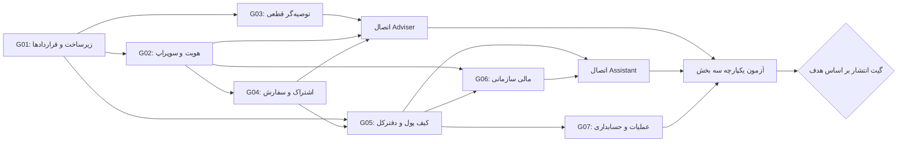
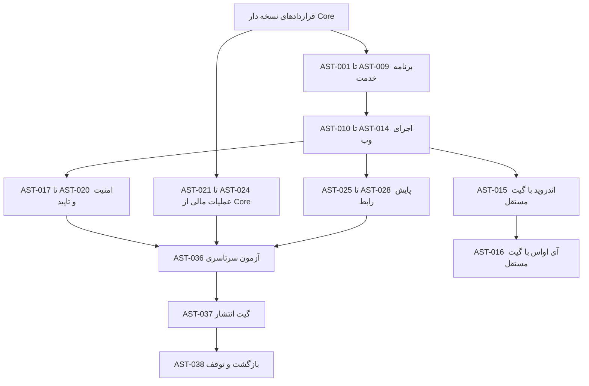

# برنامه پیاده‌سازی فاز دوم شهاب

**وضعیت:** پیش‌نویس اجرایی؛ ممیزی اتمی و پوشش Adviser/Assistant کامل و تأییدشده نیست. خط مبنای مستقل نسخه‌های مرجع در `SHAHAB_PHASE_2_COVERAGE_BASELINE_B.md` و `SHAHAB_PHASE_2_COVERAGE_BASELINE_W.md` ثبت شده است: ۲٬۸۰۶ خط غیرخالی، ۱٬۹۵۷ ردیف ممیزی قبلی و ۸۴۹ خط بدون ردیف قبلی. ادعای ۵٬۲۵۸ واحد تا بازیابی روش استخراج اولیه و تطبیق نسخه‌ها تأیید نشده است. در خط مبنای اولیه ۱۵۷ مورد از ۱۵۸ زیرتسک QA عبارت عمومی داشتند؛ بازنویسی‌های بعدی انجام شده اما تأیید معنایی مستقل تمام آزمون‌ها همچنان باز است. این سند و PR تا بسته‌شدن گیت‌های معنایی و CI آماده ادغام نیستند.
**مراجع:** [سند جامع فاز دوم](SHAHAB_PHASE_2_DEVELOPMENT_BLUEPRINT.md) نسخه ۱.۶؛ [سند کیف پول](SHAHAB_DIGITAL_WALLET.md) نسخه ۰.۲۰.

## فصل اول — مجموعه تسک های فاز دوم

### ۱.۱. اصول دامنه، مالکیت و ردیابی
- این فصل بسته‌های Core و موجودی اولیه Assistant را مستقل از زمان انتشار ثبت می‌کند؛ اجرای RAG و Computer Use به‌ترتیب متعلق به Adviser و Assistant است. مالکیت داده، مجوز و قرارداد برحسب دامنه و مرجع مصوب تعیین می‌شود و پوشش کامل Adviser ادعا نشده است.
- هر ردیف `CORE-W-xxx` یا `CORE-B-xxx` یک بسته قابلیت مستقل است؛ چهار زیرتسک `.DB`، `.BE`، `.FE` و `.QA` دارد. زیرتسک فاقد کاربرد باید با دلیل فنی مستند شود؛ حذف خاموش مجاز نیست.
- متن مصوب هر بند بر خلاصه این سند مقدم است؛ گزاره‌های تصمیم‌باز با برچسب «باز» از پیاده‌سازی مصوب تفکیک می‌شوند. مثال عددی به‌تنهایی مصوبه نیست.
- [ماتریس ممیزی محتوایی](SHAHAB_PHASE_2_CORE_SEMANTIC_AUDIT.md) مرجع کمکی ردیابی خطوط است، نه جایگزین آزمون‌های اختصاصی زیر.

### ۱.۱.۱. قرارداد توالی‌یابی بین Core، Adviser و Assistant

**اصل الزام‌آور:** فصل اول «فهرست موجودی کار» است و ترتیب سطرها به‌معنای ترتیب اجرا نیست. فصل بعد باید بتواند بدون بازنویسی شناسه‌ها، همه تسک‌های سه بخش را در یک شبکه وابستگی و برحسب هدف و زمان کنار هم قرار دهد. هیچ تسکی نباید فقط با نام یک فاز، Story یا یک وابستگی مبهم مانند «پس از تکمیل Core» توالی‌یابی شود.

**مدل اجباری داده برای هر تسک اجرایی:**

| فیلد | قاعده ثبت و کاربرد در فصل بعد |
|---|---|
| `task_id` | شناسه یکتا و پایدار؛ با جابه‌جایی زمانی تغییر نمی‌کند |
| `component` | `CORE`، `ADVISER`، `ASSISTANT` یا `SHARED`؛ مالک اجرای کار، نه مصرف‌کننده آن |
| `story_id` و `source_refs` | ارتباط با User Story و بندهای مصوب مرجع، قابل ردیابی و ممیزی |
| `objective_ids` | هدف یا خروجی محصول که تسک برای آن ضروری است؛ قابل اشتراک میان سه بخش |
| `deliverable` و `acceptance_tests` | خروجی عینی، معیار اتمام و شاهد آزمون مستقل |
| `hard_dependencies` | شناسه تسک‌های پیش‌نیاز واقعی؛ تا پایان آن‌ها شروع/پایان کار ممکن نیست |
| `soft_dependencies` | وابستگی ترجیحی یا بهینه‌ساز که مانع شروع کار نیست |
| `contract_dependencies` | شناسه قرارداد API، رویداد، schema، مجوز یا داده نسخه‌دار که باید پیش از یکپارچه‌سازی تثبیت شود |
| `provides` و `consumes` | قابلیت، داده یا قرارداد تولیدشده/مصرف‌شده، همراه با مالک و نسخه |
| `parallelizable_with` | کارهای مستقل قابل اجرای هم‌زمان یا امکان کار با mock/contract-first |
| `decision_gates` | تصمیم باز، تصویب حقوقی یا گیت امنیت/مالی که انجام یا انتشار را متوقف می‌کند |
| `estimate` و `capacity_role` | تخمین و تخصص لازم، بعد از تحلیل؛ بدون اعداد ساختگی |
| `release_gate` | شرط ورود به بهره‌برداری؛ جدا از پیش‌نیاز فنی و جدا از اولویت |

**قواعد توالی‌یابی:**

۱. وابستگی باید به **شناسه تسک یا قرارداد مشخص** ارجاع دهد، نه صرفاً نام سرویس. وابستگی دوری ممنوع است و باید پیش از زمان‌بندی تشخیص داده شود.

۲. وابستگی فنی، وابستگی قراردادی، وابستگی تصمیمی و شرط انتشار چهار مفهوم متفاوت‌اند؛ نباید به یک فیلد «پیش‌نیاز» تقلیل یابند.

۳. برای آغاز توسعه موازی Adviser و Assistant، تثبیت قرارداد و mock معتبر ممکن است کافی باشد؛ تکمیل کل Core شرط عمومی آغاز آن‌ها نیست. اما آزمون یکپارچه و بهره‌برداری به اجرای واقعی و کنترل‌های امنیتی وابسته‌اند.

۴. یک قابلیت مشترک فقط یک مالک و یک شناسه اجرایی دارد. مصرف‌کنندگان در بخش‌های دیگر به همان شناسه ارجاع می‌دهند؛ تسک مشابه به نام سه سرویس تکرار نمی‌شود.

۵. هر هدف بین‌سرویسی باید به زنجیره‌ای از تسک‌ها و شواهد پذیرش ختم شود: **زیرساخت/قرارداد → قابلیت هر سرویس → یکپارچه‌سازی → آزمون سرتاسری → گیت انتشار**. این الگو ترتیب اجباری همه کارهای داخلی نیست؛ اجرای موازی در هر گام مجاز است.

۶. فصل بعد مجاز است ترتیب، گروه‌بندی، ظرفیت و زمان‌بندی را تغییر دهد، ولی شناسه و مصوبه مرجع را بدون ثبت تغییر عوض نمی‌کند.

**نکته کنترلی:** فهرست فعلی بسته‌ها و Storyهای این فصل هنوز همه فیلدهای بالا را برای هر تسک به‌صورت تکمیل‌شده ندارد. این بخش قرارداد ساختاری لازم برای تکمیل ماتریس وابستگی است؛ نباید صرف درج این قرارداد به‌عنوان تکمیل واقعی شبکه توالی‌یابی تلقی شود.

### ۱.۲. شاخص ۴۶ User Story و مالکیت بسته‌های اجرایی
هر Story یک هدف محصول/فنی است؛ تسک‌ها در بسته‌های بعدی ثبت شده‌اند. Storyهای بدون بسته اختصاصی در بخش ۱.۵ تسک مستقل دارند و برای آن‌ها ردیابی در سطح Story حفظ می‌شود.

| Story | هدف | بسته‌های مستقیم در این فصل |
|---|---|---|
| CORE-US-01 | مرزبندی ماژول‌های Core | CORE-B-002، CORE-B-003، CORE-B-007، CORE-B-010، CORE-B-016، CORE-B-018، CORE-B-026، CORE-B-028، CORE-B-030، CORE-B-049 |
| CORE-US-02 | پیکربندی و مهاجرت داده | تسک سراسری ۱.۶ / نیازمند تخصیص بسته مستقل |
| CORE-US-03 | قراردادهای API نسخه‌دار | CORE-B-031، CORE-B-034 |
| CORE-US-04 | Job و Outbox | تسک سراسری ۱.۶ / نیازمند تخصیص بسته مستقل |
| CORE-US-05 | مشاهده‌پذیری | تسک سراسری ۱.۶ / نیازمند تخصیص بسته مستقل |
| CORE-US-06 | امنیت پایه | تسک سراسری ۱.۶ / نیازمند تخصیص بسته مستقل |
| CORE-US-07 | حساب و نشست | CORE-B-033 |
| CORE-US-08 | دامنه و نقش و نشست | تسک سراسری ۱.۶ / نیازمند تخصیص بسته مستقل |
| CORE-US-09 | کاتالوگ خدمات | تسک سراسری ۱.۶ / نیازمند تخصیص بسته مستقل |
| CORE-US-10 | مسیریابی درخواست | تسک سراسری ۱.۶ / نیازمند تخصیص بسته مستقل |
| CORE-US-11 | رضایت و مجوز | CORE-B-015، CORE-B-032، CORE-B-041، CORE-W-068، CORE-W-081، CORE-W-083 |
| CORE-US-12 | سوپراپ | تسک سراسری ۱.۶ / نیازمند تخصیص بسته مستقل |
| CORE-US-13 | Snapshot تسهیلات | تسک سراسری ۱.۶ / نیازمند تخصیص بسته مستقل |
| CORE-US-14 | توصیه‌گر قطعی | CORE-B-004، CORE-B-035، CORE-B-036، CORE-B-038 |
| CORE-US-15 | پرسشنامه | تسک سراسری ۱.۶ / نیازمند تخصیص بسته مستقل |
| CORE-US-16 | کاتالوگ پویای محصولات | تسک سراسری ۱.۶ / نیازمند تخصیص بسته مستقل |
| CORE-US-17 | تازگی و اختلاف نسخه | تسک سراسری ۱.۶ / نیازمند تخصیص بسته مستقل |
| CORE-US-18 | پنل مدیریت کاتالوگ | تسک سراسری ۱.۶ / نیازمند تخصیص بسته مستقل |
| CORE-US-19 | پلن و استحقاق | تسک سراسری ۱.۶ / نیازمند تخصیص بسته مستقل |
| CORE-US-20 | نسخه قیمت | تسک سراسری ۱.۶ / نیازمند تخصیص بسته مستقل |
| CORE-US-21 | چرخه اشتراک | CORE-B-012، CORE-B-029 |
| CORE-US-22 | تمدید خودکار | تسک سراسری ۱.۶ / نیازمند تخصیص بسته مستقل |
| CORE-US-23 | سنجش مصرف | تسک سراسری ۱.۶ / نیازمند تخصیص بسته مستقل |
| CORE-US-24 | سفارش، فاکتور و پرداخت | تسک سراسری ۱.۶ / نیازمند تخصیص بسته مستقل |
| CORE-US-25 | مالکیت کیف پول | CORE-B-001، CORE-B-005، CORE-B-006، CORE-B-008، CORE-B-011، CORE-B-014، CORE-B-017، CORE-B-019، CORE-B-020، CORE-B-021، CORE-B-022، CORE-B-023، CORE-B-024، CORE-B-025، CORE-B-027، CORE-B-037، CORE-B-039، CORE-B-040، CORE-B-042، CORE-B-043، CORE-B-044، CORE-B-045، CORE-B-046، CORE-B-047، CORE-B-048، CORE-B-050، CORE-B-051، CORE-B-052، CORE-B-053، CORE-W-003، CORE-W-018، CORE-W-020، CORE-W-021، CORE-W-022، CORE-W-024، CORE-W-027، CORE-W-073، CORE-W-075، CORE-W-076، CORE-W-082، CORE-W-084، CORE-W-087، CORE-W-089، CORE-W-092، CORE-W-093، CORE-W-094، CORE-W-095، CORE-W-097، CORE-W-101، CORE-W-103، CORE-W-104، CORE-W-105 |
| CORE-US-26 | دفترکل | CORE-W-071، CORE-W-072، CORE-W-074، CORE-W-080، CORE-W-090 |
| CORE-US-27 | ضدتکرار و هم‌زمانی | تسک سراسری ۱.۶ / نیازمند تخصیص بسته مستقل |
| CORE-US-28 | شارژ نقدی | CORE-B-013، CORE-W-017، CORE-W-033، CORE-W-034 |
| CORE-US-29 | هدیه و تخفیف | CORE-W-036، CORE-W-037، CORE-W-038، CORE-W-039، CORE-W-040، CORE-W-063 |
| CORE-US-30 | موجودی، تاریخچه و رسید | CORE-W-032، CORE-W-098، CORE-W-102 |
| CORE-US-31 | مصرف خدمت | CORE-W-019، CORE-W-026، CORE-W-028، CORE-W-031، CORE-W-041، CORE-W-078، CORE-W-086، CORE-W-088، CORE-W-091، CORE-W-096 |
| CORE-US-32 | استرداد | CORE-W-061، CORE-W-062 |
| CORE-US-33 | رزرو | CORE-W-025، CORE-W-042، CORE-W-043، CORE-W-044، CORE-W-045، CORE-W-046، CORE-W-047، CORE-W-048، CORE-W-077 |
| CORE-US-34 | تطبیق | CORE-W-079، CORE-W-085 |
| CORE-US-35 | کیف پول سازمانی | CORE-B-009، CORE-W-001، CORE-W-002، CORE-W-004، CORE-W-005، CORE-W-006، CORE-W-007، CORE-W-008، CORE-W-009، CORE-W-013، CORE-W-014، CORE-W-016، CORE-W-029، CORE-W-030، CORE-W-035، CORE-W-054، CORE-W-060 |
| CORE-US-36 | بودجه و سقف | CORE-W-010، CORE-W-011، CORE-W-012، CORE-W-015، CORE-W-070 |
| CORE-US-37 | تأمین مالی سازمان | تسک سراسری ۱.۶ / نیازمند تخصیص بسته مستقل |
| CORE-US-38 | انتقال | CORE-W-049، CORE-W-051، CORE-W-052، CORE-W-058، CORE-W-059 |
| CORE-US-39 | برداشت | CORE-W-023، CORE-W-049، CORE-W-050، CORE-W-053، CORE-W-055، CORE-W-056، CORE-W-057 |
| CORE-US-40 | پرداخت دوره‌ای و شارژ خودکار | CORE-W-064، CORE-W-065، CORE-W-066، CORE-W-067، CORE-W-069 |
| CORE-US-41 | اعلان | CORE-W-099 |
| CORE-US-42 | پشتیبانی و اختلاف | CORE-W-100 |
| CORE-US-43 | حسابداری | تسک سراسری ۱.۶ / نیازمند تخصیص بسته مستقل |
| CORE-US-44 | پنل عملیات | تسک سراسری ۱.۶ / نیازمند تخصیص بسته مستقل |
| CORE-US-45 | آزمون جامع | تسک سراسری ۱.۶ / نیازمند تخصیص بسته مستقل |
| CORE-US-46 | CI/CD | تسک سراسری ۱.۶ / نیازمند تخصیص بسته مستقل |

### ۱.۲.۱. تسک مستقل و معیار پذیرش برای هر User Story
این ردیف‌ها کارهای اصلی و **غیرتکراری** هر Story هستند؛ بسته‌های مرجع بخش‌های ۱.۳ و ۱.۴ جزئیات پیاده‌سازی و استثناهای آن‌ها را پوشش می‌دهند. اجرای تسک با معیار پذیرش سنجیده می‌شود، نه صرفاً ایجاد فایل یا API.

| شناسه تسک | کار اجرایی | آزمون پذیرش |
|---|---|---|
| CORE-US-01.MAIN | ماژول‌های Identity/Catalog/Recommendation/Plan/Wallet را با dependency rule جدا کن | تست معماری هر import بین ماژول‌ها را کنترل کند |
| CORE-US-02.MAIN | تنظیمات نوع‌دار، migration و feature flag نسخه‌دار بساز | تغییر schema و rollback بدون تخریب داده انجام شود |
| CORE-US-03.MAIN | OpenAPI و DTO قرارداد Core با Adviser و Assistant را نسخه‌دار کن | consumer contract test نسخه ناسازگار را رد کند |
| CORE-US-04.MAIN | Job پایدار و Outbox تراکنشی و پردازش idempotent بساز | restart یا retry پیام اثر مالی تکراری نسازد |
| CORE-US-05.MAIN | Metric/Trace/Log برای API، Job، مالی و وابستگی بساز | داشبورد تأخیر و خطای قرارداد و ledger هشدار دهد |
| CORE-US-06.MAIN | RBAC/ABAC، کنترل نشست، rate limit و audit عملیات حساس بساز | دسترسی افقی و نقش نامعتبر رد شود |
| CORE-US-07.MAIN | ثبت‌نام، ورود، نشست ناشناس و تبدیل مجاز به حساب بساز | انقضای نشست و مهاجرت داده بدون نشت تست شود |
| CORE-US-08.MAIN | مدل زمینه دامنه، نقش، نشست و دسترسی چندسازمانی بساز | جابجایی دامنه بدون مجوز داده شخصی منتقل نکند |
| CORE-US-09.MAIN | کاتالوگ نسخه‌دار حوزه/خدمت/شرایط/شواهد بساز | خدمت ناموجود یا غیرفعال در مسیریابی قابل اجرا نباشد |
| CORE-US-10.MAIN | Router درخواست به مشاور، دستیار یا توصیه قطعی بساز | مسیر انتخابی و علت fallback در trace ثبت شود |
| CORE-US-11.MAIN | رضایت هدفمند، تاریخ انقضا و لغو مجوز بساز | پس از لغو، اقدام هزینه‌زای جدید رد شود |
| CORE-US-12.MAIN | خانه سوپراپ، کارت خدمت و حالت Adviser/Assistant بساز | حالت غیرفعال و دسترسی پلن به‌درستی نمایش یابد |
| CORE-US-13.MAIN | Snapshot و نسخه منبع تسهیلات را با منشأ نگهداری کن | بازیابی نتیجه قدیمی با نسخه داده ممکن باشد |
| CORE-US-14.MAIN | امتیاز تطابق و دلیل توصیه را قطعی و بازتولیدپذیر کن | ورودی و نسخه یکسان نتیجه و درصد یکسان بدهد |
| CORE-US-15.MAIN | پرسشنامه نسخه‌دار با اعتبارسنجی و canonical answer بساز | پاسخ ناقص/نامعتبر از توصیه جلوگیری کند |
| CORE-US-16.MAIN | مدل پویا برای بانک، محصول، ویژگی، شرط و تغییرات بساز | نسخه جدید محصول بدون تخریب تاریخچه ثبت شود |
| CORE-US-17.MAIN | کشف اختلاف Snapshot و سیاست تازگی داده را اجرا کن | داده متعارض با برچسب عدم قطعیت نمایش یابد |
| CORE-US-18.MAIN | پنل تأیید، انتشار و rollback نسخه کاتالوگ بساز | انتشار Snapshot اتمیک و قابل بازگشت باشد |
| CORE-US-19.MAIN | Plan/Entitlement و اعمال سقف و دسترسی در سرور بساز | پلن نامعتبر امکان مصرف خدمت محدود را ندهد |
| CORE-US-20.MAIN | PriceVersion و تثبیت نسخه در سفارش و اجرا بساز | تغییر قیمت، سفارش معتبر قبلی را بازقیمت‌گذاری نکند |
| CORE-US-21.MAIN | ماشین وضعیت اشتراک، ارتقا، تنزل و انقضا بساز | ارتقا تاریخ انقضا را جابجا نکند؛ تنزل به‌موقع اثر کند |
| CORE-US-22.MAIN | رضایت نسخه‌دار تمدید و مدیریت افزایش قیمت بساز | پیش‌فرض خاموش و افزایش بدون رضایت جدید رد شود |
| CORE-US-23.MAIN | ثبت UsageEvent و کنترل سهمیه و اندازه‌گیری دقیق بساز | retry مصرف را دوبار محاسبه نکند |
| CORE-US-24.MAIN | Order/Invoice/Payment و تطبیق نتیجه نامعلوم بساز | سفارش ۱۵ دقیقه و پرداخت معتبر دیررس صحیح رسیدگی شود |
| CORE-US-25.MAIN | یک کیف اصلی برای هر مالک و وضعیت فعال‌سازی بساز | ایجاد مجدد کیف تکراری نسازد |
| CORE-US-26.MAIN | دفترکل دوطرفه و ثبت‌های جبرانی immutable بساز | تراز حساب‌ها و بازسازی مانده دقیق باشد |
| CORE-US-27.MAIN | idempotency، قفل مانده و کنترل مصرف موازی بساز | دو مصرف هم‌زمان از مانده/سقف عبور نکنند |
| CORE-US-28.MAIN | شارژ با درگاه، بانک، تأیید و تطبیق بساز | callback تکراری فقط یک شارژ ایجاد کند |
| CORE-US-29.MAIN | CreditLot هدیه، کد تخفیف و تاریخ انقضا بساز | هدیه قابل برداشت نباشد و کد دوباره مصرف نشود |
| CORE-US-30.MAIN | API و UI موجودی آزاد/رزرو/برداشت، تاریخچه و رسید بساز | مجموع مانده با دفترکل و رسید همخوان باشد |
| CORE-US-31.MAIN | محاسبه و کسر هزینه خدمت با منشأ و نرخ ثابت بساز | کسر از سقف مجاز و هزینه واقعی بیشتر نشود |
| CORE-US-32.MAIN | استرداد کامل/جزئی با تخصیص منشأ و ثبت جبرانی بساز | جمع ریالی دقیق و Largest Remainder رعایت شود |
| CORE-US-33.MAIN | Hold/partial capture/release و انقضا بساز | افزایش بدون مجوز و آزادسازی مازاد ممنوع باشد |
| CORE-US-34.MAIN | تطبیق حداقل روزانه بانک، خدمت و دفترکل بساز | هر مغایرت حل‌نشده پرونده داشته باشد |
| CORE-US-35.MAIN | مدل Org/Membership/Admin و کیف سازمانی بساز | چند ادمین هم‌اختیار و مرز سازمانی رعایت شود |
| CORE-US-36.MAIN | Allowance و کنترل سقف عضو/سازمان و رزرو بساز | سقف بدون موجودی سازمان مجوز خرج نسازد |
| CORE-US-37.MAIN | فاکتور سازمان پیش از پرداخت و واریز بانکی سازمان بساز | بدون فاکتور معتبر شارژ سازمانی شروع نشود |
| CORE-US-38.MAIN | انتقال فردی و سازمانی محدود با lineage بساز | فرد→سازمان و سازمان→سازمان رد شوند |
| CORE-US-39.MAIN | برداشت بانکی فقط از نقدی واجد شرایط با احراز مجدد بساز | حساب غیرمالک و هدیه/انتقالی رد شود |
| CORE-US-40.MAIN | قرارداد شارژ خودکار و پرداخت دوره‌ای با لغو و شکست بساز | شکست قطعی بدون اقدام مشتری retry نشود |
| CORE-US-41.MAIN | اعلان وضعیت مالی و امنیتی و اقدام لازم بساز | پیام به مخاطب نامجاز ارسال نشود |
| CORE-US-42.MAIN | پرونده اختلاف، پشتیبانی، جبران و ممیزی بساز | اصلاح مالی بدون دلیل و عامل ثبت نشود |
| CORE-US-43.MAIN | حسابداری تعهد مشتری، درآمد و بدهی تأمین‌کننده بساز | تسویه تأمین‌کننده کسر دوم مشتری نسازد |
| CORE-US-44.MAIN | داشبورد عملیات مالی، مغایرت، Job و هشدار بساز | اپراتور مجاز بتواند وضعیت نامعلوم را پیگیری کند |
| CORE-US-45.MAIN | تست property-based دفترکل، قرارداد، E2E، بار و fault injection بساز | گیت‌ها تکرار، رقابت و خرابی را کشف کنند |
| CORE-US-46.MAIN | Pipeline CI/CD، migration، rollback و restore را تست کن | استقرار قابل بازگشت و بازیابی قابل تکرار باشد |

### ۱.۳. دامنه کیف پول: بسته‌های مستقل و معیار پذیرش

#### CORE-W-001 — ۳.۱. هر شخص و سازمان چند کیف پول دارد
**مرجع:** کیف پول ۳.۱، خط 130؛ **مالک:** CORE-US-35.
**قواعد لازم برای این بسته:**
- مسئله و هدف: باید صاحب کیف پول و زمان ایجاد آن روشن باشد؛ کیف پول کارمند با منابع سازمانی که اجازهٔ مصرفشان را دارد یک دارایی نیست.
- پاسخ مصوب: هر شخص یک کیف پول شخصی اصلی دارد که با فعال‌شدن حساب او ایجاد می‌شود. هر سازمان نیز پس از ایجاد و تأیید حساب سازمانی، یک کیف پول سازمانی اصلی دارد. مالک آن سازمان است، نه کارمندی که حساب را ساخته یا مدیر فعلی آن.
- جزئیات اجرایی نیازمند تصمیم: قالب و مدارک اجرایی قرارداد رسمی محضری و روش اتصال به سرویس‌های احراز باید نهایی شوند؛ اصل ثبت هویت سازمان، مالک واقعی و نماینده در قرارداد و سیاست فعال‌سازی و بستن حساب مصوب است.
| تسک | خروجی اجرایی | آزمون پذیرش |
|---|---|---|
| CORE-W-001.DB | مدل WalletOwner با مالک شخصی/سازمانی و شناسه یکتای کیف اصلی؛ ایجاد اتمیک پس از فعال‌سازی حساب؛ نگهداری تاریخچه مالکیت بدون وابستگی به مدیر فعلی | قیود و migration با داده واقعی و نامعتبر آزمایش شوند |
| CORE-W-001.BE | API ایجاد کیف اصلی به‌صورت idempotent پس از فعال‌شدن شخص یا تأیید سازمان؛ جلوگیری از ایجاد کیف اصلی تکراری و انتقال مالکیت سازمان به سازنده | حالت‌های معتبر، نامعتبر، تکراری و نتیجه نامعلوم تست شوند |
| CORE-W-001.FE | نمای تفکیک کیف شخصی و سازمانی؛ نمایش مالک حقوقی و وضعیت فعال‌سازی بدون اشتباه گرفتن مجوز مصرف کارمند با مالکیت | مسیر کاربر و پیام‌های خطا/تأیید با E2E تست شوند |
| CORE-W-001.QA | تست ایجاد هم‌زمان دوباره کیف اصلی، ایجاد پیش از فعال‌سازی، حذف مدیر و عضویت چندسازمانی؛ assert دقیقاً یک کیف اصلی برای هر مالک و بقای مالکیت سازمان | سطح: integration/E2E؛ مسئول: QA و مالک Core؛ پیش‌شرط: fixture داده و قرارداد نسخه‌دار؛ ورودی مثبت/منفی/مرزی: تست ایجاد هم‌زمان دوباره کیف اصلی، ایجاد پیش از فعال‌سازی، حذف مدیر و عضویت چندسازمانی؛ assert دقیقاً یک کیف اصلی برای هر مالک و بقای مالکیت سازمان؛ موفقیت: هیچ invariant مصوب بسته نقض نشود؛ شاهد: شناسه آزمون، fixture، خروجی و assertion؛ [طراحی آزمون؛ اجرا نشده] |

#### CORE-W-002 — ۳.۱.۱. فعال‌سازی مالی سازمان
**مرجع:** کیف پول ۳.۱.۱، خط 150؛ **مالک:** CORE-US-35.
**قواعد لازم برای این بسته:**
- مسئله و هدف: پیش‌ثبت‌نام نباید پیش از احراز، اختیار جابه‌جایی پول ایجاد کند.
- پاسخ مصوب: پیش از دریافت خدمات، قرارداد رسمی محضری مطابق اسناد خود سازمان و قانون تنظیم و نهایی شود؛ هویت سازمان، مالک واقعی، سمت و اختیار نماینده در همین فرایند مشخص و مستند شوند. پس از نهایی‌شدن قرارداد و تأیید موارد فوق، داشبورد سازمانی تخصیص و امکان شارژ و تخصیص اعتبار فعال شود؛ تا آن زمان فقط پیش‌ثبت‌نام و مشاهدهٔ وضعیت مجاز است.
| تسک | خروجی اجرایی | آزمون پذیرش |
|---|---|---|
| CORE-W-002.DB | مدل وضعیت پیش‌ثبت‌نام/احراز/قرارداد محضری/تأیید نهایی با شناسه و نسخه شواهد هویت سازمان، مالک واقعی و اختیار نماینده | قیود و migration با داده واقعی و نامعتبر آزمایش شوند |
| CORE-W-002.BE | ماشین وضعیت فعال‌سازی سازمان؛ شارژ و تخصیص اعتبار فقط پس از تأیید هویت و نهایی‌شدن قرارداد محضری؛ رد انتقال غیرمجاز حالت | حالت‌های معتبر، نامعتبر، تکراری و نتیجه نامعلوم تست شوند |
| CORE-W-002.FE | نمای پیش‌ثبت‌نام و وضعیت قرارداد/احراز؛ پنهان یا غیرفعال بودن شارژ و تخصیص تا تکمیل همه پیش‌شرط‌ها | مسیر کاربر و پیام‌های خطا/تأیید با E2E تست شوند |
| CORE-W-002.QA | تست پیش‌ثبت‌نام بدون قرارداد، قرارداد بدون تأیید مالک واقعی، نماینده فاقد اختیار، درخواست شارژ مستقیم از API و فعال‌سازی کامل؛ assert عدم جابه‌جایی پول قبل از تأیید نهایی | سطح: integration/E2E؛ مسئول: QA و مالک Core؛ پیش‌شرط: fixture داده و قرارداد نسخه‌دار؛ ورودی مثبت/منفی/مرزی: تست پیش‌ثبت‌نام بدون قرارداد، قرارداد بدون تأیید مالک واقعی، نماینده فاقد اختیار، درخواست شارژ مستقیم از API و فعال‌سازی کامل؛ assert عدم جابه‌جایی پول قبل از تأیید نهایی؛ موفقیت: هیچ invariant مصوب بسته نقض نشود؛ شاهد: شناسه آزمون، fixture، خروجی و assertion؛ [طراحی آزمون؛ اجرا نشده] |

#### CORE-W-003 — ۳.۱.۲. شناسایی معمول شخص حقیقی
**مرجع:** کیف پول ۳.۱.۲، خط 162؛ **مالک:** CORE-US-25.
**قواعد لازم برای این بسته:**
- مسئله و هدف: کنترل شماره و هویت باید روشن و از بررسی استثنایی یا احراز مجدد عملیات حساس جدا باشد.
- پاسخ مصوب: کنترل شماره با OTP و تطبیق مالکیت شمارهٔ تلفن همراه با کد ملی از طریق شاهکار انجام شود. نتیجهٔ ناموفق یا نامعلوم، تطبیق موفق محسوب نشود. این مسیر عادی، جای تطبیق مالکیت حساب بانکی هنگام برداشت یا بررسی تکمیلی در موارد الزام قانونی و اطلاعات متعارض را نمی‌گیرد.
| تسک | خروجی اجرایی | آزمون پذیرش |
|---|---|---|
| CORE-W-003.DB | مدل وضعیت OTP، تطبیق شاهکار و شواهد نتیجه بدون نگهداری اسرار؛ قیود یکتایی هویت و تاریخ اعتبار | OTP منقضی/تکراری و پاسخ ناموفق یا نامعلوم شاهکار نتواند وضعیت تطبیق موفق بسازد |
| CORE-W-003.BE | سرویس تأیید OTP و adapter شاهکار با سه وضعیت موفق/ناموفق/نامعلوم؛ عدم جایگزینی احراز برداشت | فقط OTP معتبر همراه تطبیق موفق شاهکار مجوز شناسایی عادی بدهد؛ timeout یا مغایرت رد شود |
| CORE-W-003.FE | فرم کد OTP و نمایش وضعیت تطبیق بدون افشای کد ملی یا داده حساس در پیام خطا | OTP اشتباه/منقضی و تطبیق نامعلوم پیام غیرقطعی بدهد؛ وضعیت موفق فقط پس از تأیید هر دو کنترل |
| CORE-W-003.QA | ماتریس آزمون OTP، شاهکار، timeout، تکرار و استقلال کنترل برداشت | سطح: integration/E2E؛ مسئول: QA و مالک Core؛ پیش‌شرط: OTP معتبر و منقضی، پاسخ‌های موفق/ناموفق/نامعلوم شاهکار و حساب آزمایشی؛ مثبت: OTP معتبر + تطبیق موفق شماره و کد ملی، فقط یک بار وضعیت هویت تأییدشده بسازد؛ منفی: OTP غلط/منقضی، مغایرت کد ملی یا timeout شاهکار وضعیت تأییدشده نسازد؛ مرزی: callback تکراری یا پاسخ دیررس وضعیت تأییدشده نامعتبر ایجاد نکند؛ استقلال: احراز هویت عادی مجوز برداشت بانکی بدون تطبیق حساب نیست؛ موفقیت: هیچ مسیر ناموفق یا نامعلوم به هویت تأییدشده یا مجوز برداشت تبدیل نشود؛ شاهد: ورودی پوشانده، پاسخ mock شاهکار، transitionهای وضعیت و assertionهای اجرا؛ [طراحی آزمون؛ اجرا نشده] |

#### CORE-W-004 — ۳.۲. کاربر می‌تواند عضو چند سازمان باشد و با خروج او چه می‌شود
**مرجع:** کیف پول ۳.۲، خط 174؛ **مالک:** CORE-US-35.
**قواعد لازم برای این بسته:**
- مسئله و هدف: همکاری یک شخص با چند سازمان نباید دسترسی یا پول آن‌ها را مخلوط کند؛ خروج از یک سازمان نیز نباید حساب شخصی را حذف کند.
- پاسخ مصوب: بله؛ یک شخص می‌تواند عضو چند سازمان باشد. دسترسی، بودجه و سوابق هر سازمان جدا می‌مانند. حذف عضویت، اجازهٔ شروع عملیات جدید برای همان سازمان را قطع می‌کند؛ کیف پول شخصی کاربر، پول سازمان و سوابق مالی قبلی حذف نمی‌شوند.
- وضعیت تصمیم: دعوت و رسیدهای عضو سابق در ادامه مصوب‌اند؛ عملیات ناتمام طبق ۳.۶ تعیین تکلیف می‌شوند.
| تسک | خروجی اجرایی | آزمون پذیرش |
|---|---|---|
| CORE-W-004.DB | مدل Membership با کلید مرکب شخص/سازمان، وضعیت و تاریخ مؤثر خروج؛ جداسازی Allowance و سوابق مالی به شناسه سازمان | قیود و migration با داده واقعی و نامعتبر آزمایش شوند |
| CORE-W-004.BE | API خروج/حذف عضویت که شروع عملیات جدید سازمان را بلافاصله رد کند؛ حفظ کیف شخصی، تعهدات قبلی و ارجاع عملیات ناتمام به قاعده ۳.۶ | حالت‌های معتبر، نامعتبر، تکراری و نتیجه نامعلوم تست شوند |
| CORE-W-004.FE | انتخاب سازمان فعال و نمایش مجوز همان سازمان؛ پس از خروج فقط دسترسی مجاز به رسیدهای قبلی بدون امکان شروع خدمت جدید | مسیر کاربر و پیام‌های خطا/تأیید با E2E تست شوند |
| CORE-W-004.QA | تست عضویت هم‌زمان در دو سازمان، خروج از یکی، درخواست جدید با توکن قدیمی، بقای کیف شخصی و رسید قبلی؛ assert عدم نشت مجوز یا بودجه میان سازمان‌ها | سطح: integration/E2E؛ مسئول: QA و مالک Core؛ پیش‌شرط: fixture داده و قرارداد نسخه‌دار؛ ورودی مثبت/منفی/مرزی: تست عضویت هم‌زمان در دو سازمان، خروج از یکی، درخواست جدید با توکن قدیمی، بقای کیف شخصی و رسید قبلی؛ assert عدم نشت مجوز یا بودجه میان سازمان‌ها؛ موفقیت: هیچ invariant مصوب بسته نقض نشود؛ شاهد: شناسه آزمون، fixture، خروجی و assertion؛ [طراحی آزمون؛ اجرا نشده] |

#### CORE-W-005 — ۳.۲.۱. دعوت و پذیرش عضو
**مرجع:** کیف پول ۳.۲.۱، خط 190؛ **مالک:** CORE-US-35.
**قواعد لازم برای این بسته:**
- پاسخ مصوب: ادمین فهرست افراد را بارگذاری کند؛ فرد پس از احراز هویت و پذیرش دعوت عضو فعال شود. تطبیق فرد با حساب صحیح لازم است.
- ارتباط با بخش‌های دیگر: جهت انتقال و فهرست مجاز ۳.۷ پابرجاست؛ قالب فایل و شناسه‌های تطبیق جزئیات اجرایی‌اند.
| تسک | خروجی اجرایی | آزمون پذیرش |
|---|---|---|
| CORE-W-005.DB | مدل دعوت سازمانی با شناسه سازمان/شخص، وضعیت uploaded/pending/accepted/rejected/expired، تاریخ و کلید یکتای دعوت؛ اتصال عضویت فقط به حساب احرازشده | سطح migration/constraint؛ پیش‌شرط: داده معتبر و نامعتبر بند CORE-W-005؛ قبولی: دعوت با وضعیت pending پس از بارگذاری، بدون Membership فعال؛ کلید یکتای سازمان/فرد/دعوت؛ رد: نقض همین شرط یا پذیرش دسترسی غیرمجاز، تکرار اثر مالی یا عبور از سقف؛ شاهد: fixture، شناسه سناریو CORE-W-005.DB.T01، ورودی و assertion خروجی؛ مسئول: مالک Core و QA؛ [طراحی؛ اجرا نشده] |
| CORE-W-005.BE | API بارگذاری فهرست فقط برای ادمین همان سازمان، تطبیق هویت دعوت‌شونده، پذیرش صریح و فعال‌سازی عضویت پس از هر دو شرط؛ بارگذاری صرف هیچ مجوز مصرفی ندهد | سطح API/integration؛ پیش‌شرط: داده معتبر و نامعتبر بند CORE-W-005؛ قبولی: بارگذاری توسط غیرادمین رد؛ پذیرش بدون تطبیق هویت رد؛ پس از احراز و پذیرش یک عضویت فعال؛ رد: نقض همین شرط یا پذیرش دسترسی غیرمجاز، تکرار اثر مالی یا عبور از سقف؛ شاهد: fixture، شناسه سناریو CORE-W-005.BE.T01، ورودی و assertion خروجی؛ مسئول: مالک Core و QA؛ [طراحی؛ اجرا نشده] |
| CORE-W-005.FE | نمای بارگذاری و خطاهای ردیف‌های نامعتبر برای ادمین؛ اعلان دعوت و اقدام پذیرش/رد برای شخص احرازشده با نام سازمان | سطح E2E/accessibility؛ پیش‌شرط: داده معتبر و نامعتبر بند CORE-W-005؛ قبولی: پیش از پذیرش، دکمه مصرف سازمان غیرفعال؛ رد دعوت و خطای هویت قابل مشاهده؛ رد: نقض همین شرط یا پذیرش دسترسی غیرمجاز، تکرار اثر مالی یا عبور از سقف؛ شاهد: fixture، شناسه سناریو CORE-W-005.FE.T01، ورودی و assertion خروجی؛ مسئول: مالک Core و QA؛ [طراحی؛ اجرا نشده] |
| CORE-W-005.QA | سطح integration/E2E؛ مسئول QA/Core؛ پیش‌شرط: سازمان دارای ادمین، فهرست معتبر/نامعتبر و دو حساب متمایز؛ مثبت: بارگذاری→احراز هویت→پذیرش صریح فقط همان شخص را عضو فعال کند؛ منفی: بارگذاری تنها، عدم تطبیق حساب، رد دعوت، بارگذاری فرد سازمان دیگر یا کاربر غیرادمین دسترسی نسازد؛ مرزی: دعوت تکراری، پذیرش دوباره و رقابت دعوت/لغو عضو تکراری نسازد؛ موفقیت: هیچ عضوی قبل از احراز و پذیرش فعال نشود؛ شاهد: شناسه دعوت، transition وضعیت، assert عضویت و عدم مجوز مصرف؛ [طراحی آزمون؛ اجرا نشده] | سطح integration/E2E/security؛ پیش‌شرط: داده معتبر و نامعتبر بند CORE-W-005؛ قبولی: برای سه وضعیت uploaded/verified/accepted آزمون مستقل و تست تکرار/لغو؛ عضویت فقط در accepted؛ رد: نقض همین شرط یا پذیرش دسترسی غیرمجاز، تکرار اثر مالی یا عبور از سقف؛ شاهد: fixture، شناسه سناریو CORE-W-005.QA.T01، ورودی و assertion خروجی؛ مسئول: QA و مالک Core؛ [طراحی؛ اجرا نشده] |

#### CORE-W-006 — ۳.۲.۲. دسترسی عضو سابق به رسید
**مرجع:** کیف پول ۳.۲.۲، خط 202؛ **مالک:** CORE-US-35.
**قواعد لازم برای این بسته:**
- مسئله و هدف: خروج عضو نباید دسترسی مالی جاری بدهد یا امکان پیگیری عملیات خودش را از بین ببرد.
- پاسخ مصوب: مشاهدهٔ محدود رسید عملیات خودش باقی بماند؛ اطلاعات سایر اعضا و موجودی سازمان نمایش داده نشوند.
| تسک | خروجی اجرایی | آزمون پذیرش |
|---|---|---|
| CORE-W-006.DB | مدل رسید با شناسه صاحب عملیات و سازمان در زمان اجرا؛ نگهداری مالک رسید مستقل از وضعیت فعلی Membership و نمای حداقلی داده‌های مجاز | سطح migration/constraint؛ پیش‌شرط: داده معتبر و نامعتبر بند CORE-W-006؛ قبولی: رسیدها دارای owner_user_id و org_id تاریخی؛ حذف عضویت کلید خارجی رسید را حذف نکند؛ رد: نقض همین شرط یا پذیرش دسترسی غیرمجاز، تکرار اثر مالی یا عبور از سقف؛ شاهد: fixture، شناسه سناریو CORE-W-006.DB.T01، ورودی و assertion خروجی؛ مسئول: مالک Core و QA؛ [طراحی؛ اجرا نشده] |
| CORE-W-006.BE | API خواندن رسید شخصی عضو سابق با فیلتر مالک عملیات و حذف موجودی سازمان/داده دیگر اعضا؛ رد همه عملیات مالی جدید و فهرست رسیدهای دیگران | سطح API/integration؛ پیش‌شرط: داده معتبر و نامعتبر بند CORE-W-006؛ قبولی: API رسید خود عضو سابق 200 و رسید دیگری 403/404؛ API موجودی سازمان 403؛ رد: نقض همین شرط یا پذیرش دسترسی غیرمجاز، تکرار اثر مالی یا عبور از سقف؛ شاهد: fixture، شناسه سناریو CORE-W-006.BE.T01، ورودی و assertion خروجی؛ مسئول: مالک Core و QA؛ [طراحی؛ اجرا نشده] |
| CORE-W-006.FE | نمای فقط‌خواندنی رسیدهای عملیات خود کاربر سابق، بدون نمایش مانده سازمان، لیست اعضا یا دکمه عملیات جاری | سطح E2E/accessibility؛ پیش‌شرط: داده معتبر و نامعتبر بند CORE-W-006؛ قبولی: در حساب عضو سابق فقط رسیدهای خودش نمایش یابد؛ موجودی و اعضا در پاسخ شبکه نیز نباشند؛ رد: نقض همین شرط یا پذیرش دسترسی غیرمجاز، تکرار اثر مالی یا عبور از سقف؛ شاهد: fixture، شناسه سناریو CORE-W-006.FE.T01، ورودی و assertion خروجی؛ مسئول: مالک Core و QA؛ [طراحی؛ اجرا نشده] |
| CORE-W-006.QA | سطح API-security/E2E؛ مسئول QA/Core؛ پیش‌شرط: کاربر سابق با دو رسید خود و رسید همکار در سازمان، عضویت لغوشده؛ مثبت: خواندن رسید خود پس از خروج موفق؛ منفی: رسید همکار، موجودی سازمان، فهرست اعضا و عملیات جدید با شناسه/توکن قدیمی رد شود؛ مرزی: خروج در میانه مشاهده، چندسازمانی و حدس شناسه رسید باعث نشت نشود؛ موفقیت: فقط رسید متعلق به همان شخص و فیلدهای مجاز بازگردد؛ شاهد: fixture مالکیت، پاسخ API و assertion فیلدها؛ [طراحی آزمون؛ اجرا نشده] | سطح integration/E2E/security؛ پیش‌شرط: داده معتبر و نامعتبر بند CORE-W-006؛ قبولی: بعد از خروج، رسید خود قابل خواندن و رسید دیگری/موجودی غیرقابل خواندن؛ E2E و API؛ رد: نقض همین شرط یا پذیرش دسترسی غیرمجاز، تکرار اثر مالی یا عبور از سقف؛ شاهد: fixture، شناسه سناریو CORE-W-006.QA.T01، ورودی و assertion خروجی؛ مسئول: QA و مالک Core؛ [طراحی؛ اجرا نشده] |

#### CORE-W-007 — ۳.۳. سازمان برای مدیریت کیف پول به چند نقش مدیریتی نیاز دارد
**مرجع:** کیف پول ۳.۳، خط 214؛ **مالک:** CORE-US-35.
**قواعد لازم برای این بسته:**
- مسئله و هدف: سازمان باید کیف پول را ساده و با اختیار روشن اداره کند، بدون فرایند مدیریتی چندنفرهٔ تحمیلی.
- پاسخ مصوب: تنها نوع نقش مدیریتی سازمان، ادمین سازمان است و تمام دسترسی‌های لازم را در همان سازمان دارد. شهاب سازمان را ملزم به داشتن مسئول مالی، تأییدکنندهٔ دوم یا گردش چندمرحله‌ای نمی‌کند.
- / صاحب کیف پول شخصی / موجودی خودش را ببیند، شارژ کند، خدمت بگیرد، انتقال دهد و برداشت مجاز درخواست کند /
- / ادمین سازمان / اعضا و دسترسی‌ها را مدیریت کند؛ شارژ، تخصیص بودجه و سقف، مشاهدهٔ گزارش، انتقال و برداشت مجاز سازمان را انجام دهد /
| تسک | خروجی اجرایی | آزمون پذیرش |
|---|---|---|
| CORE-W-007.DB | مدل RBAC با تنها یک نوع نقش مدیریتی سازمان (OrgAdmin) و مجوزهای عضو عادی؛ ثبت قلمرو هر مجوز به سازمان و تفکیک کیف شخصی | سطح migration/constraint؛ پیش‌شرط: داده معتبر و نامعتبر بند CORE-W-007؛ قبولی: RBAC تنها یک نوع OrgAdmin و Member؛ هر grant محدود به org_id؛ رد: نقض همین شرط یا پذیرش دسترسی غیرمجاز، تکرار اثر مالی یا عبور از سقف؛ شاهد: fixture، شناسه سناریو CORE-W-007.DB.T01، ورودی و assertion خروجی؛ مسئول: مالک Core و QA؛ [طراحی؛ اجرا نشده] |
| CORE-W-007.BE | کنترل سروری نقش ادمین برای مدیریت عضو، شارژ، تخصیص سقف، گزارش و برداشت مجاز همان سازمان؛ بدون تأییدکننده دوم اجباری؛ اجرای مستقل کنترل هویت، موجودی و منشأ اعتبار | سطح API/integration؛ پیش‌شرط: داده معتبر و نامعتبر بند CORE-W-007؛ قبولی: ادمین همان سازمان عملیات مجاز را بدون تأیید دوم انجام دهد؛ Member و ادمین سازمان دیگر 403؛ رد: نقض همین شرط یا پذیرش دسترسی غیرمجاز، تکرار اثر مالی یا عبور از سقف؛ شاهد: fixture، شناسه سناریو CORE-W-007.BE.T01، ورودی و assertion خروجی؛ مسئول: مالک Core و QA؛ [طراحی؛ اجرا نشده] |
| CORE-W-007.FE | داشبورد ادمین سازمان با عملیات مجاز و بدون گردش تأیید چندمرحله‌ای اجباری؛ نمای کارمند فقط خدمت و رسیدهای مجاز؛ جداسازی کیف شخصی | سطح E2E/accessibility؛ پیش‌شرط: داده معتبر و نامعتبر بند CORE-W-007؛ قبولی: ادمین عملیات همان سازمان را ببیند و کارمند کنترل مدیریتی نبیند؛ سرور نیز رد کند؛ رد: نقض همین شرط یا پذیرش دسترسی غیرمجاز، تکرار اثر مالی یا عبور از سقف؛ شاهد: fixture، شناسه سناریو CORE-W-007.FE.T01، ورودی و assertion خروجی؛ مسئول: مالک Core و QA؛ [طراحی؛ اجرا نشده] |
| CORE-W-007.QA | سطح authorization/integration/E2E؛ مسئول QA/Core؛ پیش‌شرط: ادمین، عضو عادی و دو سازمان؛ مثبت: ادمین همان سازمان مستقلاً سقف/عضو/عملیات مجاز را مدیریت کند؛ منفی: عضو عادی نتواند مدیریت کند و ادمین به کیف شخصی یا سازمان دیگر دسترسی نداشته باشد؛ مرزی: ادمین هم نتواند اعتبار هدیه غیرقابل‌برداشت را نقد کند؛ موفقیت: مجوزها سروری و محدود به قلمرو سازمان باشند و تأییدکننده دوم تحمیل نشود؛ شاهد: ماتریس مجوز، پاسخ API و audit actor؛ [طراحی آزمون؛ اجرا نشده] | سطح integration/E2E/security؛ پیش‌شرط: داده معتبر و نامعتبر بند CORE-W-007؛ قبولی: ماتریس نقش×سازمان×عملیات با رد دسترسی افقی و نقدکردن هدیه؛ همه موارد pass؛ رد: نقض همین شرط یا پذیرش دسترسی غیرمجاز، تکرار اثر مالی یا عبور از سقف؛ شاهد: fixture، شناسه سناریو CORE-W-007.QA.T01، ورودی و assertion خروجی؛ مسئول: QA و مالک Core؛ [طراحی؛ اجرا نشده] |

#### CORE-W-008 — ۳.۳.۱. چند ادمین با یک نوع نقش
**مرجع:** کیف پول ۳.۳.۱، خط 238؛ **مالک:** CORE-US-35.
**قواعد لازم برای این بسته:**
- مسئله و هدف: نباید تعداد مدیران با تعداد انواع نقش اشتباه شود.
- پاسخ مصوب: بله؛ چند ادمین با اختیارات یکسان در همان سازمان مجازند و سوابق کامل اقدامات هرکدام ثبت شود. نقش مالی یا تأییدکنندهٔ دوم اجباری ایجاد نشود.
| تسک | خروجی اجرایی | آزمون پذیرش |
|---|---|---|
| CORE-W-008.DB | مدل چند انتساب مستقل OrgAdmin به یک سازمان با سطح دسترسی برابر و ثبت شناسه عامل هر تغییر در audit trail غیرقابل‌حذف | سطح migration/constraint؛ پیش‌شرط: داده معتبر و نامعتبر بند CORE-W-008؛ قبولی: دو OrgAdmin همزمان با شناسه عامل مستقل ذخیره شوند؛ audit هر اقدام محفوظ؛ رد: نقض همین شرط یا پذیرش دسترسی غیرمجاز، تکرار اثر مالی یا عبور از سقف؛ شاهد: fixture، شناسه سناریو CORE-W-008.DB.T01، ورودی و assertion خروجی؛ مسئول: مالک Core و QA؛ [طراحی؛ اجرا نشده] |
| CORE-W-008.BE | API افزودن/لغو ادمین با احراز اختیار سازمان؛ هر ادمین فعال مستقلاً همان عملیات مجاز را انجام دهد؛ ثبت actor و جلوگیری از دسترسی به سازمان دیگر | سطح API/integration؛ پیش‌شرط: داده معتبر و نامعتبر بند CORE-W-008؛ قبولی: هر دو ادمین مستقل مجاز؛ پس از لغو یکی فقط همان ادمین 403؛ audit متمایز؛ رد: نقض همین شرط یا پذیرش دسترسی غیرمجاز، تکرار اثر مالی یا عبور از سقف؛ شاهد: fixture، شناسه سناریو CORE-W-008.BE.T01، ورودی و assertion خروجی؛ مسئول: مالک Core و QA؛ [طراحی؛ اجرا نشده] |
| CORE-W-008.FE | نمای فهرست ادمین‌های هم‌اختیار و تاریخچه اقدام هر عامل؛ بدون تعریف نقش مالی یا تأییدکننده دوم اجباری | سطح E2E/accessibility؛ پیش‌شرط: داده معتبر و نامعتبر بند CORE-W-008؛ قبولی: دو ادمین در فهرست با اختیارات یکسان؛ حذف یکی دسترسی دیگری را تغییر ندهد؛ رد: نقض همین شرط یا پذیرش دسترسی غیرمجاز، تکرار اثر مالی یا عبور از سقف؛ شاهد: fixture، شناسه سناریو CORE-W-008.FE.T01، ورودی و assertion خروجی؛ مسئول: مالک Core و QA؛ [طراحی؛ اجرا نشده] |
| CORE-W-008.QA | سطح authorization/audit/E2E؛ مسئول QA/Core؛ پیش‌شرط: سازمان با دو ادمین و یک عضو عادی؛ مثبت: هر دو ادمین مستقل عملیات مجاز انجام دهند و actor صحیح ثبت شود؛ منفی: عضو عادی و ادمین سازمان دیگر رد شوند؛ مرزی: لغو یکی از ادمین‌ها دسترسی دیگری و سوابق را حذف نکند؛ موفقیت: مجوز برابر، audit متمایز و نبود گیت تأیید دوم؛ شاهد: actor IDs، تغییرات وضعیت و assertion دسترسی؛ [طراحی آزمون؛ اجرا نشده] | سطح integration/E2E/security؛ پیش‌شرط: داده معتبر و نامعتبر بند CORE-W-008؛ قبولی: تست همزمان دو ادمین و لغو یکی؛ شمارش دو actor مستقل و نبود تأیید دوم؛ رد: نقض همین شرط یا پذیرش دسترسی غیرمجاز، تکرار اثر مالی یا عبور از سقف؛ شاهد: fixture، شناسه سناریو CORE-W-008.QA.T01، ورودی و assertion خروجی؛ مسئول: QA و مالک Core؛ [طراحی؛ اجرا نشده] |

#### CORE-W-009 — ۳.۳.۲. جایگزینی ادمین و بستن حساب
**مرجع:** کیف پول ۳.۳.۲، خط 250؛ **مالک:** CORE-US-35.
**قواعد لازم برای این بسته:**
- مسئله و هدف: تغییر نماینده نباید مالکیت سازمان یا تعهدات قبلی را حذف کند.
- پاسخ مصوب: انتقال توسط ادمین فعلی با احراز مجدد انجام شود؛ اگر او در دسترس نیست، بازیابی با احراز نمایندگی سازمان صورت گیرد. بستن حساب پس از تعیین تکلیف تعهدات انجام شود؛ سوابق مالی حذف نشوند.
| تسک | خروجی اجرایی | آزمون پذیرش |
|---|---|---|
| CORE-W-009.DB | مدل نسخه‌دار تغییر ادمین و وضعیت حساب سازمان؛ ثبت مدرک احراز مجدد یا نمایندگی و تعهدات باز؛ حفظ دفترکل و سوابق پس از بستن | سطح migration/constraint؛ پیش‌شرط: داده معتبر و نامعتبر بند CORE-W-009؛ قبولی: تغییر نماینده با نسخه وضعیت و شواهد احراز؛ بستن حساب بدون حذف دفترکل؛ رد: نقض همین شرط یا پذیرش دسترسی غیرمجاز، تکرار اثر مالی یا عبور از سقف؛ شاهد: fixture، شناسه سناریو CORE-W-009.DB.T01، ورودی و assertion خروجی؛ مسئول: مالک Core و QA؛ [طراحی؛ اجرا نشده] |
| CORE-W-009.BE | فرایند انتقال توسط ادمین فعلی فقط پس از احراز مجدد؛ بازیابی بدون ادمین با اثبات نمایندگی سازمان؛ بستن حساب فقط پس از تعیین تکلیف تعهدات و بدون حذف سوابق | سطح API/integration؛ پیش‌شرط: داده معتبر و نامعتبر بند CORE-W-009؛ قبولی: انتقال بدون احراز مجدد یا نمایندگی معتبر 403؛ بستن با تعهد باز 409؛ رد: نقض همین شرط یا پذیرش دسترسی غیرمجاز، تکرار اثر مالی یا عبور از سقف؛ شاهد: fixture، شناسه سناریو CORE-W-009.BE.T01، ورودی و assertion خروجی؛ مسئول: مالک Core و QA؛ [طراحی؛ اجرا نشده] |
| CORE-W-009.FE | فرم انتقال/بازیابی ادمین با وضعیت بررسی نمایندگی؛ نمایش موانع بستن حساب و تعهدات تسویه‌نشده بدون حذف تاریخچه | سطح E2E/accessibility؛ پیش‌شرط: داده معتبر و نامعتبر بند CORE-W-009؛ قبولی: تا تکمیل احراز، انتقال نهایی نمایش داده نشود؛ تعهد باز مانع بستن شود؛ رد: نقض همین شرط یا پذیرش دسترسی غیرمجاز، تکرار اثر مالی یا عبور از سقف؛ شاهد: fixture، شناسه سناریو CORE-W-009.FE.T01، ورودی و assertion خروجی؛ مسئول: مالک Core و QA؛ [طراحی؛ اجرا نشده] |
| CORE-W-009.QA | سطح integration/security؛ مسئول QA/Core؛ پیش‌شرط: ادمین فعال، نماینده قابل احراز و تعهد باز؛ مثبت: انتقال با احراز مجدد یا بازیابی با مدرک نمایندگی معتبر؛ منفی: انتقال بدون احراز و بستن با تعهد باز رد شود؛ مرزی: رقابت دو درخواست انتقال و تکرار callback مالکیت مبهم نسازد؛ موفقیت: مالک سازمان ثابت و سوابق مالی محفوظ بمانند؛ شاهد: state transitions، مدرک پوشانده، actor audit و ledger count؛ [طراحی آزمون؛ اجرا نشده] | سطح integration/E2E/security؛ پیش‌شرط: داده معتبر و نامعتبر بند CORE-W-009؛ قبولی: تست احراز معتبر/نامعتبر، رقابت انتقال و تعهد باز؛ مالکیت سازمان و سوابق محفوظ؛ رد: نقض همین شرط یا پذیرش دسترسی غیرمجاز، تکرار اثر مالی یا عبور از سقف؛ شاهد: fixture، شناسه سناریو CORE-W-009.QA.T01، ورودی و assertion خروجی؛ مسئول: QA و مالک Core؛ [طراحی؛ اجرا نشده] |

#### CORE-W-010 — ۳.۴. اختصاص بودجه به کارمند، پول را وارد کیف پول شخصی او می‌کند
**مرجع:** کیف پول ۳.۴، خط 262؛ **مالک:** CORE-US-36.
**قواعد لازم برای این بسته:**
- مسئله و هدف: بودجهٔ واگذارشده ممکن است فقط اجازهٔ مصرف باشد، نه انتقال دارایی؛ باید این تفاوت برای ادمین و کارمند روشن بماند.
- پاسخ مصوب: خیر. در مدل پایه، پول در کیف پول سازمان می‌ماند و کارمند اجازهٔ مصرف تا سقف تعیین‌شده توسط ادمین را می‌گیرد. در شروع خدمت، هم موجودی آزاد سازمان و هم سقف باقیماندهٔ کارمند بررسی می‌شوند. مبلغ رزروشده نیز در هر دو کنترل لحاظ می‌شود.
- وضعیت تصمیم: بودجه فقط مجوز مصرف و بدون پشتوانهٔ موجودی اختصاصی است. دوره‌ها و ترکیب سقف‌ها در ۶.۸ و مانده و استرداد در ادامه مصوب‌اند؛ ادمین تعیین‌کنندهٔ مقادیر است.
| تسک | خروجی اجرایی | آزمون پذیرش |
|---|---|---|
| CORE-W-010.DB | مدل Allowance مستقل از WalletBalance با سقف مصوب کارمند، مصرف و رزرو فعال؛ ارتباط به سازمان/عضو و کنترل هم‌زمان دو منبع محدودیت | سطح migration/constraint؛ پیش‌شرط: داده معتبر و نامعتبر بند CORE-W-010؛ قبولی: Allowance و reservation مستقل از موجودی شخصی؛ کلید دوره/سازمان/عضو؛ رد: نقض همین شرط یا پذیرش دسترسی غیرمجاز، تکرار اثر مالی یا عبور از سقف؛ شاهد: fixture، شناسه سناریو CORE-W-010.DB.T01، ورودی و assertion خروجی؛ مسئول: مالک Core و QA؛ [طراحی؛ اجرا نشده] |
| CORE-W-010.BE | API ایجاد/تغییر سقف فقط برای ادمین؛ شروع خدمت و رزرو با بررسی اتمیک موجودی آزاد سازمان و سقف باقیمانده عضو؛ منع انتقال ضمنی پول به کیف شخصی | سطح API/integration؛ پیش‌شرط: داده معتبر و نامعتبر بند CORE-W-010؛ قبولی: رزرو فقط اگر مبلغ ≤ حداقل مانده آزاد سازمان و مجوز آزاد عضو؛ همزمانی مانع اضافه‌مصرف؛ رد: نقض همین شرط یا پذیرش دسترسی غیرمجاز، تکرار اثر مالی یا عبور از سقف؛ شاهد: fixture، شناسه سناریو CORE-W-010.BE.T01، ورودی و assertion خروجی؛ مسئول: مالک Core و QA؛ [طراحی؛ اجرا نشده] |
| CORE-W-010.FE | نمای بودجه قابل‌مصرف به‌عنوان «مجوز مصرف» جدا از موجودی کیف شخصی؛ نمایش سقف باقیمانده و رزروهای فعال به ادمین/عضو در حدود مجوز | سطح E2E/accessibility؛ پیش‌شرط: داده معتبر و نامعتبر بند CORE-W-010؛ قبولی: موجودی کیف شخصی با بودجه سازمان یکی نمایش داده نشود؛ هر دو سقف قابل مشاهده؛ رد: نقض همین شرط یا پذیرش دسترسی غیرمجاز، تکرار اثر مالی یا عبور از سقف؛ شاهد: fixture، شناسه سناریو CORE-W-010.FE.T01، ورودی و assertion خروجی؛ مسئول: مالک Core و QA؛ [طراحی؛ اجرا نشده] |
| CORE-W-010.QA | سطح financial-concurrency/integration؛ مسئول QA/Core؛ پیش‌شرط: کیف سازمان با موجودی، سقف عضو و رزرو فعال؛ مثبت: رزرو فقط تا کمینه موجودی آزاد و سقف آزاد عضو انجام شود؛ منفی: کافی‌نبودن هر یک رد شود؛ مرزی: دو درخواست هم‌زمان و لغو رزرو نتواند از هر دو سقف عبور کند یا اعتبار شخصی بسازد؛ موفقیت: موجودی سازمان ثابتاً مالک دارایی و مصرف/رزرو در هر دو کنترل محاسبه شود؛ شاهد: snapshot قبل/بعد دفترکل، allowance و reservation، assertion رقابت؛ [طراحی آزمون؛ اجرا نشده] | سطح integration/E2E/security؛ پیش‌شرط: داده معتبر و نامعتبر بند CORE-W-010؛ قبولی: دو رزرو همزمان نباید از موجودی یا سقف عبور کنند؛ عدم ایجاد credit شخصی؛ رد: نقض همین شرط یا پذیرش دسترسی غیرمجاز، تکرار اثر مالی یا عبور از سقف؛ شاهد: fixture، شناسه سناریو CORE-W-010.QA.T01، ورودی و assertion خروجی؛ مسئول: QA و مالک Core؛ [طراحی؛ اجرا نشده] |

#### CORE-W-011 — ۳.۴.۱. انتقال ماندهٔ مجوز مصرف
**مرجع:** کیف پول ۳.۴.۱، خط 278؛ **مالک:** CORE-US-36 (Allowance و دوره بودجه؛ نه انتقال دارایی).
**قواعد لازم برای این بسته:**
- پاسخ مصوب: ادمین برای هر بودجه انتخاب کند ماندهٔ مجوز مصرف به دورهٔ بعد منتقل شود یا نشود. این انتخاب انتقال پول به کیف پول شخصی نیست.
| تسک | خروجی اجرایی | آزمون پذیرش |
|---|---|---|
| CORE-W-011.DB | مدل نسخه‌دار سیاست انتقال مانده مجوز مصرف به دوره بعد برای هر بودجه؛ ثبت مقدار منتقل‌شده جدا از دفترکل دارایی | سطح migration/constraint؛ پیش‌شرط: داده معتبر و نامعتبر بند CORE-W-011؛ قبولی: سیاست carry_over برای هر بودجه/دوره ذخیره شود؛ مانده منتقل‌شده فقط Allowance؛ رد: نقض همین شرط یا پذیرش دسترسی غیرمجاز، تکرار اثر مالی یا عبور از سقف؛ شاهد: fixture، شناسه سناریو CORE-W-011.DB.T01، ورودی و assertion خروجی؛ مسئول: مالک Core و QA؛ [طراحی؛ اجرا نشده] |
| CORE-W-011.BE | API بستن دوره و محاسبه مانده مجوز طبق انتخاب ادمین؛ انتقال ظرفیت بدون انتقال دارایی یا افزایش کیف شخصی | سطح API/integration؛ پیش‌شرط: داده معتبر و نامعتبر بند CORE-W-011؛ قبولی: در بستن دوره، carry_over=false مانده صفر و true مانده مجوز منتقل شود؛ تکرار job بی‌اثر؛ رد: نقض همین شرط یا پذیرش دسترسی غیرمجاز، تکرار اثر مالی یا عبور از سقف؛ شاهد: fixture، شناسه سناریو CORE-W-011.BE.T01، ورودی و assertion خروجی؛ مسئول: مالک Core و QA؛ [طراحی؛ اجرا نشده] |
| CORE-W-011.FE | کنترل ادمین برای انتقال/عدم انتقال مانده هر بودجه و نمایش مانده دوره بعد جدا از موجودی کیف | سطح E2E/accessibility؛ پیش‌شرط: داده معتبر و نامعتبر بند CORE-W-011؛ قبولی: ادمین سیاست هر بودجه را مستقل انتخاب کند؛ مانده منتقل‌شده به‌عنوان دارایی نمایش داده نشود؛ رد: نقض همین شرط یا پذیرش دسترسی غیرمجاز، تکرار اثر مالی یا عبور از سقف؛ شاهد: fixture، شناسه سناریو CORE-W-011.FE.T01، ورودی و assertion خروجی؛ مسئول: مالک Core و QA؛ [طراحی؛ اجرا نشده] |
| CORE-W-011.QA | آزمون دو بودجه با سیاست متفاوت، تغییر سیاست در پایان دوره، تکرار job و نبود انتقال به کیف شخصی؛ assert مانده مجوز مطابق سیاست و دفترکل دارایی بدون تغییر | سطح integration/E2E/security؛ پیش‌شرط: داده معتبر و نامعتبر بند CORE-W-011؛ قبولی: آزمون دو بودجه با سیاست متضاد، تکرار بستن دوره و ثبات دفترکل دارایی؛ رد: نقض همین شرط یا پذیرش دسترسی غیرمجاز، تکرار اثر مالی یا عبور از سقف؛ شاهد: fixture، شناسه سناریو CORE-W-011.QA.T01، ورودی و assertion خروجی؛ مسئول: QA و مالک Core؛ [طراحی؛ اجرا نشده] |

#### CORE-W-012 — ۳.۴.۲. اثر استرداد بر ظرفیت کارمند
**مرجع:** کیف پول ۳.۴.۲، خط 290؛ **مالک:** CORE-US-36.
**قواعد لازم برای این بسته:**
- مسئله و هدف: بازگشت پول به سازمان نباید بی‌قاعده سقف دورهٔ تازهٔ عضو را افزایش دهد.
- پاسخ مصوب: فقط ظرفیت دورهٔ اصلی به اندازهٔ استرداد احیا شود؛ اگر دوره تمام شده، ظرفیت دورهٔ جدید افزایش نیابد. مبلغ و اجزای اعتبار به کیف پول پرداخت‌کننده طبق ۶.۶ بازگردند.
- ارتباط با بخش‌های دیگر: انتقال ماندهٔ مجوز قاعدهٔ مستقلی است؛ جزئیات ترکیب آن با استرداد دورهٔ بسته باید در طراحی اجرایی بدون افزایش خودکار ظرفیت دورهٔ جدید مشخص شود.
| تسک | خروجی اجرایی | آزمون پذیرش |
|---|---|---|
| CORE-W-012.DB | ثبت شناسه دوره اصلی مصرف و شناسه رزرو/استرداد و اجزای منشأ اعتبار برای بازپرداخت | سطح migration/constraint؛ پیش‌شرط: داده معتبر و نامعتبر بند CORE-W-012؛ قبولی: استرداد به دوره اصلی و منشأ نقد/هدیه متصل باشد؛ دوره جدید مستقل؛ رد: نقض همین شرط یا پذیرش دسترسی غیرمجاز، تکرار اثر مالی یا عبور از سقف؛ شاهد: fixture، شناسه سناریو CORE-W-012.DB.T01، ورودی و assertion خروجی؛ مسئول: مالک Core و QA؛ [طراحی؛ اجرا نشده] |
| CORE-W-012.BE | API استرداد به همان کیف و اجزای پرداخت‌کننده؛ احیای ظرفیت فقط در دوره اصلی و عدم افزایش ظرفیت دوره جدید پس از انقضا | سطح API/integration؛ پیش‌شرط: داده معتبر و نامعتبر بند CORE-W-012؛ قبولی: استرداد در دوره بسته ظرفیت دوره جدید را صفر تغییر دهد؛ مبلغ به کیف اولیه بازگردد؛ رد: نقض همین شرط یا پذیرش دسترسی غیرمجاز، تکرار اثر مالی یا عبور از سقف؛ شاهد: fixture، شناسه سناریو CORE-W-012.BE.T01، ورودی و assertion خروجی؛ مسئول: مالک Core و QA؛ [طراحی؛ اجرا نشده] |
| CORE-W-012.FE | نمای استرداد و ظرفیت احیاشده در دوره مربوط، بدون نمایش اعتبار اضافی در دوره تازه | سطح E2E/accessibility؛ پیش‌شرط: داده معتبر و نامعتبر بند CORE-W-012؛ قبولی: رسید استرداد دوره اصلی و اجزای اعتبار را نشان دهد؛ مانده دوره جدید تغییر نکند؛ رد: نقض همین شرط یا پذیرش دسترسی غیرمجاز، تکرار اثر مالی یا عبور از سقف؛ شاهد: fixture، شناسه سناریو CORE-W-012.FE.T01، ورودی و assertion خروجی؛ مسئول: مالک Core و QA؛ [طراحی؛ اجرا نشده] |
| CORE-W-012.QA | آزمون استرداد قبل/بعد بسته‌شدن دوره، استرداد جزئی و تکراری، ترکیب نقد/هدیه و انتقال مانده؛ assert عدم افزایش خودکار ظرفیت دوره جدید | سطح integration/E2E/security؛ پیش‌شرط: داده معتبر و نامعتبر بند CORE-W-012؛ قبولی: تست استرداد جزئی/کامل و تکراری قبل و بعد بسته‌شدن دوره؛ دوره جدید بدون افزایش؛ رد: نقض همین شرط یا پذیرش دسترسی غیرمجاز، تکرار اثر مالی یا عبور از سقف؛ شاهد: fixture، شناسه سناریو CORE-W-012.QA.T01، ورودی و assertion خروجی؛ مسئول: QA و مالک Core؛ [طراحی؛ اجرا نشده] |

#### CORE-W-013 — ۳.۵. هزینه از کیف پول شخصی پرداخت می‌شود یا سازمانی
**مرجع:** کیف پول ۳.۵، خط 302؛ **مالک:** CORE-US-35.
**قواعد لازم برای این بسته:**
- پاسخ مصوب: پیش از رزرو یا شروع کار هزینه‌زا، کیف پول پرداخت‌کننده و سقف مجاز هزینه روشن شوند. سازمان فعال می‌تواند انتخاب پیش‌فرض باشد، ولی کاربر نام منبع پرداخت را ببیند. اگر مجوز یا اعتبار سازمان کافی نیست، شهاب توقف می‌کند و انتخاب تازه می‌گیرد؛ خودکار از کیف پول شخصی کسر نمی‌کند.
- در نسخهٔ اولیه، هر عملیات یک کیف پول پرداخت‌کننده دارد. تقسیم هزینهٔ یک عملیات بین شخص و سازمان فعلاً فعال نیست؛ افزودن آن در آینده به تصمیم و طراحی جدا نیاز دارد. این موضوع با مصرف ترکیبی نقدی و هدیه داخل یک کیف پول فرق دارد؛ ترتیب آن در بخش ۵.۳ مصوب است.
| تسک | خروجی اجرایی | آزمون پذیرش |
|---|---|---|
| CORE-W-013.DB | مدل انتخاب یکتای payer_wallet_id برای هر عملیات و snapshot سقف مجاز پیش از رزرو؛ منع split بین شخص و سازمان در نسخه اولیه | سطح migration/constraint؛ پیش‌شرط: داده معتبر و نامعتبر بند CORE-W-013؛ قبولی: هر سفارش دقیقاً یک payer_wallet_id داشته باشد؛ split payer ممنوع؛ رد: نقض همین شرط یا پذیرش دسترسی غیرمجاز، تکرار اثر مالی یا عبور از سقف؛ شاهد: fixture، شناسه سناریو CORE-W-013.DB.T01، ورودی و assertion خروجی؛ مسئول: مالک Core و QA؛ [طراحی؛ اجرا نشده] |
| CORE-W-013.BE | API الزام انتخاب صریح کیف پرداخت‌کننده و بررسی مجوز/موجودی قبل از رزرو؛ در ناکافی‌بودن سازمان توقف و درخواست انتخاب جدید بدون fallback خودکار شخصی | سطح API/integration؛ پیش‌شرط: داده معتبر و نامعتبر بند CORE-W-013؛ قبولی: کسری موجودی/مجوز سازمان عملیات را متوقف کند؛ هیچ debit از کیف شخصی بدون انتخاب صریح؛ رد: نقض همین شرط یا پذیرش دسترسی غیرمجاز، تکرار اثر مالی یا عبور از سقف؛ شاهد: fixture، شناسه سناریو CORE-W-013.BE.T01، ورودی و assertion خروجی؛ مسئول: مالک Core و QA؛ [طراحی؛ اجرا نشده] |
| CORE-W-013.FE | نمای نام کیف پرداخت‌کننده پیش از شروع هزینه و انتخاب مجدد هنگام ناکافی‌بودن موجودی/مجوز سازمان؛ بدون تقسیم هزینه میان دو کیف | سطح E2E/accessibility؛ پیش‌شرط: داده معتبر و نامعتبر بند CORE-W-013؛ قبولی: نام کیف پیش از تأیید نشان داده شود؛ هنگام کسری انتخاب جدید لازم باشد؛ رد: نقض همین شرط یا پذیرش دسترسی غیرمجاز، تکرار اثر مالی یا عبور از سقف؛ شاهد: fixture، شناسه سناریو CORE-W-013.FE.T01، ورودی و assertion خروجی؛ مسئول: مالک Core و QA؛ [طراحی؛ اجرا نشده] |
| CORE-W-013.QA | آزمون انتخاب شخص/سازمان، کسری مجوز سازمان، تغییر سازمان فعال، درخواست split و mixed cash/gift داخل یک کیف؛ assert یک payer برای هر عملیات و نبود برداشت شخصی خودکار | سطح integration/E2E/security؛ پیش‌شرط: داده معتبر و نامعتبر بند CORE-W-013؛ قبولی: تست سازمان ناکافی و کیف شخصی پر؛ debit شخصی صفر تا تأیید مجدد؛ split رد؛ رد: نقض همین شرط یا پذیرش دسترسی غیرمجاز، تکرار اثر مالی یا عبور از سقف؛ شاهد: fixture، شناسه سناریو CORE-W-013.QA.T01، ورودی و assertion خروجی؛ مسئول: QA و مالک Core؛ [طراحی؛ اجرا نشده] |

#### CORE-W-014 — ۳.۶. اگر دسترسی کارمند در میانهٔ کار قطع شود، هزینه چه می‌شود
**مرجع:** کیف پول ۳.۶، خط 318؛ **مالک:** CORE-US-35.
**قواعد لازم برای این بسته:**
- پاسخ مصوب: پیش از رزرو، افزایش رزرو یا اقدام هزینه‌زای جدید، مجوز بررسی شود. پس از لغو دسترسی، ایجاد هزینهٔ تازه متوقف و عملیات در اولین نقطهٔ امن متوقف یا منتظر تصمیم ادمین شود. هزینهٔ واقعاً ایجادشده و مجاز طبق تعهد قبلی و تعرفه تعیین تکلیف و باقی رزرو پس از روشن‌شدن نتیجه آزاد شود. هزینه به کیف پول شخصی منتقل نشود.
- پاسخ مصوب دربارهٔ کاهش سقف یا قطع دسترسی: هزینهٔ تازه و افزایش رزرو متوقف شود؛ تعهد قبلی رسیدگی و ادامه فقط با اجازهٔ صریح ادمین و احراز مجدد اختیار معتبر ممکن باشد. جزئیات نقطهٔ امن برای هر خدمت نیازمند طراحی اجرایی است؛ هزینهٔ قبلی طبق بخش ۹ تعیین می‌شود.
| تسک | خروجی اجرایی | آزمون پذیرش |
|---|---|---|
| CORE-W-014.DB | مدل وضعیت revocation و نقطه امن خدمت، تعهد ایجادشده، رزرو باقیمانده و مجوز ادامه نسخه‌دار ادمین | سطح migration/constraint؛ پیش‌شرط: داده معتبر و نامعتبر بند CORE-W-014؛ قبولی: لغو مجوز و تعهد پیشین با snapshot و شناسه نقطه امن ذخیره شود؛ رد: نقض همین شرط یا پذیرش دسترسی غیرمجاز، تکرار اثر مالی یا عبور از سقف؛ شاهد: fixture، شناسه سناریو CORE-W-014.DB.T01، ورودی و assertion خروجی؛ مسئول: مالک Core و QA؛ [طراحی؛ اجرا نشده] |
| CORE-W-014.BE | کنترل مجوز پیش از هر رزرو/افزایش/اقدام هزینه‌زا؛ پس از لغو توقف در نقطه امن، تعیین هزینه قبلی و آزادسازی مانده؛ ادامه فقط با مجوز صریح ادمین و احراز معتبر | سطح API/integration؛ پیش‌شرط: داده معتبر و نامعتبر بند CORE-W-014؛ قبولی: بعد از لغو هیچ رزرو جدید/افزایش رزرو مجاز نیست؛ تعهد قبلی تسویه و مانده آزاد؛ رد: نقض همین شرط یا پذیرش دسترسی غیرمجاز، تکرار اثر مالی یا عبور از سقف؛ شاهد: fixture، شناسه سناریو CORE-W-014.BE.T01، ورودی و assertion خروجی؛ مسئول: مالک Core و QA؛ [طراحی؛ اجرا نشده] |
| CORE-W-014.FE | نمای توقف/انتظار تصمیم ادمین، هزینه ایجادشده و مانده رزرو قابل آزادسازی؛ عدم تغییر کیف پرداخت‌کننده به شخصی | سطح E2E/accessibility؛ پیش‌شرط: داده معتبر و نامعتبر بند CORE-W-014؛ قبولی: نمای توقف و تصمیم ادمین؛ ادامه فقط پس از مجوز صریح و احراز مجدد؛ رد: نقض همین شرط یا پذیرش دسترسی غیرمجاز، تکرار اثر مالی یا عبور از سقف؛ شاهد: fixture، شناسه سناریو CORE-W-014.FE.T01، ورودی و assertion خروجی؛ مسئول: مالک Core و QA؛ [طراحی؛ اجرا نشده] |
| CORE-W-014.QA | آزمون لغو قبل رزرو، هنگام کار و بعد تعهد؛ افزایش رزرو پس از لغو، ادامه با/بدون مجوز ادمین، نتیجه نامعلوم و آزادسازی تکراری؛ assert هزینه جدید صفر بدون مجوز و حفظ هزینه مجاز قبلی | سطح integration/E2E/security؛ پیش‌شرط: داده معتبر و نامعتبر بند CORE-W-014؛ قبولی: تست لغو قبل/حین/بعد رزرو و retry؛ هزینه تازه صفر، تعهد قبلی حفظ؛ رد: نقض همین شرط یا پذیرش دسترسی غیرمجاز، تکرار اثر مالی یا عبور از سقف؛ شاهد: fixture، شناسه سناریو CORE-W-014.QA.T01، ورودی و assertion خروجی؛ مسئول: QA و مالک Core؛ [طراحی؛ اجرا نشده] |

#### CORE-W-015 — ۳.۶.۱. کاهش سقف در میانهٔ اجرا
**مرجع:** کیف پول ۳.۶.۱، خط 334؛ **مالک:** CORE-US-36.
**قواعد لازم برای این بسته:**
- مسئله و هدف: کاهش سقف نباید مصرف تازه را با اتکا به رزرو قبلی مجاز کند.
- پاسخ مصوب: ایجاد هزینهٔ تازه و افزایش رزرو متوقف شوند؛ تعهد قبلی رسیدگی و ادامه فقط با اجازهٔ صریح ادمین و اعتبار و اختیار معتبر انجام شود. باقی بدون تعهد پس از روشن‌شدن نتیجه آزاد شود.
| تسک | خروجی اجرایی | آزمون پذیرش |
|---|---|---|
| CORE-W-015.DB | مدل نسخه‌دار سقف و رزرو و تعهد قبلی با رکورد مجوز ادامه | سطح migration/constraint؛ پیش‌شرط: داده معتبر و نامعتبر بند CORE-W-015؛ قبولی: نسخه سقف عضو، رزرو موجود، تعهد پیشین و مجوز ادامه ادمین جدا ثبت شوند؛ رد: نقض همین شرط یا پذیرش دسترسی غیرمجاز، تکرار اثر مالی یا عبور از سقف؛ شاهد: fixture، شناسه سناریو CORE-W-015.DB.T01، ورودی و assertion خروجی؛ مسئول: مالک Core و QA؛ [طراحی؛ اجرا نشده] |
| CORE-W-015.BE | کنترل اتمیک کاهش سقف پیش از هزینه تازه و افزایش رزرو؛ تعیین تکلیف تعهد و آزادسازی مانده | سطح API/integration؛ پیش‌شرط: داده معتبر و نامعتبر بند CORE-W-015؛ قبولی: کاهش سقف، هزینه تازه و افزایش رزرو را فوراً رد کند؛ ادامه فقط با اجازه ادمین و ظرفیت معتبر؛ رد: نقض همین شرط یا پذیرش دسترسی غیرمجاز، تکرار اثر مالی یا عبور از سقف؛ شاهد: fixture، شناسه سناریو CORE-W-015.BE.T01، ورودی و assertion خروجی؛ مسئول: مالک Core و QA؛ [طراحی؛ اجرا نشده] |
| CORE-W-015.FE | نمای توقف خدمت و درخواست مجوز ادامه از ادمین همراه با اعتبارسنجی دوباره | سطح E2E/accessibility؛ پیش‌شرط: داده معتبر و نامعتبر بند CORE-W-015؛ قبولی: نمای هشدار کاهش سقف و توقف ادامه؛ درخواست مجوز مجدد به ادمین، بدون تغییر کیف پرداخت‌کننده؛ رد: نقض همین شرط یا پذیرش دسترسی غیرمجاز، تکرار اثر مالی یا عبور از سقف؛ شاهد: fixture، شناسه سناریو CORE-W-015.FE.T01، ورودی و assertion خروجی؛ مسئول: مالک Core و QA؛ [طراحی؛ اجرا نشده] |
| CORE-W-015.QA | ماتریس کاهش سقف حین رزرو و هزینه، مجوز ادامه، آزادسازی و رقابت | سطح integration/E2E/security؛ پیش‌شرط: داده معتبر و نامعتبر بند CORE-W-015؛ قبولی: تست کاهش سقف وسط اجرا، رقابت رزرو/کاهش و retry؛ عدم هزینه تازه، آزادسازی مانده بی‌تعهد؛ رد: نقض همین شرط یا پذیرش دسترسی غیرمجاز، تکرار اثر مالی یا عبور از سقف؛ شاهد: fixture، شناسه سناریو CORE-W-015.QA.T01، ورودی و assertion خروجی؛ مسئول: QA و مالک Core؛ [طراحی؛ اجرا نشده] |

#### CORE-W-016 — ۳.۷. سازمان با چه اشخاصی و به چه روشی اعتبار در اختیار می‌گذارد
**مرجع:** کیف پول ۳.۷، خط 346؛ **مالک:** CORE-US-35.
**قواعد لازم برای این بسته:**
- مسئله و هدف: سازمان باید بتواند اعتبار را در اختیار افراد منتخب خودش بگذارد، بدون اینکه امکان انتقال آزاد بین سازمان‌ها یا از افراد به سازمان ایجاد شود. همچنین انتقال اعتبار به فرد با اجازهٔ مصرف از موجودی مشترک سازمان تفاوت دارد.
- پاسخ مصوب: انتقال فرد به سازمان و سازمان به سازمان وجود ندارد. سازمان فقط می‌تواند برای افراد موجود در فهرستی که خودش بارگذاری کرده یکی از دو روش را به کار بگیرد:
- ۱. انتقال اعتبار از کیف پول سازمان به کیف پول شخصی فرد مجاز؛ این مبلغ برای گیرنده اعتبار دریافتی و غیرقابل‌برداشت است.
- ۲. اعطای دسترسی مصرف از کیف پول مشترک سازمان، با سقف محدود برای هر فرد؛ در این روش موجودی به کیف پول شخصی منتقل نمی‌شود.
| تسک | خروجی اجرایی | آزمون پذیرش |
|---|---|---|
| CORE-W-016.DB | مدل تفکیک credit transfer و allowance با lineage و فهرست گیرندگان سازمان | سطح migration/constraint؛ پیش‌شرط: داده معتبر و نامعتبر بند CORE-W-016؛ قبولی: انتقال credit با lineage و ممنوعیت cash-out جدا از Allowance مشترک؛ whitelist سازمان نسخه‌دار؛ رد: نقض همین شرط یا پذیرش دسترسی غیرمجاز، تکرار اثر مالی یا عبور از سقف؛ شاهد: fixture، شناسه سناریو CORE-W-016.DB.T01، ورودی و assertion خروجی؛ مسئول: مالک Core و QA؛ [طراحی؛ اجرا نشده] |
| CORE-W-016.BE | API انتقال سازمان به فرد فهرست‌شده و API تخصیص allowance مشترک؛ رد جهت‌های ممنوع | سطح API/integration؛ پیش‌شرط: داده معتبر و نامعتبر بند CORE-W-016؛ قبولی: فقط سازمان→فرد موجود در فهرست مجاز؛ فرد→سازمان و سازمان→سازمان رد؛ allowance پول منتقل نکند؛ رد: نقض همین شرط یا پذیرش دسترسی غیرمجاز، تکرار اثر مالی یا عبور از سقف؛ شاهد: fixture، شناسه سناریو CORE-W-016.BE.T01، ورودی و assertion خروجی؛ مسئول: مالک Core و QA؛ [طراحی؛ اجرا نشده] |
| CORE-W-016.FE | دو جریان جداگانه انتقال اعتبار غیرقابل‌برداشت و مجوز مصرف مشترک | سطح E2E/accessibility؛ پیش‌شرط: داده معتبر و نامعتبر بند CORE-W-016؛ قبولی: دو گزینه انتقال اعتبار یا اجازه مصرف مشترک با توضیح تفاوت مالکیت؛ مقصد خارج فهرست غیرقابل انتخاب؛ رد: نقض همین شرط یا پذیرش دسترسی غیرمجاز، تکرار اثر مالی یا عبور از سقف؛ شاهد: fixture، شناسه سناریو CORE-W-016.FE.T01، ورودی و assertion خروجی؛ مسئول: مالک Core و QA؛ [طراحی؛ اجرا نشده] |
| CORE-W-016.QA | ماتریس مسیرهای انتقال مجاز و ممنوع و کنترل lineage/سقف | سطح integration/E2E/security؛ پیش‌شرط: داده معتبر و نامعتبر بند CORE-W-016؛ قبولی: تست هر دو مسیر مجاز و سه مسیر ممنوع، تکرار و رقابت؛ lineage و مانده دقیق؛ رد: نقض همین شرط یا پذیرش دسترسی غیرمجاز، تکرار اثر مالی یا عبور از سقف؛ شاهد: fixture، شناسه سناریو CORE-W-016.QA.T01، ورودی و assertion خروجی؛ مسئول: QA و مالک Core؛ [طراحی؛ اجرا نشده] |

#### CORE-W-017 — ۴.۱. شارژ مشتری چه اثری دارد
**مرجع:** کیف پول ۴.۱، خط 373؛ **مالک:** CORE-US-28.
**قواعد لازم برای این بسته:**
- مسئله و هدف: ورود پول لزوماً به معنی کسب درآمد نیست؛ باید تعهد ناشی از شارژ با فروش خدمت تفکیک شود.
- پاسخ مصوب: وجه مشتری در حساب بانکی شهاب نگهداری می‌شود و اعتبار مصرف‌نشده به‌خودی‌خود درآمد نیست؛ تعهد متناظر مشتری جدا و قابل‌ردیابی ثبت شود. ماندهٔ آزاد واجد شرایط از شارژ نقدی خود مشتری طبق ۶.۵ قابل بازپرداخت است؛ اعتبار هدیه و انتقال‌یافته حق برداشت ایجاد نمی‌کنند، ولی غیرقابل‌برداشت‌بودن به‌تنهایی تعهد ارائهٔ خدمت را حذف یا مبلغ را درآمد نمی‌کند. وجه بانکی و بدهی متناظر در ثبت حسابداری از هم تفکیک شوند؛ عبارت «درآمد نیست» به معنی حذف حساب وجه بانکی از ثبت دارایی نیست. طبقه‌بندی نهایی حسابداری با متخصص تعیین شود. درآمد و هزینهٔ عملیاتی نیز
- ارتباط با بخش‌های دیگر: حقوق موجودی در بخش ۵ و وصول و فاکتور در بخش ۶ باید با این تفکیک مالی سازگار باشند؛ تطبیق بانک در بخش ۸ آن را کنترل می‌کند.
| تسک | خروجی اجرایی | آزمون پذیرش |
|---|---|---|
| CORE-W-017.DB | مدل دفترکل دارایی وجه بانکی، بدهی مشتری و درآمد خدمت به‌صورت حساب‌های مستقل با پیوند تراکنش | سطح: contract/integration؛ شناسه آزمون: CORE-W-017.DB.T01؛ قبولی: ثبت شارژ ۱۰۰ واحد، بدهی مشتری را ۱۰۰ افزایش و درآمد خدمت را صفر تغییر دهد؛ هدیه حق برداشت ایجاد نکند؛ رد: نقض شرط، ثبت مضاعف یا دسترسی غیرمجاز؛ شاهد: fixture و خروجی assertion/سند تصمیم؛ مسئول: Core + QA؛ [طراحی؛ اجرا نشده] |
| CORE-W-017.BE | شارژ فقط بدهی متناظر مشتری را زیاد کند؛ درآمد صرفاً با رویداد خدمت و سیاست حسابداری مصوب شناسایی شود | سطح: contract/integration؛ شناسه آزمون: CORE-W-017.BE.T01؛ قبولی: در retry همان شارژ تنها یک بدهی ایجاد شود؛ مصرف خدمت طبق قاعده درآمد مصوب جدا ثبت شود؛ رد: نقض شرط، ثبت مضاعف یا دسترسی غیرمجاز؛ شاهد: fixture و خروجی assertion/سند تصمیم؛ مسئول: Core + QA؛ [طراحی؛ اجرا نشده] |
| CORE-W-017.FE | نمای مانده قابل‌مصرف و واجد بازپرداخت مستقل از درآمد و مانده بانکی؛ هدیه/انتقال را قابل برداشت نشان ندهد | سطح: contract/integration؛ شناسه آزمون: CORE-W-017.FE.T01؛ قبولی: در شارژ بدون مصرف، UI برچسب درآمد یا برداشت هدیه نشان ندهد؛ رد: نقض شرط، ثبت مضاعف یا دسترسی غیرمجاز؛ شاهد: fixture و خروجی assertion/سند تصمیم؛ مسئول: Core + QA؛ [طراحی؛ اجرا نشده] |
| CORE-W-017.QA | آزمون شارژ نقدی/هدیه، مصرف، استرداد و تکرار؛ تطبیق بدهی و دارایی بدون ثبت درآمد در شارژ | سطح: financial-integration؛ شناسه آزمون: CORE-W-017.QA.T01؛ قبولی: assert دفترکل و حساب‌های درآمد/بدهی قبل و بعد؛ دوباره‌پردازش بدون اثر مضاعف؛ رد: نقض شرط، ثبت مضاعف یا دسترسی غیرمجاز؛ شاهد: fixture و خروجی assertion/سند تصمیم؛ مسئول: Core + QA؛ [طراحی؛ اجرا نشده] |

#### CORE-W-018 — ۴.۱.۱. تفکیک منابع و درآمد
**مرجع:** کیف پول ۴.۱.۱، خط 387؛ **مالک:** CORE-US-25.
**قواعد لازم برای این بسته:**
- مسئله و هدف: حقوق اعتبار با منشأ وجه و مالک کیف پول متفاوت است؛ این ابعاد نباید در یک عدد ادغام شوند.
- پاسخ مصوب: اعتبار نقدی مشتری، اعتبار تبلیغاتی و حساب مشتری سازمانی، از درآمد خدمات شهاب تفکیک شوند. سازمانی‌بودن یک بُعد مالکیت است و می‌تواند اجزای نقدی و هدیه داشته باشد؛ جمع‌زدن دوبارهٔ آن با اجزا مجاز نیست. وجوه فروش پذیرندهٔ مستقل در مدل فعلی وجود ندارد؛ بدهی و هزینهٔ تأمین‌کنندگان، تعهدات خود شهاب هستند.
| تسک | خروجی اجرایی | آزمون پذیرش |
|---|---|---|
| CORE-W-018.DB | ابعاد مستقل owner_type و credit_origin و revenue_class؛ constraint جلوگیری از جمع دوباره مانده سازمان با اجزای نقدی/هدیه | سطح: contract/integration؛ شناسه آزمون: CORE-W-018.DB.T01؛ قبولی: با دو منشأ ۷۰ و ۳۰ و owner=org مجموع ۱۰۰ باشد؛ duplicate aggregation رد؛ رد: نقض شرط، ثبت مضاعف یا دسترسی غیرمجاز؛ شاهد: fixture و خروجی assertion/سند تصمیم؛ مسئول: Core + QA؛ [طراحی؛ اجرا نشده] |
| CORE-W-018.BE | گزارش تفکیک وجه نقد مشتری، هدیه تبلیغاتی، تعهد سازمان و درآمد خدمت؛ سازمان یک بُعد مالکیت است نه منبع پول مستقل | سطح: contract/integration؛ شناسه آزمون: CORE-W-018.BE.T01؛ قبولی: گزارش تجمیع در هر دو بعد بدون double count و بدون ساخت حساب پذیرنده ثالث؛ رد: نقض شرط، ثبت مضاعف یا دسترسی غیرمجاز؛ شاهد: fixture و خروجی assertion/سند تصمیم؛ مسئول: Core + QA؛ [طراحی؛ اجرا نشده] |
| CORE-W-018.FE | نمای گزارش با گروه‌بندی مالک/منشأ و بدون جمع مضاعف؛ عدم نمایش پذیرنده ثالث | سطح: contract/integration؛ شناسه آزمون: CORE-W-018.FE.T01؛ قبولی: نمای مجموع ۱۰۰ و تفکیک ۷۰/۳۰؛ فیلتر سازمان جمع را تغییر ندهد؛ رد: نقض شرط، ثبت مضاعف یا دسترسی غیرمجاز؛ شاهد: fixture و خروجی assertion/سند تصمیم؛ مسئول: Core + QA؛ [طراحی؛ اجرا نشده] |
| CORE-W-018.QA | آزمون یک کیف سازمان با ۷۰ نقد و ۳۰ هدیه؛ مجموع اعتبار ۱۰۰ نه ۲۰۰؛ درآمد مستقل | سطح: financial-integration؛ شناسه آزمون: CORE-W-018.QA.T01؛ قبولی: assert invariant ۷۰+۳۰=۱۰۰ و revenue جدا؛ نمونه ترکیب‌های شخصی/سازمانی؛ رد: نقض شرط، ثبت مضاعف یا دسترسی غیرمجاز؛ شاهد: fixture و خروجی assertion/سند تصمیم؛ مسئول: Core + QA؛ [طراحی؛ اجرا نشده] |

#### CORE-W-019 — ۴.۲. پول مشتریان در همان حساب هزینه‌های جاری شرکت باشد
**مرجع:** کیف پول ۴.۲، خط 399؛ **مالک:** CORE-US-31.
**قواعد لازم برای این بسته:**
- مسئله و هدف: منابع پوشش‌دهندهٔ تعهد مشتری نباید با پول هزینه‌های جاری شرکت اشتباه شوند.
- پاسخ مصوب: پول مشتری در حساب شهاب نگهداری شود؛ سهم منابع پوشش‌دهندهٔ تعهد مشتریان از پول هزینه‌های جاری شرکت جدا و قابل‌ردیابی باشد. این تصمیم به معنی ایجاد حساب بانکی مستقل برای هر مشتری یا احراز ساختار امانی خاص نیست؛ ساختار بانکی و حسابداری نهایی مطابق مدل واقعی و مقررات قابل اعمال تعیین شود.
- ارتباط با بخش‌های دیگر: حقوق موجودی در بخش ۵ و وصول و فاکتور در بخش ۶ باید با این تفکیک مالی سازگار باشند؛ تطبیق بانک در بخش ۸ آن را کنترل می‌کند.
| تسک | خروجی اجرایی | آزمون پذیرش |
|---|---|---|
| CORE-W-019.DB | ثبت مانده منابع پوشش تعهد مشتری جدا از بودجه هزینه جاری و تطبیق حساب بانکی؛ ساختار حساب واقعی وابسته به تصمیم حقوقی | سطح: contract/integration؛ شناسه آزمون: CORE-W-019.DB.T01؛ قبولی: مبالغ پوشش تعهد و هزینه جاری در دو سرفصل قابل ردیابی باشند؛ بدون فرض حساب امانی؛ رد: نقض شرط، ثبت مضاعف یا دسترسی غیرمجاز؛ شاهد: fixture و خروجی assertion/سند تصمیم؛ مسئول: Core + QA؛ [طراحی؛ اجرا نشده] |
| CORE-W-019.BE | سرویس گزارش منابع تعهد مشتری و منابع عملیاتی با reconciliation؛ بدون الزام حساب مستقل برای هر مشتری | سطح: contract/integration؛ شناسه آزمون: CORE-W-019.BE.T01؛ قبولی: گزارش مغایرت بانک/دفترکل مقدار و شناسه عملیات را بدهد و از اختلاط منابع جلوگیری کند؛ رد: نقض شرط، ثبت مضاعف یا دسترسی غیرمجاز؛ شاهد: fixture و خروجی assertion/سند تصمیم؛ مسئول: Core + QA؛ [طراحی؛ اجرا نشده] |
| CORE-W-019.FE | نمای مدیریتی اختلاف منابع تعهد و هزینه جاری؛ هشدار مغایرت بدون نمایش جزئیات مشتری به غیرمجاز | سطح: contract/integration؛ شناسه آزمون: CORE-W-019.FE.T01؛ قبولی: دسترسی فقط نقش عملیاتی مجاز؛ مغایرت پنهان یا موفق تلقی نشود؛ رد: نقض شرط، ثبت مضاعف یا دسترسی غیرمجاز؛ شاهد: fixture و خروجی assertion/سند تصمیم؛ مسئول: Core + QA؛ [طراحی؛ اجرا نشده] |
| CORE-W-019.QA | آزمون شارژ و هزینه جاری هم‌زمان، مغایرت بانک و گزارش جداگانه منابع | سطح: financial-integration؛ شناسه آزمون: CORE-W-019.QA.T01؛ قبولی: assert جمع هر سرفصل، اختلاف و سطح دسترسی؛ ساختار بانکی نهایی گیت تصمیم؛ رد: نقض شرط، ثبت مضاعف یا دسترسی غیرمجاز؛ شاهد: fixture و خروجی assertion/سند تصمیم؛ مسئول: Core + QA؛ [طراحی؛ اجرا نشده] |

#### CORE-W-020 — ۴.۳. بانک و شهاب هرکدام چه مسئولیتی دارند
**مرجع:** کیف پول ۴.۳، خط 413؛ **مالک:** CORE-US-25.
**قواعد لازم برای این بسته:**
- مسئله و هدف: بانک پول را جابه‌جا می‌کند و شهاب اعتبار را ثبت می‌کند؛ مسئولیت هر طرف باید در قرارداد قابل پیگیری باشد.
- پاسخ مصوب در سطح اصل: بانک یا شریک پرداخت طبق قرارداد حساب را نگهداری و جابه‌جایی واقعی پول را اجرا می‌کند. شهاب اعتبار هر مشتری، مجوز مصرف و برداشت و پیگیری عملیات را مدیریت می‌کند. مسئول مشخصی نیز باید تطبیق مالی و مشکلات مشتری را پیگیری کند. این مسئولیت عملیاتی شهاب با نقش ادمین سازمان مشتری متفاوت است و نقش مالی تازه‌ای به سازمان تحمیل نمی‌کند.
- تصمیم باز: بانک یا شریک داخلی، نوع و ساختار حساب متعلق به شهاب، قرارداد، الزامات و مجوزهای واقعاً قابل اعمال در ایران، حسابداری هدیه و زمان شناسایی درآمد هنوز باید تعیین شوند.
- ارتباط با ادامه: بخش ۵ حقوق اعتبار هر مشتری را روشن می‌کند. بخش ۸ بررسی می‌کند پول گزارش‌شدهٔ بانک با ثبت‌های شهاب سازگار است یا نه. فاکتور سازمانی بخش ۶.۱ نیز نباید صرفاً به‌دلیل صدور، شارژ را درآمد تلقی کند.
| تسک | خروجی اجرایی | آزمون پذیرش |
|---|---|---|
| CORE-W-020.DB | مدل بانک/شریک پرداخت، وضعیت settlement و مسئول پیگیری مغایرت؛ مشخصات شریک نهایی گیت تصمیم | سطح: contract/integration؛ شناسه آزمون: CORE-W-020.DB.T01؛ قبولی: بدون پاسخ بانکی confirmed اعتبار قطعی نسازد؛ شریک نهایی تصمیم باز بماند؛ رد: نقض شرط، ثبت مضاعف یا دسترسی غیرمجاز؛ شاهد: fixture و خروجی assertion/سند تصمیم؛ مسئول: Core + QA؛ [طراحی؛ اجرا نشده] |
| CORE-W-020.BE | adapter جابه‌جایی واقعی پول توسط بانک و ثبت اعتبار/مجوز توسط Core؛ timeout وضعیت نامعلوم و پیگیری اپراتوری بسازد | سطح: contract/integration؛ شناسه آزمون: CORE-W-020.BE.T01؛ قبولی: callback تکراری یک بار ثبت؛ timeout pending بماند و ticket مسئول مشخص داشته باشد؛ رد: نقض شرط، ثبت مضاعف یا دسترسی غیرمجاز؛ شاهد: fixture و خروجی assertion/سند تصمیم؛ مسئول: Core + QA؛ [طراحی؛ اجرا نشده] |
| CORE-W-020.FE | نمای وضعیت پرداخت pending/confirmed/failed و شماره پیگیری بدون ادعای وصول زودهنگام | سطح: contract/integration؛ شناسه آزمون: CORE-W-020.FE.T01؛ قبولی: تا confirmed رسید موفقیت صادر نشود؛ failed و pending قابل تمایز باشند؛ رد: نقض شرط، ثبت مضاعف یا دسترسی غیرمجاز؛ شاهد: fixture و خروجی assertion/سند تصمیم؛ مسئول: Core + QA؛ [طراحی؛ اجرا نشده] |
| CORE-W-020.QA | آزمون timeout، callback تکراری، مغایرت و مسئول پیگیری؛ نقش ادمین سازمان با اپراتور شهاب مخلوط نشود | سطح: financial-integration؛ شناسه آزمون: CORE-W-020.QA.T01؛ قبولی: assert انتقال وضعیت و owner پیگیری؛ سناریوی بانک نامشخص BLOCKED برای integration واقعی؛ رد: نقض شرط، ثبت مضاعف یا دسترسی غیرمجاز؛ شاهد: fixture و خروجی assertion/سند تصمیم؛ مسئول: Core + QA؛ [طراحی؛ اجرا نشده] |

#### CORE-W-021 — ۴.۳.۱. حدود استناد به ضوابط کیف پول ایران
**مرجع:** کیف پول ۴.۳.۱، خط 429؛ **مالک:** CORE-US-25.
**قواعد لازم برای این بسته:**
- مسئله و هدف: نباید مقررات کیف فراگیر بدون احراز دامنه به اعتبار خدمات داخلی تعمیم یابند یا نبود پذیرنده، معافیت کامل فرض شود.
- پاسخ مصوب: مدل واقعی محصول، مصرف اعتبار فقط نزد شهاب و بدون پذیرندهٔ مستقل است. در ضوابط ارسالی ۱۳۹۹، مقدمه کیف حلقه‌بسته را خارج از دامنه و بند ۱ـ۱۲ آن را با وحدت صادرکننده و پذیرنده تعریف می‌کند؛ این مبنای بررسی شهاب است، نه تأیید قطعی معافیت از تمام مقررات. الزامات خاص راهبر، حساب واسط و سقف‌های آن فقط پس از احراز شمول، الزام شهاب معرفی شوند. اثر قابلیت انتقال و بازپرداخت و مقررات جاری نیز باید در بررسی حقوقی نهایی دیده شود.
| تسک | خروجی اجرایی | آزمون پذیرش |
|---|---|---|
| CORE-W-021.DB | ثبت نسخه مستند بررسی شمول مقررات، دامنه خدمت حلقه‌بسته و وضعیت گیت حقوقی؛ نه ایجاد مدل تراکنش بانکی | سطح: design/legal-gate؛ شناسه آزمون: CORE-W-021.DB.T01؛ قبولی: مستند شمول باید تاریخ، نسخه مقررات، نتیجه و تأییدکننده داشته باشد؛ بدون آن status=BLOCKED؛ رد: نقض شرط، ثبت مضاعف یا دسترسی غیرمجاز؛ شاهد: fixture و خروجی assertion/سند تصمیم؛ مسئول: حقوقی محصول + مالک Core؛ [طراحی؛ اجرا نشده] |
| CORE-W-021.BE | گیت انتشار قابلیت انتقال/بازپرداخت وابسته به تأیید حقوقی دامنه شمول؛ منع تبدیل فرض عدم شمول به قانون قطعی | سطح: design/legal-gate؛ شناسه آزمون: CORE-W-021.BE.T01؛ قبولی: بدون تأیید حقوقی انتشار قابلیت وابسته blocked باشد؛ هیچ قانون نامصوب hard-code نشود؛ رد: نقض شرط، ثبت مضاعف یا دسترسی غیرمجاز؛ شاهد: fixture و خروجی assertion/سند تصمیم؛ مسئول: حقوقی محصول + مالک Core؛ [طراحی؛ اجرا نشده] |
| CORE-W-021.FE | نمای وضعیت «در انتظار بررسی حقوقی» در پنل داخلی و جلوگیری از ادعای معافیت قطعی در محصول | سطح: design/legal-gate؛ شناسه آزمون: CORE-W-021.FE.T01؛ قبولی: در وضعیت pending هیچ عبارت «معافیت قطعی» نمایش داده نشود؛ رد: نقض شرط، ثبت مضاعف یا دسترسی غیرمجاز؛ شاهد: fixture و خروجی assertion/سند تصمیم؛ مسئول: حقوقی محصول + مالک Core؛ [طراحی؛ اجرا نشده] |
| CORE-W-021.QA | بازبینی حقوقی مستند شامل مقررات جاری، انتقال، بازپرداخت و نبود پذیرنده مستقل؛ آزمون گیت انتشار | سطح: design/legal-gate؛ شناسه آزمون: CORE-W-021.QA.T01؛ قبولی: چک مستنداتی/گیت: شواهد حقوقی حاضر یا BLOCKED؛ آزمون بانکی نامرتبط حذف شود؛ رد: نقض شرط، ثبت مضاعف یا دسترسی غیرمجاز؛ شاهد: fixture و خروجی assertion/سند تصمیم؛ مسئول: حقوقی محصول + مالک Core؛ [طراحی؛ اجرا نشده] |

#### CORE-W-022 — ۴.۴. خاتمهٔ فعالیت، انحلال و تصفیه
**مرجع:** کیف پول ۴.۴، خط 443؛ **مالک:** CORE-US-25.
**قواعد لازم برای این بسته:**
- مسئله و هدف: پایان ارائهٔ خدمت باید از حذف موجودی یا سقوط طلب مشتری جدا شود.
- پاسخ مصوب: در خاتمهٔ فعالیت، تاریخ پایان امکان مصرف خدمات به‌طور روشن اعلام و تعهدات باقی‌مانده طبق مقررات قابل اعمال به نوع شرکت و وضعیت انحلال یا تصفیه تعیین تکلیف شوند. وجوه نقدِ قابل بازپرداخت به صاحبان حق طبق فرایند قانونی بازگردند؛ پایان مهلت استفاده از خدمات به‌تنهایی طلب نقدی را حذف نمی‌کند. هدیه و اجزای انتقال‌یافته جدا از وجه واجد برداشت شناسایی شوند؛ ممنوعیت برداشت عادیِ انتقال، خودکار حکم سقوط حقوق در تصفیه نیست و نحوهٔ برخورد حقوقی آن در تصفیه باید بررسی شود. این بخش تاریخ انقضای عمومی در فعالیت عادی ایجاد نمی‌کند.
- ارتباط با بخش‌های دیگر: منشأ و مالک فعلی از ۵ و ۷ مشخص می‌شوند؛ اسناد و صف عملیات نامعلوم باید پیش از بستن حساب‌ها تعیین تکلیف شوند. جزئیات وجوه مطالبه‌نشده و مرجع تصفیه نیازمند تعیین حقوقی‌اند.
| تسک | خروجی اجرایی | آزمون پذیرش |
|---|---|---|
| CORE-W-022.DB | ثبت نوع منشأ و حقوق نقدی/هدیه/انتقال، بدهی تسویه‌نشده، وضعیت claim و عملیات نامعلوم؛ حفظ دفترکل در انحلال | شناسه: CORE-W-022.DB.T01؛ سطح: migration/constraint؛ پیش‌شرط: داده و نقش معتبر مطابق بند 022؛ قبولی: با مانده نقدی ۱۰۰ و هدیه ۲۰، هر دو منشأ و بدهی نقدی پس از خاتمه قابل بازیابی باشند؛ هیچ رکورد حذف نشود؛ شکست: نتیجه مخالف شرط صریح همین ردیف؛ شاهد: ورودی و assertion و شناسه تراکنش؛ مسئول: Core و QA؛ [طراحی، اجرا نشده] |
| CORE-W-022.BE | جریان خاتمه: اعلام تاریخ پایان مصرف، توقف عملیات تازه، تعیین تکلیف pending، استخراج طلب نقدی و پرداخت قانونی فقط پس از گیت حقوقی | شناسه: CORE-W-022.BE.T01؛ سطح: unit/integration؛ پیش‌شرط: داده و نقش معتبر مطابق بند 022؛ قبولی: پس از پایان مصرف، شروع خدمت رد شود ولی claim نقدی واجد شرایط باقی بماند؛ پرونده حقوقی هدیه/انتقال تا تصمیم قطعی مسدود بماند؛ شکست: نتیجه مخالف شرط صریح همین ردیف؛ شاهد: ورودی و assertion و شناسه تراکنش؛ مسئول: Core و QA؛ [طراحی، اجرا نشده] |
| CORE-W-022.FE | نمای اعلان تاریخ پایان خدمات و مسیر مطالبه؛ عدم نمایش انقضای خودکار طلب نقدی؛ نمایش وضعیت درخواست بازپرداخت | شناسه: CORE-W-022.FE.T01؛ سطح: E2E؛ پیش‌شرط: داده و نقش معتبر مطابق بند 022؛ قبولی: پس از تاریخ پایان، دکمه مصرف غیرفعال و مطالبه نقدی همچنان قابل پیگیری باشد؛ متن «همه مانده‌ها منقضی شدند» ظاهر نشود؛ شکست: نتیجه مخالف شرط صریح همین ردیف؛ شاهد: ورودی و assertion و شناسه تراکنش؛ مسئول: Core و QA؛ [طراحی، اجرا نشده] |
| CORE-W-022.QA | آزمون خاتمه با مانده نقدی و هدیه، عملیات pending و ادعای حقوقی باز؛ بررسی عدم سقوط طلب نقدی | شناسه: CORE-W-022.QA.T01؛ سطح: integration/property؛ پیش‌شرط: داده و نقش معتبر مطابق بند 022؛ قبولی: در fixture ۱۰۰ نقد/۲۰ هدیه/یک pending، خدمت جدید صفر، طلب نقدی ۱۰۰ محفوظ و پرونده حقوقی هدیه باز بماند؛ شکست: نتیجه مخالف شرط صریح همین ردیف؛ شاهد: ورودی و assertion و شناسه تراکنش؛ مسئول: QA/Core؛ [طراحی، اجرا نشده] |

#### CORE-W-023 — ۵.۱. چه مبلغی قابل مصرف، انتقال یا برداشت است
**مرجع:** کیف پول ۵.۱، خط 459؛ **مالک:** CORE-US-39.
**قواعد لازم برای این بسته:**
- پاسخ مصوب: حقوق به منشأ اعتبار بستگی دارد:
- مبنای تصمیم: این جدول سیاست شهاب است. در مثال کیف پول MT، گیرنده می‌تواند برداشت کند؛ این قسمت از مثال به شهاب منتقل نشده است. منشأ باید در ثبت‌های داخلی بماند، حتی اگر رابط یک موجودی کلی نشان دهد.
| تسک | خروجی اجرایی | آزمون پذیرش |
|---|---|---|
| CORE-W-023.DB | مدل هر credit lot با origin و transferable و cashout_eligible؛ انتقال عادی cashout_eligible=false و lineage محفوظ | شناسه: CORE-W-023.DB.T01؛ سطح: migration/constraint؛ پیش‌شرط: داده و نقش معتبر مطابق بند 023؛ قبولی: سه منشأ مجزا ذخیره شوند؛ انتقال نقدی به شخص دیگر lineage را حفظ و cashout_eligible را false کند؛ شکست: نتیجه مخالف شرط صریح همین ردیف؛ شاهد: ورودی و assertion و شناسه تراکنش؛ مسئول: Core و QA؛ [طراحی، اجرا نشده] |
| CORE-W-023.BE | موتور حقوق مصرف/انتقال/برداشت براساس منشأ؛ نقد آزاد خود فرد قابل برداشت، هدیه و دریافتی غیرقابل برداشت؛ بازگشت انتقال به فرستنده حق برداشت را احیا نکند | شناسه: CORE-W-023.BE.T01؛ سطح: unit/integration؛ پیش‌شرط: داده و نقش معتبر مطابق بند 023؛ قبولی: برداشت از هدیه/دریافتی حتی پس از بازگشت عادی به فرستنده رد؛ برداشت از نقد آزاد خود مجاز؛ اصلاح رسمی فقط طبق ۶.۵.۱۰؛ شکست: نتیجه مخالف شرط صریح همین ردیف؛ شاهد: ورودی و assertion و شناسه تراکنش؛ مسئول: Core و QA؛ [طراحی، اجرا نشده] |
| CORE-W-023.FE | نمای مانده کلی همراه جزئیات منشأ و قابلیت‌های مجاز؛ دکمه برداشت برای اجزای هدیه و انتقالی ممنوع | شناسه: CORE-W-023.FE.T01؛ سطح: E2E؛ پیش‌شرط: داده و نقش معتبر مطابق بند 023؛ قبولی: با مانده هدیه/دریافتی بدون نقد، UI برداشت قابل‌اجرا نداشته باشد و API نیز درخواست را رد کند؛ شکست: نتیجه مخالف شرط صریح همین ردیف؛ شاهد: ورودی و assertion و شناسه تراکنش؛ مسئول: Core و QA؛ [طراحی، اجرا نشده] |
| CORE-W-023.QA | ماتریس نقد خود، هدیه، دریافت نقدی، انتقال مجدد به فرستنده و اصلاح رسمی انتقال اشتباه | شناسه: CORE-W-023.QA.T01؛ سطح: integration/property؛ پیش‌شرط: داده و نقش معتبر مطابق بند 023؛ قبولی: سناریوهای جدول ۵.۱ و انتقال رفت‌وبرگشت assert شوند؛ فقط مسیر اصلاح رسمی استثنا بگیرد؛ شکست: نتیجه مخالف شرط صریح همین ردیف؛ شاهد: ورودی و assertion و شناسه تراکنش؛ مسئول: QA/Core؛ [طراحی، اجرا نشده] |

#### CORE-W-024 — ۵.۱.۱. انقضا در فعالیت عادی
**مرجع:** کیف پول ۵.۱.۱، خط 479؛ **مالک:** CORE-US-25.
**قواعد لازم برای این بسته:**
- مسئله و هدف: مهلت خاتمهٔ فعالیت با عمر معمول اعتبار یکی نیست و انتقال هدیه نباید شرط آن را حذف کند.
- پاسخ مصوب: اعتبار نقدی و اجزای انتقال‌یافته با منشأ نقدی در فعالیت عادی تاریخ انقضا ندارند. اعتبار هدیه طبق سیاست کسب‌وکار می‌تواند مدت‌دار یا بدون انقضا باشد؛ هدیهٔ منتقل‌شده همان مهلت اصلی را حفظ کند. مهلت فعال‌سازی کد و مهلت مصرف هدیه نیز مستقل‌اند.
- ارتباط با بخش‌های دیگر: شرایط ۶.۲، انتقال ۶.۵ و جبران ۶.۶ برقرارند؛ مهلت خاص انحلال فقط در ۴.۴ بررسی می‌شود.
| تسک | خروجی اجرایی | آزمون پذیرش |
|---|---|---|
| CORE-W-024.DB | فیلد expiry_at nullable برای cash/gift/received، فعال‌سازی کد جدا از انقضای مصرف؛ تاریخ هدیه منتقل‌شده immutable | شناسه: CORE-W-024.DB.T01؛ سطح: migration/constraint؛ پیش‌شرط: داده و نقش معتبر مطابق بند 024؛ قبولی: cash و received_cash expiry_at=null؛ هدیه انتقالی همان timestamp منبع داشته باشد؛ شکست: نتیجه مخالف شرط صریح همین ردیف؛ شاهد: ورودی و assertion و شناسه تراکنش؛ مسئول: Core و QA؛ [طراحی، اجرا نشده] |
| CORE-W-024.BE | در فعالیت عادی برای نقد و انتقال با منشأ نقد expiry نسازد؛ هدیه منتقل‌شده expiry قبلی را عیناً حفظ کند | شناسه: CORE-W-024.BE.T01؛ سطح: unit/integration؛ پیش‌شرط: داده و نقش معتبر مطابق بند 024؛ قبولی: هدیه با دو روز باقیمانده بعد انتقال دو روز بماند نه پنج روز؛ کد منقضی فعال نشود اما اعتبار فعال‌شده با قانون مستقل بررسی شود؛ شکست: نتیجه مخالف شرط صریح همین ردیف؛ شاهد: ورودی و assertion و شناسه تراکنش؛ مسئول: Core و QA؛ [طراحی، اجرا نشده] |
| CORE-W-024.FE | نمای تاریخ انقضای هدیه و مهلت فعال‌سازی کد جدا؛ نقد را با تاریخ انقضا نشان ندهد | شناسه: CORE-W-024.FE.T01؛ سطح: E2E؛ پیش‌شرط: داده و نقش معتبر مطابق بند 024؛ قبولی: برای نقد «بدون انقضا» و هدیه مهلت اصلی نمایش یابد؛ مهلت فعال‌سازی به‌جای مصرف ننشیند؛ شکست: نتیجه مخالف شرط صریح همین ردیف؛ شاهد: ورودی و assertion و شناسه تراکنش؛ مسئول: Core و QA؛ [طراحی، اجرا نشده] |
| CORE-W-024.QA | تست هدیه ۵روزه منتقل‌شده در روز سوم، نقد منتقل‌شده و هدیه بدون انقضا | شناسه: CORE-W-024.QA.T01؛ سطح: integration/property؛ پیش‌شرط: داده و نقش معتبر مطابق بند 024؛ قبولی: assert timestamp قبل/بعد انتقال یکسان؛ نقد پس از گذشت زمان در فعالیت عادی منقضی نشود؛ شکست: نتیجه مخالف شرط صریح همین ردیف؛ شاهد: ورودی و assertion و شناسه تراکنش؛ مسئول: QA/Core؛ [طراحی، اجرا نشده] |

#### CORE-W-025 — ۵.۲. چرا موجودی قطعی، رزروشده و قابل‌مصرف یک عدد نیستند
**مرجع:** کیف پول ۵.۲، خط 491؛ **مالک:** CORE-US-33.
**قواعد لازم برای این بسته:**
- مسئله و هدف: موجودی وصول‌نشده یا کنارگذاشته‌شده نباید مانند اعتبار آزاد خرج شود.
- پاسخ مصوب: چون بخشی از اعتبار ممکن است هنوز وصول نشده یا برای عملیاتی کنار گذاشته شده باشد.
| تسک | خروجی اجرایی | آزمون پذیرش |
|---|---|---|
| CORE-W-025.DB | تفکیک posted/pending/reserved با منشأ هر جزء؛ موجودی قابل مصرف تابع محدودیت خدمت و انقضا؛ جلوگیری از مصرف دوباره رزرو | شناسه: CORE-W-025.DB.T01؛ سطح: migration/constraint؛ پیش‌شرط: داده و نقش معتبر مطابق بند 025؛ قبولی: با posted=۵۰۰ و reserved=۱۰۰ و بدون محدودیت دیگر available=۴۰۰؛ pending ورودی در posted نباشد؛ شکست: نتیجه مخالف شرط صریح همین ردیف؛ شاهد: ورودی و assertion و شناسه تراکنش؛ مسئول: Core و QA؛ [طراحی، اجرا نشده] |
| CORE-W-025.BE | محاسبه available = قطعی مجاز منهای رزرو و خروجی pending؛ ورودی pending تا تأیید معتبر صفر قابل‌مصرف | شناسه: CORE-W-025.BE.T01؛ سطح: unit/integration؛ پیش‌شرط: داده و نقش معتبر مطابق بند 025؛ قبولی: pending ورودی بدون تأیید بانک available را زیاد نکند؛ خروجی pending از available کم شود؛ دو رزرو همزمان اضافه‌مصرف نسازند؛ شکست: نتیجه مخالف شرط صریح همین ردیف؛ شاهد: ورودی و assertion و شناسه تراکنش؛ مسئول: Core و QA؛ [طراحی، اجرا نشده] |
| CORE-W-025.FE | نمای جداگانه قطعی، درانتظار، رزرو، قابل‌مصرف، قابل‌برداشت و قابل‌انتقال؛ نتیجه مرورگر به‌تنهایی تأیید نشود | شناسه: CORE-W-025.FE.T01؛ سطح: E2E؛ پیش‌شرط: داده و نقش معتبر مطابق بند 025؛ قبولی: نمای ۵۰۰ قطعی/۱۰۰ رزرو/۴۰۰ قابل‌مصرف؛ callback مرورگر بدون تأیید بانک اعداد را تغییر ندهد؛ شکست: نتیجه مخالف شرط صریح همین ردیف؛ شاهد: ورودی و assertion و شناسه تراکنش؛ مسئول: Core و QA؛ [طراحی، اجرا نشده] |
| CORE-W-025.QA | آزمون ۵۰۰ قطعی و ۱۰۰ رزرو، ورودی pending و خروجی pending، callback جعلی و همزمانی رزرو | شناسه: CORE-W-025.QA.T01؛ سطح: integration/property؛ پیش‌شرط: داده و نقش معتبر مطابق بند 025؛ قبولی: assert available=۴۰۰، pending credit=۰ اثر، pending debit کاهنده و رزرو تکراری بدون اثر؛ شکست: نتیجه مخالف شرط صریح همین ردیف؛ شاهد: ورودی و assertion و شناسه تراکنش؛ مسئول: QA/Core؛ [طراحی، اجرا نشده] |

#### CORE-W-026 — ۵.۳. وقتی چند نوع اعتبار داریم، هزینه اول از کدام کم شود
**مرجع:** کیف پول ۵.۳، خط 518؛ **مالک:** CORE-US-31.
**قواعد لازم برای این بسته:**
- پاسخ مصوب: ابتدا اجزایی انتخاب شوند که برای خدمت موردنظر مجاز، منقضی‌نشده و آزادند. سپس به ترتیب زیر هزینه تخصیص یابد:
- ۱. اعتبارهای غیرقابل‌برداشت دارای انقضا، از نزدیک‌ترین تاریخ انقضا؛
- ۲. اعتبارهای غیرقابل‌برداشت بدون انقضا؛
- ۳. شارژ نقدی قابل‌برداشت خود صاحب کیف پول.
| تسک | خروجی اجرایی | آزمون پذیرش |
|---|---|---|
| CORE-W-026.DB | lotهای اعتبار با expiry، created_at، service_scope، cap و reserved؛ شاخص مرتب‌سازی با اولویت منشأ | شناسه: CORE-W-026.DB.T01؛ سطح: migration/constraint؛ پیش‌شرط: داده و نقش معتبر مطابق بند 026؛ قبولی: lot منقضی/نامجاز از تخصیص حذف شود؛ کلید ترتیب expiry و سن ایجاد قابل‌بازتولید باشد؛ شکست: نتیجه مخالف شرط صریح همین ردیف؛ شاهد: ورودی و assertion و شناسه تراکنش؛ مسئول: Core و QA؛ [طراحی، اجرا نشده] |
| CORE-W-026.BE | تخصیص خدمت: فیلتر مجاز/آزاد/منقضی‌نشده، سپس هدیه مدت‌دار نزدیک‌تر، غیرقابل‌برداشت بی‌انقضا، نقد خود؛ tie قدیمی‌تر | شناسه: CORE-W-026.BE.T01؛ سطح: unit/integration؛ پیش‌شرط: داده و نقش معتبر مطابق بند 026؛ قبولی: هزینه ۸۰ با هدیه مجاز ۱۰۰ ابتدا ۸۰ هدیه کسر کند و نقد ۵۰۰ ثابت بماند؛ سقف هدیه ۳۰ ابتدا فقط ۳۰ هدیه بدهد؛ شکست: نتیجه مخالف شرط صریح همین ردیف؛ شاهد: ورودی و assertion و شناسه تراکنش؛ مسئول: Core و QA؛ [طراحی، اجرا نشده] |
| CORE-W-026.FE | پیش‌نمایش ترکیب هزینه و مانده پس از پرداخت، نمایش دلیل رد جزء نامجاز؛ عدم اعمال ترتیب پرداخت خدمت به انتقال | شناسه: CORE-W-026.FE.T01؛ سطح: E2E؛ پیش‌شرط: داده و نقش معتبر مطابق بند 026؛ قبولی: پیش‌نمایش سهم هر lot با نتیجه ledger یکی باشد؛ در انتقال کاربر منشأ را انتخاب کند نه الگوریتم خدمت؛ شکست: نتیجه مخالف شرط صریح همین ردیف؛ شاهد: ورودی و assertion و شناسه تراکنش؛ مسئول: Core و QA؛ [طراحی، اجرا نشده] |
| CORE-W-026.QA | آزمون سه lot شامل هدیه نزدیک انقضا، غیرقابل‌برداشت بی‌انقضا و نقد؛ محدودیت سقف و tie | شناسه: CORE-W-026.QA.T01؛ سطح: integration/property؛ پیش‌شرط: داده و نقش معتبر مطابق بند 026؛ قبولی: assert ۸۰ هدیه/۰ نقد، و با cap=۳۰ مقدار ۳۰ هدیه/۵۰ نقد؛ tie قدیمی‌تر مقدم؛ شکست: نتیجه مخالف شرط صریح همین ردیف؛ شاهد: ورودی و assertion و شناسه تراکنش؛ مسئول: QA/Core؛ [طراحی، اجرا نشده] |

#### CORE-W-027 — ۵.۴. مبلغ با ریال ثبت شود یا تومان
**مرجع:** کیف پول ۵.۴، خط 538؛ **مالک:** CORE-US-25.
**قواعد لازم برای این بسته:**
- پاسخ مصوب: ثبت مالی با عدد صحیح به ریال و نمایش به تومان انجام شود. تبدیل باید صریح باشد و محاسبهٔ پول با عدد ممیز شناور انجام نشود.
| تسک | خروجی اجرایی | آزمون پذیرش |
|---|---|---|
| CORE-W-027.DB | مقادیر مالی integer rial و واحد ورودی در قرارداد مشخص؛ constraint منع مقدار اعشاری در ledger | شناسه: CORE-W-027.DB.T01؛ سطح: migration/constraint؛ پیش‌شرط: داده و نقش معتبر مطابق بند 027؛ قبولی: برای ۱۰٬۰۰۰ تومان، ledger مقدار صحیح ۱۰۰٬۰۰۰ ریال ثبت کند؛ مقدار ۱۰۰۰۰.۵ ریال رد؛ شکست: نتیجه مخالف شرط صریح همین ردیف؛ شاهد: ورودی و assertion و شناسه تراکنش؛ مسئول: Core و QA؛ [طراحی، اجرا نشده] |
| CORE-W-027.BE | تبدیل صریح تومان به ریال با ضریب ۱۰ در مرز ورودی؛ منع float و کنترل واحد در adapter درگاه | شناسه: CORE-W-027.BE.T01؛ سطح: unit/integration؛ پیش‌شرط: داده و نقش معتبر مطابق بند 027؛ قبولی: درگاه مبلغ ۱۰۰٬۰۰۰ ریال بگیرد نه ۱۰٬۰۰۰؛ ورودی بدون واحد یا float رد شود؛ شکست: نتیجه مخالف شرط صریح همین ردیف؛ شاهد: ورودی و assertion و شناسه تراکنش؛ مسئول: Core و QA؛ [طراحی، اجرا نشده] |
| CORE-W-027.FE | نمای تومان با برچسب واحد و نمایش تأیید مبلغ ریالی درگاه؛ عدم ارسال عدد بدون واحد | شناسه: CORE-W-027.FE.T01؛ سطح: E2E؛ پیش‌شرط: داده و نقش معتبر مطابق بند 027؛ قبولی: نمای «۱۰٬۰۰۰ تومان» به درخواست ۱۰۰٬۰۰۰ ریال نگاشت شود؛ واحد در تأیید صریح باشد؛ شکست: نتیجه مخالف شرط صریح همین ردیف؛ شاهد: ورودی و assertion و شناسه تراکنش؛ مسئول: Core و QA؛ [طراحی، اجرا نشده] |
| CORE-W-027.QA | تست ۱۰هزار تومان→۱۰۰هزار ریال، ورودی float، overflow و اختلاف واحد درگاه | شناسه: CORE-W-027.QA.T01؛ سطح: integration/property؛ پیش‌شرط: داده و نقش معتبر مطابق بند 027؛ قبولی: assert نسبت تبدیل ۱۰ و نبود float؛ ورودی مرزی بزرگ و mismatch درگاه رد؛ شکست: نتیجه مخالف شرط صریح همین ردیف؛ شاهد: ورودی و assertion و شناسه تراکنش؛ مسئول: QA/Core؛ [طراحی، اجرا نشده] |

#### CORE-W-028 — ۵.۴.۱. گردکردن هزینهٔ تجمعی عملیات
**مرجع:** کیف پول ۵.۴.۱، خط 552؛ **مالک:** CORE-US-31.
**قواعد لازم برای این بسته:**
- پاسخ مصوب: محاسبات با عدد اعشاری دقیق یا صحیح مقیاس‌دار و بدون ممیز شناور انجام شوند. هزینهٔ تجمعی عملیات به نزدیک‌ترین ریال گرد شود؛ نیم‌ریال رو به بالا. در کسر مرحله‌ای، مبلغ قابل کسر برابر هزینهٔ تجمعی گرد‌شده منهای مبلغ قبلاً کسرشده باشد. ثبت مالی ریال صحیح است؛ نرخ یا مصرف تازه فقط به دلیل گردکردن ساخته نشود.
| تسک | خروجی اجرایی | آزمون پذیرش |
|---|---|---|
| CORE-W-028.DB | مقدار دقیق هزینه تجمعی و total_debited_rial صحیح برای هر عملیات با نسخه و idempotency ذخیره شود | شناسه: CORE-W-028.DB.T01؛ سطح: migration/constraint؛ پیش‌شرط: داده و نقش معتبر مطابق بند 028؛ قبولی: پس از مراحل ۰٫۴/۰٫۸/۱٫۲ مجموع debitهای صحیح ۰/۱/۱ باشد؛ ledger بدون اعشار؛ شکست: نتیجه مخالف شرط صریح همین ردیف؛ شاهد: ورودی و assertion و شناسه تراکنش؛ مسئول: Core و QA؛ [طراحی، اجرا نشده] |
| CORE-W-028.BE | هر مرحله delta=round_half_up(cumulative_exact)-total_debited؛ نه گردکردن مستقل مرحله؛ retry بدون کسر تازه | شناسه: CORE-W-028.BE.T01؛ سطح: unit/integration؛ پیش‌شرط: داده و نقش معتبر مطابق بند 028؛ قبولی: برای ۰٫۴،۰٫۴،۰٫۴ deltaها ۰،۱،۰؛ برای ۱٫۵ جمع گرد شده ۲؛ retry delta صفر؛ شکست: نتیجه مخالف شرط صریح همین ردیف؛ شاهد: ورودی و assertion و شناسه تراکنش؛ مسئول: Core و QA؛ [طراحی، اجرا نشده] |
| CORE-W-028.FE | نمای مبلغ کسرشده تجمعی به ریال صحیح و تفکیک نرخ/مصرف واقعی از اثر گردکردن | شناسه: CORE-W-028.FE.T01؛ سطح: E2E؛ پیش‌شرط: داده و نقش معتبر مطابق بند 028؛ قبولی: نمای هزینه تجمعی پس از سه مرحله ۱ ریال باشد؛ نرخ یا واحد مصرف ساختگی نشان داده نشود؛ شکست: نتیجه مخالف شرط صریح همین ردیف؛ شاهد: ورودی و assertion و شناسه تراکنش؛ مسئول: Core و QA؛ [طراحی، اجرا نشده] |
| CORE-W-028.QA | آزمون مراحل ۰٫۴/۰٫۴/۰٫۴ ریال و مقدار ۱٫۵ ریال، retry و همزمانی | شناسه: CORE-W-028.QA.T01؛ سطح: integration/property؛ پیش‌شرط: داده و نقش معتبر مطابق بند 028؛ قبولی: assert [۰،۱،۰] و half-up(۱٫۵)=۲؛ جمع deltaها دقیقاً برابر rounded cumulative؛ شکست: نتیجه مخالف شرط صریح همین ردیف؛ شاهد: ورودی و assertion و شناسه تراکنش؛ مسئول: QA/Core؛ [طراحی، اجرا نشده] |

#### CORE-W-029 — ۶.۱. شارژ نقدی و پرداخت سازمانی
**مرجع:** کیف پول ۶.۱، خط 570؛ **مالک:** CORE-US-35.
**قواعد لازم برای این بسته:**
- مسئله و هدف: باید پول واقعی به کیف پول درست برسد، فقط یک‌بار ثبت شود و اگر نتیجه نامعلوم ماند، کاربر امکان پیگیری داشته باشد.
| تسک | خروجی اجرایی | آزمون پذیرش |
|---|---|---|
| CORE-W-029.DB | درخواست شارژ با wallet_id ثابت، receipt_id یکتا و وضعیت وصول ثبت شود | شناسه آزمون CORE-W-029.DB.T01؛ قبولی: دو درخواست با receipt یکسان نباید دو credit بسازند؛ رد: مشاهده نتیجه مخالف مقدار/وضعیت مشخص‌شده؛ شاهد: شناسه درخواست، receipt، پاسخ و snapshot دفترکل؛ [آزمون طراحی شده، اجرا نشده] |
| CORE-W-029.BE | شارژ فقط با وصول معتبر و تطبیق مقصد انجام شود؛ هر receipt_id یک ledger credit | شناسه آزمون CORE-W-029.BE.T01؛ قبولی: وصول ۱۰۰٬۰۰۰ ریال به wallet مشخص دقیقاً یک افزایش ۱۰۰٬۰۰۰ ایجاد کند؛ رسید نامعتبر صفر؛ رد: مشاهده نتیجه مخالف مقدار/وضعیت مشخص‌شده؛ شاهد: شناسه درخواست، receipt، پاسخ و snapshot دفترکل؛ [آزمون طراحی شده، اجرا نشده] |
| CORE-W-029.FE | تاریخچه درخواست و شماره پیگیری برای وضعیت نامعلوم، بدون نمایش شارژ موفق | شناسه آزمون CORE-W-029.FE.T01؛ قبولی: در pending شماره پیگیری نمایش یابد و مانده قابل‌مصرف زیاد نشود؛ رد: مشاهده نتیجه مخالف مقدار/وضعیت مشخص‌شده؛ شاهد: شناسه درخواست، receipt، پاسخ و snapshot دفترکل؛ [آزمون طراحی شده، اجرا نشده] |
| CORE-W-029.QA | وصول معتبر، نتیجه نامعلوم، callback تکراری و مقصد نادرست | شناسه آزمون CORE-W-029.QA.T01؛ قبولی: assert یک credit برای receipt معتبر و صفر برای pending/نامعتبر؛ رد: مشاهده نتیجه مخالف مقدار/وضعیت مشخص‌شده؛ شاهد: شناسه درخواست، receipt، پاسخ و snapshot دفترکل؛ [آزمون طراحی شده، اجرا نشده] |

#### CORE-W-030 — ۶.۱.۱. شخص و سازمان از چه روشی شارژ می‌کنند و مقصد چگونه مشخص می‌شود
**مرجع:** کیف پول ۶.۱.۱، خط 574؛ **مالک:** CORE-US-35.
**قواعد لازم برای این بسته:**
- مسئله و هدف: پرداخت باید به کیف پول ازپیش‌تعیین‌شده برسد؛ تغییر صفحه یا سازمان فعال نباید مقصد را عوض کند.
- پاسخ مصوب: شخص از درگاه بانکی استفاده می‌کند. سازمان می‌تواند از درگاه یا واریز بانکی استفاده کند. پیش از پرداخت، شهاب یک درخواست شارژ با شناسهٔ مستقل برای کیف پول مشخص ایجاد و مجوز را در سرور بررسی می‌کند. تغییر صفحه یا سازمان فعال پس از پرداخت، مقصد این درخواست را تغییر نمی‌دهد.
- واریز بانکی باید در گزارش معتبر بانک پیدا و با شناسهٔ واریز یا اطلاعات قابل‌اتکا به همان سازمان منتسب شود. شارژ از مسیر بانکی با انتقال داخلی کیف پول‌ها فرق دارد؛ ممنوعیت انتقال فرد به سازمان برقرار است. شارژ مستقیم سازمان با کارت شخصی ادمین در نسخهٔ اولیه پشتیبانی نمی‌شود؛ مبنای شارژ نقدی خود سازمان بخش ۶.۵.۱۱ است. تصویر رسید یا اعلام ادمین کافی نیست. اگر مالک واریز روشن نیست یا چند مقصد ممکن است، مبلغ تا بررسی به کیف پولی اضافه نشود.
| تسک | خروجی اجرایی | آزمون پذیرش |
|---|---|---|
| CORE-W-030.DB | درخواست شارژ با مقصد immutable و روش gateway/bank_transfer و شواهد انتساب سازمان | شناسه آزمون CORE-W-030.DB.T01؛ قبولی: پس از ایجاد درخواست برای org-A، تغییر سازمان فعال به org-B همچنان destination=org-A باشد؛ رد: مشاهده نتیجه مخالف مقدار/وضعیت مشخص‌شده؛ شاهد: شناسه درخواست، receipt، پاسخ و snapshot دفترکل؛ [آزمون طراحی شده، اجرا نشده] |
| CORE-W-030.BE | شخص فقط gateway؛ سازمان gateway یا bank_transfer؛ واریز مبهم بدون تطبیق معتبر قرنطینه شود | شناسه آزمون CORE-W-030.BE.T01؛ قبولی: bank_transfer با مالک مبهم هیچ credit ندهد؛ عکس رسید بدون سند بانک رد؛ شارژ مستقیم سازمان با کارت شخصی ادمین پشتیبانی نشود؛ رد: مشاهده نتیجه مخالف مقدار/وضعیت مشخص‌شده؛ شاهد: شناسه درخواست، receipt، پاسخ و snapshot دفترکل؛ [آزمون طراحی شده، اجرا نشده] |
| CORE-W-030.FE | پیش از پرداخت مقصد کیف و روش مجاز نشان داده شود؛ تغییر سازمان فعال مقصد درخواست قبلی را عوض نکند | شناسه آزمون CORE-W-030.FE.T01؛ قبولی: مقصد در تأیید پرداخت ثابت بماند؛ کاربر تغییر مقصد را فقط با درخواست جدید انجام دهد؛ رد: مشاهده نتیجه مخالف مقدار/وضعیت مشخص‌شده؛ شاهد: شناسه درخواست، receipt، پاسخ و snapshot دفترکل؛ [آزمون طراحی شده، اجرا نشده] |
| CORE-W-030.QA | آزمون تغییر سازمان فعال، واریز بدون شناسه، تصویر رسید جعلی و کارت شخصی ادمین | شناسه آزمون CORE-W-030.QA.T01؛ قبولی: assert destination immutable، credit صفر در ابهام و روش شخصی/سازمانی مطابق بند؛ رد: مشاهده نتیجه مخالف مقدار/وضعیت مشخص‌شده؛ شاهد: شناسه درخواست، receipt، پاسخ و snapshot دفترکل؛ [آزمون طراحی شده، اجرا نشده] |

#### CORE-W-031 — ۶.۱.۲. در چه زمانی اعتبار قابل‌مصرف می‌شود
**مرجع:** کیف پول ۶.۱.۲، خط 590؛ **مالک:** CORE-US-31.
**قواعد لازم برای این بسته:**
- مسئله و هدف: تأیید شروع یا انجام پرداخت همیشه با وصول واقعی هم‌زمان نیست؛ باید زمان افزایش اعتبار قابل‌مصرف روشن باشد.
- پاسخ مصوب: پس از تأیید معتبر وصول پول به حساب شهاب و ارتباط صحیح آن با درخواست شارژ. شروع پرداخت، تأیید پرداخت درگاه و وصول واقعی ممکن است هم‌زمان نباشند. اگر پرداخت تأیید شده اما وصول کامل نشده، وضعیت «پرداخت تأیید شده؛ شارژ در انتظار وصول» نشان داده شود و هنوز موجودی قابل‌مصرف زیاد نشود. این تأخیر احتمالی قبل از پرداخت اعلام شود.
| تسک | خروجی اجرایی | آزمون پذیرش |
|---|---|---|
| CORE-W-031.DB | وضعیت payment_confirmed و funds_received جدا؛ available_credit فقط پس از تطبیق وصول | شناسه آزمون CORE-W-031.DB.T01؛ قبولی: با payment_confirmed=true و funds_received=false، available_delta=۰؛ رد: مشاهده نتیجه مخالف مقدار/وضعیت مشخص‌شده؛ شاهد: شناسه درخواست، receipt، پاسخ و snapshot دفترکل؛ [آزمون طراحی شده، اجرا نشده] |
| CORE-W-031.BE | تأیید درگاه بدون سند وصول فقط status=awaiting_settlement؛ افزایش available ممنوع | شناسه آزمون CORE-W-031.BE.T01؛ قبولی: فقط پس از وصول معتبر مرتبط با charge_request افزایش اعتبار دقیقاً یک بار انجام شود؛ رد: مشاهده نتیجه مخالف مقدار/وضعیت مشخص‌شده؛ شاهد: شناسه درخواست، receipt، پاسخ و snapshot دفترکل؛ [آزمون طراحی شده، اجرا نشده] |
| CORE-W-031.FE | قبل از پرداخت هشدار تأخیر احتمالی؛ بعد تأیید درگاه متن «در انتظار وصول» تا وصول واقعی | شناسه آزمون CORE-W-031.FE.T01؛ قبولی: تا funds_received=false پیام «شارژ موفق» نمایش داده نشود؛ هشدار پیش از پرداخت وجود داشته باشد؛ رد: مشاهده نتیجه مخالف مقدار/وضعیت مشخص‌شده؛ شاهد: شناسه درخواست، receipt، پاسخ و snapshot دفترکل؛ [آزمون طراحی شده، اجرا نشده] |
| CORE-W-031.QA | آزمون تأیید درگاه بدون وصول، وصول دیرهنگام، تکرار تأیید و وصول نامعتبر | شناسه آزمون CORE-W-031.QA.T01؛ قبولی: assert available_delta=۰ پیش از وصول و برابر مبلغ پس از وصول؛ callback تکراری بی‌اثر؛ رد: مشاهده نتیجه مخالف مقدار/وضعیت مشخص‌شده؛ شاهد: شناسه درخواست، receipt، پاسخ و snapshot دفترکل؛ [آزمون طراحی شده، اجرا نشده] |

#### CORE-W-032 — ۶.۱.۳. اگر پول از حساب مشتری کم شد ولی نتیجه نرسید، چه کنیم
**مرجع:** کیف پول ۶.۱.۳، خط 604؛ **مالک:** CORE-US-30.
**قواعد لازم برای این بسته:**
- پاسخ مصوب: قطع ارتباط به معنی شکست قطعی نیست. شهاب باید پرداخت را بررسی کند و نتیجه را در تاریخچه نشان دهد:
- / وصول معتبر تأیید شد / شارژ همان کیف پول، فقط یک‌بار /
- / وجه باید برگردد یا در حال برگشت است / پیگیری مستقل وضعیت بازگشت /
- شناسه و سابقه از ابتدا در اختیار پیگیری باشند؛ سیستم نباید تا پایان ۷۲ ساعت برای استعلام صبر کند. بازگشت ظرف ۷۲ ساعت وعدهٔ عمومی شهاب نیست؛ درج چنین مهلتی نیازمند مستند ارائه‌دهندهٔ منتخب است و خودکار به واریز بانکی سازمان تعمیم نمی‌یابد.
| تسک | خروجی اجرایی | آزمون پذیرش |
|---|---|---|
| CORE-W-032.DB | ثبت inquiry_id، وضعیت نامعلوم، تاریخچه استعلام و refund_tracking_id مستقل | شناسه آزمون CORE-W-032.DB.T01؛ قبولی: پس از timeout رکورد pending با شناسه قابل جست‌وجو وجود داشته باشد، نه failed قطعی؛ رد: مشاهده نتیجه مخالف مقدار/وضعیت مشخص‌شده؛ شاهد: شناسه درخواست، receipt، پاسخ و snapshot دفترکل؛ [آزمون طراحی شده، اجرا نشده] |
| CORE-W-032.BE | پس از قطع ارتباط بلافاصله پیگیری شروع شود؛ وصول معتبر شارژ یک‌باره و بازگشت وجه مسیر پیگیری مستقل داشته باشد | شناسه آزمون CORE-W-032.BE.T01؛ قبولی: استعلام بدون انتظار ۷۲ ساعت آغاز شود؛ refund بدون وصول charge نسازد؛ رد: مشاهده نتیجه مخالف مقدار/وضعیت مشخص‌شده؛ شاهد: شناسه درخواست، receipt، پاسخ و snapshot دفترکل؛ [آزمون طراحی شده، اجرا نشده] |
| CORE-W-032.FE | تاریخچه سه وضعیت نامعلوم/وصول تأییدشده/بازگشت در حال پیگیری و شناسه استعلام | شناسه آزمون CORE-W-032.FE.T01؛ قبولی: در timeout پیام شکست قطعی یا وعده بازگشت ۷۲ ساعت بدون سند ارائه‌دهنده نمایش داده نشود؛ رد: مشاهده نتیجه مخالف مقدار/وضعیت مشخص‌شده؛ شاهد: شناسه درخواست، receipt، پاسخ و snapshot دفترکل؛ [آزمون طراحی شده، اجرا نشده] |
| CORE-W-032.QA | آزمون قطع ارتباط، وصول پس از تأخیر، برگشت وجه و عدم وجود SLA ثابت ۷۲ساعته | شناسه آزمون CORE-W-032.QA.T01؛ قبولی: assert timeout→inquiry، settled→یک credit و refund→tracking بدون credit؛ رد: مشاهده نتیجه مخالف مقدار/وضعیت مشخص‌شده؛ شاهد: شناسه درخواست، receipt، پاسخ و snapshot دفترکل؛ [آزمون طراحی شده، اجرا نشده] |

#### CORE-W-033 — ۶.۱.۴. اگر یک تأیید چند بار برسد، چند بار شارژ انجام می‌شود
**مرجع:** کیف پول ۶.۱.۴، خط 630؛ **مالک:** CORE-US-28.
**قواعد لازم برای این بسته:**
- مسئله و هدف: یک دریافت پول ممکن است از چند مسیر یا چند بار اعلام شود؛ هدف، ایجاد فقط یک افزایش اعتبار است.
- پاسخ مصوب: فقط یک‌بار. درخواست شارژ و دریافت واقعی پول شناسه‌های قابل‌اتکا داشته باشند. نتیجهٔ بازگشت درگاه، استعلام و تطبیق باید به همان رویداد مالی متصل شوند؛ هیچ‌کدام حق ایجاد شارژ دوم برای همان دریافت را ندارند.
- منابع: درخواست تکرار امن، شناسه‌های خارجی و پردازش وبهوک. چون حفاظت API ارائه‌دهنده محدوده و عمر مشخص دارد، ثبت داخلی شهاب نیز باید از افزایش تکراری جلوگیری کند. جزئیات فنی در بخش ۷ تکمیل می‌شوند.
| تسک | خروجی اجرایی | آزمون پذیرش |
|---|---|---|
| CORE-W-033.DB | unique constraint روی شناسه دریافت واقعی بانک و charge_request؛ همه مسیرهای تأیید به receipt یکسان متصل | شناسه آزمون CORE-W-033.DB.T01؛ قبولی: سه اعلان یک receipt فقط یک journal entry ایجاد کنند؛ unique conflict بدون duplicate؛ رد: مشاهده نتیجه مخالف مقدار/وضعیت مشخص‌شده؛ شاهد: شناسه درخواست، receipt، پاسخ و snapshot دفترکل؛ [آزمون طراحی شده، اجرا نشده] |
| CORE-W-033.BE | callback، استعلام و reconciliation برای receipt یکسان یک credit اتمیک و idempotent ایجاد کنند | شناسه آزمون CORE-W-033.BE.T01؛ قبولی: در race سه مسیر، ledger_credit_count(receipt)=۱ و مجموع credit=amount؛ رد: مشاهده نتیجه مخالف مقدار/وضعیت مشخص‌شده؛ شاهد: شناسه درخواست، receipt، پاسخ و snapshot دفترکل؛ [آزمون طراحی شده، اجرا نشده] |
| CORE-W-033.FE | تاریخچه یک شارژ برای یک receipt، حتی با چند اعلان؛ عدم تکرار رسید موفق | شناسه آزمون CORE-W-033.FE.T01؛ قبولی: با سه اعلان یک رویداد فقط یک رکورد شارژ و یک مانده افزوده نمایش یابد؛ رد: مشاهده نتیجه مخالف مقدار/وضعیت مشخص‌شده؛ شاهد: شناسه درخواست، receipt، پاسخ و snapshot دفترکل؛ [آزمون طراحی شده، اجرا نشده] |
| CORE-W-033.QA | آزمون همزمان callback و استعلام و reconciliation، replay و خطای retry | شناسه آزمون CORE-W-033.QA.T01؛ قبولی: assert race/replay با شمارش ledger entries=۱ و amount ثابت؛ رد: مشاهده نتیجه مخالف مقدار/وضعیت مشخص‌شده؛ شاهد: شناسه درخواست، receipt، پاسخ و snapshot دفترکل؛ [آزمون طراحی شده، اجرا نشده] |

#### CORE-W-034 — ۶.۱.۵. حداقل و سقف شارژ
**مرجع:** کیف پول ۶.۱.۵، خط 644؛ **مالک:** CORE-US-28.
**قواعد لازم برای این بسته:**
- مسئله و هدف: اگر سقف فقط برای هر پرداخت باشد، یک نفر می‌تواند با چند شارژ پیاپی از آن عبور کند. این بخش مشخص می‌کند حداقل هر درخواست چقدر است و مجموع ورود اعتبار در یک بازهٔ زمانی چگونه محدود می‌شود.
- پاسخ مصوب: حداقل هر درخواست شارژ شخصی ۱۰ هزار تومان و سقف مجموع شارژ هر حساب شخصی ۲۰۰ میلیون تومان در ۲۴ ساعت شناور است. حداقل هر درخواست سازمانی ۱ میلیون تومان و سقف مجموع شارژ هر حساب سازمانی ۱ میلیارد تومان در ۲۴ ساعت شناور است؛ سقف سازمان میان درگاه و واریز بانکی مشترک است.
- برای جلوگیری از عبور هم‌زمان، درخواست‌های در انتظار در کنترل ظرفیت لحاظ و با شکست قطعی آزاد شوند. محدودیت واقعی بانک یا روش پرداخت نیز باید رعایت شود؛ سقف محصول تضمین نمی‌کند یک تراکنش با همان مبلغ در درگاه پذیرفته می‌شود.
- ارتباط با بخش‌های دیگر: شناسهٔ حساب و مقصد شارژ از بخش ۳ و بخش ۶.۱.۱ می‌آید؛ سقف به همان حساب اعمال می‌شود. درخواست‌های در انتظار بخش ۶.۱.۲ و ۶.۱.۳ باید ظرفیت را درست اشغال یا آزاد کنند. کنترل هم‌زمانی و ثبت یکتای بخش ۷ مانع دورزدن سقف با درخواست موازی می‌شوند. این سقف ورود اعتبار است و با سقف مصرف کارمند در بخش ۳.۴ و سقف مصرف بخش ۶.۸ تفاوت دارد.
| تسک | خروجی اجرایی | آزمون پذیرش |
|---|---|---|
| CORE-W-034.DB | مدل ChargeLimitWindow با account_id، بازه ۲۴ ساعت شناور و مبلغ ریالی confirmed+pending؛ reservation یکتای ظرفیت تا شکست قطعی | CORE-W-034.DB.T01؛ قبولی: شخص: حداقل ۱۰۰٬۰۰۰ ریال و سقف ۲٬۰۰۰٬۰۰۰٬۰۰۰ ریال؛ سازمان: حداقل ۱۰٬۰۰۰٬۰۰۰ و سقف ۱۰٬۰۰۰٬۰۰۰٬۰۰۰ ریال؛ pending در جمع منظور شود؛ رد: خروجی مخالف شرط عددی/وضعیت ذکرشده؛ شواهد: ورودی، snapshot، assertion و شناسه پرونده؛ [طراحی؛ اجرا نشده] |
| CORE-W-034.BE | کنترل اتمیک حداقل و سقف شارژ برای شخص/سازمان در هر دو روش پرداخت؛ pending ظرفیت را اشغال و failed قطعی آزاد کند | CORE-W-034.BE.T01؛ قبولی: شخص با جمع ۱۹۹٬۹۹۰٬۰۰۰ تومان در ۲۴ ساعت، شارژ ۲۰٬۰۰۰ تومان رد شود؛ دو درخواست موازی نتوانند مجموع را از سقف بگذرانند؛ failed قطعی ظرفیت آزاد کند؛ رد: خروجی مخالف شرط عددی/وضعیت ذکرشده؛ شواهد: ورودی، snapshot، assertion و شناسه پرونده؛ [طراحی؛ اجرا نشده] |
| CORE-W-034.FE | نمای حداقل و سقف مربوط به نوع حساب، ظرفیت باقی‌مانده و هشدار محدودیت مستقل بانک | CORE-W-034.FE.T01؛ قبولی: در درخواست شخصی ۹٬۹۹۹ تومان یا سازمانی ۹۹۹٬۹۹۹ تومان، فرم خطای حداقل را نشان دهد؛ محدودیت بانک مستقل نمایش داده شود؛ رد: خروجی مخالف شرط عددی/وضعیت ذکرشده؛ شواهد: ورودی، snapshot، assertion و شناسه پرونده؛ [طراحی؛ اجرا نشده] |
| CORE-W-034.QA | ماتریس مبلغ مرزی، بازه شناور، پرداخت موازی، pending/failed و شارژ سازمانی درگاه+واریز | CORE-W-034.QA.T01؛ قبولی: برای حساب شخصی ۲۰۰ میلیون تومان و سازمانی ۱ میلیارد تومان در پنجره لغزان، جمع confirmed+pending از سقف تجاوز نکند؛ race و release بعد failed آزموده شود؛ رد: خروجی مخالف شرط عددی/وضعیت ذکرشده؛ شواهد: ورودی، snapshot، assertion و شناسه پرونده؛ [طراحی؛ اجرا نشده] |

#### CORE-W-035 — ۶.۱.۶. سازمان پیش از پرداخت چه سندی دریافت کند
**مرجع:** کیف پول ۶.۱.۶، خط 671؛ **مالک:** CORE-US-35.
**قواعد لازم برای این بسته:**
- مسئله و هدف: سازمان برای اقدام به پرداخت سند می‌خواهد؛ باید صدور سند از وصول پول و شناسایی درآمد جدا بماند.
- پاسخ مصوب محصول: سیستم پیش از پرداخت، فاکتور رسمی به نام همان سازمان صادر کند؛ هم برای درگاه و هم برای واریز بانکی. ادمین باید بتواند سند را دریافت کند. فاکتور به درخواست شارژ و کیف پول مقصد متصل و پس از پرداخت، مرجع و وضعیت وصول به همان پرونده مرتبط شوند. صدور سند به‌تنهایی پول یا اعتبار ایجاد نمی‌کند.
- تصمیم باز: منظور حقوقی و مالیاتی از سند باید دقیق شود. پیش‌فاکتور، رسید وصول و صورتحساب مالیاتی یک چیز نیستند. الگوی صورتحساب، اطلاعات قانونی خریدار و فروشنده، شناسه‌های مالیاتی، ثبت در سامانهٔ مربوط، مالیات و اصلاح یا ابطال در عدم پرداخت نیازمند بررسی مقررات جاری ایران‌اند. شارژ و مصرف نباید برای یک فروش، صورتحساب یا درآمد تکراری ایجاد کنند.
- مبنای تصمیم: الزام صدور سند، خواسته و مصوبهٔ محصول است. هیچ بررسی تکمیل‌شده‌ای در این سند، ممنوعیت عمومی همکاری همهٔ سازمان‌های ایران با همهٔ سایت‌های فاقد فاکتور را اثبات نکرده است. Modern Treasury مرجع مقررات ایران نیست. این بررسی اجرایی، خواستهٔ فاکتور رسمی را به یک رسید یا پیش‌فاکتور ساده تنزل نمی‌دهد.
| تسک | خروجی اجرایی | آزمون پذیرش |
|---|---|---|
| CORE-W-035.DB | مدل InvoiceDocument با org_id، charge_request_id، wallet_id، نسخه سند و وضعیت issued/voided؛ ارتباط جدا با وصول و درآمد | CORE-W-035.DB.T01؛ قبولی: سند صادرشده به همان org و wallet و charge_request متصل باشد؛ صدور سند هیچ journal credit یا revenue نسازد؛ رد: خروجی مخالف شرط عددی/وضعیت ذکرشده؛ شواهد: ورودی، snapshot، assertion و شناسه پرونده؛ [طراحی؛ اجرا نشده] |
| CORE-W-035.BE | صدور سند رسمی موردنیاز محصول پیش از پرداخت و اتصال به همان درخواست/کیف؛ وضعیت مالیاتی و الگوی حقوقی تا گیت بررسی مستقل باز بماند | CORE-W-035.BE.T01؛ قبولی: بدون سند پیش از پرداخت سازمان، شروع مسیر پرداخت رد؛ با تکرار درخواست، سند مالیاتی یا درآمد مضاعف تولید نشود؛ نوع سند مالیاتی تا تأیید حقوقی قطعی اعلام نشود؛ رد: خروجی مخالف شرط عددی/وضعیت ذکرشده؛ شواهد: ورودی، snapshot، assertion و شناسه پرونده؛ [طراحی؛ اجرا نشده] |
| CORE-W-035.FE | نمای دریافت سند سازمان پیش از پرداخت در هر دو روش؛ پس از وصول نمایش وضعیت و مرجع پرداخت در همان پرونده | CORE-W-035.FE.T01؛ قبولی: ادمین همان سازمان سند را قبل از پرداخت دریافت کند؛ ادمین سازمان دیگر 403؛ وضعیت «صادرشده» معادل «وصول‌شده» نمایش داده نشود؛ رد: خروجی مخالف شرط عددی/وضعیت ذکرشده؛ شواهد: ورودی، snapshot، assertion و شناسه پرونده؛ [طراحی؛ اجرا نشده] |
| CORE-W-035.QA | آزمون صدور قبل از پرداخت، دو روش شارژ، عدم وصول، تکرار درخواست و گیت حقوقی صورتحساب | CORE-W-035.QA.T01؛ قبولی: دو مسیر gateway/bank_transfer سند پیشینی دارند و credit پیش از وصول صفر است؛ گیت الگوی مالیاتی تا تصمیم حقوقی BLOCKED بماند؛ رد: خروجی مخالف شرط عددی/وضعیت ذکرشده؛ شواهد: ورودی، snapshot، assertion و شناسه پرونده؛ [طراحی؛ اجرا نشده] |

#### CORE-W-036 — ۶.۲. کد هدیه و تخفیف
**مرجع:** کیف پول ۶.۲، خط 689؛ **مالک:** CORE-US-29.
**قواعد لازم برای این بسته:**
- مسئله و هدف: کسب‌وکار می‌خواهد اعتبار یا تخفیف تبلیغاتی بدهد. باید روشن باشد آیا موجودی ساخته می‌شود یا قیمت کم می‌شود، اعتبار برای چه کسی و چه خدمتی مجاز است و تا چه زمانی می‌توان از آن استفاده کرد.
| تسک | خروجی اجرایی | آزمون پذیرش |
|---|---|---|
| CORE-W-036.DB | قرارداد نوع‌دار CampaignKind با دو مقدار GIFT_CREDIT و PRICE_DISCOUNT؛ مرجع wallet_grant یا price_adjustment جدا و version ثابت | CORE-W-036.DB.T01: هر CampaignVersion دقیقاً یک نوع GIFT_CREDIT یا PRICE_DISCOUNT داشته باشد؛ تغییر نوع نسخه فعال رد شود؛ رکورد تخفیف هیچ credit_lot یا journal_entry تولید نکند؛ آزمون schema و migration، اجرا نشده |
| CORE-W-036.BE | سرویس مرزبندی کمپین که برای GIFT_CREDIT به CORE-US-29 و برای PRICE_DISCOUNT به موتور قیمت CORE-US-20 ارجاع دهد؛ بدون موتور موازی صدور اعتبار | CORE-W-036.BE.T01: با همان درخواست تکراری، هدیه فقط یک grant و تخفیف فقط یک price_adjustment ایجاد کند؛ کمپین نامعتبر در هر دو مسیر بدون تغییر اعتبار/قیمت رد شود؛ آزمون contract، اجرا نشده |
| CORE-W-036.FE | نمایش صریح «افزایش اعتبار کیف پول» در هدیه و «کاهش قیمت» در تخفیف، همراه با نمایش مخاطب، خدمت و موعد پیش از تأیید | CORE-W-036.FE.T01: در نمونه تخفیف ۲۰٬۰۰۰ ریالی قیمت سفارش ۱۰۰٬۰۰۰ ریالی به ۸۰٬۰۰۰ برسد ولی موجودی کیف تغییر نکند؛ در نمونه هدیه ۲۰٬۰۰۰ ریالی فقط credit_lot واجد شرایط افزوده شود و قیمت پایه ثابت بماند؛ آزمون E2E، اجرا نشده |
| CORE-W-036.QA | آزمون قرارداد رفتار متفاوت دو نوع کمپین، رد نوع نامعتبر و پایداری نتیجه در retry، با fixture کیف و سفارش | CORE-W-036.QA.T01: دو کمپین مستقل هدیه و تخفیف، تکرار redemption، لغو سفارش و نوع نامعتبر اجرا شوند؛ در تخفیف ۲۰٬۰۰۰ ریالی روی سفارش ۱۰۰٬۰۰۰ ریالی credit=۰ و مبلغ پرداخت ۸۰٬۰۰۰؛ در هدیه ۲۰٬۰۰۰ ریالی grant=۲۰٬۰۰۰ با منشأ غیرقابل‌برداشت، قیمت پایه ۱۰۰٬۰۰۰؛ refund تخفیف را نقد نکند؛ اجرا نشده |

#### CORE-W-037 — ۶.۲.۱. کد هدیه و کد تخفیف یک قابلیت‌اند
**مرجع:** کیف پول ۶.۲.۱، خط 693؛ **مالک:** CORE-US-29.
**قواعد لازم برای این بسته:**
- مسئله و هدف: هدیه موجودی می‌سازد ولی تخفیف قیمت را کم می‌کند؛ یکسان‌گرفتن آن‌ها در لغو می‌تواند اعتبار غیرمجاز ایجاد کند.
- پاسخ مصوب: خیر. کد هدیه، اعتبار مشخص به کیف پول اضافه می‌کند؛ کد تخفیف قیمت خدمت یا سفارش مجاز را کاهش می‌دهد و به‌خودی‌خود موجودی ایجاد نمی‌کند. ابتدا قیمت پس از تخفیف محاسبه، سپس اعتبارها برای پرداخت آن مصرف شوند.
- ارتباط: قیمت نهایی در بخش ۹ و بازگشت اعتبار در بخش ۶.۶ باید این تفکیک را حفظ کنند.
| تسک | خروجی اجرایی | آزمون پذیرش |
|---|---|---|
| CORE-W-037.DB | مدل GrantRecord(credit_lot_id) و DiscountApplication(order_id) مستقل با شناسه یکتای اعمال کد؛ پیوند refund به جزئیات پرداخت نه به تخفیف به‌عنوان پول | CORE-W-037.DB.T01: ثبت کد تخفیف هیچ سطر credit_lot یا journal credit ایجاد نکند؛ لغو سفارش تخفیف را به موجودی کیف پول برنگرداند؛ وضعیت: آزمون طراحی‌شده، اجرا نشده |
| CORE-W-037.BE | محاسبه نهایی قیمت پس از تخفیف و پیش از تخصیص credit lots؛ اعطای هدیه idempotent؛ رفتار استفاده مجدد کد تخفیف در لغو منوط به تصمیم باز | CORE-W-037.BE.T01: قیمت ۲۰۰٬۰۰۰ تومان با تخفیف ۲۰٪ به ۱۶۰٬۰۰۰ برسد؛ تخصیص credit lots فقط به ۱۶۰٬۰۰۰ انجام شود؛ لغو سفارش هیچ اعتبار بابت ۴۰٬۰۰۰ تخفیف نسازد؛ سیاست مصرف مجدد کد با برچسب DECISION_OPEN و بدون فعال‌سازی دلخواه بماند؛ اجرا نشده |
| CORE-W-037.FE | صورتحساب شامل قیمت اولیه، کاهش قیمت، قیمت نهایی و سهم اعتبار کیف؛ پیام بازگشت مبلغ فقط برای وجوه واقعاً پرداخت‌شده | CORE-W-037.FE.T01: بعد از لغو سفارش ۲۰۰٬۰۰۰ تومانی با تخفیف ۲۰٪، مبلغ تخفیف ۴۰٬۰۰۰ تومان در رسید استرداد پولی نمایش داده نشود؛ سهم پرداخت‌شده قابل مشاهده باشد؛ وضعیت: آزمون طراحی‌شده، اجرا نشده |
| CORE-W-037.QA | آزمون end-to-end تخفیف→قیمت نهایی→مصرف هدیه/نقد→لغو/استرداد؛ سناریوی retry و وضعیت تصمیم باز استفاده مجدد | CORE-W-037.QA.T01: سفارش ۲۰۰٬۰۰۰ تومانی با تخفیف ۲۰٪ و پرداخت واقعی ۱۶۰٬۰۰۰ در لغو فقط تا سقف اجزای واقعاً کسرشده ۱۶۰٬۰۰۰ برگرداند؛ هیچ موجودی بابت ۴۰٬۰۰۰ تخفیف ساخته نشود؛ استفاده دوباره کد تا تصمیم مستقل مجاز فرض نشود؛ اجرا نشده |

#### CORE-W-038 — ۶.۲.۲. مدیر کسب‌وکار چه تنظیماتی برای کمپین داشته باشد
**مرجع:** کیف پول ۶.۲.۲، خط 707؛ **مالک:** CORE-US-29.
**قواعد لازم برای این بسته:**
- مسئله و هدف: کمپین‌ها هدف‌ها و بودجه‌های متفاوت دارند؛ باید تنظیمات و محدودیت‌های قابل اجرا از ابتدا مشخص باشند.
- پاسخ مصوب: مبلغ هدیه، مخاطبان شخصی یا سازمانی و گروه یا حساب منتخب، خدمات مجاز، مهلت فعال‌سازی و مصرف، تعداد کل استفاده، تعداد استفادهٔ هر حساب، بودجهٔ کل کمپین و وضعیت فعال، متوقف یا پایان‌یافته قابل تنظیم باشند. پشتیبانی از حالت مدت‌دار یا بدون انقضا و محدود یا بدون سقف مصرف اضافه برقرار است. مقدارها با هدف کسب‌وکار تعیین می‌شوند.
| تسک | خروجی اجرایی | آزمون پذیرش |
|---|---|---|
| CORE-W-038.DB | مدل نسخه‌دار کمپین شامل مبلغ هدیه، scope حساب/گروه، سرویس مجاز، دو پنجره زمانی، total_uses، per_account_uses، total_budget، status و policy اختیاری انقضا/سقف | CORE-W-038.DB.T01: schema فیلدهای مبلغ، مخاطب، خدمت، دو پنجره زمانی، تعداد کل/هر حساب، بودجه کل، وضعیت و انقضای اختیاری را round-trip کند؛ شمارنده یا بودجه منفی و status نامعتبر رد؛ null فقط برای سقف اختیاری مجاز، اجرا نشده |
| CORE-W-038.BE | اجرای اتمیک redemption با قفل/سنجش بودجه و تعداد کل/هر حساب، کنترل مخاطب، خدمت و دو مهلت؛ idempotency-key روی حساب/کد/درخواست | CORE-W-038.BE.T01: با بودجه باقی‌مانده ۱۰۰٬۰۰۰ ریال و هدیه ۱۰۰٬۰۰۰ ریال، از دو redemption هم‌زمان حداکثر یک مورد موفق شود و یک lot ساخته شود؛ paused/ended، حساب و خدمت خارج scope و درخواست بعد پایان مهلت اثر صفر داشته باشد؛ اجرا نشده |
| CORE-W-038.FE | پنل تنظیمات مستقل تمام شروط مصوب و نمایش وضعیت فعال/متوقف/تمام‌شده و نوع مهلت/سقف بدون الزام عدد ثابت نمونه | CORE-W-038.FE.T01: مدیر بتواند کمپین با محدودیت یا بدون سقف اختیاری ذخیره کند؛ در نمایش کمپین متوقف امکان مصرف فعال نشان داده نشود؛ خطای فیلد نامعتبر مشخص باشد؛ وضعیت: آزمون طراحی‌شده، اجرا نشده |
| CORE-W-038.QA | ماتریس camp-version، حساب مجاز/نامجاز، خدمت مجاز/نامجاز، budget exhausted، زمان مرزی و رقابت در آخرین سهمیه | CORE-W-038.QA.T01: برآورد تست به ریال: با یک سهمیه باقی‌مانده، دو درخواست هم‌زمان دقیقاً یک grant معتبر و مصرف بودجه ۱۰۰٬۰۰۰ ریال داشته باشند؛ بودجه منفی، پایان مهلت، paused و کاربر خارج scope نه اعتبار و نه شمارنده را تغییر دهند؛ اجرا نشده |

#### CORE-W-039 — ۶.۲.۳. سقف مصرف هدیه دقیقاً چه چیزی را محدود می‌کند
**مرجع:** کیف پول ۶.۲.۳، خط 721؛ **مالک:** CORE-US-29.
**قواعد لازم برای این بسته:**
- پاسخ مصوب: سه محدودیت مستقل و اختیاری پشتیبانی شوند: حداکثر مبلغ هدیه در هر پرداخت، حداکثر سهم هدیه از قیمت نهایی خدمت و حداکثر مصرف در یک دوره. تمام محدودیت‌های فعال باید هم‌زمان رعایت شوند. سقف سهم برای مجموع هدیه‌های همان خرید نیز قابل تعریف باشد تا تعدد هدیه‌ها آن را دور نزند. مبلغ مجاز از ماندهٔ واقعی و ظرفیت باقی‌ماندهٔ تمام سقف‌های فعال بیشتر نباشد.
- ارتباط: بخش ۵.۳ فقط در میان اعتبارهای مجاز ترتیب مصرف را اجرا می‌کند. انتقال و بازگشت نباید سقف‌ها را بی‌قاعده بازنشانی کنند؛ بخش‌های ۶.۵ و ۶.۶.
| تسک | خروجی اجرایی | آزمون پذیرش |
|---|---|---|
| CORE-W-039.DB | ثبت مستقل per_payment_cap، share_of_final_price و period_cap و دوره/کلید aggregation برای مجموع همه gift lots یک خرید؛ سقف null به معنی غیرفعال | CORE-W-039.DB.T01: هر سه سقف مستقل persist شوند؛ period_spent و مبلغ مصرف‌شده یک خرید با چند lot دو بار حساب نشود؛ cap منفی رد شود؛ وضعیت: آزمون طراحی‌شده، اجرا نشده |
| CORE-W-039.BE | موتور سقف هدیه: min(مانده آزاد، سهم سقف در هر پرداخت، درصد قیمت نهایی، مانده ظرفیت دوره) برای مجموع همه هدایا؛ قفل رقابت | CORE-W-039.BE.T01: قیمت نهایی ۱۰۰٬۰۰۰ ریال با سقف هر پرداخت ۴۰٬۰۰۰ و سقف مجموع هدیه ۳۰٪، از تمام gift lots جمعاً حداکثر ۳۰٬۰۰۰ مصرف کند؛ سقف دوره فعال و موجودی آزاد نیز مستقل اعمال شوند؛ دو پرداخت هم‌زمان سقف دوره را دور نزنند؛ اجرا نشده |
| CORE-W-039.FE | نمایش سقف‌های فعال، سهم هدیه مجاز و مبلغ باقی‌مانده از سایر اعتبارها قبل از تأیید؛ توضیح «بدون سقف» به‌عنوان نبود قید و نه موجودی نامحدود | CORE-W-039.FE.T01: همان خرید ۱۰۰٬۰۰۰ با دو gift lot، پیش‌نمایش هدیه ۳۰٬۰۰۰ و سایر اعتبار ۷۰٬۰۰۰ باشد؛ سقف خاموش صرفاً قید را بردارد؛ وضعیت: آزمون طراحی‌شده، اجرا نشده |
| CORE-W-039.QA | تست property-based سه سقف اختیاری، cap تجمیعی چند هدیه، retry، مرز دوره و انتقال/استرداد بدون reset خودسرانه سقف | CORE-W-039.QA.T01: مانده ۲۰۰٬۰۰۰، قیمت ۱۰۰٬۰۰۰، سقف ۴۰٬۰۰۰ و سهم ۳۰٪، بدهکار شدن هدیه دقیقاً ۳۰٬۰۰۰ و مانده ۱۷۰٬۰۰۰؛ با غیرفعال شدن سهم، ۴۰٬۰۰۰ و با غیرفعال شدن هر دو، حداکثر ۱۰۰٬۰۰۰؛ یک پرداخت دو lot و رقابت دوره‌ای نیز سقف را رعایت کنند؛ اجرا نشده |

#### CORE-W-040 — ۶.۲.۴. مهلت واردکردن کد با مهلت مصرف اعتبار یکی است
**مرجع:** کیف پول ۶.۲.۴، خط 735؛ **مالک:** CORE-US-29.
**قواعد لازم برای این بسته:**
- مسئله و هدف: آخرین مهلت واردکردن کد با آخرین مهلت خرج‌کردن اعتبار فرق دارد؛ هر دو باید مستقل و روشن باشند.
- پاسخ مصوب: دو تنظیم مستقل‌اند. مهلت فعال‌سازی، آخرین زمان دریافت هدیه با کد است؛ مهلت مصرف، آخرین زمان خرج‌کردن اعتبار حاصل است. برای مصرف، تاریخ ثابت، مدت از زمان فعال‌سازی یا بدون انقضا قابل انتخاب باشد. لحظهٔ دقیق پایان و منطقهٔ زمانی باید روشن و انقضا در سابقه قابل توضیح باشد.
- مبنای تصمیم: تفکیک مهلت‌ها سیاست مصوب شهاب است؛ آموزش پاداش MT این دو مهلت را تعیین نمی‌کند.
- ارتباط: انتقال عادی مهلت را از نو آغاز نمی‌کند؛ بخش ۶.۵. مهلت جبرانی در بازگشت ناشی از شکست، قاعدهٔ جدا در بخش ۶.۶ است. قاعدهٔ انقضا هنگام رزرو در بخش ۶.۴.۵ مصوب است؛ مهلت عددی رزرو هر خدمت هنوز باید تعیین شود.
| تسک | خروجی اجرایی | آزمون پذیرش |
|---|---|---|
| CORE-W-040.DB | مدل مستقل activation_deadline و spend_expiry(kind=fixed/relative/unlimited, timezone) با activated_at و expiry_at مشتق‌شده/ثابت؛ ثبت lineage انتقال | CORE-W-040.DB.T01: تاریخ پایان فعال‌سازی و الگوی expiry مصرف (fixed/relative/unlimited) جدا و با timezone روشن بازیابی شوند؛ expiry_at هدیه انتقالی با منبع برابر بماند؛ migrated NULL برای unlimited درست تفسیر شود؛ اجرا نشده |
| CORE-W-040.BE | اعتبارسنجی redemption قبل/بعد پایان فعال‌سازی، تعیین expiry هدیه با سیاست fixed/relative/unlimited، منع تمدید در انتقال عادی و ارجاع جبران به W063 | CORE-W-040.BE.T01: کد پس از مهلت فعال‌سازی grant ایجاد نکند، ولی هدیه قبلاً فعال‌شده تا انقضای مصرف قابل خرج باشد؛ انتقال عادی تمدید نکند؛ جبران طبق CORE-W-063 و رزرو طبق CORE-W-047 اعمال شود؛ اجرا نشده |
| CORE-W-040.FE | نمای مستقل «آخرین زمان فعال‌سازی کد» و «انقضای اعتبار پس از فعال‌سازی» با منطقه زمانی و توضیح علت رد یا انقضا در تاریخچه | CORE-W-040.FE.T01: کاربر پیش از ورود کد دو مهلت را یکسان نبیند؛ در اختلاف timezone، لحظه پایان با زمان سرور یکسان تفسیر شود؛ نمایش «انقضای نقد» انجام نشود؛ وضعیت: آزمون طراحی‌شده، اجرا نشده |
| CORE-W-040.QA | آزمون timestamp مرز فعال‌سازی، انقضای fixed/relative/unlimited، انتقال هدیه و ارتباط با reserve gift و بازگشت جبرانی | CORE-W-040.QA.T01: ساعت مرزی پایان فعال‌سازی، منطقه زمانی، fixed/relative/unlimited و انتقال در روز سوم هدیه پنج‌روزه آزموده شوند؛ بعد از انتقال همان روز پنجم منقضی شود، نه روز هشتم؛ کد منقضی هیچ grant نسازد و مهلت عددی رزرو اختراع نشود؛ اجرا نشده |

#### CORE-W-041 — ۶.۳. پرداخت هزینهٔ خدمات
**مرجع:** کیف پول ۶.۳، خط 749؛ **مالک:** CORE-US-31.
**قواعد لازم برای این بسته:**
- مسئله و هدف: موجودی باید فقط برای خدمت و طبق قیمت معلوم مصرف شود. معلوم‌بودن پرداخت‌کننده به‌تنهایی زمان و مبلغ کسر را مشخص نمی‌کند.
- پاسخ فعلی: مصرف نقدی و هدیه هر دو مجاز است. منبع پرداخت قبل از شروع مشخص می‌شود و نسخهٔ اولیه یک کیف پول پرداخت‌کننده دارد؛ این بخش، پرداخت ترکیبی شخصی و سازمانی را دوباره باز نمی‌کند.
- پاسخ مصوب دربارهٔ هزینه: مدل داینامیک بخش ۹ مبنای محاسبه است؛ رویداد مجاز کسر و رفتار کمبود اعتبار در بخش ۶.۴، ترتیب مصرف در ۵.۳ و ثبت اجزا در ۷ تعیین شده‌اند. انتخاب معیار دقیق پردازش فعلاً به تعویق افتاده است؛ سیاست هزینهٔ لغو و شکست در ۹.۱.۵ آمده است.
| تسک | خروجی اجرایی | آزمون پذیرش |
|---|---|---|
| CORE-W-041.DB | مدل charge_quote و payer_wallet_id یکتا با نسخه نرخ و سهم lot مصرفی؛ رخداد قطعی کسر جدا از شروع خدمت | CORE-W-041.DB.T01؛ قبولی: در یک operation فقط یک payer ثبت شود؛ تغییر payer بدون تأیید تازه رد و نرخ نسخه اجرا حفظ شود؛ رد: نتیجه مخالف سناریوی عددی/حقی تعریف‌شده؛ شاهد: fixture، version، state/ledger assertions؛ آزمون طراحی‌شده، اجرا نشده |
| CORE-W-041.BE | API سنجش نرخ نسخه‌دار و مصرف مرحله‌ای طبق مجوز رویداد قابل‌صورتحساب W048 و ترتیب lot در W026؛ انتخاب واحد دقیق پردازش گیت باز | CORE-W-041.BE.T01؛ قبولی: برای خدمت بدون billable_event کسر صفر باشد؛ تلاش مصرف از دو کیف شخص/سازمان در یک عملیات رد شود؛ رد: نتیجه مخالف سناریوی عددی/حقی تعریف‌شده؛ شاهد: fixture، version، state/ledger assertions؛ آزمون طراحی‌شده، اجرا نشده |
| CORE-W-041.FE | نمای برآورد، کیف پرداخت‌کننده، جزء هدیه/نقد و رویداد کسر؛ اعلام وابستگی هزینه به پردازش واقعی و نه قیمت ثابتِ نامصوب | CORE-W-041.FE.T01؛ قبولی: نمایش کیف سازمان نباید خودکار از کیف شخصی debit کند؛ پیش از رویداد قابل‌صورتحساب مبلغ قطعی نمایش داده نشود؛ رد: نتیجه مخالف سناریوی عددی/حقی تعریف‌شده؛ شاهد: fixture، version، state/ledger assertions؛ آزمون طراحی‌شده، اجرا نشده |
| CORE-W-041.QA | تست منبع پرداخت یکتا، نرخ ثابت اجرا، هدیه/نقد، رویداد صورتحساب و توقف کمبود موجودی؛ پارامتر عددی باز صریح بماند | CORE-W-041.QA.T01؛ قبولی: عملیات با دو payer یا capture قبل از event رد؛ محاسبه ضریب ۰٫۵ هنگام مشاوره حین دستیار در quote و invoice یکسان باشد؛ رد: نتیجه مخالف سناریوی عددی/حقی تعریف‌شده؛ شاهد: fixture، version، state/ledger assertions؛ آزمون طراحی‌شده، اجرا نشده |

#### CORE-W-042 — ۶.۴. رزرو موقت برای عملیات دستیار
**مرجع:** کیف پول ۶.۴، خط 763؛ **مالک:** CORE-US-33.
**قواعد لازم برای این بسته:**
- مسئله و هدف: هزینهٔ نهایی بعضی خدمات از ابتدا دقیق نیست. باید اعتبار موردنیاز عملیات حفظ شود و مشتری هم بداند چه مقدار هنوز خرج نشده و چرا موقتاً قابل استفادهٔ دیگر نیست.
| تسک | خروجی اجرایی | آزمون پذیرش |
|---|---|---|
| CORE-W-042.DB | مدل Reservation با operation_id، payer، expiry، held lot allocations و وضعیت hold/capture/release بدون انتقال درآمد | CORE-W-042.DB.T01؛ قبولی: رزرو ۱۰۰ از موجودی قطعی ۵۰۰، available را ۴۰۰ کند و posted balance را ۵۰۰ نگه دارد؛ رد: نتیجه مخالف سناریوی عددی/حقی تعریف‌شده؛ شاهد: fixture، version، state/ledger assertions؛ آزمون طراحی‌شده، اجرا نشده |
| CORE-W-042.BE | API Hold با درخواست مجاز Assistant و کنترل مانده/سقف اتمیک؛ Capture/Release فقط در Core و با idempotency | CORE-W-042.BE.T01؛ قبولی: Hold تکراری همان operation دو بار مسدود نکند؛ Assistant به DB کیف پول دسترسی نگیرد؛ رد: نتیجه مخالف سناریوی عددی/حقی تعریف‌شده؛ شاهد: fixture، version، state/ledger assertions؛ آزمون طراحی‌شده، اجرا نشده |
| CORE-W-042.FE | نمای مبلغ رزروشده، مانده آزاد و علت عدم‌قابلیت خرج برای همان خدمت، بدون نشان دادن آن به‌عنوان هزینه قطعی | CORE-W-042.FE.T01؛ قبولی: قبل از capture مانده رزروشده از درآمد یا هزینه قطعی جدا باشد؛ لغو ساده مقدار آزادشده را نشان دهد؛ رد: نتیجه مخالف سناریوی عددی/حقی تعریف‌شده؛ شاهد: fixture، version، state/ledger assertions؛ آزمون طراحی‌شده، اجرا نشده |
| CORE-W-042.QA | آزمون ledger/contract با AST-022 و سناریوهای هم‌زمان، کمبود موجودی و لغو | CORE-W-042.QA.T01؛ قبولی: در fixture ۵۰۰ موجودی و hold=۱۰۰، available=۴۰۰؛ release=۱۰۰ مقدار available=۵۰۰ و درآمد=۰؛ retry تغییری ایجاد نکند؛ رد: نتیجه مخالف سناریوی عددی/حقی تعریف‌شده؛ شاهد: fixture، version، state/ledger assertions؛ آزمون طراحی‌شده، اجرا نشده |

#### CORE-W-043 — ۶.۴.۱. معنای رزرو و تفاوت آن با کسر و استرداد
**مرجع:** کیف پول ۶.۴.۱، خط 767؛ **مالک:** CORE-US-33.
**قواعد لازم برای این بسته:**
- مسئله و هدف: کنارگذاشتن اعتبار نباید با پرداخت یا درآمد شهاب اشتباه شود.
- پاسخ مصوب: رزرو، کنارگذاشتن موقت سهم مشخصی از اعتبار برای یک عملیات مشخص است. مبلغ رزروشده هنوز مصرف قطعی نشده، اما نمی‌توان آن را در عملیات دیگری خرج، منتقل یا برداشت کرد. صرف رزرو، انتقال بانکی یا درآمد شهاب ایجاد نمی‌کند. منشأ و شرایط اجزای نقدی و هدیه در رزرو حفظ شوند. آزادسازی، اعتبار خرج‌نشده را از حالت رزرو خارج می‌کند؛ استرداد، مبلغ قبلاً کسرشده را بازمی‌گرداند.
| تسک | خروجی اجرایی | آزمون پذیرش |
|---|---|---|
| CORE-W-043.DB | مدل رویدادهای مستقل hold، capture، release و refund با ردیابی origination هر credit lot | CORE-W-043.DB.T01؛ قبولی: انتقال بین وضعیت hold و capture بدون حذف منشأ lot انجام شود؛ refund فقط به مبلغ captured پیوند بخورد؛ رد: نتیجه مخالف سناریوی عددی/حقی تعریف‌شده؛ شاهد: fixture، version، state/ledger assertions؛ آزمون طراحی‌شده، اجرا نشده |
| CORE-W-043.BE | در hold مانده مصرف‌شدنی کاهش یابد اما دارایی و درآمد تغییر نکند؛ release فقط مقدار خرج‌نشده و refund فقط مبلغ قطعی را بازگرداند | CORE-W-043.BE.T01؛ قبولی: در hold ۱۰۰ و capture ۶۰، release ۴۰ باشد؛ refund ۶۰ مستقل از release محاسبه شود؛ رد: نتیجه مخالف سناریوی عددی/حقی تعریف‌شده؛ شاهد: fixture، version، state/ledger assertions؛ آزمون طراحی‌شده، اجرا نشده |
| CORE-W-043.FE | تفکیک سه وضعیت رزروشده، مصرف قطعی و استرداد در تاریخچه و رسید | CORE-W-043.FE.T01؛ قبولی: رزرو ۱۰۰ را رسید هزینه قطعی ۱۰۰ نشان ندهد؛ release ۴۰ با refund ۶۰ اشتباه نشود؛ رد: نتیجه مخالف سناریوی عددی/حقی تعریف‌شده؛ شاهد: fixture، version، state/ledger assertions؛ آزمون طراحی‌شده، اجرا نشده |
| CORE-W-043.QA | آزمون پاسخ به شکست قبل از capture، capture جزئی، release و refund بعدی | CORE-W-043.QA.T01؛ قبولی: hold ۱۰۰، capture ۶۰، release ۴۰ و refund ۶۰: هیچ double refund/release و هیچ انتقال بانکی در صرف hold رخ ندهد؛ رد: نتیجه مخالف سناریوی عددی/حقی تعریف‌شده؛ شاهد: fixture، version، state/ledger assertions؛ آزمون طراحی‌شده، اجرا نشده |

#### CORE-W-044 — ۶.۴.۲. مبنای مبلغ اولیهٔ رزرو
**مرجع:** کیف پول ۶.۴.۲، خط 781؛ **مالک:** CORE-US-33.
**قواعد لازم برای این بسته:**
- مسئله و هدف: پیش از شروع باید اعتبار کافی تأمین شود، بدون مسدودکردن بی‌دلیل تمام موجودی یا سقف مجاز مشتری.
- پاسخ مصوب: مبلغ اولیه از مدل داینامیک بخش ۹ محاسبه شود: مشاور بر اساس پرامپت و پردازش پاسخ، دستیار بر اساس تعرفهٔ پایهٔ عملیات به‌علاوهٔ مشاورهٔ حین اجرا با ضریب یک‌دوم. برآورد کل اولیهٔ همان فرایند و سقف افزایش مجاز، پیش از شروع به تأیید مشتری برسند. رزرو مرحله‌ای است و ابتدا هزینهٔ مرحلهٔ بعد را پوشش می‌دهد؛ مبلغ رزرو مرحله‌ای با برآورد کل اولیه یکی فرض نشود. اگر اعتبار مجاز کافی نیست، شروع انجام نشود.
- ارتباط با بخش‌های دیگر: تعرفهٔ بخش ۹ مبلغ را تعیین می‌کند؛ ترتیب مصرف بخش ۵.۳ و بودجهٔ سازمانی بخش ۳.۴ مستقل رعایت شوند. نرخ و پارامتر عددی هر خدمت هنوز باید تعیین شود.
| تسک | خروجی اجرایی | آزمون پذیرش |
|---|---|---|
| CORE-W-044.DB | دو متغیر مستقل total_initial_estimate و next_step_hold با price_version و approval_id؛ ثبت سقف ۱٫۲ برابر برآورد اولیه | CORE-W-044.DB.T01؛ قبولی: برآورد کل ۱۰۰٬۰۰۰ و hold مرحله نخست ۳۰٬۰۰۰ با سقف خودکار ۱۲۰٬۰۰۰ ثبت شود؛ مبنای سقف ۳۰٬۰۰۰ نباشد؛ رد: نتیجه مخالف سناریوی عددی/حقی تعریف‌شده؛ شاهد: fixture، version، state/ledger assertions؛ آزمون طراحی‌شده، اجرا نشده |
| CORE-W-044.BE | قیمت‌گذاری Core برای مشاور بر اساس پرامپت/پردازش و برای دستیار تعرفه عملیات+مشاوره ضریب ۰٫۵؛ hold فقط هزینه مرحله بعد | CORE-W-044.BE.T01؛ قبولی: در همان مثال hold=۳۰٬۰۰۰، سقف=۱۲۰٬۰۰۰؛ موجودی یا اختیار کمتر از hold شروع را رد کند؛ اعداد تعرفه خدمت نامصوب hardcode نشوند؛ رد: نتیجه مخالف سناریوی عددی/حقی تعریف‌شده؛ شاهد: fixture، version، state/ledger assertions؛ آزمون طراحی‌شده، اجرا نشده |
| CORE-W-044.FE | نمای برآورد کل، سقف افزایش خودکار و رزرو مرحله بعد به‌عنوان سه عدد جدا، اخذ تأیید صریح قبل شروع | CORE-W-044.FE.T01؛ قبولی: در quote ۱۰۰٬۰۰۰ و hold ۳۰٬۰۰۰، UI نباید سقف را ۳۶٬۰۰۰ یا hold را ۱۰۰٬۰۰۰ نشان دهد؛ رد: نتیجه مخالف سناریوی عددی/حقی تعریف‌شده؛ شاهد: fixture، version، state/ledger assertions؛ آزمون طراحی‌شده، اجرا نشده |
| CORE-W-044.QA | آزمون قرارداد AST-021/022 و Core Pricing با hold مرحله‌ای و کفایت بودجه سازمان | CORE-W-044.QA.T01؛ قبولی: assert initial_estimate=۱۰۰٬۰۰۰، first_hold=۳۰٬۰۰۰، cap=۱۲۰٬۰۰۰؛ بدون تأیید نسخه quote یا اعتبار کافی شروع ممنوع؛ رد: نتیجه مخالف سناریوی عددی/حقی تعریف‌شده؛ شاهد: fixture، version، state/ledger assertions؛ آزمون طراحی‌شده، اجرا نشده |

#### CORE-W-045 — ۶.۴.۳. مدت اعتبار و پایان رزرو
**مرجع:** کیف پول ۶.۴.۳، خط 795؛ **مالک:** CORE-US-33.
**قواعد لازم برای این بسته:**
- مسئله و هدف: انتظار طولانی نباید اعتبار را بی‌دلیل مسدود کند؛ آزادسازی نیز نباید تعهدی با نتیجهٔ نامعلوم را نادیده بگیرد.
- پاسخ مصوب: برای اجرای شروع‌نشده یا انتظار کاربر، مهلت مشخص همان خدمت اعمال شود؛ با پایان مهلت، عملیات متوقف و سهم بدون تعهد آزاد شود. در اجرای واقعی، تمدید کنترل‌شده فقط با ثبت پیشرفت واقعی و رعایت حداکثر مدت اجرای خدمت انجام شود. انتظار عادی برای OTP یا پاسخ کاربر در همان اجرای معتبر، آغاز تازه نیست و نرخ را تغییر نمی‌دهد؛ پس از پایان یا توقف اجرا، آغاز اجرای تازه نرخ به‌روز می‌گیرد، مطابق ۹.۱.۳. در نتیجهٔ نامعلوم هزینهٔ خارجی، هزینه‌سازی جدید متوقف، فقط سهم مرتبط با تعهد نامعلوم نگهداری و پرونده برای تعیین نتیجه ارجاع شود. باقی رزرو پس از احر
| تسک | خروجی اجرایی | آزمون پذیرش |
|---|---|---|
| CORE-W-045.DB | مدل service_specific_deadline، max_running_duration، progress_evidence و unresolved_external_commitment مرتبط با hold | CORE-W-045.DB.T01؛ قبولی: در رزرو ۱۰۰٬۰۰۰ با تعهد نامعلوم ۲۰٬۰۰۰، امکان آزادسازی ۸۰٬۰۰۰ پس از تأیید نبود تعهد دیگر وجود داشته باشد؛ رد: نتیجه مخالف سناریوی عددی/حقی تعریف‌شده؛ شاهد: fixture، version، state/ledger assertions؛ آزمون طراحی‌شده، اجرا نشده |
| CORE-W-045.BE | ماشین expire/resume با تمدید صرفاً برای پیشرفت واقعی؛ در unknown توقف هزینه تازه، نگهداری فقط مبلغ متعهد و بازیابی از استعلام | CORE-W-045.BE.T01؛ قبولی: timeout در انتظار OTP اجرای معتبر نرخ جدید نگیرد؛ پس از پایان اجرای قبلی شروع جدید به نرخ جدید برود؛ موعد عددی عمومی تعیین نشود؛ رد: نتیجه مخالف سناریوی عددی/حقی تعریف‌شده؛ شاهد: fixture، version، state/ledger assertions؛ آزمون طراحی‌شده، اجرا نشده |
| CORE-W-045.FE | نمای مهلت همان خدمت و وضعیت «در انتظار نتیجه خارجی»، آزادسازی مبلغ بدون تعهد و توقف اقدام تازه | CORE-W-045.FE.T01؛ قبولی: برای unknown مبلغ ۲۰ از hold=۱۰۰، UI مبلغ ۸۰ آزادشده را نشان دهد و موفقیت قطعی ادعا نکند؛ رد: نتیجه مخالف سناریوی عددی/حقی تعریف‌شده؛ شاهد: fixture، version، state/ledger assertions؛ آزمون طراحی‌شده، اجرا نشده |
| CORE-W-045.QA | تست انقضای پیش از شروع، انتظار OTP، اجرای دارای progress، unknown و بازیابی با AST-014/024 | CORE-W-045.QA.T01؛ قبولی: نتیجه unknown پس از استعلام بدون تعهد دیگر فقط ۲۰ نگه دارد و ۸۰ آزاد کند؛ با deadline گذشته بی‌تعهد hold آزاد شود؛ رد: نتیجه مخالف سناریوی عددی/حقی تعریف‌شده؛ شاهد: fixture، version، state/ledger assertions؛ آزمون طراحی‌شده، اجرا نشده |

#### CORE-W-046 — ۶.۴.۴. افزایش رزرو، عبور از سقف و خطای برآورد
**مرجع:** کیف پول ۶.۴.۴، خط 809؛ **مالک:** CORE-US-33.
**قواعد لازم برای این بسته:**
- مسئله و هدف: هزینهٔ ادامه ممکن است بیش از رزرو اولیه باشد. باید پیش از ایجاد تعهد تازه، هم اعتبار و هم اجازهٔ مشتری کنترل شوند.
- پاسخ مصوب: پیش از ایجاد هزینهٔ بیشتر، اعتبار لازم رزرو شود. سقف افزایش خودکار برابر ۱۲۰ درصد برآورد کل اولیهٔ مورد تأیید همان فرایند است؛ مبنا با هر افزایش رزرو تغییر نمی‌کند و افزایش‌های ۲۰ درصدی روی هم انباشته نمی‌شوند. این ۲۰ درصد کارمزد، سود یا مبلغی برای کسر قطعی نیست؛ فقط مجوز افزایش هزینهٔ واقعی تا سقف مشخص است. مجموع مصرف قطعی و رزرو باقیمانده، با اعتبار و مجوز کافی، تا این سقف خودکار اصلاح شود. پیش از عبور از آن، تأیید تازهٔ مشتری لازم است؛ تأیید تازه مجوز زنجیره‌ای افزایش‌های ۲۰ درصدی ایجاد نمی‌کند. در کمبود اعتبار یا اختیار، پیش از ه
- اگر هزینهٔ اضافه به علت خطای برآورد یا کنترل شهاب بدون مجوز لازم ایجاد شده باشد، مازاد غیرمجاز بر عهدهٔ شهاب است؛ از سقف پذیرفته‌شده بی‌اجازه کسر یا کیف پول منفی نشود. افزایش واقعی داخل حاشیهٔ مصوب و دارای مجوز، هزینهٔ غیرمجاز محسوب نمی‌شود.
- ارتباط با بخش‌های دیگر: کنترل اتمیک بخش ۷.۷ باید افزایش رزرو، اجزای مجاز و ظرفیت بودجهٔ سازمانی را پوشش دهد. این قاعده باید در محاسبهٔ هزینهٔ مشتری در بخش ۹ نیز رعایت شود؛ تغییر پرداخت‌کننده یا مقصد در اجرای مجدد مجاز نیست.
| تسک | خروجی اجرایی | آزمون پذیرش |
|---|---|---|
| CORE-W-046.DB | ثبت estimate_original، cap_base_approved، approved_overrides و version برای هر operation؛ مصرف قطعی و hold در یک جمع | CORE-W-046.DB.T01؛ قبولی: اگر estimate=۱۰۰، cap=۱۲۰ ثابت بماند؛ افزایش مرحله‌ای خودکار پایه cap را تغییر ندهد؛ رد: نتیجه مخالف سناریوی عددی/حقی تعریف‌شده؛ شاهد: fixture، version، state/ledger assertions؛ آزمون طراحی‌شده، اجرا نشده |
| CORE-W-046.BE | محاسبه ceiling خودکار ۱٫۲×برآورد اصلی؛ check اتمیک مصرف+رزرو و بودجه عضو؛ بالای cap تأیید تازه، بدون ایجاد هزینه تا تأیید | CORE-W-046.BE.T01؛ قبولی: با هزینه ۱۱۲ و مجوز/مانده کافی، debit=۱۱۲ و نه ۱۲۰؛ هزینه ۱۲۵ بدون تأیید جدید متوقف شود؛ اضافه غیرمجاز از کیف کسر نشود؛ رد: نتیجه مخالف سناریوی عددی/حقی تعریف‌شده؛ شاهد: fixture، version، state/ledger assertions؛ آزمون طراحی‌شده، اجرا نشده |
| CORE-W-046.FE | پیش‌نمایش سقف خودکار و تأیید مجدد برای عبور؛ هشدار توقف امن در کسری بودجه | CORE-W-046.FE.T01؛ قبولی: برای ۱۲۵ با estimate=۱۰۰ پیام تأیید تازه قبل از تعهد نشان داده شود؛ پذیرش ۱۲۰ خودکار تلقی نشود؛ رد: نتیجه مخالف سناریوی عددی/حقی تعریف‌شده؛ شاهد: fixture، version، state/ledger assertions؛ آزمون طراحی‌شده، اجرا نشده |
| CORE-W-046.QA | آزمون ۱۱۲/۱۲۵/۳۰، تکرار تأیید، کاهش سقف عضو و خطای قیمت‌گذاری شهاب | CORE-W-046.QA.T01؛ قبولی: auto≤۱۲۰ بدون margin-as-fee؛ ۱۲۵ پیش از تعهد نیازمند رضایت جدید؛ عدم wallet-negative و عدم compound margin؛ رد: نتیجه مخالف سناریوی عددی/حقی تعریف‌شده؛ شاهد: fixture، version، state/ledger assertions؛ آزمون طراحی‌شده، اجرا نشده |

#### CORE-W-047 — ۶.۴.۵. انقضای هدیه در حین رزرو
**مرجع:** کیف پول ۶.۴.۵، خط 825؛ **مالک:** CORE-US-33.
**قواعد لازم برای این بسته:**
- مسئله و هدف: ممکن است هدیه هنگام شروع معتبر و در میانهٔ اجرا منقضی شود؛ باید حق مصرف همان عملیات روشن بماند، بدون تمدید نامحدود هدیه.
- پاسخ مصوب: سهم هدیه‌ای که در زمان اعتبارش برای عملیات مشخص رزرو شده، تا پایان مهلت مجاز همان رزرو فقط برای همان عملیات قابل مصرف باشد. پس از انقضا، رزرو تازه، افزایش سهم هدیه یا انتقال آن مجاز نیست. سهم مصرف‌نشده پس از آزادسازی تابع انقضای اصلی است و به اعتبار آزاد معتبر تبدیل نمی‌شود. رزرو نباید راه تمدید نامحدود مهلت هدیه باشد.
| تسک | خروجی اجرایی | آزمون پذیرش |
|---|---|---|
| CORE-W-047.DB | مدل original_gift_expiry و hold_granted_at و operation_id و reservation_deadline؛ نگهداری منع مصرف آزاد پس از expiry | CORE-W-047.DB.T01؛ قبولی: هدیه ۴۰ رزروشده پیش از انقضا در همان عملیات شناسایی شود، نه اعتبار آزاد جدید؛ رد: نتیجه مخالف سناریوی عددی/حقی تعریف‌شده؛ شاهد: fixture، version، state/ledger assertions؛ آزمون طراحی‌شده، اجرا نشده |
| CORE-W-047.BE | capture gift lot منقضی فقط داخل همان hold معتبر و تا پایان زمان رزرو؛ ایجاد hold تازه/افزایش/انتقال پس از expiry ممنوع | CORE-W-047.BE.T01؛ قبولی: هدیه با expiry نیمه‌شب و hold ساعت ۲۳:۵۵، capture=۳۰ در ۰۰:۰۵ با deadline مجاز شود، ۱۰ آزادشده expired بماند؛ رد: نتیجه مخالف سناریوی عددی/حقی تعریف‌شده؛ شاهد: fixture، version، state/ledger assertions؛ آزمون طراحی‌شده، اجرا نشده |
| CORE-W-047.FE | نمای تفکیک «هدیه رزروشده برای این عملیات» از «هدیه آزاد منقضی»، عدم پیشنهاد استفاده از مانده آزادشده | CORE-W-047.FE.T01؛ قبولی: پس از capture ۳۰ و release ۱۰، مقدار هدیه آزاد قابل‌مصرف صفر باشد؛ رد: نتیجه مخالف سناریوی عددی/حقی تعریف‌شده؛ شاهد: fixture، version، state/ledger assertions؛ آزمون طراحی‌شده، اجرا نشده |
| CORE-W-047.QA | آزمون مرز نیمه‌شب، تمدید تلاش‌شده، انتقال منقضی و جبران استثنایی با W063 | CORE-W-047.QA.T01؛ قبولی: hold=۴۰، capture=۳۰، release=۱۰ پس از انقضا؛ هیچ ۱۰ هدیه آزاد قابل‌مصرف و هیچ extension نامحدود ایجاد نشود؛ رد: نتیجه مخالف سناریوی عددی/حقی تعریف‌شده؛ شاهد: fixture، version، state/ledger assertions؛ آزمون طراحی‌شده، اجرا نشده |

#### CORE-W-048 — ۶.۴.۶. رویداد مجاز برای کسر قطعی از رزرو
**مرجع:** کیف پول ۶.۴.۶، خط 839؛ **مالک:** CORE-US-33.
**قواعد لازم برای این بسته:**
- مسئله و هدف: ایجاد هزینهٔ داخلی یا شروع فعالیت دستیار به‌تنهایی نشان نمی‌دهد مشتری باید آن مبلغ را بپردازد.
- پاسخ مصوب: هر خدمت پیش از شروع، رویداد قابل صورتحساب خود را مشخص کند. برای مشاور، پرامپت و میزان پردازش واقعی پاسخ طبق مبنای محاسبهٔ همان اجرا ملاک‌اند؛ برای دستیار، رویداد قابل صورتحسابِ عملیات و مشاوره‌های حین اجرا با ضریب یک‌دوم مطابق بخش ۹ محاسبه شوند. تعرفهٔ مشخص عملیات به معنی تضمین قیمت ثابت برای اجراهای آینده نیست. پیشرفت داخلی، کلیک مرورگر یا گذشت زمان به‌تنهایی مجوز کسر نیست، مگر آنکه همان واحد تعرفهٔ اعلام‌شده باشد. فقط هزینهٔ قابل دریافت قطعی و ماندهٔ بدون تعهد آزاد شود؛ ثبت مرحله‌ای طبق بخش ۷.۶ انجام شود.
- ارتباط با بخش‌های دیگر: بخش ۹ باید خروجی، واحد و تعرفهٔ هر خدمت را تکمیل کند. سیاست هزینهٔ لغو، شکست و اجرای ناقص در ۹.۱.۵ و اصلاح خطای شهاب در ۹.۱.۶ مصوب است؛ مقصد و ترکیب استرداد مطابق ۶.۶ باقی می‌مانند.
| تسک | خروجی اجرایی | آزمون پذیرش |
|---|---|---|
| CORE-W-048.DB | مدل BillableEventDefinition نسخه‌دار برای هر خدمت و CapturedEvent با idempotency و نرخ نسخه اجرای جاری | CORE-W-048.DB.T01؛ قبولی: بدون تعریف رویداد قبل از شروع، capture اجازه اجرا نگیرد؛ کلیک مرورگر به‌عنوان evidence صرف کافی نباشد؛ رد: نتیجه مخالف سناریوی عددی/حقی تعریف‌شده؛ شاهد: fixture، version، state/ledger assertions؛ آزمون طراحی‌شده، اجرا نشده |
| CORE-W-048.BE | Core فقط event قابل صورتحساب مصوبِ خدمت را بر اساس تعرفه نسخه اجرا capture کند؛ مشاوره حین Assistant با ضریب ۰٫۵ | CORE-W-048.BE.T01؛ قبولی: در service با billable_on=accepted_submission، کلیک قبل از پذیرش capture صفر بدهد؛ event تکراری یک debit داشته باشد؛ رد: نتیجه مخالف سناریوی عددی/حقی تعریف‌شده؛ شاهد: fixture، version، state/ledger assertions؛ آزمون طراحی‌شده، اجرا نشده |
| CORE-W-048.FE | نمای واحد تعرفه، رویداد قابل صورتحساب و تفاوت ارسال با پذیرش بانکی؛ هزینه قطعی را به رویداد همان خدمت متصل کند | CORE-W-048.FE.T01؛ قبولی: اگر قرارداد service فقط «ارسال موفق» باشد، رسید تعهد «تأیید بانک» را بدون تعریف قبلی مطالبه نکند؛ رد: نتیجه مخالف سناریوی عددی/حقی تعریف‌شده؛ شاهد: fixture، version، state/ledger assertions؛ آزمون طراحی‌شده، اجرا نشده |
| CORE-W-048.QA | تست رویداد مجاز/نامجاز، گردش هم‌زمان چند مرحله، مشاوره ضریب ۰٫۵ و replay | CORE-W-048.QA.T01؛ قبولی: click تنها با billable_unit نامرتبط zero_capture؛ یک event دو callback فقط یک capture؛ مانده release بدون تعهد آزاد؛ رد: نتیجه مخالف سناریوی عددی/حقی تعریف‌شده؛ شاهد: fixture، version، state/ledger assertions؛ آزمون طراحی‌شده، اجرا نشده |

#### CORE-W-049 — ۶.۵. برداشت بانکی و انتقال اعتبار
**مرجع:** کیف پول ۶.۵، خط 853؛ **مالک بسته هماهنگی:** CORE-US-39؛ **مالک انتقال:** CORE-US-38؛ **مالک برداشت:** CORE-US-39 (هر دو در Core).
**قواعد لازم برای این بسته:**
- مسئله و هدف: انتقال می‌تواند از چند منشأ تشکیل شود. باید معلوم باشد چه چیزی منتقل شده، کدام جزء منقضی می‌شود و چرا هیچ انتقالی حق برداشت تازه نمی‌سازد.
| تسک | خروجی اجرایی | آزمون پذیرش |
|---|---|---|
| CORE-W-049.DB | طرح مستقل TransferRequest و CashoutRequest با credit_origin_lineage، مجوز و وضعیت؛ این بسته مرز مشترک CORE-US-38/39 است | CORE-W-049.DB.T01؛ قبولی: انتقال عادی نباید cashout eligibility ایجاد کند؛ جزئیات Cashout متعلق به CORE-US-39 بماند؛ رد: نتیجه مخالف سناریوی عددی/حقی تعریف‌شده؛ شاهد: fixture، version، state/ledger assertions؛ آزمون طراحی‌شده، اجرا نشده |
| CORE-W-049.BE | API مسیریابی انتقال مجاز به Core-US-38 و برداشت مجاز به Core-US-39 با ledger واحد Core؛ منع جهت‌های غیرمجاز | CORE-W-049.BE.T01؛ قبولی: در انتقال نقدِ خود فرد به گیرنده، cashout_allowed گیرنده=false؛ انتقال فرد به سازمان/سازمان به سازمان رد؛ رد: نتیجه مخالف سناریوی عددی/حقی تعریف‌شده؛ شاهد: fixture، version، state/ledger assertions؛ آزمون طراحی‌شده، اجرا نشده |
| CORE-W-049.FE | نمای جداگانه «انتقال اعتبار» و «برداشت بانکی» برحسب حق lot، بدون یکی‌گرفتن این دو | CORE-W-049.FE.T01؛ قبولی: گیرنده اعتبار منتقل‌شده حق برداشت بانکی در صفحه نداشته باشد؛ API نیز درخواست را رد کند؛ رد: نتیجه مخالف سناریوی عددی/حقی تعریف‌شده؛ شاهد: fixture، version، state/ledger assertions؛ آزمون طراحی‌شده، اجرا نشده |
| CORE-W-049.QA | آزمون سناریوی lineages، جهت‌های انتقال و cashout با ارجاع W050-W060 | CORE-W-049.QA.T01؛ قبولی: پس از انتقال رفت‌وبرگشت، cashout از اعتبار دریافتی رد؛ انتقال مجاز بدون انتقال بانکی انجام شود؛ رد: نتیجه مخالف سناریوی عددی/حقی تعریف‌شده؛ شاهد: fixture، version، state/ledger assertions؛ آزمون طراحی‌شده، اجرا نشده |

#### CORE-W-050 — ۶.۵.۱. چه اعتبارهایی قابل انتقال یا برداشت‌اند
**مرجع:** کیف پول ۶.۵.۱، خط 857؛ **مالک:** CORE-US-39.
**قواعد لازم برای این بسته:**
- مسئله و هدف: جابه‌جایی اعتبار نباید حق برداشت تازه بسازد یا جهت انتقال ممنوع را مجاز کند.
- پاسخ مصوب: فقط ماندهٔ آزاد واجد شرایط از شارژ نقدی خود صاحب کیف پول قابل برداشت است. در انتقال‌های مجاز، نقدی، هدیه و اعتبار دریافتی قابل انتقال و بازانتقال‌اند. فرد به فرد مجاز است؛ فرد به سازمان و سازمان به سازمان مجاز نیستند؛ سازمان فقط به افراد فهرست بارگذاری‌شدهٔ خودش انتقال می‌دهد. دریافتی برای گیرنده همواره غیرقابل‌برداشت است؛ حتی اگر منشأ آن نقدی بوده یا با انتقال عادی دوباره به شارژکنندهٔ اولیه رسیده باشد. انتقال فقط تا ماندهٔ مجاز انجام شود. انتقال داخلی لزوماً جابه‌جایی بانکی ندارد.
- ارتباط: جهت‌های مجاز و فهرست انتقال سازمانی از بخش ۳.۷ و ثبت اصلاحی از بخش ۶.۶ می‌آید؛ امکان بازانتقال، ممنوعیت فرد به سازمان یا سازمان به سازمان را نقض نمی‌کند.
| تسک | خروجی اجرایی | آزمون پذیرش |
|---|---|---|
| CORE-W-050.DB | فیلدهای origin=self_cash/gift/received، transfer_allowed و cashout_allowed و source_chain با قوانین immutable | CORE-W-050.DB.T01؛ قبولی: cashout eligibility فقط از self_cashِ واجد شرایط محاسبه شود و در انتقال عادی از بین برود؛ رد: نتیجه مخالف سناریوی عددی/حقی تعریف‌شده؛ شاهد: fixture، version، state/ledger assertions؛ آزمون طراحی‌شده، اجرا نشده |
| CORE-W-050.BE | Policy Engine برای source-aware transfer/cashout و direction constraints؛ استثنای official reversal از W059 مجزا | CORE-W-050.BE.T01؛ قبولی: فرد→فرد مجاز؛ فرد→سازمان و سازمان→سازمان نامجاز؛ سازمان→فرد فقط فهرست مجاز؛ cashout gift/received رد؛ رد: نتیجه مخالف سناریوی عددی/حقی تعریف‌شده؛ شاهد: fixture، version، state/ledger assertions؛ آزمون طراحی‌شده، اجرا نشده |
| CORE-W-050.FE | نمای تفاوت مبلغ قابل‌انتقال و قابل‌برداشت با توضیح منشأ و شرایط؛ بدون نمای حق برداشت برای دریافتی | CORE-W-050.FE.T01؛ قبولی: اگر ۱۰۰ نقد خود و ۵۰ دریافتی باشد، بدون رزرو cashout≤۱۰۰ و transfer≤۱۵۰ طبق سایر مجوزها؛ رد: نتیجه مخالف سناریوی عددی/حقی تعریف‌شده؛ شاهد: fixture، version، state/ledger assertions؛ آزمون طراحی‌شده، اجرا نشده |
| CORE-W-050.QA | ماتریس مبدأ خودنقد/هدیه/دریافتی، دو بار انتقال، انتقال سازمانی و cashout | CORE-W-050.QA.T01؛ قبولی: نقد اولیه به شخص دیگر و بازگشت عادی به فرستنده حق cashout برنگرداند؛ reverse رسمی فقط مطابق W059؛ رد: نتیجه مخالف سناریوی عددی/حقی تعریف‌شده؛ شاهد: fixture، version، state/ledger assertions؛ آزمون طراحی‌شده، اجرا نشده |

#### CORE-W-051 — ۶.۵.۲. در انتقال ترکیبی، منشأ و مبلغ هر جزء چگونه حفظ می‌شوند
**مرجع:** کیف پول ۶.۵.۲، خط 871؛ **مالک:** CORE-US-38.
**قواعد لازم برای این بسته:**
- پاسخ مصوب: سیستم موجودی را به اجزای قابل‌ردیابی نگه دارد؛ هر جزء مبلغ، منشأ، شرایط و تاریخ انقضای خود را دارد. کاربر منشأ انتقال را انتخاب کند و ترکیب پیشنهادی پیش از تأیید نشان داده شود. مصرف، بازانتقال، انقضا و بازگشت باید به اجزای دقیق مرتبط باشند. تعداد اجزا به دو محدود نیست. نمایش یک انتقال کلی برای کاربر مجاز است، اما شرایط و مبلغ منقضی‌شونده باید روشن باشند.
| تسک | خروجی اجرایی | آزمون پذیرش |
|---|---|---|
| CORE-W-051.DB | CreditLot lineage ledger با amount،origin،expiry،terms و links انتقال/مصرف/بازگشت برای تعداد نامحدود اجزا | CORE-W-051.DB.T01؛ قبولی/رد: fixture سه جزء ۲۰/۳۰/۵۰ هر سه lineage را جدا ثبت کند؛ مجموع ۱۰۰ بماند و expiry هیچ جزء حذف نشود؛ شواهد fixture و نسخه، پاسخ سرور، شناسه عملیات و assertion؛ طراحی شده، اجرا نشده |
| CORE-W-051.BE | انتقال اتمیک ترکیب انتخاب‌شده با تطبیق مانده آزاد هر lot و snapshot پذیرش ترکیب قبل commit | CORE-W-051.BE.T01؛ قبولی/رد: فرستنده سه lot را انتخاب و تأیید کند؛ انتقال بعد تغییر ترکیب بدون تأیید رد؛ retry یک بار debit/credit ایجاد کند؛ شواهد fixture و نسخه، پاسخ سرور، شناسه عملیات و assertion؛ طراحی شده، اجرا نشده |
| CORE-W-051.FE | نمای پیش از تأیید منشأ، مبلغ و انقضای هر جزء و پس از انتقال رسید قابل‌فهم از مجموع و اجزا | CORE-W-051.FE.T01؛ قبولی/رد: با سه lot، مبلغ کل و تاریخ‌های متفاوت پیش از تأیید آشکار باشند؛ نمایش یک عدد کلی نباید تاریخ انقضا را پنهان کند؛ شواهد fixture و نسخه، پاسخ سرور، شناسه عملیات و assertion؛ طراحی شده، اجرا نشده |
| CORE-W-051.QA | آزمون انتقال ۳+ جزء با تاریخ‌های متفاوت، retry، تغییر ترکیب بعد تأیید، بازانتقال و استرداد | CORE-W-051.QA.T01؛ قبولی/رد: همه lot ها پس از انتقال با lineage درست بازسازی شوند؛ مجموع بدهکار/بستانکار ۰؛ جزء منقضی دیگر منتقل نشود؛ شواهد fixture و نسخه، پاسخ سرور، شناسه عملیات و assertion؛ طراحی شده، اجرا نشده |

#### CORE-W-052 — ۶.۵.۳. هدیه پس از انتقال چه شرایطی دارد
**مرجع:** کیف پول ۶.۵.۳، خط 887؛ **مالک:** CORE-US-38.
**قواعد لازم برای این بسته:**
- مسئله و هدف: انتقال هدیه نباید تاریخ انقضا یا محدودیت مصرف آن را از نو آغاز یا حذف کند.
- پاسخ مصوب: انتقال، تاریخ انقضا، خدمات مجاز، منشأ و محدودیت‌ها را حذف یا بهتر نمی‌کند. پنج روز مهلت قبلی، پس از دریافت نیز همان تاریخ پایان را دارد، نه پنج روز تازه. محدودیت دوره‌ای وابسته به دارندهٔ حساب نباید با انتقال ظرفیت رایگان تازه بسازد؛ شیوهٔ کنترل آن باید در طراحی تفصیلی مشخص شود. اگر گیرنده طبق شرایط کمپین واجد دریافت نیست، انتقال انجام نشود.
| تسک | خروجی اجرایی | آزمون پذیرش |
|---|---|---|
| CORE-W-052.DB | ثبت policy_version/expiry_at/service_scope/period_usage همراه lot منتقل‌شده و owner فعلی | CORE-W-052.DB.T01؛ قبولی/رد: هدیه پنج‌روزه بعد انتقال در روز سوم همچنان با تاریخ انقضای اصلی ذخیره شود؛ مهلت از نو آغاز نشود؛ شواهد fixture و نسخه، پاسخ سرور، شناسه عملیات و assertion؛ طراحی شده، اجرا نشده |
| CORE-W-052.BE | اعتبارسنجی واجد شرایط بودن گیرنده و حفظ محدوده خدمات و سقف دوره؛ انتقال ظرفیت مصرف تازه ایجاد نکند | CORE-W-052.BE.T01؛ قبولی/رد: گیرنده خارج کمپین 403/eligibility-denied بگیرد؛ پس از transfer cap دوره افزایش نیابد؛ expiry جدید > expiry قبلی نباشد؛ شواهد fixture و نسخه، پاسخ سرور، شناسه عملیات و assertion؛ طراحی شده، اجرا نشده |
| CORE-W-052.FE | پیش‌نمایش مهلت باقیمانده و خدمات مجاز دریافت‌شده و خطای عدم صلاحیت گیرنده | CORE-W-052.FE.T01؛ قبولی/رد: هدیه با دو روز باقیمانده همان «دو روز» را نمایش دهد؛ خدمات نامجاز گزینه مصرف نداشته باشند؛ شواهد fixture و نسخه، پاسخ سرور، شناسه عملیات و assertion؛ طراحی شده، اجرا نشده |
| CORE-W-052.QA | آزمون transfer→retransfer→refund برای expiry، eligibility، cap و منشأ | CORE-W-052.QA.T01؛ قبولی/رد: در زنجیره چندانتقال هیچ expiry extension یا cap reset رخ ندهد؛ گیرنده نامجاز هیچ credit نگیرد؛ شواهد fixture و نسخه، پاسخ سرور، شناسه عملیات و assertion؛ طراحی شده، اجرا نشده |

#### CORE-W-053 — ۶.۵.۴. حساب بانکی مجاز برای برداشت
**مرجع:** کیف پول ۶.۵.۴، خط 899؛ **مالک:** CORE-US-39.
**قواعد لازم برای این بسته:**
- مسئله و هدف: دانستن شمارهٔ حساب یا داشتن اختیار ادمین کافی نیست؛ برداشت باید به حساب متعلق به صاحب واقعی کیف پول برسد.
- پاسخ مصوب: برداشت شخصی فقط به حساب بانکی تأییدشدهٔ همان شخص مجاز است. با فراخوانی API، شمارهٔ حساب با کد ملی صاحب کیف پول تطبیق داده شود. نتیجهٔ منفی، نامعلوم یا خطای سرویس، تأیید مالکیت محسوب نشود. برداشت سازمانی فقط به حساب بانکی تأییدشدهٔ متعلق به همان سازمان انجام شود؛ کد ملی ادمین جای هویت سازمان را نمی‌گیرد. امکان ثبت چند حساب مجاز وجود داشته باشد و مقصد هر برداشت پیش از تأیید مشخص شود.
| تسک | خروجی اجرایی | آزمون پذیرش |
|---|---|---|
| CORE-W-053.DB | BankAccountVerification برای owner_kind person/org با شناسه مالک، نتیجه تأیید و اعتبار زمانی؛ مقصد برداشت به نسخه تأیید پیوند بخورد | CORE-W-053.DB.T01؛ قبولی/رد: حساب سازمان به کد ملی ادمین متعلق تلقی نشود؛ verified=false/unknown حق برداشت نسازد؛ شواهد fixture و نسخه، پاسخ سرور، شناسه عملیات و assertion؛ طراحی شده، اجرا نشده |
| CORE-W-053.BE | API تطبیق حساب شخص با کد ملی مالک کیف و سازمان با شناسه حقوقی سازمان؛ fail closed برای timeout/negative | CORE-W-053.BE.T01؛ قبولی/رد: اگر سرویس تطبیق پاسخ unknown یا مالک متفاوت دهد، درخواست برداشت بدون حواله بانکی رد؛ ادمین مالک حساب سازمان حساب نشود؛ شواهد fixture و نسخه، پاسخ سرور، شناسه عملیات و assertion؛ طراحی شده، اجرا نشده |
| CORE-W-053.FE | انتخاب از چند حساب بانکی تأییدشده با نمایش مقصد قبل تأیید برداشت؛ منع انتخاب حساب تأییدنشده | CORE-W-053.FE.T01؛ قبولی/رد: برای دو مقصد معتبر یکی برگزیده و در رسید ثابت شود؛ حساب سازمان دیگر یا شخص ثالث انتخاب‌پذیر نباشد؛ شواهد fixture و نسخه، پاسخ سرور، شناسه عملیات و assertion؛ طراحی شده، اجرا نشده |
| CORE-W-053.QA | آزمون مالکیت شخص/سازمان، قطع API، پاسخ متعارض، چند حساب، تغییر مقصد پس تأیید | CORE-W-053.QA.T01؛ قبولی/رد: در unknown/negative تعداد دستورهای بانکی ۰؛ مقصد انتقال باید همان حساب تأییدشده در confirmation باشد؛ شواهد fixture و نسخه، پاسخ سرور، شناسه عملیات و assertion؛ طراحی شده، اجرا نشده |

#### CORE-W-054 — ۶.۵.۵. گیرندگان مجاز انتقال سازمانی
**مرجع:** کیف پول ۶.۵.۵، خط 913؛ **مالک:** CORE-US-35.
**قواعد لازم برای این بسته:**
- مسئله و هدف: سازمان نباید به هر حساب موجود در شهاب انتقال دهد؛ گیرنده باید در فهرست بارگذاری‌شدهٔ همان سازمان باشد.
- پاسخ مصوب: سازمان فقط به افراد فهرست خودش اعتبار منتقل کند یا از کیف پول مشترک، با سقف محدود هر فرد، دسترسی مصرف بدهد. انتقال سازمان به سازمان و فرد به سازمان وجود ندارد. جست‌وجوی آزاد نباید کنترل فهرست را دور بزند. ادمین تمام اختیارات لازم را دارد و تأییدکنندهٔ دوم تحمیل نمی‌شود.
| تسک | خروجی اجرایی | آزمون پذیرش |
|---|---|---|
| CORE-W-054.DB | فهرست upload‌شده گیرندگان مجاز سازمان با org_id و person_id و وضعیت احراز؛ تفکیک allowance از انتقال lot | CORE-W-054.DB.T01؛ قبولی/رد: شخص خارج فهرست org-A حتی اگر عضو org-B است eligible نباشد؛ شواهد fixture و نسخه، پاسخ سرور، شناسه عملیات و assertion؛ طراحی شده، اجرا نشده |
| CORE-W-054.BE | API transfer سازمان→فرد فهرست‌شده یا allowance مشترک با سقف؛ server-side whitelist و منع org→org/person→org | CORE-W-054.BE.T01؛ قبولی/رد: جست‌وجوی آزاد به شخص خارج فهرست امکان transfer ندهد؛ درخواست org→org و person→org reject شود؛ شواهد fixture و نسخه، پاسخ سرور، شناسه عملیات و assertion؛ طراحی شده، اجرا نشده |
| CORE-W-054.FE | نمای دو انتخاب «انتقال اعتبار» و «مجوز مصرف مشترک» فقط برای فهرست خود سازمان؛ بدون نقش تأییدکننده دوم | CORE-W-054.FE.T01؛ قبولی/رد: ادمین org-A نتواند گیرنده org-B را انتخاب کند؛ پرداخت با allowance نباید اعتبار را به کیف شخصی منتقل کند؛ شواهد fixture و نسخه، پاسخ سرور، شناسه عملیات و assertion؛ طراحی شده، اجرا نشده |
| CORE-W-054.QA | آزمون cross-org و stale whitelist، role escalation، concurrent transfer، allowance بدون انتقال دارایی | CORE-W-054.QA.T01؛ قبولی/رد: بیرون فهرست بدون debit/credit؛ دو درخواست تکراری یک اثر؛ عضو عادی admin operation انجام ندهد؛ شواهد fixture و نسخه، پاسخ سرور، شناسه عملیات و assertion؛ طراحی شده، اجرا نشده |

#### CORE-W-055 — ۶.۵.۶. سقف برداشت و انتقال
**مرجع:** کیف پول ۶.۵.۶، خط 927؛ **مالک:** CORE-US-39.
**قواعد لازم برای این بسته:**
- مسئله و هدف: داشتن موجودی کافی به معنی مجازبودن هر تعداد یا هر مبلغ عملیات نیست. سقف شارژ نیز به‌تنهایی سقف خروج اعتبار را تعیین نمی‌کند.
- پاسخ مصوب: تنظیمات مستقلِ حداقل و حداکثر هر عملیات، سقف مجموع در ۲۴ ساعت شناور و محدودیت تعداد درخواست پشتیبانی شوند؛ سیاست شخصی و سازمانی جدا قابل تعریف باشد. درخواست‌های در انتظار ظرفیت مربوط را اشغال و شکست قطعی آن را آزاد کند تا درخواست هم‌زمان سقف را دور نزند.
- مقدارهای هنوز باز: اعداد اولیهٔ برداشت و انتقال پس از شناخت هزینه و محدودیت مسیر بانکی تعیین شوند. سقف‌های شارژ شخصی ۲۰۰ میلیون و سازمانی یک میلیارد تومان، خودکار سقف برداشت یا انتقال نیستند. ساختار محدودیت‌ها مصوب است؛ مقدارهایی که در پیشنهاد گزارش تعیین نشده بودند همچنان بازند.
- ارتباط با بخش‌های دیگر: سقف شارژ بخش ۶.۱.۵، سقف مصرف بخش ۶.۸ و سقف عضو در بخش ۳.۴ مستقل‌اند. بخش ۷ باید ظرفیت هم‌زمان را صحیح کنترل کند.
| تسک | خروجی اجرایی | آزمون پذیرش |
|---|---|---|
| CORE-W-055.DB | Withdrawal/TransferLimitPolicy نسخه‌دار و مستقل برای person/org با min,max,rolling_24h_count,sum و pending capacity | CORE-W-055.DB.T01؛ قبولی/رد: قید هر عملیات، تعداد و مجموع ۲۴ساعته مستقل نگهداری شود؛ اعداد نامصوب پیش‌فرض hard-code نشوند؛ شواهد fixture و نسخه، پاسخ سرور، شناسه عملیات و assertion؛ طراحی شده، اجرا نشده |
| CORE-W-055.BE | check اتمیک rolling-window برای درخواست‌های نهایی/در انتظار و release در شکست قطعی؛ جداسازی charge cap | CORE-W-055.BE.T01؛ قبولی/رد: دو درخواست هم‌زمان که با هم از سقف پیکربندی‌شده می‌گذرند هر دو قبول نشوند؛ pending تا شکست قطعی ظرفیت بگیرد؛ شواهد fixture و نسخه، پاسخ سرور، شناسه عملیات و assertion؛ طراحی شده، اجرا نشده |
| CORE-W-055.FE | نمای سقف‌های پیکربندی‌شده و باقی‌مانده با برچسب جدا برای برداشت، انتقال و شارژ | CORE-W-055.FE.T01؛ قبولی/رد: نمای سقف شارژ ۲۰۰ میلیون را به‌عنوان سقف برداشت نشان ندهد؛ اگر limit سیاست هنوز باز است، UI آن را قطعی نخواند؛ شواهد fixture و نسخه، پاسخ سرور، شناسه عملیات و assertion؛ طراحی شده، اجرا نشده |
| CORE-W-055.QA | property-based در rolling 24h برای min/max، pending/failed، رقیب و نوع حساب با سیاست آزمایشی | CORE-W-055.QA.T01؛ قبولی/رد: در fixture سقف آزمایشی ۱۰۰، pending ۸۰، درخواست ۳۰ رد شود؛ بعد failed قطعی ۸۰، درخواست ۳۰ مجاز شود؛ شواهد fixture و نسخه، پاسخ سرور، شناسه عملیات و assertion؛ طراحی شده، اجرا نشده |

#### CORE-W-056 — ۶.۵.۷. کارمزد برداشت و انتقال
**مرجع:** کیف پول ۶.۵.۷، خط 943؛ **مالک:** CORE-US-39.
**قواعد لازم برای این بسته:**
- مسئله و هدف: هزینهٔ بانک برای شهاب با کارمزدی که مشتری می‌پردازد یکسان نیست؛ مبلغ کسرشونده باید پیش از تأیید معلوم باشد.
- پاسخ مصوب: انتقال داخلی رایگان باشد. در شروع، برداشت کارمزد خدمات اضافهٔ شهاب نداشته باشد؛ هزینهٔ بانکیِ قابل‌انتقال به مشتری طبق تعرفهٔ اعلام‌شده محاسبه شود. پیش از تأیید، مبلغ دریافتی در بانک، کارمزد و مجموع کسر نمایش داده شوند. اصل برداشت و کارمزد مرتبط از موجودی نقدی واجد برداشت تأمین شوند، نه هدیه.
- در شکست، اصل مبلغ آزاد یا بازگردانده شود. هزینهٔ واقعاً اخذشده و غیرقابل‌بازگشت بانک فقط با سیاست ازپیش‌اعلام‌شده قابل کسر است؛ شکست نباید کارمزد نامعلوم بسازد. نرخ دقیق و سیاست اعلام و بازگشت آن هنوز باید اجرایی شود.
| تسک | خروجی اجرایی | آزمون پذیرش |
|---|---|---|
| CORE-W-056.DB | FeeQuote شامل بانکی واقعی/قابل انتقال، shahab_extra=0، اصل برداشت، total_debit و سیاست غیرقابل برگشت نسخه‌دار | CORE-W-056.DB.T01؛ قبولی/رد: نقل‌قول انتقال داخلی fee=0 و برداشت بدون کارمزد خدمات اضافه شهاب باشد؛ هزینه بانک از حساب نقدی eligible تأمین شود؛ شواهد fixture و نسخه، پاسخ سرور، شناسه عملیات و assertion؛ طراحی شده، اجرا نشده |
| CORE-W-056.BE | سرویس quote قبل از تأیید: net_received، bank_fee، total_debit و fallback شکست؛ کسر فقط طبق تعرفه اعلامی | CORE-W-056.BE.T01؛ قبولی/رد: هدیه برای bank_fee قابل مصرف نباشد؛ در شکست مبلغ اصلی release شود؛ fee ناشناخته به حساب مشتری بدهکار نشود؛ شواهد fixture و نسخه، پاسخ سرور، شناسه عملیات و assertion؛ طراحی شده، اجرا نشده |
| CORE-W-056.FE | نمای قبل تأیید اصل، کارمزد بانک، دریافتی بانک و مبلغ کل کسر؛ علت توقف اگر نقد کافی نیست | CORE-W-056.FE.T01؛ قبولی/رد: برای نقد آزاد کمتر از اصل+کارمزد، دکمه تأیید غیرفعال و API نیز رد کند؛ انتقال داخلی fee صفر نمایش دهد؛ شواهد fixture و نسخه، پاسخ سرور، شناسه عملیات و assertion؛ طراحی شده، اجرا نشده |
| CORE-W-056.QA | آزمون quote version و تغییر کارمزد، شکست بانکی با/بدون هزینه واقعی بازگشت‌ناپذیر | CORE-W-056.QA.T01؛ قبولی/رد: در شکست اصل ۱۰۰ بازگردد؛ فقط هزینه بانکی با سند و سیاست از پیش اعلام‌شده قابل حفظ است؛ fee نامعلوم=۰؛ شواهد fixture و نسخه، پاسخ سرور، شناسه عملیات و assertion؛ طراحی شده، اجرا نشده |

#### CORE-W-057 — ۶.۵.۸. مراحل درخواست برداشت
**مرجع:** کیف پول ۶.۵.۸، خط 959؛ **مالک:** CORE-US-39.
**قواعد لازم برای این بسته:**
- مسئله و هدف: بین تأیید کاربر و نتیجهٔ بانک فاصله وجود دارد؛ مبلغ در حال خروج نباید دوباره خرج شود و قطع ارتباط نیز نباید شکست تلقی شود.
- لغو فقط تا جایی مجاز است که چرخهٔ اجرایی اجازه دهد. پس از پردازش یا ارسال، تضمین لغو فوری داده نشود. زمان اعلامی از مسیر بانکی و ساعات پردازش منتخب استخراج شود؛ برداشت آنی یا مهلت ثابت در این تصمیم وعده داده نشده است. ادمین سازمان طبق اختیار خود اقدام می‌کند و نقش تأییدکنندهٔ دوم لازم نیست.
- منابع: دستور پرداخت، لغو پرداخت و ارتباط دفترکل و پرداخت. نگاشت دقیق وضعیت‌های داخلی و زمان سرویس ایرانی باید طراحی شود.
| تسک | خروجی اجرایی | آزمون پذیرش |
|---|---|---|
| CORE-W-057.DB | WithdrawalStateMachine با requested/verified/reserved/submitted/unknown/settled/failed/cancelled و external_reference | CORE-W-057.DB.T01؛ قبولی/رد: در نتیجه unknown مقدار reserved دوباره available نشود؛ transition نامعتبر یا دوباره submit duplicate ندهد؛ شواهد fixture و نسخه، پاسخ سرور، شناسه عملیات و assertion؛ طراحی شده، اجرا نشده |
| CORE-W-057.BE | API جریان احراز→رزرو→ارسال بانکی→استعلام و cancellation تا وضعیت مجاز؛ idempotent payout | CORE-W-057.BE.T01؛ قبولی/رد: timeout پس از ارسال failed قطعی تلقی نشود و دوباره submit نشود؛ لغو پس از ارسال تضمین فوری نداشته باشد؛ شواهد fixture و نسخه، پاسخ سرور، شناسه عملیات و assertion؛ طراحی شده، اجرا نشده |
| CORE-W-057.FE | نمای مرحله درخواست و پیگیری و امکان لغو مشروط با پیام نبود تضمین برداشت فوری؛ ادمین به تأییدکننده دوم نیاز نداشته باشد | CORE-W-057.FE.T01؛ قبولی/رد: در status submitted دکمه «لغو قطعی و فوری» نباشد؛ مدت ثابت بانکی نامصوب وعده داده نشود؛ شواهد fixture و نسخه، پاسخ سرور، شناسه عملیات و assertion؛ طراحی شده، اجرا نشده |
| CORE-W-057.QA | آزمون timeout، callback تکراری، لغو pre-submit/post-submit، تأخیر تسویه و replay | CORE-W-057.QA.T01؛ قبولی/رد: در submit timeout فقط یک external payout داشته باشیم؛ cancel پس ارسال بدون تأیید بانک «لغوشده قطعی» نشود؛ شواهد fixture و نسخه، پاسخ سرور، شناسه عملیات و assertion؛ طراحی شده، اجرا نشده |

#### CORE-W-058 — ۶.۵.۹. شناسایی گیرندهٔ فردبه‌فرد
**مرجع:** کیف پول ۶.۵.۹، خط 985؛ **مالک:** CORE-US-38.
**قواعد لازم برای این بسته:**
- مسئله و هدف: اشتباه میان نام، شمارهٔ همراه و شناسهٔ حساب می‌تواند اعتبار را به گیرندهٔ نادرست برساند؛ مقصد باید قبل از انتقال روشن باشد.
- پاسخ مصوب: شناسهٔ یکتای حساب یا کیف پول مرجع اصلی باشد. شمارهٔ همراه تأییدشده می‌تواند ابزار جست‌وجو باشد، ولی ثبت انتقال به شناسهٔ ثابت کیف پول متصل شود. پیش از تأیید، نام گیرنده، نوع حساب، شناسهٔ مقصد، مبلغ و ترکیب اعتبار نشان داده شوند. در نسخهٔ اولیه فقط حساب موجود و فعال مقصد باشد؛ انتقال به شماره‌ای که حساب ندارد فرایند مستقل می‌خواهد و فعلاً پشتیبانی نمی‌شود.
| تسک | خروجی اجرایی | آزمون پذیرش |
|---|---|---|
| CORE-W-058.DB | RecipientResolution با wallet_id پایدار و شماره همراه تأییدشده برای lookup فقط؛ target snapshot امضاشده زمان تأیید | CORE-W-058.DB.T01؛ قبولی/رد: تغییر شماره همراه پس از lookup wallet_id مقصد ثبت‌شده را تغییر ندهد؛ مقصد بدون حساب فعال فاقد wallet_id رد؛ شواهد fixture و نسخه، پاسخ سرور، شناسه عملیات و assertion؛ طراحی شده، اجرا نشده |
| CORE-W-058.BE | API جست‌وجوی گیرنده فقط با verified-phone برای نمایش؛ انتقال به شناسه قطعی کیف موجود/فعال بعد confirmation | CORE-W-058.BE.T01؛ قبولی/رد: شماره همراه فاقد حساب ثبت‌شده به مقصد فرضی تبدیل نشود؛ inactive wallet transfer رد؛ شواهد fixture و نسخه، پاسخ سرور، شناسه عملیات و assertion؛ طراحی شده، اجرا نشده |
| CORE-W-058.FE | نمای نام، نوع حساب، شناسه مقصد، مبلغ و ترکیب قبل تأیید؛ هشدار تغییر نتیجه جست‌وجو | CORE-W-058.FE.T01؛ قبولی/رد: هر تغییر wallet_id نسبت به تأیید قبلی confirmation جدید بخواهد؛ دریافت‌کننده غیرموجود امکان submit نداشته باشد؛ شواهد fixture و نسخه، پاسخ سرور، شناسه عملیات و assertion؛ طراحی شده، اجرا نشده |
| CORE-W-058.QA | تست lookup شماره مشترک/تغییر شماره، مقصد غیرفعال، رقابت تغییر مالکیت و تایید قدیمی | CORE-W-058.QA.T01؛ قبولی/رد: انتقال پس از تغییر identity یا wallet فعال بدون تأیید جدید رد و مبلغ فرستنده ثابت بماند؛ شواهد fixture و نسخه، پاسخ سرور، شناسه عملیات و assertion؛ طراحی شده، اجرا نشده |

#### CORE-W-059 — ۶.۵.۱۰. اصلاح انتقال اشتباه
**مرجع:** کیف پول ۶.۵.۱۰، خط 999؛ **مالک:** CORE-US-38.
**قواعد لازم برای این بسته:**
- مسئله و هدف: ادعای اشتباه با خطای فنی فرق دارد. نباید بدون بررسی دارایی گیرنده کم شود یا اصلاح مالی، هدیه را نقدشدنی کند.
- پاسخ مصوب: اگر انتقال هنوز قطعی نیست و چرخهٔ اجرا اجازه می‌دهد، لغو امن انجام شود. اگر کاربر گیرنده را اشتباه انتخاب کرده، درخواست پیگیری ثبت شود و برگشت یک‌طرفهٔ خودکار تضمین نشود. اگر اعتبار باقی است، بررسی و مسیر بازگشت با رضایت گیرنده فراهم باشد؛ صرف ادعا مجوز کسر نیست. در خطای فنی خود شهاب، پروندهٔ اصلاح با سابقه و مسئول مشخص ایجاد شود.
- اگر مبلغ مصرف یا منتقل شده است، بدون قاعدهٔ مصوب جدا کیف پول منفی یا از افراد بعدی برداشت نشود. اصلاح در مرجع اولیه ثبت شود و با انتقال عادی به فرستنده اشتباه گرفته نشود.
- پاسخ مصوب: فقط در اصلاح رسمی و کاملِ انتقال اولیه، پس از احراز اشتباه و بازیابی اجزای اصلی، وضعیت پیش از انتقال قابل بازیابی باشد. انتقال عادی به شارژکننده این حق را احیا نمی‌کند. هدیه قبل و بعد از اصلاح غیرقابل‌برداشت می‌ماند. این استثنا، انتقال ممنوع فرد به سازمان را به مسیر عادی مجاز تبدیل نمی‌کند؛ اصلاح به رویداد قبلی متصل است.
| تسک | خروجی اجرایی | آزمون پذیرش |
|---|---|---|
| CORE-W-059.DB | TransferCorrectionCase با cause(user_error/system_error)، original_id، actor، consent_recipient و recovered_lots؛ reversal رسمی جدا از transfer | CORE-W-059.DB.T01؛ قبولی/رد: بدون original transfer و مدرک خطا هیچ restoration حق cashout اجرا نشود؛ سوابق immutable بماند؛ شواهد fixture و نسخه، پاسخ سرور، شناسه عملیات و assertion؛ طراحی شده، اجرا نشده |
| CORE-W-059.BE | لغو انتقال فقط پیش قطعیت و مجوز چرخه؛ بعد قطعی درخواست پیگیری و بازگشت با رضایت گیرنده/تصحیح فنی معتبر؛ full correction بازیابی اجزای اصلی | CORE-W-059.BE.T01؛ قبولی/رد: ادعای اشتباه به‌تنهایی ledger debit گیرنده نسازد؛ partial recovery حق برداشت نقدی جدید ندهد؛ انتقال عادی به فرستنده reversal رسمی تلقی نشود؛ شواهد fixture و نسخه، پاسخ سرور، شناسه عملیات و assertion؛ طراحی شده، اجرا نشده |
| CORE-W-059.FE | نمای پرونده پیگیری و وضعیت رضایت گیرنده و اصلاح رسمی با شناسه اصل؛ عدم وعده بازگشت یک‌طرفه | CORE-W-059.FE.T01؛ قبولی/رد: اگر گیرنده اعتبار مصرف کرده، UI «بازگشت تضمینی» نشان ندهد؛ هدیه پس از اصلاح همچنان noncashout باشد؛ شواهد fixture و نسخه، پاسخ سرور، شناسه عملیات و assertion؛ طراحی شده، اجرا نشده |
| CORE-W-059.QA | آزمون user-error/system-error، مصرف جزئی گیرنده، full reversal، عادی برگشت به فرستنده و retry اصلاح | CORE-W-059.QA.T01؛ قبولی/رد: بدون رضایت/مبنای قانونی debit ثالث صفر؛ only official full verified correction restoring pre-transfer rights; no negative balance؛ شواهد fixture و نسخه، پاسخ سرور، شناسه عملیات و assertion؛ طراحی شده، اجرا نشده |

#### CORE-W-060 — ۶.۵.۱۱. شارژ نقدی خود سازمان
**مرجع:** کیف پول ۶.۵.۱۱، خط 1019؛ **مالک:** CORE-US-35.
**قواعد لازم برای این بسته:**
- مسئله و هدف: ادمین نمایندهٔ سازمان است، اما حساب شخصی او متعلق به سازمان نیست. باید منشأ پرداخت سازمانی روشن باشد تا حق برداشت نادرست ایجاد نشود.
- پاسخ مصوب: پرداختی که منشأ بانکی متعلق به همان سازمان، احراز و به کیف پول آن منتسب شده باشد، شارژ نقدی خود سازمان محسوب شود. این اعتبار طبق شرایط عمومی، قابلیت برداشت به حساب تأییدشدهٔ همان سازمان دارد.
- شارژ مستقیم سازمان از حساب یا کارت شخصی ادمین در نسخهٔ اولیه پشتیبانی نشود و پیش از پرداخت اعلام شود. مسیر جایگزینِ شارژ کیف پول شخصی و انتقال به سازمان نیز وجود ندارد؛ انتقال فرد به سازمان ممنوع است. ادمین می‌تواند کیف پول شخصی را فقط طبق قواعد عادی خودش شارژ کند، نه برای تأمین سازمان از مسیر انتقال.
- ارتباط با بخش‌های دیگر: روش شارژ و وصول بخش ۶.۱، منع جهت‌های انتقال بخش ۳.۷ و حساب مجاز برداشت بخش ۶.۵.۴ باید این قاعده را رعایت کنند. انتخاب سرویس احراز سازمان و جزئیات بررسی وجوه نامعتبر هنوز اجرایی نشده‌اند.
| تسک | خروجی اجرایی | آزمون پذیرش |
|---|---|---|
| CORE-W-060.DB | ثبت verified_org_bank_origin و تطبیق org_id از واریز بانکی تا wallet سازمان؛ lineage self_org_cash | CORE-W-060.DB.T01؛ قبولی/رد: کارت شخصی ادمین منشأ نقدی سازمان ثبت نشود؛ حساب بانک سازمان به همان org متعلق باشد؛ شواهد fixture و نسخه، پاسخ سرور، شناسه عملیات و assertion؛ طراحی شده، اجرا نشده |
| CORE-W-060.BE | gateway/bank-transfer سازمان فقط پس از احراز منشأ خود سازمان شارژ را قطعی کند؛ fallback فرد→سازمان ممنوع | CORE-W-060.BE.T01؛ قبولی/رد: واریز حساب org-A به org-B credit ندهد؛ کارت شخصی ادمین به org charge رد؛ self_org_cash قابل cashout فقط به بانک org باشد؛ شواهد fixture و نسخه، پاسخ سرور، شناسه عملیات و assertion؛ طراحی شده، اجرا نشده |
| CORE-W-060.FE | نمای هشدار قبل شارژ «فقط پرداخت از حساب متعلق به سازمان» و مسیر مجاز بانک سازمان؛ برداشت مقصد org verified | CORE-W-060.FE.T01؛ قبولی/رد: اگر ادمین کارت شخصی وارد کند، جریان شارژ سازمان ادامه نداشته باشد؛ انتقال کیف شخصی به سازمان پیشنهاد نشود؛ شواهد fixture و نسخه، پاسخ سرور، شناسه عملیات و assertion؛ طراحی شده، اجرا نشده |
| CORE-W-060.QA | آزمون org bank match/mismatch، admin personal card، receipt fake و cashout مقصد سازمان | CORE-W-060.QA.T01؛ قبولی/رد: در واریز معتبر به org-A فقط wallet-A credit؛ در mismatch هیچ wallet credit؛ cashout فقط bank-owned-by-org؛ شواهد fixture و نسخه، پاسخ سرور، شناسه عملیات و assertion؛ طراحی شده، اجرا نشده |

#### CORE-W-061 — ۶.۶. لغو خدمت، اصلاح و استرداد
**مرجع:** کیف پول ۶.۶، خط 1035؛ **مالک:** CORE-US-32.
**قواعد لازم برای این بسته:**
- مسئله و هدف: لغو نباید منشأ اعتبار را از بین ببرد یا مشتری را به‌دلیل شکست خدمت از امکان مصرف هدیه محروم کند. از طرف دیگر، بازگشت نباید هدیه را به پول نقد تبدیل کند.
| تسک | خروجی اجرایی | آزمون پذیرش |
|---|---|---|
| CORE-W-061.DB | RefundCase با original_operation، payer_wallet_id، refundable_captured و breakdown lots، جداسازی release/refund/bank_refund | CORE-W-061.DB.T01؛ قبولی/شکست: در شکست قبل capture، original captured=۰ و refund ممنوع، اما release رزرو مجاز باشد؛ منشأ در بازگشت محفوظ؛ شاهد وضعیت/دفترکل، fixture و assertion؛ طراحی شده، اجرا نشده |
| CORE-W-061.BE | Core برای لغو و شکست مطابق W091 مبلغ قابل استرداد را تعیین و به جریان‌های release یا reversal با actor و idempotency هدایت کند | CORE-W-061.BE.T01؛ قبولی/شکست: لغو دوباره یک refund نسازد؛ هدیه به cashout تبدیل نشود؛ مبلغ از استحقاق واقعی بیشتر نباشد؛ شاهد وضعیت/دفترکل، fixture و assertion؛ طراحی شده، اجرا نشده |
| CORE-W-061.FE | رسید جدا برای آزادسازی رزرو، بازگشت اعتبار مصرف‌شده و استرداد بانکی با نمایش مقصد اصلی | CORE-W-061.FE.T01؛ قبولی/شکست: برای cancel قبل هزینه، UI «استرداد بانکی» نشان ندهد؛ در برگشت هدیه هیچ «وجه نقد» گزارش نشود؛ شاهد وضعیت/دفترکل، fixture و assertion؛ طراحی شده، اجرا نشده |
| CORE-W-061.QA | آزمون cancel قبل/بعد capture، ترکیب gift/cash، خطای شهاب و replay refund | CORE-W-061.QA.T01؛ قبولی/شکست: بعد از refund ترکیبی، مجموع ریالی تغییر مثبت غیرمجاز نداشته باشد و هیچ پرداخت به کیف غیر از payer اولیه نرود؛ شاهد وضعیت/دفترکل، fixture و assertion؛ طراحی شده، اجرا نشده |

#### CORE-W-062 — ۶.۶.۱. مبلغ قابل‌بازگشت به کجا و با چه ترکیبی برگردد
**مرجع:** کیف پول ۶.۶.۱، خط 1039؛ **مالک:** CORE-US-32.
**قواعد لازم برای این بسته:**
- مسئله و هدف: در لغو، مقصد و منشأ مبلغ برگشتی باید درست باشند؛ نباید هدیه به پول نقد یا پول سازمان به دارایی شخصی تبدیل شود.
- پاسخ مصوب: به همان کیف پول پرداخت‌کننده و با اجزای واقعی پرداخت برگردد. بازگشت کامل، سهم‌های اصلی را بازیابی و بازگشت جزئی به نسبت سهم‌های پرداخت تقسیم شود. منشأ و حق برداشت حفظ شوند و سقف‌ها بدون قاعده بازنشانی نشوند. ثبت قطعی حذف یا بازنویسی نشود؛ ثبت معکوس یا جبرانی به عملیات اولیه متصل باشد.
- / آزادسازی رزرو / اعتبار کنارگذاشته‌شده دوباره قابل‌مصرف می‌شود؛ الزاماً پرداخت بانکی نیست /
- ارتباط: مبلغ قابل‌بازگشت در لغو و شکست و اجرای ناقص مطابق سیاست مصوب ۹.۱.۵ تعیین می‌شود؛ این بخش مقصد و ترکیب همان مبلغ را مشخص می‌کند. گردکردن تجمعی هزینه مصرف در ۵.۴.۱ مستقل از روش مصوب بزرگ‌ترین باقیمانده برای تخصیص استرداد در همین بخش است؛ گردکردن به نفع مشتری در استرداد نسبتی اشتراک طبق E04-O02 نیز نباید قاعده مصرف کیف پول را تغییر دهد و مبلغ استرداد از مانده استحقاق همان قرارداد تجاوز نمی‌کند.
| تسک | خروجی اجرایی | آزمون پذیرش |
|---|---|---|
| CORE-W-062.DB | RefundAllocation با payment_lots و correction_event immutable؛ الگوریتم Largest Remainder و فیلد tie_policy_version به‌عنوان جزئیات باز | CORE-W-062.DB.T01؛ قبولی/شکست: پرداخت ۳۰ هدیه/۷۰ نقد با refund=۵۰ به ۱۵ هدیه/۳۵ نقد تخصیص یابد؛ original capture وامحی نشود؛ شاهد وضعیت/دفترکل، fixture و assertion؛ طراحی شده، اجرا نشده |
| CORE-W-062.BE | محاسبه نسبت هر جزء از پرداخت واقعی، floor سهم و توزیع ریال‌های باقیمانده به بزرگ‌ترین کسری؛ تساوی تا تعیین rule نسخه‌دار BLOCKED | CORE-W-062.BE.T01؛ قبولی/شکست: با refund ۵۰ از ۱۰۰، اجزا ۱۵/۳۵ بازگردند؛ جمع برگشت دقیقاً ۵۰ شود؛ tie نامصوب تصادفی انتخاب نشود؛ شاهد وضعیت/دفترکل، fixture و assertion؛ طراحی شده، اجرا نشده |
| CORE-W-062.FE | نمای سهم هر جزء و مقصد همان payer_wallet، تفکیک release/refund/bank refund | CORE-W-062.FE.T01؛ قبولی/شکست: refund از کیف سازمان هرگز به کیف شخصی عضو منتقل نشود؛ حق برداشت gift بعد استرداد ممنوع بماند؛ شاهد وضعیت/دفترکل، fixture و assertion؛ طراحی شده، اجرا نشده |
| CORE-W-062.QA | property tests برای refund کامل/جزئی سه lot و باقیمانده ریالی، برابرشدن کسری و duplicate callback | CORE-W-062.QA.T01؛ قبولی/شکست: sum allocated = refund rial exact؛ هر جزء lineage قبل و بعد یکسان؛ در tie باز نتیجه تا تصمیم نسخه‌دار نباید ادعای قطعی داشته باشد؛ شاهد وضعیت/دفترکل، fixture و assertion؛ طراحی شده، اجرا نشده |

#### CORE-W-063 — ۶.۶.۲. هدیهٔ برگشتی چه مهلتی برای مصرف دارد
**مرجع:** کیف پول ۶.۶.۲، خط 1059؛ **مالک:** CORE-US-29.
**قواعد لازم برای این بسته:**
- پاسخ مصوب: هدیهٔ هنوز معتبر با تاریخ قبلی و هدیهٔ بدون انقضا بدون انقضا برگردد. اگر هدیه هنگام بازگشت منقضی شده و لغو ناشی از شهاب یا شکست خدمت باشد، مهلت جبرانی دریافت کند. در لغو داوطلبانهٔ مشتری، تمدید خودکار اعمال نشود و سیاست اعلام‌شدهٔ لغو رعایت شود.
- این مهلت فقط بر اجزای هدیهٔ مشمول جبران اثر می‌گذارد؛ محدودیت خدمات، منشأ و غیرقابل‌برداشت‌بودن آن‌ها باقی می‌ماند.
- مبنای تصمیم: هفت روز و فرمول جبران تصمیم تجاری مصوب شهاب‌اند؛ در منابع بررسی‌شدهٔ MT چنین مهلتی تعیین نشده است.
- اثر مصوب استرداد بر ظرفیت کارمند: مطابق بخش ۳.۴.۲، استرداد فقط ظرفیت دورهٔ اصلی را به اندازهٔ مبلغ بازگشتی احیا می‌کند؛ اگر آن دوره تمام شده باشد، ظرفیت دورهٔ جدید افزایش نمی‌یابد. این قاعده تصمیم باز نیست. جزئیات ترکیب استرداد دورهٔ بسته با انتقال ماندهٔ مجوز، طبق همان بخش، همچنان نیازمند طراحی اجرایی است.
| تسک | خروجی اجرایی | آزمون پذیرش |
|---|---|---|
| CORE-W-063.DB | GiftCompensation با original_expiry،remaining_at_payment،returned_at,cause و new_expiry فقط برای eligible gift | CORE-W-063.DB.T01؛ قبولی/شکست: فقط gift منقضی‌شده به‌سبب شکست خدمت/خطای شهاب eligible شود؛ مهلت از زمان بازگشت max(۷ روز,remaining_at_payment) باشد؛ شاهد وضعیت/دفترکل، fixture و assertion؛ طراحی شده، اجرا نشده |
| CORE-W-063.BE | محاسبه جبران هدیه منقضی با max(۷روز, زمان باقی‌مانده هنگام پرداخت) بدون جمع‌زدن؛ voluntary_cancel تمدید نکند | CORE-W-063.BE.T01؛ قبولی/شکست: اگر هنگام پرداخت ۲۰ روز باقی بوده و در برگشت منقضی است، مهلت جدید ۲۰ روز از بازگشت باشد نه ۲۷؛ منشأ gift باقی بماند؛ شاهد وضعیت/دفترکل، fixture و assertion؛ طراحی شده، اجرا نشده |
| CORE-W-063.FE | نمای تاریخ معتبر قبلی/مهلت جبرانی و دلیل، بدون نمایش امکان cashout یا گسترش خدمات | CORE-W-063.FE.T01؛ قبولی/شکست: هدیه هنوز معتبر تاریخ قبلی را حفظ کند؛ لغو داوطلبانه با انقضای گذشته «۷ روز جدید» نشان ندهد؛ شاهد وضعیت/دفترکل، fixture و assertion؛ طراحی شده، اجرا نشده |
| CORE-W-063.QA | آزمون ۲روز/۲۰روز، بدون انقضا، لغو کاربر، شکست سرویس و استرداد دوره بسته کارمند | CORE-W-063.QA.T01؛ قبولی/شکست: ۲→۷ روز، ۲۰→۲۰ روز از زمان بازگشت؛ noncashout همواره true؛ capacity دوره جدید پس از استرداد صفر تغییر کند؛ شاهد وضعیت/دفترکل، fixture و assertion؛ طراحی شده، اجرا نشده |

#### CORE-W-064 — ۶.۷. شارژ خودکار و پرداخت دوره‌ای
**مرجع:** کیف پول ۶.۷، خط 1081؛ **مالک:** CORE-US-40.
**قواعد لازم برای این بسته:**
- مسئله و هدف: تأمین و مصرف دوره‌ای اعتبار باید محدود به مجوز روشن مشتری باشد.
| تسک | خروجی اجرایی | آزمون پذیرش |
|---|---|---|
| CORE-W-064.DB | AutoChargeMandate و RecurringPaymentMandate دو نوع قرارداد مستقل با schedule، scope، revocation و version | CORE-W-064.DB.T01؛ قبولی/شکست: بانک‌شارژ خودکار و هزینه دوره‌ای از موجودی یکی نشوند؛ بدون consent فعال هیچ‌یک قابل اجرا نباشد؛ شاهد وضعیت/دفترکل، fixture و assertion؛ طراحی شده، اجرا نشده |
| CORE-W-064.BE | API ساخت/فعال‌سازی دو مسیر مستقل تحت CORE-US-40؛ هر مسیر درگاه قابلیت تأیید provider و Core consent داشته باشد | CORE-W-064.BE.T01؛ قبولی/شکست: provider unsupported مانع auto bank debit شود؛ recurring wallet operation نباید دستور بانکی تازه به‌عنوان side effect بسازد؛ شاهد وضعیت/دفترکل، fixture و assertion؛ طراحی شده، اجرا نشده |
| CORE-W-064.FE | نمای جدا برای شارژ بانکی خودکار و پرداخت دوره‌ای از کیف؛ شرح منبع پول/مبلغ/لغو قبل فعال‌سازی | CORE-W-064.FE.T01؛ قبولی/شکست: کاربر باید نوع مجوز را پیش تأیید ببیند؛ لغو یکی نوع دیگر را خودکار فعال نکند؛ شاهد وضعیت/دفترکل، fixture و assertion؛ طراحی شده، اجرا نشده |
| CORE-W-064.QA | تست تفکیک mandate، revoked consent، عدم پشتیبانی provider و اجرای تکراری scheduler | CORE-W-064.QA.T01؛ قبولی/شکست: بدون مجوز یا provider support اثر مالی صفر؛ recurring wallet نباید bank-charge بدون مجوز بسازد؛ شاهد وضعیت/دفترکل، fixture و assertion؛ طراحی شده، اجرا نشده |

#### CORE-W-065 — ۶.۷.۱. مجوز شارژ خودکار
**مرجع:** کیف پول ۶.۷.۱، خط 1085؛ **مالک:** CORE-US-40.
**قواعد لازم برای این بسته:**
- پاسخ مصوب: اختیاری، با مجوز صریح مشتری، سقف مبلغ و امکان لغو؛ فقط پس از تأیید پشتیبانی فنی و قراردادی ارائه‌دهنده فعال شود.
| تسک | خروجی اجرایی | آزمون پذیرش |
|---|---|---|
| CORE-W-065.DB | AutoChargeConsent با user_id، wallet_id، max_amount، scope، version، expiry/revocation و provider_capability_evidence | CORE-W-065.DB.T01؛ قبولی/شکست: بدون مدرک پشتیبانی قراردادی/فنی provider هیچ mandate به حالت ACTIVE نرود؛ شاهد وضعیت/دفترکل، fixture و assertion؛ طراحی شده، اجرا نشده |
| CORE-W-065.BE | API فعال‌سازی opt-in با تأیید صریح و سقف؛ fail-closed provider-gate و اجرای قطع فوری مجوز | CORE-W-065.BE.T01؛ قبولی/شکست: revoked یا provider_unverified هر درخواست auto-charge جدید را رد کند؛ سقف بیش از consent پذیرفته نشود؛ شاهد وضعیت/دفترکل، fixture و assertion؛ طراحی شده، اجرا نشده |
| CORE-W-065.FE | نمای مجوز اختیاری و مبلغ سقف، وضعیت provider و دکمه لغو مستقل | CORE-W-065.FE.T01؛ قبولی/شکست: تا تأیید provider امکان فعال‌سازی روشن نمایش داده نشود؛ consent خاموش پیش‌فرض باشد؛ شاهد وضعیت/دفترکل، fixture و assertion؛ طراحی شده، اجرا نشده |
| CORE-W-065.QA | contract tests از consent absent/revoked، provider unsupported، سقف و تکرار callback | CORE-W-065.QA.T01؛ قبولی/شکست: بدون explicit consent و provider evidence charge count=۰؛ تکرار schedule یک charge_request داشته باشد؛ شاهد وضعیت/دفترکل، fixture و assertion؛ طراحی شده، اجرا نشده |

#### CORE-W-066 — ۶.۷.۲. محرک و مبلغ شارژ خودکار
**مرجع:** کیف پول ۶.۷.۲، خط 1097؛ **مالک:** CORE-US-40.
**قواعد لازم برای این بسته:**
- مسئله و هدف: مشتری باید مقدار و شرط برداشت را بداند.
- پاسخ مصوب: مشتری آستانهٔ اعتبار، مبلغ ثابت هر شارژ و سقف مجموع دوره را تنظیم کند. سقف‌های کل مصوب و درخواست‌های در انتظار نیز کنترل شوند.
- ارتباط با بخش‌های دیگر: عددهای تنظیمات، تعریف دوره و کنترل هم‌زمانی باید در طراحی اجرایی مشخص شوند؛ حداقل و سقف مصوب شارژ تغییر نمی‌کنند.
| تسک | خروجی اجرایی | آزمون پذیرش |
|---|---|---|
| CORE-W-066.DB | AutoChargePolicy شامل threshold، fixed_topup_amount، period_cap، period_definition و pending_capacity جدا از سقف عمومی شارژ | CORE-W-066.DB.T01؛ قبولی/شکست: آستانه، مبلغ شارژ و سقف دوره به‌صورت مستقل persist شوند؛ مقادیر فاقد تصویب پیش‌فرض ساختگی نگیرند؛ شاهد وضعیت/دفترکل، fixture و assertion؛ طراحی شده، اجرا نشده |
| CORE-W-066.BE | scheduler پس از عبور از threshold فقط مبلغ ثابت تحت سقف مجوز/دوره و سقف ۲۴ساعته شارژ، با احتساب pending رزرو کند | CORE-W-066.BE.T01؛ قبولی/شکست: در مانده بالای threshold شارژ صفر؛ pending قبلی مصرف ظرفیت دوره، retry یک charge_request؛ شاهد وضعیت/دفترکل، fixture و assertion؛ طراحی شده، اجرا نشده |
| CORE-W-066.FE | نمای تنظیم سه پارامتر با اعلام سقف عمومی شارژ و وضعیت pending؛ اعداد قاعده ثابت به‌جای انتخاب مشتری درج نشود | CORE-W-066.FE.T01؛ قبولی/شکست: اگر fixed amount از سقف remaining بیشتر است، قبل تلاش به درگاه خطای کافی‌نبودن ظرفیت نشان دهد؛ شاهد وضعیت/دفترکل، fixture و assertion؛ طراحی شده، اجرا نشده |
| CORE-W-066.QA | آزمون crossing-threshold، limit دوره، pending و دو scheduler هم‌زمان | CORE-W-066.QA.T01؛ قبولی/شکست: در fixture cap=۱۰۰، pending=۸۰، topup=۳۰، شارژ جدید صفر؛ بعد release pending=۸۰، ۳۰ مجاز؛ بدون double charge؛ شاهد وضعیت/دفترکل، fixture و assertion؛ طراحی شده، اجرا نشده |

#### CORE-W-067 — ۶.۷.۳. پرداخت دوره‌ای از کیف پول
**مرجع:** کیف پول ۶.۷.۳، خط 1109؛ **مالک:** CORE-US-40.
**قواعد لازم برای این بسته:**
- پاسخ مصوب: برای خدمت مشخص، زمان‌بندی و سقف هر نوبت باشد؛ افزایش خارج از مجوز به پذیرش تازه نیاز دارد.
- ارتباط با بخش‌های دیگر: حقوق اجزای اعتبار و تعرفهٔ داینامیک بخش ۹ و موجودی آزاد باید رعایت شوند.
| تسک | خروجی اجرایی | آزمون پذیرش |
|---|---|---|
| CORE-W-067.DB | RecurringWalletOrder با service_id،schedule،per_cycle_cap،payer_wallet،contract_version و next_due/attempt_id | CORE-W-067.DB.T01؛ قبولی/شکست: پرداخت دوره‌ای مختص خدمت ثبت‌شده با سقف هر نوبت باشد؛ تغییر نسخه نرخ بدون reconsent خارج scope رد شود؛ شاهد وضعیت/دفترکل، fixture و assertion؛ طراحی شده، اجرا نشده |
| CORE-W-067.BE | Job idempotent برای اجرای هزینه از کیف در سررسید؛ الزام رضایت تازه برای بیش از سقف و کنترل gift/cash/available | CORE-W-067.BE.T01؛ قبولی/شکست: در دوره با cap=۱۰۰ و هزینه=۱۲۰ هیچ debit قبل تأیید جدید رخ ندهد؛ کمبود اعتبار credit منفی نسازد؛ شاهد وضعیت/دفترکل، fixture و assertion؛ طراحی شده، اجرا نشده |
| CORE-W-067.FE | نمای تقویم پرداخت، سقف هر نوبت، خدمت و تاریخچه؛ امکان تأیید افزایش خارج از مجوز | CORE-W-067.FE.T01؛ قبولی/شکست: در هزینه ۱۲۰ و cap ۱۰۰، CTA «نیازمند تأیید» به جای خودکارپرداخت نمایش دهد؛ شاهد وضعیت/دفترکل، fixture و assertion؛ طراحی شده، اجرا نشده |
| CORE-W-067.QA | آزمون سررسید تکراری، افزایش تعرفه، مجوز لغوشده، عدم کفایت مانده و محدودیت lot | CORE-W-067.QA.T01؛ قبولی/شکست: در یک دوره فقط یک debit، با مبلغ >cap صفر تا تأیید جدید، gift نامجاز مصرف نشود؛ شاهد وضعیت/دفترکل، fixture و assertion؛ طراحی شده، اجرا نشده |

#### CORE-W-068 — ۶.۷.۴. لغو مجوز
**مرجع:** کیف پول ۶.۷.۴، خط 1121؛ **مالک:** CORE-US-11.
**قواعد لازم برای این بسته:**
- مسئله و هدف: لغو آینده نباید ثبت قطعی گذشته را پاک کند.
- پاسخ مصوب: برای نوبت‌های بعد فوری باشد؛ عملیات در جریان فقط در صورت امکان توقف امن متوقف شود. وضعیت و تعهد قبلی پیگیری و ثبت شوند.
| تسک | خروجی اجرایی | آزمون پذیرش |
|---|---|---|
| CORE-W-068.DB | RevocationEvent با effective_at و scope و linked_inflight_operations؛ تاریخچه عملیات قبلی immutable | CORE-W-068.DB.T01؛ قبولی/شکست: پس از revocation هیچ سررسید جدید صادر نشود و عملیات قبلی حذف نشود؛ شاهد وضعیت/دفترکل، fixture و assertion؛ طراحی شده، اجرا نشده |
| CORE-W-068.BE | Core Consent API لغو را برای نوبت آینده فوری مؤثر کند؛ عملیات در جریان را فقط در توقف امن متوقف و تعهد قبلی را بازیابی کند | CORE-W-068.BE.T01؛ قبولی/شکست: cancel پس از settled نباید اثر مالی را پاک کند؛ race لغو و scheduler نباید new-charge پس از لغو بسازد؛ شاهد وضعیت/دفترکل، fixture و assertion؛ طراحی شده، اجرا نشده |
| CORE-W-068.FE | نمای مؤثرشدن لغو در نوبت بعد و وضعیت عملیات در جریان؛ عدم ادعای لغو قطعی پرداخت پردازش‌شده | CORE-W-068.FE.T01؛ قبولی/شکست: برای پرداخت already-submitted پیام «لغو در جریان» و نتیجه نیازمند پیگیری نشان دهد، نه refund خودکار؛ شاهد وضعیت/دفترکل، fixture و assertion؛ طراحی شده، اجرا نشده |
| CORE-W-068.QA | آزمون race بین revoke و schedule، پرداخت pending و settled و restore after restart | CORE-W-068.QA.T01؛ قبولی/شکست: هر job بعد effective_at با consent revoked رد؛ ledger historical ثابت و عملیات قبلی resolve؛ شاهد وضعیت/دفترکل، fixture و assertion؛ طراحی شده، اجرا نشده |

#### CORE-W-069 — ۶.۷.۵. شکست و کمبود اعتبار
**مرجع:** کیف پول ۶.۷.۵، خط 1133؛ **مالک:** CORE-US-40.
**قواعد لازم برای این بسته:**
- پاسخ مصوب: در نسخهٔ اولِ ارائهٔ قابلیت، پس از شکست قطعی اعلان و همان نوبت متوقف شود؛ تکرار با اقدام مشتری باشد. در کمبود اعتبار، هزینهٔ بدون پشتوانه ایجاد نشود. نتیجهٔ نامعلوم ابتدا بررسی شود و شکست قطعی فرض نشود.
| تسک | خروجی اجرایی | آزمون پذیرش |
|---|---|---|
| CORE-W-069.DB | RecurringAttempt با status definite_failed/unknown/succeeded و customer_retry_authorization؛ شناسه نوبت یکتا | CORE-W-069.DB.T01؛ قبولی/شکست: unknown و definite failure در یک state ادغام نشوند؛ failed auto-new-attempt نسازد؛ شاهد وضعیت/دفترکل، fixture و assertion؛ طراحی شده، اجرا نشده |
| CORE-W-069.BE | پس از شکست قطعی اعلان و توقف همان نوبت؛ شروع مجدد با اقدام مشتری؛ unknown ابتدا استعلام، کمبود مانده بدون کسر | CORE-W-069.BE.T01؛ قبولی/شکست: با definite failed، scheduler retry در نوبت جدید بدون action مشتری صفر؛ در unknown settlement inquiry قبل از retry؛ شاهد وضعیت/دفترکل، fixture و assertion؛ طراحی شده، اجرا نشده |
| CORE-W-069.FE | اعلان شکست قطعی با مسیر اقدام کاربر و نمایش «در حال بررسی» در unknown؛ عدم وعده پرداخت موفق | CORE-W-069.FE.T01؛ قبولی/شکست: در unknown نباید دکمه تکرار قطعی با احتمال دوباره‌پرداخت ارائه شود؛ insufficient balance error روشن باشد؛ شاهد وضعیت/دفترکل، fixture و assertion؛ طراحی شده، اجرا نشده |
| CORE-W-069.QA | آزمون failed/unknown، قطع provider، شارژ تکراری و recovery بعد restart | CORE-W-069.QA.T01؛ قبولی/شکست: در definite_failed اعلان ۱ و charge جدید ۰؛ در unknown inquiry حداقل ۱ و payment جدید ۰ تا تأیید؛ شاهد وضعیت/دفترکل، fixture و assertion؛ طراحی شده، اجرا نشده |

#### CORE-W-070 — ۶.۸. محدودیت مصرف
**مرجع:** کیف پول ۶.۸، خط 1145؛ **مالک:** CORE-US-36.
**قواعد لازم برای این بسته:**
- پاسخ مصوب: ادمین بتواند سقف هر عملیات، روزانه و ماهانه را فعال یا غیرفعال کند؛ تعریف دوره و منطقهٔ زمانی مشخص باشد. همهٔ سقف‌های فعال هم‌زمان رعایت شوند. بودجهٔ عضو فقط مجوز مصرف است و پشتوانهٔ موجودی اختصاصی ندارد؛ ماندهٔ آزاد سازمان نیز کنترل شود.
| تسک | خروجی اجرایی | آزمون پذیرش |
|---|---|---|
| CORE-W-070.DB | OrgMemberSpendLimitPolicy با per_operation,daily,monthly،timezone،period_usage و reservation_usage مستقل از wallet balance | CORE-W-070.DB.T01؛ قبولی/شکست: هر سه قید قابل روشن/خاموش و نسخه‌دار باشند؛ جمع pending و reserved در ظرفیت مجوز منظور شود؛ شاهد وضعیت/دفترکل، fixture و assertion؛ طراحی شده، اجرا نشده |
| CORE-W-070.BE | کنترل اتمیک min(available org wallet, remaining member allowance, all enabled limits) قبل hold و capture | CORE-W-070.BE.T01؛ قبولی/شکست: عضو با daily cap ۱۰۰ و مصرف/رزرو ۸۰ برای هزینه جدید ۳۰ رد شود؛ اضافه‌شدن پول به کیف شخصی از allowance ممنوع؛ شاهد وضعیت/دفترکل، fixture و assertion؛ طراحی شده، اجرا نشده |
| CORE-W-070.FE | پنل ادمین با سه سقف و timezone و نمایش تفکیک «مجوز مصرف» از دارایی؛ خطای حد مشخص | CORE-W-070.FE.T01؛ قبولی/شکست: کاهش سقف عضو در میانه کار اجازه افزایش رزرو ندهد؛ UI سقف روز را موجودی نقدی نشان ندهد؛ شاهد وضعیت/دفترکل، fixture و assertion؛ طراحی شده، اجرا نشده |
| CORE-W-070.QA | آزمون مرز روز/ماه و منطقه زمانی، درخواست موازی، تغییر سقف و رد cross-org | CORE-W-070.QA.T01؛ قبولی/شکست: two concurrent holds نتوانند از daily/monthly/organisational balance عبور کنند؛ با cap خاموش فقط سایر قیود معتبر باقی بمانند؛ شاهد وضعیت/دفترکل، fixture و assertion؛ طراحی شده، اجرا نشده |

#### CORE-W-071 — ۷.۱. پول و تعهدها در چه حساب‌هایی ثبت شوند؟
**مرجع:** کیف پول ۷.۱، خط 1161؛ **مالک:** CORE-US-26.
**قواعد لازم برای این بسته:**
- پاسخ مصوب: در نسخهٔ اولیه، یک دفترکل مشترک ریالی با حساب‌های تفکیک‌شده برای مالک و موضوع مالی داشته باشیم. حساب‌های اصلی این گروه‌ها را پوشش دهند: پول بانک و وجوه در راه؛ تعهد موجودی هر کیف پول؛ درآمد و کارمزد؛ هزینه و بدهی به تأمین‌کننده؛ اعطا، مصرف و انقضای هدیه؛ و وجوه نامشخص یا مورد اختلاف. کیف پول سازمانی و شخصی حساب‌های مستقل دارند، ولی جداکردن هر کیف پول به معنی ساختن دفترکل یا حساب بانکی مستقل برای آن نیست.
- ثبت مالی دوطرفه و متوازن باشد و هر تراکنش مرتبط به‌صورت اتمیک ثبت شود؛ یعنی همهٔ ورودی‌های آن ثبت شوند یا هیچ‌کدام. مدل دقیق بدهکار و بستانکار هدیه و نام نهایی حساب‌ها باید با مسئول حسابداری تکمیل شود؛ تصویب این گروه‌ها مجوز ثبت خودکار هدیه به‌عنوان درآمد نیست. فناوری یا خرید سرویس MT با این تصمیم انتخاب نشده است.
| تسک | خروجی اجرایی | آزمون پذیرش |
|---|---|---|
| CORE-W-071.DB | ریالی DoubleEntryLedger با سرفصل‌های وجه بانک/درراه، بدهی کیف، درآمد/کارمزد، تأمین‌کننده، هدیه و مغایرت؛ حساب مالک شخص/سازمان جدا | CORE-W-071.DB.T01؛ قبولی/رد: هر JournalEntry مجموع بدهکار=بستانکار و تمامی legs در یک transaction commit شود؛ حساب بانکی مستقل برای هر کیف الزام نشود؛ شاهد migration، API و ledger assertions؛ آزمون طراحی شده، اجرا نشده |
| CORE-W-071.BE | LedgerPosting API اتمیک با کنترل تراز و طبقه‌بندی هدیه به سیاست حسابداری تأییدنشده وابسته؛ فناوری ledger engine باز | CORE-W-071.BE.T01؛ قبولی/رد: اگر یک leg خطا دهد همه legs rollback؛ شارژ صرف یا gift grant به‌صورت خودکار revenue نشود؛ شاهد migration، API و ledger assertions؛ آزمون طراحی شده، اجرا نشده |
| CORE-W-071.FE | نمای خواندنی و محدود مانده حساب/تعهد برای حسابداری مجاز، بدون افشای حساب سایر سازمان‌ها | CORE-W-071.FE.T01؛ قبولی/رد: جمع حساب‌ها دقیقاً برابر JournalEntries و gift liability از revenue مستقل باشد؛ نقش نامجاز 403 بگیرد؛ شاهد migration، API و ledger assertions؛ آزمون طراحی شده، اجرا نشده |
| CORE-W-071.QA | آزمون transaction fault injection، تراز ریالی، منشأ هدیه و جداسازی مالکیت؛ گیت حسابداری | CORE-W-071.QA.T01؛ قبولی/رد: در credit نقدی و gift، Journal balanced و نه revenue phantom؛ انتخاب نام حساب بدهکار/بستانکار هدیه تا تأیید متخصص قطعی تلقی نشود؛ شاهد migration، API و ledger assertions؛ آزمون طراحی شده، اجرا نشده |

#### CORE-W-072 — ۷.۲. منشأ و حق مصرف هر جزء اعتبار چگونه نگهداری شود؟
**مرجع:** کیف پول ۷.۲، خط 1177؛ **مالک:** CORE-US-26.
**قواعد لازم برای این بسته:**
- مسئله و هدف: ماندهٔ کل به‌تنهایی نشان نمی‌دهد چه مقدار قابل برداشت است یا کدام قسمت فردا منقضی می‌شود. پس از چند انتقال نیز باید منشأ و شرایط هر قسمت قابل پیگیری بمانند.
- پاسخ مصوب: خیر. در کنار ثبت مالی مرجع، تفصیل ساختاریافتهٔ اجزای اعتبار نگهداری شود. هر جزء شناسه، مالک فعلی، منشأ و رویداد ایجاد، پیوند انتقال‌های قبلی، مبلغ اولیه و مانده، مقدار رزروشده و مصرف‌شده، حق برداشت، انقضا، محدودیت خدمت و پیوند مصرف، بازگشت و اصلاح داشته باشد. شرایط صرفاً به‌صورت توضیح آزاد یا فرادادهٔ نمایشی ذخیره نشوند؛ سیستم باید بتواند آن‌ها را کنترل کند.
- اثر مالی و تغییر اجزای مربوط باید هماهنگ ثبت شوند. در یک پایگاه داده، این تغییرات در یک تراکنش اتمیک انجام شوند. اگر دفترکل و تفصیل در دو سامانه باشند، سازوکار هماهنگی و بازیابی باید پیش از اجرا طراحی شود؛ اتمیک‌بودن یک API به‌تنهایی تضمین اتمیک‌بودن دو سامانه نیست.
- ارتباط با بخش‌های دیگر: ترتیب مصرف بخش ۵.۳، انتقال بخش ۶.۵ و بازگشت نسبتی بخش ۶.۶ از همین اجزا استفاده می‌کنند. رزرو بخش ۷.۶ باید اجزای مشخص را کنار بگذارد، نه فقط یک مبلغ کل را.
| تسک | خروجی اجرایی | آزمون پذیرش |
|---|---|---|
| CORE-W-072.DB | CreditLot جدول ساختاری با owner,origin,creation_event,parents,initial/remaining/reserved/consumed,cashout,expiry,service_scope,refund links | CORE-W-072.DB.T01؛ قبولی/رد: حسابی با ۲ lot نقد/هدیه مبلغ ۲۰/۳۰ باید منشأ و حقوق جدا ذخیره کند؛ free-text به تنهایی policy محسوب نشود؛ شاهد migration، API و ledger assertions؛ آزمون طراحی شده، اجرا نشده |
| CORE-W-072.BE | ثبت تغییر lots و ledger مالی در یک transaction پایگاه مشترک؛ در دو سیستم اجرای قرارداد بازیابی الزام گیت مستقل باشد | CORE-W-072.BE.T01؛ قبولی/رد: اگر ثبت ledger موفق و update lot شکست خورد، هر دو rollback؛ با سامانه جدا بدون saga/settlement قطعی انتشار ممنوع؛ شاهد migration، API و ledger assertions؛ آزمون طراحی شده، اجرا نشده |
| CORE-W-072.FE | نمای منشأ و حق برداشت/انقضا هر lot در سطح دسترسی همان کیف، بدون تکیه به موجودی کلی | CORE-W-072.FE.T01؛ قبولی/رد: هدیه ۳۰ در کنار نقد ۲۰ حق برداشت ۳۰ ندهد؛ تغییر service_scope در UI بدون backend rejection معتبر نباشد؛ شاهد migration، API و ledger assertions؛ آزمون طراحی شده، اجرا نشده |
| CORE-W-072.QA | property/invariant: جمع lots با ledger، rollback on failure، چندانتقال و رزرو lot مشخص | CORE-W-072.QA.T01؛ قبولی/رد: در fault وسط تراکنش، مانده ledger و lot ثابت بمانند؛ سهم رزرو فقط lotهای مجاز را محدود کند؛ شاهد migration، API و ledger assertions؛ آزمون طراحی شده، اجرا نشده |

#### CORE-W-073 — ۷.۲.۱. ردیابی کامل زنجیرهٔ اعتبار در طول زمان
**مرجع:** کیف پول ۷.۲.۱، خط 1193؛ **مالک:** CORE-US-26.
**قواعد لازم برای این بسته:**
- پاسخ مصوب: بله؛ ردیابی به عقب تا منشأ اولیه و به جلو تا مصرف، انتقال، بازگشت یا انقضا فراهم شود. تمام کاربران و سازمان‌های واسط در جهت‌های انتقال مجاز، پیوند والد و فرزند اجزا، سهم ریالی هر منشأ، زمان، شناسه، وضعیت و عامل هر رویداد حفظ شوند. تقسیم میان چند گیرنده، ترکیب منشأها، بازانتقال و حلقهٔ بازگشت به حساب قبلی، پیوندها را حذف نکنند. اصلاح و استرداد رویداد مرتبط تازه‌اند؛ سابقه پاک نشود. وضعیت مسیر در هر مقطع زمانی و کل شبکهٔ مرتبط با حساب قابل بازسازی و گزارش باشد؛ پیوندها دائمی نگهداری شوند.
- ارتباط با بخش‌های دیگر: مدل اجزای ۶.۵.۲ و شناسه‌های ۷.۴ مبنا هستند؛ ثبت و کنترل جمع سهم‌ها اتمیک باشند. دسترسی و نگهداری در ۸.۲ و نمایش مجاز و آزمون در ۱۰ و ۱۱ تکمیل می‌شوند؛ انتخاب فناوری گراف یا پایگاه داده هنوز تصمیم اجرایی است.
| تسک | خروجی اجرایی | آزمون پذیرش |
|---|---|---|
| CORE-W-073.DB | DirectedAcyclic provenance graph? نه الزام DAG؛ link والد-فرزند چندانتقالی با مبلغ دقیق، owner تاریخی، زمان، agent و event immutable | CORE-W-073.DB.T01؛ قبولی/رد: انتقال A→B→A چرخه جریان مالکیت را ثبت کند و ancestor provenance حذف نشود؛ فناوری Graph DB اجباری نباشد؛ شاهد migration، API و ledger assertions؛ آزمون طراحی شده، اجرا نشده |
| CORE-W-073.BE | API lineage traversal عقب/جلو با مجوز دسترسی، تجمیع سهم ریالی و snapshot تاریخی؛ حفظ همه واسطه‌ها | CORE-W-073.BE.T01؛ قبولی/رد: در split ۱۰۰ به ۳۰/۷۰، سهم descendants مجموع ۱۰۰ بماند؛ ردیابی forward/backward حتی پس از refund معتبر باشد؛ شاهد migration، API و ledger assertions؛ آزمون طراحی شده، اجرا نشده |
| CORE-W-073.FE | نمای زنجیره برای شخص/سازمان مجاز با redaction واسطه‌های غیرمجاز و زمان رویداد | CORE-W-073.FE.T01؛ قبولی/رد: مالک A نباید اطلاعات بانکی خصوصی B را ببیند؛ lineage عددی در حدود مجوز همچنان قابل فهم باشد؛ شاهد migration، API و ledger assertions؛ آزمون طراحی شده، اجرا نشده |
| CORE-W-073.QA | آزمون split/merge/retransfer A→B→A، refund، اصلاح و reconstruction تاریخی | CORE-W-073.QA.T01؛ قبولی/رد: تعداد رویدادهای مرتبط قبل/بعد اصلاح کاهش نیابد؛ کل مبلغ منشأ حفظ و بازسازی T1/T2 ممکن باشد؛ شاهد migration، API و ledger assertions؛ آزمون طراحی شده، اجرا نشده |

#### CORE-W-074 — ۷.۳. وضعیت خدمت، بانک و ثبت مالی چگونه از هم جدا شوند؟
**مرجع:** کیف پول ۷.۳، خط 1205؛ **مالک:** CORE-US-26.
**قواعد لازم برای این بسته:**
- پاسخ مصوب: سه چرخهٔ مستقل و مرتبط نگهداری شود: اجرای خدمت مانند ایجاد، اجرا، انتظار کاربر، موفق، ناقص، لغو یا شکست؛ عملیات بانکی مانند انتظار، ارسال، نتیجهٔ نامعلوم، موفق، ناموفق یا برگشت؛ و ثبت دفترکل شامل در انتظار، قطعی یا بایگانی‌شده. نام فنی نهایی و جدول انتقال مجاز وضعیت‌ها در طراحی اجرایی تکمیل شوند.
- ارتباط با بخش‌های دیگر: نتیجهٔ نامعلوم شارژ در بخش ۶.۱ و برداشت در بخش ۶.۵ با این مدل ثبت می‌شوند. سیاست لغو و هزینهٔ اجرای ناقص در بخش ۹ هنوز باید مبلغ تعهد را تعیین کند.
| تسک | خروجی اجرایی | آزمون پذیرش |
|---|---|---|
| CORE-W-074.DB | سه جدول/ماشین وضعیت مستقل service_execution،bank_operation،ledger_posting با event refs و history | CORE-W-074.DB.T01؛ قبولی/رد: بانک unknown با service failed و ledger pending ترکیب‌شدنی باشد؛ enum هر کدام مستقل بماند؛ شاهد migration، API و ledger assertions؛ آزمون طراحی شده، اجرا نشده |
| CORE-W-074.BE | API transition guards و event correlation؛ bank confirmed به‌تنهایی بدون policy ledger posted نسازد | CORE-W-074.BE.T01؛ قبولی/رد: وقتی بانک unknown است، service success به‌تنهایی ledger final نشود؛ transition نامعتبر rejected و audit شود؛ شاهد migration، API و ledger assertions؛ آزمون طراحی شده، اجرا نشده |
| CORE-W-074.FE | نمای مجزا وضعیت خدمت، بانک و مالی در رسید/پشتیبانی با نشان unknown به‌عنوان نامعلوم | CORE-W-074.FE.T01؛ قبولی/رد: بانک unknown را «پرداخت موفق قطعی» نمایش ندهد؛ جدول مجاز status تا طراحی اجرایی گیت باشد؛ شاهد migration، API و ledger assertions؛ آزمون طراحی شده، اجرا نشده |
| CORE-W-074.QA | آزمون تمام حالت‌های مجاز/نامجاز و out-of-order callback سه ماشین | CORE-W-074.QA.T01؛ قبولی/رد: پس از callback متناقض bank، وضعیت قبلی بدون ثبت reconciliation به‌طور خاموش overwrite نشود؛ شاهد migration، API و ledger assertions؛ آزمون طراحی شده، اجرا نشده |

#### CORE-W-075 — ۷.۴. چگونه تمام ثبت‌های یک عملیات به هم متصل شوند؟
**مرجع:** کیف پول ۷.۴، خط 1221؛ **مالک:** CORE-US-26.
**قواعد لازم برای این بسته:**
- پاسخ مصوب: شناسهٔ عملیات، کیف پول، تراکنش دفترکل، جزء اعتبار، رزرو، مرجع بانکی، رویداد دریافتی و مرجع اصلاح مستقل و به هم مرتبط باشند. هر عملیات می‌تواند چند ثبت مالی داشته باشد؛ هر اصلاح نیز به رویداد اصلی اشاره کند. شناسهٔ فاکتور جای شناسهٔ پرداخت یا عملیات را نگیرد. قالب فنی و قیود یکتایی هر شناسه در طراحی اجرایی تعیین شوند.
- ارتباط با بخش‌های دیگر: رسید و تاریخچهٔ بخش ۱۰، تطبیق بخش ۸ و اصلاح اشتباه بخش ۶.۵ از این ارتباط‌ها استفاده می‌کنند. بخش ۷.۵ تعیین می‌کند تکرار کدام شناسه نباید اثر تازه بسازد.
| تسک | خروجی اجرایی | آزمون پذیرش |
|---|---|---|
| CORE-W-075.DB | Correlation graph شناسه‌های operation,wallet,journal,credit_lot,hold,bank_reference,received_event,correction و invoice جدا | CORE-W-075.DB.T01؛ قبولی/رد: یک operation با ۳ journal بتواند به همان operation برگردد؛ invoice_id جای payment_id نوشته نشود؛ شاهد migration، API و ledger assertions؛ آزمون طراحی شده، اجرا نشده |
| CORE-W-075.BE | API خواندن زنجیره correlated و enforce uniqueness در جای صحیح هر entity با trace کمینه | CORE-W-075.BE.T01؛ قبولی/رد: دو events بانکی با external_id یکسان double charge ندهند؛ correction بدون original_id رد شود؛ شاهد migration، API و ledger assertions؛ آزمون طراحی شده، اجرا نشده |
| CORE-W-075.FE | تاریخچه قابل ردیابی با operation/reference متمایز از invoice و receipt، بدون نشت داده شخص ثالث | CORE-W-075.FE.T01؛ قبولی/رد: جست‌وجو با invoice_id نباید bank_reference جعلی برگرداند؛ خطای ردیابی به پیام «نیازمند بررسی» منجر شود؛ شاهد migration، API و ledger assertions؛ آزمون طراحی شده، اجرا نشده |
| CORE-W-075.QA | آزمون چند Journal برای یک operation و اصلاح مرتبط، شناسه تکراری، لغو و بانک timeout | CORE-W-075.QA.T01؛ قبولی/رد: از هر journal به operation و origin بازگردیم؛ orphan correction=۰ و شناسه‌ها با هم خلط نشوند؛ شاهد migration، API و ledger assertions؛ آزمون طراحی شده، اجرا نشده |

#### CORE-W-076 — ۷.۵. درخواست و پیام تکراری چگونه فقط یک اثر مالی داشته باشند؟
**مرجع:** کیف پول ۷.۵، خط 1235؛ **مالک:** CORE-US-27.
**قواعد لازم برای این بسته:**
- مسئله و هدف: مشتری ممکن است دوبار دکمه را بزند یا بانک اعلان قبلی را دوباره بفرستد. پایان عمر حافظهٔ یک API نباید اجازه دهد همان شارژ دوباره ثبت شود.
- پاسخ مصوب: کنترل چندلایه باشد: کلید تکرار امن برای هر اقدام مشخص از یک عملیات، یکتایی پایدار رویداد مالی در شهاب و شناسایی پیام‌های تکراری ورودی. رزرو، قطعی‌کردن و بازگشت اقدام‌های متفاوت‌اند و کلید یکدیگر را استفاده نکنند. تکرار همان اقدام با همان داده اثر دوم نسازد؛ تغییر مبلغ یا مقصد زیر همان کلید نیز نباید بی‌صدا به اقدام تازه تبدیل شود.
- شناسهٔ رویداد پردازش‌شده و پیوند اثر مالی آن مستقل از حافظهٔ موقت ارائه‌دهنده نگهداری شود. زمان نگهداری سوابق و جزئیات بازیابی مطابق بخش ۸ تکمیل شوند، ولی پاک‌شدن پاسخ کش‌شدهٔ API نباید یکتایی مالی را از بین ببرد.
- ارتباط با بخش‌های دیگر: یکتایی شارژ بخش ۶.۱.۴، برداشت و اصلاح بخش ۶.۵ و بازیابی بخش ۸.۳ همگی باید این قاعده را رعایت کنند.
| تسک | خروجی اجرایی | آزمون پذیرش |
|---|---|---|
| CORE-W-076.DB | Durable IdempotencyRecord برای action_type + operation + fingerprint درخواست و financial_event unique؛ مستقل از cache provider | CORE-W-076.DB.T01؛ قبولی/رد: بعد TTL/cache expiration، replay همان event ledger جدید نسازد؛ hold/capture/refund کلیدهای جدا داشته باشند؛ شاهد migration، API و ledger assertions؛ آزمون طراحی شده، اجرا نشده |
| CORE-W-076.BE | API idempotency هر action با conflict اگر مبلغ/مقصد همان key عوض شد، retry همان درخواست پاسخ قبلی بدهد | CORE-W-076.BE.T01؛ قبولی/رد: دو درخواست موازی same key exactly one effect؛ key یکسان با مبلغ جدید 409 و نه overwrite یا debit تازه؛ شاهد migration، API و ledger assertions؛ آزمون طراحی شده، اجرا نشده |
| CORE-W-076.FE | وضعیت processing/done/unknown و retry safe در رابط با شناسه ثابت، بدون ساخت سفارش تازه با refresh | CORE-W-076.FE.T01؛ قبولی/رد: فشردن دوباره پرداخت با همان key رسید دوم نسازد و متن pending را به failed قطعی تبدیل نکند؛ شاهد migration، API و ledger assertions؛ آزمون طراحی شده، اجرا نشده |
| CORE-W-076.QA | تست race و TTL cache expire و retry چندمنبعی bank callback، Hold/Capture/Refund | CORE-W-076.QA.T01؛ قبولی/رد: پس از ۳ replay و پاک‌سازی cache، journal_effects=۱؛ mismatch key→409 و balance unchanged؛ شاهد migration، API و ledger assertions؛ آزمون طراحی شده، اجرا نشده |

#### CORE-W-077 — ۷.۶. رزرو چگونه به مصرف قطعی یا آزادسازی تبدیل شود؟
**مرجع:** کیف پول ۷.۶، خط 1251؛ **مالک:** CORE-US-33.
**قواعد لازم برای این بسته:**
- مسئله و هدف: رزرو باید جلوی مصرف دوباره را بگیرد، اما تا معلوم‌شدن هزینه درآمد یا مصرف قطعی محسوب نشود. همچنین باید معلوم باشد دقیقاً کدام قسمت نقدی یا هدیه کنار گذاشته شده است.
- پاسخ مصوب: هر رزرو به عملیات و سهم دقیق اجزای اعتبار متصل باشد و همان سهم‌ها را از اعتبار آزاد کم کند. هزینهٔ تأییدشده می‌تواند مرحله‌ای قطعی شود؛ ماندهٔ رزرو تا تعیین نتیجه محفوظ بماند و بخش بدون تعهد پس از روشن‌شدن نتیجه آزاد شود. قطعی‌کردن مبلغ و کاهش رزرو متناظر باید هماهنگ و بدون فاصلهٔ قابل مصرف دوباره انجام شوند.
- ارتباط با بخش‌های دیگر: سیاست مبلغ، مدت، افزایش رزرو و انقضای اعتبار هنگام رزرو در بخش ۶.۴ مصوب است؛ پارامتر عددی هر خدمت هنوز باید تعیین شود. تعرفهٔ بخش ۹ میزان کسر و بخش ۶.۶ قواعد بازگشت پس از کسر را مشخص می‌کنند؛ آزادسازی رزرو، استرداد مصرف قطعی نیست.
| تسک | خروجی اجرایی | آزمون پذیرش |
|---|---|---|
| CORE-W-077.DB | HoldAllocation per lot با reserved,posted,released و version در transaction immutable-linked | CORE-W-077.DB.T01؛ قبولی/رد: hold ۱۰۰ از سه lot، capture ۶۰ و release ۴۰؛ هیچ reserved negative یا double release ثبت نشود؛ شاهد migration، API و ledger assertions؛ آزمون طراحی شده، اجرا نشده |
| CORE-W-077.BE | partial capture کاهش hold و ثبت مالی اتمیک در یک commit؛ pending unknown تا تعیین تکلیف حفاظت شود | CORE-W-077.BE.T01؛ قبولی/رد: قطع تراکنش بعد capture و پیش کاهش hold نباید دوباره‌مصرف بسازد؛ uncommitted عملیات rollback؛ شاهد migration، API و ledger assertions؛ آزمون طراحی شده، اجرا نشده |
| CORE-W-077.FE | نمای رزرو/مصرف/آزادسازی جدا و سهم lotهای gift/cash؛ آزادسازی را با refund قطعی یکی نکند | CORE-W-077.FE.T01؛ قبولی/رد: بعد capture ۶۰ از hold ۱۰۰، «هزینه قطعی ۶۰/رزرو مانده ۴۰» نشان دهد؛ refund فقط برای ۶۰ capture؛ شاهد migration، API و ledger assertions؛ آزمون طراحی شده، اجرا نشده |
| CORE-W-077.QA | آزمون partial capture/release، race، gift expiry و fault injection | CORE-W-077.QA.T01؛ قبولی/رد: sum reserved+captured+released invariant هر original hold حفظ؛ ledger balanced و batch idempotent؛ شاهد migration، API و ledger assertions؛ آزمون طراحی شده، اجرا نشده |

#### CORE-W-078 — ۷.۷. چگونه جلوی مصرف هم‌زمان یک اعتبار گرفته شود؟
**مرجع:** کیف پول ۷.۷، خط 1265؛ **مالک:** CORE-US-27.
**قواعد لازم برای این بسته:**
- مسئله و هدف: دیدن موجودی کافی پیش از ثبت تضمین نمی‌کند که درخواست دیگری آن را مصرف نکرده باشد. کنترل فقط ماندهٔ کل نیز برای رعایت هدیه و سقف کارمند کافی نیست.
- پاسخ مصوب: ثبت اثر مالی به مانده یا نسخهٔ معتبر حساب و اجزای اعتبار مشروط شود. بررسی و مصرف، دو مرحلهٔ مستقل و بدون محافظ نباشند. در همان مرز ثبت، حق برداشت، انقضا، خدمت مجاز، سهم اجزا، رزروهای قبلی، سقف‌های فرد و سازمان، عضویت و فهرست مجاز سازمان و ظرفیت عملیات در انتظار کنترل شوند. تغییر شرایط باعث رد یا محاسبهٔ مجدد شود؛ محاسبهٔ مجدد اجازهٔ تغییر پنهان پرداخت‌کننده، گیرنده یا مبلغ تأییدشده نیست.
| تسک | خروجی اجرایی | آزمون پذیرش |
|---|---|---|
| CORE-W-078.DB | OptimisticLock version یا row lock روی account/lot/allowance/capacity؛ guard condition همه منابع مجوز | CORE-W-078.DB.T01؛ قبولی/رد: دو مصرف هم‌زمان از available=۱۰۰ هرکدام ۷۰ نتوانند هر دو commit شوند؛ شاهد migration، API و ledger assertions؛ آزمون طراحی شده، اجرا نشده |
| CORE-W-078.BE | API commit-time check روی مالکیت، service_scope، expiry، cap، org whitelist، holds و pending؛ تغییر شرایط reject/requote | CORE-W-078.BE.T01؛ قبولی/رد: بعد تغییر recipient، amount یا payer از snapshot تأیید شده، transaction بدون confirmation تازه رد شود؛ ۷۰+۷۰ از ۱۰۰ یکی reject؛ شاهد migration، API و ledger assertions؛ آزمون طراحی شده، اجرا نشده |
| CORE-W-078.FE | نمای نتیجه re-quote و دلیل کمبود یا نقض مجوز بدون تغییر پنهان سفارش تأییدشده | CORE-W-078.FE.T01؛ قبولی/رد: کاربر تغییر مبلغ/پرداخت‌کننده را قبل درخواست تازه ببیند؛ UI ممکن است stale باشد ولی Backend هرگز overspend نکند؛ شاهد migration، API و ledger assertions؛ آزمون طراحی شده، اجرا نشده |
| CORE-W-078.QA | آزمون رقابت ۲+ مصرف، کاهش سقف وسط hold، expired lot، لغو عضویت و تغییر service | CORE-W-078.QA.T01؛ قبولی/رد: از ۱۰۰، دو درخواست ۷۰ فقط یکی موفق؛ no negative balance, no unauthorized payer switch؛ شاهد migration، API و ledger assertions؛ آزمون طراحی شده، اجرا نشده |

#### CORE-W-079 — ۸.۱. تطبیق و رسیدگی به مغایرت
**مرجع:** کیف پول ۸.۱، خط 1283؛ **مالک:** CORE-US-34.
**قواعد لازم برای این بسته:**
- مسئله و هدف: اختلاف بانک و دفترکل باید توضیح داده شود، نه با تغییر بی‌سابقه پنهان شود.
- پاسخ مصوب: تطبیق خودکار دست‌کم روزانه انجام شود. موارد حل‌نشده پرونده شوند و مسئول عملیات مالی شهاب با مستندات رسیدگی کند. هر اصلاح مالی ثبت مرتبط، علت و عامل داشته باشد.
- ارتباط با بخش‌های دیگر: شارژ بخش ۶ و شناسه‌های بخش ۷ مبنای تطبیق‌اند؛ مهلت رسیدگی و حدود اختیار اجرایی هنوز باید تعیین شوند.
| تسک | خروجی اجرایی | آزمون پذیرش |
|---|---|---|
| CORE-W-079.DB | ReconciliationBatch با bank_statement_ref، ledger_event_ref، cutoff_time، discrepancy_type و case owner/shadow correction | CORE-W-079.DB.T01؛ قبولی/رد: هر اختلاف بانکی/دفترکل بدون سند معکوس مخفی نشود؛ correction original link داشته باشد؛ شاهد migration، API و ledger assertions؛ آزمون طراحی شده، اجرا نشده |
| CORE-W-079.BE | job روزانه تطبیق وضعیت و مبلغ و ساخت پرونده برای unresolved؛ اصلاح ثبت append-only با علت/actor | CORE-W-079.BE.T01؛ قبولی/رد: در یک روز بدون reconciliation موفق، وضعیت «تطبیق‌شده» ادعا نشود؛ هر unmatched item یک case باز داشته باشد؛ شاهد migration، API و ledger assertions؛ آزمون طراحی شده، اجرا نشده |
| CORE-W-079.FE | پنل مالی شهاب با مورد اختلاف، آخرین بررسی، مسئول رسیدگی و evidence پوشانده؛ نه نقش ادمین سازمان مشتری | CORE-W-079.FE.T01؛ قبولی/رد: اختلاف resolved فقط با سند reconciliation قابل بستن باشد؛ مشتری داده مشتری دیگر را نبیند؛ شاهد migration، API و ledger assertions؛ آزمون طراحی شده، اجرا نشده |
| CORE-W-079.QA | آزمون مغایرت واریز، callback دیررس، partial settlement و duplicate statement | CORE-W-079.QA.T01؛ قبولی/رد: هر روز حداقل یک run موفق/هشدار failure؛ unmatched بدون case=۰ و correction بدون actor=۰؛ شاهد migration، API و ledger assertions؛ آزمون طراحی شده، اجرا نشده |

#### CORE-W-080 — ۸.۱.۱. برش زمانی و پوشش تعهد
**مرجع:** کیف پول ۸.۱.۱، خط 1297؛ **مالک:** CORE-US-26.
**قواعد لازم برای این بسته:**
- پاسخ مصوب: برش روزانه با زمان و منطقهٔ زمانی مشخص باشد؛ هدیه و وجوه در راه تفکیک و اقلام باز گزارش شوند. فرمول پوشش تعهد با تأیید متخصص نهایی شود.
| تسک | خروجی اجرایی | آزمون پذیرش |
|---|---|---|
| CORE-W-080.DB | DailyCutoffPolicy با timezone و گزارش bank-in-transit, gift obligation, pending, unsettled برحسب cut | CORE-W-080.DB.T01؛ قبولی/رد: برش روزانه با زمان و timezone ثابت قابل بازسازی باشد؛ gift و in-transit در یک عدد درآمد ادغام نشوند؛ شاهد migration، API و ledger assertions؛ آزمون طراحی شده، اجرا نشده |
| CORE-W-080.BE | گزارش پوشش تعهد با ورودی حساب‌های مستقل و گیت فرمول نهایی تأیید حسابدار؛ عدد نامصوب قطعی محاسبه نشود | CORE-W-080.BE.T01؛ قبولی/رد: وقتی فرمول نهایی تأیید نشده، status=AWAITING_FINANCE_APPROVAL باشد؛ اقلام باز حذف نشوند؛ شاهد migration، API و ledger assertions؛ آزمون طراحی شده، اجرا نشده |
| CORE-W-080.FE | داشبورد زمان برش، تفکیک منابع و پرچم گیت حسابداری، بدون ادعای حسابرسی کامل | CORE-W-080.FE.T01؛ قبولی/رد: برای bank pending یا gift موجود، رقم کل نباید به‌عنوان نقد قابل برداشت نمایش یابد؛ فرمول تاییدنشده منتشر نشود؛ شاهد migration، API و ledger assertions؛ آزمون طراحی شده، اجرا نشده |
| CORE-W-080.QA | آزمون cutoff روز مرزی منطقه زمانی و انواع منابع و بازبودن فرمول پوشش | CORE-W-080.QA.T01؛ قبولی/رد: داده قبل و بعد cutoff جدا باشد؛ با عدم تأیید متخصص report coverage-ratio با label approved ساخته نشود؛ شاهد migration، API و ledger assertions؛ آزمون طراحی شده، اجرا نشده |

#### CORE-W-081 — ۸.۲. احراز عملیات حساس
**مرجع:** کیف پول ۸.۲، خط 1311؛ **مالک:** CORE-US-11.
**قواعد لازم برای این بسته:**
- مسئله و هدف: نقش مجاز باید به عامل واقعی منتسب باشد.
- پاسخ مصوب: برداشت، تغییر حساب بانکی، تغییر ادمین و تغییر مجوز مالی مهم، احراز مجدد بخواهند؛ سایر عملیات کنترل ریسک داشته باشند. سازمان به تأییدکنندهٔ دوم اجباری نیاز ندارد.
| تسک | خروجی اجرایی | آزمون پذیرش |
|---|---|---|
| CORE-W-081.DB | Challenge(action,actor,nonce,expiry) برای برداشت/تغییر حساب/ادمین/مجوز مالی با reauth مستقل | CORE-W-081.DB.T01؛ قبولی/رد: بدون challenge معتبر و منطبق، هیچ تغییر حساس commit نشود؛ شاهد داده، نسخه، assertion؛ آزمون طراحی شده، اجرا نشده |
| CORE-W-081.BE | Backend require-reauth در هر چهار عملیات؛ سایر عملیات با risk guard | CORE-W-081.BE.T01؛ قبولی/رد: challenge منقضی یا actor متفاوت 403؛ ادمین مجاز به تأییدکننده دوم نیاز ندارد؛ شاهد داده، نسخه، assertion؛ آزمون طراحی شده، اجرا نشده |
| CORE-W-081.FE | نمای تایید مجدد در هر عملیات حساس و پیام زمان انقضا | CORE-W-081.FE.T01؛ قبولی/رد: پس از انقضای nonce تایید قبلی پذیرفته نشود؛ شاهد داده، نسخه، assertion؛ آزمون طراحی شده، اجرا نشده |
| CORE-W-081.QA | تست replay nonce، تغییر حساب، برداشت، تغییر ادمین و role escalation | CORE-W-081.QA.T01؛ قبولی/رد: تغییر حساس بدون reauth اثر صفر؛ OTP هیچ جا ثبت نشود؛ شاهد داده، نسخه، assertion؛ آزمون طراحی شده، اجرا نشده |

#### CORE-W-082 — ۸.۲.۱. نگهداری دائمی و دسترسی سوابق مالی
**مرجع:** کیف پول ۸.۲.۱، خط 1325؛ **مالک:** CORE-US-25.
**قواعد لازم برای این بسته:**
- مسئله و هدف: سوابق مالی باید پس از انتقال، خروج عضو، بستن حساب یا پایان فعالیت قابل پیگیری بمانند؛ لاگ فنی و اسرار احراز ماهیت دیگری دارند.
- پاسخ مصوب: همهٔ رخدادهای مالی اشخاص حقیقی و حقوقی و پیوندهای منشأ و زنجیرهٔ انتقال، دائمی نگهداری شوند؛ دورهٔ بیست‌ساله یا حذف زمان‌دار برای این سوابق ملاک نیست. مدارک و قراردادهای مرتبطِ لازم برای توضیح رویداد و عامل و علت و زمان آن با سابقه پیوند داشته و قابل بازیابی بمانند. لاگ‌های صرفاً فنی و مدیریتی فاقد اثر مالی، رده‌بندی و سیاست مدت جدا داشته باشند؛ ردپای مدیریتی مؤثر بر حق مالی در زنجیرهٔ مالی حفظ شود. رمز و OTP ذخیره نشوند. مشاهده و خروجی سوابق محدود به اشخاص مجاز و همراه ثبت سابقهٔ دسترسی باشد.
| تسک | خروجی اجرایی | آزمون پذیرش |
|---|---|---|
| CORE-W-082.DB | ImmutableFinancialEvent شامل actor/time/cause/lineage و مدرک با ACL دائمی؛ لاگ فنی retention مستقل | CORE-W-082.DB.T01؛ قبولی/رد: حذف عضویت یا بستن حساب هیچ financial event حذف نکند؛ شاهد داده، نسخه، assertion؛ آزمون طراحی شده، اجرا نشده |
| CORE-W-082.BE | بازیابی دائمی سوابق مالی با export مجاز و audit خواندن | CORE-W-082.BE.T01؛ قبولی/رد: عضو سابق فقط رسید خودش را ببیند؛ cross-org export رد؛ شاهد داده، نسخه، assertion؛ آزمون طراحی شده، اجرا نشده |
| CORE-W-082.FE | نمای تاریخچه مالی با redaction اطلاعات دیگران و بدون رمز/OTP | CORE-W-082.FE.T01؛ قبولی/رد: پس از خروج عضو، رسید شخصی باقی و مانده سازمان پنهان؛ شاهد داده، نسخه، assertion؛ آزمون طراحی شده، اجرا نشده |
| CORE-W-082.QA | تست دائمی‌ماندن provenance، بکاپ و access-control | CORE-W-082.QA.T01؛ قبولی/رد: پس از account closure شمار event ثابت؛ secret leak صفر؛ شاهد داده، نسخه، assertion؛ آزمون طراحی شده، اجرا نشده |

#### CORE-W-083 — ۸.۲.۲. هشدارهای عملیاتی و امنیتی
**مرجع:** کیف پول ۸.۲.۲، خط 1337؛ **مالک:** CORE-US-11.
**قواعد لازم برای این بسته:**
- مسئله و هدف: خطر مالی مهم نباید میان گزارش‌های کم‌اهمیت گم شود.
- پاسخ مصوب: کسری پوشش، مغایرت مهم، تراکنش نامعلوم طولانی و دسترسی مشکوک هشدار فوری داشته باشند؛ موارد کم‌اهمیت دوره‌ای گزارش شوند.
| تسک | خروجی اجرایی | آزمون پذیرش |
|---|---|---|
| CORE-W-083.DB | IncidentRule برای کسری پوشش، مغایرت مهم، unknown طولانی و دسترسی مشکوک با severity | CORE-W-083.DB.T01؛ قبولی/رد: هر چهار دسته قابل تشخیص و جدا از گزارش کم‌اهمیت باشند؛ شاهد داده، نسخه، assertion؛ آزمون طراحی شده، اجرا نشده |
| CORE-W-083.BE | تولید هشدار فوری برای رویداد مهم و digest دوره‌ای برای خفیف | CORE-W-083.BE.T01؛ قبولی/رد: در mismatch مهم، event به incident بحرانی برسد و در digest دفن نشود؛ شاهد داده، نسخه، assertion؛ آزمون طراحی شده، اجرا نشده |
| CORE-W-083.FE | داشبورد incident با عامل، مسئول و وضعیت مستقل از اعلان مشتری | CORE-W-083.FE.T01؛ قبولی/رد: رخداد بحرانی نمایش مستقل داشته باشد؛ داده غیرمجاز نشت نکند؛ شاهد داده، نسخه، assertion؛ آزمون طراحی شده، اجرا نشده |
| CORE-W-083.QA | تست چهار نوع هشدار و dedupe، thresholds باز | CORE-W-083.QA.T01؛ قبولی/رد: ۴ fixture مهم ۴ نوع alert مجزا، رخداد خفیف فقط digest؛ شاهد داده، نسخه، assertion؛ آزمون طراحی شده، اجرا نشده |

#### CORE-W-084 — ۸.۲.۳. نسبت ردیابی با تکالیف مبارزه با پول‌شویی
**مرجع:** کیف پول ۸.۲.۳، خط 1349؛ **مالک:** CORE-US-25.
**قواعد لازم برای این بسته:**
- مسئله و هدف: قابلیت ردیابی و حسابرسی، شواهد لازم را فراهم می‌کنند؛ نباید با اعلام انجام یا حذف تمام تکالیف قانونی اشتباه شوند.
- پاسخ مصوب: در این مرحله تمرکز توسعه بر ردیابی کامل زنجیره است و ساخت سامانهٔ مستقل تازه برای چهار موضوع گزارش مشکوک، کنترل داخلی و آموزش، محرمانگی و اجرای دستور قانونی به برنامه اضافه نمی‌شود. به اعلام مالک، سازوکارهای موجود سازمان مبنای انجام تکالیف‌اند؛ این اعلام، گواهی حقوقی یا اثبات ممیزی‌شدهٔ انطباق نیست. حسابرسی یا ردیابی جای تکلیف قانونیِ قابل اعمال به گزارش، محرمانگی و اجرای دستور معتبر را نمی‌گیرد؛ روش انجام و مسئولیت در فرایندهای موجود باید قابل ارجاع و مستند باشد. کفایت مسیر معمول OTP و شاهکار برای تمام وضعیت‌های استثنایی قطعی فرض نش
| تسک | خروجی اجرایی | آزمون پذیرش |
|---|---|---|
| CORE-W-084.DB | پیوند lineage به شواهد و مسئول فرایند موجود AML، نه ساخت موتور موازی | CORE-W-084.DB.T01؛ قبولی/رد: وضعیت قانونی نامعلوم را compliance-approved نشان ندهد؛ شاهد داده، نسخه، assertion؛ آزمون طراحی شده، اجرا نشده |
| CORE-W-084.BE | export کنترل‌شده به فرایندهای موجود و ثبت مسیر پاسخ به دستور معتبر | CORE-W-084.BE.T01؛ قبولی/رد: بدون مجوز، صادرات اطلاعات مالی ممنوع؛ مقررات باز گیت بررسی بمانند؛ شاهد داده، نسخه، assertion؛ آزمون طراحی شده، اجرا نشده |
| CORE-W-084.FE | نمای داخلی انطباق «در انتظار ارزیابی حقوقی» و پیوند مسئول | CORE-W-084.FE.T01؛ قبولی/رد: وجود گزارش دفترکل به معنی انطباق قانونی خودکار نمایش داده نشود؛ شاهد داده، نسخه، assertion؛ آزمون طراحی شده، اجرا نشده |
| CORE-W-084.QA | آزمون export، privacy و گیت حقوقی | CORE-W-084.QA.T01؛ قبولی/رد: بدون شاهد انطباق وضعیت PENDING؛ گزارش مشکوک خودکار جدید نسازیم؛ شاهد داده، نسخه، assertion؛ آزمون طراحی شده، اجرا نشده |

#### CORE-W-085 — ۸.۳. بازیابی کارهای ناتمام و نتیجهٔ نامعلوم
**مرجع:** کیف پول ۸.۳، خط 1363؛ **مالک:** CORE-US-34.
**قواعد لازم برای این بسته:**
- پاسخ مصوب: پس از بررسی نتیجه، بازیابی خودکار و تکرار محدودِ امن انجام شود؛ موارد حل‌نشده به صف مسئول عملیات شهاب بروند. تا تعیین نتیجه، عملیات قبلی ناموفق فرض نشود. بازیابی پیام یا نتیجهٔ قبلی کسر تازه نیست؛ اجرای تازه پس از پایان یا توقف، طبق ۹.۱.۳ نرخ روز می‌گیرد. انتظار عادی همان اجرا نرخ را تغییر نمی‌دهد.
| تسک | خروجی اجرایی | آزمون پذیرش |
|---|---|---|
| CORE-W-085.DB | RecoverableOperation با unknown،attempts،evidence و owner پایدار | CORE-W-085.DB.T01؛ قبولی/رد: restart وضعیت unknown را failed یا completed نکند؛ شاهد داده، نسخه، assertion؛ آزمون طراحی شده، اجرا نشده |
| CORE-W-085.BE | استعلام وضعیت قبل retry و handoff به مسئول عملیات، با idempotency | CORE-W-085.BE.T01؛ قبولی/رد: timeout منجر به دوباره‌پرداخت یا debit جدید نشود؛ شاهد داده، نسخه، assertion؛ آزمون طراحی شده، اجرا نشده |
| CORE-W-085.FE | نمای وضعیت نامعلوم، شناسه پیگیری و مسئول پیگیری | CORE-W-085.FE.T01؛ قبولی/رد: در unknown پیام موفق/شکست قطعی ظاهر نشود؛ شاهد داده، نسخه، assertion؛ آزمون طراحی شده، اجرا نشده |
| CORE-W-085.QA | تست timeout، callback دیررس، replay و قیمت run | CORE-W-085.QA.T01؛ قبولی/رد: دو callback یک debit، استعلام وضعیت پیش از تکرار؛ شاهد داده، نسخه، assertion؛ آزمون طراحی شده، اجرا نشده |

#### CORE-W-086 — ۹.۱. مدل داینامیک هزینهٔ مشاور و دستیار
**مرجع:** کیف پول ۹.۱، خط 1381؛ **مالک:** CORE-US-31.
**قواعد لازم برای این بسته:**
- مسئله و هدف: هزینهٔ مشاوره با میزان پردازش و هزینهٔ عملیات با تعرفهٔ خدمت پایه تغییر می‌کند. باید معلوم باشد قیمت چه زمانی به‌روز می‌شود و کدام اجرا از تغییر میان‌کار مصون است.
| تسک | خروجی اجرایی | آزمون پذیرش |
|---|---|---|
| CORE-W-086.DB | مدل نسخه نرخ و روش مصرف Adviser/Assistant با گیت سنجه باز | CORE-W-086.DB.T01؛ قبولی/رد: هیچ قیمت عددی نامصوب به‌عنوان پیش‌فرض تحمیل نشود؛ شاهد داده، نسخه، assertion؛ آزمون طراحی شده، اجرا نشده |
| CORE-W-086.BE | Pricing quote بر مبنای prompt/processing و تعرفه عملیات با coef=0.5 | CORE-W-086.BE.T01؛ قبولی/رد: اگر نرخ اجرای جاری pinned است تغییر نرخ run جدید را متاثر کند نه قبلی؛ شاهد داده، نسخه، assertion؛ آزمون طراحی شده، اجرا نشده |
| CORE-W-086.FE | نمای quote، توضیح هزینه داینامیک و اعلام کسر واقعی | CORE-W-086.FE.T01؛ قبولی/رد: رزرو را به هزینه قطعی یا قیمت ثابت همه promptها تعبیر نکند؛ شاهد داده، نسخه، assertion؛ آزمون طراحی شده، اجرا نشده |
| CORE-W-086.QA | تست نسخه نرخ و مرز estimate/actual/hold | CORE-W-086.QA.T01؛ قبولی/رد: coefficient=0.5، replay charge صفر اضافی؛ شاهد داده، نسخه، assertion؛ آزمون طراحی شده، اجرا نشده |

#### CORE-W-087 — ۹.۱.۱. مبنای محاسبهٔ مشاور و دستیار
**مرجع:** کیف پول ۹.۱.۱، خط 1385؛ **مالک:** CORE-US-31.
**قواعد لازم برای این بسته:**
- مسئله و هدف: قیمت یکسان برای همهٔ پرامپت‌ها، تفاوت پردازش پاسخ‌ها را نشان نمی‌دهد؛ مشاورهٔ حین اجرای دستیار نیز باید با ضریب مشخص محاسبه شود.
- پاسخ مصوب: هزینهٔ مشاور داینامیک و بر حسب تعداد پرامپت‌ها و میزان پردازش انجام‌شده برای پاسخ به هر پرامپت محاسبه شود؛ هر پرامپت قیمت ثابت و یکسان ندارد. هزینهٔ دستیار از تعرفهٔ پایهٔ عملیات به‌علاوهٔ مجموع هزینهٔ مشاوره‌های مرتبط حین همان عملیات با ضریب همواره یک‌دوم تشکیل شود. یک‌سوم گزینهٔ جاری نیست. حاشیهٔ افزایش مجاز ۲۰ درصدی طبق ۶.۴.۴، سقف اجازهٔ افزایش است و به مبلغ خدمت به‌عنوان کارمزد یا سود افزوده نمی‌شود. کسر قطعی فقط هزینهٔ محاسبه‌شدهٔ قابل دریافت را پوشش دهد.
- ارتباط با بخش‌های دیگر: رزرو و مجوز افزایش در ۶.۴، ثبت مصرف در ۷ و نمایش جزئیات در ۱۰ اجرا می‌شوند. انتخاب معیار دقیق پردازش با تصمیم مالک فعلاً به تعویق افتاده و نرخ عددی هر واحد نیز هنوز باید تعیین شود؛ این جزئیات نباید به فرض قیمت یکسان پرامپت بازگردند.
| تسک | خروجی اجرایی | آزمون پذیرش |
|---|---|---|
| CORE-W-087.DB | UsageRecord شامل prompt_count,processing_quantity,assistant_base,advice_total,coef=0.5 | CORE-W-087.DB.T01؛ قبولی/رد: مجموع advice در Assistant با ضریب نصف ذخیره شود، نه یک‌سوم؛ شاهد داده، نسخه، assertion؛ آزمون طراحی شده، اجرا نشده |
| CORE-W-087.BE | هزینه Assistant = base + 0.5×advice و Adviser برحسب پرامپت/پردازش واقعی | CORE-W-087.BE.T01؛ قبولی/رد: base=۱۰۰ و advice=۴۰ به charge=۱۲۰ برسد؛ margin ۲۰٪ fee نشود؛ شاهد داده، نسخه، assertion؛ آزمون طراحی شده، اجرا نشده |
| CORE-W-087.FE | رسید تفکیک base و مشاوره نیم‌نرخ و تعداد مصرف | CORE-W-087.FE.T01؛ قبولی/رد: برای ۱۰۰+۴۰ مبلغ ۱۲۰ نمایش داده شود نه ۱۴۰؛ شاهد داده، نسخه، assertion؛ آزمون طراحی شده، اجرا نشده |
| CORE-W-087.QA | تست 0.5، ریسک rounding و مبلغ مصرف واقعی | CORE-W-087.QA.T01؛ قبولی/رد: capture فقط actual billable و ۱۲۰ مطابق ورودی؛ شاهد داده، نسخه، assertion؛ آزمون طراحی شده، اجرا نشده |

#### CORE-W-088 — ۹.۱.۲. تغییر لحظه‌ای نرخ و حفظ مبنای اجرای جاری
**مرجع:** کیف پول ۹.۱.۲، خط 1399؛ **مالک:** CORE-US-31.
**قواعد لازم برای این بسته:**
- مسئله و هدف: قیمت پایه می‌تواند تغییر کند، اما اجرای در حال انجام نباید در میانهٔ کار بی‌اطلاع مشتری با مبنای تازه محاسبه شود.
- پاسخ مصوب: افزایش مبلغ تأمین‌کننده یا خدمت پایه، عیناً و در لحظه در مبنای قیمت‌گذاری جدید وارد شود و کسر هر مصرف قابل صورتحساب طبق نرخ معتبر همان اجرا انجام شود. درخواست یا اجرای تازه، نرخ به‌روز زمان شروع را بگیرد. اگر قیمت در میانهٔ یک اجرای پیوسته تغییر کند، مبنای نرخ ثبت‌شده هنگام رزرو همان اجرا حفظ شود؛ مقدار واقعی مصرف همچنان اندازه‌گیری می‌شود و افزایش مبلغ تابع سقف ۶.۴.۴ است. حفظ مبنای نرخ به معنی ثابت‌بودن مقدار مصرف یا کسر کل مبلغ رزرو نیست. مصرف و ثبت قطعی گذشته با قیمت تازه بازنویسی نشوند.
- ارتباط با بخش‌های دیگر: هر ثبت مصرف در بخش ۷ باید مقدار پردازش، نرخ و مبنای اجرای خودش را قابل بازسازی نگه دارد. سقف مجاز افزایش با تغییر نرخ خودکار از نو محاسبه و بزرگ‌تر نشود.
| تسک | خروجی اجرایی | آزمون پذیرش |
|---|---|---|
| CORE-W-088.DB | PriceSnapshot pinned per run با نسخه supplier/customer و مقدار مصرف | CORE-W-088.DB.T01؛ قبولی/رد: قیمت گذشته و run پیوسته با v2 بی‌صدا بازنویسی نشود؛ شاهد داده، نسخه، assertion؛ آزمون طراحی شده، اجرا نشده |
| CORE-W-088.BE | با تغییر نرخ، run جدید v2 و run فعلی v1 بگیرد | CORE-W-088.BE.T01؛ قبولی/رد: تغییر base ۱۰۰→۱۵۰، run فعلی ۱۰۰ و بعدی ۱۵۰؛ شاهد داده، نسخه، assertion؛ آزمون طراحی شده، اجرا نشده |
| CORE-W-088.FE | نمای نرخ اجرای جاری جدا از برآورد کل و قیمت جدید | CORE-W-088.FE.T01؛ قبولی/رد: پس از تغییر تعرفه جاری، receipt قدیمی ثابت بماند؛ شاهد داده، نسخه، assertion؛ آزمون طراحی شده، اجرا نشده |
| CORE-W-088.QA | تست تغییر نرخ وسط اجرای پیوسته و retry | CORE-W-088.QA.T01؛ قبولی/رد: run قدیمی v1، جدید v2، افزایش سقف خودکار بدون تغییر؛ شاهد داده، نسخه، assertion؛ آزمون طراحی شده، اجرا نشده |

#### CORE-W-089 — ۹.۱.۳. انتظار، توقف و آغاز مجدد
**مرجع:** کیف پول ۹.۱.۳، خط 1413؛ **مالک:** CORE-US-31.
**قواعد لازم برای این بسته:**
- مسئله و هدف: انتظار عادی برای کاربر با پایان یک اجرا و ایجاد اجرای تازه متفاوت است؛ دریافت دوبارهٔ نتیجه نیز نباید درخواست تازه تلقی شود.
- پاسخ مصوب: انتظار عادی برای OTP یا پاسخ کاربر، در محدودهٔ همان اجرای معتبر، قیمت را تجدید نمی‌کند. فقط پایان یا توقف اجرای قبلی و آغاز اجرای تازه، نرخ به‌روز را مبنا قرار می‌دهد؛ همین قاعده برای آغاز مجدد پس از شکست و هر تکراری که واقعاً درخواست جدید ایجاد کند برقرار است. مبنای قیمت و برآورد اجرای تازه و مجوز هزینهٔ آن طبق ۶.۴ ثبت شوند. تکرار پیام، بازیابی پاسخ قبلی یا استعلام نتیجه، به‌تنهایی اجرای تازه یا مصرف قابل دریافت تازه نیست. اعمال نرخ جدید بر اجرای تازه، به‌تنهایی تعیین نمی‌کند کدام هزینهٔ شکست یا اصلاح خطا از مشتری قابل دریافت است.
- ارتباط با بخش‌های دیگر: وضعیت خدمت در ۷.۳، شناسه‌ها در ۷.۴ و بازیابی در ۸.۳ باید اجرای قبلی و تازه را از هم تشخیص دهند. اجرای تازهٔ اصلاحی برای خطای شهاب در همان دامنه مطابق ۹.۱.۶ هزینهٔ اضافه برای مشتری ندارد؛ نرخ روز آن در حساب داخلی ثبت می‌شود.
| تسک | خروجی اجرایی | آزمون پذیرش |
|---|---|---|
| CORE-W-089.DB | RunLifecycle و stopped/resumed/new با price_version و parent_case | CORE-W-089.DB.T01؛ قبولی/رد: انتظار OTP همان run باشد و نرخ تغییر نکند؛ شاهد داده، نسخه، assertion؛ آزمون طراحی شده، اجرا نشده |
| CORE-W-089.BE | resume قبلی بدون charge جدید؛ new_run با quote تازه و مجوز | CORE-W-089.BE.T01؛ قبولی/رد: OTP wait v1، اجرا بعد توقف v2، recovery debit تکراری صفر؛ شاهد داده، نسخه، assertion؛ آزمون طراحی شده، اجرا نشده |
| CORE-W-089.FE | نمای waiting/resume و quote جدید فقط در new_run | CORE-W-089.FE.T01؛ قبولی/رد: retry نتیجه قدیمی را اجرای تازه قابل دریافت نمایش ندهد؛ شاهد داده، نسخه، assertion؛ آزمون طراحی شده، اجرا نشده |
| CORE-W-089.QA | تست انتظار، توقف، new run، اصلاح رایگان شهاب | CORE-W-089.QA.T01؛ قبولی/رد: new_run اصلاحی در همان دامنه customer charge صفر؛ شاهد داده، نسخه، assertion؛ آزمون طراحی شده، اجرا نشده |

#### CORE-W-090 — ۹.۱.۴. هزینهٔ داخلی، دقت محاسبه و مسائل باقی‌مانده
**مرجع:** کیف پول ۹.۱.۴، خط 1427؛ **مالک:** CORE-US-26.
**قواعد لازم برای این بسته:**
- مسئله و هدف: داینامیک‌بودن قیمت نباید ثبت هزینهٔ تأمین‌کننده و مبلغ دریافتی مشتری را مخلوط یا سابقهٔ محاسبه را حذف کند.
- پاسخ مصوب: هزینهٔ داخلی و مبلغ مشتری جدا و مرتبط ثبت شوند؛ اما این تفکیک نباید مانع انعکاس عینی تغییر نرخ پایه در محاسبهٔ اجرای تازه طبق ۹.۱.۲ شود. مقدار مصرف، نرخ معتبر، ضریب یک‌دوم و مبلغ نهایی قابل پیگیری باشند. محل اصلی تصمیم دقت و گردکردن بخش ۵.۴ است؛ این بخش قاعدهٔ موازی ایجاد نمی‌کند.
- وضعیت تصمیم‌ها: انتخاب معیار دقیق سنجش پردازش فعلاً به تعویق افتاده است؛ هیچ گزینهٔ توکن، صورتحساب ارائه‌دهنده یا معیار دیگر خودکار انتخاب نشده است. نرخ‌های عددی نیز هنوز تعیین نشده‌اند. گردکردن تجمعی در ۵.۴.۱، لغو و شکست در ۹.۱.۵ و اصلاح خطای شهاب در ۹.۱.۶ مصوب‌اند. روش تقسیم ریال باقی‌مانده استرداد طبق E04-O08 و بخش ۶.۶.۱ تصویب شده؛ قاعده شکست تساوی و جزئیات اجرایی آن باز است. امور اسناد و مالیات در ۹.۲ نیازمند بررسی تخصصی‌اند.
| تسک | خروجی اجرایی | آزمون پذیرش |
|---|---|---|
| CORE-W-090.DB | CostAttribution جدا برای supplier_cost و customer_charge، unit/rate/coef/rounding | CORE-W-090.DB.T01؛ قبولی/رد: هر customer charge به usage و rate version مرتبط و supplier cost جدا باشد؛ شاهد داده، نسخه، assertion؛ آزمون طراحی شده، اجرا نشده |
| CORE-W-090.BE | گزارش نسخه‌دار cost vs charge؛ معیار پردازش هنوز decision gate | CORE-W-090.BE.T01؛ قبولی/رد: اگر measure=UNDECIDED، نرخ حدسی ثابت به‌عنوان مصوب ندهد؛ شاهد داده، نسخه، assertion؛ آزمون طراحی شده، اجرا نشده |
| CORE-W-090.FE | نمای هزینه مرتبط برای نقش مجاز و تاریخچه عدد ریالی دقیق | CORE-W-090.FE.T01؛ قبولی/رد: بازیابی run تاریخی با نسخه نرخ اصلی ممکن باشد؛ شاهد داده، نسخه، assertion؛ آزمون طراحی شده، اجرا نشده |
| CORE-W-090.QA | تست هزینه تجمعی و تفکیک درآمد از هزینه تامین‌کننده | CORE-W-090.QA.T01؛ قبولی/رد: round-half-up طبق W028، بدون تخمین قطعی metric نامصوب؛ شاهد داده، نسخه، assertion؛ آزمون طراحی شده، اجرا نشده |

#### CORE-W-091 — ۹.۱.۵. هزینهٔ لغو، شکست و اجرای ناقص
**مرجع:** کیف پول ۹.۱.۵، خط 1443؛ **مالک:** CORE-US-31.
**قواعد لازم برای این بسته:**
- مسئله و هدف: لغو داوطلبانهٔ مشتری با شکست ناشی از خطای شهاب متفاوت است؛ باید هزینهٔ مجاز پیش از توقف از پردازش بی‌نتیجهٔ ناشی از خطای شهاب جدا شود.
- پاسخ مصوب: در لغو داوطلبانهٔ مشتری، مصرف مجاز انجام‌شده و مراحل تحویل‌شده تا زمان لغو، طبق تعرفه و مجوز همان اجرا دریافت و باقی رزرو بدون تعهد آزاد شود. یک مصرف یا مرحله دوبار محاسبه نشود. در شکست یا اجرای ناقص ناشی از خطای شهاب، فقط خروجی مستقل، قابل استفاده و تحویل‌شده با مبنای قیمت اعلام‌شده هزینه داشته باشد؛ بدون چنین خروجی‌ای، هزینهٔ مشتری صفر و کسر احتمالی مربوط بازگردانده شود. پردازش داخلی بی‌نتیجه به علت خطای شهاب، به مشتری تحمیل نشود. سهم دارای نتیجهٔ نامعلوم پیش از احراز وضعیت، مصرف قطعی یا آزاد فرض نشود.
| تسک | خروجی اجرایی | آزمون پذیرش |
|---|---|---|
| CORE-W-091.DB | CancellationSettlement با علت، delivered_billable_output،previous_capture،held、unresolved و original_operation | CORE-W-091.DB.T01؛ قبولی/رد: شکست شهاب بدون خروجی مستقل قابل‌استفاده customer_billable=۰؛ unknown جدا بماند؛ شواهد fixture، نسخه، پاسخ و assertion؛ طراحی‌شده، اجرا نشده |
| CORE-W-091.BE | حساب هزینه مجاز تا لغو داوطلبانه و release بدون تعهد؛ شکست شهاب فقط خروجی مستقل تحویل‌شده charge شود | CORE-W-091.BE.T01؛ قبولی/رد: در لغو پس از capture=۶۰ از hold=۱۰۰، release=۴۰؛ یک stage دو بار charge نشود؛ شواهد fixture، نسخه، پاسخ و assertion؛ طراحی‌شده، اجرا نشده |
| CORE-W-091.FE | نمای علت، اقلام تحویل‌شده، charge نهایی و release/refund بدون تضمین نتیجه unknown | CORE-W-091.FE.T01؛ قبولی/رد: در شکست بدون خروجی مبلغ customer=۰ و مبلغ کسرشده جبرانی برگردد؛ شواهد fixture، نسخه، پاسخ و assertion؛ طراحی‌شده، اجرا نشده |
| CORE-W-091.QA | آزمون cancel voluntary/technical failure, partial delivery, unknown and retry | CORE-W-091.QA.T01؛ قبولی/رد: عدم تحمیل هزینه پردازش بی‌نتیجه؛ unresolved نه capture و نه release تا inquiry؛ شواهد fixture، نسخه، پاسخ و assertion؛ طراحی‌شده، اجرا نشده |

#### CORE-W-092 — ۹.۱.۶. اجرای اصلاحی برای رفع خطای شهاب
**مرجع:** کیف پول ۹.۱.۶، خط 1457؛ **مالک:** CORE-US-31.
**قواعد لازم برای این بسته:**
- مسئله و هدف: اجرای تازه نرخ روز دارد، ولی مشتری نباید برای اصلاح خطای شهاب در همان دامنه هزینهٔ اضافه بپردازد.
- پاسخ مصوب: اصلاح خطای شهاب در همان دامنهٔ سفارش، هزینهٔ اضافه برای مشتری نداشته باشد. هزینهٔ اجرای تازه با نرخ روز در حساب داخلی شهاب محاسبه و ثبت شود؛ از کیف پول مشتری به‌عنوان هزینهٔ اضافهٔ اصلاح کسر نشود. اجرای اصلاحی به اجرای اصلی و علت خطا متصل باشد. این قاعده مجوز رایگان‌بودن درخواست مستقل با دامنه یا ورودی تازهٔ مشتری نیست؛ سفارش تازهٔ مستقل طبق مدل داینامیک و مجوز خودش محاسبه می‌شود. هزینهٔ قابل دریافتِ اصل خدمت و استرداد اجرای قبلی مطابق ۹.۱.۵ تعیین شود تا هم هزینهٔ تکراری و هم استرداد تکراری ایجاد نشود.
- ارتباط با بخش‌های دیگر: نرخ اجرای تازه در ۹.۱.۳ محفوظ است؛ مسئول پرداخت این هزینه در این بخش مشخص می‌شود. شناسه‌های بخش ۷ و بازیابی بخش ۸ باید رابطهٔ اجرای اصلی و اصلاحی را نگهداری کنند.
| تسک | خروجی اجرایی | آزمون پذیرش |
|---|---|---|
| CORE-W-092.DB | RemediationRun با parent_run_id،error_cause،internal_cost و customer_extra_charge=۰ | CORE-W-092.DB.T01؛ قبولی/رد: هر remediation معتبر به همان سفارش و علت خطا وصل باشد؛ درخواست جدید مستقل همان شناسه را نگیرد؛ شواهد fixture، نسخه، پاسخ و assertion؛ طراحی‌شده، اجرا نشده |
| CORE-W-092.BE | محاسبه هزینه داخلی اصلاح با نرخ روز و صدور quote مشتری صفر؛ هزینه قبلی طبق W091 | CORE-W-092.BE.T01؛ قبولی/رد: برای run اصلاحی شهاب customer extra debit=۰؛ درخواست مستقل خارج دامنه قیمت جدا بگیرد؛ شواهد fixture، نسخه، پاسخ و assertion؛ طراحی‌شده، اجرا نشده |
| CORE-W-092.FE | نمای «اصلاح خطای شهاب بدون هزینه اضافه» و پیوند اجرای اصلی | CORE-W-092.FE.T01؛ قبولی/رد: run اصلاحی رسید پرداخت اضافه نشان ندهد؛ درخواست تازه خارج scope رایگان معرفی نشود؛ شواهد fixture، نسخه، پاسخ و assertion؛ طراحی‌شده، اجرا نشده |
| CORE-W-092.QA | آزمون remediation retry، double refund و out-of-scope new order | CORE-W-092.QA.T01؛ قبولی/رد: تلاش دو بار اصلاح فقط یک نتیجه مالی؛ customer_extra=۰، internal_cost ثبت؛ شواهد fixture، نسخه، پاسخ و assertion؛ طراحی‌شده، اجرا نشده |

#### CORE-W-093 — ۹.۲. تسویه، ثبت حسابداری و اسناد رسمی
**مرجع:** کیف پول ۹.۲، خط 1471؛ **مالک:** CORE-US-43.
**قواعد لازم برای این بسته:**
- مسئله و هدف: مصرف مشتری، ایجاد بدهی تأمین‌کننده، پرداخت بانکی و صدور فاکتور زمان و اثر یکسان ندارند. باید ارتباط آن‌ها روشن باشد و یک خدمت دوبار از مشتری کسر یا صورتحساب نشود.
| تسک | خروجی اجرایی | آزمون پذیرش |
|---|---|---|
| CORE-W-093.DB | روابط مستقل service_usage،supplier_payable،payout،customer_invoice و bank_payment | CORE-W-093.DB.T01؛ قبولی/رد: مصرف خدمت و وصول پول دو ثبت مستقل باشند؛ هیچ payout تأمین‌کننده debit دوباره مشتری نسازد؛ شواهد fixture، نسخه، پاسخ و assertion؛ طراحی‌شده، اجرا نشده |
| CORE-W-093.BE | Core accounting events با state و idempotency برای payable و settlement، اسناد فقط با گیت حقوقی | CORE-W-093.BE.T01؛ قبولی/رد: supplier payout بعد fulfilment دوباره wallet capture ندهد؛ سند بدون پرداخت revenue ایجاد نکند؛ شواهد fixture، نسخه، پاسخ و assertion؛ طراحی‌شده، اجرا نشده |
| CORE-W-093.FE | پنل وضعیت تسویه و ارتباط اسناد با خدمت برای نقش مالی مجاز | CORE-W-093.FE.T01؛ قبولی/رد: فاکتور، رسید و گردش بانک یکسان برچسب نخورند؛ شواهد fixture، نسخه، پاسخ و assertion؛ طراحی‌شده، اجرا نشده |
| CORE-W-093.QA | آزمون ۱ مصرف، ۱ بدهی تأمین‌کننده، payout با callback تکراری | CORE-W-093.QA.T01؛ قبولی/رد: پس از payout دوباره charge_customer_count همان یک بماند؛ مدارک مالیاتی باز؛ شواهد fixture، نسخه، پاسخ و assertion؛ طراحی‌شده، اجرا نشده |

#### CORE-W-094 — ۹.۲.۱. زمان‌بندی تسویه با تأمین‌کننده
**مرجع:** کیف پول ۹.۲.۱، خط 1475؛ **مالک:** CORE-US-43.
**قواعد لازم برای این بسته:**
- مسئله و هدف: قرارداد تأمین‌کنندگان ممکن است متفاوت باشد؛ کسر کیف پول نباید به معنی پرداخت فوری به همهٔ تأمین‌کنندگان تلقی شود.
- پاسخ مصوب: تسویه پس از تطبیق مبالغ و طبق قرارداد هر تأمین‌کننده انجام شود؛ برنامهٔ روزانه یا هفتگی واحدی برای همه تحمیل نشود. هزینه و بدهی از زمان تحقق تعهد مربوط جدا ثبت شوند و پرداخت بانکی بعدی، بدهی را تسویه کند؛ پرداخت به تأمین‌کننده کسر دوباره از کیف پول مشتری ایجاد نکند. زمان دقیق و مدارک تطبیق هر تأمین‌کننده در قرارداد اجرایی مشخص شوند.
| تسک | خروجی اجرایی | آزمون پذیرش |
|---|---|---|
| CORE-W-094.DB | SupplierContractSettlementPolicy با due_schedule،reconciled_amount،payable و bank_payout | CORE-W-094.DB.T01؛ قبولی/رد: برای دو تأمین‌کننده قرارداد متفاوت زمان‌بندی مشترک اجباری ایجاد نشود؛ شواهد fixture، نسخه، پاسخ و assertion؛ طراحی‌شده، اجرا نشده |
| CORE-W-094.BE | تسویه فقط پس از reconciliation و طبق قرارداد هر تأمین‌کننده؛ کاهش بدهی پس از payout موفق | CORE-W-094.BE.T01؛ قبولی/رد: unreconciled supplier payout رد؛ repeated payout یک payment اجرا کند؛ شواهد fixture، نسخه، پاسخ و assertion؛ طراحی‌شده، اجرا نشده |
| CORE-W-094.FE | نمای بدهی، تطبیق و نوبت پرداخت به اپراتور مالی شهاب | CORE-W-094.FE.T01؛ قبولی/رد: وضعیت بدهی پیش از پرداخت «تسویه‌شده» نمایش داده نشود؛ شواهد fixture، نسخه، پاسخ و assertion؛ طراحی‌شده، اجرا نشده |
| CORE-W-094.QA | تست two suppliers differing terms،reconcile fail،payout retry | CORE-W-094.QA.T01؛ قبولی/رد: ۱ wallet capture به ۲ supplier settlement بدون customer second debit؛ شواهد fixture، نسخه، پاسخ و assertion؛ طراحی‌شده، اجرا نشده |

#### CORE-W-095 — ۹.۲.۲. فاکتور پیش از پرداخت و بررسی تخصصی اسناد
**مرجع:** کیف پول ۹.۲.۲، خط 1489؛ **مالک:** CORE-US-43.
**قواعد لازم برای این بسته:**
- پاسخ مصوب: الزام فاکتور رسمی سازمانی پیش از پرداخت در هر دو مسیر درگاه و واریز بانکی حفظ شود. فاکتور، درخواست شارژ، پرداخت، مصرف خدمت و اصلاحات به هم مرتبط باشند تا فروش دوبار صورتحساب نشود. فاکتور به‌تنهایی وصول یا مصرف را اثبات نمی‌کند و شارژ خودکار درآمد خدمت محسوب نشود. نوع سند شارژ و مصرف، زمان شناسایی درآمد، ثبت حسابداری نهایی و مالیات با بررسی تخصصی مقررات ایران تعیین شوند؛ گزینهٔ خاصی برای این جزئیات فعلاً مصوب نیست.
- ارتباط با بخش‌های دیگر: الزام اصلی بخش ۶.۱.۶ و تفکیک پول و تعهد و درآمد بخش ۴ برقرارند؛ نمایش رسید و فاکتور در بخش ۱۰ باید همین تفاوت‌ها را روشن کند.
| تسک | خروجی اجرایی | آزمون پذیرش |
|---|---|---|
| CORE-W-095.DB | InvoiceDocument/ChargeRequest/Payment/ServiceUsage و tax_status مستقل با correction references | CORE-W-095.DB.T01؛ قبولی/رد: صدور پیش از پرداخت سازمان به همان org و wallet وصل شود؛ بدون وصول credit=۰؛ شواهد fixture، نسخه، پاسخ و assertion؛ طراحی‌شده، اجرا نشده |
| CORE-W-095.BE | API صدور فاکتور پیشینی برای درگاه/واریز و منع duplicate invoice/revenue؛ نوع سند مالیاتی گیت حقوقی | CORE-W-095.BE.T01؛ قبولی/رد: اگر فاکتور صادر اما پرداخت failed باشد، درآمد خدمت و wallet credit ایجاد نشود؛ شواهد fixture، نسخه، پاسخ و assertion؛ طراحی‌شده، اجرا نشده |
| CORE-W-095.FE | نمای سند پیش از پرداخت با تفکیک invoice/receipt/service delivery | CORE-W-095.FE.T01؛ قبولی/رد: صورتحساب مالیاتی را بدون تأیید تخصصی معادل پیش‌فاکتور ننامد؛ شواهد fixture، نسخه، پاسخ و assertion؛ طراحی‌شده، اجرا نشده |
| CORE-W-095.QA | آزمون duplicate invoice، bank transfer و gateway، settlement later و tax gate | CORE-W-095.QA.T01؛ قبولی/رد: فاکتور تنها ledger credit=۰؛ فاکتور دوباره همان sale تکراری ندهد؛ شواهد fixture، نسخه، پاسخ و assertion؛ طراحی‌شده، اجرا نشده |

#### CORE-W-096 — ۱۰.۱. نمایش موجودی، هزینه و پیگیری
**مرجع:** کیف پول ۱۰.۱، خط 1507؛ **مالک:** CORE-US-30.
**قواعد لازم برای این بسته:**
- مسئله و هدف: مشتری باید وضعیت و علت تغییر اعتبار را بفهمد، بدون شلوغ‌شدن نمای اصلی.
| تسک | خروجی اجرایی | آزمون پذیرش |
|---|---|---|
| CORE-W-096.DB | ReadModel وضعیت مانده/hold/withdrawable، هزینه و آخرین وضعیت عملیاتی با source ledger | CORE-W-096.DB.T01؛ قبولی/رد: هر رقم پنل از snapshot مجاز Core قابل محاسبه باشد؛ شواهد fixture، نسخه، پاسخ و assertion؛ طراحی‌شده، اجرا نشده |
| CORE-W-096.BE | API projection مالک‌محور برای مانده و رسید و pending، با consistency version | CORE-W-096.BE.T01؛ قبولی/رد: در unknown event، status قطعی نشان ندهد و مانده آزاد با ledger ناسازگار نشود؛ شواهد fixture، نسخه، پاسخ و assertion؛ طراحی‌شده، اجرا نشده |
| CORE-W-096.FE | نمای خلاصه و drilldown بدون نمایش تمامی raw events در صفحه اول | CORE-W-096.FE.T01؛ قبولی/رد: کاربر با یک کلیک provenance/hold و علت تغییر را ببیند؛ شواهد fixture، نسخه، پاسخ و assertion؛ طراحی‌شده، اجرا نشده |
| CORE-W-096.QA | آزمون available/held/pending از ledger در حالت delay و retry | CORE-W-096.QA.T01؛ قبولی/رد: panel total=ledger projection؛ هیچ هزینه/مانده ساختگی؛ شواهد fixture، نسخه، پاسخ و assertion؛ طراحی‌شده، اجرا نشده |

#### CORE-W-097 — ۱۰.۱.۱. نمای اصلی و جزئیات
**مرجع:** کیف پول ۱۰.۱.۱، خط 1511؛ **مالک:** CORE-US-30.
**قواعد لازم برای این بسته:**
- مسئله و هدف: همهٔ تفصیل‌ها نباید در نمای اول نمایش داده شوند.
- پاسخ مصوب: نمای اصلی ساده با اعتبار قابل مصرف، رزرو و قابل برداشت باشد؛ منشأ، انقضا و جزئیات محاسبه با بازکردن هر مورد دیده شوند. برآورد کل، سقف افزایش خودکار و سهم مشاورهٔ حین اجرا قابل فهم باشند.
| تسک | خروجی اجرایی | آزمون پذیرش |
|---|---|---|
| CORE-W-097.DB | BalanceSummaryView شامل spendable,reserved,cashout،details lot/expiry و price quote | CORE-W-097.DB.T01؛ قبولی/رد: با ۵۰۰ total و ۱۰۰ hold spendable=۴۰۰؛ withdrawable مستقل محاسبه شود؛ شواهد fixture، نسخه، پاسخ و assertion؛ طراحی‌شده، اجرا نشده |
| CORE-W-097.BE | API summary و detail با provenance و سقف ۱٫۲ برآورد اصلی، مشاوره نیم‌نرخ | CORE-W-097.BE.T01؛ قبولی/رد: hold ۳۰ از estimate۱۰۰، auto cap۱۲۰ باشد نه ۳۶؛ شواهد fixture، نسخه، پاسخ و assertion؛ طراحی‌شده، اجرا نشده |
| CORE-W-097.FE | نمای ساده سه موجودی و بخش جزئیات منبع و زمان انقضا/محاسبه | CORE-W-097.FE.T01؛ قبولی/رد: ۲۰٪ margin به عنوان fee یا total debit در صفحه نمایش داده نشود؛ شواهد fixture، نسخه، پاسخ و assertion؛ طراحی‌شده، اجرا نشده |
| CORE-W-097.QA | E2E مقایسه اعداد summary و detail و accessibility | CORE-W-097.QA.T01؛ قبولی/رد: تفاوت spendable+reserved با ledger بدون دلیل شکست؛ شواهد fixture، نسخه، پاسخ و assertion؛ طراحی‌شده، اجرا نشده |

#### CORE-W-098 — ۱۰.۱.۲. تاریخچه و رسید
**مرجع:** کیف پول ۱۰.۱.۲، خط 1523؛ **مالک:** CORE-US-30.
**قواعد لازم برای این بسته:**
- پاسخ مصوب: فیلتر نوع، وضعیت و زمان فراهم شود؛ رسید شامل مبلغ، اجزای هزینه، زمان، وضعیت و شناسهٔ پیگیری باشد. خروجی سازمانی برای ادمین فراهم شود؛ شخص به اطلاعات سازمان دیگر یا سایر اعضا دسترسی نگیرد.
| تسک | خروجی اجرایی | آزمون پذیرش |
|---|---|---|
| CORE-W-098.DB | ReceiptEntry با kind,status,amount,component breakdown,timestamp,reference و owner | CORE-W-098.DB.T01؛ قبولی/رد: رسید شخص/سازمان مرجع و owner صحیح داشته باشد؛ نمایش تاریخچه جدا از audit حساس؛ شواهد fixture، نسخه، پاسخ و assertion؛ طراحی‌شده، اجرا نشده |
| CORE-W-098.BE | API فیلتر type,status,time و export سازمان فقط برای admin same-org | CORE-W-098.BE.T01؛ قبولی/رد: عضو سابق فقط رسید خودش؛ cross-org filter=403/empty بدون leakage؛ شواهد fixture، نسخه، پاسخ و assertion؛ طراحی‌شده، اجرا نشده |
| CORE-W-098.FE | صفحه فیلترها و خروجی رسید/تاریخچه با شناسه پیگیری | CORE-W-098.FE.T01؛ قبولی/رد: رسید pending نباید settled معرفی شود؛ شخص به سایر اعضا دسترسی نگیرد؛ شواهد fixture، نسخه، پاسخ و assertion؛ طراحی‌شده، اجرا نشده |
| CORE-W-098.QA | تست سه فیلتر، member former، admin report و unauthorised IDOR | CORE-W-098.QA.T01؛ قبولی/رد: در خروج عضو رسید خود حفظ، رسید همکار صفر؛ شواهد fixture، نسخه، پاسخ و assertion؛ طراحی‌شده، اجرا نشده |

#### CORE-W-099 — ۱۰.۱.۳. اعلان مشتری
**مرجع:** کیف پول ۱۰.۱.۳، خط 1535؛ **مالک:** CORE-US-41.
**قواعد لازم برای این بسته:**
- پاسخ مصوب: رویدادهای مالی اعلان درون‌برنامه داشته باشند؛ برای موارد امنیتی و نیاز به اقدام فوری پیامک ارسال شود. یادآوری‌ها قابل تنظیم باشند.
| تسک | خروجی اجرایی | آزمون پذیرش |
|---|---|---|
| CORE-W-099.DB | NotificationEvent/DeliveryChannel با category=financial/security/urgent و preference reminder | CORE-W-099.DB.T01؛ قبولی/رد: اعلان مالی درون‌برنامه و رخداد امنیتی فوری sms eligible ذخیره شود؛ شواهد fixture، نسخه، پاسخ و assertion؛ طراحی‌شده، اجرا نشده |
| CORE-W-099.BE | dispatcher idempotent تفکیک in-app برای مالی، SMS برای امنیت/اقدام فوری و reminder opt-out | CORE-W-099.BE.T01؛ قبولی/رد: یک event retry duplicate SMS نسازد؛ تنظیم یادآوری opt-out رعایت شود؛ شواهد fixture، نسخه، پاسخ و assertion؛ طراحی‌شده، اجرا نشده |
| CORE-W-099.FE | مرکز اعلان و تنظیم یادآوری؛ بدون نمایش اطلاعات حساس در متن SMS | CORE-W-099.FE.T01؛ قبولی/رد: برای رویداد مالی عادی push درون‌برنامه؛ امنیتی SMS بدون رمز/شماره کامل حساب؛ شواهد fixture، نسخه، پاسخ و assertion؛ طراحی‌شده، اجرا نشده |
| CORE-W-099.QA | تست channel routing و duplicate delivery و privacy | CORE-W-099.QA.T01؛ قبولی/رد: financial event یک inbox notification؛ security event sms مجاز؛ retry duplicate=۰؛ شواهد fixture، نسخه، پاسخ و assertion؛ طراحی‌شده، اجرا نشده |

#### CORE-W-100 — ۱۰.۱.۴. پروندهٔ پشتیبانی و اختلاف
**مرجع:** کیف پول ۱۰.۱.۴، خط 1547؛ **مالک:** CORE-US-42.
**قواعد لازم برای این بسته:**
- پاسخ مصوب: پرونده به تراکنش متصل و دارای وضعیت و مسئول باشد؛ مدارک فقط در صورت نیاز دریافت شوند. مهلت پاسخ پس از تعیین ظرفیت تیم منتشر شود؛ عددی فعلاً وعده داده نشده است.
| تسک | خروجی اجرایی | آزمون پذیرش |
|---|---|---|
| CORE-W-100.DB | SupportCase با transaction_id,status,assignee و optional document_refs با ACL | CORE-W-100.DB.T01؛ قبولی/رد: پرونده بدون transaction شناسه معتبر رد؛ مدارک اضافه بدون نیاز نگهداری نشوند؛ شواهد fixture، نسخه، پاسخ و assertion؛ طراحی‌شده، اجرا نشده |
| CORE-W-100.BE | API ایجاد و پیگیری پرونده با مسئول و وضعیت؛ SLA تا تایید ظرفیت تیم باز بماند | CORE-W-100.BE.T01؛ قبولی/رد: درخواست کاربر دیگر با case_id غیرخود 403؛ زمان ثابت پاسخ بدون تصمیم منتشر نشود؛ شواهد fixture، نسخه، پاسخ و assertion؛ طراحی‌شده، اجرا نشده |
| CORE-W-100.FE | نمای وضعیت پرونده و بارگذاری مدارک فقط هنگام درخواست مشخص | CORE-W-100.FE.T01؛ قبولی/رد: کاربر بتواند شناسه پیگیری را بازیابی و اطلاعات سازمان دیگر را نبیند؛ شواهد fixture، نسخه، پاسخ و assertion؛ طراحی‌شده، اجرا نشده |
| CORE-W-100.QA | تست case create/reopen، owner and attachments permissions | CORE-W-100.QA.T01؛ قبولی/رد: case_id قابل جست‌وجو برای مالک و نه غیرمجاز؛ SLA invented=۰؛ شواهد fixture، نسخه، پاسخ و assertion؛ طراحی‌شده، اجرا نشده |

#### CORE-W-101 — ۱۰.۱.۵. مشاهده و گزارش زنجیره برای اشخاص مجاز
**مرجع:** کیف پول ۱۰.۱.۵، خط 1559؛ **مالک:** CORE-US-30.
**قواعد لازم برای این بسته:**
- مسئله و هدف: کاربر عادی یا ادمین یک سازمان نباید از نمایش زنجیره به اطلاعات سایر اشخاص دسترسی پیدا کند.
- پاسخ مصوب: برای اشخاص دارای مجوز رسیدگی، نمایش زمانی و شبکه‌ای مسیر و خروجی مستند با حساب‌های واسط، رویدادها و سهم منشأها فراهم شود؛ دسترسی و گرفتن خروجی ثبت شوند. تاریخچهٔ معمول مشتری به سوابق و حدود مجاز خودش محدود بماند؛ گزارش مشکوک و تحلیل داخلی خودکار در خروجی مشتری یا ادمین قرار نگیرد.
| تسک | خروجی اجرایی | آزمون پذیرش |
|---|---|---|
| CORE-W-101.DB | LineageReportReadModel با access_scope,actor,query_audit و ریال سهم هر node | CORE-W-101.DB.T01؛ قبولی/رد: بررسی زنجیره A→B→C حفظ شود؛ داده‌های غیرمجاز در export نباشند؛ شواهد fixture، نسخه، پاسخ و assertion؛ طراحی‌شده، اجرا نشده |
| CORE-W-101.BE | API گزارش زمان‌محور و گرافی با redaction و logging هر read/export | CORE-W-101.BE.T01؛ قبولی/رد: ادمین org-A نتواند مانده/نام کامل org-B را از traversing دریافت کند؛ شواهد fixture، نسخه، پاسخ و assertion؛ طراحی‌شده، اجرا نشده |
| CORE-W-101.FE | پنل کارشناسی مجاز با export تاریخچه شبکه‌ای؛ UI عادی فقط تاریخچه مجاز | CORE-W-101.FE.T01؛ قبولی/رد: گزارش مشکوک یا تحلیل محرمانه داخلی به مشتری نمایش داده نشود؛ شواهد fixture، نسخه، پاسخ و assertion؛ طراحی‌شده، اجرا نشده |
| CORE-W-101.QA | تست reachability lineage، privacy، audit export و cross-tenant | CORE-W-101.QA.T01؛ قبولی/رد: هر report دانلودشده audit actor،scope و زمان داشته باشد؛ leakage=۰؛ شواهد fixture، نسخه، پاسخ و assertion؛ طراحی‌شده، اجرا نشده |

#### CORE-W-102 — ۱۰.۲. آیا رسید پرداخت، فاکتور و رسید خدمت یک سند هستند
**مرجع:** کیف پول ۱۰.۲، خط 1571؛ **مالک:** CORE-US-30.
**قواعد لازم برای این بسته:**
- مسئله و هدف: رسید پرداخت، فاکتور و اطلاعات خدمت پاسخ پرسش‌های متفاوتی را می‌دهند؛ نباید اثرشان یکسان فرض شود.
- پاسخ: خیر. رسید پرداخت، اتفاق مالی را پیگیری می‌کند؛ فاکتور سازمانی سند قبل از پرداخت با الزامات بخش ۶.۱.۶ است؛ جزئیات خدمت نیز نشان می‌دهد مشتری چه دریافت کرده است. ارتباط آن‌ها حفظ شود، ولی عنوان و اثر مالیاتی‌شان یکی فرض نشود.
- ارتباط با سایر بخش‌ها: تاریخچه باید وضعیت‌های واقعی بخش ۶ را منعکس کند و از سابقهٔ مالی بخش ۷ قابل توضیح باشد. پشتیبانی از نتیجهٔ تطبیق بخش ۸ استفاده می‌کند. نقش ادمین و حریم کیف پول شخصی نیز از بخش ۳ می‌آید.
| تسک | خروجی اجرایی | آزمون پذیرش |
|---|---|---|
| CORE-W-102.DB | سه نوع سند PaymentReceipt,CorporateInvoice,ServiceReceipt با references و document_type | CORE-W-102.DB.T01؛ قبولی/رد: هر سه سند قابلیت پیوند به order و payment داشته باشند ولی document_type مستقل بماند؛ شواهد fixture، نسخه، پاسخ و assertion؛ طراحی‌شده، اجرا نشده |
| CORE-W-102.BE | API مستندسازی مالی با وضعیت payment و خدمت، بدون تعبیر invoice به وصول | CORE-W-102.BE.T01؛ قبولی/رد: invoice صادرشده بدون payment_ref confirmed هیچ وصول قطعی اعلام نکند؛ شواهد fixture، نسخه، پاسخ و assertion؛ طراحی‌شده، اجرا نشده |
| CORE-W-102.FE | نمای تفکیک رسید بانکی/فاکتور پیشینی/جزئیات خدمت در تاریخچه | CORE-W-102.FE.T01؛ قبولی/رد: عنوان و اثر مالیاتی همه اسناد یکسان نشان داده نشود؛ شواهد fixture، نسخه، پاسخ و assertion؛ طراحی‌شده، اجرا نشده |
| CORE-W-102.QA | تست invoice before payment، payment unknown، service delivered and correction | CORE-W-102.QA.T01؛ قبولی/رد: status هر سند مستقل، cross-reference صحیح و duplicate invoice=۰؛ شواهد fixture، نسخه، پاسخ و assertion؛ طراحی‌شده، اجرا نشده |

#### CORE-W-103 — ۱۱.۱. معیار پذیرش انتشار
**مرجع:** کیف پول ۱۱.۱، خط 1613؛ **مالک:** CORE-US-45.
**قواعد لازم برای این بسته:**
- پاسخ مصوب: صحت مالی، جلوگیری از تکرار و مصرف هم‌زمان، مجوزها، استرداد و بازیابی شرط انتشار باشند؛ معیار تجربه و کارایی نیز متناسب با دامنهٔ هر انتشار تعیین شود. قابلیت مالی فعال بدون کنترل صحت منتشر نشود. این مصوبه ادعای اجرای آزمون یا قبولی سیستم نیست.
| تسک | خروجی اجرایی | آزمون پذیرش |
|---|---|---|
| CORE-W-103.DB | ReleaseEvidenceManifest با finance_invariants،permissions،recovery،load/UX checks و release-id | CORE-W-103.DB.T01؛ قبولی/رد: انتشار Wallet بدون شاهد گیت مالی و امنیتی به approved تبدیل نشود؛ شواهد fixture، نسخه، پاسخ و assertion؛ طراحی‌شده، اجرا نشده |
| CORE-W-103.BE | CI/release gate خواندن نتایج واقعی و الزام idempotency/concurrency/refund قبل rollout | CORE-W-103.BE.T01؛ قبولی/رد: با یک financial test FAIL یا missing، release=blocked بماند؛ شواهد fixture، نسخه، پاسخ و assertion؛ طراحی‌شده، اجرا نشده |
| CORE-W-103.FE | نمای وضعیت گیت و evidence برای operator، بدون ادعای آزمون اجرا نشده | CORE-W-103.FE.T01؛ قبولی/رد: گیت طراحی شده ولی اجرا نشده وضعیت passed نگیرد؛ شواهد fixture، نسخه، پاسخ و assertion؛ طراحی‌شده، اجرا نشده |
| CORE-W-103.QA | آزمون منفی pipeline با missing artifacts و stale test report | CORE-W-103.QA.T01؛ قبولی/رد: release approval فقط با suite واقعی PASSED و دامنه متناسب؛ شواهد fixture، نسخه، پاسخ و assertion؛ طراحی‌شده، اجرا نشده |

#### CORE-W-104 — ۱۲.۱. جزئیات اجرایی نیازمند تصمیم — موارد ب
**مرجع:** کیف پول ۱۲.۱، خط 1635؛ **مالک:** CORE-US-25.
**قواعد لازم برای این بسته:**
- مسئله و هدف: اجرای مصوبات به قرارداد، سرویس، مقدار و طراحی دقیق نیاز دارد؛ انتخاب نشده‌ها باید قابل پیگیری باشند.
- / بانک و ارائه‌دهندگان / درگاه، بانک و شریک داخلی، نوع حساب شهاب، قرارداد و الزامات و مجوزهای متناسب با دامنهٔ واقعی؛ سرویس تطبیق مالکیت شخص و سازمان، اعتبار زمانی استعلام و پشتیبانی شارژ خودکار / ۴.۳، ۶.۱، ۶.۵، ۶.۷ /
- / طراحی فنی / جداول و API، نام‌ها و انتقال مجاز وضعیت‌های فنی، هماهنگی دفترکل و اجزای اعتبار، قیود یکتایی و استعلام و بازیابی، مدل ردیابی تمام شاخه‌ها و واسطه‌ها و گزارش تاریخی / ۷، ۸ /
- ارتباط با بخش‌های دیگر: این جدول فهرست پیگیری است؛ پاسخ هر موضوع باید در محل اصلی خودش اعمال و وضعیت این فهرست هماهنگ شود. معیارهای اجرایی پیش از فعال‌کردن قابلیت مربوط نهایی شوند.
| تسک | خروجی اجرایی | آزمون پذیرش |
|---|---|---|
| CORE-W-104.DB | DecisionRegistry برای provider/contract/legal/accounting/migration با status OPEN و external-evidence | CORE-W-104.DB.T01؛ قبولی/رد: گزینه حل‌نشده default implementation یا deadline ساختگی نگیرد؛ شواهد fixture، نسخه، پاسخ و assertion؛ طراحی‌شده، اجرا نشده |
| CORE-W-104.BE | گیت feature activation براساس تصمیم مصوب برای بانک/مالیات/سقف/شناسه | CORE-W-104.BE.T01؛ قبولی/رد: بدون provider و legal approval settlement/auto-charge قابلیت واقعی فعال نشود؛ شواهد fixture، نسخه، پاسخ و assertion؛ طراحی‌شده، اجرا نشده |
| CORE-W-104.FE | نمای مدیریتی اقلام تصمیم باز با owner و تأثیر اجرایی نه UI مشتری | CORE-W-104.FE.T01؛ قبولی/رد: پیشنهاد اکتشافی با برچسب approved نشان داده نشود؛ شواهد fixture، نسخه، پاسخ و assertion؛ طراحی‌شده، اجرا نشده |
| CORE-W-104.QA | کنترل گیت باز و رجوع به متن ۱۲.۱ و بند اصلی | CORE-W-104.QA.T01؛ قبولی/رد: همه بازها OPEN تا تایید مالک؛ تیم فنی اصل سیاست مصوب را تغییر ندهد؛ شواهد fixture، نسخه، پاسخ و assertion؛ طراحی‌شده، اجرا نشده |

#### CORE-W-105 — ۱۲.۲. جزئیات اجرایی باز و وضعیت تصمیم‌های پیش‌تر به‌تعویق‌افتاده
**مرجع:** کیف پول ۱۲.۲، خط 1658؛ **مالک:** CORE-US-25.
**قواعد لازم برای این بسته:**
- پاسخ — تفکیک وضعیت: معیار دقیق سنجش پردازش مشاور و تبدیل آن به مبلغ در ۹.۱ همچنان به تعویق افتاده است. روش تخصیص ریال باقی‌مانده استرداد در ۶.۶.۱ طبق E04-O08 به روش بزرگ‌ترین باقیمانده تصویب شده و دیگر تصمیم باز نیست؛ تنها قاعده شکست تساوی و جزئیات پیاده‌سازی باز است. هیچ اولویت ذاتی نقدی یا هدیه برقرار نیست. اصل داینامیک و استرداد نسبتی مصوب‌اند.
- ارتباط با بخش‌های دیگر: مرجع گردکردن هزینه ۵.۴.۱ و مرجع تخصیص استرداد ۶.۶.۱ است؛ پیش از پیاده‌سازی، فقط جزئیات اجرایی باز در محل اصلی تکمیل شوند. قواعد عرضه در ۲.۴ و گیت‌های ۱۱ رعایت شوند.
| تسک | خروجی اجرایی | آزمون پذیرش |
|---|---|---|
| CORE-W-105.DB | DecisionLedger جداکننده approved LargestRemainder از pending tie_break و undecided usage measurement | CORE-W-105.DB.T01؛ قبولی/رد: لجیک rounding مصرف W028 با تخصیص refund W062 در یک policy مخلوط نشود؛ شواهد fixture، نسخه، پاسخ و assertion؛ طراحی‌شده، اجرا نشده |
| CORE-W-105.BE | گیت تصمیم میزان پردازش و tie-break استرداد؛ LargestRemainder مصوب باقی بماند | CORE-W-105.BE.T01؛ قبولی/رد: در tie fractional برابر با rule نامصوب، انتخاب خودسرانه ثبت نشود؛ اصل method مصوب حذف نشود؛ شواهد fixture، نسخه، پاسخ و assertion؛ طراحی‌شده، اجرا نشده |
| CORE-W-105.FE | نمای status هر تصمیم برای تیم و ارجاع به بند اصلی | CORE-W-105.FE.T01؛ قبولی/رد: عبارت «روش Largest Remainder تصمیم باز است» نمایش داده نشود؛ شواهد fixture، نسخه، پاسخ و assertion؛ طراحی‌شده، اجرا نشده |
| CORE-W-105.QA | تست عدم تعارض بین W028، W062، W090 و گیت بند ۱۲.۲ | CORE-W-105.QA.T01؛ قبولی/رد: rounding هزینه و refund مستقل؛ tie فقط بخش باز؛ نسخه ۰٫۲۰ حاکم؛ شواهد fixture، نسخه، پاسخ و assertion؛ طراحی‌شده، اجرا نشده |

### ۱.۴. معماری محصول، کاتالوگ و اتصال Core به سرویس‌ها

#### CORE-B-001 — ۱. هدف و جایگاه فصل دوم
**مرجع:** جامع فصل دوم — معماری محصول، ایجنت‌ها و اجرای خدمات مالی، خط 796؛ **مالک مرزی Core:** CORE-US-12.
**خروجی Core:** قرارداد Core و مرز داده/مجوز با Adviser و Assistant.
**قیود و تصمیم‌های مرتبط:**
- دو نقش اصلی شهاب عبارت‌اند از مشاور هوشمند، برای پرسش‌وپاسخ و تحلیل شبیه حالت گفت‌وگو، و دستیار هوشمند، برای انجام و پیگیری کار شبیه حالت واگذاری کار. زیرساخت دانش مشترک است؛ ابزارهای مجاز، وضعیت عملیات و صورتحساب این دو نقش متفاوت‌اند.
| تسک | تحویل | معیار پذیرش |
|---|---|---|
| CORE-B-001.DB | حالت mode Adviser/Assistant و entitlement در نشست Core ثبت شود؛ محتوای پاسخ و Computer Use ذخیره Core نشود | CORE-B-001.DB.T01؛ قبولی/رد: انتخاب Adviser در R1 مجاز و Assistant unavailable باشد؛ شاهد version، API/DB/UX assertion؛ آزمون طراحی‌شده، اجرا نشده |
| CORE-B-001.BE | API انتخاب نقش با domain guard و plan gate، بدون مسیر اجرایی بانکی در Core | CORE-B-001.BE.T01؛ قبولی/رد: در R1 درخواست Assistant هیچ operation بیرونی نسازد؛ شاهد version، API/DB/UX assertion؛ آزمون طراحی‌شده، اجرا نشده |
| CORE-B-001.FE | تب دو نقش و وضعیت به‌زودی/فعّال طبق release gate | CORE-B-001.FE.T01؛ قبولی/رد: Assistant disabled CTA به اجرای واقعی نرود؛ شاهد version، API/DB/UX assertion؛ آزمون طراحی‌شده، اجرا نشده |
| CORE-B-001.QA | آزمون تفکیک Mode/Entitlement و مرز اجرا | CORE-B-001.QA.T01؛ قبولی/رد: در R1 یک تعامل Adviser بدون امکان بانکی و صفر Assistant execution؛ شاهد version، API/DB/UX assertion؛ آزمون طراحی‌شده، اجرا نشده |

#### CORE-B-002 — ۲. معماری مرجع یکپارچه
**مرجع:** جامع فصل دوم — معماری محصول، ایجنت‌ها و اجرای خدمات مالی، خط 804؛ **مالک مرزی Core:** CORE-US-01.
**خروجی Core:** مرز ماژول، API نسخه‌دار، مالکیت داده و کنترل کیفیت.
**قیود و تصمیم‌های مرتبط:**
- در این نمودار پیکان‌ها مسیرهای همکاری را نشان می‌دهند و به معنای اختیار اجرای پرداخت یا اقدام بانکی بدون کنترل مجوز نیستند. این مؤلفه‌ها الزاماً میکروسرویس‌های مستقل نیستند؛ مطابق A01، هویت، توصیه‌گر قطعی، کاتالوگ محصول، پلن و سیاست و مالی در ماژول‌های Core قرار می‌گیرند؛ دانش، بازیابی و گفت‌وگوی مشاوره‌ای در Adviser؛ و گردش‌کار اجرایی و Computer Use در Assistant آتی. نمودار جریان منطقی را نشان می‌دهد و استقرار Assistant در R1 را تجویز
| تسک | تحویل | معیار پذیرش |
|---|---|---|
| CORE-B-002.DB | نقشه ماژولی Core Identity/Catalog/Wallet/Entitlement با FK فقط داخلی و event contracts | CORE-B-002.DB.T01؛ قبولی/رد: Adviser نتواند به جداول private Core FK یا read مستقیم داشته باشد؛ شاهد version، API/DB/UX assertion؛ آزمون طراحی‌شده، اجرا نشده |
| CORE-B-002.BE | API نسخه‌دار و ممنوعیت import/cross-db همراه با Outbox محلی | CORE-B-002.BE.T01؛ قبولی/رد: contract consumer با schema ناسازگار شکست و shared DB مستقیم رد؛ شاهد version، API/DB/UX assertion؛ آزمون طراحی‌شده، اجرا نشده |
| CORE-B-002.FE | نمای سطح حوزه با DTO Core بدون نمایش internals Adviser/Assistant | CORE-B-002.FE.T01؛ قبولی/رد: UI درخواست عملیات بانکی بدون entitlement نتواند اجرا کند؛ شاهد version، API/DB/UX assertion؛ آزمون طراحی‌شده، اجرا نشده |
| CORE-B-002.QA | تست معماری A01 + consumer contracts | CORE-B-002.QA.T01؛ قبولی/رد: نقض مرز جداول یا استقرار Assistant در R1 بدون گیت باعث شکست؛ شاهد version، API/DB/UX assertion؛ آزمون طراحی‌شده، اجرا نشده |

#### CORE-B-003 — ۳. معماری دامنه‌محور
**مرجع:** جامع فصل دوم — معماری محصول، ایجنت‌ها و اجرای خدمات مالی، خط 846؛ **مالک مرزی Core:** CORE-US-08.
**خروجی Core:** مرز ماژول، API نسخه‌دار، مالکیت داده و کنترل کیفیت.
**قیود و تصمیم‌های مرتبط:**
- هر دامنه می‌تواند کاتالوگ خدمات، شرایط و مدارک، قواعد مقرراتی، گردش‌کارها، ابزارهای Computer Use و قواعد تحلیل اختصاصی داشته باشد. قابلیت‌های مشترک مانند عضویت، پرداخت، کیف پول، مجوز، دانش، رویداد و اجرای گردش‌کار نباید در هر دامنه دوباره ساخته شوند.
- اصل جداسازی: دامنه‌ها از طریق قرارداد نسخه‌دار سرویس و، فقط در صورت نیاز واقعی، رویداد همکاری می‌کنند و به جداول خصوصی یکدیگر وابسته نمی‌شوند. مطابق E02، این قاعده شامل Assistant آتی و زیرکار میان‌حوزه‌ای نیز هست؛ مالک، هدف، نسخه، مجوز، تازگی و رفتار خطای هر تبادل باید روشن باشد.
| تسک | تحویل | معیار پذیرش |
|---|---|---|
| CORE-B-003.DB | Domain/Service/Capability با stable ID و owner + contract_id و scope | CORE-B-003.DB.T01؛ قبولی/رد: دو حوزه با نام مشابه کلید مستقل و schema ثابت داشته باشند؛ شاهد version، API/DB/UX assertion؛ آزمون طراحی‌شده، اجرا نشده |
| CORE-B-003.BE | API دامنه و توافق تبادل حداقل داده با consent مستقل | CORE-B-003.BE.T01؛ قبولی/رد: API حوزه دوم بدون scope/permission رد و cross-tenant نشت نکند؛ شاهد version، API/DB/UX assertion؛ آزمون طراحی‌شده، اجرا نشده |
| CORE-B-003.FE | انتخاب حوزه با هویت روشن و بدون انتقال زمینه کامل | CORE-B-003.FE.T01؛ قبولی/رد: تغییر حوزه نیازمند تأیید و بازاعتبارسنجی باشد؛ شاهد version، API/DB/UX assertion؛ آزمون طراحی‌شده، اجرا نشده |
| CORE-B-003.QA | آزمون domain isolation و circular dependency | CORE-B-003.QA.T01؛ قبولی/رد: در وام، ابزار خصوصی چک مستقیم فراخوانی نشود؛ هر subcase مجوز مستقل؛ شاهد version، API/DB/UX assertion؛ آزمون طراحی‌شده، اجرا نشده |

#### CORE-B-004 — ۴. کاتالوگ خدمات و مسیریاب تجربه
**مرجع:** جامع فصل دوم — معماری محصول، ایجنت‌ها و اجرای خدمات مالی، خط 867؛ **مالک مرزی Core:** CORE-US-09.
**خروجی Core:** Product/Service Catalog، Snapshot، نسخه قواعد و API توصیه قطعی.
**قیود و تصمیم‌های مرتبط:**
- کاتالوگ خدمات و مسیریاب تجربه (Service Catalog & Experience Router) مرجع منطقی واحد و نسخه‌دار تعریف «دامنه»، «خدمت» و «قابلیت» است: دامنه مرز مسئله کسب‌وکار، خدمت نتیجه قابل ارائه به مشتری و قابلیت عملکرد تخصصی یا مشترکِ قابل استفاده مجدد است. هر خدمت شناسه پایدار، هدف، دامنه مالک، ورودی/خروجی قراردادی، قابلیت‌های وابسته، مسئول اجرا، وضعیت انتشار، نسخه قرارداد و الزامات دسترسی/تعرفه دارد. کاتالوگ میان خدمات مشاوره‌ای (پاسخ و تحلیل باز
- ورود به حوزه از انتخاب آیکن یا تأیید پیشنهاد مسیریاب عمومی صفحه اصلی انجام می‌شود؛ ورودی عمومی فقط برای کشف و پیشنهاد حوزه است، نه مشاور فراگیر یا مجوز پاسخ تخصصی پیش از انتخاب حوزه. کاربر در محیط حوزه از زبانه‌های Adviser و Assistant نقش را انتخاب یا تغییر می‌دهد، بدون الزام به آغاز از Adviser. مسیریاب با توجه به هدف درخواست، نه واژگان منفرد، سه حالت را تمیز می‌دهد: (۱) درخواست داخل حوزه که همان‌جا پردازش می‌شود؛ (۲) درخواست مستقل حوزه
- D -->/نامجاز/ DENY["توقف اقدام؛ راه مجاز در صورت امکان"]
| تسک | تحویل | معیار پذیرش |
|---|---|---|
| CORE-B-004.DB | ServiceCatalog نسخه‌دار domain/service/capability با status,scope,tariff و dependency | CORE-B-004.DB.T01؛ قبولی/رد: service inactive یا unsupported در source فعال اعلام نشود؛ شاهد version، API/DB/UX assertion؛ آزمون طراحی‌شده، اجرا نشده |
| CORE-B-004.BE | Router با تشخیص goal نه keyword و API انتشار/حوزه/قابلیت | CORE-B-004.BE.T01؛ قبولی/رد: پرسش خارج حوزه فقط پیشنهاد مقصد، نه پاسخ متخصص یا اجرا؛ شاهد version، API/DB/UX assertion؛ آزمون طراحی‌شده، اجرا نشده |
| CORE-B-004.FE | کارت خدمات به‌همراه حالت published/unavailable و تب نقش | CORE-B-004.FE.T01؛ قبولی/رد: پیش از تأیید حوزه پیشنهادی نشست تخصصی باز نشود؛ شاهد version، API/DB/UX assertion؛ آزمون طراحی‌شده، اجرا نشده |
| CORE-B-004.QA | تست ۶ وضعیت B03 و انتشار service | CORE-B-004.QA.T01؛ قبولی/رد: حالت ambiguous clarifying، prohibited denied، unsupported بدون ادعای اجرا؛ شاهد version، API/DB/UX assertion؛ آزمون طراحی‌شده، اجرا نشده |

#### CORE-B-005 — ۵. هماهنگ‌کننده ایجنت
**مرجع:** جامع فصل دوم — معماری محصول، ایجنت‌ها و اجرای خدمات مالی، خط 908؛ **مالک مرزی Core:** CORE-US-10.
**خروجی Core:** قرارداد Core و مرز داده/مجوز با Adviser و Assistant. موتور اجرای ایجنت یا بازیابی مقررات خارج از Core است؛ قرارداد و داده لازم داخل Core باقی می‌ماند.
**قیود و تصمیم‌های مرتبط:**
- هماهنگ‌کننده هدف اصلی را فقط در دامنه و نقش تثبیت‌شده نشست و پس از پذیرش درخواست مطابق B03 پردازش می‌کند؛ مسیر مشاوره بدون اختیار اجرای عملیات بانکی است و مسیر دستیار صرفاً پیشنهادهای LLM را پس از اعتبارسنجی قطعی Backend و قرارداد Workflow اجرا می‌کند؛ درخواست مستقل خارج از دامنه را ارجاع می‌دهد، درخواست مبهم را روشن می‌کند و درخواست نامجاز یا غیرقابل‌اجرا را به عملیات تبدیل نمی‌کند. برای پیش‌نیاز تأییدشده پرونده می‌تواند زیرکار تخصصی ح
| تسک | تحویل | معیار پذیرش |
|---|---|---|
| CORE-B-005.DB | فقط حق و نقش service در Core؛ plan و state اجرای ایجنت در Adviser/Assistant | CORE-B-005.DB.T01؛ قبولی/رد: هیچ وضعیت گام Computer Use در DB Core تکرار نشود؛ شاهد version، API/DB/UX assertion؛ آزمون طراحی‌شده، اجرا نشده |
| CORE-B-005.BE | Admission/policy check Core برای domain/consent/contract و event lookup | CORE-B-005.BE.T01؛ قبولی/رد: LLM tool suggestion بدون backend verify خروجی عملیاتی نسازد؛ شاهد version، API/DB/UX assertion؛ آزمون طراحی‌شده، اجرا نشده |
| CORE-B-005.FE | نمای پیام کنترل مجوز و سؤال روشن‌کننده، نه اجرای ایجنت Core | CORE-B-005.FE.T01؛ قبولی/رد: در درخواست مستقل خارج حوزه پیشنهاد مقصد بدون انتقال خودکار؛ شاهد version، API/DB/UX assertion؛ آزمون طراحی‌شده، اجرا نشده |
| CORE-B-005.QA | contract tests Adviser/Assistant and guard | CORE-B-005.QA.T01؛ قبولی/رد: invalid domain/tool/entitlement هر بار قبل اقدام مؤثر reject؛ شاهد version، API/DB/UX assertion؛ آزمون طراحی‌شده، اجرا نشده |

#### CORE-B-006 — ۶. موتور گردش‌کار
**مرجع:** جامع فصل دوم — معماری محصول، ایجنت‌ها و اجرای خدمات مالی، خط 914؛ **مالک مرزی Core:** CORE-US-03.
**خروجی Core:** قرارداد Core و مرز داده/مجوز با Adviser و Assistant.
**قیود و تصمیم‌های مرتبط:**
- موتور گردش‌کار (Workflow Engine) در مسیر عملیاتی Assistant مسئول اجرای پایدار فرایند چندمرحله‌ای است: ایجاد پرونده، ثبت وضعیت، توقف و ادامه، انتظار برای مشتری، مدیریت خطا، تلاش مجدد، جلوگیری از تکرار اقدام، انقضا، لغو و حسابرسی. طبق A04، در شروع PostgreSQL مرجع پایدار وضعیت و نتیجه عملیات سرویس مالک است و صف اجرا در صورت نیاز می‌تواند از Redis استفاده کند. قراردادهای نسخه‌دار Job/Workflow و Port/Adapter، منطق کسب‌وکار را از پیاده‌سازی م
- مرز مسئولیت B04: هماهنگی مبتنی بر LLM صرفاً تحلیل و پیشنهاد می‌دهد؛ Backend و سرویس مالک، قرارداد خدمت، مجوز، رضایت، وضعیت انتشار، شرایط جاری و تأیید حساس را در مرز هر اقدام مؤثر دوباره اعتبارسنجی می‌کنند. موتور گردش‌کار وضعیت معتبر، انتظار برای مشتری یا نتیجه بیرونی، لغو، توقف، ادامه و اجرای قابل اتکا را در داده پایدار سرویس مالک مدیریت می‌کند؛ حافظه LLM یا نشست منقضی‌شده مرجع وضعیت پرونده نیست. نتیجه نامعلوم اقدام بانکی پیش از هر Retr
- این وضعیت‌ها پیشنهادی هستند؛ نام‌گذاری و جزئیات انتقال باید در طراحی تفصیلی تثبیت شود.
| تسک | تحویل | معیار پذیرش |
|---|---|---|
| CORE-B-006.DB | Core فقط policy reference و transaction ID؛ Workflow state در DB Assistant مالک | CORE-B-006.DB.T01؛ قبولی/رد: Core migration نباید table WorkflowStep یا bank-browser-session بسازد؛ شاهد version، API/DB/UX assertion؛ آزمون طراحی‌شده، اجرا نشده |
| CORE-B-006.BE | Job contract و status query Core فقط برای داده/مجوز متعلق به خودش | CORE-B-006.BE.T01؛ قبولی/رد: Assistant timeout نتواند Core wallet را بدون Wallet API تغییر دهد؛ شاهد version، API/DB/UX assertion؛ آزمون طراحی‌شده، اجرا نشده |
| CORE-B-006.FE | نمای Core فقط وضعیت مجوز/سرویس و callback را نشان دهد؛ UI workflow در AST | CORE-B-006.FE.T01؛ قبولی/رد: با پرونده unknown هویت/بانک از Core موفق قطعی تعبیر نشود؛ شاهد version، API/DB/UX assertion؛ آزمون طراحی‌شده، اجرا نشده |
| CORE-B-006.QA | contract recovery tests با AST-003/014 | CORE-B-006.QA.T01؛ قبولی/رد: worker restart external submit دوباره نسازد؛ snapshot financial immutable؛ شاهد version، API/DB/UX assertion؛ آزمون طراحی‌شده، اجرا نشده |

#### CORE-B-007 — ۷. معماری ایجنت رویدادمحور
**مرجع:** جامع فصل دوم — معماری محصول، ایجنت‌ها و اجرای خدمات مالی، خط 942؛ **مالک مرزی Core:** CORE-US-41.
**خروجی Core:** Event/Notification Contract و استحقاق پایش. موتور اجرای ایجنت یا بازیابی مقررات خارج از Core است؛ قرارداد و داده لازم داخل Core باقی می‌ماند.
**قیود و تصمیم‌های مرتبط:**
- ایجنت رویدادمحور (Event-Driven Agent) فقط با پیام مستقیم مشتری فعال نمی‌شود. رویدادهایی مانند پاسخ اعتبارسنجی، خطای بانک، نقص مدرک، تغییر وضعیت، رسیدن به مرحله حساس یا انتشار مقرره مرتبط می‌توانند بررسی هوشمند را آغاز کنند.
- رویداد ابتدا فقط نامزد بررسی ایجاد می‌کند، نه دستور تحلیل شخصی یا اعلان؛ سپس دروازه سیاست نسخه‌دار D02، پلن/Entitlement، هدف، حوزه، رضایت و مجوز داده، تازگی و کفایت شواهد، ارتباط با کاربر، اهمیت ریسک/فرصت و بودجه پردازش را کنترل می‌کند. تنها نامزد مجاز و دارای شواهد کافی می‌تواند به نتیجه قابل اطلاع‌رسانی تبدیل شود؛ موارد ناکافی به تکمیل داده/مجوز یا پاسخ مشروط می‌روند و موارد غیرمجاز/نامعتبر بدون هشدار قطعی متوقف می‌شوند. هر تصمیم با م
- رویدادهای واقعاً موردنیاز باید امکان پردازش مجدد امن، شناسه یکتا، جلوگیری از تکرار اثر، ترتیب موردنیاز و مشاهده‌پذیری داشته باشند. مطابق A03، وجود رویداد به معنی الزام به Message Broker مستقل نیست؛ انتخاب Redis، PostgreSQL یا Broker تخصصی به تضمین تحویل، تعداد مصرف‌کنندگان، ظرفیت و آزمون وابسته است.
| تسک | تحویل | معیار پذیرش |
|---|---|---|
| CORE-B-007.DB | رویداد Core شامل event_id، source،entitlement و event_version بدون duplicate notification policy | CORE-B-007.DB.T01؛ قبولی/رد: یک رویداد تکراری دو event مالی یا اطلاع‌رسانی منطقی نسازد؛ شاهد version، API/DB/UX assertion؛ آزمون طراحی‌شده، اجرا نشده |
| CORE-B-007.BE | API/Outbox رویداد Core با D02 candidate و NOTIFY-v1 | CORE-B-007.BE.T01؛ قبولی/رد: بدون consent و evidence نتیجه شخصی تولید نشود؛ broker مستقل اجباری نیست؛ شاهد version، API/DB/UX assertion؛ آزمون طراحی‌شده، اجرا نشده |
| CORE-B-007.FE | مرکز اعلان Core رویداد تأییدشده را نمایش دهد نه خام candidate | CORE-B-007.FE.T01؛ قبولی/رد: رویداد غیرمعتبر به کاربر اعلان قطعی ندهد؛ شاهد version، API/DB/UX assertion؛ آزمون طراحی‌شده، اجرا نشده |
| CORE-B-007.QA | D02/D03 eligibility and dedupe contract tests | CORE-B-007.QA.T01؛ قبولی/رد: یک تغییر مقرره به یک اعلان منطقی منجر شود و هرگز tool بانکی اجرا نکند؛ شاهد version، API/DB/UX assertion؛ آزمون طراحی‌شده، اجرا نشده |

#### CORE-B-008 — ۸. فیدبک و فیدفوروارد
**مرجع:** جامع فصل دوم — معماری محصول، ایجنت‌ها و اجرای خدمات مالی، خط 971؛ **مالک مرزی Core:** CORE-US-19.
**خروجی Core:** Event/Notification Contract و استحقاق پایش.
**قیود و تصمیم‌های مرتبط:**
- فیدبک (Feedback) رفتار تحلیلی مشترک مشاور و دستیار درباره وضعیت، نتیجه یا مسئله مشاهده‌شده است؛ مثلاً مشاور نتیجه گذشته را تحلیل کند یا دستیار رد مدرک و خطای مرحله اجرایی را توضیح دهد. در مدل مصوب E01، این قابلیت در هر سه پلن برنزی، نقره‌ای و طلایی فعال است؛ اعتبار شواهد و کیفیت تحلیل به پلن وابسته نیست و خروجی باید مستند و قابل‌فهم باشد.
- فیدفوروارد (Feedforward / پیش‌آگاهی) رفتار تحلیلی مشترک مشاور و دستیار برای شناسایی و اطلاع‌رسانی پیشگیرانه درباره ریسک‌ها و فرصت‌های آینده است، بدون نیاز به پرسش جدید یا وقوع خطا. مشاور می‌تواند پیش‌آگاهی مستقلی به کاربر واجد شرایط ارائه دهد؛ دستیار نیز در مأموریت مجاز، پیش از اقدام بعدی ریسک/فرصت را بررسی و هشدار یا پیشنهاد اصلاحی می‌دهد. مطابق E01، پیش‌آگاهی برای پلن‌های نقره‌ای و طلایی بدون تعرفه مستقل و بدون سقف شمارشی Feedforward
- Monitoring (پایش کاربرمحور) یک فیچر محصولی مستقل از Feedforward است: کاربر موضوع و محدوده پایش را از گفتگو یا منوی همبرگری فعال/مدیریت می‌کند؛ دسترسی و حدود استفاده تابع پلن و رضایت لازم است. پایش می‌تواند تغییر مرتبط را کشف کند، اما خودِ آن معادل پیش‌آگاهی هوشمند، مجوز استفاده نامحدود از داده یا تعهد کشف همه تغییرات نیست. تحلیل و شواهد، زمان‌بندی و اعلان می‌توانند زیرساخت مشترک داشته باشند؛ چرخه عمر، هدف، Entitlement، بودجه و مجوز دو ق
| تسک | تحویل | معیار پذیرش |
|---|---|---|
| CORE-B-008.DB | Entitlement جدا برای Feedback all plans، Feedforward silver/gold و Monitoring با cap | CORE-B-008.DB.T01؛ قبولی/رد: در Bronze، Feedback true و Feedforward/Monitoring false بماند؛ شاهد version، API/DB/UX assertion؛ آزمون طراحی‌شده، اجرا نشده |
| CORE-B-008.BE | Plan API D01/D02/D03 برای دسترسی و quota و رضایت مستقل | CORE-B-008.BE.T01؛ قبولی/رد: در پلن Gold فاقد consent هم monitoring شخصی راه نیفتد؛ شاهد version، API/DB/UX assertion؛ آزمون طراحی‌شده، اجرا نشده |
| CORE-B-008.FE | پنل تنظیم Monitoring جدا از Feedforward و تاریخچه alert | CORE-B-008.FE.T01؛ قبولی/رد: تنزل پلن پایش اضافی suspend و history را حفظ کند؛ شاهد version، API/DB/UX assertion؛ آزمون طراحی‌شده، اجرا نشده |
| CORE-B-008.QA | تست تغییر پلن و consent با اعلان تکراری | CORE-B-008.QA.T01؛ قبولی/رد: Bronze Feedback فعال و Feedforward blocked؛ یک event چند منبع یک notification؛ شاهد version، API/DB/UX assertion؛ آزمون طراحی‌شده، اجرا نشده |

#### CORE-B-009 — ۹. مدل محصول و سطوح عضویت
**مرجع:** جامع فصل دوم — معماری محصول، ایجنت‌ها و اجرای خدمات مالی، خط 999؛ **مالک مرزی Core:** CORE-US-19.
**خروجی Core:** Product/Service Catalog، Snapshot، نسخه قواعد و API توصیه قطعی.
**قیود و تصمیم‌های مرتبط:**
- / خدمات دستیار با تعرفه جداگانه هر اجرا / خدمات پایه مانند پرداخت قبوض / خدمات پایه و منتخب بیشتر مانند درخواست وام / تمام خدمات منتشرشده، مجاز و قابل اجرای شهاب /
- / مشاوره محدود حین عملیات دستیار / در خدمت مجاز، با نرخ کاهش‌یافته / در خدمت مجاز، با نرخ کاهش‌یافته / در خدمت مجاز، با نرخ کاهش‌یافته /
- چرخه عمر E01: ارتقا، قابلیت‌های پلن جدید را در دوره معتبر فعال می‌کند؛ انقضای هر اشتراک پولی بدون تمدید معتبر، مستقیماً به برنزی بازمی‌گردد، نه به پلن پولی پایین‌تر. در تنزل یا انقضا، پایش‌های فاقد دسترسی یا مازاد بر سهمیه معلق می‌شوند و تنظیمات و تاریخچه مجاز خودکار حذف نمی‌شوند؛ طبق E04-O18، در تنزل برنامه‌ریزی‌شده، مشتری پیش از مؤثرشدن تنزل امکان انتخاب پایش‌های قابل حفظ در سهمیه پلن جدید را دارد؛ از زمان مؤثرشدن، پایش فاقد استحقاق ی
| تسک | تحویل | معیار پذیرش |
|---|---|---|
| CORE-B-009.DB | Plan/FeatureScope با Bronze default، Silver/Gold entitlement و monitoring usage | CORE-B-009.DB.T01؛ قبولی/رد: expiry paid به Bronze برگردد نه tier پایین‌تر؛ شاهد version، API/DB/UX assertion؛ آزمون طراحی‌شده، اجرا نشده |
| CORE-B-009.BE | API access plan و تغییر/انقضا با preserve history و quota | CORE-B-009.BE.T01؛ قبولی/رد: انقضا دسترسی premium را قطع کند ولی billing receipt حذف نشود؛ شاهد version، API/DB/UX assertion؛ آزمون طراحی‌شده، اجرا نشده |
| CORE-B-009.FE | نمای خدمات مجاز هر پلن و وضعیت تمدید/تنزل بدون تعرفه ساختگی | CORE-B-009.FE.T01؛ قبولی/رد: با انقضا، UI به Bronze و پایش های غیرمجاز suspended برگردد؛ شاهد version، API/DB/UX assertion؛ آزمون طراحی‌شده، اجرا نشده |
| CORE-B-009.QA | subscription plan test و E04 lifecycle | CORE-B-009.QA.T01؛ قبولی/رد: بازگشت paid→Bronze، Feedback همه پلن، Monitor cap در Gold؛ شاهد version، API/DB/UX assertion؛ آزمون طراحی‌شده، اجرا نشده |

#### CORE-B-010 — ۱۰. مدل تجاری و معماری مالی
**مرجع:** جامع فصل دوم — معماری محصول، ایجنت‌ها و اجرای خدمات مالی، خط 1017؛ **مالک مرزی Core:** CORE-US-19.
**خروجی Core:** Plan/Entitlement، سفارش، تعرفه، پرداخت و قرارداد مالی.
**قیود و تصمیم‌های مرتبط:**
- سه جریان درآمدی مستقل در مدل مصوب E01 وجود دارد:
- ۱. حق عضویت سالانه نقره‌ای/طلایی برای دسترسی به قابلیت‌ها و دامنه خدمات دستیار؛ برنزی وضعیت پیش‌فرض است. قیمت اشتراک‌ها هنوز تعیین نشده است.
- ۲. تعرفه ثابت هر نوع خدمت دستیار، مستقل از پلن و ضرب‌در تعداد اجرای آن خدمت؛ نمونه ثبت درخواست وام صرفاً مثال است و قیمت مصوب نیست.
| تسک | تحویل | معیار پذیرش |
|---|---|---|
| CORE-B-010.DB | Price/Order/Entitlement/Usage/Invoice با سه درآمد مستقل و نسخه | CORE-B-010.DB.T01؛ قبولی/رد: هزینه اشتراک از wallet usage fee و execution fee جدا باشد؛ شاهد version، API/DB/UX assertion؛ آزمون طراحی‌شده، اجرا نشده |
| CORE-B-010.BE | Core Pricing API و Plan/Billing بدون مبلغ پیشنهادی به‌عنوان مصوب | CORE-B-010.BE.T01؛ قبولی/رد: بدون PriceVersion معتبر order و charge قطعی ساخته نشود؛ شاهد version، API/DB/UX assertion؛ آزمون طراحی‌شده، اجرا نشده |
| CORE-B-010.FE | نمای تفکیک حق عضویت، تعرفه خدمت و مصرف مشاور | CORE-B-010.FE.T01؛ قبولی/رد: مثال قیمت خدمت در متن مرجع نرخ رسمی نمایش داده نشود؛ شاهد version، API/DB/UX assertion؛ آزمون طراحی‌شده، اجرا نشده |
| CORE-B-010.QA | E01 financial-source segmentation test | CORE-B-010.QA.T01؛ قبولی/رد: charge یک خدمت نباید subscription revenue را دوبار شناسایی کند؛ شاهد version، API/DB/UX assertion؛ آزمون طراحی‌شده، اجرا نشده |

#### CORE-B-011 — ۱۰.۱. کیف پول شهاب — تصمیم‌های مصوب E03 و مرز اجرا
**مرجع:** جامع فصل دوم — معماری محصول، ایجنت‌ها و اجرای خدمات مالی، خط 1048؛ **مالک مرزی Core:** CORE-US-25.
**خروجی Core:** قرارداد Core و مرز داده/مجوز با Adviser و Assistant.
**قیود و تصمیم‌های مرتبط:**
- مرجع تصمیم: سند مستقل کیف پول دیجیتال شهاب، نسخه ۰٫۲۰ متن کامل و مرجع جزئیات تخصصی است. قواعد مصوب آن در مدل تجاری، معماری و برنامه فاز دوم لازم‌الاجرا هستند؛ تغییرشان نیازمند تصمیم جدید مالک و اصلاح هماهنگ هر دو سند است. وضعیت FD-01: قواعد محصول و مالی تصویب شده‌اند؛ انتخاب فناوری، بانک، قراردادها، برخی پارامترهای اجرایی، انطباق نهایی حقوقی و تاریخ انتشار بازند. این قابلیت در نخستین انتشار RAG پیاده‌سازی نمی‌شود.
- ماهیت و مالکیت: اعتبار فقط برای خدمات خود شهاب و بدون پذیرنده مستقل استفاده می‌شود. هر شخص یک کیف پول شخصی اصلی و هر سازمان پس از تأیید و قرارداد رسمی محضری یک کیف پول سازمانی اصلی دارد. مالک واقعی و نماینده سازمان احراز و اختیارش مستند می‌شود. عضویت و بودجه کارمند، مالکیت موجودی سازمان نیست. حساب‌های دفترکل پشت صحنه می‌توانند متعدد باشند؛ وجوه مشتری از درآمد و وجوه عملیاتی شهاب تفکیک می‌شود. احراز فرد با OTP و تطبیق شاهکار است؛ برداشت
- انواع اعتبار و حقوق: موجودی نقدی، هدیه، رزروشده، قابل‌مصرف، قابل‌انتقال و قابل‌برداشت معادل نیستند. وجه پرداختی مشتری به سفارش خاص قفل دائمی نمی‌شود و برای خدمات مجاز شهاب قابل مصرف است؛ اما هدیه و تخفیف حق برداشت و انتقال نقدی ایجاد نمی‌کنند. منشأ و شرایط هر جزء در انتقال، مصرف و بازگشت حفظ می‌شود. انتقال بین کاربران، تخصیص سازمانی و برداشت صرفاً با مسیرها، گیرندگان و سقف‌های مصوب §§۳، ۵ و ۶ سند کیف پول انجام می‌شوند.
| تسک | تحویل | معیار پذیرش |
|---|---|---|
| CORE-B-011.DB | Wallet/Lineage/Organization جدا از Recommendation و Adviser؛ قوانین از W001-W105 ارجاع | CORE-B-011.DB.T01؛ قبولی/رد: انتساب عضو سازمانی موجودی شخصی نسازد؛ double ledger مجاز نشود؛ شاهد version، API/DB/UX assertion؛ آزمون طراحی‌شده، اجرا نشده |
| CORE-B-011.BE | Wallet API versioned و gating مالی FD-01 برای انتشار بعدی | CORE-B-011.BE.T01؛ قبولی/رد: اولین RAG release بدون Wallet فعال قابل اجرا باشد؛ شاهد version، API/DB/UX assertion؛ آزمون طراحی‌شده، اجرا نشده |
| CORE-B-011.FE | در سوپراپ wallet unavailable تا گیت، بدون موجودی ساختگی | CORE-B-011.FE.T01؛ قبولی/رد: در R1 button wallet inactive و Adviser مستقل باشد؛ شاهد version، API/DB/UX assertion؛ آزمون طراحی‌شده، اجرا نشده |
| CORE-B-011.QA | boundary test wallet release and provenance | CORE-B-011.QA.T01؛ قبولی/رد: بدون FD-01 approved deployment هیچ عملیات Wallet فعال نشود؛ شاهد version، API/DB/UX assertion؛ آزمون طراحی‌شده، اجرا نشده |

#### CORE-B-012 — ۱۰.۲. قواعد مصوب E04 برای اشتراک و تصمیم باز FD-02 درباره فعال‌سازی زیرساخت
**مرجع:** جامع فصل دوم — معماری محصول، ایجنت‌ها و اجرای خدمات مالی، خط 1062؛ **مالک مرزی Core:** CORE-US-21.
**خروجی Core:** Plan/Entitlement، سفارش، تعرفه، پرداخت و قرارداد مالی.
**قیود و تصمیم‌های مرتبط:**
- وضعیت: سیاست‌های تجاری و چرخه عمر اشتراک E04 تصویب شده‌اند؛ FD-02 فقط از نظر معماری اجرایی، زمان و دامنه فعال‌سازی همچنان باز است و در اولین انتشار RAG قرار ندارد. مدل پلن‌های §۹ و قواعد زیر باید مبنای طراحی آتی باشند؛ قیمت عددی و پارامترهای صریحاً باز تصویب نشده‌اند.
- چرخه عمر و محاسبات اشتراک (E04-O01 تا O04 و O06): اشتراک نقره‌ای/طلایی تنها پس از پرداخت معتبر و فعال‌سازی آغاز می‌شود؛ تأخیر داخلی نباید مدت خریداری‌شده را کاهش دهد. دوره استحقاق و تمدید تقویمی است و محاسبه نسبت روزهای استفاده‌نشده و مابه‌التفاوت با مدت دقیق انجام می‌شود؛ مرز دوره و منطقه زمانی اجرایی هنوز باز است. ارتقای نقره‌ای به طلایی فوراً با تسویه مابه‌التفاوت و اعتبار باقیمانده و بدون تغییر تاریخ انقضای دوره جاری مؤثر می‌شود؛ ار
- تمدید و رضایت (E04-O05، O11 تا O13 و O15): تمدید خودکار پیش‌فرض خاموش دارد و فقط با مجوز صریح، نسخه‌دار و محدود به پلن، قیمت، پرداخت‌کننده، مسیر پرداخت، دوره و سقف مجاز است. افزایش قیمت تمدید نیازمند اطلاع پیشینی و رضایت صریح برای قیمت افزایش‌یافته است؛ عدم رضایت به معنای تمدید با قیمت جدید نیست. تلاش برداشت می‌تواند پیش از انقضا انجام شود، اما دوره بعد زودتر آغاز نمی‌شود؛ هر دوره حداکثر یک پرداخت قطعی معتبر دارد. شکست قطعی بدون تمدید م
| تسک | تحویل | معیار پذیرش |
|---|---|---|
| CORE-B-012.DB | SubscriptionStatus و proration با E04 pricing version و expiry/calendar retention | CORE-B-012.DB.T01؛ قبولی/رد: ارتقا expiry را جابه‌جا نکند؛ auto renewal default false؛ شاهد version، API/DB/UX assertion؛ آزمون طراحی‌شده، اجرا نشده |
| CORE-B-012.BE | Order/Subscription API با consent افزایش قیمت و idempotency payment | CORE-B-012.BE.T01؛ قبولی/رد: افزایش قیمت تمدید بدون رضایت قیمت جدید را charge نکند؛ شاهد version، API/DB/UX assertion؛ آزمون طراحی‌شده، اجرا نشده |
| CORE-B-012.FE | نمای consent و دوره اشتراک و تغییر پلن بدون قراردادهای پیشنهادی | CORE-B-012.FE.T01؛ قبولی/رد: downgrade scheduled فقط در زمان مصوب و monitoring selection محفوظ؛ شاهد version، API/DB/UX assertion؛ آزمون طراحی‌شده، اجرا نشده |
| CORE-B-012.QA | E04 state transition tests | CORE-B-012.QA.T01؛ قبولی/رد: renewal retry فقط یک دوره/پرداخت؛ expiry Bronze و تاریخچه محفوظ؛ شاهد version، API/DB/UX assertion؛ آزمون طراحی‌شده، اجرا نشده |

#### CORE-B-013 — ۱۰.۳. تصمیم باز FD-03 — درگاه پرداخت و صدور خودکار اسناد حسابداری
**مرجع:** جامع فصل دوم — معماری محصول، ایجنت‌ها و اجرای خدمات مالی، خط 1087؛ **مالک مرزی Core:** CORE-US-24.
**خروجی Core:** قرارداد Core و مرز داده/مجوز با Adviser و Assistant.
**قیود و تصمیم‌های مرتبط:**
- وضعیت: OPEN / نیازمند بررسی و تصمیم مالک؛ خارج از دامنه اولین انتشار RAG. پرداخت و سند حسابداری دو موضوع وابسته اما متمایزند و نباید بدون تعیین دامنه به یک تسک واحد تبدیل شوند.
- - انتخاب الگوی ارائه‌دهنده پرداخت و الزامات قرارداد، تسویه، کارمزد، بازگشت وجه، پرداخت ناموفق و مغایرت.
- - چرخه پرداخت: `payment intent → redirect/initiation → callback/webhook → server-side verification → settlement/reconciliation`؛ callback به‌تنهایی اثبات پرداخت نیست.
| تسک | تحویل | معیار پذیرش |
|---|---|---|
| CORE-B-013.DB | PaymentIntent/ProviderEvidence/InvoiceEvent جدا، FD-03=OPEN و عدم نصب adapter فرضی | CORE-B-013.DB.T01؛ قبولی/رد: پرداخت pending با callback فقط settled نشود؛ tax invoice فرض نگردد؛ شاهد version، API/DB/UX assertion؛ آزمون طراحی‌شده، اجرا نشده |
| CORE-B-013.BE | contract design برای verify server-side/reconciliation و provider capability gate | CORE-B-013.BE.T01؛ قبولی/رد: تا انتخاب provider و مجوز مالی توسعه و انتشار پرداخت واقعی BLOCKED؛ شاهد version، API/DB/UX assertion؛ آزمون طراحی‌شده، اجرا نشده |
| CORE-B-013.FE | نمای pending/unknown و نوع سند واقعی بدون برچسب پرداخت قطعی | CORE-B-013.FE.T01؛ قبولی/رد: رسید تصویر کاربر جای تأیید بانکی نباشد؛ شاهد version، API/DB/UX assertion؛ آزمون طراحی‌شده، اجرا نشده |
| CORE-B-013.QA | FD-03 decision-gate contract tests | CORE-B-013.QA.T01؛ قبولی/رد: provider unresolved، payment enabled false؛ duplicate callback بدون credit؛ شاهد version، API/DB/UX assertion؛ آزمون طراحی‌شده، اجرا نشده |

#### CORE-B-014 — ۱۰.۴. مدل درآمدی شهاب — تصمیم‌های مصوب E01 و کیف پول و جزئیات عددی باز
**مرجع:** جامع فصل دوم — معماری محصول، ایجنت‌ها و اجرای خدمات مالی، خط 1105؛ **مالک مرزی Core:** CORE-US-20.
**خروجی Core:** Plan/Entitlement، سفارش، تعرفه، پرداخت و قرارداد مالی.
**قیود و تصمیم‌های مرتبط:**
- وضعیت: مدل سه‌جریانی و پلن‌ها در E01 و قواعد مالی و کیف پول در سند کیف پول نسخه ۰٫۲۰ تصویب شده‌اند؛ قیمت‌های عددی، معیار دقیق سنجش پردازش، انتخاب ارائه‌دهنده، بررسی حقوقی و زمان عرضه هنوز نیازمند تصمیم‌اند؛ ضریب یک‌دوم مشاوره حین دستیار و قواعد رزرو/استرداد در سند کیف پول نسخه ۰٫۲۰ مصوب‌اند. تصویب مدل تجاری به معنی افزودن پرداخت، کیف پول یا دستیار به نخستین انتشار RAG نیست.
| تسک | تحویل | معیار پذیرش |
|---|---|---|
| CORE-B-014.DB | سیاست سه جریان Revenue و مصرف Adviser با coef ۰٫۵ و قیمت عددی باز | CORE-B-014.DB.T01؛ قبولی/رد: مشاوره داخل Assistant ضریب یک‌دوم باشد، نه یک‌سوم؛ ۲۰٪ رزرو درآمد نشود؛ شاهد version، API/DB/UX assertion؛ آزمون طراحی‌شده، اجرا نشده |
| CORE-B-014.BE | PriceVersion contract برای cost-metering و service tariff با pending exact metric | CORE-B-014.BE.T01؛ قبولی/رد: بدون approved metering، charge per-token نامصوب ایجاد نشود؛ شاهد version، API/DB/UX assertion؛ آزمون طراحی‌شده، اجرا نشده |
| CORE-B-014.FE | نمای سهم Adviser/Assistant/Subscription جدا و caveat number pending | CORE-B-014.FE.T01؛ قبولی/رد: قیمت ساختگی ۵۰۰٬۰۰۰ مثال به نرخ قطعی تبدیل نشود؛ شاهد version، API/DB/UX assertion؛ آزمون طراحی‌شده، اجرا نشده |
| CORE-B-014.QA | E01 revenue and wallet model test | CORE-B-014.QA.T01؛ قبولی/رد: subscription/assistant/adviser با یک invoice دوبار محاسبه نشوند؛ شاهد version، API/DB/UX assertion؛ آزمون طراحی‌شده، اجرا نشده |

#### CORE-B-015 — ۱۱. مجوز مشتری و امنیت
**مرجع:** جامع فصل دوم — معماری محصول، ایجنت‌ها و اجرای خدمات مالی، خط 1145؛ **مالک مرزی Core:** CORE-US-11.
**خروجی Core:** Consent/Policy و مجوز هدفمند قابل لغو.
**قیود و تصمیم‌های مرتبط:**
- / مشاهده / دریافت وضعیت اقساط / رضایت و دسترسی مجاز /
| تسک | تحویل | معیار پذیرش |
|---|---|---|
| CORE-B-015.DB | ConsentRecord action/domain/service/customer/expiry/revocation، enforce per type | CORE-B-015.DB.T01؛ قبولی/رد: برای پرداخت رضایت مشاهده اقساط کافی نباشد؛ شاهد version، API/DB/UX assertion؛ آزمون طراحی‌شده، اجرا نشده |
| CORE-B-015.BE | API scope checking و confirmation حساس با fail closed | CORE-B-015.BE.T01؛ قبولی/رد: revoke یا token expired درخواست مالی را قبل submit رد کند؛ شاهد version، API/DB/UX assertion؛ آزمون طراحی‌شده، اجرا نشده |
| CORE-B-015.FE | UI تفاوت مشاهده، آماده‌سازی، ارسال و پرداخت با confirmation صریح | CORE-B-015.FE.T01؛ قبولی/رد: بدون final confirmation پرداخت دکمه ارسال نهایی effect صفر؛ شاهد version، API/DB/UX assertion؛ آزمون طراحی‌شده، اجرا نشده |
| CORE-B-015.QA | security/RBAC/consent matrix | CORE-B-015.QA.T01؛ قبولی/رد: password/OTP ذخیره نشود و هیچ scope general جای action permission نگیرد؛ شاهد version، API/DB/UX assertion؛ آزمون طراحی‌شده، اجرا نشده |

#### CORE-B-016 — ۱۱.۱. الزامات تکمیلی ابزارهای MCP و API غیرمستقیم
**مرجع:** جامع فصل دوم — معماری محصول، ایجنت‌ها و اجرای خدمات مالی، خط 1158؛ **مالک مرزی Core:** CORE-US-03.
**خروجی Core:** قرارداد Core و مرز داده/مجوز با Adviser و Assistant.
**قیود و تصمیم‌های مرتبط:**
- اصل طراحی: نبود API مستقیم یا عمومی یک وب‌سایت نباید باعث حذف پیش‌فرض آن منبع یا خدمت از امکان‌سنجی شود. برای هر قابلیت، روش‌های API رسمی، API غیرمستقیم مجاز، واسط ثالث مجاز، HTTP/خزشگر، و Computer Use به‌صورت مستقل از نظر مجوز، قابلیت فنی، امنیت، پایداری، هزینه و پوشش بررسی می‌شوند. در صورت امکان، ابزار نوع‌دار MCP رابط مشترک این روش‌ها خواهد بود.
- - ابزارهای خواندنی: جست‌وجوی وب‌سایت، فهرست خدمات، دریافت جزئیات محصول، جست‌وجوی مقررات و استعلام وضعیت.
- - ابزارهای نوشتنی: ثبت سفارش/درخواست، ارسال فرم یا تغییر وضعیت؛ فقط در دامنه مجاز، با رضایت صریح، احراز مجوز، تأیید کاربر پیش از اقدام حساس، کنترل تکرار، گزارش نتیجه و ممیزی.
| تسک | تحویل | معیار پذیرش |
|---|---|---|
| CORE-B-016.DB | SourceAccessPolicyRef فقط برای service capabilities متعلق Core و method availability؛ موتور MCP در Adviser/Assistant | CORE-B-016.DB.T01؛ قبولی/رد: امکان API غیرمستقیم بدون مجوز به روش فعال تبدیل نشود؛ شاهد قرارداد، fixture و assertion؛ طراحی شده، اجرا نشده |
| CORE-B-016.BE | Core service capability API مجازبودن روش را اعلام کند، ابزارهای خواندنی Adviser و نوشتنی Assistant جدا | CORE-B-016.BE.T01؛ قبولی/رد: method=unlicensed پاسخ blocked و write-tool بدون consent 403 بگیرد؛ شاهد قرارداد، fixture و assertion؛ طراحی شده، اجرا نشده |
| CORE-B-016.FE | نمای مسیر مجاز و ابزار unavailable با دلیل، بدون جعل وجود API بانک | CORE-B-016.FE.T01؛ قبولی/رد: نبود API رسمی خدمت را خودکار غیرقابل اجرا اعلام نکند؛ شاهد قرارداد، fixture و assertion؛ طراحی شده، اجرا نشده |
| CORE-B-016.QA | contract tests Read vs Write permission, eligibility | CORE-B-016.QA.T01؛ قبولی/رد: read tool اجازه submit_order نسازد؛ write tool با revoke هیچ side effect؛ شاهد قرارداد، fixture و assertion؛ طراحی شده، اجرا نشده |

#### CORE-B-017 — ۱۲. اتصال به منابع خارجی و اصل استقلال عملیاتی
**مرجع:** جامع فصل دوم — معماری محصول، ایجنت‌ها و اجرای خدمات مالی، خط 1170؛ **مالک مرزی Core:** CORE-US-03.
**خروجی Core:** قرارداد Core و مرز داده/مجوز با Adviser و Assistant.
**قیود و تصمیم‌های مرتبط:**
- - دریافت دانش و اطلاعات محصولات: اتصال به منابع رسمی برای کشف و بازاعتبارسنجی مقررات و محصولات؛ مسیرهای قابل‌ارزیابی شامل مشاهده و استخراج کنترل‌شده از وب/اپ، API رسمی، API غیرمستقیم مجاز و API واسط ثالث مجاز از طریق ابزارهای MCP هستند؛ روش اصلی باید برای هر منبع بر اساس مجوز و شواهد فنی انتخاب شود. دریافت داده از API رسمی بانک‌ها یا مؤسسات، اگر در آینده در دسترس باشد، گزینه مکمل و مزیت رقابتی تجاری است: می‌تواند تازگی، دقت، پوشش و سرعت
- - اجرای عملیات مشتری: ستون فقرات معماری، Computer Use بر روی رابط واقعی وب، اندروید یا iOS است. اتصال مستقیم به API بانکی مسیر اصلی یا پیش‌شرط اجرای خدمات نیست. استفاده از رابط نیز مشروط به مجازبودن روش، امکان فنی و کنترل رضایت مشتری است.
- اصل عدم وابستگی: خرابی، نبود دسترسی یا توقف همکاری API نباید گردش‌کار اجرایی مبتنی بر Computer Use را از کار بیندازد؛ در مسیر کاتالوگ نیز داده‌های قبلی باید با برچسب تازگی و اطمینان مدیریت شوند، نه اینکه اطلاعات منقضی به‌عنوان قطعی ارائه شوند. جزئیات در فصل سوم آمده است.
| تسک | تحویل | معیار پذیرش |
|---|---|---|
| CORE-B-017.DB | SourceAvailability metadata در Core catalog با provenance/freshness و status provider API مکمل | CORE-B-017.DB.T01؛ قبولی/رد: قطع API بانک داده کاتالوگ را به «تأیید امروز» ارتقا ندهد؛ شاهد قرارداد، fixture و assertion؛ طراحی شده، اجرا نشده |
| CORE-B-017.BE | API Core برای catalog/freshness و offline-safe routing؛ Computer Use در AST نه Core | CORE-B-017.BE.T01؛ قبولی/رد: API مکمل قطع شد، service UI flow فقط در صورت مجازبودن/امکان فنی پابرجا بماند؛ شاهد قرارداد، fixture و assertion؛ طراحی شده، اجرا نشده |
| CORE-B-017.FE | نمای داده قدیمی با نشان زمان و ریسک، مسیر browser با مجوز | CORE-B-017.FE.T01؛ قبولی/رد: اطلاعات stale به‌عنوان شروط جاری قطعی نمایش داده نشود؛ شاهد قرارداد، fixture و assertion؛ طراحی شده، اجرا نشده |
| CORE-B-017.QA | outage tests optional API vs Computer Use | CORE-B-017.QA.T01؛ قبولی/رد: بدون API رسمی ولی با مسیر مجاز web خدمت ممکن؛ بدون license هیچ route خودکار؛ شاهد قرارداد، fixture و assertion؛ طراحی شده، اجرا نشده |

#### CORE-B-018 — ۱۳. اثر بر طراحی دیتابیس و سرویس‌ها
**مرجع:** جامع فصل دوم — معماری محصول، ایجنت‌ها و اجرای خدمات مالی، خط 1190؛ **مالک مرزی Core:** CORE-US-01.
**خروجی Core:** مرز ماژول، API نسخه‌دار، مالکیت داده و کنترل کیفیت.
**قیود و تصمیم‌های مرتبط:**
- قواعد مصوب A02 تا A05: Core و Adviser مالک مستقل جداول و Schema خود هستند، حتی اگر از PostgreSQL/Redis مشترک استفاده کنند؛ دسترسی مستقیم به جداول سرویس دیگر ممنوع است. طبق A05، هر سرویس تراکنش محلی داده‌های خودش را مدیریت می‌کند و تراکنش توزیع‌شده Core–Adviser پیش‌فرض نیست؛ برای انتشار رویدادِ واقعاً لازم و قابل اتکا، داده و رکورد Outbox در همان تراکنش محلی ثبت می‌شوند. مصرف‌کننده رویداد باید Idempotent باشد؛ همگام‌سازی غیرحساس می‌تواند
- قید مصوب A01/B06/E02: «مسئول منطقی» در جدول زیر الزاماً «سرویس قابل‌استقرار مستقل» نیست. دانش حقوقی و فرایند بازیابی در Adviser، کاتالوگ محصولات منتشرشده و قواعد قطعی در Core، و اطلاعات شخصی در سرویس مالک خود باقی می‌مانند؛ حتی اگر PostgreSQL مشترک باشد، Adviser اجازه خواندن مستقیم جداول محصول یا حافظه شخصی دیگران را ندارد. ترکیب شواهد برای پاسخ، اختیار اصلاح Snapshot، مقررات یا داده احرازشده ایجاد نمی‌کند. حوزه‌های مشترک محصول در Core
- / رویدادها و وضعیت پردازش / سرویس مالک Job / زیرساخت رویداد در صورت نیاز / PostgreSQL برای وضعیت پایدار؛ Worker و صف Redis اختیاری؛ Broker مستقل فقط با نیاز اثبات‌شده /
| تسک | تحویل | معیار پذیرش |
|---|---|---|
| CORE-B-018.DB | Schema ownership Core و مخزن Adviser جدا با local txn و outbox/event owner | CORE-B-018.DB.T01؛ قبولی/رد: هیچ table محصولات Core در schema Adviser با privilege خواندن مستقیم expose نشود؛ شاهد قرارداد، fixture و assertion؛ طراحی شده، اجرا نشده |
| CORE-B-018.BE | consumer API versioning و outbox همان تراکنش مالک، ادغام با retry idempotent | CORE-B-018.BE.T01؛ قبولی/رد: rollback transaction محلی Outbox را orphan نکند؛ distributed transaction پیش‌فرض نباشد؛ شاهد قرارداد، fixture و assertion؛ طراحی شده، اجرا نشده |
| CORE-B-018.FE | پنل status قرارداد و version mismatch بدون دسترسی به DB سرویس دیگر | CORE-B-018.FE.T01؛ قبولی/رد: در خرابی Adviser فهرست محصول Core حذف نشود؛ شاهد قرارداد، fixture و assertion؛ طراحی شده، اجرا نشده |
| CORE-B-018.QA | architecture/contract isolation tests | CORE-B-018.QA.T01؛ قبولی/رد: SQL cross-service permission denied؛ event replay اثر دوم نسازد؛ شاهد قرارداد، fixture و assertion؛ طراحی شده، اجرا نشده |

#### CORE-B-019 — ۱۴. جریان جامع اجرای درخواست
**مرجع:** جامع فصل دوم — معماری محصول، ایجنت‌ها و اجرای خدمات مالی، خط 1218؛ **مالک مرزی Core:** CORE-US-10.
**خروجی Core:** قرارداد Core و مرز داده/مجوز با Adviser و Assistant.
**قیود و تصمیم‌های مرتبط:**
- این نمودار جریان طلایی را ساده می‌کند؛ در حالت واقعی بررسی مجوز پیش از هر اقدام حساس تکرار می‌شود. فیدبک مبتنی بر شواهد در هر سه پلن برنزی، نقره‌ای و طلایی مجاز است و به وقوع خطا محدود نیست؛ فیدفوروارد تنها برای نقره‌ای و طلایی با کنترل‌های مصوب E01 و D01–D03 فعال است. نمایش نمودار نمونه به معنی یکسان‌بودن مجوز اجرای خدمت در همه پلن‌ها نیست.
- رفتار در درخواست‌های چندوامی: اگر یک وام انتخاب‌شده قابل ادامه نبود، دستیار می‌تواند وام جایگزین پیشنهاد کند؛ افزودن جایگزین فقط با تأیید مشتری انجام می‌شود و جریان وام‌های باقی‌مانده متوقف نمی‌شود. نبود مدرک، عدم احراز شرط و عدم دسترسی به سرویس بانک باید از هم تفکیک شوند.
| تسک | تحویل | معیار پذیرش |
|---|---|---|
| CORE-B-019.DB | CaseRef و AuthorizedRecommendation/Consent در Core؛ چند وام پرونده‌های مستقل در Assistant | CORE-B-019.DB.T01؛ قبولی/رد: گزینه جایگزین بدون consent جدید جای وام انتخاب‌شده وارد نشود؛ شاهد قرارداد، fixture و assertion؛ طراحی شده، اجرا نشده |
| CORE-B-019.BE | Core validity API برای محصول جایگزین و entitlement؛ orchestration فقط AST | CORE-B-019.BE.T01؛ قبولی/رد: در unavailable bank service status unavailable جدا از missing-doc/eligibility رد شود؛ شاهد قرارداد، fixture و assertion؛ طراحی شده، اجرا نشده |
| CORE-B-019.FE | نمای دلیل شکست یک وام و امکان انتخاب جایگزین بدون توقف کل پرونده‌ها | CORE-B-019.FE.T01؛ قبولی/رد: وام جایگزین بدون تأیید کاربر اجرا نشود؛ شاهد قرارداد، fixture و assertion؛ طراحی شده، اجرا نشده |
| CORE-B-019.QA | multi-loan contract tests | CORE-B-019.QA.T01؛ قبولی/رد: یک loan failed باعث cancel خودکار دیگر loanها نشود؛ جایگزینی تنها با consent؛ شاهد قرارداد، fixture و assertion؛ طراحی شده، اجرا نشده |

#### CORE-B-020 — ۱۵. تجربه کاربری و سوپراپ
**مرجع:** جامع فصل دوم — معماری محصول، ایجنت‌ها و اجرای خدمات مالی، خط 1253؛ **مالک مرزی Core:** CORE-US-12.
**خروجی Core:** Service Routing و UI حوزه‌محور با نشست مستقل.
**قیود و تصمیم‌های مرتبط:**
- اصل تعامل: صفحه اصلی هم آیکن‌های حوزه و هم ورودی عمومیِ صرفاً پیشنهاددهنده حوزه دارد؛ پیشنهاد حوزه بدون تأیید کاربر نشست تخصصی نمی‌سازد. پس از انتخاب آیکن یا تأیید مقصد پیشنهادی، شناسه حوزه ثابت می‌ماند؛ تغییر نقش با اقدام صریح کاربر مجاز است و زمینه حوزه با رعایت مجوزها حفظ می‌شود. درخواست مستقل خارج از حوزه در نشست فعلی پاسخ تخصصی نمی‌گیرد؛ مقصد مناسب پیشنهاد و انتقال تنها با اقدام کاربر انجام می‌شود. طبق B05، زمینه مرتبط گفتگوهای قبل
| تسک | تحویل | معیار پذیرش |
|---|---|---|
| CORE-B-020.DB | DomainSession با source_icon/explicit_confirmation و mode، حفظ همان domain هنگام تغییر tab | CORE-B-020.DB.T01؛ قبولی/رد: پیشنهاد اولیه بدون تأیید نباید session تخصصی ثبت کند؛ شاهد قرارداد، fixture و assertion؛ طراحی شده، اجرا نشده |
| CORE-B-020.BE | Core domain guard و role switching backend با recheck policy و حداقل context | CORE-B-020.BE.T01؛ قبولی/رد: در تغییر نقش permission قبلی معتبر فرض نشود؛ تغییر حوزه بدون action رد؛ شاهد قرارداد، fixture و assertion؛ طراحی شده، اجرا نشده |
| CORE-B-020.FE | خانه آیکن و ورودی پیشنهاد حوزه، تب Adviser/Assistant با حالت release | CORE-B-020.FE.T01؛ قبولی/رد: پرسش خارج حوزه route فقط پیشنهاد و تأیید باشد نه پاسخ تخصصی؛ شاهد قرارداد، fixture و assertion؛ طراحی شده، اجرا نشده |
| CORE-B-020.QA | E2E entry-point and mode switch | CORE-B-020.QA.T01؛ قبولی/رد: بدون انتخاب/تأیید domain هیچ Adviser answer تخصصی یا Assistant workflow؛ شاهد قرارداد، fixture و assertion؛ طراحی شده، اجرا نشده |

#### CORE-B-021 — ۱۶. الزامات کیفیت و قابلیت اطمینان
**مرجع:** جامع فصل دوم — معماری محصول، ایجنت‌ها و اجرای خدمات مالی، خط 1283؛ **مالک مرزی Core:** CORE-US-45.
**خروجی Core:** مرز ماژول، API نسخه‌دار، مالکیت داده و کنترل کیفیت.
| تسک | تحویل | معیار پذیرش |
|---|---|---|
| CORE-B-021.DB | QualityEvidence registry برای API، contract، security و availability، با thresholdهای مصوب یا pending | CORE-B-021.DB.T01؛ قبولی/رد: تست فرضی یا score بدون evidence گیت انتشار passed ندهد؛ شاهد قرارداد، fixture و assertion؛ طراحی شده، اجرا نشده |
| CORE-B-021.BE | CI hooks و telemetry داده معتبر، performance sensitivity به release scope | CORE-B-021.BE.T01؛ قبولی/رد: در missing financial security evidence release=blocked؛ شاهد قرارداد، fixture و assertion؛ طراحی شده، اجرا نشده |
| CORE-B-021.FE | نمای dashboard test status واقعی، نه وعده کیفیت کلی | CORE-B-021.FE.T01؛ قبولی/رد: در dashboard fail/pending با green pass اشتباه نشود؛ شاهد قرارداد، fixture و assertion؛ طراحی شده، اجرا نشده |
| CORE-B-021.QA | quality gate sabotage tests | CORE-B-021.QA.T01؛ قبولی/رد: برداشتن contract test artifact باید pipeline failure ایجاد کند؛ شاهد قرارداد، fixture و assertion؛ طراحی شده، اجرا نشده |

#### CORE-B-022 — ۱۷. شاخص‌های ارزیابی پیشنهادی
**مرجع:** جامع فصل دوم — معماری محصول، ایجنت‌ها و اجرای خدمات مالی، خط 1295؛ **مالک مرزی Core:** CORE-US-45.
**خروجی Core:** قرارداد Core و مرز داده/مجوز با Adviser و Assistant.
| تسک | تحویل | معیار پذیرش |
|---|---|---|
| CORE-B-022.DB | MetricsCatalog candidate KPI با تعریف numerator/denominator و status proposed vs approved | CORE-B-022.DB.T01؛ قبولی/رد: آستانه‌های پیشنهادی انتشار به‌عنوان مصوبه ذخیره نشوند؛ شاهد قرارداد، fixture و assertion؛ طراحی شده، اجرا نشده |
| CORE-B-022.BE | API metric definitions/observations با نسخه و scope سرویس | CORE-B-022.BE.T01؛ قبولی/رد: KPI بدون baseline معتبر برای Go/No-Go تصمیم قطعی نسازد؛ شاهد قرارداد، fixture و assertion؛ طراحی شده، اجرا نشده |
| CORE-B-022.FE | داشبورد جداکننده actual KPI از target پیشنهادی | CORE-B-022.FE.T01؛ قبولی/رد: در نبود baseline درصد موفقیت ساختگی نمایش داده نشود؛ شاهد قرارداد، fixture و assertion؛ طراحی شده، اجرا نشده |
| CORE-B-022.QA | metric semantics tests | CORE-B-022.QA.T01؛ قبولی/رد: کسر denominator صفر باید unavailable نه 100% موفقیت شود؛ شاهد قرارداد، fixture و assertion؛ طراحی شده، اجرا نشده |

#### CORE-B-023 — ۱۸. جزئیات اجرایی باز و موضوعات نیازمند اعتبارسنجی
**مرجع:** جامع فصل دوم — معماری محصول، ایجنت‌ها و اجرای خدمات مالی، خط 1312؛ **مالک مرزی Core:** CORE-US-02.
**خروجی Core:** قرارداد Core و مرز داده/مجوز با Adviser و Assistant.
**قیود و تصمیم‌های مرتبط:**
- ۱. قیمت نهایی پلن‌ها، خدمات و هر پرامپت چیست؟
- ۲. فهرست دقیق خدمات و دامنه هر پلن چیست؟
- ۳. سطح دسترسی مشاور به دانش و محصولات همان حوزه انتخاب‌شده در هر پلن چیست؟ درخواست مستقل خارج از حوزه در تمام پلن‌ها ممنوع است؛ زیرکار وابسته بین‌حوزه‌ای صرفاً با قرارداد تخصصی و مجوز مستقل انجام می‌شود.
| تسک | تحویل | معیار پذیرش |
|---|---|---|
| CORE-B-023.DB | OpenDecisionRegister با owner/evidence/impacts برای قیمت، بانک، کنترل iOS و scope service | CORE-B-023.DB.T01؛ قبولی/رد: تصمیم باز به enum approved default تبدیل نشود؛ شاهد قرارداد، fixture و assertion؛ طراحی شده، اجرا نشده |
| CORE-B-023.BE | Gate API policy برای وابستگی به decision_id و شرایط قابل اجرا | CORE-B-023.BE.T01؛ قبولی/رد: قابلیت بانکی با unknown provider gate به production راه نیابد؛ شاهد قرارداد، fixture و assertion؛ طراحی شده، اجرا نشده |
| CORE-B-023.FE | نمای تصمیم‌های باز و وابستگی impacted tasks | CORE-B-023.FE.T01؛ قبولی/رد: برچسب OPEN و تاریخ تایید مجعول نشود؛ شاهد قرارداد، fixture و assertion؛ طراحی شده، اجرا نشده |
| CORE-B-023.QA | decision governance negative test | CORE-B-023.QA.T01؛ قبولی/رد: پیش از تصویب شماره FD یا thresholds flag enabled نباشد؛ شاهد قرارداد، fixture و assertion؛ طراحی شده، اجرا نشده |

#### CORE-B-024 — ۱۹. مسیر مفهومی توسعه و نسبت آن با مرحله‌بندی مصوب
**مرجع:** جامع فصل دوم — معماری محصول، ایجنت‌ها و اجرای خدمات مالی، خط 1336؛ **مالک مرزی Core:** CORE-US-01.
**خروجی Core:** قرارداد Core و مرز داده/مجوز با Adviser و Assistant.
**قیود و تصمیم‌های مرتبط:**
- ۱. بررسی ساختار واقعی فاز اول، تثبیت مرز دامنه‌ها و قراردادهای داده.
- ۲. توسعه شبکه دانش، مخزن اسناد، بازیابی و اتصال منابع.
- ۳. ایجاد کاتالوگ خدمات و قراردادهای قابلیت؛ عضویت، پرداخت و کیف پول فقط در انتشارهای نیازمند و پس از تصویب جزئیات اجرایی مالی فعال می‌شوند.
| تسک | تحویل | معیار پذیرش |
|---|---|---|
| CORE-B-024.DB | PhaseMilestone statuses با سه مرحله policy و گیت وابستگی واقعی، نه جدول تاریخی اجباری | CORE-B-024.DB.T01؛ قبولی/رد: فهرست پیشنهادی مرحله‌ها، PR مصوب یا موعد اجرای اجباری تولید نکند؛ شاهد قرارداد، fixture و assertion؛ طراحی شده، اجرا نشده |
| CORE-B-024.BE | API نمایش technical dependencies وابسته به قرارداد، نه «پس از Core کامل» | CORE-B-024.BE.T01؛ قبولی/رد: تسک موازی Adviser با mock معتبر مستقل از تمام Core آغازپذیر باشد؛ شاهد قرارداد، fixture و assertion؛ طراحی شده، اجرا نشده |
| CORE-B-024.FE | نمای roadmap tagged policy vs proposed sequence | CORE-B-024.FE.T01؛ قبولی/رد: فصل تاریخی با قابلیت انتشار قطعی اشتباه نمایش داده نشود؛ شاهد قرارداد، fixture و assertion؛ طراحی شده، اجرا نشده |
| CORE-B-024.QA | planning/version conformance test | CORE-B-024.QA.T01؛ قبولی/رد: Assistant active در R1 بدون گیت غیرمجاز، اما contract mock development مجاز؛ شاهد قرارداد، fixture و assertion؛ طراحی شده، اجرا نشده |

#### CORE-B-025 — ۲۰. الزامات الحاق و سازگاری با سند قبلی
**مرجع:** جامع فصل دوم — معماری محصول، ایجنت‌ها و اجرای خدمات مالی، خط 1360؛ **مالک مرزی Core:** CORE-US-01.
**خروجی Core:** قرارداد Core و مرز داده/مجوز با Adviser و Assistant.
**قیود و تصمیم‌های مرتبط:**
- - فصل نخست بدون حذف معماری Demand-Driven Hybrid RAG، کشف انتشار، بازاعتبارسنجی و کشف روابط حفظ می‌شود.
- - مفاهیم دامنه‌محور، رویدادمحور، کاتالوگ خدمات، هماهنگ‌کننده ایجنت و موتور گردش‌کار باید در قراردادهای معماری صریح باشند.
- - پلن‌ها، کیف پول، تعرفه و مجوزها جزئی از معماری محصول‌اند، نه صرفاً تنظیمات رابط کاربری.
| تسک | تحویل | معیار پذیرش |
|---|---|---|
| CORE-B-025.DB | CompatibilityChecklist for Blueprint chapters & ADR 40 and A01/E01/E04 source refs | CORE-B-025.DB.T01؛ قبولی/رد: اصول RAG و مرز پشتیبانی با حذف بی‌صدای متن سند ساقط نشوند؛ شاهد قرارداد، fixture و assertion؛ طراحی شده، اجرا نشده |
| CORE-B-025.BE | contract registry از Core capabilities به Adviser/Assistant با source refs | CORE-B-025.BE.T01؛ قبولی/رد: در ناسازگاری نسخه قرارداد consumer test fail شود؛ شاهد قرارداد، fixture و assertion؛ طراحی شده، اجرا نشده |
| CORE-B-025.FE | نمای معماری مرز ماژول و ردپاهای تصمیم‌ها، بدون ساخت UI اضافه | CORE-B-025.FE.T01؛ قبولی/رد: تغییر E04 نباید فقط در UI بدون Backend اعمال شود؛ شاهد قرارداد، fixture و assertion؛ طراحی شده، اجرا نشده |
| CORE-B-025.QA | documentation consistency tests | CORE-B-025.QA.T01؛ قبولی/رد: هر ADR به test/owner/decision gate بدون تغییر وضعیت مصوبه لینک شود؛ شاهد قرارداد، fixture و assertion؛ طراحی شده، اجرا نشده |

#### CORE-B-026 — ۲۱. نتیجه معماری فصل دوم
**مرجع:** جامع فصل دوم — معماری محصول، ایجنت‌ها و اجرای خدمات مالی، خط 1374؛ **مالک مرزی Core:** CORE-US-01.
**خروجی Core:** مرز ماژول، API نسخه‌دار، مالکیت داده و کنترل کیفیت.
**قیود و تصمیم‌های مرتبط:**
- اصل نهایی: شهاب نباید به یک ایجنت یکپارچه تبدیل شود که به‌تنهایی قانون تفسیر کند، مجوز بدهد، وجه کسر کند و عملیات بانکی انجام دهد. هوش مصنوعی هماهنگ‌کننده و تحلیل‌گر است؛ کنترل‌های حساس در سرویس‌های قطعی، قابل آزمون و قابل حسابرسی باقی می‌مانند.
| تسک | تحویل | معیار پذیرش |
|---|---|---|
| CORE-B-026.DB | Service ownership register با Core/Adviser/Assistant و resource ACL و contract versions | CORE-B-026.DB.T01؛ قبولی/رد: RAG یا Computer Use به Core به‌عنوان یک موتور واحد واگذار نشود؛ شاهد قرارداد، fixture و assertion؛ طراحی شده، اجرا نشده |
| CORE-B-026.BE | API typed permissions جدا برای calculation/consent/execution، LLM فقط proposal | CORE-B-026.BE.T01؛ قبولی/رد: LLM response به‌تنهایی debit یا external submission ایجاد نکند؛ شاهد قرارداد، fixture و assertion؛ طراحی شده، اجرا نشده |
| CORE-B-026.FE | نمای خطای دسترسی و تصمیم معتبر سرویس مالک | CORE-B-026.FE.T01؛ قبولی/رد: مدل زبانی نتواند با پیام خود نقش admin یا approval بسازد؛ شاهد قرارداد، fixture و assertion؛ طراحی شده، اجرا نشده |
| CORE-B-026.QA | anti-one-agent architecture test | CORE-B-026.QA.T01؛ قبولی/رد: بدون Core wallet confirmation هر debit=۰؛ Adviser bank tools ندارد؛ شاهد قرارداد، fixture و assertion؛ طراحی شده، اجرا نشده |

#### CORE-B-027 — ۱. دامنه، اهداف و تفکیک وضعیت تصمیم‌ها
**مرجع:** جامع فصل سوم — معماری تفصیلی ایجنت‌های دامنه‌محور و اجرای خدمات، خط 1393؛ **مالک مرزی Core:** CORE-US-08.
**خروجی Core:** قرارداد Core و مرز داده/مجوز با Adviser و Assistant.
**قیود و تصمیم‌های مرتبط:**
- / ممنوعیت درخواست خارج از حوزه / تصمیم محصول / کنترل قطعی در Backend، نه فقط پرامپت /
- / Computer Use به‌عنوان ستون فقرات عملیات / تصمیم معماری هدف / وب، اندروید، iOS با قید امکان فنی و مجازبودن /
- / ورود کد بانکی در چت / هدف تجربه با قید امنیت و مجازبودن / نباید به متن مدل یا تاریخچه مکالمه برسد /
| تسک | تحویل | معیار پذیرش |
|---|---|---|
| CORE-B-027.DB | Session-domain role and intent classifications با approved vs proposed capabilities | CORE-B-027.DB.T01؛ قبولی/رد: domain_id از LLM text مستقیم نوشته نشود؛ شاهد قرارداد، fixture و assertion؛ طراحی شده، اجرا نشده |
| CORE-B-027.BE | Core API admission/status برای خارج حوزه، ambiguous، unsupported و forbidden | CORE-B-027.BE.T01؛ قبولی/رد: نامجاز/ambiguous قبل اجرای ابزار fail-closed؛ درخواست unsupported نه forbidden گزارش شود؛ شاهد قرارداد، fixture و assertion؛ طراحی شده، اجرا نشده |
| CORE-B-027.FE | صفحه انتخاب آیکن، mode و ابزار قابل استفاده با وضعیت صادقانه | CORE-B-027.FE.T01؛ قبولی/رد: گفتگوی generic قبل تایید حوزه پاسخ تخصصی ندهد؛ شاهد قرارداد، fixture و assertion؛ طراحی شده، اجرا نشده |
| CORE-B-027.QA | B03 states security test | CORE-B-027.QA.T01؛ قبولی/رد: ambiguous سؤال روشن‌کننده بدون عمل؛ tool mismatch رد؛ شاهد قرارداد، fixture و assertion؛ طراحی شده، اجرا نشده |

#### CORE-B-028 — ۲. معماری سوپراپ و نشست دامنه‌محور
**مرجع:** جامع فصل سوم — معماری تفصیلی ایجنت‌های دامنه‌محور و اجرای خدمات، خط 1410؛ **مالک مرزی Core:** CORE-US-08.
**خروجی Core:** Service Routing و UI حوزه‌محور با نشست مستقل.
**قیود و تصمیم‌های مرتبط:**
- مرزهای زمینه و حافظه B05: Session Context موقت، Conversation Continuity همان حوزه، User Memory ماندگار و Case/Workflow State پایدار چهار مرز منطقی متمایزند. انقضای نشست نه به معنای حذف پرونده است و نه مجوز بازیابی داده حوزه دیگر. اطلاعات منتخبِ مفید و مجاز به‌صورت خودکار در حافظه ماندگار ثبت و زمینه مرتبط گفتگوهای قبلی در همان حوزه به‌صورت خودکار و حداقلی بازیابی می‌شوند؛ اما حافظه مدل مرجع نتیجه مالی یا وضعیت معتبر پرونده نیست. انتقال
- شناسه `domain_id` از آیکن انتخاب‌شده یا تأیید صریح حوزه پیشنهادیِ ورودی عمومی صفحه اصلی، و شناسه `experience_mode` از زبانه نقش در Backend ثبت می‌شود. ورودی عمومی صرفاً قصد کاربر را برای پیشنهاد حوزه طبقه‌بندی می‌کند و پیش از تأیید، مشاوره تخصصی یا عملیات بانکی ارائه نمی‌دهد. کاربر می‌تواند بدون شروع از مشاور، نقش را انتخاب کند و با اقدام صریح خود تغییر دهد؛ مجوزها برای نقش جدید دوباره ارزیابی می‌شوند. مدل زبانی این مقادیر را از متن مشت
- CHECK -->/مرتبط و قابل ارائه/ ENT["کنترل پلن و ابزار مجاز"]
| تسک | تحویل | معیار پذیرش |
|---|---|---|
| CORE-B-028.DB | موجودیت‌های متمایز SessionContext،ConversationContinuity،UserMemory و CaseRef، با retention و ACL | CORE-B-028.DB.T01؛ قبولی/رد: انقضای session دائمی case حذف یا داده حوزه دیگر را وارد نکند؛ شاهد قرارداد، fixture و assertion؛ طراحی شده، اجرا نشده |
| CORE-B-028.BE | Backend consent و scope checks برای cross-domain subcase و memory retrieval | CORE-B-028.BE.T01؛ قبولی/رد: گفتگوی وام نباید private chat ضمانتنامه را بدون consent بازگرداند؛ شاهد قرارداد، fixture و assertion؛ طراحی شده، اجرا نشده |
| CORE-B-028.FE | ناوبری تغییر حوزه با تایید صریح، role switching با recheck | CORE-B-028.FE.T01؛ قبولی/رد: معرفی حوزه از خانه بدون تایید اجازه adviser chat ندارد؛ شاهد قرارداد، fixture و assertion؛ طراحی شده، اجرا نشده |
| CORE-B-028.QA | B05 four-boundary tests | CORE-B-028.QA.T01؛ قبولی/رد: حافظه مدل status بانکی را overwrite نکند؛ دامین cross-over invalid؛ شاهد قرارداد، fixture و assertion؛ طراحی شده، اجرا نشده |

#### CORE-B-029 — ۳. دو نقش مشاور و دستیار و رابطه آن‌ها با پلن
**مرجع:** جامع فصل سوم — معماری تفصیلی ایجنت‌های دامنه‌محور و اجرای خدمات، خط 1445؛ **مالک مرزی Core:** CORE-US-19.
**خروجی Core:** قرارداد Core و مرز داده/مجوز با Adviser و Assistant.
**قیود و تصمیم‌های مرتبط:**
- مشاور: پاسخ مستند به پرسش‌های متنوع، مقایسه و تبیین شرایط در حوزه انتخاب‌شده با RAG، کاتالوگ محصولات و قواعد پلن؛ نیازمند ثبت یک خدمت مجزا برای هر پرسش نیست و به‌خودی‌خود مجوز اجرای اقدام بانکی ندارد. دستیار: عملیات مشخص و منتشرشده همان حوزه (مانند ثبت و پیگیری درخواست) را از طریق گردش‌کار و Computer Use آغاز و پیگیری می‌کند و در صورت پیش‌نیاز معتبر، زیرکار حوزه دیگر را با قرارداد و مجوز مستقل هماهنگ می‌سازد؛ خودِ دستیار مبدأ ابزار خصوص
- مطابق E01، برنزی پلن پیش‌فرض و مقصد انقضای نقره‌ای/طلایی است؛ Feedback در هر سه پلن و Feedforward بدون تعرفه مستقل در نقره‌ای/طلایی فعال است. Monitoring مستقل از گفتگو یا منوی همبرگری در نقره‌ای/طلایی با سقف پایش فعال هم‌زمان (حتی در طلایی) ارائه می‌شود؛ پایش مازاد یا فاقد حق دسترسی معلق و تاریخچه مجاز حفظ می‌شود. هزینه مستقل Monitoring و سقف عددی باز است. پلن صرفاً دامنه خدمات دستیار را تعیین می‌کند؛ عمق تحلیل مشاور مستقل از پلن و هزین
| تسک | تحویل | معیار پذیرش |
|---|---|---|
| CORE-B-029.DB | Entitlement policies: Bronze default/Feedback all; Feedforward Silver+Gold; Monitoring separate cap | CORE-B-029.DB.T01؛ قبولی/رد: با expiry silver به Bronze بازگردد نه Silver دیگر؛ Monitoring inactive حفظ تاریخچه؛ شاهد قرارداد، fixture و assertion؛ طراحی شده، اجرا نشده |
| CORE-B-029.BE | API plan feature gate بدون lock تحلیل Adviser بر مبنای tier | CORE-B-029.BE.T01؛ قبولی/رد: Gold مجوز بانک/دامنه اضافه نکند؛ Adviser depth مستقل از tier؛ شاهد قرارداد، fixture و assertion؛ طراحی شده، اجرا نشده |
| CORE-B-029.FE | نمای plan benefits و مصرف Adviser با نرخ و scope مستقل | CORE-B-029.FE.T01؛ قبولی/رد: Bronze Feedback available و Feedforward unavailable باشد؛ شاهد قرارداد، fixture و assertion؛ طراحی شده، اجرا نشده |
| CORE-B-029.QA | E01/D01 plan tests | CORE-B-029.QA.T01؛ قبولی/رد: Monitoring quota in Gold باقی و user revoke توقف پایش؛ شاهد قرارداد، fixture و assertion؛ طراحی شده، اجرا نشده |

#### CORE-B-030 — ۴. معماری چت تعاملی و تولید مؤلفه‌های رابط
**مرجع:** جامع فصل سوم — معماری تفصیلی ایجنت‌های دامنه‌محور و اجرای خدمات، خط 1451؛ **مالک مرزی Core:** CORE-US-12.
**خروجی Core:** مرز ماژول، API نسخه‌دار، مالکیت داده و کنترل کیفیت.
**قیود و تصمیم‌های مرتبط:**
- چت Adviser یا Assistant سطح تعامل تخصصی است: متن، کارت محصول، پرسشنامه وام، نتیجه توصیه‌گر، انتخاب گزینه، فرم پویا، بارگذاری مدرک، درخواست مجوز، نمایش پیشرفت پرونده اصلی و زیرکارهای وابسته، وضعیت انتظار و ازسرگیری، تأیید حساس، خطا، رسید و اعلان فیدبک/فیدفوروارد در همان جریان نمایش داده می‌شوند. مطابق D02/D03، بخش مستقل «سوابق پیام‌ها و اطلاع‌رسانی‌ها» در رابط اصلی سوپراپ (برای نمونه از زنگوله یا منوی همبرگری) مرجع پایدار و قابل بازیابی
- مرز امنیتی کد تأیید: کد یک‌بارمصرف، رمز، کلید یا توکن نباید وارد متن چت قابل مشاهده برای مدل، لاگ عمومی، تحلیل مکالمه یا حافظه RAG شود. کنترل امن باید ارتباط محافظت‌شده، محدود به نشست و دارای انقضا با مؤلفه اجرایی داشته باشد. امکان و مجازبودن ورود کد بانک از طریق واسط ثالث برای هر ارائه‌دهنده جداگانه بررسی می‌شود؛ ممکن است الزام به تعامل مستقیم در محیط رسمی بانک وجود داشته باشد. تجربه «همه‌چیز در چت» هدف محصول است، نه تضمین عبور از محدو
| تسک | تحویل | معیار پذیرش |
|---|---|---|
| CORE-B-030.DB | Typed UI component definitions for service forms/status/receipts and secure secret input contract | CORE-B-030.DB.T01؛ قبولی/رد: OTP یا password به chat message/memory/RAG field serialize نشود؛ شاهد قرارداد، fixture و assertion؛ طراحی شده، اجرا نشده |
| CORE-B-030.BE | Backend renderer schema و consent/action events جدا از LLM متن، financial state از Core API | CORE-B-030.BE.T01؛ قبولی/رد: schema invalid یا untrusted UI content بدون validation نمایش/اجرا نشود؛ شاهد قرارداد، fixture و assertion؛ طراحی شده، اجرا نشده |
| CORE-B-030.FE | چت کارت/فرم/رسید و control امن خارج prompt همراه با status واقعی | CORE-B-030.FE.T01؛ قبولی/رد: کد بانکی در transcript یا LLM context هرگز ظاهر نشود؛ شاهد قرارداد، fixture و assertion؛ طراحی شده، اجرا نشده |
| CORE-B-030.QA | secure-chat component tests | CORE-B-030.QA.T01؛ قبولی/رد: منع ذخیره OTP، form tampering denial، unknown status بدون success؛ شاهد قرارداد، fixture و assertion؛ طراحی شده، اجرا نشده |

#### CORE-B-031 — ۵. معماری Computer Use و چرخه تصمیم اجرایی
**مرجع:** جامع فصل سوم — معماری تفصیلی ایجنت‌های دامنه‌محور و اجرای خدمات، خط 1480؛ **مالک مرزی Core:** CORE-US-03؛ **مالک رفتار اجرایی:** Assistant (AST).
**خروجی Core:** قرارداد نسخه‌دار service_execution_context و policy_decision برای Assistant؛ Core نه موتور Computer Use است نه مرجع وضعیت اجرای بیرونی
**قیود و تصمیم‌های مرتبط:**
- مدل زبانی یا مدل چندوجهی، مشاهده و تفسیر رابط و پیشنهاد گام بعدی را انجام می‌دهد؛ ابزار اجرایی فقط پس از کنترل قرارداد، وضعیت جاری، مجوز و تأیید حساس در Backend کلیک، تایپ، پیمایش و دریافت نتیجه را انجام می‌دهد؛ موتور گردش‌کار سرویس مالک مرجع معتبر وضعیت پرونده است. در نتیجه نامعلوم، ابتدا وضعیت واقعی استعلام/راستی‌آزمایی و سپس طبق Idempotency و Retry محدود تصمیم‌گیری می‌شود. اتکا به مختصات ثابت یا فلوهای شکننده ممنوع به‌عنوان تنها سازو
- W["مرحله مجاز گردش‌کار"] --> OBS["مشاهده رابط واقعی"]
- ابزارهای قابل بررسی شامل Playwright برای وب، ابزارهای مجاز UI Automation برای اندروید و Appium/XCUITest برای محیط‌های سازگار iOS هستند؛ انتخاب ابزار تصویب نشده است. مدل نباید خودسرانه از CAPTCHA، محدودیت ضدربات یا کنترل احراز هویت عبور کند.
| تسک | تحویل | معیار پذیرش |
|---|---|---|
| CORE-B-031.DB | مهاجرت فقط برای شناسه خدمت/نسخه قرارداد/شناسه رضایت در مالکیت Core؛ وضعیت گام اجرایی در DB Assistant است | CORE-B-031.DB.T01: مهاجرت فقط برای شناسه خدمت/نسخه قرارداد/شناسه رضایت در مالکیت Core؛ وضعیت گام اجرایی در DB Assistant است؛ شاهد: قرارداد/نسخه، تست منفی، نتیجه؛ اجرا نشده |
| CORE-B-031.BE | API بررسی قطعی وضعیت خدمت، consent و entitlement پیش از اقدام؛ بدون صدور کلیک/فرمان بانکی | CORE-B-031.BE.T01: API بررسی قطعی وضعیت خدمت، consent و entitlement پیش از اقدام؛ بدون صدور کلیک/فرمان بانکی؛ شاهد: قرارداد/نسخه، تست منفی، نتیجه؛ اجرا نشده |
| CORE-B-031.FE | نمایش زمینه خدمت و وضعیت دسترسی در سوپراپ Core؛ UI اجرای گام در AST-032 | CORE-B-031.FE.T01: نمایش زمینه خدمت و وضعیت دسترسی در سوپراپ Core؛ UI اجرای گام در AST-032؛ شاهد: قرارداد/نسخه، تست منفی، نتیجه؛ اجرا نشده |
| CORE-B-031.QA | contract: تغییر نسخه/لغو رضایت به denial منجر شود؛ AST-010..014 اجرای بانکی را تست کنند | CORE-B-031.QA.T01: contract: تغییر نسخه/لغو رضایت به denial منجر شود؛ AST-010..014 اجرای بانکی را تست کنند؛ شاهد: قرارداد/نسخه، تست منفی، نتیجه؛ اجرا نشده |

#### CORE-B-032 — ۶. تشخیص اپ نصب‌شده، انتخاب مسیر و نصب با مجوز
**مرجع:** جامع فصل سوم — معماری تفصیلی ایجنت‌های دامنه‌محور و اجرای خدمات، خط 1502؛ **مالک مرزی Core:** CORE-US-11؛ **مالک رفتار اجرایی:** Assistant (AST).
**خروجی Core:** مالک Core فقط Consent/Policy؛ تشخیص نصب، انتخاب مسیر و نصب با تأیید متعلق به AST-015/016 است
**قیود و تصمیم‌های مرتبط:**
- پس از انتخاب خدمت، دستیار قابلیت‌های واقعی و مسیرهای شناخته‌شده آن خدمت را بررسی می‌کند: وب، اندروید، iOS. در صورت امکان فنی و مجوز، نصب اپ را بررسی می‌کند؛ در غیر این صورت از مشتری سؤال می‌پرسد. اگر اپ نصب و کنترل مجاز آن ممکن باشد، مسیر اپ بررسی می‌شود؛ اگر نه و خدمت وب دارد، مسیر مرورگر انتخاب می‌شود؛ اگر خدمت صرفاً اپی است، دستیار با تأیید مشتری درخواست نصب را مطرح می‌کند و پس از نصب، قابلیت اجرا را دوباره می‌سنجد. هیچ نصب پنهانی یا
- A["خدمت انتخاب‌شده"] --> PATH["مسیرهای اجرایی مجاز و شناخته‌شده"]
- INST -->/بله و نصب است/ CAN{"کنترل مجاز اپ ممکن است؟"}
| تسک | تحویل | معیار پذیرش |
|---|---|---|
| CORE-B-032.DB | مدل consent هدفمند، نسخه، expiry و revocation؛ بدون داده نصب اپ در Core | CORE-B-032.DB.T01: مدل consent هدفمند، نسخه، expiry و revocation؛ بدون داده نصب اپ در Core؛ شاهد: قرارداد/نسخه، تست منفی، نتیجه؛ اجرا نشده |
| CORE-B-032.BE | API بررسی و لغو مجوز قبل از انتخاب مسیر؛ رد مجوز منقضی/لغوشده | CORE-B-032.BE.T01: API بررسی و لغو مجوز قبل از انتخاب مسیر؛ رد مجوز منقضی/لغوشده؛ شاهد: قرارداد/نسخه، تست منفی، نتیجه؛ اجرا نشده |
| CORE-B-032.FE | نمایش وضعیت مجوز و لغو در UI Core؛ نمایش پیشنهاد نصب در Assistant | CORE-B-032.FE.T01: نمایش وضعیت مجوز و لغو در UI Core؛ نمایش پیشنهاد نصب در Assistant؛ شاهد: قرارداد/نسخه، تست منفی، نتیجه؛ اجرا نشده |
| CORE-B-032.QA | contract: revocation حین جریان AST-015 را متوقف کند؛ هیچ نصب پنهانی رخ ندهد | CORE-B-032.QA.T01: contract: revocation حین جریان AST-015 را متوقف کند؛ هیچ نصب پنهانی رخ ندهد؛ شاهد: قرارداد/نسخه، تست منفی، نتیجه؛ اجرا نشده |

#### CORE-B-033 — ۷. محل اجرا، مدیریت دستگاه و ایزوله‌سازی نشست
**مرجع:** جامع فصل سوم — معماری تفصیلی ایجنت‌های دامنه‌محور و اجرای خدمات، خط 1524؛ **مالک مرزی Core:** CORE-US-07؛ **مالک رفتار اجرایی:** Assistant (AST).
**خروجی Core:** مالک Core نشست هویت/دامنه و contract token است؛ Device Orchestrator و محیط اجرای ایزوله در Assistant قرار دارد
**قیود و تصمیم‌های مرتبط:**
- / زیرساخت شهاب / زمان‌بندی و مدیریت متمرکز / هزینه دستگاه/مرورگر، انتقال امن احراز هویت، مجازبودن دسترسی /
- Session & Device Orchestrator پیشنهادی باید تخصیص محیط، جداسازی مشتریان، انقضا، پاک‌سازی، اتصال به پرونده، بازیابی خطا و محدودیت نرخ را مدیریت کند. یک نشست بانکی هرگز نباید میان مشتریان مشترک شود. اجرای iOS در سرور لینوکسی با فرض شبیه‌سازی آزاد اپ‌های واقعی قابل اتکا نیست و به امکان‌سنجی مستقل نیاز دارد.
| تسک | تحویل | معیار پذیرش |
|---|---|---|
| CORE-B-033.DB | شناسه نشست هویت و دامنه با TTL؛ تخصیص دستگاه/مرورگر در DB Assistant، نه کیف پول Core | CORE-B-033.DB.T01: شناسه نشست هویت و دامنه با TTL؛ تخصیص دستگاه/مرورگر در DB Assistant، نه کیف پول Core؛ شاهد: قرارداد/نسخه، تست منفی، نتیجه؛ اجرا نشده |
| CORE-B-033.BE | صدور/ابطال توکن حوزه‌دار و API اعتبارسنجی نشست؛ عدم افشای نشست بانکی | CORE-B-033.BE.T01: صدور/ابطال توکن حوزه‌دار و API اعتبارسنجی نشست؛ عدم افشای نشست بانکی؛ شاهد: قرارداد/نسخه، تست منفی، نتیجه؛ اجرا نشده |
| CORE-B-033.FE | نمایش انقضای نشست و درخواست احراز مجدد؛ رابط دستگاه متعلق به Assistant | CORE-B-033.FE.T01: نمایش انقضای نشست و درخواست احراز مجدد؛ رابط دستگاه متعلق به Assistant؛ شاهد: قرارداد/نسخه، تست منفی، نتیجه؛ اجرا نشده |
| CORE-B-033.QA | contract: نشست Core لغوشده رد؛ E2E در AST-017 جداسازی دو مشتری را اثبات کند | CORE-B-033.QA.T01: contract: نشست Core لغوشده رد؛ E2E در AST-017 جداسازی دو مشتری را اثبات کند؛ شاهد: قرارداد/نسخه، تست منفی، نتیجه؛ اجرا نشده |

#### CORE-B-034 — ۸. کشف، آزمون و پایش تغییرات رابط کاربری
**مرجع:** جامع فصل سوم — معماری تفصیلی ایجنت‌های دامنه‌محور و اجرای خدمات، خط 1536؛ **مالک مرزی Core:** CORE-US-03؛ **مالک رفتار اجرایی:** Assistant (AST).
**خروجی Core:** مالک Core فقط قرارداد نسخه‌دار قابلیت/مجوز؛ پایش UI و نقشه عناصر متعلق به AST-025..027 است
**قیود و تصمیم‌های مرتبط:**
- زیرسیستم UI Discovery & Change Monitoring در زمان کم‌ترافیک (مثلاً ساعت ۳ بامداد به‌عنوان نمونه، نه زمان‌بندی مصوب) مسیرهای رسمی و مجاز را با محیط و حساب آزمون مجاز بررسی می‌کند. هدف، شناسایی تغییر نسخه، جابه‌جایی عناصر، تغییر مراحل و انتشار نقشه‌های آزموده‌شده است. حساب واقعی مشتری برای پیمایش شبانه استفاده نمی‌شود. آزمون باید غیرمخرب باشد؛ ثبت درخواست واقعی، پرداخت یا تعهد ممنوع است مگر محیط آزمون رسمی و مجوز صریح مربوط وجود داشته باش
| تسک | تحویل | معیار پذیرش |
|---|---|---|
| CORE-B-034.DB | هیچ جدول نقشه UI بانکی در Core ایجاد نشود؛ فقط شناسه قابلیت/نسخه قرارداد Core | CORE-B-034.DB.T01: هیچ جدول نقشه UI بانکی در Core ایجاد نشود؛ فقط شناسه قابلیت/نسخه قرارداد Core؛ شاهد: قرارداد/نسخه، تست منفی، نتیجه؛ اجرا نشده |
| CORE-B-034.BE | API نسخه‌دار اعلام وضعیت مجاز خدمت؛ بدون اجرای crawler یا پایش شبانه در Core | CORE-B-034.BE.T01: API نسخه‌دار اعلام وضعیت مجاز خدمت؛ بدون اجرای crawler یا پایش شبانه در Core؛ شاهد: قرارداد/نسخه، تست منفی، نتیجه؛ اجرا نشده |
| CORE-B-034.FE | نمایش unavailable برای خدمت غیرفعال؛ داشبورد نقشه UI در Assistant | CORE-B-034.FE.T01: نمایش unavailable برای خدمت غیرفعال؛ داشبورد نقشه UI در Assistant؛ شاهد: قرارداد/نسخه، تست منفی، نتیجه؛ اجرا نشده |
| CORE-B-034.QA | contract: خدمت غیرفعال مسدود؛ AST-026 در محیط آزمون بدون تراکنش واقعی و AST-027 quarantine را اثبات کنند | CORE-B-034.QA.T01: contract: خدمت غیرفعال مسدود؛ AST-026 در محیط آزمون بدون تراکنش واقعی و AST-027 quarantine را اثبات کنند؛ شاهد: قرارداد/نسخه، تست منفی، نتیجه؛ اجرا نشده |

#### CORE-B-035 — ۹. کاتالوگ پویا و خودتوسعه‌دهنده محصولات مالی
**مرجع:** جامع فصل سوم — معماری تفصیلی ایجنت‌های دامنه‌محور و اجرای خدمات، خط 1557؛ **مالک پیشنهادی:** CORE-US-14.
**خروجی Core:** Product/Service Catalog، Snapshot، نسخه قواعد و API توصیه قطعی.
**قیود و تصمیم‌های مرتبط:**
- اصل سراسری همه خدمات: کاتالوگ پویای محصولات و خدمات مالی زیرساخت مشترک همه حوزه‌هاست، اما توسعه یا فراخوانی موتور توصیه‌گر برای هیچ حوزه‌ای به‌صرف حضور در کاتالوگ الزامی نیست. هر خدمت می‌تواند بدون توصیه‌گر اختصاصی، اطلاعات معتبر کاتالوگ را در Adviser یا Assistant برای جست‌وجو، معرفی و مقایسه مستند ارائه کند؛ تنها در صورت نیاز واقعی و وجود قواعد معتبر، موتور تطبیق تخصصی آن حوزه طراحی و فراخوانی می‌شود. وجود موتور قطعی فعلی وام در Core ی
- دامنه مصوب: وام‌ها نیز مانند سایر محصولات مالی مشمول چرخه واحد کشف، استخراج، اعتبارسنجی، نسخه‌بندی، انتشار، پایش و بازاعتبارسنجی‌اند. دیتابیس فعلی وام‌ها منبع اولیه مهاجرت است، نه استثنا از به‌روزرسانی سیستمی. تنها Snapshot معتبر منتشرشده به توصیه‌گر می‌رسد؛ نسخه قبلی تا انتشار معتبر نسخه جایگزین نگهداری می‌شود و داده نامطمئن یا منقضی مبنای توصیه قطعی نیست. برای همه خدمات توصیه‌گر اختصاصی ساخته نمی‌شود؛ کاتالوگ می‌تواند مستقل از موتور ت
- تصمیم محصولی منتخب: رویکرد دوم، کاتالوگ خودتوسعه‌دهنده. شهاب نباید برای هر درخواست ضمانت‌نامه یا تسهیلات، جست‌وجوی آزاد و بی‌قاعده اینترنت را مبنای توصیه قرار دهد. عامل کشف، منابع رسمی شناخته‌شده را به‌صورت زمان‌بندی‌شده، مبتنی بر تقاضا و مبتنی بر تغییر پایش می‌کند؛ محصول یا تغییر را استخراج و ساختاریافته می‌کند؛ شواهد، منشأ، تاریخ و نسخه را ثبت می‌کند؛ سپس فقط داده عبورکرده از اعتبارسنجی را در کاتالوگ قابل توصیه منتشر می‌کند.
| تسک | تحویل | معیار پذیرش |
|---|---|---|
| CORE-B-035.DB | مدل داده و قیود Product/Service Catalog، Snapshot، نسخه قواعد و API توصیه قطعی | مهاجرت و invariant داده آزموده شود |
| CORE-B-035.BE | API نسخه‌دار، کنترل دسترسی، رفتار خطا و رویدادهای Product/Service Catalog، Snapshot، نسخه قواعد و API توصیه قطعی | قرارداد و شکست وابستگی آزموده شود |
| CORE-B-035.FE | تجربه Core مربوط یا دلیل عدم کاربرد رابط | مسیر E2E، خطا و لغو مستند شود |
| CORE-B-035.QA | آزمون قرارداد، امنیت، یکپارچگی و بازیابی | سطح: contract/integration؛ مسئول: QA+مالک Core؛ پیش‌شرط: داده/قرارداد نسخه‌دار و مجوز معتبر؛ مثبت: آزمون قرارداد، امنیت، یکپارچگی و بازیابی؛ منفی: ورودی نامعتبر/دسترسی غیرمجاز رد شود؛ مرزی: تکرار درخواست و وضعیت نامعلوم بدون اثر اضافی؛ موفقیت: invariant مصوب بند «جامع فصل سوم — معماری تفصیلی ایجنت‌های دامنه‌محور و اجرای خد» نقض نشود؛ شاهد: شناسه اجرا، ورودی پوشانده، خروجی، assertion و نسخه قرارداد. [طراحی آزمون؛ اجرا نشده] |

#### CORE-B-036 — ۱۰. API کاتالوگ: مزیت رقابتی بدون وابستگی عملیاتی
**مرجع:** جامع فصل سوم — معماری تفصیلی ایجنت‌های دامنه‌محور و اجرای خدمات، خط 1584؛ **مالک پیشنهادی:** CORE-US-14.
**خروجی Core:** Product/Service Catalog، Snapshot، نسخه قواعد و API توصیه قطعی.
**قیود و تصمیم‌های مرتبط:**
- ۱. API برای اجرای عملیات بانکی مشتری: در معماری هدف انتخاب نشده است؛ ستون فقرات اجرای خدمات Computer Use است.
- ۲. API برای دریافت یا به‌روزرسانی اطلاعات محصولات و خدمات: گزینه مکمل و فرصت رقابتی/تجاری است. اگر بانکی داده رسمی و به‌روز از محصولات، نرخ‌ها، شرایط یا وضعیت ارائه خدمت در اختیار شهاب بگذارد، این همکاری می‌تواند پوشش، سرعت، دقت و اعتمادپذیری کاتالوگ را افزایش دهد و زمینه همکاری تجاری فراهم کند. این مزیت بالقوه است و تا زمانی که قرارداد، دسترسی و کیفیت داده اثبات نشده‌اند نباید قطعی فرض شود.
- تکمیل معماری ابزارها: در نبود API رسمی، ابزارهای MCP می‌توانند از API غیرمستقیم یا واسط ثالث مجاز و آزموده‌شده برای جست‌وجوی وب‌سایت، دریافت اطلاعات، استعلام و حتی ثبت سفارش استفاده کنند. قابلیت ثبت سفارش فقط با کنترل‌های فصل سوم و تأیید کاربر مجاز است؛ مسیر پایه Computer Use همچنان حفظ می‌شود و جایگزینی آن با API عملیاتی، تصمیمی مستقل و نیازمند ارزیابی است.
| تسک | تحویل | معیار پذیرش |
|---|---|---|
| CORE-B-036.DB | مدل داده و قیود Product/Service Catalog، Snapshot، نسخه قواعد و API توصیه قطعی | مهاجرت و invariant داده آزموده شود |
| CORE-B-036.BE | API نسخه‌دار، کنترل دسترسی، رفتار خطا و رویدادهای Product/Service Catalog، Snapshot، نسخه قواعد و API توصیه قطعی | قرارداد و شکست وابستگی آزموده شود |
| CORE-B-036.FE | تجربه Core مربوط یا دلیل عدم کاربرد رابط | مسیر E2E، خطا و لغو مستند شود |
| CORE-B-036.QA | آزمون قرارداد، امنیت، یکپارچگی و بازیابی | سطح: contract/integration؛ مسئول: QA+مالک Core؛ پیش‌شرط: داده/قرارداد نسخه‌دار و مجوز معتبر؛ مثبت: ۱. API برای اجرای عملیات بانکی مشتری: در معماری هدف انتخاب نشده است؛ ستون فقرات اجرای خدمات Computer Use است.؛ منفی: ورودی نامعتبر/دسترسی غیرمجاز رد شود؛ مرزی: تکرار درخواست و وضعیت نامعلوم بدون اثر اضافی؛ موفقیت: invariant مصوب بند «جامع فصل سوم — معماری تفصیلی ایجنت‌های دامنه‌محور و اجرای خد» نقض نشود؛ شاهد: شناسه اجرا، ورودی پوشانده، خروجی، assertion و نسخه قرارداد. [طراحی آزمون؛ اجرا نشده] |

#### CORE-B-037 — ۱۱. تفکیک سه نوع دانش و مدل داده
**مرجع:** جامع فصل سوم — معماری تفصیلی ایجنت‌های دامنه‌محور و اجرای خدمات، خط 1604؛ **مالک پیشنهادی:** CORE-US-25.
**خروجی Core:** قرارداد Core و مرز داده/مجوز با Adviser و Assistant.
**قیود و تصمیم‌های مرتبط:**
- سه دارایی متفاوت باید با شناسه‌های پایدار به هم متصل باشند:
- - دانش مقرراتی: قوانین، بخشنامه‌ها، اسناد، رابطه‌ها و اعتبار زمانی؛ معماری RAG و Neo4j فصل نخست.
- - دانش محصول: شناسه بانک/مؤسسه، شناسه محصول، نوع خدمت، شرایط، مدارک، نرخ‌ها، محدودیت‌ها، منبع، نسخه، تاریخ مشاهده و وضعیت اعتبار؛ کاتالوگ ساختاریافته.
| تسک | تحویل | معیار پذیرش |
|---|---|---|
| CORE-B-037.DB | مدل داده و قیود قرارداد Core و مرز داده/مجوز با Adviser و Assistant | مهاجرت و invariant داده آزموده شود |
| CORE-B-037.BE | API نسخه‌دار، کنترل دسترسی، رفتار خطا و رویدادهای قرارداد Core و مرز داده/مجوز با Adviser و Assistant | قرارداد و شکست وابستگی آزموده شود |
| CORE-B-037.FE | تجربه Core مربوط یا دلیل عدم کاربرد رابط | مسیر E2E، خطا و لغو مستند شود |
| CORE-B-037.QA | آزمون قرارداد، امنیت، یکپارچگی و بازیابی | سطح: contract/integration؛ مسئول: QA+مالک Core؛ پیش‌شرط: داده/قرارداد نسخه‌دار و مجوز معتبر؛ مثبت: آزمون قرارداد، امنیت، یکپارچگی و بازیابی؛ منفی: ورودی نامعتبر/دسترسی غیرمجاز رد شود؛ مرزی: تکرار درخواست و وضعیت نامعلوم بدون اثر اضافی؛ موفقیت: invariant مصوب بند «جامع فصل سوم — معماری تفصیلی ایجنت‌های دامنه‌محور و اجرای خد» نقض نشود؛ شاهد: شناسه اجرا، ورودی پوشانده، خروجی، assertion و نسخه قرارداد. [طراحی آزمون؛ اجرا نشده] |

#### CORE-B-038 — ۱۲. موتور توصیه دامنه‌ای و استفاده از توصیه‌گر فعلی تسهیلات
**مرجع:** جامع فصل سوم — معماری تفصیلی ایجنت‌های دامنه‌محور و اجرای خدمات، خط 1627؛ **مالک پیشنهادی:** CORE-US-14.
**خروجی Core:** Product/Service Catalog، Snapshot، نسخه قواعد و API توصیه قطعی.
**قیود و تصمیم‌های مرتبط:**
- مالکیت مصوب: موتور قطعی محاسبه تطابق، رتبه‌بندی و دلایل توصیه وام در Core ماژولار باقی می‌ماند. Adviser در گفت‌وگوی حوزه وام، نیاز را تشخیص می‌دهد، پرسشنامه تعبیه‌شده را آغاز و نمایش می‌دهد، از API نسخه‌دار Core موتور را فراخوانی می‌کند و نتایج را به‌صورت تعاملی نشان می‌دهد. Adviser و فرانت منطق قطعی را بازپیاده‌سازی نمی‌کنند و به جداول Core دسترسی مستقیم ندارند.
- دو محرک فعال‌سازی: (۱) درخواست کاربر درباره وام مناسب یا تأمین مبلغ موردنیاز؛ (۲) پیشنهاد Adviser در محیط حوزه وام برای تکمیل پرسشنامه، با اختیار پذیرش یا رد کاربر. پرسشنامه نخستین صفحه اجباری ورود به شهاب نیست. مطابق A03، محاسبه قطعی و کوتاه توصیه‌گر از API هم‌زمان Core فراخوانی می‌شود و به صف منتقل نمی‌شود؛ شکست API یا Adviser باید با Timeout، Trace، پیام خطای کنترل‌شده، تلاش مجدد محدود و بدون ارائه نتیجه ساختگی مدیریت شود. خروجی قابل
- چرخه داده: داده توصیه‌گر از Snapshot معتبر و منتشرشده کاتالوگ واحد محصولات مالی تغذیه می‌شود. داده‌های وام موجود باید به چرخه کشف و به‌روزرسانی سیستمی فصل سوم §۹ مهاجرت کنند؛ انتشار داده جدید پس از اعتبارسنجی است و نسخه معتبر پیشین تا جایگزینی مجاز حفظ می‌شود. نتیجه توصیه‌گر تضمین پذیرش بانک نیست.
| تسک | تحویل | معیار پذیرش |
|---|---|---|
| CORE-B-038.DB | مدل داده و قیود Product/Service Catalog، Snapshot، نسخه قواعد و API توصیه قطعی | مهاجرت و invariant داده آزموده شود |
| CORE-B-038.BE | API نسخه‌دار، کنترل دسترسی، رفتار خطا و رویدادهای Product/Service Catalog، Snapshot، نسخه قواعد و API توصیه قطعی | قرارداد و شکست وابستگی آزموده شود |
| CORE-B-038.FE | تجربه Core مربوط یا دلیل عدم کاربرد رابط | مسیر E2E، خطا و لغو مستند شود |
| CORE-B-038.QA | آزمون قرارداد، امنیت، یکپارچگی و بازیابی | سطح: contract/integration؛ مسئول: QA+مالک Core؛ پیش‌شرط: داده/قرارداد نسخه‌دار و مجوز معتبر؛ مثبت: آزمون قرارداد، امنیت، یکپارچگی و بازیابی؛ منفی: ورودی نامعتبر/دسترسی غیرمجاز رد شود؛ مرزی: تکرار درخواست و وضعیت نامعلوم بدون اثر اضافی؛ موفقیت: invariant مصوب بند «جامع فصل سوم — معماری تفصیلی ایجنت‌های دامنه‌محور و اجرای خد» نقض نشود؛ شاهد: شناسه اجرا، ورودی پوشانده، خروجی، assertion و نسخه قرارداد. [طراحی آزمون؛ اجرا نشده] |

#### CORE-B-039 — ۱۳. سناریوی سرتاسری ضمانت‌نامه
**مرجع:** جامع فصل سوم — معماری تفصیلی ایجنت‌های دامنه‌محور و اجرای خدمات، خط 1637؛ **مالک پیشنهادی:** CORE-US-25.
**خروجی Core:** قرارداد Core و مرز داده/مجوز با Adviser و Assistant.
**قیود و تصمیم‌های مرتبط:**
- ۱. مشتری آیکن «ضمانت‌نامه» را انتخاب و وارد گفت‌وگوی همان حوزه می‌شود؛ در انتشار دارای Assistant می‌تواند مستقیماً زبانه دستیار را انتخاب کند، بدون عبور اجباری از Adviser. حوزه ثابت و تغییر نقش با اقدام صریح کاربر ممکن است.
- ۲. دستیار درخواست ضمانت‌نامه شرکت در مناقصه را در همان حوزه تفسیر می‌کند؛ درخواست وام نامرتبط را رد و به حوزه تسهیلات ارجاع می‌دهد.
- ۳. بر اساس پلن، نوع خدمات و توانایی فیدبک/فیدفوروارد بررسی می‌شود؛ اطلاعات ضروری مانند نوع ضمانت‌نامه، مبلغ، زمان و ذی‌نفع در چت دریافت می‌شود.
| تسک | تحویل | معیار پذیرش |
|---|---|---|
| CORE-B-039.DB | مدل داده و قیود قرارداد Core و مرز داده/مجوز با Adviser و Assistant | مهاجرت و invariant داده آزموده شود |
| CORE-B-039.BE | API نسخه‌دار، کنترل دسترسی، رفتار خطا و رویدادهای قرارداد Core و مرز داده/مجوز با Adviser و Assistant | قرارداد و شکست وابستگی آزموده شود |
| CORE-B-039.FE | تجربه Core مربوط یا دلیل عدم کاربرد رابط | مسیر E2E، خطا و لغو مستند شود |
| CORE-B-039.QA | آزمون قرارداد، امنیت، یکپارچگی و بازیابی | سطح: contract/integration؛ مسئول: QA+مالک Core؛ پیش‌شرط: داده/قرارداد نسخه‌دار و مجوز معتبر؛ مثبت: ۱. مشتری آیکن «ضمانت‌نامه» را انتخاب و وارد گفت‌وگوی همان حوزه می‌شود؛ در انتشار دارای Assistant می‌تواند مستقیماً زبانه دستیار را انتخاب کند، بدون عبور اجباری از Ad؛ منفی: ورودی نامعتبر/دسترسی غیرمجاز رد شود؛ مرزی: تکرار درخواست و وضعیت نامعلوم بدون اثر اضافی؛ موفقیت: invariant مصوب بند «جامع فصل سوم — معماری تفصیلی ایجنت‌های دامنه‌محور و اجرای خد» نقض نشود؛ شاهد: شناسه اجرا، ورودی پوشانده، خروجی، assertion و نسخه قرارداد. [طراحی آزمون؛ اجرا نشده] |

#### CORE-B-040 — ۱۴. رویدادها، فیدبک و فیدفوروارد
**مرجع:** جامع فصل سوم — معماری تفصیلی ایجنت‌های دامنه‌محور و اجرای خدمات، خط 1682؛ **مالک پیشنهادی:** CORE-US-25.
**خروجی Core:** Event/Notification Contract و استحقاق پایش.
**قیود و تصمیم‌های مرتبط:**
- رویدادهای «تغییر محصول»، «تغییر UI»، «توقف نشست»، «درخواست مجوز»، «عدم احراز شرط»، «ثبت موفق»، «تغییر مقررات» و «ریسک/فرصت آینده» از هم تفکیک می‌شوند. طبق D02، این رویدادها تنها نامزد بررسی هستند؛ ارزیابی سیاست‌محور و نسخه‌دار Entitlement، هدف، رضایت، حداقل داده مجاز، اعتبار/تازگی شواهد، ارتباط، اهمیت و هزینه، پیش‌شرط تولید نتیجه قابل اطلاع‌رسانی است. برای تغییر عمومی ابتدا ارتباط احتمالی سنجیده و سپس داده شخصی لازم از API سرویس مالک اخ
| تسک | تحویل | معیار پذیرش |
|---|---|---|
| CORE-B-040.DB | مدل داده و قیود Event/Notification Contract و استحقاق پایش | مهاجرت و invariant داده آزموده شود |
| CORE-B-040.BE | API نسخه‌دار، کنترل دسترسی، رفتار خطا و رویدادهای Event/Notification Contract و استحقاق پایش | قرارداد و شکست وابستگی آزموده شود |
| CORE-B-040.FE | تجربه Core مربوط یا دلیل عدم کاربرد رابط | مسیر E2E، خطا و لغو مستند شود |
| CORE-B-040.QA | آزمون قرارداد، امنیت، یکپارچگی و بازیابی | سطح: contract/integration؛ مسئول: QA+مالک Core؛ پیش‌شرط: داده/قرارداد نسخه‌دار و مجوز معتبر؛ مثبت: آزمون قرارداد، امنیت، یکپارچگی و بازیابی؛ منفی: ورودی نامعتبر/دسترسی غیرمجاز رد شود؛ مرزی: تکرار درخواست و وضعیت نامعلوم بدون اثر اضافی؛ موفقیت: invariant مصوب بند «جامع فصل سوم — معماری تفصیلی ایجنت‌های دامنه‌محور و اجرای خد» نقض نشود؛ شاهد: شناسه اجرا، ورودی پوشانده، خروجی، assertion و نسخه قرارداد. [طراحی آزمون؛ اجرا نشده] |

#### CORE-B-041 — ۱۵. امنیت، رضایت، احراز هویت و توقف امن
**مرجع:** جامع فصل سوم — معماری تفصیلی ایجنت‌های دامنه‌محور و اجرای خدمات، خط 1686؛ **مالک پیشنهادی:** CORE-US-11.
**خروجی Core:** Consent/Policy و مجوز هدفمند قابل لغو.
**قیود و تصمیم‌های مرتبط:**
- - حداقل اختیار و حافظه B05: مجوزها برای یک مشتری، حوزه، خدمت، نشست، نوع عمل و بازه زمانی محدود شوند. دسترسی به حافظه و انتقال میان حوزه‌ها مستقل از مجوز اجرای خدمت است: انتقال فقط برای فیلدهای ضروری، مقصد تخصصی، هدف و اعتبار زمانی مشخص و پس از کنترل Backend انجام شود؛ انتقال تاریخچه کامل یا دسترسی سراسری ایجنت‌ها ممنوع است.
- - تأیید حساس: ارسال نهایی، تعهد، امضا، پرداخت و تغییر مؤثر نیازمند کنترل متناسب و تأیید صریح‌اند؛ تأیید کلی اولیه کافی نیست.
- - اسرار و پیکربندی (A08/B05): رمز، OTP، توکن و اسرار احراز هویت به مدل، حافظه شخصی، خلاصه گفتگو، حافظه RAG، لاگ مکالمه یا عامل کشف منتقل نشوند؛ نشست‌ها رمزنگاری، محدود و منقضی شوند. API Key، Token، رمز DB و کلید امضا نباید در Git، لاگ، پاسخ API یا تنظیمات قابل مشاهده کاربر باشند؛ دسترسی حداقلی هر سرویس، اسکن اسرار در CI، قابلیت چرخش و ابطال کلید و جداسازی محیط آزمون/تولید الزامی است. ابزار نگهداری اسرار و دوره چرخش در طراحی امنیتی تعیین
| تسک | تحویل | معیار پذیرش |
|---|---|---|
| CORE-B-041.DB | مدل داده و قیود Consent/Policy و مجوز هدفمند قابل لغو | مهاجرت و invariant داده آزموده شود |
| CORE-B-041.BE | API نسخه‌دار، کنترل دسترسی، رفتار خطا و رویدادهای Consent/Policy و مجوز هدفمند قابل لغو | قرارداد و شکست وابستگی آزموده شود |
| CORE-B-041.FE | تجربه Core مربوط یا دلیل عدم کاربرد رابط | مسیر E2E، خطا و لغو مستند شود |
| CORE-B-041.QA | آزمون قرارداد، امنیت، یکپارچگی و بازیابی | سطح: contract/integration؛ مسئول: QA+مالک Core؛ پیش‌شرط: داده/قرارداد نسخه‌دار و مجوز معتبر؛ مثبت: آزمون قرارداد، امنیت، یکپارچگی و بازیابی؛ منفی: ورودی نامعتبر/دسترسی غیرمجاز رد شود؛ مرزی: تکرار درخواست و وضعیت نامعلوم بدون اثر اضافی؛ موفقیت: invariant مصوب بند «جامع فصل سوم — معماری تفصیلی ایجنت‌های دامنه‌محور و اجرای خد» نقض نشود؛ شاهد: شناسه اجرا، ورودی پوشانده، خروجی، assertion و نسخه قرارداد. [طراحی آزمون؛ اجرا نشده] |

#### CORE-B-042 — ۱۵.۱. الزامات فنی نیازمند تصمیم برای قابلیت‌های مالی آتی (FD-01 تا FD-03)
**مرجع:** جامع فصل سوم — معماری تفصیلی ایجنت‌های دامنه‌محور و اجرای خدمات، خط 1696؛ **مالک پیشنهادی:** CORE-US-25.
**خروجی Core:** Plan/Entitlement، سفارش، تعرفه، پرداخت و قرارداد مالی.
**قیود و تصمیم‌های مرتبط:**
- وضعیت: بررسی فنی، نه معماری اجرایی مصوب و نه پیش‌نیاز اولین انتشار RAG. پس از تعیین دامنه محصول در فصل دوم، این موضوعات باید با وضعیت واقعی Backend فاز اول و اسناد حاکمیت پروژه تطبیق داده شوند:
- / FD-01 — کیف پول / مرز دامنه Wallet/Ledger، پیاده‌سازی مدل مصوب منشأ اعتبار، دفترکل ریالی، رزرو، idempotency، ردیابی زنجیره انتقال، تسویه/بازپرداخت، مغایرت‌گیری و کنترل همزمانی / طراحی اجرایی مطابق سند کیف پول نسخه ۰٫۲۰، مدل داده و رویدادها، تهدیدشناسی، آزمون‌های مالی و برنامه مهاجرت /
- / FD-02 — پلن‌های پرداختی / اجرای قواعد مصوب E04 در §۱۰.۲؛ تفکیک Plan/Price/Subscription/Entitlement/Usage/Billing، کنترل مجوز در Backend، تغییر قیمت، تمدید و انقضا، feature flag و سازگاری با هویت کاربر / قراردادهای داده و API، ماتریس دسترسی و چرخه عمر اشتراک، معیار پذیرش /
| تسک | تحویل | معیار پذیرش |
|---|---|---|
| CORE-B-042.DB | مدل داده و قیود Plan/Entitlement، سفارش، تعرفه، پرداخت و قرارداد مالی | مهاجرت و invariant داده آزموده شود |
| CORE-B-042.BE | API نسخه‌دار، کنترل دسترسی، رفتار خطا و رویدادهای Plan/Entitlement، سفارش، تعرفه، پرداخت و قرارداد مالی | قرارداد و شکست وابستگی آزموده شود |
| CORE-B-042.FE | تجربه Core مربوط یا دلیل عدم کاربرد رابط | مسیر E2E، خطا و لغو مستند شود |
| CORE-B-042.QA | آزمون قرارداد، امنیت، یکپارچگی و بازیابی | سطح: contract/integration؛ مسئول: QA+مالک Core؛ پیش‌شرط: داده/قرارداد نسخه‌دار و مجوز معتبر؛ مثبت: آزمون قرارداد، امنیت، یکپارچگی و بازیابی؛ منفی: ورودی نامعتبر/دسترسی غیرمجاز رد شود؛ مرزی: تکرار درخواست و وضعیت نامعلوم بدون اثر اضافی؛ موفقیت: invariant مصوب بند «جامع فصل سوم — معماری تفصیلی ایجنت‌های دامنه‌محور و اجرای خد» نقض نشود؛ شاهد: شناسه اجرا، ورودی پوشانده، خروجی، assertion و نسخه قرارداد. [طراحی آزمون؛ اجرا نشده] |

#### CORE-B-043 — ۱۶. کیفیت، آزمون و معیارهای پذیرش پیشنهادی
**مرجع:** جامع فصل سوم — معماری تفصیلی ایجنت‌های دامنه‌محور و اجرای خدمات، خط 1710؛ **مالک پیشنهادی:** CORE-US-25.
**خروجی Core:** مرز ماژول، API نسخه‌دار، مالکیت داده و کنترل کیفیت.
**قیود و تصمیم‌های مرتبط:**
- / قفل دامنه و پذیرش B03 / درخواست تسهیلات در چت ضمانت‌نامه؛ درخواست مبهم، نامرتبط، خارج از توان یا نامجاز؛ تلاش تزریق پرامپت / ارجاع با تأیید کاربر، روشن‌سازی بدون اقدام حساس، اعلام محدودیت واقعی، رد اقدام نامجاز؛ بدون ابزار غیرمجاز /
- آستانه‌های کمی موفقیت، پوشش بانک‌ها، نرخ بازیابی، هزینه هر نشست و سطح خدمات باید پس از پایلوت واقعی تعیین شوند؛ هیچ نرخ موفقیت یا امکان فراگیر برای بانک‌ها از پیش مفروض نیست.
| تسک | تحویل | معیار پذیرش |
|---|---|---|
| CORE-B-043.DB | مدل داده و قیود مرز ماژول، API نسخه‌دار، مالکیت داده و کنترل کیفیت | مهاجرت و invariant داده آزموده شود |
| CORE-B-043.BE | API نسخه‌دار، کنترل دسترسی، رفتار خطا و رویدادهای مرز ماژول، API نسخه‌دار، مالکیت داده و کنترل کیفیت | قرارداد و شکست وابستگی آزموده شود |
| CORE-B-043.FE | تجربه Core مربوط یا دلیل عدم کاربرد رابط | مسیر E2E، خطا و لغو مستند شود |
| CORE-B-043.QA | آزمون قرارداد، امنیت، یکپارچگی و بازیابی | سطح: contract/integration؛ مسئول: QA+مالک Core؛ پیش‌شرط: داده/قرارداد نسخه‌دار و مجوز معتبر؛ مثبت: آزمون قرارداد، امنیت، یکپارچگی و بازیابی؛ منفی: ورودی نامعتبر/دسترسی غیرمجاز رد شود؛ مرزی: تکرار درخواست و وضعیت نامعلوم بدون اثر اضافی؛ موفقیت: invariant مصوب بند «جامع فصل سوم — معماری تفصیلی ایجنت‌های دامنه‌محور و اجرای خد» نقض نشود؛ شاهد: شناسه اجرا، ورودی پوشانده، خروجی، assertion و نسخه قرارداد. [طراحی آزمون؛ اجرا نشده] |

#### CORE-B-044 — ۱۷. تعامل صوتی آینده
**مرجع:** جامع فصل سوم — معماری تفصیلی ایجنت‌های دامنه‌محور و اجرای خدمات، خط 1727؛ **مالک پیشنهادی:** CORE-US-25.
**خروجی Core:** قرارداد Core و مرز داده/مجوز با Adviser و Assistant.
**قیود و تصمیم‌های مرتبط:**
- لایه تعامل صوتی باید صرفاً یک کانال ورودی/خروجی جدید روی همان نشست دامنه‌محور باشد؛ Domain Scope Guard، پلن، مجوز و موتور گردش‌کار بدون تغییر بنیادی باقی می‌مانند. تبدیل گفتار به متن، تولید گفتار، تأیید هویت و نمایش/خواندن وضعیت به طراحی جداگانه نیاز دارند. انجام امور بانکی هنگام رانندگی به معنای مجازبودن تأیید مالی حساس، ورود OTP یا توجه به فرم نیست؛ این مراحل باید تا توقف ایمن مشتری معلق شوند.
| تسک | تحویل | معیار پذیرش |
|---|---|---|
| CORE-B-044.DB | مدل داده و قیود قرارداد Core و مرز داده/مجوز با Adviser و Assistant | مهاجرت و invariant داده آزموده شود |
| CORE-B-044.BE | API نسخه‌دار، کنترل دسترسی، رفتار خطا و رویدادهای قرارداد Core و مرز داده/مجوز با Adviser و Assistant | قرارداد و شکست وابستگی آزموده شود |
| CORE-B-044.FE | تجربه Core مربوط یا دلیل عدم کاربرد رابط | مسیر E2E، خطا و لغو مستند شود |
| CORE-B-044.QA | آزمون قرارداد، امنیت، یکپارچگی و بازیابی | سطح: contract/integration؛ مسئول: QA+مالک Core؛ پیش‌شرط: داده/قرارداد نسخه‌دار و مجوز معتبر؛ مثبت: آزمون قرارداد، امنیت، یکپارچگی و بازیابی؛ منفی: ورودی نامعتبر/دسترسی غیرمجاز رد شود؛ مرزی: تکرار درخواست و وضعیت نامعلوم بدون اثر اضافی؛ موفقیت: invariant مصوب بند «جامع فصل سوم — معماری تفصیلی ایجنت‌های دامنه‌محور و اجرای خد» نقض نشود؛ شاهد: شناسه اجرا، ورودی پوشانده، خروجی، assertion و نسخه قرارداد. [طراحی آزمون؛ اجرا نشده] |

#### CORE-B-045 — ۱۸. جزئیات اجرایی باز و آزمایش‌های امکان‌سنجی
**مرجع:** جامع فصل سوم — معماری تفصیلی ایجنت‌های دامنه‌محور و اجرای خدمات، خط 1731؛ **مالک پیشنهادی:** CORE-US-25.
**خروجی Core:** قرارداد Core و مرز داده/مجوز با Adviser و Assistant.
**قیود و تصمیم‌های مرتبط:**
- ۱. اجرای Computer Use در گوشی مشتری، زیرساخت شهاب یا معماری ترکیبی چگونه امکان‌پذیر و اقتصادی است؟
- ۲. در اندروید و iOS کدام اپ‌های بانکی واقعاً اجازه تشخیص نصب، کنترل UI، ورود و ادامه نشست را می‌دهند؟ تفاوت نسخه‌ها و سیاست‌های سیستم‌عامل چیست؟
- ۳. برای کدام بانک‌ها انتقال OTP از کنترل امن درون چت به نشست اجرایی از نظر امنیتی و شرایط استفاده مجاز است؟ اگر مجاز نباشد، تجربه جایگزین چیست؟
| تسک | تحویل | معیار پذیرش |
|---|---|---|
| CORE-B-045.DB | مدل داده و قیود قرارداد Core و مرز داده/مجوز با Adviser و Assistant | مهاجرت و invariant داده آزموده شود |
| CORE-B-045.BE | API نسخه‌دار، کنترل دسترسی، رفتار خطا و رویدادهای قرارداد Core و مرز داده/مجوز با Adviser و Assistant | قرارداد و شکست وابستگی آزموده شود |
| CORE-B-045.FE | تجربه Core مربوط یا دلیل عدم کاربرد رابط | مسیر E2E، خطا و لغو مستند شود |
| CORE-B-045.QA | آزمون قرارداد، امنیت، یکپارچگی و بازیابی | سطح: contract/integration؛ مسئول: QA+مالک Core؛ پیش‌شرط: داده/قرارداد نسخه‌دار و مجوز معتبر؛ مثبت: ۱. اجرای Computer Use در گوشی مشتری، زیرساخت شهاب یا معماری ترکیبی چگونه امکان‌پذیر و اقتصادی است؟؛ منفی: ورودی نامعتبر/دسترسی غیرمجاز رد شود؛ مرزی: تکرار درخواست و وضعیت نامعلوم بدون اثر اضافی؛ موفقیت: invariant مصوب بند «جامع فصل سوم — معماری تفصیلی ایجنت‌های دامنه‌محور و اجرای خد» نقض نشود؛ شاهد: شناسه اجرا، ورودی پوشانده، خروجی، assertion و نسخه قرارداد. [طراحی آزمون؛ اجرا نشده] |

#### CORE-B-046 — ۱۹. مسیر اعتبارسنجی پیشنهادی، بدون تبدیل به تسک مصوب
**مرجع:** جامع فصل سوم — معماری تفصیلی ایجنت‌های دامنه‌محور و اجرای خدمات، خط 1753؛ **مالک پیشنهادی:** CORE-US-25.
**وضعیت تصمیم:** این مسیر در فصل سوم بند ۱۹ سند جامع فقط نقشه پیشنهادی اعتبارسنجی است؛ خودبه‌خود تسک اجرایی مصوب ایجاد نمی‌کند. اجرای ردیف‌های زیر به تصویب مستقل و تعیین مالک نیاز دارد.
**خروجی احتمالی Core پس از تصویب:** قرارداد Core و مرز داده/مجوز با Adviser و Assistant.
| تسک | تحویل | معیار پذیرش |
|---|---|---|
| CORE-B-046.DB | بررسی مشروط پس از تصویب مستقل؛ فاقد تعهد اجرایی فعلی | گیت تصمیم و شواهد امکان‌سنجی؛ نه آزمون تسک مصوب |
| CORE-B-046.BE | بررسی مشروط پس از تصویب مستقل؛ فاقد تعهد اجرایی فعلی | گیت تصمیم و شواهد امکان‌سنجی؛ نه آزمون تسک مصوب |
| CORE-B-046.FE | بررسی مشروط پس از تصویب مستقل؛ فاقد تعهد اجرایی فعلی | گیت تصمیم و شواهد امکان‌سنجی؛ نه آزمون تسک مصوب |
| CORE-B-046.QA | بررسی مشروط پس از تصویب مستقل؛ فاقد تعهد اجرایی فعلی | گیت تصمیم و شواهد امکان‌سنجی؛ نه آزمون تسک مصوب |

#### CORE-B-047 — ۲۰. سازگاری با فصل‌های اول و دوم و اسناد مرجع
**مرجع:** جامع فصل سوم — معماری تفصیلی ایجنت‌های دامنه‌محور و اجرای خدمات، خط 1757؛ **مالک پیشنهادی:** CORE-US-25.
**خروجی Core:** قرارداد Core و مرز داده/مجوز با Adviser و Assistant.
**قیود و تصمیم‌های مرتبط:**
- - فصل اول مسئول معماری بازیابی مقررات، کشف منبع، بازاعتبارسنجی و روابط است؛ عامل کشف محصولات از همان اصول منشأ و تازگی بهره می‌گیرد اما کاتالوگ محصول را جایگزین RAG نمی‌کند.
- - فصل دوم مسئول معماری کلان دامنه، نقش، پلن، گردش‌کار، رویداد، مدل تجاری و حاکمیت است؛ فصل سوم روش اجرای تفصیلی و محدودیت‌های آن را توضیح می‌دهد.
- - توصیه‌گر تسهیلات فاز اول حفظ می‌شود و فقط از طریق قراردادهای مشخص به دستیار متصل می‌شود؛ تغییر UI موجود یا بازنویسی توصیه‌گر بدون تصمیم مستقل مجاز نیست.
| تسک | تحویل | معیار پذیرش |
|---|---|---|
| CORE-B-047.DB | مدل داده و قیود قرارداد Core و مرز داده/مجوز با Adviser و Assistant | مهاجرت و invariant داده آزموده شود |
| CORE-B-047.BE | API نسخه‌دار، کنترل دسترسی، رفتار خطا و رویدادهای قرارداد Core و مرز داده/مجوز با Adviser و Assistant | قرارداد و شکست وابستگی آزموده شود |
| CORE-B-047.FE | تجربه Core مربوط یا دلیل عدم کاربرد رابط | مسیر E2E، خطا و لغو مستند شود |
| CORE-B-047.QA | آزمون قرارداد، امنیت، یکپارچگی و بازیابی | سطح: contract/integration؛ مسئول: QA+مالک Core؛ پیش‌شرط: داده/قرارداد نسخه‌دار و مجوز معتبر؛ مثبت: آزمون قرارداد، امنیت، یکپارچگی و بازیابی؛ منفی: ورودی نامعتبر/دسترسی غیرمجاز رد شود؛ مرزی: تکرار درخواست و وضعیت نامعلوم بدون اثر اضافی؛ موفقیت: invariant مصوب بند «جامع فصل سوم — معماری تفصیلی ایجنت‌های دامنه‌محور و اجرای خد» نقض نشود؛ شاهد: شناسه اجرا، ورودی پوشانده، خروجی، assertion و نسخه قرارداد. [طراحی آزمون؛ اجرا نشده] |

#### CORE-B-048 — ۲۱. نتیجه فصل سوم
**مرجع:** جامع فصل سوم — معماری تفصیلی ایجنت‌های دامنه‌محور و اجرای خدمات، خط 1765؛ **مالک پیشنهادی:** CORE-US-25.
**خروجی Core:** قرارداد Core و مرز داده/مجوز با Adviser و Assistant.
| تسک | تحویل | معیار پذیرش |
|---|---|---|
| CORE-B-048.DB | مدل داده و قیود قرارداد Core و مرز داده/مجوز با Adviser و Assistant | مهاجرت و invariant داده آزموده شود |
| CORE-B-048.BE | API نسخه‌دار، کنترل دسترسی، رفتار خطا و رویدادهای قرارداد Core و مرز داده/مجوز با Adviser و Assistant | قرارداد و شکست وابستگی آزموده شود |
| CORE-B-048.FE | تجربه Core مربوط یا دلیل عدم کاربرد رابط | مسیر E2E، خطا و لغو مستند شود |
| CORE-B-048.QA | آزمون قرارداد، امنیت، یکپارچگی و بازیابی | سطح: contract/integration؛ مسئول: QA+مالک Core؛ پیش‌شرط: داده/قرارداد نسخه‌دار و مجوز معتبر؛ مثبت: آزمون قرارداد، امنیت، یکپارچگی و بازیابی؛ منفی: ورودی نامعتبر/دسترسی غیرمجاز رد شود؛ مرزی: تکرار درخواست و وضعیت نامعلوم بدون اثر اضافی؛ موفقیت: invariant مصوب بند «جامع فصل سوم — معماری تفصیلی ایجنت‌های دامنه‌محور و اجرای خد» نقض نشود؛ شاهد: شناسه اجرا، ورودی پوشانده، خروجی، assertion و نسخه قرارداد. [طراحی آزمون؛ اجرا نشده] |

#### CORE-B-049 — ۲۲. تصمیم مصوب A01 و ارزیابی فنی مهاجرت و استخراج سرویس
**مرجع:** جامع فصل سوم — معماری تفصیلی ایجنت‌های دامنه‌محور و اجرای خدمات، خط 1770؛ **مالک پیشنهادی:** CORE-US-01.
**خروجی Core:** مرز ماژول، API نسخه‌دار، مالکیت داده و کنترل کیفیت.
**قیود و تصمیم‌های مرتبط:**
- وضعیت پس از A01: انتخاب معماری هدف Core + Adviser + Assistant و استقرار تدریجی مصوب است. مقایسه‌های این بخش صرفاً سابقه مطالعاتی و مبنای ارزیابی شیوه استخراج، منابع و مهاجرت‌اند؛ نه گزینه‌های باز برای تغییر خودکار معماری مصوب و نه مجوز پیاده‌سازی. این بخش برای پاسخ به پرسش باز فصل دوم درباره معماری ماکروسرویس تدوین شده است. منظور از «ماکروسرویس» در این بررسی، واحد استقرار نسبتاً درشت‌دانه با مسئولیت و مالکیت مشخص است؛ این اصطلاح برخلاف
| تسک | تحویل | معیار پذیرش |
|---|---|---|
| CORE-B-049.DB | مدل داده و قیود مرز ماژول، API نسخه‌دار، مالکیت داده و کنترل کیفیت | مهاجرت و invariant داده آزموده شود |
| CORE-B-049.BE | API نسخه‌دار، کنترل دسترسی، رفتار خطا و رویدادهای مرز ماژول، API نسخه‌دار، مالکیت داده و کنترل کیفیت | قرارداد و شکست وابستگی آزموده شود |
| CORE-B-049.FE | تجربه Core مربوط یا دلیل عدم کاربرد رابط | مسیر E2E، خطا و لغو مستند شود |
| CORE-B-049.QA | آزمون قرارداد، امنیت، یکپارچگی و بازیابی | سطح: contract/integration؛ مسئول: QA+مالک Core؛ پیش‌شرط: داده/قرارداد نسخه‌دار و مجوز معتبر؛ مثبت: آزمون قرارداد، امنیت، یکپارچگی و بازیابی؛ منفی: ورودی نامعتبر/دسترسی غیرمجاز رد شود؛ مرزی: تکرار درخواست و وضعیت نامعلوم بدون اثر اضافی؛ موفقیت: invariant مصوب بند «جامع فصل سوم — معماری تفصیلی ایجنت‌های دامنه‌محور و اجرای خد» نقض نشود؛ شاهد: شناسه اجرا، ورودی پوشانده، خروجی، assertion و نسخه قرارداد. [طراحی آزمون؛ اجرا نشده] |

#### CORE-B-050 — ۵.۲. اصول حاکم بر برنامه‌ریزی و قواعد غیرقابل‌چشم‌پوشی
**مرجع:** جامع فصل پنجم — سیاست مصوب اجرای تدریجی، انتشار و مدیریت پروژه فاز دوم، خط 1942؛ **مالک پیشنهادی:** CORE-US-25.
**خروجی Core:** قرارداد Core و مرز داده/مجوز با Adviser و Assistant.
**قیود و تصمیم‌های مرتبط:**
- ۱. عرضه زودهنگام ارزش: هر جا انتشار مستقل از نظر کیفیت، امنیت و سازگاری ممکن است، تکمیل تمام فاز دوم شرط عرضه نباشد.
- ۲. پوشش کامل دامنه مرحله: انتشار زودهنگام به معنی حذف خاموش تعهدات معماری نیست. برای هر مرحله «حداقل انتشار» و «معیار پایان مرحله» جداگانه تعریف شود.
- ۳. تقدم ارزش بر نمایش فنی: خروجی هر انتشار باید مسئله مشخص مشتری یا عملیات را حل کند؛ PoC داخلی به‌تنهایی عرضه محصول نیست.
| تسک | تحویل | معیار پذیرش |
|---|---|---|
| CORE-B-050.DB | مدل داده و قیود قرارداد Core و مرز داده/مجوز با Adviser و Assistant | مهاجرت و invariant داده آزموده شود |
| CORE-B-050.BE | API نسخه‌دار، کنترل دسترسی، رفتار خطا و رویدادهای قرارداد Core و مرز داده/مجوز با Adviser و Assistant | قرارداد و شکست وابستگی آزموده شود |
| CORE-B-050.FE | تجربه Core مربوط یا دلیل عدم کاربرد رابط | مسیر E2E، خطا و لغو مستند شود |
| CORE-B-050.QA | آزمون قرارداد، امنیت، یکپارچگی و بازیابی | سطح: contract/integration؛ مسئول: QA+مالک Core؛ پیش‌شرط: داده/قرارداد نسخه‌دار و مجوز معتبر؛ مثبت: ۱. عرضه زودهنگام ارزش: هر جا انتشار مستقل از نظر کیفیت، امنیت و سازگاری ممکن است، تکمیل تمام فاز دوم شرط عرضه نباشد.؛ منفی: ورودی نامعتبر/دسترسی غیرمجاز رد شود؛ مرزی: تکرار درخواست و وضعیت نامعلوم بدون اثر اضافی؛ موفقیت: invariant مصوب بند «جامع فصل پنجم — سیاست مصوب اجرای تدریجی، انتشار و مدیریت پرو» نقض نشود؛ شاهد: شناسه اجرا، ورودی پوشانده، خروجی، assertion و نسخه قرارداد. [طراحی آزمون؛ اجرا نشده] |

#### CORE-B-051 — ۵.۱۱. ساختار شکست کار و سازگاری با فرایند فعلی پروژه
**مرجع:** جامع فصل پنجم — سیاست مصوب اجرای تدریجی، انتشار و مدیریت پروژه فاز دوم، خط 2130؛ **مالک پیشنهادی:** CORE-US-25.
**خروجی Core:** قرارداد Core و مرز داده/مجوز با Adviser و Assistant.
**قیود و تصمیم‌های مرتبط:**
- الگوی مفهومی ردیابی: مرحله مصوب در سطح سیاست ← قابلیت قابل‌انتشار ← Epic/User Story ← Task/Subtask ← آزمون/پذیرش/انتشار. این ساختار فقط برای بحث است؛ شماره‌گذاری، تعریف دقیق تسک و شیوه PR باید با `docs/SHAHAB_PROJECT_DEVELOPMENT_CANONICAL_GUIDE.md`، `docs/TASK_EXECUTION_PROTOCOL.md`، سند تداوم و قوانین طلایی تطبیق داده شود. هیچ «ساب‌تسک» بدون ثبت و تأیید در سند مرجع ساخته نشود.
- برای هر مرحله باید ماتریس پوشش بندهای معماری به قابلیت‌های قابل‌انتشار ایجاد شود تا هیچ الزام فصل اول در مرحله ۱، کاتالوگ در مرحله ۲ یا کنترل اجرایی مرحله ۳ فراموش نشود. پایان User Story و به‌روزرسانی handoff مطابق پروتکل مصوب باشد؛ زمان و شیوه آن نباید از این پیش‌نویس حدس زده شود.
| تسک | تحویل | معیار پذیرش |
|---|---|---|
| CORE-B-051.DB | مدل داده و قیود قرارداد Core و مرز داده/مجوز با Adviser و Assistant | مهاجرت و invariant داده آزموده شود |
| CORE-B-051.BE | API نسخه‌دار، کنترل دسترسی، رفتار خطا و رویدادهای قرارداد Core و مرز داده/مجوز با Adviser و Assistant | قرارداد و شکست وابستگی آزموده شود |
| CORE-B-051.FE | تجربه Core مربوط یا دلیل عدم کاربرد رابط | مسیر E2E، خطا و لغو مستند شود |
| CORE-B-051.QA | آزمون قرارداد، امنیت، یکپارچگی و بازیابی | سطح: contract/integration؛ مسئول: QA+مالک Core؛ پیش‌شرط: داده/قرارداد نسخه‌دار و مجوز معتبر؛ مثبت: آزمون قرارداد، امنیت، یکپارچگی و بازیابی؛ منفی: ورودی نامعتبر/دسترسی غیرمجاز رد شود؛ مرزی: تکرار درخواست و وضعیت نامعلوم بدون اثر اضافی؛ موفقیت: invariant مصوب بند «جامع فصل پنجم — سیاست مصوب اجرای تدریجی، انتشار و مدیریت پرو» نقض نشود؛ شاهد: شناسه اجرا، ورودی پوشانده، خروجی، assertion و نسخه قرارداد. [طراحی آزمون؛ اجرا نشده] |

#### CORE-B-052 — ۵.۱۲. کنترل تغییرات، رتروسپکتیو و مدیریت تعارض
**مرجع:** جامع فصل پنجم — سیاست مصوب اجرای تدریجی، انتشار و مدیریت پروژه فاز دوم، خط 2136؛ **مالک پیشنهادی:** CORE-US-25.
**خروجی Core:** قرارداد Core و مرز داده/مجوز با Adviser و Assistant.
**قیود و تصمیم‌های مرتبط:**
- رتروسپکتیو فاز اول باید از روایت تجربه به معیار آزمون سند و برنامه تبدیل شود: جلوگیری از تغییر بدون مجوز UI، افزودن تسک یا شماره نامعتبر، جابه‌جایی دامنه، ادعای تست‌نشده، وابستگی ناخواسته و نقض قراردادهای فنی. هر پیشنهاد جدید از فیلتر «سازگاری با قوانین، درس‌آموخته‌ها، قابلیت آزمون و اثر بر منابع» عبور کند. سند تداوم باید به handoff قابل استفاده برای فاز دوم تبدیل شود؛ تا انجام این تطبیق، وضعیت پیش‌نویس باقی می‌ماند.
- قاعده تعارض: در اختلاف با توالی تاریخی فصل دوم §۱۹ یا گزینه‌های مطالعاتی فصل سوم §۲۲، تصمیم مصوب A01 بر تفسیر معماری هدف حاکم است؛ سایر تعارض‌های مربوط به زمان‌بندی، الزامات فصل اول و تصمیم‌های باز باید با محل دقیق و پیامد ثبت و جداگانه تصویب شوند. هیچ تصمیم جدیدی از این اصلاح نتیجه گرفته نمی‌شود.
| تسک | تحویل | معیار پذیرش |
|---|---|---|
| CORE-B-052.DB | مدل داده و قیود قرارداد Core و مرز داده/مجوز با Adviser و Assistant | مهاجرت و invariant داده آزموده شود |
| CORE-B-052.BE | API نسخه‌دار، کنترل دسترسی، رفتار خطا و رویدادهای قرارداد Core و مرز داده/مجوز با Adviser و Assistant | قرارداد و شکست وابستگی آزموده شود |
| CORE-B-052.FE | تجربه Core مربوط یا دلیل عدم کاربرد رابط | مسیر E2E، خطا و لغو مستند شود |
| CORE-B-052.QA | آزمون قرارداد، امنیت، یکپارچگی و بازیابی | سطح: contract/integration؛ مسئول: QA+مالک Core؛ پیش‌شرط: داده/قرارداد نسخه‌دار و مجوز معتبر؛ مثبت: آزمون قرارداد، امنیت، یکپارچگی و بازیابی؛ منفی: ورودی نامعتبر/دسترسی غیرمجاز رد شود؛ مرزی: تکرار درخواست و وضعیت نامعلوم بدون اثر اضافی؛ موفقیت: invariant مصوب بند «جامع فصل پنجم — سیاست مصوب اجرای تدریجی، انتشار و مدیریت پرو» نقض نشود؛ شاهد: شناسه اجرا، ورودی پوشانده، خروجی، assertion و نسخه قرارداد. [طراحی آزمون؛ اجرا نشده] |

#### CORE-B-053 — ۵.۱۲.۱. موضوعات باز مالی در برنامه‌ریزی مراحل بعد (FD-01 تا FD-03)
**مرجع:** جامع فصل پنجم — سیاست مصوب اجرای تدریجی، انتشار و مدیریت پروژه فاز دوم، خط 2142؛ **مالک پیشنهادی:** CORE-US-25.
**خروجی Core:** Plan/Entitlement، سفارش، تعرفه، پرداخت و قرارداد مالی.
**قیود و تصمیم‌های مرتبط:**
- تصمیم قطعی دامنه: هیچ‌یک از سه موضوع زیر در اولین انتشار RAG قرار ندارند و پیش‌نیاز استخراج دامنه آن انتشار، تدوین PRD آن یا شروع توسعه RAG نیستند. آن‌ها در دفتر برنامه‌ریزی مراحل/انتشارهای بعدی باقی می‌مانند. زمان اجرا و ترتیب آن‌ها هنوز مصوب نشده است.
- / FD-01 / E03 / کیف پول / قواعد محصول و مالی طبق سند کیف پول نسخه ۰٫۲۰ مصوب؛ انتشار آتی نامشخص / اجرای قواعد مالکیت، منشأ، رزرو، دفترکل، انتقال، برداشت، استرداد، تطبیق و کنترل؛ انتخاب بانک/فناوری و موارد صریحاً باز نیازمند تصمیم /
- / FD-02 / E04 / زیرساخت و مقدمات فنی پلن‌های پرداختی / قواعد تجاری و چرخه عمر E04 مصوب؛ معماری اجرایی، زمان و فعال‌سازی OPEN / پیاده‌سازی قواعد مصوب §۱۰.۲، دامنه Plan/Entitlement/Subscription/Billing، معماری و امکان آماده‌سازی غیرفعال؛ تصمیم مستقل مالک درباره انتشار /
| تسک | تحویل | معیار پذیرش |
|---|---|---|
| CORE-B-053.DB | مدل داده و قیود Plan/Entitlement، سفارش، تعرفه، پرداخت و قرارداد مالی | مهاجرت و invariant داده آزموده شود |
| CORE-B-053.BE | API نسخه‌دار، کنترل دسترسی، رفتار خطا و رویدادهای Plan/Entitlement، سفارش، تعرفه، پرداخت و قرارداد مالی | قرارداد و شکست وابستگی آزموده شود |
| CORE-B-053.FE | تجربه Core مربوط یا دلیل عدم کاربرد رابط | مسیر E2E، خطا و لغو مستند شود |
| CORE-B-053.QA | آزمون قرارداد، امنیت، یکپارچگی و بازیابی | سطح: contract/integration؛ مسئول: QA+مالک Core؛ پیش‌شرط: داده/قرارداد نسخه‌دار و مجوز معتبر؛ مثبت: آزمون قرارداد، امنیت، یکپارچگی و بازیابی؛ منفی: ورودی نامعتبر/دسترسی غیرمجاز رد شود؛ مرزی: تکرار درخواست و وضعیت نامعلوم بدون اثر اضافی؛ موفقیت: invariant مصوب بند «جامع فصل پنجم — سیاست مصوب اجرای تدریجی، انتشار و مدیریت پرو» نقض نشود؛ شاهد: شناسه اجرا، ورودی پوشانده، خروجی، assertion و نسخه قرارداد. [طراحی آزمون؛ اجرا نشده] |

### ۱.۵. کنترل‌های صریح بین‌بندی و استثناهای حساس
| شناسه | مرجع | الزام اجرایی غیرقابل حذف | معیار پذیرش |
|---|---|---|---|
| CORE-W-REF-01 | ۱.۴ | محدودسازی کیف پول به خدمات خود شهاب و منع پذیرندگان ثالث | درخواست مصرف در پذیرنده ثالث باید با خطای دامنه رد شود |
| CORE-W-REF-02 | ۲.۱–۲.۳ | پوشش ۲۶ قابلیت کیف پول در تست پوشش و مستند قراردادها | هر ۲۶ قابلیت یک تسک و تست یا دلیل عدم کاربرد داشته باشد |
| CORE-W-REF-03 | ۳.۳.۱ | امکان چند ادمین هم‌اختیار با تنها یک نوع نقش ادمین | چند ادمین مجاز؛ تأییدکننده دوم اجباری نباشد |
| CORE-W-REF-04 | ۳.۷ | انتقال سازمانی فقط به فهرست سازمان؛ منع انتقال فرد به سازمان و سازمان به سازمان | هر سه مسیر ممنوع رد شوند |
| CORE-W-REF-05 | ۵.۳ | ترتیب مصرف اجزای اعتبار دقیقاً از سند، بدون فرض اولویت دلخواه | آزمون مصرف مختلط منشأ واقعی را حفظ کند |
| CORE-W-REF-06 | ۵.۴.۱ / ۶.۶.۱ | گردکردن تجمعی مصرف از تخصیص استرداد با Largest Remainder مستقل است | تست دو الگوریتم مستقل و tie-break باز |
| CORE-W-REF-07 | ۶.۴.۴ / ۹.۱.۱ | ۲۰ درصد سقف مجوز افزایش رزرو است، نه کارمزد یا مبلغ قابل کسر | ثبت نهایی فقط هزینه واقعی را کسر کند |
| CORE-W-REF-08 | ۶.۷.۵ / ۸.۳ | شکست قطعی پرداخت دوره‌ای خودکار فقط با اقدام مشتری تکرار شود | Job بازیابی پس از شکست قطعی پرداخت جدید نسازد |
| CORE-W-REF-09 | ۷.۳ | وضعیت بانک، خدمت و دفترکل مستقل اما همبسته‌اند | نتیجه نامعلوم به موفقیت یا شکست قطعی تحمیل نشود |
| CORE-W-REF-10 | ۸.۱ | تطبیق خودکار حداقل روزانه با پرونده مغایرت و مسئول مشخص | هر مغایرت حل‌نشده پرونده داشته باشد |
| CORE-W-REF-11 | ۹.۱.۱ | ضریب مشاوره حین دستیار دقیقاً یک‌دوم است | یک‌سوم رد و یک‌دوم تست شود |
| CORE-W-REF-12 | ۹.۲ | پرداخت تأمین‌کننده کسر دوباره از کیف مشتری نیست | تسویه فقط بدهی تأمین‌کننده را تسویه کند |
| CORE-B-REF-01 | E04 | سفارش پرداخت‌نشده ۱۵ دقیقه نسخه قیمت را حفظ می‌کند | پرداخت معتبر پیش از انقضا با تأخیر پاسخ بی‌اثر نشود |
| CORE-B-REF-02 | E04 | تمدید خودکار پیش‌فرض خاموش و افزایش قیمت نیازمند رضایت جدید است | افزایش بدون رضایت برداشت نکند |
| CORE-B-REF-03 | E04-O18 | تنزل، پایش مازاد را معلق می‌کند و تاریخچه را پاک نمی‌کند | تاریخچه و تنظیمات پس از تنزل حفظ شود |
| CORE-B-REF-04 | A01/A02/A07 | Core مالک داده است؛ Adviser/Assistant فقط از API نسخه‌دار استفاده کنند | آزمون عدم دسترسی مستقیم به DB و قرارداد سازگار |
| CORE-B-REF-05 | A03–A06 | Outbox اتمیک، Job پایدار، retry محدود، circuit breaker و جداسازی ظرفیت | Crash و retry اثر مالی دوم ایجاد نکنند |
| CORE-B-REF-06 | A08/A09 | config نسخه‌دار، telemetry حداقل‌داده و مانیتورینگ قرارداد و مالی | متن فرم و OTP وارد لاگ و RUM نشود |

### ۱.۶. کارهای سراسری غیرتکراری
| شناسه | تسک مستقل | تحویل/پذیرش |
|---|---|---|
| CORE-X01 | ممیزی کد فعلی و برچسب هر تسک به ایجاد/اصلاح/بازاستفاده | فایل و ماژول واقعی، شاهد تست و مالک هر بسته ثبت شود |
| CORE-X02 | قواعد مرز مونولیت ماژولار و قرارداد Core/Adviser/Assistant | Architecture tests عدم چرخه و DB access مستقیم |
| CORE-X03 | Migration و پشتیبان/بازیابی داده مالی و اشتراک | آزمون restore و عدم گم‌شدن تراکنش |
| CORE-X04 | ماشین وضعیت رسمی و شناسه مشترک عملیات مالی | تمام transitionهای مجاز/ممنوع با تست |
| CORE-X05 | دفترکل دوطرفه، حساب‌های تعهد، CreditLot و invariants | تراز هر عملیات و بازسازی مانده |
| CORE-X06 | Job پایدار، Outbox اتمیک، deduplication و recovery | Fault injection و عدم ثبت مضاعف |
| CORE-X07 | Secret، رمزنگاری، کمینه‌سازی PII و audit تغییر | اسکن امنیتی و تست نشت داده |
| CORE-X08 | OpenTelemetry، مانیتورینگ مالی و قراردادها، Runbook | شبیه‌سازی هشدار و incident |
| CORE-X09 | پنل اپراتوری پرونده مغایرت، تسویه و پشتیبانی | دسترسی نقش‌محور و ردپا |
| CORE-X10 | پوشش unit/integration/contract/E2E/property/load/recovery | اجرای CI با گزارش شکست و پوشش invariant |
| CORE-X11 | فهرست تصمیم‌های باز و مالک تصمیم و اثر هر تصمیم بر تسک | هیچ مقدار یا بانک فرضی به مصوبه تبدیل نشود |
| CORE-X12 | ماتریس کامل ۲۶ قابلیت کیف پول با بسته، تست و وابستگی | هر قابلیت به حداقل یک بسته و تست متصل باشد |
| CORE-X13 | کنترل سازگاری مصوبات E01/E04 و کیف پول | عدم تعارض نرخ، اشتراک، استرداد و مجوز |
| CORE-X14 | قابلیت تنظیم و نسخه‌بندی سیاست‌های مالی و تجاری | تغییر policy اثر گذشته را بی‌سابقه بازنویسی نکند |
| CORE-X15 | دسترس‌پذیری، واکنش‌گرایی، حالت‌های خطا و RTL در همه صفحات Core | E2E موبایل و دسکتاپ |

### ۱.۷. کنترل پوشش و مرز تصمیم‌های باز
- 105 بسته کیف پول، 53 بسته سند جامع، 18 کنترل رابطه/استثنا و 15 کار سراسری مستقل ثبت شده‌اند؛ مجموع 711 ردیف تسک/کنترل اجرایی (بدون شمارش مجدد شرح قواعد).
- تسک‌های کیف پول شامل زیربخش‌های ۳ تا ۱۲ و کنترل‌های بخش‌های ۱ و ۲ هستند؛ جزئیات صرفاً منبع‌شناختی/تاریخچه تغییرات در دامنه اجرایی نیستند.
- پارامترهای عددی، بانک/درگاه، انطباق حقوقی، شکست تساوی استرداد، سنجش دقیق پردازش مشاور و قراردادهای تأمین‌کننده که در مرجع باز هستند، **تصمیم باز** باقی می‌مانند و تسک تحلیل/تصویب آن‌ها در CORE-X11 ثبت است.
- هر بسته به بند و خط مرجع پیوند دارد. نتیجه آزمون‌ها در این سند **معیار پذیرش طراحی‌شده** است، نه ادعای اجرای واقعی تست روی کد.

### ۱.۸. ماتریس پایه توالی‌یابی اهداف و Storyها

**قاعده:** پیش‌نیازهای این جدول «پیش‌نیاز قابلیت کامل/یکپارچه‌سازی» هستند؛ شروع پیاده‌سازی داخلی با Mock و قرارداد مصوب می‌تواند زودتر انجام شود. هیچ مدت یا تاریخ ساختگی در این فصل تعیین نمی‌شود. شناسه‌های هدف در هر سه بخش ثابت خواهند ماند.

| هدف | خروجی قابل سنجش | Storyهای Core | قرارداد بین‌بخشی |
|---|---|---|---|
| G01 | زیرساخت قابل اتکا | CORE-US-01، CORE-US-02، CORE-US-03، CORE-US-04، CORE-US-05، CORE-US-06، CORE-US-45، CORE-US-46 | ARCH-API-v1 |
| G02 | ورود و سوپراپ مشاور | CORE-US-07، CORE-US-08، CORE-US-09، CORE-US-10، CORE-US-11، CORE-US-12 | IDENTITY-v1;SERVICE-CATALOG-v1;CONSENT-v1 |
| G03 | توصیه‌گر و کاتالوگ تسهیلات | CORE-US-13، CORE-US-14، CORE-US-15، CORE-US-16، CORE-US-17، CORE-US-18 | PRODUCT-SNAPSHOT-v1;RECOMMENDATION-v1 |
| G04 | اشتراک و استحقاق خدمات | CORE-US-19، CORE-US-20، CORE-US-21، CORE-US-22، CORE-US-23، CORE-US-24 | ENTITLEMENT-v1;ORDER-v1;PRICING-v1 |
| G05 | کیف پول و پرداخت مطمئن | CORE-US-25، CORE-US-26، CORE-US-27، CORE-US-28، CORE-US-29، CORE-US-30، CORE-US-31، CORE-US-32، CORE-US-33، CORE-US-34 | WALLET-v1;LEDGER-v1;PAYMENT-v1 |
| G06 | خدمات مالی سازمانی | CORE-US-35، CORE-US-36، CORE-US-37، CORE-US-38، CORE-US-39، CORE-US-40 | ORG-ALLOWANCE-v1;TRANSFER-v1;PAYOUT-v1 |
| G07 | عملیات، حسابداری و کنترل | CORE-US-41، CORE-US-42، CORE-US-43، CORE-US-44 | FINANCE-OPERATIONS-v1;NOTIFY-v1 |

#### ۱.۸.۱. شبکه وابستگی ۴۶ Story

| Story / تسک اصلی | اهداف | پیش‌نیاز تکمیل قابلیت | امکان شروع موازی |
|---|---|---|---|
| CORE-US-01.MAIN | G01 | — | طراحی قرارداد، UI و تست با Mock تا زمان تکمیل پیش‌نیازها مجاز است |
| CORE-US-02.MAIN | G01 | CORE-US-01.MAIN | طراحی قرارداد، UI و تست با Mock تا زمان تکمیل پیش‌نیازها مجاز است |
| CORE-US-03.MAIN | G01 | CORE-US-01.MAIN،CORE-US-02.MAIN | طراحی قرارداد، UI و تست با Mock تا زمان تکمیل پیش‌نیازها مجاز است |
| CORE-US-04.MAIN | G01 | CORE-US-02.MAIN،CORE-US-03.MAIN | طراحی قرارداد، UI و تست با Mock تا زمان تکمیل پیش‌نیازها مجاز است |
| CORE-US-05.MAIN | G01 | CORE-US-03.MAIN،CORE-US-04.MAIN | طراحی قرارداد، UI و تست با Mock تا زمان تکمیل پیش‌نیازها مجاز است |
| CORE-US-06.MAIN | G01 | CORE-US-01.MAIN،CORE-US-03.MAIN | طراحی قرارداد، UI و تست با Mock تا زمان تکمیل پیش‌نیازها مجاز است |
| CORE-US-07.MAIN | G02 | CORE-US-02.MAIN،CORE-US-06.MAIN | طراحی قرارداد، UI و تست با Mock تا زمان تکمیل پیش‌نیازها مجاز است |
| CORE-US-08.MAIN | G02 | CORE-US-07.MAIN،CORE-US-06.MAIN | طراحی قرارداد، UI و تست با Mock تا زمان تکمیل پیش‌نیازها مجاز است |
| CORE-US-09.MAIN | G02 | CORE-US-02.MAIN،CORE-US-03.MAIN | طراحی قرارداد، UI و تست با Mock تا زمان تکمیل پیش‌نیازها مجاز است |
| CORE-US-10.MAIN | G02 | CORE-US-03.MAIN،CORE-US-09.MAIN،CORE-US-11.MAIN | طراحی قرارداد، UI و تست با Mock تا زمان تکمیل پیش‌نیازها مجاز است |
| CORE-US-11.MAIN | G02 | CORE-US-07.MAIN،CORE-US-06.MAIN | طراحی قرارداد، UI و تست با Mock تا زمان تکمیل پیش‌نیازها مجاز است |
| CORE-US-12.MAIN | G02 | CORE-US-07.MAIN،CORE-US-09.MAIN،CORE-US-10.MAIN | طراحی قرارداد، UI و تست با Mock تا زمان تکمیل پیش‌نیازها مجاز است |
| CORE-US-13.MAIN | G03 | CORE-US-02.MAIN،CORE-US-03.MAIN | طراحی قرارداد، UI و تست با Mock تا زمان تکمیل پیش‌نیازها مجاز است |
| CORE-US-14.MAIN | G03 | CORE-US-13.MAIN،CORE-US-15.MAIN | طراحی قرارداد، UI و تست با Mock تا زمان تکمیل پیش‌نیازها مجاز است |
| CORE-US-15.MAIN | G03 | CORE-US-07.MAIN،CORE-US-13.MAIN | طراحی قرارداد، UI و تست با Mock تا زمان تکمیل پیش‌نیازها مجاز است |
| CORE-US-16.MAIN | G03 | CORE-US-09.MAIN،CORE-US-13.MAIN | طراحی قرارداد، UI و تست با Mock تا زمان تکمیل پیش‌نیازها مجاز است |
| CORE-US-17.MAIN | G03 | CORE-US-16.MAIN | طراحی قرارداد، UI و تست با Mock تا زمان تکمیل پیش‌نیازها مجاز است |
| CORE-US-18.MAIN | G03 | CORE-US-16.MAIN،CORE-US-17.MAIN،CORE-US-06.MAIN | طراحی قرارداد، UI و تست با Mock تا زمان تکمیل پیش‌نیازها مجاز است |
| CORE-US-19.MAIN | G04 | CORE-US-07.MAIN،CORE-US-09.MAIN | طراحی قرارداد، UI و تست با Mock تا زمان تکمیل پیش‌نیازها مجاز است |
| CORE-US-20.MAIN | G04 | CORE-US-19.MAIN | طراحی قرارداد، UI و تست با Mock تا زمان تکمیل پیش‌نیازها مجاز است |
| CORE-US-21.MAIN | G04 | CORE-US-19.MAIN،CORE-US-20.MAIN،CORE-US-24.MAIN | طراحی قرارداد، UI و تست با Mock تا زمان تکمیل پیش‌نیازها مجاز است |
| CORE-US-22.MAIN | G04 | CORE-US-21.MAIN،CORE-US-11.MAIN | طراحی قرارداد، UI و تست با Mock تا زمان تکمیل پیش‌نیازها مجاز است |
| CORE-US-23.MAIN | G04 | CORE-US-19.MAIN،CORE-US-03.MAIN | طراحی قرارداد، UI و تست با Mock تا زمان تکمیل پیش‌نیازها مجاز است |
| CORE-US-24.MAIN | G04 | CORE-US-20.MAIN،CORE-US-07.MAIN،CORE-US-27.MAIN | طراحی قرارداد، UI و تست با Mock تا زمان تکمیل پیش‌نیازها مجاز است |
| CORE-US-25.MAIN | G05 | CORE-US-07.MAIN،CORE-US-08.MAIN | طراحی قرارداد، UI و تست با Mock تا زمان تکمیل پیش‌نیازها مجاز است |
| CORE-US-26.MAIN | G05 | CORE-US-02.MAIN،CORE-US-25.MAIN | طراحی قرارداد، UI و تست با Mock تا زمان تکمیل پیش‌نیازها مجاز است |
| CORE-US-27.MAIN | G05 | CORE-US-26.MAIN،CORE-US-04.MAIN | طراحی قرارداد، UI و تست با Mock تا زمان تکمیل پیش‌نیازها مجاز است |
| CORE-US-28.MAIN | G05 | CORE-US-27.MAIN،CORE-US-24.MAIN | طراحی قرارداد، UI و تست با Mock تا زمان تکمیل پیش‌نیازها مجاز است |
| CORE-US-29.MAIN | G05 | CORE-US-26.MAIN،CORE-US-27.MAIN | طراحی قرارداد، UI و تست با Mock تا زمان تکمیل پیش‌نیازها مجاز است |
| CORE-US-30.MAIN | G05 | CORE-US-26.MAIN،CORE-US-25.MAIN | طراحی قرارداد، UI و تست با Mock تا زمان تکمیل پیش‌نیازها مجاز است |
| CORE-US-31.MAIN | G05 | CORE-US-20.MAIN،CORE-US-23.MAIN،CORE-US-27.MAIN | طراحی قرارداد، UI و تست با Mock تا زمان تکمیل پیش‌نیازها مجاز است |
| CORE-US-32.MAIN | G05 | CORE-US-26.MAIN،CORE-US-31.MAIN | طراحی قرارداد، UI و تست با Mock تا زمان تکمیل پیش‌نیازها مجاز است |
| CORE-US-33.MAIN | G05 | CORE-US-26.MAIN،CORE-US-27.MAIN،CORE-US-31.MAIN | طراحی قرارداد، UI و تست با Mock تا زمان تکمیل پیش‌نیازها مجاز است |
| CORE-US-34.MAIN | G05 | CORE-US-26.MAIN،CORE-US-28.MAIN،CORE-US-32.MAIN | طراحی قرارداد، UI و تست با Mock تا زمان تکمیل پیش‌نیازها مجاز است |
| CORE-US-35.MAIN | G06 | CORE-US-08.MAIN،CORE-US-25.MAIN | طراحی قرارداد، UI و تست با Mock تا زمان تکمیل پیش‌نیازها مجاز است |
| CORE-US-36.MAIN | G06 | CORE-US-35.MAIN،CORE-US-27.MAIN | طراحی قرارداد، UI و تست با Mock تا زمان تکمیل پیش‌نیازها مجاز است |
| CORE-US-37.MAIN | G06 | CORE-US-24.MAIN،CORE-US-35.MAIN،CORE-US-28.MAIN | طراحی قرارداد، UI و تست با Mock تا زمان تکمیل پیش‌نیازها مجاز است |
| CORE-US-38.MAIN | G06 | CORE-US-26.MAIN،CORE-US-27.MAIN،CORE-US-35.MAIN | طراحی قرارداد، UI و تست با Mock تا زمان تکمیل پیش‌نیازها مجاز است |
| CORE-US-39.MAIN | G06 | CORE-US-26.MAIN،CORE-US-27.MAIN،CORE-US-34.MAIN | طراحی قرارداد، UI و تست با Mock تا زمان تکمیل پیش‌نیازها مجاز است |
| CORE-US-40.MAIN | G06 | CORE-US-11.MAIN،CORE-US-22.MAIN،CORE-US-27.MAIN،CORE-US-28.MAIN | طراحی قرارداد، UI و تست با Mock تا زمان تکمیل پیش‌نیازها مجاز است |
| CORE-US-41.MAIN | G07 | CORE-US-04.MAIN،CORE-US-07.MAIN | طراحی قرارداد، UI و تست با Mock تا زمان تکمیل پیش‌نیازها مجاز است |
| CORE-US-42.MAIN | G07 | CORE-US-30.MAIN،CORE-US-41.MAIN | طراحی قرارداد، UI و تست با Mock تا زمان تکمیل پیش‌نیازها مجاز است |
| CORE-US-43.MAIN | G07 | CORE-US-26.MAIN،CORE-US-34.MAIN | طراحی قرارداد، UI و تست با Mock تا زمان تکمیل پیش‌نیازها مجاز است |
| CORE-US-44.MAIN | G07 | CORE-US-05.MAIN،CORE-US-34.MAIN،CORE-US-42.MAIN،CORE-US-43.MAIN | طراحی قرارداد، UI و تست با Mock تا زمان تکمیل پیش‌نیازها مجاز است |
| CORE-US-45.MAIN | G01 | CORE-US-03.MAIN،CORE-US-04.MAIN،CORE-US-06.MAIN | طراحی قرارداد، UI و تست با Mock تا زمان تکمیل پیش‌نیازها مجاز است |
| CORE-US-46.MAIN | G01 | CORE-US-02.MAIN،CORE-US-45.MAIN | طراحی قرارداد، UI و تست با Mock تا زمان تکمیل پیش‌نیازها مجاز است |

#### ۱.۸.۲. نمودار شبکه اهداف و گیت یکپارچه‌سازی

این نمودار فقط روابط اصلی اهداف را نشان می‌دهد؛ مسیر بحرانی واقعی و زمان‌بندی از ماتریس تسک‌ها، ظرفیت و تخمین فصل بعد محاسبه می‌شود. پیکان‌ها **وابستگی برای یکپارچه‌سازی** هستند، نه منع شروع موازی توسعه.

### ۱.۹. ماتریس اتصال همه بسته‌های مرجع به شبکه بین‌سرویسی

هر بسته `CORE-W` یا `CORE-B` در جدول زیر به یک Story اصلی، هدف، پیش‌نیازهای همان Story، قرارداد مصرفی و مصرف‌کننده وصل شده است. **مالک قطعی بسته** برای برنامه‌ریزی، ستون «مالک اجرایی» است؛ برچسب «مالک پیشنهادی» در متن استخراج اولیه صرفاً یک نگاشت اولیه بوده و در تعارض، این ماتریس برای توالی‌یابی مقدم است. `CORE-W-xxx.DB/BE/FE/QA` به همین شناسه بسته ارث می‌برد، اما وابستگی داخلی آن باید با معیار پایان واقعی سنجیده شود.

| بسته | مالک اجرایی | هدف | پیش‌نیاز تکمیل | قرارداد/داده مشترک | مصرف‌کننده | گیت تصمیم |
|---|---|---|---|---|---|---|
| CORE-W-001 | CORE-US-35.MAIN | G06 | CORE-US-07.MAIN،CORE-US-08.MAIN | ORG-ALLOWANCE-v1 | CORE | — |
| CORE-W-002 | CORE-US-35.MAIN | G06 | CORE-US-07.MAIN،CORE-US-08.MAIN | ORG-ALLOWANCE-v1 | CORE | — |
| CORE-W-003 | CORE-US-25.MAIN | G05 | CORE-US-07.MAIN،CORE-US-08.MAIN | ARCH-API-v1 | CORE | — |
| CORE-W-004 | CORE-US-35.MAIN | G06 | CORE-US-07.MAIN،CORE-US-08.MAIN | ORG-ALLOWANCE-v1 | CORE | — |
| CORE-W-005 | CORE-US-35.MAIN | G06 | CORE-US-07.MAIN،CORE-US-08.MAIN | ORG-ALLOWANCE-v1 | CORE | — |
| CORE-W-006 | CORE-US-35.MAIN | G06 | CORE-US-07.MAIN،CORE-US-08.MAIN | ORG-ALLOWANCE-v1 | CORE | — |
| CORE-W-007 | CORE-US-35.MAIN | G06 | CORE-US-07.MAIN،CORE-US-08.MAIN | ORG-ALLOWANCE-v1 | CORE | — |
| CORE-W-008 | CORE-US-35.MAIN | G06 | CORE-US-07.MAIN،CORE-US-08.MAIN | ORG-ALLOWANCE-v1 | CORE | — |
| CORE-W-009 | CORE-US-35.MAIN | G06 | CORE-US-07.MAIN،CORE-US-08.MAIN | ORG-ALLOWANCE-v1 | CORE | — |
| CORE-W-010 | CORE-US-36.MAIN | G06 | CORE-US-07.MAIN،CORE-US-08.MAIN | ORG-ALLOWANCE-v1 | CORE | — |
| CORE-W-011 | CORE-US-36.MAIN | G06 | CORE-US-07.MAIN،CORE-US-08.MAIN | ORG-ALLOWANCE-v1 | CORE | — |
| CORE-W-012 | CORE-US-36.MAIN | G06 | CORE-US-07.MAIN،CORE-US-08.MAIN | ORG-ALLOWANCE-v1 | CORE | — |
| CORE-W-013 | CORE-US-35.MAIN | G06 | CORE-US-07.MAIN،CORE-US-08.MAIN | ORG-ALLOWANCE-v1 | CORE | — |
| CORE-W-014 | CORE-US-35.MAIN | G06 | CORE-US-07.MAIN،CORE-US-08.MAIN | ORG-ALLOWANCE-v1 | CORE | — |
| CORE-W-015 | CORE-US-36.MAIN | G06 | CORE-US-07.MAIN،CORE-US-08.MAIN | ARCH-API-v1 | CORE | — |
| CORE-W-016 | CORE-US-35.MAIN | G06 | CORE-US-07.MAIN،CORE-US-08.MAIN | ORG-ALLOWANCE-v1 | CORE | — |
| CORE-W-017 | CORE-US-28.MAIN | G05 | CORE-US-02.MAIN،CORE-US-25.MAIN | PAYMENT-v1 | CORE | — |
| CORE-W-018 | CORE-US-25.MAIN | G05 | CORE-US-02.MAIN،CORE-US-25.MAIN | ARCH-API-v1 | CORE | — |
| CORE-W-019 | CORE-US-31.MAIN | G05 | CORE-US-02.MAIN،CORE-US-25.MAIN | ARCH-API-v1 | CORE | — |
| CORE-W-020 | CORE-US-25.MAIN | G05 | CORE-US-02.MAIN،CORE-US-25.MAIN | PAYMENT-v1 | CORE | — |
| CORE-W-021 | CORE-US-25.MAIN | G05 | CORE-US-02.MAIN،CORE-US-25.MAIN | ARCH-API-v1 | CORE | — |
| CORE-W-022 | CORE-US-25.MAIN | G05 | CORE-US-02.MAIN،CORE-US-25.MAIN | ARCH-API-v1 | CORE | — |
| CORE-W-023 | CORE-US-39.MAIN | G06 | CORE-US-02.MAIN،CORE-US-25.MAIN | TRANSFER-v1 | CORE | — |
| CORE-W-024 | CORE-US-25.MAIN | G05 | CORE-US-02.MAIN،CORE-US-25.MAIN | ARCH-API-v1 | CORE | — |
| CORE-W-025 | CORE-US-33.MAIN | G05 | CORE-US-02.MAIN،CORE-US-25.MAIN | WALLET-v1 | CORE | — |
| CORE-W-026 | CORE-US-31.MAIN | G05 | CORE-US-02.MAIN،CORE-US-25.MAIN | ARCH-API-v1 | CORE | — |
| CORE-W-027 | CORE-US-25.MAIN | G05 | CORE-US-02.MAIN،CORE-US-25.MAIN | ARCH-API-v1 | CORE | — |
| CORE-W-028 | CORE-US-31.MAIN | G05 | CORE-US-02.MAIN،CORE-US-25.MAIN | ARCH-API-v1 | CORE | — |
| CORE-W-029 | CORE-US-35.MAIN | G06 | CORE-US-20.MAIN،CORE-US-07.MAIN،CORE-US-27.MAIN | ORG-ALLOWANCE-v1 | CORE | — |
| CORE-W-030 | CORE-US-35.MAIN | G06 | CORE-US-20.MAIN،CORE-US-07.MAIN،CORE-US-27.MAIN | ORG-ALLOWANCE-v1 | CORE | — |
| CORE-W-031 | CORE-US-31.MAIN | G05 | CORE-US-20.MAIN،CORE-US-07.MAIN،CORE-US-27.MAIN | ARCH-API-v1 | CORE | — |
| CORE-W-032 | CORE-US-30.MAIN | G05 | CORE-US-20.MAIN،CORE-US-07.MAIN،CORE-US-27.MAIN | ARCH-API-v1 | CORE | — |
| CORE-W-033 | CORE-US-28.MAIN | G05 | CORE-US-20.MAIN،CORE-US-07.MAIN،CORE-US-27.MAIN | PAYMENT-v1 | CORE | — |
| CORE-W-034 | CORE-US-28.MAIN | G05 | CORE-US-20.MAIN،CORE-US-07.MAIN،CORE-US-27.MAIN | PAYMENT-v1 | CORE | — |
| CORE-W-035 | CORE-US-35.MAIN | G06 | CORE-US-20.MAIN،CORE-US-07.MAIN،CORE-US-27.MAIN | ORG-ALLOWANCE-v1 | CORE | — |
| CORE-W-036 | CORE-US-29.MAIN | G05 | CORE-US-02.MAIN،CORE-US-25.MAIN | ARCH-API-v1 | CORE | — |
| CORE-W-037 | CORE-US-29.MAIN | G05 | CORE-US-02.MAIN،CORE-US-25.MAIN | ARCH-API-v1 | CORE | — |
| CORE-W-038 | CORE-US-29.MAIN | G05 | CORE-US-02.MAIN،CORE-US-25.MAIN | ARCH-API-v1 | CORE | — |
| CORE-W-039 | CORE-US-29.MAIN | G05 | CORE-US-02.MAIN،CORE-US-25.MAIN | ARCH-API-v1 | CORE | — |
| CORE-W-040 | CORE-US-29.MAIN | G05 | CORE-US-02.MAIN،CORE-US-25.MAIN | ARCH-API-v1 | CORE | — |
| CORE-W-041 | CORE-US-31.MAIN | G05 | CORE-US-20.MAIN،CORE-US-23.MAIN،CORE-US-27.MAIN | ARCH-API-v1 | CORE | — |
| CORE-W-042 | CORE-US-33.MAIN | G05 | CORE-US-26.MAIN،CORE-US-27.MAIN،CORE-US-31.MAIN | WALLET-v1 | CORE | — |
| CORE-W-043 | CORE-US-33.MAIN | G05 | CORE-US-26.MAIN،CORE-US-27.MAIN،CORE-US-31.MAIN | WALLET-v1 | CORE | — |
| CORE-W-044 | CORE-US-33.MAIN | G05 | CORE-US-26.MAIN،CORE-US-27.MAIN،CORE-US-31.MAIN | WALLET-v1 | CORE | — |
| CORE-W-045 | CORE-US-33.MAIN | G05 | CORE-US-26.MAIN،CORE-US-27.MAIN،CORE-US-31.MAIN | WALLET-v1 | CORE | — |
| CORE-W-046 | CORE-US-33.MAIN | G05 | CORE-US-26.MAIN،CORE-US-27.MAIN،CORE-US-31.MAIN | WALLET-v1 | CORE | — |
| CORE-W-047 | CORE-US-33.MAIN | G05 | CORE-US-26.MAIN،CORE-US-27.MAIN،CORE-US-31.MAIN | WALLET-v1 | CORE | — |
| CORE-W-048 | CORE-US-33.MAIN | G05 | CORE-US-26.MAIN،CORE-US-27.MAIN،CORE-US-31.MAIN | WALLET-v1 | CORE | — |
| CORE-W-049 | CORE-US-39.MAIN | G06 | CORE-US-26.MAIN،CORE-US-27.MAIN،CORE-US-35.MAIN | TRANSFER-v1 | CORE | — |
| CORE-W-050 | CORE-US-39.MAIN | G06 | CORE-US-26.MAIN،CORE-US-27.MAIN،CORE-US-35.MAIN | TRANSFER-v1 | CORE | — |
| CORE-W-051 | CORE-US-38.MAIN | G06 | CORE-US-26.MAIN،CORE-US-27.MAIN،CORE-US-35.MAIN | TRANSFER-v1 | CORE | — |
| CORE-W-052 | CORE-US-38.MAIN | G06 | CORE-US-26.MAIN،CORE-US-27.MAIN،CORE-US-35.MAIN | TRANSFER-v1 | CORE | — |
| CORE-W-053 | CORE-US-39.MAIN | G06 | CORE-US-26.MAIN،CORE-US-27.MAIN،CORE-US-35.MAIN | TRANSFER-v1 | CORE | — |
| CORE-W-054 | CORE-US-35.MAIN | G06 | CORE-US-26.MAIN،CORE-US-27.MAIN،CORE-US-35.MAIN | ORG-ALLOWANCE-v1 | CORE | — |
| CORE-W-055 | CORE-US-39.MAIN | G06 | CORE-US-26.MAIN،CORE-US-27.MAIN،CORE-US-35.MAIN | TRANSFER-v1 | CORE | — |
| CORE-W-056 | CORE-US-39.MAIN | G06 | CORE-US-26.MAIN،CORE-US-27.MAIN،CORE-US-35.MAIN | TRANSFER-v1 | CORE | — |
| CORE-W-057 | CORE-US-39.MAIN | G06 | CORE-US-26.MAIN،CORE-US-27.MAIN،CORE-US-35.MAIN | TRANSFER-v1 | CORE | — |
| CORE-W-058 | CORE-US-38.MAIN | G06 | CORE-US-26.MAIN،CORE-US-27.MAIN،CORE-US-35.MAIN | ARCH-API-v1 | CORE | — |
| CORE-W-059 | CORE-US-38.MAIN | G06 | CORE-US-26.MAIN،CORE-US-27.MAIN،CORE-US-35.MAIN | TRANSFER-v1 | CORE | — |
| CORE-W-060 | CORE-US-35.MAIN | G06 | CORE-US-26.MAIN،CORE-US-27.MAIN،CORE-US-35.MAIN | ORG-ALLOWANCE-v1 | CORE | — |
| CORE-W-061 | CORE-US-32.MAIN | G05 | CORE-US-26.MAIN،CORE-US-31.MAIN | ARCH-API-v1 | CORE | — |
| CORE-W-062 | CORE-US-32.MAIN | G05 | CORE-US-26.MAIN،CORE-US-31.MAIN | ARCH-API-v1 | CORE | DECISION-REVIEW |
| CORE-W-063 | CORE-US-29.MAIN | G05 | CORE-US-26.MAIN،CORE-US-31.MAIN | ARCH-API-v1 | CORE | — |
| CORE-W-064 | CORE-US-40.MAIN | G06 | CORE-US-11.MAIN،CORE-US-22.MAIN،CORE-US-27.MAIN،CORE-US-28.MAIN | PAYMENT-v1 | CORE | — |
| CORE-W-065 | CORE-US-40.MAIN | G06 | CORE-US-11.MAIN،CORE-US-22.MAIN،CORE-US-27.MAIN،CORE-US-28.MAIN | PAYMENT-v1 | CORE | — |
| CORE-W-066 | CORE-US-40.MAIN | G06 | CORE-US-11.MAIN،CORE-US-22.MAIN،CORE-US-27.MAIN،CORE-US-28.MAIN | PAYMENT-v1 | CORE | — |
| CORE-W-067 | CORE-US-40.MAIN | G06 | CORE-US-11.MAIN،CORE-US-22.MAIN،CORE-US-27.MAIN،CORE-US-28.MAIN | ARCH-API-v1 | CORE | — |
| CORE-W-068 | CORE-US-11.MAIN | G02 | CORE-US-11.MAIN،CORE-US-22.MAIN،CORE-US-27.MAIN،CORE-US-28.MAIN | CONSENT-v1 | CORE | — |
| CORE-W-069 | CORE-US-40.MAIN | G06 | CORE-US-11.MAIN،CORE-US-22.MAIN،CORE-US-27.MAIN،CORE-US-28.MAIN | ARCH-API-v1 | CORE | — |
| CORE-W-070 | CORE-US-36.MAIN | G06 | CORE-US-35.MAIN،CORE-US-27.MAIN | ARCH-API-v1 | CORE | — |
| CORE-W-071 | CORE-US-26.MAIN | G05 | CORE-US-02.MAIN،CORE-US-25.MAIN | ARCH-API-v1 | CORE | — |
| CORE-W-072 | CORE-US-26.MAIN | G05 | CORE-US-02.MAIN،CORE-US-25.MAIN | ARCH-API-v1 | CORE | — |
| CORE-W-073 | CORE-US-25.MAIN | G05 | CORE-US-02.MAIN،CORE-US-25.MAIN | ARCH-API-v1 | CORE | — |
| CORE-W-074 | CORE-US-26.MAIN | G05 | CORE-US-02.MAIN،CORE-US-25.MAIN | PAYMENT-v1 | CORE | — |
| CORE-W-075 | CORE-US-25.MAIN | G05 | CORE-US-02.MAIN،CORE-US-25.MAIN | ARCH-API-v1 | CORE | — |
| CORE-W-076 | CORE-US-25.MAIN | G05 | CORE-US-02.MAIN،CORE-US-25.MAIN | ARCH-API-v1 | CORE | — |
| CORE-W-077 | CORE-US-33.MAIN | G05 | CORE-US-02.MAIN،CORE-US-25.MAIN | WALLET-v1 | CORE | — |
| CORE-W-078 | CORE-US-31.MAIN | G05 | CORE-US-02.MAIN،CORE-US-25.MAIN | ARCH-API-v1 | CORE | — |
| CORE-W-079 | CORE-US-34.MAIN | G05 | CORE-US-26.MAIN،CORE-US-28.MAIN،CORE-US-32.MAIN | ARCH-API-v1 | CORE | — |
| CORE-W-080 | CORE-US-26.MAIN | G05 | CORE-US-26.MAIN،CORE-US-28.MAIN،CORE-US-32.MAIN | ARCH-API-v1 | CORE | — |
| CORE-W-081 | CORE-US-11.MAIN | G02 | CORE-US-26.MAIN،CORE-US-28.MAIN،CORE-US-32.MAIN | ARCH-API-v1 | CORE | — |
| CORE-W-082 | CORE-US-25.MAIN | G05 | CORE-US-26.MAIN،CORE-US-28.MAIN،CORE-US-32.MAIN | ARCH-API-v1 | CORE | — |
| CORE-W-083 | CORE-US-11.MAIN | G02 | CORE-US-26.MAIN،CORE-US-28.MAIN،CORE-US-32.MAIN | NOTIFY-v1 | CORE | — |
| CORE-W-084 | CORE-US-25.MAIN | G05 | CORE-US-26.MAIN،CORE-US-28.MAIN،CORE-US-32.MAIN | ARCH-API-v1 | CORE | — |
| CORE-W-085 | CORE-US-34.MAIN | G05 | CORE-US-26.MAIN،CORE-US-28.MAIN،CORE-US-32.MAIN | ARCH-API-v1 | CORE | DECISION-REVIEW |
| CORE-W-086 | CORE-US-31.MAIN | G05 | CORE-US-19.MAIN | ARCH-API-v1 | CORE | — |
| CORE-W-087 | CORE-US-25.MAIN | G05 | CORE-US-19.MAIN | ARCH-API-v1 | CORE | — |
| CORE-W-088 | CORE-US-31.MAIN | G05 | CORE-US-19.MAIN | ARCH-API-v1 | CORE | — |
| CORE-W-089 | CORE-US-25.MAIN | G05 | CORE-US-19.MAIN | ARCH-API-v1 | CORE | — |
| CORE-W-090 | CORE-US-26.MAIN | G05 | CORE-US-19.MAIN | ARCH-API-v1 | CORE | — |
| CORE-W-091 | CORE-US-31.MAIN | G05 | CORE-US-19.MAIN | ARCH-API-v1 | CORE | — |
| CORE-W-092 | CORE-US-25.MAIN | G05 | CORE-US-19.MAIN | ARCH-API-v1 | CORE | — |
| CORE-W-093 | CORE-US-25.MAIN | G05 | CORE-US-26.MAIN،CORE-US-34.MAIN | ARCH-API-v1 | CORE | — |
| CORE-W-094 | CORE-US-25.MAIN | G05 | CORE-US-26.MAIN،CORE-US-34.MAIN | ARCH-API-v1 | CORE | — |
| CORE-W-095 | CORE-US-25.MAIN | G05 | CORE-US-26.MAIN،CORE-US-34.MAIN | ARCH-API-v1 | CORE | DECISION-REVIEW |
| CORE-W-096 | CORE-US-31.MAIN | G05 | CORE-US-26.MAIN،CORE-US-25.MAIN | ARCH-API-v1 | CORE | — |
| CORE-W-097 | CORE-US-25.MAIN | G05 | CORE-US-26.MAIN،CORE-US-25.MAIN | ARCH-API-v1 | CORE | — |
| CORE-W-098 | CORE-US-30.MAIN | G05 | CORE-US-26.MAIN،CORE-US-25.MAIN | ARCH-API-v1 | CORE | — |
| CORE-W-099 | CORE-US-41.MAIN | G07 | CORE-US-26.MAIN،CORE-US-25.MAIN | NOTIFY-v1 | CORE | — |
| CORE-W-100 | CORE-US-42.MAIN | G07 | CORE-US-26.MAIN،CORE-US-25.MAIN | ARCH-API-v1 | CORE | — |
| CORE-W-101 | CORE-US-25.MAIN | G05 | CORE-US-26.MAIN،CORE-US-25.MAIN | ARCH-API-v1 | CORE | — |
| CORE-W-102 | CORE-US-30.MAIN | G05 | CORE-US-26.MAIN،CORE-US-25.MAIN | ARCH-API-v1 | CORE | — |
| CORE-W-103 | CORE-US-25.MAIN | G05 | CORE-US-03.MAIN،CORE-US-04.MAIN،CORE-US-06.MAIN | ARCH-API-v1 | CORE | — |
| CORE-W-104 | CORE-US-25.MAIN | G05 | CORE-US-03.MAIN،CORE-US-04.MAIN،CORE-US-06.MAIN | ARCH-API-v1 | CORE | DECISION-REVIEW |
| CORE-W-105 | CORE-US-25.MAIN | G05 | CORE-US-03.MAIN،CORE-US-04.MAIN،CORE-US-06.MAIN | ARCH-API-v1 | CORE | DECISION-REVIEW |
| CORE-B-001 | CORE-US-25.MAIN | G05 | CORE-US-07.MAIN،CORE-US-08.MAIN | ARCH-API-v1 | CORE | — |
| CORE-B-002 | CORE-US-01.MAIN | G01 | — | ARCH-API-v1 | CORE | — |
| CORE-B-003 | CORE-US-01.MAIN | G01 | — | ARCH-API-v1 | CORE | — |
| CORE-B-004 | CORE-US-14.MAIN | G03 | CORE-US-13.MAIN،CORE-US-15.MAIN | ARCH-API-v1 | CORE | — |
| CORE-B-005 | CORE-US-25.MAIN | G05 | CORE-US-07.MAIN،CORE-US-08.MAIN | ARCH-API-v1 | CORE | — |
| CORE-B-006 | CORE-US-25.MAIN | G05 | CORE-US-07.MAIN،CORE-US-08.MAIN | ARCH-API-v1 | CORE | — |
| CORE-B-007 | CORE-US-01.MAIN | G01 | — | ARCH-API-v1 | CORE | — |
| CORE-B-008 | CORE-US-25.MAIN | G05 | CORE-US-07.MAIN،CORE-US-08.MAIN | ARCH-API-v1 | CORE | — |
| CORE-B-009 | CORE-US-35.MAIN | G06 | CORE-US-08.MAIN،CORE-US-25.MAIN | ORG-ALLOWANCE-v1 | CORE | — |
| CORE-B-010 | CORE-US-01.MAIN | G01 | — | ARCH-API-v1 | CORE | — |
| CORE-B-011 | CORE-US-25.MAIN | G05 | CORE-US-07.MAIN،CORE-US-08.MAIN | ARCH-API-v1 | CORE | — |
| CORE-B-012 | CORE-US-21.MAIN | G04 | CORE-US-19.MAIN،CORE-US-20.MAIN،CORE-US-24.MAIN | PRICING-v1 | CORE | DECISION-REVIEW |
| CORE-B-013 | CORE-US-28.MAIN | G05 | CORE-US-27.MAIN،CORE-US-24.MAIN | ARCH-API-v1 | CORE | DECISION-REVIEW |
| CORE-B-014 | CORE-US-25.MAIN | G05 | CORE-US-07.MAIN،CORE-US-08.MAIN | ARCH-API-v1 | CORE | DECISION-REVIEW |
| CORE-B-015 | CORE-US-11.MAIN | G02 | CORE-US-07.MAIN،CORE-US-06.MAIN | CONSENT-v1 | CORE | — |
| CORE-B-016 | CORE-US-01.MAIN | G01 | — | ARCH-API-v1 | CORE | — |
| CORE-B-017 | CORE-US-25.MAIN | G05 | CORE-US-07.MAIN،CORE-US-08.MAIN | ARCH-API-v1 | CORE | — |
| CORE-B-018 | CORE-US-01.MAIN | G01 | — | ARCH-API-v1 | CORE | — |
| CORE-B-019 | CORE-US-25.MAIN | G05 | CORE-US-07.MAIN،CORE-US-08.MAIN | ARCH-API-v1 | CORE | — |
| CORE-B-020 | CORE-US-25.MAIN | G05 | CORE-US-07.MAIN،CORE-US-08.MAIN | ARCH-API-v1 | CORE | — |
| CORE-B-021 | CORE-US-25.MAIN | G05 | CORE-US-07.MAIN،CORE-US-08.MAIN | ARCH-API-v1 | CORE | — |
| CORE-B-022 | CORE-US-25.MAIN | G05 | CORE-US-07.MAIN،CORE-US-08.MAIN | ARCH-API-v1 | CORE | — |
| CORE-B-023 | CORE-US-25.MAIN | G05 | CORE-US-07.MAIN،CORE-US-08.MAIN | ARCH-API-v1 | CORE | DECISION-REVIEW |
| CORE-B-024 | CORE-US-25.MAIN | G05 | CORE-US-07.MAIN،CORE-US-08.MAIN | ARCH-API-v1 | CORE | — |
| CORE-B-025 | CORE-US-25.MAIN | G05 | CORE-US-07.MAIN،CORE-US-08.MAIN | ARCH-API-v1 | CORE | — |
| CORE-B-026 | CORE-US-01.MAIN | G01 | — | ARCH-API-v1 | CORE | — |
| CORE-B-027 | CORE-US-25.MAIN | G05 | CORE-US-07.MAIN،CORE-US-08.MAIN | ARCH-API-v1 | CORE | — |
| CORE-B-028 | CORE-US-01.MAIN | G01 | — | ARCH-API-v1 | CORE | — |
| CORE-B-029 | CORE-US-21.MAIN | G04 | CORE-US-19.MAIN،CORE-US-20.MAIN،CORE-US-24.MAIN | PRICING-v1 | CORE | — |
| CORE-B-030 | CORE-US-01.MAIN | G01 | — | ARCH-API-v1 | CORE | — |
| CORE-B-031 | CORE-US-03.MAIN | G01 | — | ARCH-API-v1 | CORE | — |
| CORE-B-032 | CORE-US-11.MAIN | G02 | CORE-US-07.MAIN،CORE-US-06.MAIN | CONSENT-v1 | CORE | — |
| CORE-B-033 | CORE-US-07.MAIN | G02 | CORE-US-07.MAIN،CORE-US-08.MAIN | ARCH-API-v1 | CORE | — |
| CORE-B-034 | CORE-US-03.MAIN | G01 | CORE-US-07.MAIN،CORE-US-08.MAIN | ARCH-API-v1 | CORE | — |
| CORE-B-035 | CORE-US-14.MAIN | G03 | CORE-US-13.MAIN،CORE-US-15.MAIN | PRODUCT-SNAPSHOT-v1 | CORE | — |
| CORE-B-036 | CORE-US-14.MAIN | G03 | CORE-US-13.MAIN،CORE-US-15.MAIN | ARCH-API-v1 | CORE | — |
| CORE-B-037 | CORE-US-25.MAIN | G05 | CORE-US-07.MAIN،CORE-US-08.MAIN | ARCH-API-v1 | CORE | — |
| CORE-B-038 | CORE-US-14.MAIN | G03 | CORE-US-13.MAIN،CORE-US-15.MAIN | PRODUCT-SNAPSHOT-v1 | CORE | — |
| CORE-B-039 | CORE-US-25.MAIN | G05 | CORE-US-07.MAIN،CORE-US-08.MAIN | ARCH-API-v1 | CORE | — |
| CORE-B-040 | CORE-US-25.MAIN | G05 | CORE-US-07.MAIN،CORE-US-08.MAIN | ARCH-API-v1 | CORE | — |
| CORE-B-041 | CORE-US-11.MAIN | G02 | CORE-US-07.MAIN،CORE-US-06.MAIN | CONSENT-v1 | CORE | — |
| CORE-B-042 | CORE-US-25.MAIN | G05 | CORE-US-07.MAIN،CORE-US-08.MAIN | ARCH-API-v1 | CORE | DECISION-REVIEW |
| CORE-B-043 | CORE-US-25.MAIN | G05 | CORE-US-07.MAIN،CORE-US-08.MAIN | ARCH-API-v1 | CORE | — |
| CORE-B-044 | CORE-US-25.MAIN | G05 | CORE-US-07.MAIN،CORE-US-08.MAIN | ARCH-API-v1 | CORE | — |
| CORE-B-045 | CORE-US-25.MAIN | G05 | CORE-US-07.MAIN،CORE-US-08.MAIN | ARCH-API-v1 | CORE | DECISION-REVIEW |
| CORE-B-046 | CORE-US-25.MAIN | G05 | CORE-US-07.MAIN،CORE-US-08.MAIN | ARCH-API-v1 | CORE | — |
| CORE-B-047 | CORE-US-25.MAIN | G05 | CORE-US-07.MAIN،CORE-US-08.MAIN | ARCH-API-v1 | CORE | — |
| CORE-B-048 | CORE-US-25.MAIN | G05 | CORE-US-07.MAIN،CORE-US-08.MAIN | ARCH-API-v1 | CORE | — |
| CORE-B-049 | CORE-US-01.MAIN | G01 | — | ARCH-API-v1 | CORE | — |
| CORE-B-050 | CORE-US-25.MAIN | G05 | CORE-US-07.MAIN،CORE-US-08.MAIN | ARCH-API-v1 | CORE | — |
| CORE-B-051 | CORE-US-25.MAIN | G05 | CORE-US-07.MAIN،CORE-US-08.MAIN | ARCH-API-v1 | CORE | — |
| CORE-B-052 | CORE-US-25.MAIN | G05 | CORE-US-07.MAIN،CORE-US-08.MAIN | ARCH-API-v1 | CORE | — |
| CORE-B-053 | CORE-US-25.MAIN | G05 | CORE-US-07.MAIN،CORE-US-08.MAIN | ARCH-API-v1 | CORE | DECISION-REVIEW |

### ۱.۱۰. قرارداد ریزتسک‌ها و استقلال کار موازی

| ریزتسک | وابستگی لازم | خروجی برای دیگر بخش‌ها | قاعده تکمیل |
|---|---|---|---|
| `.DB` | طرح مدل و invariant مصوب؛ تصمیم باز مرتبط | Schema/Migration و قرارداد داده | Migration و آزمون قید داده؛ در نبود DB جدید، دلیل «عدم کاربرد» |
| `.BE` | قرارداد API/رویداد نسخه‌دار؛ مدل پایدار برای ادغام | API، رویداد و خطاهای استاندارد | آزمون قرارداد، idempotency و خطای وابستگی؛ توسعه با stub قبل از DB مجاز |
| `.FE` | قرارداد API/DTO و حالات UI مصوب، نه الزاماً اجرای واقعی BE | جریان کاربر و نمایش خطا/وضعیت | آزمون با Mock و سپس E2E واقعی؛ نبود UI باید مستند شود |
| `.QA` | معیار پذیرش از آغاز طراحی؛ اجرای E2E پس از اتصال واقعی | شواهد قابل بازتولید و گیت کیفیت | آزمون واحد/قرارداد موازی؛ تست یکپارچه پس از BE و FE و زیرساخت |

**روابط بین‌سرویسی نمونه، بدون جعل شناسه تسک‌های هنوز تدوین‌نشده:**

| هدف مشترک | خروجی Core | نیاز Adviser | نیاز Assistant | گیت اتصال |
|---|---|---|---|---|
| ورود و مشاوره | CORE-US-07/09/10/11/12 | خواندن کاتالوگ و بررسی مجوز از API نسخه‌دار | مسیر خدمت و بررسی مجوز از API نسخه‌دار | Contract tests و عدم خواندن مستقیم DB |
| توصیه‌گر تسهیلات | CORE-US-13/14/15/16/17/18 | استناد به نسخه Snapshot و ارجاع به توصیه قطعی | دریافت خدمت منتخب و پیش‌شرط‌های اجرا | همسانی نسخه و provenance |
| اشتراک و مصرف | CORE-US-19/20/21/23/24 | استعلام استحقاق و ثبت مصرف مشاوره | استعلام استحقاق و هزینه خدمت | عدم کسر مضاعف و حفظ نسخه قیمت |
| اجرای مالی دستیار | CORE-US-25/26/27/31/32/33/34 | مشاوره هزینه‌دار با مجوز و RateSnapshot | Hold/Capture/Release/Refund و وضعیت نتیجه نامعلوم | تست قطعی‌سازی جزئی و recovery |
| خدمت سازمانی | CORE-US-35/36/37/38/39 | نمایش محدودیت‌های سازمان در مشاوره | اجرای خدمت با سقف عضو و کیف سازمان | تست قطع عضویت در میانه عملیات |
| عملیات و پایش | CORE-US-04/05/41/42/43/44 | telemetry قراردادی بدون متن محرمانه | trace اجرای خدمت و نتیجه نامعلوم | گیت امنیت، تطبیق و incident |

**گیت ورود به فصل زمان‌بندی:** برای هر تسک باید `objective_ids`، `hard_dependencies`، `contract_dependencies`، `decision_gates` و `acceptance_tests` تکمیل یا با «عدم کاربرد + دلیل» مشخص شده باشد؛ وجود جدول به‌تنهایی به‌معنای تأیید همه وابستگی‌ها نیست. شناسه تسک‌های Adviser و Assistant در فصل‌های مربوطه ایجاد و در فصل تلفیق به روابط بالا وصل می‌شوند؛ در این فصل نباید شناسه جعلی برای آن‌ها ساخته شود.

### ۱.۱۱. مجموعه نیازمندی‌ها، داستان‌های کاربر و تسک‌های اجرایی Assistant

**دامنه و مرجع تصمیم:** این بخش موجودی مستقل کارهای سرویس Assistant است و با بخش‌های ۱.۱ تا ۱.۱۰ و فصل‌های دوم، سوم و پنجم [سند جامع فاز دوم](SHAHAB_PHASE_2_DEVELOPMENT_BLUEPRINT.md) و قواعد مالی [سند کیف پول](SHAHAB_DIGITAL_WALLET.md) خوانده می‌شود. شناسه‌های این بخش متعلق به اجرای Assistant هستند؛ تسک‌های Core در بخش‌های قبلی تکرار نمی‌شوند. موضوعات باز، صرفاً گیت تصمیم هستند و مصوبه جدید محسوب نمی‌شوند. این فهرست به‌تنهایی ادعای تکمیل ممیزی اتمی تمام واحدهای متنی منابع را ندارد؛ تکمیل آن به ماتریس الزام‌به‌تسک‌به‌آزمون مستقل نیاز دارد.

#### ۱.۱۱.۱. مالکیت و مرزهای اجرایی

| موضوع | مالک اجرا و منبع حقیقت | تکلیف Assistant |
|---|---|---|
| حساب، هویت، نشست، نقش، رضایت و استحقاق پلن | Core؛ قراردادهای CORE-US-06/07/08/11/19 | مصرف قرارداد نسخه‌دار، بررسی مجوز پیش از هر عمل و توقف پس از لغو |
| کاتالوگ، محصول، پرسشنامه و توصیه‌گر قطعی | Core؛ CORE-US-09/13/14/15/16/17/18 | دریافت نسخه و منشأ، پیشنهاد مسیر اجرا و بازگشت نتیجه بدون دسترسی مستقیم به پایگاه داده |
| کیف پول، دفترکل، سفارش، نسخه قیمت، پرداخت و استرداد | Core؛ CORE-US-20/23/24/25/26/27/31/32/33/34 | درخواست مجازِ پیش‌رزرو، قطعی‌سازی، آزادسازی و پیگیری؛ هرگز محاسبه یا اصلاح مستقل مانده |
| بازیابی مقررات، اعتبارسنجی اسناد و پاسخ استنادی | Adviser؛ با رعایت قرارداد Core | دریافت پاسخ مشاوره در صورت نیاز، بدون پیاده‌سازی موازی موتور RAG |
| برنامه‌ریزی و اجرای گام‌های خدمت، Computer Use، تشخیص تغییر رابط و توقف امن | Assistant | مالک انحصاری اجرای عملیات، مدیریت وضعیت و شواهد غیرحساس |
| مشاهده‌پذیری زیرساخت و قراردادهای مشترک | مالک سرویس تولیدکننده؛ Core برای قراردادهای مشترک | ثبت telemetry عملیاتی خود، بدون ذخیره رمز یا محتوای محرمانه |
| قراردادها و آزمون‌های بین‌سرویسی | هر سرویس مالک سمت خود؛ قرارداد مشترک نسخه‌دار | آزمون مصرف‌کننده و آزمون سرتاسری با مالک مشترک مشخص |

**قاعده اصلاح‌شده مالکیت:** همه بسته‌های CORE-W و CORE-B در جدول ۱.۹ مالک CORE دارند و فقط داده، قرارداد یا کنترل متعلق به Core را اجرا می‌کنند. مصرف‌کننده Assistant یا Adviser مالکیت مالی، دفترکل یا Computer Use را تغییر نمی‌دهد. Computer Use فقط در AST و RAG فقط در Adviser اجرا می‌شود. بسته‌های CORE-B-031 تا CORE-B-034 برای Core صرفاً قرارداد و کنترل مرزی هستند؛ رزرو، قیمت‌گذاری، قطعی‌سازی و استرداد مالی فقط در Core انجام می‌شود. تصمیم «وب، سپس اندروید، سپس آی‌اواس» ترتیب اعتبارسنجی پلتفرم است و مانع طراحی قرارداد مستقل از پلتفرم از ابتدا نیست.

#### ۱.۱۱.۲. داستان‌های کاربر و بسته‌های اجرایی

| داستان کاربر | خروجی قابل مشاهده | تسک‌های مالک Assistant |
|---|---|---|
| AST-US-01 | انتخاب خدمت و آغاز فرایند با مسیر معتبر | AST-001 تا AST-003 |
| AST-US-02 | تشخیص پیش‌نیاز و هدایت میان حوزه‌ها | AST-004 تا AST-006 |
| AST-US-03 | برنامه اجرایی شفاف و قابل تأیید | AST-007 تا AST-009 |
| AST-US-04 | اجرای کنترل‌شده وب و بازیابی پس از اختلال | AST-010 تا AST-014 |
| AST-US-05 | آمادگی اجرای اندروید و آی‌اواس با گیت مستقل | AST-015 و AST-016 |
| AST-US-06 | مجوز، احراز و حفاظت از داده | AST-017 تا AST-020 |
| AST-US-07 | مصرف مالی و مدیریت نتیجه نامعلوم | AST-021 تا AST-024 |
| AST-US-08 | پایش تغییر رابط و قابلیت اطمینان | AST-025 تا AST-028 |
| AST-US-09 | بازخورد و پیش‌آگاهی متناسب با پلن | AST-029 تا AST-031 |
| AST-US-10 | تجربه تعاملی، دسترس‌پذیری و پشتیبانی | AST-032 تا AST-034 |
| AST-US-11 | ارزیابی، انتشار تدریجی و بازگشت | AST-035 تا AST-038 |

#### ۱.۱۱.۳. ماتریس تسک، تحویل‌دادنی، آزمون و ردیابی

هر شناسه `AST-nnn` یک تسک مستقل است. زیرتسک‌های `.DESIGN`، `.BE`، `.FE`، `.INT` و `.QA` فقط در صورت نیاز واقعی ایجاد می‌شوند؛ دلیل عدم کاربرد باید ثبت شود. هر آزمون باید به شواهد قابل بازتولید در خط لوله کیفیت متصل شود. ارجاعات «جامع: فصل» ارجاع سطح‌بالا هستند و جایگزین ارجاع دقیق بند در ممیزی اتمی نیستند.

| تسک | اقدام و خروجی | پیش‌نیاز قراردادی یا گیت | آزمون پذیرش اختصاصی | مرجع |
|---|---|---|---|---|
| AST-001 | قرارداد نسخه‌دار service_context شامل domain_id، experience_mode، service_id و وضعیت انتشار از API Core؛ بدون بازنویسی کاتالوگ | CORE-US-09/10 | AT-AST-001: service غیرفعال یا خارج domain در Backend رد شود؛ تغییر domain فقط با اقدام صریح کاربر؛ پیشنهاد LLM نتواند service_id معتبر بسازد؛ طراحی‌شده، اجرا نشده | B:1393-1444؛ CORE-US-09/10.MAIN |
| AST-002 | نمای تب نقش مشاور/دستیار براساس entitlement و release_gate Core؛ در R1 دستیار غیرقابل اجرا با متن «به‌زودی» | CORE-US-12/19 | AT-AST-002: در R1 کلیک Assistant هیچ Job یا درخواست بانکی نسازد؛ تغییر نقش مجوز قبلی را حمل نکند؛ Adviser بدون اختیار بانک باقی بماند؛ طراحی‌شده، اجرا نشده | B:1393-1450؛ B:2024؛ CORE-US-12/19.MAIN |
| AST-003 | WorkflowCase durable و شناسه همبستگی parent/subcase با status و version در مالک Assistant؛ نشست موقت مرجع پرونده نباشد | قرارداد نشست Core | AT-AST-003: پایان نشست/Restart باعث ایجاد case دوم یا تکرار قدم بانکی نشود؛ case فقط با شناسه و مجوز تازه بازیابی شود؛ طراحی‌شده، اجرا نشده | B:914-970؛ B:1410-1444 |
| AST-004 | دریافت پیش‌نیازهای خدمت از Service-Catalog-v1 نسخه‌دار Core و تفکیک required/optional/unsupported | CORE-US-09/16 | AT-AST-004: خدمت وابسته ناموجود یا stale به‌عنوان پیش‌نیاز تکمیل‌شده گزارش نشود؛ منبع داده از Core API باشد نه DB؛ طراحی‌شده، اجرا نشده | B:846-908؛ B:1410؛ CORE-US-09/16.MAIN |
| AST-005 | DAG پیش‌نیازهای خدمت با شناسه خدمت و نسخه و تشخیص cycle، شرایط صلاحیت هر وابستگی | قرارداد کاتالوگ | AT-AST-005: A→B→A cycle قبل اجرای هر step با گزارش قابل فهم رد شود؛ وابستگی خارج domain بدون قرارداد subtask اجرا نشود؛ طراحی‌شده، اجرا نشده | B:1410-1444؛ B:1637 |
| AST-006 | SubCase با owner-domain، consent محدود، نسخه قرارداد و بازگشت outcome معتبر به پرونده اصلی بدون تغییر تعامل مشتری | AST-004/005 | AT-AST-006: در سناریوی وام→دسته‌چک، ابزار چک از نقش وام مستقیم اجرا نشود؛ subcase بدون مجوز هدفمند 403؛ بعد نتیجه واقعی parent resume شود؛ طراحی‌شده، اجرا نشده | B:1410-1444؛ B:914؛ CORE-US-08/11.MAIN |
| AST-007 | برنامه اجرای خدمت با step، نوع اقدام، هزینه برآوردی، version تعرفه، دلیل و ریسک؛ مبلغ از PRICING-v1 Core | AST-004 و قرارداد قیمت | AT-AST-007: پیش از شروع، عملیات حساس/هزینه/واحد تعرفه آشکار باشد؛ اگر quote Core unavailable است، مبلغ حدسی ساخته نشود؛ طراحی‌شده، اجرا نشده | B:914؛ B:1480؛ W:781-793 |
| AST-008 | نسخه و digest برنامه همراه confirmation scoped به step، amount، destination و validity؛ Backend recheck در مرز اقدام | CORE-US-11 | AT-AST-008: تغییر مقصد/مبلغ/گام بعد confirmation آن را باطل کند؛ confirmation قبلی برای ارسال نهایی قابل استفاده مجدد نباشد؛ طراحی‌شده، اجرا نشده | B:908-942؛ B:1686-1695 |
| AST-009 | API توقف/لغو و ادامه با state machine و check وضعیت بیرونی/consent/entitlement قبل از resume | AST-003/008 | AT-AST-009: پس از cancel هیچ new external submit صادر نشود؛ unresolved external commitment به شکل unknown باقی و برای استعلام حفظ شود؛ طراحی‌شده، اجرا نشده | B:914-942؛ W:795-807 |
| AST-010 | Web Driver با allowlist میزبان، session sandbox و ممنوعیت ابزار خارج scope و ذخیره اسرار | گیت وب و AST-017 | AT-AST-010: navigation به دامنه خارج allowlist رد و audit شود؛ نشست کاربر A هرگز cookie B نداشته باشد؛ CAPTCHA دور زده نشود؛ طراحی‌شده، اجرا نشده | B:1480-1500؛ B:1686-1695 |
| AST-011 | مشاهده زنده DOM/screenshot مجاز و تأیید برچسب/مقصد/وضعیت واقعی پیش از click؛ نقشه ذخیره‌شده فقط راهنما | AST-010 | AT-AST-011: جابه‌جایی دکمه یا نامشخص‌بودن عنصر موجب توقف/بازشناسی شود، نه click مختصات حدسی یا ارسال اشتباه؛ طراحی‌شده، اجرا نشده | B:1480-1500؛ B:1536-1556 |
| AST-012 | Executor دستور مرحله با operation_id یکتا و نتیجه مشاهده‌شده before/after، محافظت در برابر اجرای مجدد حساس | AST-010/011 | AT-AST-012: replay سه‌باره submit یک application خارجی بسازد؛ دریافت نتیجه نامعلوم state=unknown باشد نه success؛ طراحی‌شده، اجرا نشده | B:1480-1500؛ B:914-942 |
| AST-013 | State-aware timeout/backoff/circuit-breaker با retry فقط پس تشخیص عدم اثر بیرونی یا idempotency معتبر | AST-012 | AT-AST-013: timeout submit بانکی به resend کور منجر نشود؛ شکست مکرر circuit را باز کند و کار را در نقطه امن متوقف سازد؛ طراحی‌شده، اجرا نشده | B:914-942؛ B:1480 |
| AST-014 | Recovery checkpoint برای Worker/جلسه و استعلام بیرونی قبل resume؛ حفظ parent/subcase linkage | AST-003/013 | AT-AST-014: قطع Worker پس از submit اما قبل ack نباید submit دوم بسازد؛ پس از احراز نتیجه بیرونی وضعیت همان case به‌روز شود؛ طراحی‌شده، اجرا نشده | B:914-942؛ B:1410 |
| AST-015 | Android adapter مشروط به گیت پلتفرم با capability detection و پیشنهاد نصب با مجوز کاربر و محدودیت OS | گیت اندروید پس از اعتبارسنجی وب | AT-AST-015: نبود اپ بدون رضایت باعث نصب خودکار نشود؛ permission denied به fallback وب مجاز یا unsupported برود؛ توان کنترل آزاد فرض نشود؛ طراحی‌شده، اجرا نشده | B:1502-1523؛ B:1731-1752 |
| AST-016 | iOS adapter feasibility با capability matrix، مسیر امن و عدم ادعای مشاهده فهرست عمومی اپ یا کنترل متقابل آزاد | گیت آی‌اواس | AT-AST-016: در iOS بدون امکان فنی مجاز، اپ خودکار کنترل نشود؛ نتیجه unsupported با توضیح و مسیر جایگزین معتبر ثبت شود؛ طراحی‌شده، اجرا نشده | B:1502-1523؛ B:1731-1752 |
| AST-017 | سیاست device/session isolation برای اجرای Assistant؛ Core فقط identity/consent را از API می‌دهد و نشست بانک متعلق به سرویس اجرایی است | CORE-US-06/11 | AT-AST-017: دو کاربر موازی نباید session/cookie/receipt یکدیگر را مشاهده کنند؛ پس از TTL محیط پاک‌سازی و credential فاقد رد پای log شود؛ طراحی‌شده، اجرا نشده | B:1524-1535؛ B:1686-1695 |
| AST-018 | Scoped consent با user/domain/service/action/session/expiry از Core و بررسی دوباره پیش از هر اقدام مؤثر | CORE-US-11 | AT-AST-018: لغو consent در حین اجرا هر step بعدی را deny کند؛ retry/resume مجوز لغوشده را زنده نکند؛ server-authoritative 403 باشد؛ طراحی‌شده، اجرا نشده | B:1686-1695؛ CORE-US-11.MAIN |
| AST-019 | Secure OTP entry فقط در مجرای رمزنگاری‌شده مجاز با اقدام خود مشتری و عدم ارسال به prompt/memory/log/trace | AST-017/018 | AT-AST-019: نمونه OTP و رمز در API trace، LLM input، پیام ذخیره‌شده و audit یافت نشود؛ اگر مسیر بانک اجازه ندهد کاربر مستقیم در بانک وارد کند؛ طراحی‌شده، اجرا نشده | B:1393؛ B:1686-1695 |
| AST-020 | گیت تأیید نهایی برای submit/payment/signature با نسخه برنامه، مبلغ، گیرنده، scope و شناسه یکبارمصرف | AST-008/018 | AT-AST-020: قبل از confirmation معتبر هیچ submit/transfer صادر نشود؛ تغییر amount/recipient تأیید قبلی را باطل کند؛ replay confirmation دومین اقدام نسازد؛ طراحی‌شده، اجرا نشده | B:1145-1157؛ B:1686-1695 |
| AST-021 | Quote و entitlement نسخه‌دار از Core در ابتدای operation و قبل افزایش hold با مصرف‌کننده فقط‌خواندنی | CORE-US-19/20/23/24 | AT-AST-021: تغییر نرخ پس از آغاز اجرای معتبر نباید quote جاری را بازقیمت‌گذاری کند؛ افزایش سقف بدون consent درست متوقف شود؛ طراحی‌شده، اجرا نشده | W:781-823؛ B:1105-1144؛ CORE-US-19/20.MAIN |
| AST-022 | درخواست Hold/Capture به WALLET-v1 Core با operation_id و provenance؛ منع محاسبه و نگهداری مانده در Assistant | CORE-US-26/27/31/33 | AT-AST-022: با available ۵۰۰ و hold ۱۰۰، Core available=۴۰۰ و capture فقط با billable_event؛ Assistant SQL write صفر؛ طراحی‌شده، اجرا نشده | W:763-851؛ CORE-US-26/27/33.MAIN |
| AST-023 | درخواست release/refund از Core با original operation و payer و حفظ components، بدون ایجاد credit شخصی از سازمان | CORE-US-32/33 | AT-AST-023: لغو قبل capture فقط release؛ پس از capture refund به همان payer و همان gift/cash نسبت؛ retry بدون دوبرگشت؛ طراحی‌شده، اجرا نشده | W:1035-1079؛ CORE-US-32/33.MAIN |
| AST-024 | حالت unknown برای پرداخت بیرونی و استعلام قبل از تلاش مجدد؛ قرارداد status/read و reconciliation Core | CORE-US-24/34 | AT-AST-024: callback دیررس و timeout به دو برداشت/شارژ نینجامد؛ تا inquiry معتبر، resend ممنوع و وضعیت قطعی اعلام نشود؛ طراحی‌شده، اجرا نشده | W:795-807؛ W:959-983؛ CORE-US-24/34.MAIN |
| AST-025 | UI Map نسخه‌دار و fingerprint مسیرهای مجاز وب/اپ با زمان مشاهده و source evidence؛ نگهداری در Assistant | AST-010 | AT-AST-025: تغییر DOM/مرحله بانک نسبت به نسخه ثبت‌شده flag شود؛ map قدیمی بدون تأیید جاری معتبر تلقی نشود؛ طراحی‌شده، اجرا نشده | B:1536-1556 |
| AST-026 | Worker پایش غیرمخرب مسیرها با test account و allowlisted environment و بدون تراکنش مشتری | AST-025 | AT-AST-026: با تغییر چیدمان ساعت پایش، هیچ انتقال واقعی یا ثبت درخواست تولید نشود؛ ساعت ۳ صبح الزام ثابت نباشد؛ طراحی‌شده، اجرا نشده | B:1536-1556 |
| AST-027 | Gate quarantine برای UI drift و تأیید انسانی map جدید قبل rollout در مسیر واقعی | AST-025/026 | AT-AST-027: نسخه نقشه تأییدنشده هر step حساس را متوقف کند؛ صرف ظاهرشدن دکمه مشابه مجوز ادامه ندهد؛ طراحی‌شده، اجرا نشده | B:1536-1556؛ B:1686-1695 |
| AST-028 | Metrics و trace غیرحساس برای latency، UI failure، retry و version mismatch Assistant با owner محلی | CORE-US-05 و AST-013 | AT-AST-028: در timeout، metric و alert دارای case_id پوشانده و بدون متن OTP/رمز باشد؛ رخداد UI drift قابل تفکیک از خطای Core API؛ طراحی‌شده، اجرا نشده | B:1536-1556؛ B:1686-1695 |
| AST-029 | Feedback event از شکست/نتیجه مشاهده‌شده با status confirmed و consent، بدون استخراج غیرضروری داده بانکی | قرارداد پلن Core | AT-AST-029: تنها در شکست واقعی و با entitlement، اعلان Feedback مناسب ساخته شود؛ false failure و داده حساس به کاربر دیگر نرود؛ طراحی‌شده، اجرا نشده | B:971-998؛ B:1682-1685 |
| AST-030 | Feedforward candidate event با policy_version و کنترل consent/entitlement/evidence قبل notification؛ هرگز trigger اجرایی پرداخت نباشد | گیت Feedforward و رضایت | AT-AST-030: رویداد عمومی بی‌ارتباط یا بی‌رضایت نباید اعلان شخصی بسازد؛ هشدار بدون تأیید کاربر عمل بانکی نسازد؛ طراحی‌شده، اجرا نشده | B:971-998؛ B:1682-1685 |
| AST-031 | Entitlement adapter برای Feedback در تمام پلن‌ها، Feedforward در نقره‌ای/طلایی و Monitoring مجزا با سقف فعال | CORE-US-19/23 | AT-AST-031: برنزی Feedback داشته باشد ولی Feedforward و Monitoring محدودشده فعال نشوند؛ نقره‌ای/طلایی فقط با رضایت و ظرفیت؛ پلن بالاتر مجوز حوزه را باز نکند؛ طراحی‌شده، اجرا نشده | B:1445-1450؛ B:971-1016 |
| AST-032 | رابط گفت‌وگویی کار با ساختار نوع‌دار status/progress/error/consent و تشخیص «نامعلوم» از «موفق» | AST-003/008 | AT-AST-032: قطع بانک وضعیت unknown نمایش دهد و کاربر توان توقف و مشاهده پرونده داشته باشد؛ هیچ متن OTP در تاریخچه مکالمه ثبت نشود؛ طراحی‌شده، اجرا نشده | B:1451-1479؛ B:1480-1500 |
| AST-033 | نمای step quote/hold/capture و رسید Core، سازگار با دسترس‌پذیری و عدم جعل شماره رسید بانک | AST-007 و CORE-US-30 | AT-AST-033: هر مبلغ در UI از WALLET-v1/ORDER-v1 Core خوانده شود؛ رسید pending موفق نمایش داده نشود و با case_id قابل بازیابی باشد؛ طراحی‌شده، اجرا نشده | B:1451-1479؛ W:1503-1570 |
| AST-034 | مسیر اعتراض با پرونده support Core و شناسه اجرای Assistant و شواهد غیرحساسِ قابل ارسال | CORE-US-42 | AT-AST-034: شکایت ناشی از failed/unknown به پرونده جدا و قابل پیگیری برسد؛ نقش دیگر نتواند سند شخصی کاربر را ببیند؛ طراحی‌شده، اجرا نشده | B:1686-1695؛ CORE-US-42.MAIN |
| AST-035 | ماتریس انتخاب خدمت اول با معیارهای مصوب O5-05 و گیت‌های F1..F5؛ بدون فرض قطعیت یک بانک خاص | تصمیم O5-05 و گیت‌های F1..F5 | AT-AST-035: خدمت با ریسک/قابلیت فاقد شواهد گیت F1..F5 برای اقدام واقعی فعال نشود؛ وزن‌های مصوب بدون تصمیم جدید تغییر نکنند؛ طراحی‌شده، اجرا نشده | B:2024-2129؛ O5-05 |
| AST-036 | آزمون contract mock و E2E واقعی کنترل‌شده برای web-only خدمت مجاز شامل توقف، consent، retry، failure و Core settlement | AST-001..034 برحسب خدمت | AT-AST-036: E2E fail-closed روی لغو مجوز، unknown external، تغییر UI و پاسخ Core timeout برقرار؛ آزمون واقعی بدون گیت محیط مجاز اجرا نشود؛ طراحی‌شده، اجرا نشده | B:1710-1726؛ B:2109-2121 |
| AST-037 | ماتریس conditional Go/No-Go ریسک R1..R4 و REL-G1..REL-G8، قابلیت rollback و تصمیم‌گیری ثبت‌شده | O5-10 و REL-G1..G8 | AT-AST-037: هر گیت ضروری FAIL مانع rollout شود؛ تصویب نقشه مفهومی B:1753 را مجوز انتشار تلقی نکند؛ طراحی‌شده، اجرا نشده | B:2109-2121؛ B:2024-2072؛ O5-10 |
| AST-038 | Rollback ایمن نسخه Workflow/UI map و kill switch با حفظ ledger قطعی Core و status external unknown | AST-037 و قراردادهای Core | AT-AST-038: rollback نسخه Assistant هیچ original capture یا bank transfer را حذف نکند؛ در unknown ابتدا reconciliation و سپس resume انجام شود؛ طراحی‌شده، اجرا نشده | B:914-942؛ B:1480؛ W:1205-1278 |

#### ۱.۱۱.۴. شبکه وابستگی و گیت‌های تصمیم

**تفسیر نمودار:** فلش‌ها وابستگی قابلیت و گیت را نشان می‌دهند، نه الزام اجرای ترتیبی تمام کارهای داخلی. طراحی قرارداد، Mock و آزمون واحد می‌تواند موازی پیش برود؛ بهره‌برداری واقعی به مجوز، قرارداد معتبر، شواهد آزمون و گیت انتشار وابسته است.

#### ۱.۱۱.۵. کنترل یکپارچگی و مواردی که نباید مصوب فرض شوند

۱. هیچ تسک Assistant جایگزین دفترکل، محاسبه مالی، کنترل استحقاق یا مرجع حقیقت Core نمی‌شود؛ هرگونه اشاره دیگر در ردیف‌های ردیابی ۱.۴ و ۱.۹ صرفاً ارجاع موضوعی است.

۲. انتخاب خدمت اول بر پایه معیارهای مصوب ۳۰/۲۵/۲۰/۱۵/۱۰ و گیت‌های F1 تا F5 است؛ مثال‌های قبض، انتقال وجه و استعلام، تعهد قطعی به انتخاب یک خدمت خاص نیستند.

۳. ترتیب وب، اندروید و آی‌اواس با گیت‌های مستقل رعایت می‌شود؛ وجود تسک طراحی آداپتور به معنی مجوز انتشار آن نیست.

۴. قابلیت‌های Feedback و Feedforward باید مطابق استحقاق پلن و مصوبات مرتبط پیاده شوند؛ سناریوهای پیشنهادی بدون تأیید، حکم قطعی محصول نیستند.

۵. نسبت ظرفیت Discovery/Delivery، تصمیم‌های Go/No-Go، ریسک، Rollback و کنترل‌های مالی مصوب در منابع حاکم‌اند؛ این بخش آن‌ها را تغییر نمی‌دهد.

۶. تغییر قیمت، تمدید، ارتقا، برداشت، هدیه، انتقال و رزرو با قواعد مصوب Core و کیف پول اجرا می‌شوند؛ Assistant مجاز به ایجاد استثنای مالی محلی نیست.

۷. تکمیل ممیزی اتمی نیازمند شکستن احکام مرکب، تعیین وضعیت هر گزاره، بند دقیق مرجع، آزمون یکتا، رفع موارد بدون مالک و ثبت پوشش همه واحدهای متنی است. تا آن زمان ادعای پوشش صددرصدی، بسته بودن تمام تعارض‌ها یا آماده‌بودن برنامه برای زمان‌بندی نهایی مجاز نیست.

#### ۱.۱۱.۶. ماتریس الزام‌آور کنترل‌های تطبیقی مالی و تصمیمی

**مرجع حاکم:** سند کیف پول بندهای ۵.۲، ۵.۳، ۶.۴.۱ تا ۶.۴.۶، ۷.۲، ۷.۵ تا ۷.۷ و ۹.۱؛ سند جامع فصل دوم بندهای ۱۰ و ۱۱ و فصل سوم بندهای ۵، ۱۵ و ۱۹. در هر تعارض احتمالی، متن دقیق مصوبه مرجع مقدم است.

| الزام مرجع | مالک | تسک‌های متصل | آزمون اختصاصی |
|---|---|---|---|
| رزرو مصرف قطعی یا درآمد نیست و منشأ اعتبار حفظ می‌شود؛ کیف پول ۶.۴.۱ | CORE | CORE-W-042، CORE-W-043، CORE-W-072 | رزرو بدون ثبت درآمد؛ سهم رزروشده غیرقابل برداشت یا انتقال؛ حفظ منشأ نقدی و هدیه |
| رزرو مرحله‌ای از برآورد کل و سقف افزایش مستقل است؛ کیف پول ۶.۴.۲ | CORE و مصرف‌کننده ASSISTANT | CORE-W-044، AST-021، AST-022 | مرحله ۳۰ از برآورد کل ۱۰۰ سقف کل را به ۳۶ تبدیل نکند |
| سقف خودکار ۱۲۰ درصد برآورد اولیه است و زنجیره‌ای افزایش نمی‌یابد؛ کیف پول ۶.۴.۴ | CORE | CORE-W-046، AST-022 | هزینه ۱۱۲ با اعتبار و اختیار کافی مجاز؛ ۱۲۵ بدون تأیید تازه متوقف؛ سقف با رزرو جدید بازتنظیم نشود |
| نتیجه نامعلوم: فقط سهم تعهد نامعلوم محفوظ و هزینه تازه متوقف شود؛ کیف پول ۶.۴.۳ و ۸.۳ | CORE برای مانده؛ ASSISTANT برای توقف | CORE-W-045، CORE-W-085، AST-023، AST-024 | از رزرو ۱۰۰ با تعهد نامعلوم ۲۰، پس از احراز نبود تعهد دیگر ۸۰ آزاد شود |
| هدیه رزروشده پس از انقضا فقط در عملیات اصلی معتبر است؛ کیف پول ۶.۴.۵ | CORE | CORE-W-047، CORE-W-024 | هدیه ۴۰ پیش از انقضا رزرو؛ مصرف ۳۰ در مهلت مجاز؛ ۱۰ آزادشده منقضی و غیرقابل مصرف عمومی |
| قطعی‌سازی فقط با رویداد قابل صورتحساب از پیش تعیین‌شده؛ کیف پول ۶.۴.۶ | CORE | CORE-W-048، CORE-W-077، AST-022 | کلیک یا پیشرفت داخلی بدون واحد تعرفه کسر نکند؛ تکرار پیام اثر مالی مضاعف نداشته باشد |
| ضریب مشاوره حین دستیار یک‌دوم و نسخه نرخ اجرای جاری ثابت است؛ کیف پول ۹.۱ | CORE برای محاسبه؛ ASSISTANT برای گزارش مصرف | CORE-W-086 تا CORE-W-089، AST-021 | ضریب ۰٫۵ در برآورد و صورتحساب؛ تغییر نرخ میانه اجرای معتبر بی‌اثر باشد |
| تکرار درخواست و مصرف هم‌زمان نباید اثر مالی تکراری داشته باشد؛ کیف پول ۷.۵ و ۷.۷ | CORE | CORE-W-076، CORE-W-078، AST-024 | هم‌زمانی و retry حداکثر یک اثر مالی داشته باشند |
| مسیر پیشنهادی اعتبارسنجی فصل سوم بند ۱۹ مصوبه اجرایی نیست | تصمیم مستقل لازم | CORE-B-046، AST-035 تا AST-038 در دامنه مصوب | پیش از تصویب مستقل هیچ تعهد انتشار از متن پیشنهادی نتیجه نشود |

**کنترل مالکیت:** در ماتریس ۱.۹ هر ۱۵۸ بسته CORE-W و CORE-B مالک CORE دارند؛ مالکیت مصرف‌کننده با مالکیت اجرای بسته یکسان نیست. این اصلاح به‌تنهایی تکمیل ممیزی اتمی تمام احکام یا پوشش Adviser را اثبات نمی‌کند.

#### ۱.۱۱.۷. زنجیره آزمون دوطرفه بین‌سرویسی برای خدمات مالی

**روش:** هر ردیف یک مسیر قابل‌راستی‌آزمایی از حکم مرجع تا قرارداد، تسک سرویس مالک، آزمون قرارداد/یکپارچه و آزمون سرتاسری است. شناسه‌های `XSV-xxx` آزمون‌های **طراحی‌شده** هستند و به‌معنای اجرای موفق یا تصویب انتشار خدمت نیستند. API/رویدادهای دقیقِ هنوز طراحی‌نشده با گیت قرارداد مشخص می‌شوند، نه با نسخه یا زمان ساختگی. مالک داده مشترک نیست: Core مالک Identity/Entitlement/Pricing/Wallet و کاتالوگ محصول، Adviser مالک شواهد حقوقی و پاسخ مشاوره‌ای، Assistant مالک Workflow/Computer Use است.

| زنجیره و حکم مرجع | مالک داده/عملیات | قرارداد نسخه‌دار و وضعیت | تسک‌های سه سرویس | آزمون قرارداد و یکپارچگی | آزمون E2E و شرط رد | گیت انتشار |
|---|---|---|---|---|---|---|
| XSV-001 ضمانت‌نامه؛ B:1637-1681 و B:1410-1444: فقط خدمت و محصول معتبر و مجاز، بدون توصیه قطعی فاقد موتور | Core کاتالوگ/استحقاق؛ Adviser شاهد حقوقی؛ Assistant پرونده و اجرای بانک | SERVICE-CATALOG-v1 و PRODUCT-SNAPSHOT-v1 از Core؛ مصرف پاسخ مستند ADV-RAG-044؛ قرارداد Workflow Assistant نیازمند تثبیت | CORE-US-09/14/16.MAIN؛ ADV-RAG-016/018/044؛ AST-001/004/007/008/010..014 | XSV-001.CT: محصول خارج دامنه/نسخه منسوخ به Assistant نرسد؛ XSV-001.IT: Adviser با سند نامعتبر حکم قطعی ندهد؛ Assistant بدون consent اجرا نکند | XSV-001.E2E: انتخاب ضمانت‌نامه→نمایش شواهد→انتخاب کاربر→تأیید→اجرای کنترل‌شده→نتیجه؛ اگر موتور تطبیق معتبر نبود، رتبه‌بندی قطعی ادعا نشود | دامنه خدمت، انتشار Assistant، مجوز ارائه‌دهنده، گیت وب و F1..F5؛ R1 اجرای واقعی ندارد |
| XSV-002 تسهیلات و پیش‌نیاز دسته‌چک؛ B:1410-1444 و B:1627-1636: زیرکار حوزه دیگر با اختیار مستقل | Core توصیه‌گر تسهیلات و دامنه نشست؛ Adviser فقط پاسخ شواهد؛ Assistant پرونده و زیرکار | RECOMMENDATION-v1، SERVICE-CATALOG-v1، CONSENT-v1؛ قرارداد parent/subcase نسخه‌دار Assistant نیازمند تثبیت | CORE-US-08/09/14.MAIN؛ ADV-RAG-018/040؛ AST-004/005/006/008/014 | XSV-002.CT: context و consent حوزه وام به ابزار خصوصی چک تعمیم نیابد؛ XSV-002.IT: subcase فقط با هدف و مجوز مستقل ساخته شود | XSV-002.E2E: وام→پیش‌نیاز معتبر چک→انتظار نتیجه چک→بازیابی parent؛ دورزدن تأیید تغییر حوزه یا اجرای ابزار چک توسط نقش وام باعث شکست شود | انتشار خدمت چک و امکان فنی، گیت حوزه/ابزار و قرارداد بین‌دامنه؛ بدون انتشار Assistant فقط طراحی |
| XSV-003 پرداخت و رزرو مرحله‌ای؛ W:781-851 و W:1035-1079: ضریب ۰٫۵، سقف ۱۲۰٪، hold/capture/refund فقط Core | Core قیمت، کیف/دفترکل و تطبیق؛ Assistant مصرف quote و اجرای خدمت؛ Adviser بدون اختیار پرداخت | PRICING-v1، WALLET-v1، LEDGER-v1، CONSENT-v1؛ operation_id و idempotency در قراردادهای Core/AST | CORE-W-041..048/061..063؛ CORE-US-20/26/27/32/33.MAIN؛ AST-007/008/020..024 | XSV-003.CT: Assistant بدون دسترسی DB فقط hold/capture/release API داشته باشد؛ XSV-003.IT: مصرف ۱۱۲ از estimate=۱۰۰ مجاز و ۱۲۵ بدون تأیید تازه reject شود | XSV-003.E2E: hold مرحله‌ای ۳۰ از برآورد ۱۰۰، capture فقط رویداد قابل صورتحساب، refund به همان کیف و اجزا؛ timeout بانکی بدون دوباره‌پرداخت؛ هر debit اضافه/منشأ عوض‌شده شکست | گیت مالی، تطبیق بانکی، تأیید کاربر، قرارداد قیمت/دفترکل و انتشار آتی Assistant |
| XSV-004 توقف و لغو در میانه اجرا؛ B:914-942، B:1686-1695 و W:795-823: توقف هزینه تازه، حفظ تعهد قبلی | Core مرجع revocation و موجودی/hold؛ Assistant وضعیت اجرا و توقف امن | CONSENT-v1، WALLET-v1، ARCH-API-v1؛ نسخه policy و وضعیت بیرونی در مرز قرارداد | CORE-US-11/33.MAIN؛ CORE-W-014/015/045/046/068؛ AST-008/009/013/014/018/023 | XSV-004.CT: revocation بعد از صدور مجوز قدیمی از طریق Backend رد شود؛ XSV-004.IT: هزینه جدید صفر، pending خارجی جدا از شکست قطعی بماند | XSV-004.E2E: لغو وسط ارسال→توقف گام بعد→استعلام وضعیت بانک→آزادسازی فقط سهم بی‌تعهد؛ حذف سابقه یا release کل رزرو در unknown شکست | گیت ایمنی/رضایت، توقف امن و reconciliation؛ بدون شواهد خارجی اجرای واقعی مجاز نیست |
| XSV-005 Feedforward مبتنی بر تغییر مقررات؛ B:399-408، B:971-998، B:1445-1450 و B:1682-1685: رویداد صرفاً نامزد، نه اختیار اقدام | Adviser منشأ قانون و اثر تغییر؛ Core entitlement/consent/catalog؛ Assistant ارزیابی ارتباط پرونده و اعلان مجاز | PRODUCT-SNAPSHOT-v1، ENTITLEMENT-v1، CONSENT-v1، NOTIFY-v1؛ قرارداد evidence/snapshot از Adviser نیازمند تأیید | ADV-RAG-016/017/036/044/049؛ CORE-US-11/17/19/41.MAIN؛ AST-029/030/031 | XSV-005.CT: هشدار source غیرمعتبر یا فاقد consent رد؛ XSV-005.IT: تغییر عمومی فقط بعد سنجش ارتباط به داده شخصی مجاز دست یابد | XSV-005.E2E: تغییر تأییدشده→سنجش شمول و پلن→یک اعلان منطقی قابل ردیابی؛ بدون مجوز/شواهد اعلان شخصی صفر و اقدام بانکی صفر؛ Feedback برنزی با Feedforward نقره‌ای/طلایی خلط نشود | گیت D02/D03، رضایت، کالیبراسیون شواهد و گیت انتشار؛ Monitoring کاربر مستقل است |
| XSV-006 عدم قطعیت منبع و بازیابی زنده؛ B:269-314، B:399-408 و B:449-458: پاسخ حقوقی فقط با سند/نسخه/قلمرو معتبر | Adviser مالک Live Retrieval/Citation؛ Core مالک کاتالوگ و توصیه‌گر قطعی؛ Assistant فقط مصرف پاسخ | ARCH-API-v1، PRODUCT-SNAPSHOT-v1؛ Canonical Evidence schema مطابق ADV-RAG-034 در گیت نسخه قرارداد | ADV-RAG-014/018/020/022/038/044/049؛ CORE-US-03/14/17.MAIN؛ AST-004/007 | XSV-006.CT: داده Core فقط از API و با provenance؛ XSV-006.IT: source stale یا conflict پاسخ قطعی نسازد و Snapshot ناهمساز فعال نشود | XSV-006.E2E: قطع منبع رسمی→fallback مجاز یا سؤال/امتناع؛ نمایش «قانون امروز تأیید شد» بدون بررسی معتبر شکست | گیت حقوق منبع، کفایت C06، Snapshot C07 و آزمون رگرسیون فارسی؛ مستقل از انتشار Assistant |

**بازبودن اجرایی:** وجود این زنجیره‌ها، استقرار Adviser یا Assistant، بانک/درگاه تأییدشده، آزمون بیرونی انجام‌شده یا پذیرش SLA را اثبات نمی‌کند. نسخه قرارداد Workflow/Evidence، انتشار هر خدمت، مجوز فنی/حقوقی، آستانه ریسک و شواهد آزمایش محیط واقعی همچنان به تصمیم/گیت‌های مصوب وابسته‌اند.

### ۱.۱۲. تسک‌های مرجع Adviser برای ممیزی اتمی RAG (دسته B001)

**دامنه:** استخراج مستقیم از سند جامع فصل اول خطوط ۳۰ تا ۸۶ و دفتر `SHAHAB_PHASE_2_ATOMIC_BATCH_B001.md`. این تسک‌ها به سرویس Adviser تعلق دارند، نه Core؛ تسک‌های مالی یا Computer Use از این بخش استنتاج نمی‌شوند. تصمیم‌های فنی باز بدون تصویب قطعی نمی‌شوند.

| Story | هدف | مالک و مرز |
|---|---|---|
| ADV-US-01 | پذیرش دامنه، Router و تازگی ریسک‌محور | Adviser؛ مصرف API نسخه‌دار Core در نقاط اشاره‌شده؛ بدون مالکیت مالی یا Computer Use |
| ADV-US-02 | DDI و دریافت هدفمند | Adviser؛ مصرف API نسخه‌دار Core در نقاط اشاره‌شده؛ بدون مالکیت مالی یا Computer Use |
| ADV-US-03 | کشف SCM و تحلیل اثر تغییر | Adviser؛ مصرف API نسخه‌دار Core در نقاط اشاره‌شده؛ بدون مالکیت مالی یا Computer Use |
| ADV-US-04 | بازاعتبارسنجی SR/DRS | Adviser؛ مصرف API نسخه‌دار Core در نقاط اشاره‌شده؛ بدون مالکیت مالی یا Computer Use |
| ADV-US-05 | نسخه‌ها، گراف شواهد و انتشار دانش | Adviser؛ مصرف API نسخه‌دار Core در نقاط اشاره‌شده؛ بدون مالکیت مالی یا Computer Use |
| ADV-US-06 | کفایت شواهد، تعارض و استناد | Adviser؛ مصرف API نسخه‌دار Core در نقاط اشاره‌شده؛ بدون مالکیت مالی یا Computer Use |
| ADV-US-07 | حاکمیت منابع و امنیت دسترسی | Adviser؛ مصرف API نسخه‌دار Core در نقاط اشاره‌شده؛ بدون مالکیت مالی یا Computer Use |
| ADV-US-08 | Job، بازیابی، ظرفیت و مشاهده‌پذیری | Adviser؛ مصرف API نسخه‌دار Core در نقاط اشاره‌شده؛ بدون مالکیت مالی یا Computer Use |
| ADV-US-09 | کیفیت، انتشار، Rollback و Disaster Recovery | Adviser؛ مصرف API نسخه‌دار Core در نقاط اشاره‌شده؛ بدون مالکیت مالی یا Computer Use |
| ADV-US-10 | زمینه شخصی، قرارداد مالی Core و مرز Adviser | Adviser؛ مصرف API نسخه‌دار Core در نقاط اشاره‌شده؛ بدون مالکیت مالی یا Computer Use |

| تسک | مرجع دقیق و مصوبه | خروجی اختصاصی | آزمون پذیرش اختصاصی | Story / مالک | وابستگی / گیت |
|---|---|---|---|---|---|
| ADV-RAG-001 — مرز تصمیم‌ها و گیت اعتبارسنجی | B:32-34 | اصول مصوب از انتخاب فنی و سنجه باز تفکیک شود | AT-RAG-001: گزارش گیت، هیچ گزینه باز را مصوب یا شرط انتشار قطعی معرفی نکند | ADV-US-09؛ Adviser | مالک Adviser؛ جزئیات گیت در بند مرجع |
| ADV-RAG-002 — عدم تضمین و تشخیص مثال فرضی | B:36 | در UI و API ادعای دسترسی یا صحت حقوقی تضمینی وجود نداشته باشد | AT-RAG-002: مثال فرضی به داده واقعی یا schema الزام‌آور تبدیل نشود | ADV-US-09؛ Adviser | مالک Adviser؛ جزئیات گیت در بند مرجع |
| ADV-RAG-003 — Ingestion تقاضامحور | B:40,44,64 | درخواست واقعی یا شواهد اثرگذاری شرط دریافت متن کامل باشد | AT-RAG-003: بدون تقاضا یا اثر معتبر، خزش کامل خودکار آغاز نشود | ADV-US-02؛ Adviser | مالک Adviser؛ جزئیات گیت در بند مرجع |
| ADV-RAG-004 — کشف سبک تغییرات | B:40 | پایش سبک فراداده بدون الزام دریافت متن کامل | AT-RAG-004: کشف انتشار فقط metadata ثبت کند | ADV-US-03؛ Adviser | مالک Adviser؛ جزئیات گیت در بند مرجع |
| ADV-RAG-005 — جداسازی Discovery از Ingestion | B:45 | وضعیت discovered مستقل از ingested | AT-RAG-005: رکورد کشف‌شده بدون متن در مخزن fulltext نباشد | ADV-US-02؛ Adviser | مالک Adviser؛ جزئیات گیت در بند مرجع |
| ADV-RAG-006 — نسخه‌مندی شواهد | B:46 | ثبت مستقل متن، نسخه، زمان دریافت، زمان بررسی و شواهد تغییر | AT-RAG-006: هر پنج فیلد در خواندن نسخه تاریخی قابل بازیابی باشد | ADV-US-05؛ Adviser | مالک Adviser؛ جزئیات گیت در بند مرجع |
| ADV-RAG-007 — اثبات رابطه حقوقی | B:47,65 | شباهت معنایی فقط نامزد رابطه تولید کند | AT-RAG-007: شباهت بالا بدون سند رسمی رابطه نسخ ایجاد نکند | ADV-US-05؛ Adviser | مالک Adviser؛ جزئیات گیت در بند مرجع |
| ADV-RAG-008 — پاسخ محافظه‌کارانه | B:48,66 | در ابهام حقوقی توقف یا پاسخ محدود و اعلام عدم قطعیت | AT-RAG-008: منبع نامعتبر به پاسخ قطعی تبدیل نشود | ADV-US-06؛ Adviser | مالک Adviser؛ جزئیات گیت در بند مرجع |
| ADV-RAG-009 — غربال پیش از دریافت | B:49 | غربال کم‌هزینه و انتخاب نامزد مرتبط | AT-RAG-009: نامزد نامرتبط دریافت کامل نشود | ADV-US-02؛ Adviser | مالک Adviser؛ جزئیات گیت در بند مرجع |
| ADV-RAG-010 — ردیابی و حفاظت داده | B:50,86 | پیوند پاسخ، رابطه و تصمیم به نسخه و شواهد؛ ثبت metadata غیرحساس | AT-RAG-010: پاسخ قابل ردیابی و متن محرمانه کاربر در لاگ پیش‌فرض غایب باشد | ADV-US-08؛ Adviser | مالک Adviser؛ جزئیات گیت در بند مرجع |
| ADV-RAG-011 — ارزیابی فنی و حقوقی منابع | B:56-60 | بررسی سیاست استفاده، دسترسی، ساختار انتشار، بازیابی و شناسه‌های موجود | AT-RAG-011: منبع بدون شواهد دسترسی مجاز و آزمون بازیابی فعال نشود | ADV-US-07؛ Adviser | مالک Adviser؛ جزئیات گیت در بند مرجع |
| ADV-RAG-012 — انتخاب فنی مشروط | B:68 | گزینه‌های embedding/reranker/graph به تصمیم مستقل وابسته بمانند | AT-RAG-012: معماری هیچ انتخاب باز را اجباری اعلام نکند | ADV-US-09؛ Adviser | مالک Adviser؛ جزئیات گیت در بند مرجع |
| ADV-RAG-013 — قرارداد ورودی Router | B:74 | پرسش، زمینه مجاز و سطح حساسیت تفکیک شوند | AT-RAG-013: زمینه غیرمجاز یا فاقد consent رد شود | ADV-US-01؛ Adviser | CORE-US-09/11.MAIN |
| ADV-RAG-014 — مسیریابی استنادی و بازاعتبارسنجی | B:75-86 | نیازهای استنادی مستقل؛ سنجش اصالت، زمان، قلمرو، ریسک؛ fallback؛ Core API نسخه‌دار | AT-RAG-014: سناریوهای کافی/ناکافی/stale/حساس/قطع منبع و عدم دسترسی مستقیم Core DB آزموده شوند | ADV-US-01؛ Adviser | ADV-RAG-010/011؛ CORE-US-03.MAIN |

| ADV-RAG-015 | B:198-207؛ ADR-RAG-04/34 | Source Access Layer با MCP و API مستقیم/غیرمستقیم مجاز؛ قرارداد read/write و بررسی ToS/احراز/نرخ پیش از فعال‌سازی | AT-RAG-015: منبع فاقد مجوز معتبر BLOCKED؛ MCP بدون adapter داده واقعی را موجود اعلام نکند؛ ابزار نوشتنی بدون رضایت/تأیید صریح اجرا نشود | ADV-US-07؛ Adviser | ADR-RAG-34؛ گیت مجوز source |
| ADV-RAG-016 | B:210-232؛ ADR-RAG-05/27 | SCM/Discovery سبک و RDE با روابط candidate_relation و اثبات بند/نسخه پیش از AMENDS/REPEALS | AT-RAG-016: سند جدید فقط metadata ثبت کند؛ شباهت عنوان رابطه نسخ نسازد؛ شکست پایش «بدون تغییر» نشود؛ تغییر پرریسک بازبینی هدفمند ایجاد کند | ADV-US-03؛ Adviser | مالک Adviser؛ جزئیات گیت در بند مرجع |
| ADV-RAG-017 | B:242-258؛ ADR-RAG-03/19/28 | SR/DRS با وضعیت stale/verification_failed و Snapshot سازگار PostgreSQL-first؛ نسخه نامزد جدا از منتشرشده | AT-RAG-017: شکست revalidation نسخه قبلی را جاری اعلام نکند؛ Snapshot ناقص منتشر نشود؛ rollback مقرره منسوخ را احیا نکند؛ Neo4j پیش‌نیاز اجباری نباشد | ADV-US-04؛ Adviser | ADR-RAG-28؛ Snapshot |
| ADV-RAG-018 | B:269-309؛ ADR-RAG-01/02/07/08 | Admission و Risk Router با کفایت شواهد، اعتبار زمانی و مسیر Live Retrieval هدفمند؛ عدم قطعیت در خروجی | AT-RAG-018: درخواست خارج حوزه پاسخ تخصصی نگیرد؛ شواهد stale/ناکافی به پاسخ قطعی تبدیل نشوند؛ سؤال پرریسک با منبع ناکافی fallback محدود داشته باشد | ADV-US-01؛ Adviser | ADV-RAG-011/017 |
| ADV-RAG-019 | B:334-374؛ ADR-RAG-14/17/19/21 | Trace کمینه، کش آگاه از اعتبار، انتشار نسخه‌دار و سهمیه جدا برای درخواست تعاملی و Worker | AT-RAG-019: متن حساس در log پیش‌فرض نباشد؛ cache stale پاسخ قطعی نسازد؛ ازدحام worker صف تعاملی را بی‌ظرفیت نکند؛ rollback فقط Snapshot سازگار | ADV-US-08؛ Adviser | مالک Adviser؛ جزئیات گیت در بند مرجع |

| ADV-RAG-020 | B:294؛ ADR-RAG-06 (اصل مصوب، گیت انتشار مستقل) | حل تعارض حقوقی برحسب شمول بانک/محصول/زمان، سلسله‌مراتب و شواهد در سطح بند؛ LLM حق تعیین تقدم قطعی ندارد | AT-RAG-020: حکم دو بانک مختلف به‌عنوان تعارض واقعی تلقی نشود؛ رابطه REPEALS بدون شاهد تأیید نشود؛ تعارض هم‌قلمرو حل‌نشده به needs_review برود؛ طراحی شده، اجرا نشده | ADV-US-06؛ Adviser | ADV-RAG-007/018 |
| ADV-RAG-021 | B:304؛ ADR-RAG-08 (اصل مصوب، گیت انتشار مستقل) | داده دو‌زمانه DocumentVersion و LegalRelation با valid_time مستقل از recorded_time و پرس‌وجوی تاریخی | AT-RAG-021: اصلاحیه کشف‌شده امروز با اثر حقوقی دیروز در پاسخ as-of valid و as-known recorded نتایج درست و متفاوت بدهد؛ طراحی شده، اجرا نشده | ADV-US-05؛ Adviser | ADV-RAG-006 |
| ADV-RAG-022 | B:309؛ ADR-RAG-09 (اصل مصوب، گیت انتشار مستقل) | RecoveryPolicy بازیابی زنده با Timeout/Retry محدود، Circuit Breaker و fallback فقط منبع هم‌صلاحیت | AT-RAG-022: در قطع منبع تازه، نسخه stale بدون برچسب «تأیید امروز» پاسخ قطعی نشود و مسیر پرریسک fail-closed باشد؛ طراحی شده، اجرا نشده | ADV-US-08؛ Adviser | ADV-RAG-014/015 |
| ADV-RAG-023 | B:314؛ ADR-RAG-10 (اصل مصوب، گیت انتشار مستقل) | سهمیه و توقف Retrieval برحسب زمان/هزینه/تلاش/منبع و پیچیدگی/ریسک درخواست؛ مقادیر عددی نیازمند بنچمارک | AT-RAG-023: وقتی کفایت ادعا محقق یا سقف بودجه تمام شد جست‌وجو متوقف؛ بودجه منبع را دور نزند؛ آستانه آزمایشی مصوبه قطعی نشود؛ طراحی شده، اجرا نشده | ADV-US-01؛ Adviser | ADV-RAG-014؛ CORE-US-09.MAIN |
| ADV-RAG-024 | B:319؛ ADR-RAG-11 (اصل مصوب، گیت انتشار مستقل) | مجموعه تست فارسی نسخه‌دار برای جدول/ستون، OCR، تقویم شمسی، ریال/تومان، استناد، امتناع و تغییر مقررات | AT-RAG-024: سطر جدول با واحد ریال به تومان بدون تبدیل صحیح رد شود؛ افتادن تبصره و خطای حقوقی پرریسک با میانگین کیفیت پنهان نشود؛ طراحی شده، اجرا نشده | ADV-US-09؛ Adviser | ADV-RAG-010/017 |
| ADV-RAG-025 | B:324؛ ADR-RAG-12 (اصل مصوب، گیت انتشار مستقل) | گراف نسب وابستگی raw→extraction→chunk→embedding→rule→snapshot→answer با invalidation هدفمند | AT-RAG-025: تغییر یک تبصره فقط مشتقات وابسته را stale کند؛ پاسخ تاریخی با نسخه سابق قابل بازسازی بماند؛ طراحی شده، اجرا نشده | ADV-US-05؛ Adviser | ADV-RAG-006/017 |
| ADV-RAG-026 | B:329؛ ADR-RAG-13 (اصل مصوب، گیت انتشار مستقل) | Sanitizer/Policy Gate برای محتوای بیرونی غیرقابل‌اعتماد و محدودیت tool call/دسترسی خروجی | AT-RAG-026: دستور «ارسال OTP» در PDF یا HTML هیچ tool نوشتنی یا افشای زمینه شخصی فعال نکند؛ محتوای بیرونی تنها شاهد باشد؛ طراحی شده، اجرا نشده | ADV-US-07؛ Adviser | ADV-RAG-015؛ CORE-US-06.MAIN |
| ADV-RAG-027 | B:339؛ ADR-RAG-15 (اصل مصوب، گیت انتشار مستقل) | QualityGate استخراج سند/صفحه/جدول با حفظ متن خام، مختصات، واحد، تقویم و قرنطینه مورد مشکوک | AT-RAG-027: OCR نامطمئن رقم سود یا سلول جدول را مقدار حدسی نکند؛ فقط جزء معیوب quarantined و پاسخ وابسته محدود شود؛ طراحی شده، اجرا نشده | ADV-US-05؛ Adviser | ADV-RAG-011/017 |
| ADV-RAG-028 | B:344؛ ADR-RAG-16 (اصل مصوب، گیت انتشار مستقل) | ServiceEvidenceContract برای فیلدهای لازم هر خدمت و gap detector مستقل از similarity | AT-RAG-028: برای خدمت فاقد بند لازم ضمانت‌نامه، پاسخ قطعی یا محاسبه صادر نشود؛ gap به retrieval هدفمند/پاسخ محدود برود؛ طراحی شده، اجرا نشده | ADV-US-01؛ Adviser | CORE-US-09.MAIN؛ ADV-RAG-018 |
| ADV-RAG-029 | B:354؛ ADR-RAG-18 (اصل مصوب، گیت انتشار مستقل) | پیام محدودیت حقوقی و مسیر پیشنهادی تماس با پشتیبانی بدون ایجاد پرونده خودکار | AT-RAG-029: در ابهام حقوقی پیام دلیل و پیشنهاد تماس نمایش داده شود؛ ticket یا کارشناس داخلی فرضی خودکار ساخته نشود؛ طراحی شده، اجرا نشده | ADV-US-06؛ Adviser | CORE-US-42.MAIN |
| ADV-RAG-030 | B:364؛ ADR-RAG-20 (اصل مصوب، گیت انتشار مستقل) | حالت‌های published،suspect،needs_expert_review برای دانش و policy استفاده متناسب با وضعیت | AT-RAG-030: needs_expert_review به محاسبه/توصیه قطعی نرسد ولی با برچسب روشن قابل نمایش مشروط باشد؛ طراحی شده، اجرا نشده | ADV-US-05؛ Adviser | ADV-RAG-017/018 |
| ADV-RAG-031 | B:374؛ ADR-RAG-22 (اصل مصوب، گیت انتشار مستقل) | JobState و retry/idempotency/locking پایدار در DB مالک Adviser، Outbox و publish checkpoint؛ Queue اختیاری | AT-RAG-031: قطع Worker بعد استخراج قبل commit نباید duplicate سند یا snapshot نیمه‌کاره بسازد؛ queue مستقل اجباری نشود؛ طراحی شده، اجرا نشده | ADV-US-08؛ Adviser | ADV-RAG-016/017؛ CORE-US-04.MAIN |
| ADV-RAG-032 | B:379؛ ADR-RAG-23 (اصل مصوب، گیت انتشار مستقل) | امتیازهای مجزای هویت منبع، مجوز، اصالت، شمول، تاریخ، کیفیت و کفایت ادعایی | AT-RAG-032: بازنشر ۳ منبع ثانویه جای سند اولیه معتبر را نگیرد؛ سند معتبر اما منسوخ پاسخ «قانون فعلی» نسازد؛ طراحی شده، اجرا نشده | ADV-US-07؛ Adviser | ADV-RAG-011/018 |
| ADV-RAG-033 | B:384؛ ADR-RAG-24 (اصل مصوب، گیت انتشار مستقل) | ماشین وضعیت source lifecycle با شواهد فعال‌سازی/تعلیق/بازنشستگی مستقل از سند و ادعا | AT-RAG-033: منبع discovered بدون بررسی ToS active نشود؛ source suspended اسناد تاریخی را حذف نکند؛ enum موازی بدون قرارداد نساخته شود؛ طراحی شده، اجرا نشده | ADV-US-07؛ Adviser | ADV-RAG-011/015 |
| ADV-RAG-034 | B:389؛ ADR-RAG-25 (اصل مصوب، گیت انتشار مستقل) | Schema نسخه‌دار DocumentIdentity/Version/Provision/Relation/EvidenceUnit با migration و canonical access contracts | AT-RAG-034: تغییر type فیلد provision_id در نسخه بدون migration consumer contract را fail کند؛ candidate_relation منتشر نشود؛ طراحی شده، اجرا نشده | ADV-US-05؛ Adviser | ADV-RAG-006/007 |
| ADV-RAG-035 | B:394؛ ADR-RAG-26 (اصل مصوب، گیت انتشار مستقل) | جداسازی زمینه شخصی از public knowledge در ACL/cache و retention؛ استفاده از Core session contract | AT-RAG-035: پرسش کاربر A پاسخ cache عمومی کاربر B را با داده خصوصی پر نکند؛ نگهداری نشست ۱ساعته خودسرانه تغییر نکند؛ طراحی شده، اجرا نشده | ADV-US-10؛ Adviser | CORE-US-07/11.MAIN؛ ADV-RAG-010 |
| ADV-RAG-036 | B:399؛ ADR-RAG-27 (اصل مصوب، گیت انتشار مستقل) | ImpactGraph تغییر مقررات بر سند/قاعده/محصول/توصیه‌گر با notification contract به Core | AT-RAG-036: اصلاح شرط وام فقط محصول/قانون مرتبط را نیازمند بازاعتبارسنجی کند؛ Core catalog بدون تأیید نسخه منتشر نشود؛ طراحی شده، اجرا نشده | ADV-US-03؛ Adviser | ADV-RAG-016/017؛ CORE-US-17.MAIN |
| ADV-RAG-037 | B:409؛ ADR-RAG-29 (اصل مصوب، گیت انتشار مستقل) | EntityResolver بانک/طرح/نسخه با شناسه پایدار و alias با اثبات صادرکننده/تاریخ | AT-RAG-037: دو طرح با نام مشابه از بانک متفاوت خودکار merge نشوند؛ شناسه قدیمی نتیجه تاریخی بازسازی‌پذیر باشد؛ طراحی شده، اجرا نشده | ADV-US-05؛ Adviser | CORE-US-16.MAIN؛ ADV-RAG-006 |
| ADV-RAG-038 | B:414؛ ADR-RAG-30 (اصل مصوب، گیت انتشار مستقل) | ApplicabilityGraph شامل صادرکننده/صلاحیت/بانک/محصول/استثنا/validity برای هر حکم | AT-RAG-038: شرط بانک A به بانک B سرایت نکند؛ قانون پایین‌دستی الزام بالادستی معتبر را بی‌اثر نکند؛ طراحی شده، اجرا نشده | ADV-US-06؛ Adviser | ADV-RAG-020/021 |
| ADV-RAG-039 | B:419؛ ADR-RAG-31 (اصل مصوب، گیت انتشار مستقل) | UncertaintyReason codes مستقل برای extraction/authenticity/validity/time/scope/conflict/inference و اقدام اصلاحی | AT-RAG-039: تعارض رفع‌نشده با confidence ساختگی قطعی نشان داده نشود؛ پیش از کالیبراسیون درصد اطمینان نمایش داده نشود؛ طراحی شده، اجرا نشده | ADV-US-06؛ Adviser | ADV-RAG-018/020 |
| ADV-RAG-040 | B:424؛ ADR-RAG-32 (اصل مصوب، گیت انتشار مستقل) | قرارداد Adviser→Core برای درخواست محاسبه قطعی اقساط/نرخ با نسخه ورودی/قانون و خروجی قابل استناد | AT-RAG-040: LLM محاسبه ۱۲ ماهه یا نرخ بانکی را بدون ابزار قطعی Core تولید نکند؛ محاسبه/اهلیت/رتبه‌بندی جدا بمانند؛ طراحی شده، اجرا نشده | ADV-US-10؛ Adviser | CORE-US-14.MAIN؛ ADV-RAG-014 |
| ADV-RAG-041 | B:429؛ ADR-RAG-33 (اصل مصوب، گیت انتشار مستقل) | SessionContext جداکننده داده تأییدشده، فرض، بانک/محصول فعال و snapshot شواهد در مکالمه | AT-RAG-041: با تغییر بانک یا محصول، شواهد قبلی بدون revalidation پاسخ قطعی جدید نسازد؛ session موقت حافظه دائمی نشود؛ طراحی شده، اجرا نشده | ADV-US-10؛ Adviser | CORE-US-07/08.MAIN؛ ADV-RAG-018 |
| ADV-RAG-042 | B:439؛ ADR-RAG-35 (اصل مصوب، گیت انتشار مستقل) | FreshnessPolicy جداکننده تاریخ اثر حقوقی، آخرین بررسی و سطح اطمینان از نبود تغییر | AT-RAG-042: اگر بررسی امروز لازم اما ممکن نبود، پاسخ «قانون فعلی قطعاً...» رد؛ no-change صرف شکست monitor محسوب نشود؛ طراحی شده، اجرا نشده | ADV-US-01؛ Adviser | ADV-RAG-016/017/018 |
| ADV-RAG-043 | B:444؛ ADR-RAG-36 (اصل مصوب، گیت انتشار مستقل) | Failover equivalence checker برای جایگزینی adapter یا منبع با مجوز/صلاحیت/تازگی یکسان؛ reuse recovery policy | AT-RAG-043: در منبع دوم ضعیف‌تر، failover برای ادعای قطعی رد؛ برای منبع هم‌ارز دلیل route تغییر در trace ثبت شود؛ طراحی شده، اجرا نشده | ADV-US-08؛ Adviser | ADV-RAG-022/015 |
| ADV-RAG-044 | B:449؛ ADR-RAG-37 (اصل مصوب، گیت انتشار مستقل) | CitationGuard claim-level با Hash، clause، version، legal validity و relationship مستقیماً/استنتاجی/متعارض | AT-RAG-044: URL موضوعاً مرتبط بدون اثبات بند نتواند ادعای مالی را منتشر کند؛ اسناد تاریخی بی‌سروصدا به URL جدید نگاشت نشوند؛ طراحی شده، اجرا نشده | ADV-US-06؛ Adviser | ADV-RAG-006/018 |
| ADV-RAG-045 | B:454؛ ADR-RAG-38 (اصل مصوب، گیت انتشار مستقل) | Feedback taxonomy ریشه خطاهای OCR/Chunking/Ranking/Citation و آزمون رگرسیون قبل rollout | AT-RAG-045: بازخورد کاربر بدون سند اولیه قانون را overwrite نکند؛ پس از رفع خطای واحد، مجموعه regression متناظر pass شود؛ طراحی شده، اجرا نشده | ADV-US-09؛ Adviser | ADV-RAG-024/048 |
| ADV-RAG-046 | B:459؛ ADR-RAG-39 (اصل مصوب، گیت انتشار مستقل) | Backup/restore نسخه‌های قانونی، روابط، policy، قرارداد و snapshot به‌همراه rebuild deterministic ایندکس | AT-RAG-046: restore از backup معتبر بدون دسترسی وب امکان‌پذیر باشد و Snapshot منسوخ خودکار active نشود؛ RPO/RTO باز بماند؛ طراحی شده، اجرا نشده | ADV-US-09؛ Adviser | ADV-RAG-017/034 |
| ADV-RAG-047 | B:464؛ ADR-RAG-40 (اصل مصوب، گیت انتشار مستقل) | ماتریس ADR→مالک→قرارداد→آزمون→گیت و تفکیک هسته R1 از قابلیت‌های مؤخر | AT-RAG-047: صرف وجود ۴۰ ADR، ۴۰ تسک را لازم‌الاجرا در R1 یا مجوز استقرار معرفی نکند؛ هر گیت انتشار نیازمند شواهد مستقل باشد؛ طراحی شده، اجرا نشده | ADV-US-09؛ Adviser | CORE-US-03.MAIN؛ ADV-RAG-024 |
| ADV-RAG-048 | B:359؛ ADR-RAG-19 (اصل مصوب، گیت انتشار مستقل) | نسخه‌بندی model/prompt/retriever config با regression و canary و rollback سازگار با Snapshot/کد | AT-RAG-048: rollback پرامپت به مدل ناسازگار یا مقرره منسوخ انجام نشود؛ در نبود نسخه امن خدمت محدود شود؛ طراحی شده، اجرا نشده | ADV-US-09؛ Adviser | ADV-RAG-017/019 |
| ADV-RAG-049 | B:404؛ ADR-RAG-28 (اصل مصوب، گیت انتشار مستقل) | SnapshotPublisher اتمیک در مالک Adviser با candidate آماده و سازگار با index/rules و pin پاسخ جاری | AT-RAG-049: در حین swap snapshot، یک پاسخ دو نسخه متعارض را ترکیب نکند؛ candidate ناقص visible نشود؛ Core در تراکنش توزیع‌شده شرکت نکند؛ طراحی شده، اجرا نشده | ADV-US-05؛ Adviser | ADV-RAG-017؛ CORE-US-03.MAIN |
| ADV-RAG-050 | B:369؛ ADR-RAG-21 (اصل مصوب، گیت انتشار مستقل) | Queue/RateLimit/Bulkhead جدا برای interactive retrieval و heavy background jobs با metric saturation | AT-RAG-050: در overload Worker سنگین ظرفیت درخواست تعاملی حفظ شود؛ صف resource fairness وابسته به QoS سنجیده شود؛ طراحی شده، اجرا نشده | ADV-US-08؛ Adviser | ADV-RAG-019/031 |
| ADV-RAG-051 | B:349؛ ADR-RAG-17 (اصل مصوب، گیت انتشار مستقل) | Cache policy multi-layer با key شامل snapshot،bank/product،validity،scope و tenant/user boundary | AT-RAG-051: پاسخ شخص A در کش عمومی شخص B نمایش داده نشود؛ invalidation فقط کلیدهای مؤثر و stale را حذف کند؛ طراحی شده، اجرا نشده | ADV-US-05؛ Adviser | ADV-RAG-019/025 |
| ADV-RAG-052 | B:434؛ ADR-RAG-34 (اصل مصوب، گیت انتشار مستقل) | Registry حقوق دسترسی source با Terms/robots/license/rate/auth/retention و enforce قبل fetch/store/publish | AT-RAG-052: منبع بی‌مجوز یا endpoint غیرمجاز حتی اگر HTTP 200 بدهد به ingest تولیدی نرود؛ attribution/TTL رعایت شوند؛ طراحی شده، اجرا نشده | ADV-US-07؛ Adviser | ADV-RAG-011/015 |

**وابستگی‌های اجرایی:** ADV-RAG-014 به قرارداد نسخه‌دار داده محصول Core، منبع مجاز ADV-RAG-011 و ردیابی ADV-RAG-010 وابسته است؛ ADV-RAG-003 به تفکیک Discovery/Ingestion در ADV-RAG-005 وابسته است. انتخاب فنی ADV-RAG-012 تا تعیین تصمیم باز گیت مشروط دارد.

#### قرارداد ردیابی ۴۰ تصمیم RAG به تسک و آزمون (تا تأیید گیت‌ها، غیر VERIFIED)

هر ردیف ADR یک تصمیم اصولی مصوب را به تسک مالک Adviser و شناسه آزمون طراحی‌شده وصل می‌کند؛ این ماتریس نه تصمیم فناوری باز را تصویب می‌کند و نه همه قابلیت‌ها را برای R1 اجباری می‌سازد.

| تصمیم | بند مرجع | تسک‌ها و آزمون‌ها | وضعیت |
|---|---|---|---|
| ADR-RAG-01 | B:269 | ADV-RAG-013 / AT-RAG-013، ADV-RAG-018 / AT-RAG-018 | طراحی؛ نیازمند آزمون و احراز گیت |
| ADR-RAG-02 | B:274 | ADV-RAG-014 / AT-RAG-014، ADV-RAG-018 / AT-RAG-018 | طراحی؛ نیازمند آزمون و احراز گیت |
| ADR-RAG-03 | B:279 | ADV-RAG-017 / AT-RAG-017 | طراحی؛ نیازمند آزمون و احراز گیت |
| ADR-RAG-04 | B:284 | ADV-RAG-015 / AT-RAG-015 | طراحی؛ نیازمند آزمون و احراز گیت |
| ADR-RAG-05 | B:289 | ADV-RAG-003 / AT-RAG-003، ADV-RAG-016 / AT-RAG-016 | طراحی؛ نیازمند آزمون و احراز گیت |
| ADR-RAG-06 | B:294 | ADV-RAG-020 / AT-RAG-020 | طراحی؛ نیازمند آزمون و احراز گیت |
| ADR-RAG-07 | B:299 | ADV-RAG-008 / AT-RAG-008، ADV-RAG-018 / AT-RAG-018 | طراحی؛ نیازمند آزمون و احراز گیت |
| ADR-RAG-08 | B:304 | ADV-RAG-021 / AT-RAG-021 | طراحی؛ نیازمند آزمون و احراز گیت |
| ADR-RAG-09 | B:309 | ADV-RAG-022 / AT-RAG-022 | طراحی؛ نیازمند آزمون و احراز گیت |
| ADR-RAG-10 | B:314 | ADV-RAG-023 / AT-RAG-023 | طراحی؛ نیازمند آزمون و احراز گیت |
| ADR-RAG-11 | B:319 | ADV-RAG-024 / AT-RAG-024 | طراحی؛ نیازمند آزمون و احراز گیت |
| ADR-RAG-12 | B:324 | ADV-RAG-025 / AT-RAG-025 | طراحی؛ نیازمند آزمون و احراز گیت |
| ADR-RAG-13 | B:329 | ADV-RAG-026 / AT-RAG-026 | طراحی؛ نیازمند آزمون و احراز گیت |
| ADR-RAG-14 | B:334 | ADV-RAG-010 / AT-RAG-010، ADV-RAG-019 / AT-RAG-019 | طراحی؛ نیازمند آزمون و احراز گیت |
| ADR-RAG-15 | B:339 | ADV-RAG-027 / AT-RAG-027 | طراحی؛ نیازمند آزمون و احراز گیت |
| ADR-RAG-16 | B:344 | ADV-RAG-028 / AT-RAG-028 | طراحی؛ نیازمند آزمون و احراز گیت |
| ADR-RAG-17 | B:349 | ADV-RAG-051 / AT-RAG-051 | طراحی؛ نیازمند آزمون و احراز گیت |
| ADR-RAG-18 | B:354 | ADV-RAG-029 / AT-RAG-029 | طراحی؛ نیازمند آزمون و احراز گیت |
| ADR-RAG-19 | B:359 | ADV-RAG-048 / AT-RAG-048 | طراحی؛ نیازمند آزمون و احراز گیت |
| ADR-RAG-20 | B:364 | ADV-RAG-030 / AT-RAG-030 | طراحی؛ نیازمند آزمون و احراز گیت |
| ADR-RAG-21 | B:369 | ADV-RAG-050 / AT-RAG-050 | طراحی؛ نیازمند آزمون و احراز گیت |
| ADR-RAG-22 | B:374 | ADV-RAG-031 / AT-RAG-031 | طراحی؛ نیازمند آزمون و احراز گیت |
| ADR-RAG-23 | B:379 | ADV-RAG-032 / AT-RAG-032 | طراحی؛ نیازمند آزمون و احراز گیت |
| ADR-RAG-24 | B:384 | ADV-RAG-033 / AT-RAG-033 | طراحی؛ نیازمند آزمون و احراز گیت |
| ADR-RAG-25 | B:389 | ADV-RAG-034 / AT-RAG-034 | طراحی؛ نیازمند آزمون و احراز گیت |
| ADR-RAG-26 | B:394 | ADV-RAG-035 / AT-RAG-035 | طراحی؛ نیازمند آزمون و احراز گیت |
| ADR-RAG-27 | B:399 | ADV-RAG-036 / AT-RAG-036 | طراحی؛ نیازمند آزمون و احراز گیت |
| ADR-RAG-28 | B:404 | ADV-RAG-049 / AT-RAG-049 | طراحی؛ نیازمند آزمون و احراز گیت |
| ADR-RAG-29 | B:409 | ADV-RAG-037 / AT-RAG-037 | طراحی؛ نیازمند آزمون و احراز گیت |
| ADR-RAG-30 | B:414 | ADV-RAG-038 / AT-RAG-038 | طراحی؛ نیازمند آزمون و احراز گیت |
| ADR-RAG-31 | B:419 | ADV-RAG-039 / AT-RAG-039 | طراحی؛ نیازمند آزمون و احراز گیت |
| ADR-RAG-32 | B:424 | ADV-RAG-040 / AT-RAG-040 | طراحی؛ نیازمند آزمون و احراز گیت |
| ADR-RAG-33 | B:429 | ADV-RAG-041 / AT-RAG-041 | طراحی؛ نیازمند آزمون و احراز گیت |
| ADR-RAG-34 | B:434 | ADV-RAG-052 / AT-RAG-052 | طراحی؛ نیازمند آزمون و احراز گیت |
| ADR-RAG-35 | B:439 | ADV-RAG-042 / AT-RAG-042 | طراحی؛ نیازمند آزمون و احراز گیت |
| ADR-RAG-36 | B:444 | ADV-RAG-043 / AT-RAG-043 | طراحی؛ نیازمند آزمون و احراز گیت |
| ADR-RAG-37 | B:449 | ADV-RAG-044 / AT-RAG-044 | طراحی؛ نیازمند آزمون و احراز گیت |
| ADR-RAG-38 | B:454 | ADV-RAG-045 / AT-RAG-045 | طراحی؛ نیازمند آزمون و احراز گیت |
| ADR-RAG-39 | B:459 | ADV-RAG-046 / AT-RAG-046 | طراحی؛ نیازمند آزمون و احراز گیت |
| ADR-RAG-40 | B:464 | ADV-RAG-047 / AT-RAG-047 | طراحی؛ نیازمند آزمون و احراز گیت |

**وضعیت اعتبارسنجی:** این بخش مشخصات تسک و آزمون است؛ آزمون نرم‌افزاری اجرا نشده و ادعای پیاده‌سازی ندارد. سایر واحدهای سند جامع و کیف پول همچنان باید ممیزی مستقل شوند.
