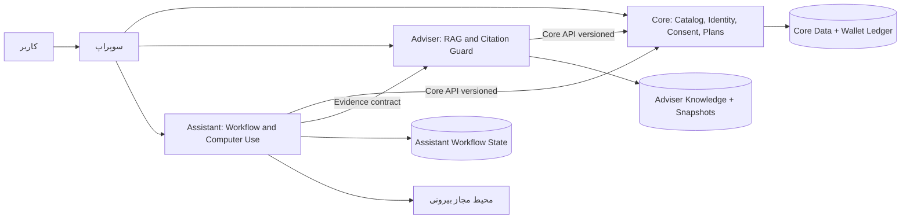
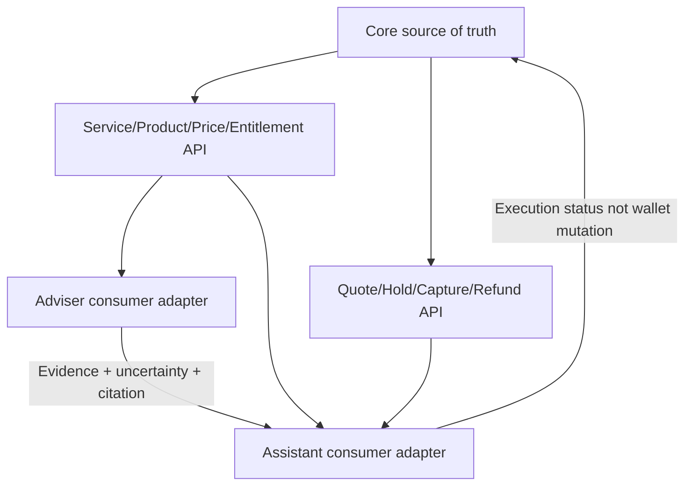
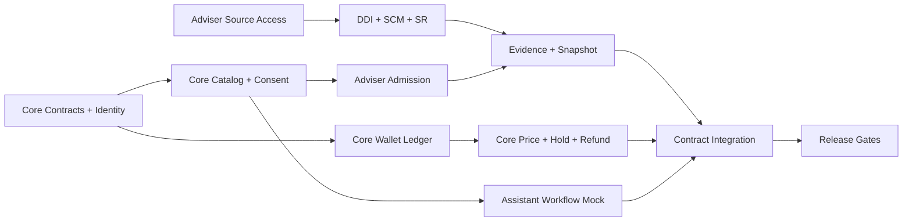
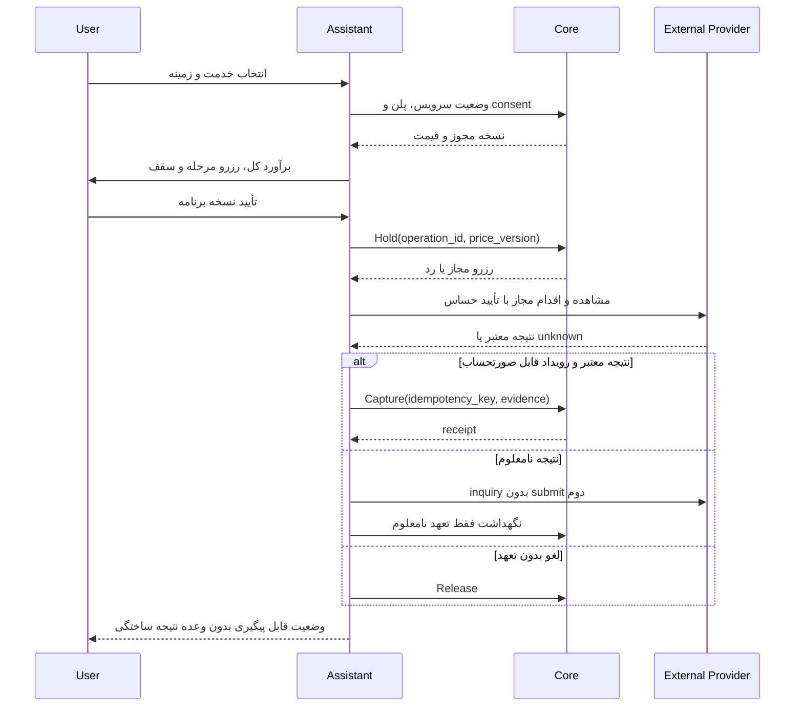
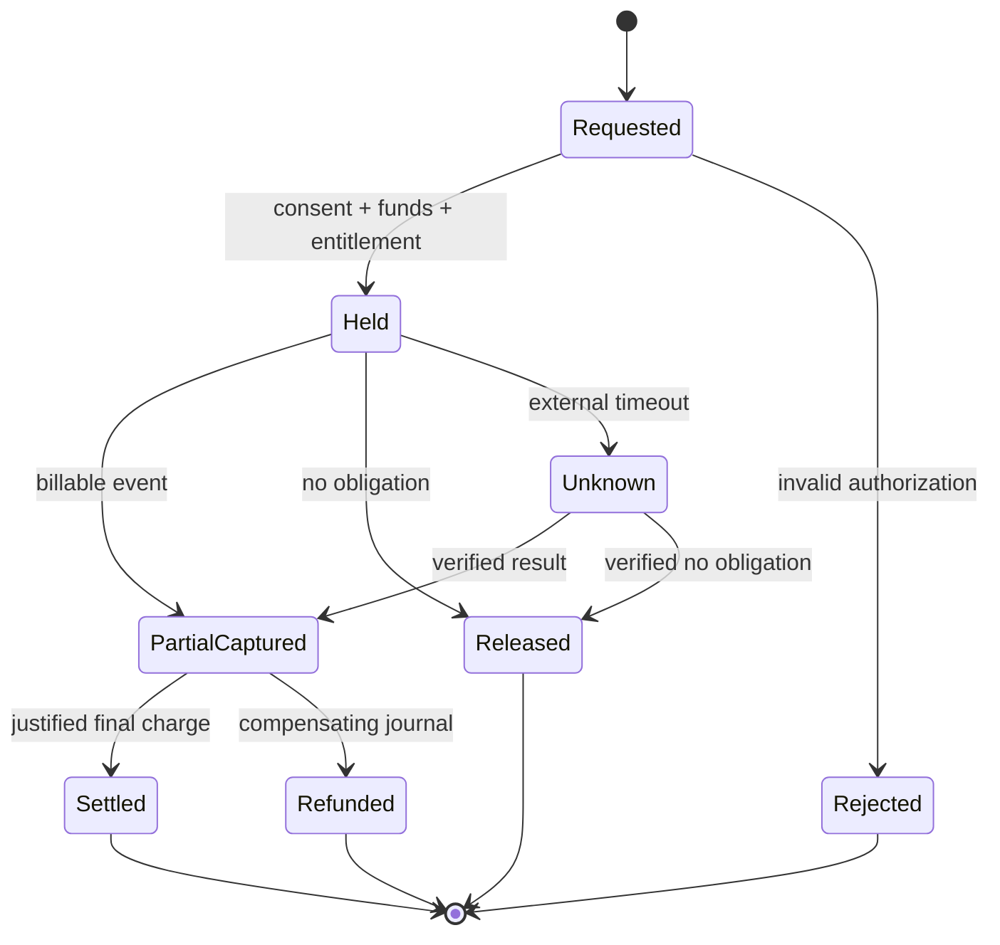
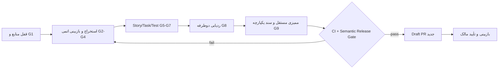

# برنامه پیاده‌سازی فاز دوم شهاب — بازسازی مستقل (پیش‌نویس قابل ممیزی)

**وضعیت: INCOMPLETE — این سند هنوز برنامه تأییدشده یا مجوز استقرار نیست.** این نسخه از دو مرجع قفل‌شده روی `main` استخراج شده و از سند PR شماره ۲۴۷ منشعب نشده است. مواردی که هنوز استخراج اتمی یا تأیید نشده‌اند نباید صرف حضور یک تسک، COVERED تلقی شوند.

**مراجع ثابت:** B = `docs/SHAHAB_PHASE_2_DEVELOPMENT_BLUEPRINT.md`، blob `9681c2bf6c3149317c3788516748084cfb6eac7c`؛ W = `docs/SHAHAB_DIGITAL_WALLET.md`، blob `1f3dc55f46b3a12b2eb33e647355e4a6a73dd37a`. ترتیب اعتبار: مصوبات متن جاری مرجع، ADR مصوب و پروتکل مخزن؛ تصمیم‌های باز بدون اختیار تغییر نمی‌کنند.

## فصل اول — مجموعه تسک‌های فاز دوم

### ۱.۱. مبنای کار، دامنه و قرارداد وضعیت

- سه مالک **Core** (هویت، سیاست، کاتالوگ، کیف پول و داده قطعی)، **Adviser** (RAG/مشاوره و نسخه شواهد) و **Assistant** (گردش‌کار اجرایی و Computer Use) هستند؛ تبادل از قرارداد نسخه‌دار و نه دسترسی مستقیم به داده خصوصی سرویس دیگر است.
- `User Story` هدف بازیگر، `Task` تحویل‌دادنی، `T-{task}` آزمون اختصاصی طراحی‌شده و `P2-B/W-...` شناسه حکم منبع است. آزمون‌ها تا اجرای واقعی وضعیت `NOT_RUN` دارند.
- «مصوب در منبع» با «پیاده‌سازی‌شده»، «آزموده‌شده» و «VERIFIED» چهار وضعیت متفاوت‌اند. ۲٬۸۰۶ خط غیرخالی مبنای متنی هستند، نه تعداد احکام.
- فیلدهای اجرایی لازم در زمان تبدیل تسک: owner، source/atom، story، deliverable، acceptance، negative test، hard/contract/soft dependency، گیت تصمیم و انتشار، شاخص مشاهده‌پذیری و trace. هیچ زمان و بودجه فرضی در این سند منظور نشده است.

### ۱.۲. User Storyهای استخراج‌شده و سناریوهای شکست

| Story | بازیگر | هدف | سناریوی اصلی | شکست یا استثنای قابل بازبینی | مرجع | تسک |
|---|---|---|---|---|---|---|
| C-US-03 | کاربر حقیقی | احراز شخص با OTP و شاهکار | موجب فراهم‌شدن سازوکار اعتبارسنجی شماره و کد ملی با وضعیت معتبر/نامعلوم، بدون فرض صحت از پیامک صرف | OTP موفق اما شماره به فرد دیگر تعلق دارد؛ فعال‌شدن حساب مردود است | W:168 | C-ARC-01 | C-US-27 | B:20، B:24 | آزمون معماری ممنوعیت وابستگی دوری و دسترسی مستقیم از Adviser/Assistant به داده Core؛ استقلال ماژول‌های Identity/Catalog/Wallet/Plan/Recommendation | با fixture import خطا، آزمون architecture fail شود؛ Core module owner تنها از API نسخه‌دار خوانده شود | مصرف جدول Wallet از Adviser یا مالکیت مشترک بدون قرارداد | T-C-ARC-01 | — | مصوبه A01/A02، بدون فرض جداشدن فیزیکی DB | طراحی؛ اجرا نشده |
| C-CFG-01 | C-US-28 | B:25 | Schema نوع‌دار و نسخه‌دار برای config عملیاتی، secret، feature flag و policy؛ migration و audit هر تغییر | کلید ناشناخته/secret در log رد؛ تغییر هزینه بدون approval policy رد؛ rollback نسخه‌دار با actor | تغییر مالی از طریق خاموش/روشن‌کردن flag عمومی | T-C-CFG-01 | C-ARC-01 | انتخاب تکنولوژی مستقل config مصوب نیست | طراحی؛ اجرا نشده |
| C-ID-01 |
| C-US-01 | شخص و سازمان | کیف اصلی شخص و سازمان | موجب فراهم‌شدن مدل مالکیت یکتای شخص/سازمان و ایجاد idempotent پس از احراز مناسب، با رابطه immutable مالک | دو کیف شخصی اصلی یا انتقال مالکیت سازمان به کارمند | W:136 | C-ACC-01 |
| C-US-02 | نماینده مجاز سازمان | فعال‌سازی مالی سازمان | موجب فراهم‌شدن فرایند قرارداد رسمی محضری، شواهد هویت، مالک واقعی، سمت و اختیار؛ حالت inactive/verified/active | سازمان بدون تأیید قرارداد بتواند کیف را شارژ کند | W:156 | C-ORG-01 |
| C-US-04 | کارمند و ادمین سازمان | عضویت چندسازمانی و دعوت | موجب فراهم‌شدن مدل مستقل Invitation/Membership با پذیرش صریح، revocation، حقوق رسید عضو سابق و جداسازی org | عضویت از بارگذاری صرف؛ نشت رسید org دیگر | W:180، W:196، W:208 | C-ORG-02 |
| C-US-05 | ادمین و نماینده سازمان | اختیارات و جانشینی ادمین سازمان | موجب فراهم‌شدن یک نوع نقش مدیریتی هم‌اختیار، audit actor و انتقال ادمین با re-auth؛ بستن پس تعهدات | ادمین سازمان B داده A را تغییر دهد؛ سوابق حذف شوند | W:220، W:244، W:256 | C-ORG-03 |
| C-US-06 | ادمین و کارمند | مجوز مصرف کارمند و دوره بودجه | موجب فراهم‌شدن Allowance مستقل از دارایی، محدود به org/member/period، carryover انتخابی و اتصال hold/refund به دوره اصلی | دو رزرو موازی سقف را رد کنند یا کیف شخصی شارژ شود | W:1151، W:268، W:284، W:296، W:308 | C-ALW-01 |
| C-US-07 | مشتری و مسئول مالی | دفترکل، منشأ و دقت مالی | موجب فراهم‌شدن دفترکل متوازن با credit lots، تفکیک بدهی مشتری/درآمد، محاسبات صحیح ریال و گردکردن تجمعی | double count سازمان+هدیه؛ debit با float یا حذف journal قدیمی | W:379، W:393، W:544، W:558 | C-FIN-01 |
| C-US-08 | کاربر و مدیر کمپین | کمپین هدیه و تخفیف | موجب فراهم‌شدن دو نوع مجزای gift lot و price discount؛ مخاطب/سرویس/مهلت/بودجه/سه سقف اختیاری با قفل رقابت | دو redemption یک سهمیه دو grant بسازند؛ discount cashout شود | W:485، W:699، W:713، W:727، W:741 | C-GFT-01 |
| C-US-20 | حسابدار و ادمین سازمان | صدور سند سازمانی پیش از شارژ | موجب فراهم‌شدن سند قابل دریافت قبل پرداخت با org_id/charge_request، ارتباط با وضعیت وصول و تصمیم حقوقی سند مالیاتی جدا | صدور سند به وصول موفق تلقی شود یا فروش دوبار صورتحساب شود | W:1495 | C-INV-01 |
| C-US-09 | مشتری شخصی و سازمانی | شارژ و وصول بانکی | موجب فراهم‌شدن charge request با مقصد immutable، تأیید واقعی وصول، ledger idempotent و سقف rolling 24h | دوباره‌شارژ با callback؛ جابه‌جایی مقصد پس تغییر سازمان | W:580، W:596، W:636، W:650، W:677 | C-CHG-01 |
| C-US-18 | مصرف‌کننده خدمت | قیمت‌گذاری داینامیک و نسخه نرخ | موجب فراهم‌شدن quote مبتنی بر پردازش واقعی مشاور و تعرفه دستیار+مشاوره ضریب ۰٫۵؛ price_version ثابت اجرا | کسر ۲۰٪ حاشیه به‌عنوان کارمزد یا نرخ ثابت پرامپت | W:1391، W:1405، W:1449 | C-PRC-01 |
| C-US-10 | مشتری و سرویس مصرف‌کننده | رزرو، افزایش و قطعی‌سازی | موجب فراهم‌شدن Hold/Capture/Release با operation_id، preserve origin، برآورد اولیه جدا از hold مرحله‌ای، سقف ۱٫۲ و billable event نسخه‌دار | کسر صرف کلیک؛ افزایش مرکب ۲۰٪؛ آزادسازی تعهد نامعلوم | W:773، W:787، W:801، W:815، W:831، W:845 | C-HLD-01 |
| C-US-11 | مالک کیف و سازمان | انتقال و برداشت واجد شرایط | موجب فراهم‌شدن transfer lot lineage، مجوز جهت‌ها و فهرست، بانک مقصد مالک و state machine برداشت با limit مستقل | انتقال round-trip حق برداشت جدید بسازد؛ شارژ شخصی ادمین به سازمان | W:863، W:877، W:893، W:905، W:919، W:933، W:949 | C-TFR-01 |
| C-US-12 | مشتری پرداخت‌کننده | استرداد و بازگشت منشأ | موجب فراهم‌شدن reversal مرتبط با ledger اصلی و سهم cash/gift، برگشت به همان wallet؛ سیاست expiry جبرانی فقط شکست منتسب به شهاب | استرداد سازمان به کیف کارمند یا تبدیل تخفیف به پول | W:1045، W:1065 | C-REF-01 |
| C-US-13 | مشتری | شارژ خودکار و پرداخت دوره‌ای | موجب فراهم‌شدن Consent نسخه‌دار، آستانه/مبلغ/سقف دوره، task idempotent و توقف فوری نوبت آینده پس لغو | خودشارژ در timeout یا پس revocation دوباره صادر شود | W:1091، W:1103، W:1115، W:1127، W:1139 | C-REC-01 |
| C-US-14 | کاربر و مدیر محصول | کاتالوگ خدمات و محصولات نسخه‌دار | موجب فراهم‌شدن شناسه پایدار حوزه/خدمت/بانک/محصول و Snapshot منتشرشده با وضعیت فعال/غیرفعال؛ قرارداد حوزه نقش | استناد به محصول منسوخ یا پاسخ تخصصی قبل انتخاب حوزه | B:1633، B:871 | C-CAT-01 |
| C-US-15 | مشترک | پلن، استحقاق و چرخه اشتراک | موجب فراهم‌شدن Entitlement نسخه‌دار، وضعیت Bron­ze/Silver/Gold، مصرف سهمیه و تعلیق Monitoring در downgrade | حذف تنظیمات پایش در انقضا؛ ادامه feedforward بدون حق | B:1014 | C-PLN-01 |
| C-US-16 | کاربر | مجوز قطعی و سیاست اقدام | موجب فراهم‌شدن Backend gate پلن/رضایت هدفمند/مجازبودن فنی‌حقوقی با scope، expiry و revocation | اتکا به تأیید onboarding برای پرداخت جدید | B:1147 | C-POL-01 |
| C-US-17 | متقاضی تسهیلات | توصیه‌گر قطعی مبتنی بر Snapshot | موجب فراهم‌شدن API هم‌زمان توصیه قطعی/دلیل/نسخه Snapshot با ورودی پرسشنامه کاننیکال | محاسبه مبلغ/اقساط با LLM یا ingestion داده draft | B:1631 | C-RCMD-01 |
| C-US-19 | مسئول مالی | تطبیق و تسویه تأمین‌کننده | موجب فراهم‌شدن ثبت بدهی به تأمین‌کننده، قرارداد زمان/تسویه و رسید بانکی، جدا از کسر کیف مشتری | تسویه خودکار روزانه برای همه؛ دوبار کسر مشتری | W:1481 | C-SET-01 |
| C-US-21 | مشتری و کارشناس مجاز | پشتیبانی، اختلاف و ردیابی مجاز | موجب فراهم‌شدن Case به تراکنش/مالک/وضعیت، دسترسی شبکه تراکنش با audit view/export و حداقل داده | نمایش تراکنش فرد دیگر یا وعده SLA مصوب نشده | W:1553، W:1565 | C-SUP-01 |
| C-US-22 | مالک انتشار و QA | گیت انتشار مالی و مانیتورینگ | موجب فراهم‌شدن قواعد انتشار ledger invariants، تست concurrency، دسترسی، refund و recovery؛ هشدارهای مهم | انتشار قابلیت مالی با آزمون طراحی‌شده ولی اجرا نشده | W:1619 | C-OPS-01 |
| A-US-01 | کاربر مشاور | پذیرش خدمت و سؤال در دامنه | موجب فراهم‌شدن Admission Server Gate و schema شواهد خدمت؛ تفکیک مبهم/خارج دامنه/غیرمجاز از ناکفایتی داده | پاسخ تخصصی در نشست حوزه اشتباه یا محاسبه نرخ با LLM | B:270، B:345، B:425 | A-ADM-01 |
| A-US-02 | کاربر مشاور | مسیریابی بازیابی ریسک‌محور | موجب فراهم‌شدن Router داخلی→Live Retrieval هدفمند→Fallback/Abstention با risk policy، بودجه و cache Snapshot-aware | منبع ثانویه stale جای سند رسمی؛ cache میان دو نسخه شواهد مشترک | B:275، B:310، B:315، B:350، B:445 | A-RET-01 |
| A-US-03 | پژوهشگر حقوقی | دسترسی مجاز و قرارداد منابع | موجب فراهم‌شدن Registry منبع و Adapterهای MCP/API/HTTP/Browser مشروط به مجوز؛ source result با provenance/error | API غیرمستقیم بدون مجوز یا دورزدن شرایط سایت | B:204، B:206، B:285، B:380، B:385، B:435 | A-SRC-01 |
| A-US-04 | کاربر با پرسش نیازمند سند | دریافت تقاضامحور و استخراج | موجب فراهم‌شدن DDI job با کشف هدفمند→بازیابی متن رسمی→استخراج فارسی و ساختار→provenance/version/chunks | اسکن کامل همه اسناد یا حذف تبصره/جدول در chunk | B:200 | A-DDI-01 |
| A-US-05 | مدیر دانش | پایش تغییرات و کشف رابطه | موجب فراهم‌شدن Source Discovery سبک، Catalog، RDE candidate→evidence review؛ اثر اصلاحیه در سطح بند | ثبت «بدون تغییر» بعد timeout یا نسخ همه بندهای سند | B:212، B:213، B:216، B:232، B:290، B:400 | A-SCM-01 |
| A-US-06 | مدیر دانش | بازاعتبارسنجی اسناد شناخته‌شده | موجب فراهم‌شدن DRS تطبیقی با current/stale/changed_pending/verification_failed و پرونده revalidation هدفمند | rollback مقرره منسوخ یا سند ناشناخته با SR کشف‌شده تلقی شود | B:245، B:246، B:340، B:440 | A-SR-01 |
| A-US-07 | توسعه‌دهنده Adviser | مخزن دانش نسخه‌دار و گراف‌پذیر | موجب فراهم‌شدن PostgreSQL-first با DocumentIdentity/Version/Provision/Relation/Evidence و valid/recorded time؛ index مشتق جدا | نسخ از شباهت عنوان یا ادغام واقعیت شخصی در کش عمومی | B:257، B:280، B:305، B:325، B:365، B:390، B:410 | A-STR-01 |
| A-US-08 | کاربر مشاور | کفایت شواهد و Citation Guard | موجب فراهم‌شدن claim-level coverage/uncertainty و citation با بند/نسخه/Hash/validity؛ تعارض با applicability | ارجاع URL عمومی به‌عنوان اثبات ادعای خاص | B:261، B:295، B:300، B:415، B:420، B:450 | A-EVD-01 |
| A-US-12 | مالک دانش | انتشار اتمیک Snapshot | موجب فراهم‌شدن ساخت نسخه candidate، تست relations/index و تعویض یک مرجع Snapshot معتبر؛ rollback سازگار | ترکیب سند جدید با ایندکس قدیمی در یک پاسخ | B:360، B:405 | A-PUB-01 |
| A-US-10 | کاربر و مالک حریم خصوصی | امنیت منابع و داده مشاور | موجب فراهم‌شدن تفکیک cache شخصی/عمومی، کنترل prompt injection اسناد، عدم درج متن حساس در trace | انتقال دستور داخل صفحه به اجرای ابزار | B:330، B:395، B:430 | A-SEC-01 |
| A-US-11 | اپراتور | Job، ظرفیت و بازیابی دانش | موجب فراهم‌شدن Job/event idempotent، Bulkhead درخواست زنده و worker، audit trace و بازسازی index از canonical | دو snapshot فعال بعد replay یا از دست‌رفتن دانش با حذف index | B:335، B:370، B:375، B:460 | A-OPS-01 |
| A-US-09 | ارزیاب RAG | ارزیابی رگرسیون فارسی و حقوقی | موجب فراهم‌شدن مجموعه آزمون نسخه‌دار RTL/اعداد/تاریخ/جدول/OCR/تبصره/نسخ/تعارض/امتناع و اتصال به release | فقط تست happy path یا امتیاز similarity بدون citation | B:320، B:455 | A-QA-01 |
| S-US-02 | مشتری | مجوز اقدام و حفاظت اسرار Assistant | موجب فراهم‌شدن گیت Backend در مرز هر اقدام حساس با consent scoped و final confirmation؛ OTP در کنترل امن کاربر و نه حافظه مدل | submit با approval عمومی، bypass CAPTCHA یا token مشترک | B:1653، B:1688، B:1689، B:1690، B:918 | S-SEC-01 |
| S-US-01 | مشتری در حال خدمت | گردش‌کار پایدار و نتیجه نامعلوم | موجب فراهم‌شدن workflow state در DB مالک Assistant، job version، توقف/ادامه، audit، inquiry قبل retry، idempotency خارجی | حافظه LLM مرجع وضعیت یا submit تکراری | B:1693، B:1694، B:916، B:918 | S-WFL-01 |
| S-US-05 | مشتری | ایزوله‌سازی محیط و نشست | موجب فراهم‌شدن Session/Device Orchestrator با تخصیص، TTL، پاک‌سازی، recovery و جداسازی مشتری و آزمون | اشتراک bank session یا test/prod credential | B:1534 | S-SES-01 |
| S-US-03 | مشتری | Computer Use مبتنی بر مشاهده زنده | موجب فراهم‌شدن observe→understand→policy gate→act→verify؛ کنترل دامنه و عنصر مبهم، توقف امن و بدون bypass | کلیک مختصات ثابت یا تکرار اقدام بعد timeout | B:1482، B:1500، B:1555، B:1691، B:1694 | S-CU-01 |
| S-US-04 | مشتری موبایل/وب | مسیر وب/اندروید/iOS با گیت مستقل | موجب فراهم‌شدن Adapter capability discovery، انتخاب وب و در صورت مجوز مسیر اپ؛ نصب صرفاً با اقدام مشتری، iOS feasibility جدا | فرض کنترل آزاد اپ دیگر یا نصب silent | B:1504، B:1522، B:1534 | S-PLT-01 |
| S-US-07 | اپراتور Assistant | پایش غیرمخرب تغییرات رابط | موجب فراهم‌شدن نقشه UI نسخه‌دار/fingerprint، تست ایزوله بدون پرداخت واقعی، قرنطینه تغییر مشکوک | پایش با حساب واقعی یا تکیه بر UI دیروز | B:1538، B:1692 | S-UI-01 |
| S-US-08 | متقاضی وام | مصرف نتیجه قطعی توصیه‌گر Core | موجب فراهم‌شدن Adapter مصرف هم‌زمان Core Recommendation/PriceVersion/Snapshot؛ در شکست fallback محدود و trace | توصیه بدون Snapshot یا محاسبه جدید LLM | B:1631 | S-REC-01 |
| S-US-09 | متقاضی ضمانت‌نامه | پرونده ضمانت‌نامه با شواهد معتبر | موجب فراهم‌شدن گردش‌کار انتخاب حوزه→گزینه معتبر CAT/RAG→انتخاب مشتری→مجوز→Computer Use→رسید؛ matcher اختیاری | پیشنهاد حدسی یا submit بدون تأیید نهایی | B:1639، B:1645، B:1647 | S-JRN-01 |
| S-US-06 | مشتری و اپراتور | Feedback و Feedforward دارای شواهد | موجب فراهم‌شدن event candidate→policy/entitlement/consent/evidence→dedup→alert؛ عدم اجازه اجرای عملیات از رویداد | پایش بی‌اجازه یا اعلان تکراری ناموجه | B:1684، B:944 | S-FF-01 |

| C-US-27 | معمار Core | مرزبندی ماژول‌های Core و استقلال مالکیت داده | طراحی و تست قواعد وابستگی ماژولار، جداسازی مدل مالکیت، اعتبارسنجی import و API داخلی | دسترسی Adviser به جداول خصوصی Core یا چرخه import | B:20، B:24 | C-ARC-01 |
| C-US-28 | مالک پیکربندی Core | تفکیک تنظیمات، اسرار، پرچم و سیاست مالی | تعریف Schema نوع‌دار، اعتبارسنجی، نسخه، audit و تفکیک محرمانگی | feature flag جایگزین مصوبه هزینه یا secret در config عمومی شود | B:25 | C-CFG-01 |
| X-US-01 | مالک قرارداد و تیم‌های مصرف‌کننده | سازگاری نسخه‌ای API Core/Adviser/Assistant | producer schema پیش از تغییر، consumer contract و migration Expand/Migrate/Contract | قرارداد ناسازگار در انتشار بدون گیت مصرف‌کننده | B:24-25 | X-CTR-06 |
| X-US-02 | مسئول تاب‌آوری و مالک هر سرویس | اجرای ایمن و جداسازی ظرفیت تعامل/پس‌زمینه | Job پایدار، Timeout Budget، Retry محدود، Circuit Breaker، Bulkhead و بازیابی | timeout تراکنش به submit دوم یا ازدحام OCR به قطع Adviser منجر شود | B:25 | X-REL-01 |
| X-US-03 | مسئول مشاهده‌پذیری و SRE | صحت مالی و هشدار وابسته به اثر کاربر | OpenTelemetry، baseline SLO، trace همبسته و Incident، ارزیابی مشروط SigNoz | نصب روی VM تولید بدون ظرفیت یا ذخیره OTP در trace | B:24-25 | X-OBS-01 |
| X-US-04 | مالک انتشار فاز دوم | حفظ دامنه مصوب R1 و گیت تصمیم | انتشار فقط Core+Adviser؛ Assistant طراحی قرارداد و غیرفعال؛ گیت شواهد/ظرفیت/نسخه | Assistant بدون مجوز در R1 مستقر شود یا سه VM اجباری تلقی شود | B:7، B:12، B:18-24 | X-R1-01 |
| C-US-23 | مسئول مالی و توسعه‌دهنده | سازمان‌دهی دفترکل و lineage عملیاتی | حساب‌های بانکی/تعهد/درآمد/تأمین‌کننده/هدیه و journal متوازن؛ credit lot lineage و سه چرخه وضعیت مستقل؛ idempotency هر اقدام | journal ناتراز، حذف پیوند واسط یا دو debit از یک موجودی | W:1167، W:1169، W:1183، W:1199، W:1211، W:1227، W:1241، W:1257، W:1271 | C-LED-02 |
| C-US-24 | مسئول عملیات مالی | تطبیق، رسیدگی اختلاف و نتیجه نامعلوم | تطبیق حداقل روزانه با cutoff/tz مشخص، پرونده مغایرت دارای مالک و عامل، inquiry/جبران وابسته به عملیات اولیه | تطبیق غیرروزانه بدون گیت، تغییر مستقیم دفترکل، payout مجدد قبل inquiry | W:1289، W:1303، W:1369 | C-REC-02 |
| C-US-25 | مسئول امنیت و مالی | امنیت مالی و نگهداری دائمی سوابق | reauth تغییر بانکی/ادمین/برداشت، نگهداری دائمی lineage مالی، حذف راز و OTP از audit، هشدار امنیتی/پوشش، اتصال رویه انطباق موجود | حذف رخداد بعد ۲۰ سال یا استفاده از نشست قدیمی برای تغییر حساب | W:1317، W:1331، W:1343، W:1355 | C-SEC-02 |
| C-US-26 | کاربر و کارشناس مجاز | نمای اصلی، رسید و اعلان مالی | نمای موجودی قابل‌مصرف/رزرو/برداشت مستقل، جزئیات origin و price، تاریخچه فیلترپذیر، اعلان مالی و پیامک امنیتی | نمایش هدیه در قابل برداشت یا نمایش سوابق سازمان دیگر | W:1517، W:1529، W:1541 | C-UX-01 |

### ۱.۳. Core — مالکیت داده پایه و عملیات مالی

| تسک | Story | ارجاع منبع | خروجی فنی اختصاصی | معیار پذیرش اصلی | مثال رفتار مردود | شناسه آزمون | پیش‌نیاز سخت | گیت تصمیم | وضعیت |
|---|---|---|---|---|---|---|---|---|---|
| C-ID-01 | C-US-03 | W:168 | سازوکار اعتبارسنجی شماره و کد ملی با وضعیت معتبر/نامعلوم، بدون فرض صحت از پیامک صرف | شماره تطبیق‌ناموفق یا شاهکار نامعلوم حساب احرازشده نسازد | OTP موفق اما شماره به فرد دیگر تعلق دارد؛ فعال‌شدن حساب مردود است | T-C-ID-01 | — | گیت دسترسی واقعی شاهکار | طراحی؛ اجرا نشده |
| C-ACC-01 | C-US-01 | W:136 | مدل مالکیت یکتای شخص/سازمان و ایجاد idempotent پس از احراز مناسب، با رابطه immutable مالک | برای یک شخص یا سازمان تأییدشده حداکثر یک کیف اصلی؛ تغییر ادمین مالکیت سازمان را تغییر ندهد | دو کیف شخصی اصلی یا انتقال مالکیت سازمان به کارمند | T-C-ACC-01 | C-ID-01 | گیت اسناد و حساب سازمان | طراحی؛ اجرا نشده |
| C-ORG-01 | C-US-02 | W:156 | فرایند قرارداد رسمی محضری، شواهد هویت، مالک واقعی، سمت و اختیار؛ حالت inactive/verified/active | بدون قرارداد تکمیل‌شده، charge و allowance سازمان ۰ بماند؛ نماینده فاقد اختیار رد شود | سازمان بدون تأیید قرارداد بتواند کیف را شارژ کند | T-C-ORG-01 | C-ACC-01 | گیت تأیید حقوقی اسناد | طراحی؛ اجرا نشده |
| C-ORG-02 | C-US-04 | W:180، W:196، W:208 | مدل مستقل Invitation/Membership با پذیرش صریح، revocation، حقوق رسید عضو سابق و جداسازی org | تا احراز+accept عضو فعال نشود؛ عضو سابق رسید خودش را ببیند و موجودی org را نبیند | عضویت از بارگذاری صرف؛ نشت رسید org دیگر | T-C-ORG-02 | C-ORG-01;C-ID-01 | قرارداد هویت و دسترسی | طراحی؛ اجرا نشده |
| C-ORG-03 | C-US-05 | W:220، W:244، W:256 | یک نوع نقش مدیریتی هم‌اختیار، audit actor و انتقال ادمین با re-auth؛ بستن پس تعهدات | دو ادمین مستقل مجاز؛ انتقال بدون re-auth و بستن با تعهد باز رد؛ تأییدکننده دوم اجباری نباشد | ادمین سازمان B داده A را تغییر دهد؛ سوابق حذف شوند | T-C-ORG-03 | C-ORG-01;C-ORG-02 | گیت مدارک بازیابی نمایندگی | طراحی؛ اجرا نشده |
| C-ALW-01 | C-US-06 | W:1151، W:268، W:284، W:296، W:308 | Allowance مستقل از دارایی، محدود به org/member/period، carryover انتخابی و اتصال hold/refund به دوره اصلی | حد مجاز مصرف=min(مانده آزاد سازمان، سقف آزاد عضو)؛ carryover پول نسازد؛ استرداد قدیمی دوره جدید را زیاد نکند | دو رزرو موازی سقف را رد کنند یا کیف شخصی شارژ شود | T-C-ALW-01 | C-ACC-01;C-ORG-02;C-FIN-01 | گیت تعریف دوره و سقف مصوب سازمان | طراحی؛ اجرا نشده |
| C-FIN-01 | C-US-07 | W:379، W:393، W:544، W:558 | دفترکل متوازن با credit lots، تفکیک بدهی مشتری/درآمد، محاسبات صحیح ریال و گردکردن تجمعی | شارژ بدون خدمت درآمد صفر؛ ۱۰٬۰۰۰ تومان=۱۰۰٬۰۰۰ ریال؛ debit تجمعی برابر گردکردن نیم‌ریال رو به بالا | double count سازمان+هدیه؛ debit با float یا حذف journal قدیمی | T-C-FIN-01 | C-ACC-01 | گیت مدل حسابداری هدیه و پوشش وجوه | طراحی؛ اجرا نشده |
| C-GFT-01 | C-US-08 | W:485، W:699، W:713، W:727، W:741 | دو نوع مجزای gift lot و price discount؛ مخاطب/سرویس/مهلت/بودجه/سه سقف اختیاری با قفل رقابت | تخفیف موجودی نسازد؛ درصد/مبلغ/دوره هم‌زمان رعایت؛ هدیه با expiry اصلی منتقل شود | دو redemption یک سهمیه دو grant بسازند؛ discount cashout شود | T-C-GFT-01 | C-FIN-01;C-CAT-01 | گیت reuse کد تخفیف پس لغو | طراحی؛ اجرا نشده |
| C-INV-01 | C-US-20 | W:1495 | سند قابل دریافت قبل پرداخت با org_id/charge_request، ارتباط با وضعیت وصول و تصمیم حقوقی سند مالیاتی جدا | هر دو روش درگاه و انتقال بانکی سند پیشینی داشته باشند؛ صرف صدور سند credit/revenue صفر | صدور سند به وصول موفق تلقی شود یا فروش دوبار صورتحساب شود | T-C-INV-01 | C-ACC-01;C-FIN-01 | گیت باز نوع حقوقی صورتحساب و ثبت مالیاتی | طراحی؛ اجرا نشده |
| C-CHG-01 | C-US-09 | W:580، W:596، W:636، W:650، W:677 | charge request با مقصد immutable، تأیید واقعی وصول، ledger idempotent و سقف rolling 24h | پیش وصول available_delta=0؛ callback/query/reconciliation یک credit؛ شخص ≤۲۰۰ میلیون و سازمان ≤۱ میلیارد تومان ۲۴ساعته | دوباره‌شارژ با callback؛ جابه‌جایی مقصد پس تغییر سازمان | T-C-CHG-01 | C-ACC-01;C-FIN-01;C-INV-01 | گیت ارائه‌دهنده بانکی و قوانین احراز حساب | طراحی؛ اجرا نشده |
| C-PRC-01 | C-US-18 | W:1391، W:1405، W:1449 | quote مبتنی بر پردازش واقعی مشاور و تعرفه دستیار+مشاوره ضریب ۰٫۵؛ price_version ثابت اجرا | افزایش نرخ وسط اجرا قیمت قدیمی را بازنویسی نکند؛ ۰٫۵ و نه ۱/۳؛ خروجی ناموفق ناشی شهاب هزینه نداشته باشد | کسر ۲۰٪ حاشیه به‌عنوان کارمزد یا نرخ ثابت پرامپت | T-C-PRC-01 | C-CAT-01;C-FIN-01 | گیت عدد تعرفه و معیار دقیق پردازش | طراحی؛ اجرا نشده |
| C-HLD-01 | C-US-10 | W:773، W:787، W:801، W:815، W:831، W:845 | Hold/Capture/Release با operation_id، preserve origin، برآورد اولیه جدا از hold مرحله‌ای، سقف ۱٫۲ و billable event نسخه‌دار | برآورد۱۰۰، رزرو۳۰ و سقف۱۲۰؛ هزینه۱۲۵ بدون تأیید جدید متوقف؛ unknown تعهد فقط همان بخش را نگه دارد | کسر صرف کلیک؛ افزایش مرکب ۲۰٪؛ آزادسازی تعهد نامعلوم | T-C-HLD-01 | C-FIN-01;C-PRC-01;C-POL-01 | گیت مدت/نرخ هر خدمت؛ قرارداد billable event | طراحی؛ اجرا نشده |
| C-TFR-01 | C-US-11 | W:863، W:877، W:893، W:905، W:919، W:933، W:949 | transfer lot lineage، مجوز جهت‌ها و فهرست، بانک مقصد مالک و state machine برداشت با limit مستقل | فرد→سازمان و سازمان→سازمان رد؛ received cashout false؛ بانک با owner unknown payout صفر | انتقال round-trip حق برداشت جدید بسازد؛ شارژ شخصی ادمین به سازمان | T-C-TFR-01 | C-FIN-01;C-ID-01;C-POL-01 | گیت اعداد سقف برداشت/انتقال و شریک بانکی | طراحی؛ اجرا نشده |
| C-REF-01 | C-US-12 | W:1045، W:1065 | reversal مرتبط با ledger اصلی و سهم cash/gift، برگشت به همان wallet؛ سیاست expiry جبرانی فقط شکست منتسب به شهاب | پرداخت ۷۰ نقد+۳۰ هدیه، استرداد۵۰ به ۳۵ نقد+۱۵ هدیه؛ لغو داوطلبانه هدیه را تمدید نکند | استرداد سازمان به کیف کارمند یا تبدیل تخفیف به پول | T-C-REF-01 | C-HLD-01;C-GFT-01 | گیت tie-break تخصیص ریال، تشخیص علت لغو | طراحی؛ اجرا نشده |
| C-REC-01 | C-US-13 | W:1091، W:1103، W:1115، W:1127، W:1139 | Consent نسخه‌دار، آستانه/مبلغ/سقف دوره، task idempotent و توقف فوری نوبت آینده پس لغو | بدون رضایت یا پشتیبانی قراردادی autopay inactive؛ unknown استعلام؛ پس failure قطعی تکرار فقط با مشتری | خودشارژ در timeout یا پس revocation دوباره صادر شود | T-C-REC-01 | C-CHG-01;C-POL-01 | گیت مجوز درگاه و پارامتر دوره | طراحی؛ اجرا نشده |
| C-CAT-01 | C-US-14 | B:1633، B:871 | شناسه پایدار حوزه/خدمت/بانک/محصول و Snapshot منتشرشده با وضعیت فعال/غیرفعال؛ قرارداد حوزه نقش | محصول draft به توصیه قطعی نرود؛ ورودی عمومی فقط حوزه پیشنهاد کند؛ تغییر نقش با کاربر | استناد به محصول منسوخ یا پاسخ تخصصی قبل انتخاب حوزه | T-C-CAT-01 | — | گیت اصالت و منبع داده محصول | طراحی؛ اجرا نشده |
| C-PLN-01 | C-US-15 | B:1014 | Entitlement نسخه‌دار، وضعیت Bron­ze/Silver/Gold، مصرف سهمیه و تعلیق Monitoring در downgrade | انقضای پلن پولی به برنزی؛ پایش خارج سهمیه suspend نه delete شود | حذف تنظیمات پایش در انقضا؛ ادامه feedforward بدون حق | T-C-PLN-01 | C-ID-01 | گیت اعداد سقف و قیمت اشتراک | طراحی؛ اجرا نشده |
| C-POL-01 | C-US-16 | B:1147 | Backend gate پلن/رضایت هدفمند/مجازبودن فنی‌حقوقی با scope، expiry و revocation | برای اقدام مؤثر فقدان هرکدام deny؛ لغو باعث توقف اقدام بعدی شود | اتکا به تأیید onboarding برای پرداخت جدید | T-C-POL-01 | C-ID-01;C-PLN-01 | گیت اثبات امکان قانونی عملیات | طراحی؛ اجرا نشده |
| C-RCMD-01 | C-US-17 | B:1631 | API هم‌زمان توصیه قطعی/دلیل/نسخه Snapshot با ورودی پرسشنامه کاننیکال | ورودی و نسخه یکسان خروجی یکسان؛ timeout بدون درصد ساختگی؛ پذیرش بانک تضمین نشود | محاسبه مبلغ/اقساط با LLM یا ingestion داده draft | T-C-RCMD-01 | C-CAT-01;C-POL-01 | گیت کیفیت ورودی و شروط محصول | طراحی؛ اجرا نشده |
| C-SET-01 | C-US-19 | W:1481 | ثبت بدهی به تأمین‌کننده، قرارداد زمان/تسویه و رسید بانکی، جدا از کسر کیف مشتری | پیش تسویه reconciliation مطابق قرارداد؛ پرداخت supplier wallet debit تازه نسازد | تسویه خودکار روزانه برای همه؛ دوبار کسر مشتری | T-C-SET-01 | C-FIN-01 | گیت قرارداد واقعی هر تأمین‌کننده | طراحی؛ اجرا نشده |
| C-SUP-01 | C-US-21 | W:1553، W:1565 | Case به تراکنش/مالک/وضعیت، دسترسی شبکه تراکنش با audit view/export و حداقل داده | کاربر فقط رسیدهای خودش؛ پرونده اختلاف state+actor؛ گزارش مشکوک برای غیرمجاز مخفی | نمایش تراکنش فرد دیگر یا وعده SLA مصوب نشده | T-C-SUP-01 | C-FIN-01;C-POL-01 | گیت ظرفیت و SLA اعلامی | طراحی؛ اجرا نشده |
| C-OPS-01 | C-US-22 | W:1619 | قواعد انتشار ledger invariants، تست concurrency، دسترسی، refund و recovery؛ هشدارهای مهم | اگر تراز/تکرار/مجوز تست fail باشد release مالی blocked؛ شکست CI مستند شود | انتشار قابلیت مالی با آزمون طراحی‌شده ولی اجرا نشده | T-C-OPS-01 | C-FIN-01;C-POL-01 | گیت مالی و کیفیت نسخه جاری | طراحی؛ اجرا نشده |

| C-LED-02 | C-US-23 | W:1167، W:1169، W:1183، W:1199، W:1211، W:1227، W:1241، W:1257، W:1271 | حساب‌های بانکی/تعهد/درآمد/تأمین‌کننده/هدیه و journal متوازن؛ credit lot lineage و سه چرخه وضعیت مستقل؛ idempotency هر اقدام | ثبت هم‌زمان hold/capture/reversal اتمیک و بازسازی تمام انتقال‌ها؛ retry اثر دوم نداشته باشد | journal ناتراز، حذف پیوند واسط یا دو debit از یک موجودی | T-C-LED-02 | C-FIN-01;C-POL-01 | گیت حسابداری نهایی هدیه | طراحی؛ اجرا نشده |
| C-REC-02 | C-US-24 | W:1289، W:1303، W:1369 | تطبیق حداقل روزانه با cutoff/tz مشخص، پرونده مغایرت دارای مالک و عامل، inquiry/جبران وابسته به عملیات اولیه | timeout شکست قطعی فرض نشود؛ اصلاح فقط با reason/actor/original_ref و journal جبرانی | تطبیق غیرروزانه بدون گیت، تغییر مستقیم دفترکل، payout مجدد قبل inquiry | T-C-REC-02 | C-LED-02;C-CHG-01 | گیت SLA و cut-off بانک | طراحی؛ اجرا نشده |
| C-SEC-02 | C-US-25 | W:1317، W:1331، W:1343، W:1355 | reauth تغییر بانکی/ادمین/برداشت، نگهداری دائمی lineage مالی، حذف راز و OTP از audit، هشدار امنیتی/پوشش، اتصال رویه انطباق موجود | حذف بی‌زمان سوابق مالی ممنوع؛ OTP ذخیره نشود؛ هشدار اصلی برقرار؛ سامانه AML جدید فرض نشود | حذف رخداد بعد ۲۰ سال یا استفاده از نشست قدیمی برای تغییر حساب | T-C-SEC-02 | C-LED-02;C-POL-01 | گیت بررسی حقوقی داده و رویه انطباق موجود | طراحی؛ اجرا نشده |
| C-UX-01 | C-US-26 | W:1517، W:1529، W:1541 | نمای موجودی قابل‌مصرف/رزرو/برداشت مستقل، جزئیات origin و price، تاریخچه فیلترپذیر، اعلان مالی و پیامک امنیتی | رسید شامل شناسه پیگیری، time/status/amount باشد؛ کاربر رسید غیرخودی نبیند؛ موارد فوری پیامک داشته باشند | نمایش هدیه در قابل برداشت یا نمایش سوابق سازمان دیگر | T-C-UX-01 | C-FIN-01;C-SUP-01;C-POL-01 | گیت UX/حریم خصوصی | طراحی؛ اجرا نشده |

### ۱.۴. RAG / Adviser — مالکیت دانش و پاسخ مستند

| تسک | Story | ارجاع منبع | خروجی فنی اختصاصی | معیار پذیرش اصلی | مثال رفتار مردود | شناسه آزمون | پیش‌نیاز سخت | گیت تصمیم | وضعیت |
|---|---|---|---|---|---|---|---|---|---|
| A-ADM-01 | A-US-01 | B:270، B:345، B:425 | Admission Server Gate و schema شواهد خدمت؛ تفکیک مبهم/خارج دامنه/غیرمجاز از ناکفایتی داده | درخواست مستقل حوزه دیگر فقط هدایت شود؛ داده ناکافی به معنای نامجاز بودن نیست | پاسخ تخصصی در نشست حوزه اشتباه یا محاسبه نرخ با LLM | T-A-ADM-01 | C-CAT-01 | گیت schema خدمت و حوزه | طراحی؛ اجرا نشده |
| A-RET-01 | A-US-02 | B:275، B:310، B:315، B:350، B:445 | Router داخلی→Live Retrieval هدفمند→Fallback/Abstention با risk policy، بودجه و cache Snapshot-aware | internal کافی نیاز به live ندارد؛ stale/حساس با شواهد ناکافی پاسخ قطعی نگیرد؛ fallback هم‌صلاحیت باشد | منبع ثانویه stale جای سند رسمی؛ cache میان دو نسخه شواهد مشترک | T-A-RET-01 | A-STR-01;A-ADM-01 | آستانه‌های ریسک پس آزمون تعیین شوند | طراحی؛ اجرا نشده |
| A-SRC-01 | A-US-03 | B:204، B:206، B:285، B:380، B:385، B:435 | Registry منبع و Adapterهای MCP/API/HTTP/Browser مشروط به مجوز؛ source result با provenance/error | Unknown/Blocked source تولیدی فعال نشود؛ MCP بدون adapter مدرک بازیابی ندهد | API غیرمستقیم بدون مجوز یا دورزدن شرایط سایت | T-A-SRC-01 | — | گیت C01 و S1..S5 هر منبع | طراحی؛ اجرا نشده |
| A-DDI-01 | A-US-04 | B:200 | DDI job با کشف هدفمند→بازیابی متن رسمی→استخراج فارسی و ساختار→provenance/version/chunks | بدون تقاضا یا اثر معتبر خزش کامل انجام نشود؛ سند خام/مشتقات نسخه‌دار و قابل بازیابی بمانند | اسکن کامل همه اسناد یا حذف تبصره/جدول در chunk | T-A-DDI-01 | A-SRC-01;A-STR-01 | گیت کیفیت فارسی F05 و مجوز source | طراحی؛ اجرا نشده |
| A-SCM-01 | A-US-05 | B:212، B:213، B:216، B:232، B:290، B:400 | Source Discovery سبک، Catalog، RDE candidate→evidence review؛ اثر اصلاحیه در سطح بند | metadata کشف‌شده published نیست؛ similarity AMENDS/REPEALS نسازد؛ monitoring failure status unknown | ثبت «بدون تغییر» بعد timeout یا نسخ همه بندهای سند | T-A-SCM-01 | A-SRC-01;A-STR-01 | گیت رابطه حقوقی C05 | طراحی؛ اجرا نشده |
| A-SR-01 | A-US-06 | B:245، B:246، B:340، B:440 | DRS تطبیقی با current/stale/changed_pending/verification_failed و پرونده revalidation هدفمند | شکست بررسی current جعل نکند؛ نسخه candidate بدون Snapshot gate منتشر نشود | rollback مقرره منسوخ یا سند ناشناخته با SR کشف‌شده تلقی شود | T-A-SR-01 | A-SRC-01;A-STR-01;A-SCM-01 | گیت C01/C06/C07 | طراحی؛ اجرا نشده |
| A-STR-01 | A-US-07 | B:257، B:280، B:305، B:325، B:365، B:390، B:410 | PostgreSQL-first با DocumentIdentity/Version/Provision/Relation/Evidence و valid/recorded time؛ index مشتق جدا | URL جدید هویت سند را عوض نکند؛ Neo4j الزامی نباشد؛ دانش draft و published جدا باشد | نسخ از شباهت عنوان یا ادغام واقعیت شخصی در کش عمومی | T-A-STR-01 | — | گیت Schema/Lineage و حجم واقعی | طراحی؛ اجرا نشده |
| A-EVD-01 | A-US-08 | B:261، B:295، B:300، B:415، B:420، B:450 | claim-level coverage/uncertainty و citation با بند/نسخه/Hash/validity؛ تعارض با applicability | ادعای بی‌شاهد حذف/محدود شود؛ چند بازنشر بی‌اصالت کفایت نسازند | ارجاع URL عمومی به‌عنوان اثبات ادعای خاص | T-A-EVD-01 | A-RET-01;A-STR-01 | گیت کفایت C06 و اعتبار منبع C01 | طراحی؛ اجرا نشده |
| A-PUB-01 | A-US-12 | B:360، B:405 | ساخت نسخه candidate، تست relations/index و تعویض یک مرجع Snapshot معتبر؛ rollback سازگار | response در یک درخواست Snapshot واحد داشته باشد؛ rollback مقرره منسوخ را current نکند | ترکیب سند جدید با ایندکس قدیمی در یک پاسخ | T-A-PUB-01 | A-STR-01;A-EVD-01;A-SR-01 | گیت C07 و سازگاری قرارداد | طراحی؛ اجرا نشده |
| A-SEC-01 | A-US-10 | B:330، B:395، B:430 | تفکیک cache شخصی/عمومی، کنترل prompt injection اسناد، عدم درج متن حساس در trace | دستور مخرب PDF tool policy را تغییر ندهد؛ داده شخصی بین نشست‌ها نشت نکند | انتقال دستور داخل صفحه به اجرای ابزار | T-A-SEC-01 | A-SRC-01;A-STR-01 | گیت امنیت و منبع مجاز | طراحی؛ اجرا نشده |
| A-OPS-01 | A-US-11 | B:335، B:370، B:375، B:460 | Job/event idempotent، Bulkhead درخواست زنده و worker، audit trace و بازسازی index از canonical | retry job انتشار تکراری نسازد؛ ازدحام OCR پاسخ تعاملی را از کار نیندازد | دو snapshot فعال بعد replay یا از دست‌رفتن دانش با حذف index | T-A-OPS-01 | A-DDI-01;A-SCM-01;A-SR-01 | گیت بار، کیفیت و disaster recovery | طراحی؛ اجرا نشده |
| A-QA-01 | A-US-09 | B:320، B:455 | مجموعه آزمون نسخه‌دار RTL/اعداد/تاریخ/جدول/OCR/تبصره/نسخ/تعارض/امتناع و اتصال به release | مقرره منسوخ/شاهد ناقص خطای تست شود؛ رگرسیون پس اصلاح chunking قابل بازتولید باشد | فقط تست happy path یا امتیاز similarity بدون citation | T-A-QA-01 | A-EVD-01;A-PUB-01 | گیت داده آزمایش واقعی و C01..C07 | طراحی؛ اجرا نشده |

### ۱.۵. Assistant — مالکیت اجرای خدمت و Computer Use

| تسک | Story | ارجاع منبع | خروجی فنی اختصاصی | معیار پذیرش اصلی | مثال رفتار مردود | شناسه آزمون | پیش‌نیاز سخت | گیت تصمیم | وضعیت |
|---|---|---|---|---|---|---|---|---|---|
| S-SEC-01 | S-US-02 | B:1653، B:1688، B:1689، B:1690، B:918 | گیت Backend در مرز هر اقدام حساس با consent scoped و final confirmation؛ OTP در کنترل امن کاربر و نه حافظه مدل | تغییر مبلغ/گیرنده تأیید قبلی را باطل کند؛ OTP در log/prompt/storage نباشد | submit با approval عمومی، bypass CAPTCHA یا token مشترک | T-S-SEC-01 | C-POL-01;C-PLN-01 | گیت اختیار بانک/پلتفرم و مجوز مشتری | طراحی؛ اجرا نشده |
| S-WFL-01 | S-US-01 | B:1693، B:1694، B:916، B:918 | workflow state در DB مالک Assistant، job version، توقف/ادامه، audit، inquiry قبل retry، idempotency خارجی | پس restart پرونده ادامه یابد؛ timeout «موفق» نشود؛ دوباره submit بدون inquiry انجام نشود | حافظه LLM مرجع وضعیت یا submit تکراری | T-S-WFL-01 | S-SEC-01 | گیت قابلیت سرویس خارجی و Retry policy | طراحی؛ اجرا نشده |
| S-SES-01 | S-US-05 | B:1534 | Session/Device Orchestrator با تخصیص، TTL، پاک‌سازی، recovery و جداسازی مشتری و آزمون | cookie/OTP کاربر A در محیط B هرگز دیده نشود؛ نشست پاک‌شده دوباره استفاده نشود | اشتراک bank session یا test/prod credential | T-S-SES-01 | S-WFL-01;S-SEC-01 | گیت محل اجرا و سیاست سیستم‌عامل | طراحی؛ اجرا نشده |
| S-CU-01 | S-US-03 | B:1482، B:1500، B:1555، B:1691، B:1694 | observe→understand→policy gate→act→verify؛ کنترل دامنه و عنصر مبهم، توقف امن و بدون bypass | UI drift یا ابهام گیرنده هیچ submit ندهد؛ مسیر ذخیره‌شده بدون مشاهده زنده اجرا نشود | کلیک مختصات ثابت یا تکرار اقدام بعد timeout | T-S-CU-01 | S-WFL-01;S-SES-01;S-SEC-01 | گیت G-WEB و ابزار هنوز انتخاب نشده | طراحی؛ اجرا نشده |
| S-PLT-01 | S-US-04 | B:1504، B:1522، B:1534 | Adapter capability discovery، انتخاب وب و در صورت مجوز مسیر اپ؛ نصب صرفاً با اقدام مشتری، iOS feasibility جدا | در نبود اپ ولی وب معتبر، fallback وب؛ نصب پنهانی صفر؛ iOS غیرممکن disabled | فرض کنترل آزاد اپ دیگر یا نصب silent | T-S-PLT-01 | S-CU-01;S-SEC-01 | G-WEB سپس G-ANDROID سپس G-IOS | طراحی؛ اجرا نشده |
| S-UI-01 | S-US-07 | B:1538، B:1692 | نقشه UI نسخه‌دار/fingerprint، تست ایزوله بدون پرداخت واقعی، قرنطینه تغییر مشکوک | پایش شبانه real_payment=0؛ تغییر تاییدنشده به production نرود؛ اجرا همچنان live observe کند | پایش با حساب واقعی یا تکیه بر UI دیروز | T-S-UI-01 | S-CU-01;S-SES-01 | گیت دسترسی آزمون مجاز بانک | طراحی؛ اجرا نشده |
| S-REC-01 | S-US-08 | B:1631 | Adapter مصرف هم‌زمان Core Recommendation/PriceVersion/Snapshot؛ در شکست fallback محدود و trace | قطعی‌سازی و محاسبه مستقل Assistant صفر؛ timeout درصد تطابق ساختگی نسازد | توصیه بدون Snapshot یا محاسبه جدید LLM | T-S-REC-01 | C-RCMD-01;C-CAT-01 | گیت قرارداد نسخه‌دار Core | طراحی؛ اجرا نشده |
| S-JRN-01 | S-US-09 | B:1639، B:1645، B:1647 | گردش‌کار انتخاب حوزه→گزینه معتبر CAT/RAG→انتخاب مشتری→مجوز→Computer Use→رسید؛ matcher اختیاری | بدون matcher ادعای رتبه‌بندی قطعی صفر؛ کاربر بدون عبور اجباری از Adviser بتواند Assistant را انتخاب کند | پیشنهاد حدسی یا submit بدون تأیید نهایی | T-S-JRN-01 | S-WFL-01;C-CAT-01;A-EVD-01;S-CU-01 | سناریوی نمونه است، نه تصویب خدمت نخست | طراحی؛ اجرا نشده |
| S-FF-01 | S-US-06 | B:1684، B:944 | event candidate→policy/entitlement/consent/evidence→dedup→alert؛ عدم اجازه اجرای عملیات از رویداد | بدون consent/حق پلن هشدار شخصی صفر؛ event هرگز bank submit صادر نکند | پایش بی‌اجازه یا اعلان تکراری ناموجه | T-S-FF-01 | S-WFL-01;S-SEC-01;C-PLN-01 | گیت D01..D03 و پلن قابل استفاده | طراحی؛ اجرا نشده |

### ۱.۶. قراردادها و آزمون‌های بین‌سرویسی

**مالک تست‌های سرتاسری:** تیم یکپارچه‌سازی/QA؛ **مالک داده/سیاست/رویداد:** سرویس تولیدکننده همان قرارداد. این تسک‌ها موتور کاتالوگ، RAG، کیف پول یا Computer Use موازی نمی‌سازند. نوع قرارداد با producer و consumer مشخص می‌شود و پیش از integration باید نسخه، خطا، timeout، idempotency، permission scope، rollback و سناریوی ناسازگاری آن امضا شوند.

| شناسه | زنجیره | تولیدکننده/مالک داده | مصرف‌کننده/مالک رفتار | منشأ | آزمون قرارداد و E2E قابل رد | گیت |
|---|---|---|---|---|---|---|
| X-CTR-01 | سرویس و حوزه | Core: C-CAT-01/C-POL-01 | Adviser: A-ADM-01؛ Assistant: S-JRN-01 | B:871, B:270, B:1639 | T-X-CTR-01: consumer contract نسخه‌دار: inactive_service در هر دو مصرف‌کننده رد؛ تغییر حوزه بدون اقدام مشتری رد | گیت انتشار قابلیت حوزه |
| X-CTR-02 | محصول/مقرره | Core: C-CAT-01 | Adviser: A-EVD-01/A-PUB-01؛ Assistant: S-JRN-01 | B:261, B:405, B:1633, B:1645 | T-X-CTR-02: snapshot mismatch یا شواهد stale فقط حالت محدود، نه توصیه قطعی؛ فیلد provenance محفوظ | گیت شواهد C01..C07 |
| X-CTR-03 | پلن و رضایت | Core: C-PLN-01/C-POL-01 | Assistant: S-SEC-01/S-FF-01؛ Adviser: A-ADM-01 | B:1147, B:1688, B:1689 | T-X-CTR-03: بعد consent revoke هر دو مسیر اقدام مؤثر deny؛ دسترسی عمومی حقوقی جدا از داده شخصی | گیت حریم خصوصی |
| X-CTR-04 | هزینه و کیف پول | Core: C-PRC-01/C-HLD-01/C-REF-01 | Assistant: S-WFL-01/S-CU-01 | W:773, W:787, W:815, W:845 | T-X-CTR-04: با برآورد۱۰۰/hold۳۰ cap۱۲۰؛ timeout تنها تعهد نامعلوم محفوظ؛ هیچ ledger mutation در Assistant | گیت مالی |
| X-CTR-05 | توصیه وام | Core: C-RCMD-01/C-CAT-01 | Adviser: A-RET-01؛ Assistant: S-REC-01 | B:1631, B:1633 | T-X-CTR-05: API timeout بدون پیشنهاد ساختگی؛ نسخه کاتالوگ و قاعده در پاسخ؛ Adviser داده Core را مستقیم نخواند | گیت قرارداد API |
| X-E2E-01 | ضمانت‌نامه | Core: C-CAT-01/C-POL-01 | Adviser: A-EVD-01؛ Assistant: S-JRN-01/S-CU-01 | B:1637-1655 | T-X-E2E-01: بدون موتور matcher رتبه قطعی تولید نشود؛ submit نهایی بدون تأیید متصل به مبلغ/ذی‌نفع صفر؛ شماره پیگیری قابل بازسازی | گیت خدمت منتخب و مجوز بانک |
| X-E2E-02 | نتیجه نامعلوم و لغو | Core: C-HLD-01/C-REF-01 | Assistant: S-WFL-01/S-SEC-01 | W:801, W:815, B:918, B:1694 | T-X-E2E-02: پس cancel/timeout هزینه تازه صفر؛ hold تعهد unknown تا inquiry حفظ؛ retry external idempotent | گیت بازیابی |
| X-CTR-06 | قرارداد APIهای سه‌سرویس و مهاجرت سازگار (X-US-01) | مالک هر API تولیدکننده؛ تیم قرارداد و QA پاسخ‌گو برای سازگاری | Core/Adviser/Assistant مصرف‌کنندگان نسخه‌دار | B:24-25 | T-X-CTR-06: تغییر breaking بدون نسخه جدید/consumer tests در CI fail؛ مسیر Expand→Migrate→Contract نسخه قدیم را تا مهاجرت حفظ کند؛ direct DB access رد | گیت A02/A07 |
| X-REL-01 | قرارداد تاب‌آوری و Jobهای بین‌سرویسی (X-US-02) | مالک Job در سرویس مولد؛ SRE/QA آزمون مشترک | مصرف‌کنندگان با timeout/retry محدود و fallback | B:25 | T-X-REL-01: restart job durable state را حفظ کند؛ retry اثر مالی دوگانه صفر؛ backpressure پس‌زمینه SLO تعاملی را نشکند؛ outage پاسخ قطعی نسازد | گیت A03/A06 |
| X-OBS-01 | استاندارد ردیابی OTel و کنترل SLI/Incident (X-US-03) | Platform/SRE مالک قرارداد Telemetry؛ هر سرویس مالک رخداد خودش | Core/Adviser/Assistant مصرف‌کننده استاندارد | B:24-25 | T-X-OBS-01: trace همبسته و baseline واقعی؛ هیچ متن محرمانه/OTP؛ هشدار ledger discrepancy؛ نصب SigNoz self-hosted روی VM تولید ممنوع | گیت A09 و capacity evidence |
| X-R1-01 | گیت معماری، زیرساخت و انتشار R1 (X-US-04) | مالک انتشار/محصول؛ هر سرویس مالک شواهد خودش | Core+Adviser فعال؛ Assistant فقط قرارداد/مرز | B:7، B:12، B:14، B:18-25 | T-X-R1-01: manifest R1 بدون Assistant فعال، tag/commit/digest تطبیق، Release Plan مصوب؛ استقرار/فناوری/VM تازه بدون ظرفیت و مجوز رد | گیت انتشار مستقل R1 |
| X-E2E-03 | پیش‌آگاهی | Core: C-PLN-01/C-POL-01 | Adviser: A-EVD-01؛ Assistant: S-FF-01 | B:942-970, B:1684 | T-X-E2E-03: رویداد بدون consent فقط candidate؛ alert duplicate حذف و هیچ پرداختی از هشدار مجاز نشود | گیت D02/D03 |

### ۱.۷. ملاک تکمیل واقعی هر تسک و قاعده تفکیک

برای تسک‌های مالک DB، migration/constraint و rollback جدا از BE endpoint، FE نمایش و QA شاهد عملیاتی بررسی می‌شوند؛ اما چهار زیرتسک صوری در کار فاقد FE یا DB ایجاد نمی‌شود. آزمون طراحی‌شده، صرفاً معیار بررسی است و نتیجه اجرایی محسوب نمی‌شود. برای هر `T-{task}` باید fixture، نسخه داده و قرارداد، ورودی، انتظار، رفتار نامعتبر نمونه، artifact اجرا و اثر مالی/امنیتی (در صورت ارتباط) ثبت شود.

## فصل دوم — معماری و مالکیت داده

در R1 مالکیت منطقی می‌تواند روی زیرساخت مشترک PostgreSQL باشد، اما پایگاه دانش Adviser و وضعیت گردش‌کار Assistant مالک معنایی مجزای خود دارند. Neo4j اجباری نیست؛ ابزار Computer Use و محل اجرای آن نیز تا آزمون امکان‌سنجی انتخاب قطعی نشده‌اند.

## فصل سوم — وابستگی و توالی اجرای قابل اثبات

وابستگی‌های سخت شناسه‌دار در جدول‌های فصل اول تعیین شده‌اند. تثبیت قرارداد و mock کافی می‌تواند اجرای موازی را آغاز کند، اما بهره‌برداری و E2E به سرویس واقعی نیاز دارد. وابستگی نرم به معنای ممنوعیت شروع نیست. وابستگی تصمیم باز تنها گیت اجرا/انتشار مربوط را مسدود می‌کند و مصوبه خلق نمی‌کند.

## فصل چهارم — فرایند حساس و وضعیت‌های مالی

در این نمودار، مقادیر گردش‌کار نمای شماتیک هستند؛ نام وضعیت‌های API و TTL عددی گیت طراحی مستقل دارند. «رزرو» هزینه قطعی یا درآمد نیست؛ «آزادسازی» استرداد مالیِ مبلغ قطعی نیست. رویداد بیرونی unknown باید تا تعیین تعهد محفوظ بماند.

## فصل پنجم — سیاست انتشار، گیت‌ها و بازگشت

- **مرحله مصوب اول:** Adviser/RAG و سوپراپ با Assistant غیرفعال برای مشتری؛ طراحی قراردادهای Assistant و تحقیق موازی مجاز است، انتشار خدمات اجرایی از آن نتیجه نمی‌شود.
- **مرحله دوم:** کاتالوگ محصول پویا، پس از گیت منبع/انتشار و هماهنگی با توصیه‌گر قطعی Core.
- **مرحله سوم:** یک خدمت Assistant پس انتخاب و گیت‌های F1..F5، ابتدا وب، سپس اندروید و iOS با گیت مستقل، به‌همراه دو سناریوی Feedback/Feedforward لازم. این ترتیب تعهد تاریخ/بودجه/توان پلتفرم نیست.
- **قواعد انتشار:** کنترل‌های امنیت، ریسک R1..R4، Go/No-Go، rollback سازگار Snapshot، قرارداد نسخه‌دار و آزمون‌های مالی متناسب هر انتشار؛ هیچ گیت فقط از روی نام تسک پاس نمی‌شود.

## فصل ششم — محدودیت‌ها، تصمیم‌های باز و تعارضات

| کد گیت | مرجع | تصمیم یا شاهد باز؛ آنچه نباید حدس زده شود | اثر بر اجرا |
|---|---|---|---|
| OPEN-PRICE | W:1391, W:1437؛ B:2154 | معیار دقیق سنجش پردازش و نرخ عددی خدمت | موتور نوع‌دار قابل طراحی است؛ قیمت عددی تولیدی بدون مصوبه مجاز نیست |
| OPEN-REFUND | W:1045-1057, W:1664 | tie-break در تساوی Largest Remainder؛ خود اصل روش مصوب است | تخصیص نهایی در حالت مساوی به قاعده نسخه‌دار نیاز دارد |
| OPEN-FISCAL | W:677-681, W:1495؛ B:1087 | الگوی مالیاتی/نوع سند و شریک بانکی ایران | ادعای ثبت مالیاتی خودکار ممنوع؛ فاکتور رسمی پیش‌پرداخت به رسید ساده تقلیل نیابد |
| OPEN-CASHOUT | W:933-937 | اعداد اولیه سقف برداشت و انتقال مستقل از سقف شارژ | محدودیت نوع‌دار طراحی می‌شود؛ مقدار غیرمصوب منتشر نمی‌شود |
| OPEN-PLATFORM | B:1500-1534 | ابزار و محل اجرای Computer Use و توان واقعی iOS | گیت وب/اندروید/iOS مستقل؛ نصب و کنترل فرض نشود |
| OPEN-RAG | B:257, B:520-526 | فناوری embedding/reranker/graph، آستانه‌های کیفیت و دسترسی تولیدی منبع | هیچ فناوری پیشنهادی prerequisite قطعی نمی‌شود |
| OPEN-RELEASE | B:1927-2259 | شواهد عملیاتی گیت‌ها، آستانه‌ها و بودجه انتشار | تصویب سیاست برابر Go نسخه واقعی نیست |
| OPEN-AUTOPAY | W:1091-1107 | قرارداد provider و جزئیات دوره و نرخ | هیچ برداشت خودکار بدون مجوز و پشتیبانی معتبر |

مورد واقعی تعارض فقط پس بررسی دو حکم معتبر و اثر اجرایی در دفتر تعارض به‌عنوان CONFLICT ثبت می‌شود. اختلاف ناشی از مثال، تاریخچه یا وضعیت تصمیم باز، به‌تنهایی تعارض مصوبه نیست. سندهای مرجع در این شاخه تغییر نمی‌کنند.

## فصل هفتم — ماتریس A: حکم مرجع به تسک و آزمون

این ردیف‌ها از متن عینی هر دو سند ساخته شده‌اند؛ آزمون و تحویل‌دادنی طراحی شده است، **نه اجرا و نه ممیزی کامل همه سطرها**. `DESIGN_PENDING` مانع ادعای COVERED است. شواهد متن مبنا و خروجی machine-readable در `SHAHAB_PHASE_2_REBUILD_ATOMIC_REQUIREMENTS.jsonl` نگهداری می‌شوند.

| اتم | خط منبع | عبارت عینی | وضعیت منبع | مالک/Story | Task | Test | قبولی | رفتار مردود | پوشش |
|---|---|---|---|---|---|---|---|---|---|
| P2-W-136-01 | W:136 | هر شخص یک کیف پول شخصی اصلی دارد | APPROVED_EXPLICIT | CORE/C-US-01 | C-ACC-01 | T-C-ACC-01 | ایجاد دوباره همان شناسه کیف را بازگرداند | دو کیف اصلی برای یک شخص | DESIGN_PENDING |
| P2-W-136-02 | W:136 | مالک آن سازمان است، نه کارمندی | APPROVED_EXPLICIT | CORE/C-US-01 | C-ACC-01 | T-C-ACC-01 | تعویض ادمین org_id مالک را عوض نکند | انتقال مالکیت به ادمین | DESIGN_PENDING |
| P2-W-156-01 | W:156 | قرارداد رسمی محضری | APPROVED_EXPLICIT | CORE/C-US-02 | C-ORG-01 | T-C-ORG-01 | قبل از تأیید قرارداد شارژ/تخصیص صفر | شارژ سازمان قبل از قرارداد | DESIGN_PENDING |
| P2-W-156-02 | W:156 | هویت سازمان، مالک واقعی، سمت و اختیار نماینده | APPROVED_EXPLICIT | CORE/C-US-02 | C-ORG-01 | T-C-ORG-01 | تمام مدارک لازم برای فعال‌سازی معتبر | نماینده فاقد اختیار فعال شود | DESIGN_PENDING |
| P2-W-168-01 | W:168 | OTP و تطبیق مالکیت شمارهٔ تلفن همراه با کد ملی | APPROVED_EXPLICIT | CORE/C-US-03 | C-ID-01 | T-C-ID-01 | دو کنترل باید موفق باشند | صرف OTP با شاهکار unknown | DESIGN_PENDING |
| P2-W-180-01 | W:180 | یک شخص می‌تواند عضو چند سازمان باشد | APPROVED_EXPLICIT | CORE/C-US-04 | C-ORG-02 | T-C-ORG-02 | عضویت هم‌زمان مستقل در orgA/orgB | نشت بودجه/رسید بین orgها | DESIGN_PENDING |
| P2-W-180-02 | W:180 | حذف عضویت، اجازهٔ شروع عملیات جدید | APPROVED_EXPLICIT | CORE/C-US-04 | C-ORG-02 | T-C-ORG-02 | بعد لغو، عملیات تازه آن org رد | شروع مجدد با توکن قدیمی | DESIGN_PENDING |
| P2-W-196-01 | W:196 | فرد پس از احراز هویت و پذیرش دعوت عضو فعال شود | APPROVED_EXPLICIT | CORE/C-US-04 | C-ORG-02 | T-C-ORG-02 | دعوت بارگذاری‌شده هنوز active نباشد | فعال شدن قبل پذیرش | DESIGN_PENDING |
| P2-W-208-01 | W:208 | مشاهدهٔ محدود رسید عملیات خودش باقی بماند | APPROVED_EXPLICIT | CORE/C-US-04 | C-ORG-02 | T-C-ORG-02 | عضو سابق فقط رسید خود ببیند | دیدن موجودی org یا رسید همکار | DESIGN_PENDING |
| P2-W-220-01 | W:220 | تنها نوع نقش مدیریتی سازمان | APPROVED_EXPLICIT | CORE/C-US-05 | C-ORG-03 | T-C-ORG-03 | ادمین بدون نقش دوم مدیریت کند | تحمیل تأییدکننده دوم | DESIGN_PENDING |
| P2-W-244-01 | W:244 | چند ادمین با اختیارات یکسان | APPROVED_EXPLICIT | CORE/C-US-05 | C-ORG-03 | T-C-ORG-03 | دو ادمین مستقل و audit actor جدا | تفاوت مجوز یا حذف actor | DESIGN_PENDING |
| P2-W-256-01 | W:256 | انتقال توسط ادمین فعلی با احراز مجدد | APPROVED_EXPLICIT | CORE/C-US-05 | C-ORG-03 | T-C-ORG-03 | بدون re-auth انتقال رد | انتقال در نشست منقضی | DESIGN_PENDING |
| P2-W-268-01 | W:268 | پول در کیف پول سازمان می‌ماند | APPROVED_EXPLICIT | CORE/C-US-06 | C-ALW-01 | T-C-ALW-01 | اعطای سقف مانده کیف شخصی را تغییر ندهد | ساخت اعتبار شخصی | DESIGN_PENDING |
| P2-W-268-02 | W:268 | هم موجودی آزاد سازمان و هم سقف باقیماندهٔ کارمند | APPROVED_EXPLICIT | CORE/C-US-06 | C-ALW-01 | T-C-ALW-01 | رزرو فقط تا min دو ظرفیت | کافی نبودن یکی نادیده گرفته شود | DESIGN_PENDING |
| P2-W-284-01 | W:284 | ماندهٔ مجوز مصرف به دورهٔ بعد منتقل شود یا نشود | APPROVED_EXPLICIT | CORE/C-US-06 | C-ALW-01 | T-C-ALW-01 | carryover فقط entitlement را تغییر دهد | تبدیل مجوز به پول | DESIGN_PENDING |
| P2-W-296-01 | W:296 | فقط ظرفیت دورهٔ اصلی به اندازهٔ استرداد احیا شود | APPROVED_EXPLICIT | CORE/C-US-06 | C-ALW-01 | T-C-ALW-01 | دوره جدید با refund قدیمی افزایش نیابد | افزایش دوره جاری | DESIGN_PENDING |
| P2-W-308-01 | W:308 | خودکار از کیف پول شخصی کسر | APPROVED_EXPLICIT | CORE/C-US-06 | C-ALW-01 | T-C-ALW-01 | کسری org بدون تأیید منبع تازه توقف کند | debit خودکار کیف شخصی | DESIGN_PENDING |
| P2-W-379-01 | W:379 | اعتبار مصرف‌نشده به‌خودی‌خود درآمد نیست | APPROVED_EXPLICIT | CORE/C-US-07 | C-FIN-01 | T-C-FIN-01 | شارژ بدون فروش revenue صفر بماند | شناسایی درآمد هنگام topup | DESIGN_PENDING |
| P2-W-393-01 | W:393 | سازمانی‌بودن یک بُعد مالکیت است | APPROVED_EXPLICIT | CORE/C-US-07 | C-FIN-01 | T-C-FIN-01 | org=100, cash=70,gift=30 جمع=100 | جمع مضاعف 200 | DESIGN_PENDING |
| P2-W-485-01 | W:485 | در فعالیت عادی تاریخ انقضا ندارند | APPROVED_EXPLICIT | CORE/C-US-08 | C-GFT-01 | T-C-GFT-01 | نقد با expire_at خالی بماند | انقضای نقد در فعالیت عادی | DESIGN_PENDING |
| P2-W-544-01 | W:544 | عدد صحیح به ریال | APPROVED_EXPLICIT | CORE/C-US-07 | C-FIN-01 | T-C-FIN-01 | ۱۰٬۰۰۰ تومان=۱۰۰٬۰۰۰ ریال صحیح | float یا ×۱ تبدیل | DESIGN_PENDING |
| P2-W-558-01 | W:558 | هزینهٔ تجمعی عملیات به نزدیک‌ترین ریال گرد شود | APPROVED_EXPLICIT | CORE/C-US-07 | C-FIN-01 | T-C-FIN-01 | جمع debit=round half-up تجمعی | گردکردن مستقل مرحله | DESIGN_PENDING |
| P2-W-580-01 | W:580 | شخص از درگاه بانکی استفاده می‌کند | APPROVED_EXPLICIT | CORE/C-US-09 | C-CHG-01 | T-C-CHG-01 | شخص gateway، سازمان gateway/transfer | واریز شخص با روش نامجاز | DESIGN_PENDING |
| P2-W-596-01 | W:596 | پس از تأیید معتبر وصول پول به حساب شهاب | APPROVED_EXPLICIT | CORE/C-US-09 | C-CHG-01 | T-C-CHG-01 | payment confirmed بدون receipt credit صفر | credit قبل وصول | DESIGN_PENDING |
| P2-W-636-01 | W:636 | هیچ‌کدام حق ایجاد شارژ دوم | APPROVED_EXPLICIT | CORE/C-US-09 | C-CHG-01 | T-C-CHG-01 | یک بانک receipt تنها یک credit | دو callback دو credit | DESIGN_PENDING |
| P2-W-650-01 | W:650 | سقف مجموع شارژ هر حساب شخصی ۲۰۰ میلیون تومان در ۲۴ ساعت شناور | APPROVED_EXPLICIT | CORE/C-US-09 | C-CHG-01 | T-C-CHG-01 | سقف confirmed+pending در پنجره ۲۴ساعته | race سقف ۲۰۰ میلیون | DESIGN_PENDING |
| P2-W-650-02 | W:650 | سقف مجموع شارژ هر حساب سازمانی ۱ میلیارد تومان در ۲۴ ساعت شناور | APPROVED_EXPLICIT | CORE/C-US-09 | C-CHG-01 | T-C-CHG-01 | سقف مشترک gateway/transfer | دو سقف جدا برای روش‌ها | DESIGN_PENDING |
| P2-W-677-01 | W:677 | فاکتور رسمی به نام همان سازمان صادر کند | APPROVED_EXPLICIT | CORE/C-US-09 | C-CHG-01 | T-C-CHG-01 | قبل از پرداخت سند مربوط به org وجود داشته باشد | پرداخت قبل سند | DESIGN_PENDING |
| P2-W-699-01 | W:699 | کد هدیه، اعتبار مشخص به کیف پول اضافه می‌کند | APPROVED_EXPLICIT | CORE/C-US-08 | C-GFT-01 | T-C-GFT-01 | gift lot افزایش بدهد، discount ندهد | discount به credit تبدیل شود | DESIGN_PENDING |
| P2-W-699-02 | W:699 | کد تخفیف قیمت خدمت یا سفارش مجاز را کاهش می‌دهد | APPROVED_EXPLICIT | CORE/C-US-08 | C-GFT-01 | T-C-GFT-01 | کاهش قیمت قبل از debit | افزایش مانده بابت discount | DESIGN_PENDING |
| P2-W-713-01 | W:713 | بودجهٔ کل کمپین | APPROVED_EXPLICIT | CORE/C-US-08 | C-GFT-01 | T-C-GFT-01 | دو مصرف هم‌زمان از یک سهمیه فقط یک grant | دو grant در یک budget | DESIGN_PENDING |
| P2-W-727-01 | W:727 | تمام محدودیت‌های فعال باید هم‌زمان رعایت شوند | APPROVED_EXPLICIT | CORE/C-US-08 | C-GFT-01 | T-C-GFT-01 | min سه limit اعمال شود | عبور با دو هدیه از percentage cap | DESIGN_PENDING |
| P2-W-741-01 | W:741 | مهلت فعال‌سازی، آخرین زمان دریافت هدیه با کد است | APPROVED_EXPLICIT | CORE/C-US-08 | C-GFT-01 | T-C-GFT-01 | پس از deadline فعال‌سازی رد | تداخل deadline با مصرف | DESIGN_PENDING |
| P2-W-773-01 | W:773 | رزرو، کنارگذاشتن موقت سهم مشخصی از اعتبار | APPROVED_EXPLICIT | CORE/C-US-10 | C-HLD-01 | T-C-HLD-01 | hold 100 از 500 available=400 و revenue=0 | رزرو درآمد ثبت کند | DESIGN_PENDING |
| P2-W-787-01 | W:787 | رزرو مرحله‌ای است | APPROVED_EXPLICIT | CORE/C-US-10 | C-HLD-01 | T-C-HLD-01 | برآورد 100/رزرو30 سقف=120 | سقف=36 | DESIGN_PENDING |
| P2-W-801-01 | W:801 | فقط سهم مرتبط با تعهد نامعلوم نگهداری | APPROVED_EXPLICIT | CORE/C-US-10 | C-HLD-01 | T-C-HLD-01 | پس بررسی تعهد20 از hold100 تنها20 محفوظ | نگه‌داشتن 100 بی‌دلیل | DESIGN_PENDING |
| P2-W-815-01 | W:815 | سقف افزایش خودکار برابر ۱۲۰ درصد برآورد کل اولیهٔ مورد تأیید | APPROVED_EXPLICIT | CORE/C-US-10 | C-HLD-01 | T-C-HLD-01 | cost112 مجاز و cost125 نیاز تأیید | ۲۰٪ زنجیره‌ای | DESIGN_PENDING |
| P2-W-831-01 | W:831 | پس از انقضا، رزرو تازه، افزایش سهم هدیه یا انتقال آن مجاز نیست | APPROVED_EXPLICIT | CORE/C-US-10 | C-HLD-01 | T-C-HLD-01 | هدیه منقضی فقط در hold قبلی قابل capture | hold تازه بعد expiry | DESIGN_PENDING |
| P2-W-845-01 | W:845 | پیشرفت داخلی، کلیک مرورگر یا گذشت زمان به‌تنهایی مجوز کسر نیست | APPROVED_EXPLICIT | CORE/C-US-10 | C-HLD-01 | T-C-HLD-01 | بدون billing event capture=0 | کسر صرف کلیک | DESIGN_PENDING |
| P2-W-863-01 | W:863 | فرد به سازمان و سازمان به سازمان مجاز نیستند | APPROVED_EXPLICIT | CORE/C-US-11 | C-TFR-01 | T-C-TFR-01 | دو جهت ممنوع در API رد | ایجاد credit به org مقصد | DESIGN_PENDING |
| P2-W-863-02 | W:863 | دریافتی برای گیرنده همواره غیرقابل‌برداشت است | APPROVED_EXPLICIT | CORE/C-US-11 | C-TFR-01 | T-C-TFR-01 | برگشت عادی به فرستنده cashout ندهد | برداشت از مبلغ دریافتی | DESIGN_PENDING |
| P2-W-877-01 | W:877 | هر جزء مبلغ، منشأ، شرایط و تاریخ انقضای خود را دارد | APPROVED_EXPLICIT | CORE/C-US-11 | C-TFR-01 | T-C-TFR-01 | lineage ۳ جزء مستقل حفظ شود | حذف expiry در انتقال | DESIGN_PENDING |
| P2-W-893-01 | W:893 | پنج روز مهلت قبلی، پس از دریافت نیز همان تاریخ پایان را دارد | APPROVED_EXPLICIT | CORE/C-US-11 | C-TFR-01 | T-C-TFR-01 | انتقال روز سوم تاریخ پایان روز پنجم | تمدید تا روز هشتم | DESIGN_PENDING |
| P2-W-905-01 | W:905 | نتیجهٔ منفی، نامعلوم یا خطای سرویس، تأیید مالکیت محسوب نشود | APPROVED_EXPLICIT | CORE/C-US-11 | C-TFR-01 | T-C-TFR-01 | unknown بانک payout=0 | برداشت در timeout | DESIGN_PENDING |
| P2-W-919-01 | W:919 | سازمان فقط به افراد فهرست خودش اعتبار منتقل کند | APPROVED_EXPLICIT | CORE/C-US-11 | C-TFR-01 | T-C-TFR-01 | recipient بیرون whitelist رد | جستجو bypass whitelist | DESIGN_PENDING |
| P2-W-933-01 | W:933 | درخواست‌های در انتظار ظرفیت مربوط را اشغال و شکست قطعی آن را آزاد کند | APPROVED_EXPLICIT | CORE/C-US-11 | C-TFR-01 | T-C-TFR-01 | pending ظرفیت rolling مصرف کند | دورزدن محدودیت هم‌زمان | DESIGN_PENDING |
| P2-W-949-01 | W:949 | اصل برداشت و کارمزد مرتبط از موجودی نقدی واجد برداشت تأمین شوند، نه هدیه | APPROVED_EXPLICIT | CORE/C-US-11 | C-TFR-01 | T-C-TFR-01 | gift-only cashout رد | مصرف هدیه برای کارمزد | DESIGN_PENDING |
| P2-W-1045-01 | W:1045 | به همان کیف پول پرداخت‌کننده و با اجزای واقعی پرداخت برگردد | APPROVED_EXPLICIT | CORE/C-US-12 | C-REF-01 | T-C-REF-01 | refund org به org با همان lot | بازگشت به کیف کارمند | DESIGN_PENDING |
| P2-W-1065-01 | W:1065 | در لغو داوطلبانهٔ مشتری، تمدید خودکار اعمال نشود | APPROVED_EXPLICIT | CORE/C-US-12 | C-REF-01 | T-C-REF-01 | لغو داوطلبانه gift expiry تمدید نکند | تمدید ۷روزه داوطلبانه | DESIGN_PENDING |
| P2-W-1091-01 | W:1091 | با مجوز صریح مشتری | APPROVED_EXPLICIT | CORE/C-US-13 | C-REC-01 | T-C-REC-01 | بدون consent autocharge disabled | پرداخت بدون مجوز | DESIGN_PENDING |
| P2-W-1103-01 | W:1103 | سقف مجموع دوره | APPROVED_EXPLICIT | CORE/C-US-13 | C-REC-01 | T-C-REC-01 | autocharge ceiling با pending | retry دورزننده سقف | DESIGN_PENDING |
| P2-W-1115-01 | W:1115 | افزایش خارج از مجوز به پذیرش تازه نیاز دارد | APPROVED_EXPLICIT | CORE/C-US-13 | C-REC-01 | T-C-REC-01 | پرداخت دوره‌ای بیش از سقف رد | افزایش بدون تأیید | DESIGN_PENDING |
| P2-W-1127-01 | W:1127 | برای نوبت‌های بعد فوری باشد | APPROVED_EXPLICIT | CORE/C-US-13 | C-REC-01 | T-C-REC-01 | لغو جلوی debit آینده بگیرد | حذف سوابق قطعی | DESIGN_PENDING |
| P2-W-1139-01 | W:1139 | نتیجهٔ نامعلوم ابتدا بررسی شود | APPROVED_EXPLICIT | CORE/C-US-13 | C-REC-01 | T-C-REC-01 | timeout به inquiry برود | تکرار کور عملیات مالی | DESIGN_PENDING |
| P2-W-1151-01 | W:1151 | بودجهٔ عضو فقط مجوز مصرف است | APPROVED_EXPLICIT | CORE/C-US-06 | C-ALW-01 | T-C-ALW-01 | اعتبار مجوز در wallet شخصی ذخیره نشود | دوبرابرشماری دارایی | DESIGN_PENDING |
| P2-B-200-01 | B:200 | پرسش کاربر که مخزن نتواند با شواهد کافی پاسخ دهد | APPROVED_EXPLICIT | ADVISER/A-US-04 | A-DDI-01 | T-A-DDI-01 | فقط نیاز ناکافی ingest هدفمند شروع کند | خزش تمام مقررات بدون نیاز | DESIGN_PENDING |
| P2-B-204-01 | B:204 | MCP **لایه رابط ابزار** است، نه موتور جست‌وجو | APPROVED_EXPLICIT | ADVISER/A-US-03 | A-SRC-01 | T-A-SRC-01 | adapter واقعی پشت MCP لازم باشد | فرض اتصال MCP به‌معنی داده واقعی | DESIGN_PENDING |
| P2-B-206-01 | B:206 | صرفاً پس از بررسی مجوز استفاده | APPROVED_EXPLICIT | ADVISER/A-US-03 | A-SRC-01 | T-A-SRC-01 | منبع فاقد usage rights فعال نشود | فراخوانی API خصوصی بدون مجوز | DESIGN_PENDING |
| P2-B-212-01 | B:212 | تناوب ثابت برای همه منابع یا عدد پیش‌فرض الزام‌آور نیست | APPROVED_EXPLICIT | ADVISER/A-US-05 | A-SCM-01 | T-A-SCM-01 | تناوب وابسته ریسک/اهمیت/هزینه ثبت شود | پایش اجباری همه منابع در ساعت ثابت | DESIGN_PENDING |
| P2-B-213-01 | B:213 | ثبت سرنخ در Catalog به معنی اصالت سند | APPROVED_EXPLICIT | ADVISER/A-US-05 | A-SCM-01 | T-A-SCM-01 | خبر فقط lead شود نه منبع حکم قطعی | توصیه حقوقی بر اساس خبر تأییدنشده | DESIGN_PENDING |
| P2-B-216-01 | B:216 | شکست پایش به معنی نبود تغییر نیست | APPROVED_EXPLICIT | ADVISER/A-US-05 | A-SCM-01 | T-A-SCM-01 | monitor failure وضعیت unknown و last_success حفظ کند | ثبت no_change در timeout | DESIGN_PENDING |
| P2-B-232-01 | B:232 | عنوان مشابه فقط `candidate_relation` ایجاد می‌کند | APPROVED_EXPLICIT | ADVISER/A-US-05 | A-SCM-01 | T-A-SCM-01 | similarity هرگز AMENDS/REPEALS قطعی نسازد | مبنا قراردادن عنوان مشابه برای نسخ | DESIGN_PENDING |
| P2-B-245-01 | B:245 | انتشار فقط از دروازه Snapshot سازگار C07 | APPROVED_EXPLICIT | ADVISER/A-US-06 | A-SR-01 | T-A-SR-01 | revalidation بدون snapshot validation انتشار نکند | به‌روزرسانی زنده از متن تأییدنشده | DESIGN_PENDING |
| P2-B-246-01 | B:246 | `current_as_checked`، `stale`، `changed_pending_validation` یا `verification_failed` | APPROVED_EXPLICIT | ADVISER/A-US-06 | A-SR-01 | T-A-SR-01 | چهار state مستقل با زمان و شواهد وجود داشته باشند | unknown به current ارتقا یابد | DESIGN_PENDING |
| P2-B-257-01 | B:257 | Neo4j الزامی نیست | APPROVED_EXPLICIT | ADVISER/A-US-07 | A-STR-01 | T-A-STR-01 | مدل PostgreSQL-first بدون Neo4j کار کند | گیت انتشار وابسته Neo4j بدون دلیل | DESIGN_PENDING |
| P2-B-261-01 | B:261 | Citation Guard مستقل از تولید متن | APPROVED_EXPLICIT | ADVISER/A-US-08 | A-EVD-01 | T-A-EVD-01 | ادعای بی‌شاهد جداگانه رد یا محدود شود | citation لینک مرتبط ولی بی‌پشتیبان | DESIGN_PENDING |
| P2-B-270-01 | B:270 | درخواست مستقل خارج از حوزه نشست، پاسخ تخصصی نمی‌گیرد | APPROVED_EXPLICIT | ADVISER/A-US-01 | A-ADM-01 | T-A-ADM-01 | خواست مستقل خارج حوزه فقط هدایت با تأیید کاربر بگیرد | پاسخ تخصصی بدون تغییر حوزه | DESIGN_PENDING |
| P2-B-275-01 | B:275 | ابتدا کفایت و اعتبار دانش داخلی | APPROVED_EXPLICIT | ADVISER/A-US-02 | A-RET-01 | T-A-RET-01 | با شواهد کافی internal answer و در ناکفایتی live هدفمند | live برای هر پرسش یا قطعیت از سند stale | DESIGN_PENDING |
| P2-B-280-01 | B:280 | PostgreSQL موجود مدل شود | APPROVED_EXPLICIT | ADVISER/A-US-07 | A-STR-01 | T-A-STR-01 | شناسه/روابط/تاریخچه در Postgres قابل بازیابی باشد | نبود schema نسخه‌دار بدون Neo4j | DESIGN_PENDING |
| P2-B-285-01 | B:285 | API مستقیم و API غیرمستقیم مجاز | APPROVED_EXPLICIT | ADVISER/A-US-03 | A-SRC-01 | T-A-SRC-01 | هر روش source-policy و adapter مجزا داشته باشد | استفاده از endpoint بی‌مجوز | DESIGN_PENDING |
| P2-B-290-01 | B:290 | محرک‌های مستقل با وضعیت سند و قواعد اعتبارسنجی/انتشار مشترک | APPROVED_EXPLICIT | ADVISER/A-US-05 | A-SCM-01 | T-A-SCM-01 | DDI/SR/SCM jobهای مجزا و publication gate مشترک | انتشار مستقیم از discovery | DESIGN_PENDING |
| P2-B-295-01 | B:295 | حل تعارض مرحله‌ای و شواهدمحور است | APPROVED_EXPLICIT | ADVISER/A-US-08 | A-EVD-01 | T-A-EVD-01 | تعارض تنها برای قلمرو/زمان یکسان و شواهد معتبر | تعارض‌خواندن تفاوت بانک | DESIGN_PENDING |
| P2-B-300-01 | B:300 | کفایت در سطح هر ادعای مؤثر | APPROVED_EXPLICIT | ADVISER/A-US-08 | A-EVD-01 | T-A-EVD-01 | هر claim جدا coverage و sufficiency داشته باشد | تقویت ادعای بی‌شاهد با کثرت بازنشر | DESIGN_PENDING |
| P2-B-305-01 | B:305 | زمان اعتبار حقوقی/اجرایی | APPROVED_EXPLICIT | ADVISER/A-US-07 | A-STR-01 | T-A-STR-01 | valid_time و recorded_time در query تاریخی مستقل | استفاده زمان ثبت به‌جای زمان اجرا | DESIGN_PENDING |
| P2-B-310-01 | B:310 | در شکست Live Retrieval | APPROVED_EXPLICIT | ADVISER/A-US-02 | A-RET-01 | T-A-RET-01 | timeout با fallback مجاز یا abstention محدود | ساخت پاسخ قطعی از کش نامعتبر | DESIGN_PENDING |
| P2-B-315-01 | B:315 | بودجه زمان، هزینه، تعداد منبع | APPROVED_EXPLICIT | ADVISER/A-US-02 | A-RET-01 | T-A-RET-01 | ردیابی بودجه و stop budget قبل retry بی‌پایان | جستجوی بدون سقف هزینه | DESIGN_PENDING |
| P2-B-320-01 | B:320 | داده آزمون شامل سناریوهای منفی و تغییر مقررات باشد | APPROVED_EXPLICIT | ADVISER/A-US-09 | A-QA-01 | T-A-QA-01 | آزمون تغییر/نسخ و ورودی فارسی منفی وجود داشته باشد | پذیرش فقط با تست happy path | DESIGN_PENDING |
| P2-B-325-01 | B:325 | وابستگی سند خام به نسخه استخراج | APPROVED_EXPLICIT | ADVISER/A-US-07 | A-STR-01 | T-A-STR-01 | revalidation مشتقات متاثر را هدف بگیرد و trace تاریخی بسازد | invalidate کل سیستم بدون lineage | DESIGN_PENDING |
| P2-B-330-01 | B:330 | دستورهای داخل صفحه/PDF نباید اختیار ابزار | APPROVED_EXPLICIT | ADVISER/A-US-10 | A-SEC-01 | T-A-SEC-01 | prompt injection در متن حقوقی نتواند tool policy عوض کند | اجرای دستور پنهان در PDF | DESIGN_PENDING |
| P2-B-335-01 | B:335 | شناسه ردیابی ساختاریافته وجود داشته باشد | APPROVED_EXPLICIT | ADVISER/A-US-11 | A-OPS-01 | T-A-OPS-01 | trace admission→answer با شناسه قابل اتصال | پاسخ بی‌اثر audit | DESIGN_PENDING |
| P2-B-340-01 | B:340 | داده مشکوک قرنطینه | APPROVED_EXPLICIT | ADVISER/A-US-06 | A-SR-01 | T-A-SR-01 | parse جدول/بند نامعتبر به published نرود | انتشار جدول شکسته OCR | DESIGN_PENDING |
| P2-B-345-01 | B:345 | برای هر خدمت، نیازهای شواهد و فیلدهای ضروری | APPROVED_EXPLICIT | ADVISER/A-US-01 | A-ADM-01 | T-A-ADM-01 | service evidence schema مانع پاسخ ناقص قطعی شود | اعطای نتیجه در فیلد ضروری خالی | DESIGN_PENDING |
| P2-B-350-01 | B:350 | کش دریافت، استخراج، بازیابی، شواهد و پاسخ | APPROVED_EXPLICIT | ADVISER/A-US-02 | A-RET-01 | T-A-RET-01 | کلید کش با snapshot/time/scope تفاوت کند | cache قدیمی پاسخ امروز شود | DESIGN_PENDING |
| P2-B-360-01 | B:360 | بازگشت فقط به ترکیب سازگار با کد | APPROVED_EXPLICIT | ADVISER/A-US-12 | A-PUB-01 | T-A-PUB-01 | rollback Snapshot حقوقی معتبر را حفظ کند | فعال‌شدن مقرره منسوخ با rollback نرم‌افزار | DESIGN_PENDING |
| P2-B-365-01 | B:365 | دانش معتبرِ منتشرشده، داده مشکوک/نامعتبر | APPROVED_EXPLICIT | ADVISER/A-US-07 | A-STR-01 | T-A-STR-01 | pending/reviewed/published از هم مستقل باشند | index دادن draft به پاسخ قطعی | DESIGN_PENDING |
| P2-B-370-01 | B:370 | درخواست‌های تعاملی و کارهای شبانه صف | APPROVED_EXPLICIT | ADVISER/A-US-11 | A-OPS-01 | T-A-OPS-01 | bulkhead صف باعث بقای ظرفیت query interactive شود | job پس‌زمینه همه worker را اشغال کند | DESIGN_PENDING |
| P2-B-375-01 | B:375 | Retry ایمن، قفل/نسخه‌سنجی | APPROVED_EXPLICIT | ADVISER/A-US-11 | A-OPS-01 | T-A-OPS-01 | replay یک ingestion یا publication تکراری نسازد | دو snapshot فعال با یک event | DESIGN_PENDING |
| P2-B-380-01 | B:380 | پذیرش منبع حقوقی چندمرحله‌ای است | APPROVED_EXPLICIT | ADVISER/A-US-03 | A-SRC-01 | T-A-SRC-01 | source discovered قبل auth/rights cited نشود | یک نتیجه web بدون اصالت حکم قطعی شود | DESIGN_PENDING |
| P2-B-385-01 | B:385 | چرخه منبع از چرخه سند | APPROVED_EXPLICIT | ADVISER/A-US-03 | A-SRC-01 | T-A-SRC-01 | source retired سابقه سند تاریخی را پاک نکند | حذف سند با غیرفعال‌سازی source | DESIGN_PENDING |
| P2-B-390-01 | B:390 | `DocumentIdentity` پایدار | APPROVED_EXPLICIT | ADVISER/A-US-07 | A-STR-01 | T-A-STR-01 | document_id مستقل URL و نسخه باشد | تولید هویت جدید با تغییر URL | DESIGN_PENDING |
| P2-B-395-01 | B:395 | دانش عمومی حقوقی/مالی از داده شخصی | APPROVED_EXPLICIT | ADVISER/A-US-10 | A-SEC-01 | T-A-SEC-01 | cache public user-specific leak ندهد | نمایش اطلاعات شخصی کاربر در cache دیگری | DESIGN_PENDING |
| P2-B-400-01 | B:400 | تغییر معنایی مقرره به اسناد وابسته | APPROVED_EXPLICIT | ADVISER/A-US-05 | A-SCM-01 | T-A-SCM-01 | اصلاح بند متاثر محصول/قاعده مرتبط را به review برگرداند | اعلام همه محصولات بدون ارزیابی بی‌اعتبار | DESIGN_PENDING |
| P2-B-405-01 | B:405 | Snapshot منطقیِ سازگار و شناسه‌دار | APPROVED_EXPLICIT | ADVISER/A-US-12 | A-PUB-01 | T-A-PUB-01 | active snapshot atomically set شود | استناد به سند جدید و index قدیم | DESIGN_PENDING |
| P2-B-410-01 | B:410 | شناسه پایدار بانک، طرح، محصول و نسخه | APPROVED_EXPLICIT | ADVISER/A-US-07 | A-STR-01 | T-A-STR-01 | alias نام بانک ID محصول را تغییر ندهد | merge دو محصول بدون شاهد | DESIGN_PENDING |
| P2-B-415-01 | B:415 | شمول بانک/محصول/موضوع | APPROVED_EXPLICIT | ADVISER/A-US-08 | A-EVD-01 | T-A-EVD-01 | تفاوت دامنه ابتدا بررسی و legal effect فقط با evidence | اعلام repeal از تاریخ جدیدتر | DESIGN_PENDING |
| P2-B-420-01 | B:420 | عدم قطعیت استخراج، هویت/اصالت، اعتبار حقوقی | APPROVED_EXPLICIT | ADVISER/A-US-08 | A-EVD-01 | T-A-EVD-01 | dimensionهای uncertainty مستقل ذخیره و نمایش شوند | تبدیل uncertainty به confidence یک‌بعدی | DESIGN_PENDING |
| P2-B-425-01 | B:425 | محاسبه اقساط، نرخ و سناریوهای مالی در ابزار قطعی | APPROVED_EXPLICIT | ADVISER/A-US-01 | A-ADM-01 | T-A-ADM-01 | LLM نرخ یا مبلغ بدون Core deterministic engine نسازد | محاسبه اقساط از متن مدل | DESIGN_PENDING |
| P2-B-430-01 | B:430 | داده تأییدشده کاربر، فرضیه‌های تأییدنشده | APPROVED_EXPLICIT | ADVISER/A-US-10 | A-SEC-01 | T-A-SEC-01 | اطلاعات user-confirmed از inferred در session جدا باشد | تبدیل فرضیه به واقعیت | DESIGN_PENDING |
| P2-B-435-01 | B:435 | مجوز قانونی و شرایط استفاده | APPROVED_EXPLICIT | ADVISER/A-US-03 | A-SRC-01 | T-A-SRC-01 | source rights قبل download و storage check شود | crawl سایت غیرمجاز | DESIGN_PENDING |
| P2-B-440-01 | B:440 | اعتبار اجرایی مقرره، آخرین زمان بررسی | APPROVED_EXPLICIT | ADVISER/A-US-06 | A-SR-01 | T-A-SR-01 | freshness/validity/last_check مستقل | آخرین بررسی به‌عنوان اعتبار حقوقی | DESIGN_PENDING |
| P2-B-445-01 | B:445 | فقط منبع هم‌صلاحیت و دارای پوشش/تازگی کافی | APPROVED_EXPLICIT | ADVISER/A-US-02 | A-RET-01 | T-A-RET-01 | fallback unauthorized یا stale پاسخ ندهد | تعویض به وبلاگ به‌جای قانون رسمی | DESIGN_PENDING |
| P2-B-450-01 | B:450 | هر ادعای مؤثر مالی/حقوقی را به بند/جدول دقیق | APPROVED_EXPLICIT | ADVISER/A-US-08 | A-EVD-01 | T-A-EVD-01 | citation بند نسخه hash و temporal match داشته باشد | لینک بی‌بند به‌عنوان evidence | DESIGN_PENDING |
| P2-B-455-01 | B:455 | خطاها و بازخوردهای کاربر/ارزیاب | APPROVED_EXPLICIT | ADVISER/A-US-09 | A-QA-01 | T-A-QA-01 | regression issue از ریشه chunking/ranking به تست تبدیل شود | release بدون regression بعد خطای مستند | DESIGN_PENDING |
| P2-B-460-01 | B:460 | ایندکس‌ها و Embeddingهای مشتق | APPROVED_EXPLICIT | ADVISER/A-US-11 | A-OPS-01 | T-A-OPS-01 | از canonical data ایندکس قابل بازسازی باشد | از دست‌رفتن دانش پس حذف ایندکس | DESIGN_PENDING |
| P2-B-916-11 | B:916 | ایجاد پرونده، ثبت وضعیت، توقف و ادامه | APPROVED_OR_BOUNDARY_CONDITIONAL | ASSISTANT/S-US-01 | S-WFL-01 | T-S-WFL-01 | پس restart همان پرونده از state persisted بازیابی شود | شروع پرونده تازه پس restart | DESIGN_PENDING |
| P2-B-916-12 | B:916 | PostgreSQL مرجع پایدار وضعیت و نتیجه عملیات سرویس مالک است | APPROVED_OR_BOUNDARY_CONDITIONAL | ASSISTANT/S-US-01 | S-WFL-01 | T-S-WFL-01 | وضعیت پرونده بدون حافظه LLM بازسازی شود | فقدان state پس قطع Worker | DESIGN_PENDING |
| P2-B-918-11 | B:918 | در مرز هر اقدام مؤثر | APPROVED_OR_BOUNDARY_CONDITIONAL | ASSISTANT/S-US-02 | S-SEC-01 | T-S-SEC-01 | قبل هر submit رضایت، مجوز و انتشار خدمت بازسنجی شود | اتکا به رضایت اولیه پس revoke | DESIGN_PENDING |
| P2-B-918-12 | B:918 | نتیجه نامعلوم اقدام بانکی پیش از هر Retry | APPROVED_OR_BOUNDARY_CONDITIONAL | ASSISTANT/S-US-01 | S-WFL-01 | T-S-WFL-01 | unknown قبل retry با شواهد external بررسی شود | submit دوباره بدون inquiry | DESIGN_PENDING |
| P2-B-918-13 | B:918 | مسیر Adviser صرفاً هماهنگی استدلال و بازیابی دارد | APPROVED_OR_BOUNDARY_CONDITIONAL | ASSISTANT/S-US-01 | S-WFL-01 | T-S-WFL-01 | هیچ فرمان بانکی از Adviser صادر نشود | اتصال chat Adviser به bank submit | DESIGN_PENDING |
| P2-B-944-11 | B:944 | رویدادهایی مانند پاسخ اعتبارسنجی | APPROVED_OR_BOUNDARY_CONDITIONAL | ASSISTANT/S-US-06 | S-FF-01 | T-S-FF-01 | event بدون مجوز فقط نامزد بررسی باشد | اجرای بانکی صرف event | DESIGN_PENDING |
| P2-B-1482-11 | B:1482 | مشاهده زنده صفحه قبل از عمل | APPROVED_OR_BOUNDARY_CONDITIONAL | ASSISTANT/S-US-03 | S-CU-01 | T-S-CU-01 | قبل هر action UI current state reobserve شود | کلیک صرف مختصات نقشه قدیمی | DESIGN_PENDING |
| P2-B-1482-12 | B:1482 | فقط پس از کنترل قرارداد، وضعیت جاری، مجوز و تأیید حساس | APPROVED_OR_BOUNDARY_CONDITIONAL | ASSISTANT/S-US-03 | S-CU-01 | T-S-CU-01 | invalid consent یا mismatch مقصد هیچ click/send ندهد | مدل LLM gate backend را دور بزند | DESIGN_PENDING |
| P2-B-1482-13 | B:1482 | ابتدا وضعیت واقعی استعلام/راستی‌آزمایی | APPROVED_OR_BOUNDARY_CONDITIONAL | ASSISTANT/S-US-03 | S-CU-01 | T-S-CU-01 | timeout submission بدون inquiry موفق گزارش نشود | تکرار ثبت درخواست مبهم | DESIGN_PENDING |
| P2-B-1500-11 | B:1500 | انتخاب ابزار تصویب نشده است | OPEN_DECISION | ASSISTANT/S-US-03 | S-CU-01 | T-S-CU-01 | Playwright/Appium انتخاب قطعی معماری نشود | قفل‌کردن ابزار پیشنهادی به‌عنوان مصوب | DESIGN_PENDING |
| P2-B-1504-11 | B:1504 | هیچ نصب پنهانی یا اعطای خودکار مجوز فرض نمی‌شود | APPROVED_OR_BOUNDARY_CONDITIONAL | ASSISTANT/S-US-04 | S-PLT-01 | T-S-PLT-01 | در نبود اپ درخواست نصب صریح و توقف تا تأیید | نصب silent یا مجوز خودکار | DESIGN_PENDING |
| P2-B-1504-12 | B:1504 | اگر نه و خدمت وب دارد، مسیر مرورگر انتخاب می‌شود | APPROVED_OR_BOUNDARY_CONDITIONAL | ASSISTANT/S-US-04 | S-PLT-01 | T-S-PLT-01 | وقتی اپ قابل‌اجرا نیست ولی وب مجاز است fallback به وب | اجبار نصب در حضور وب معتبر | DESIGN_PENDING |
| P2-B-1522-11 | B:1522 | iOS امکان فهرست‌کردن عمومی برنامه‌ها یا کنترل آزادانه رابط اپ دیگر را به اپ عادی نمی‌دهد | APPROVED_OR_BOUNDARY_CONDITIONAL | ASSISTANT/S-US-04 | S-PLT-01 | T-S-PLT-01 | feature unsupported در iOS disabled بماند | ادعای توان کنترل بین‌اپی آزاد | DESIGN_PENDING |
| P2-B-1534-11 | B:1534 | یک نشست بانکی هرگز نباید میان مشتریان مشترک شود | APPROVED_OR_BOUNDARY_CONDITIONAL | ASSISTANT/S-US-05 | S-SES-01 | T-S-SES-01 | دو کاربر session/device یکسان بانکی نگیرند | نشت cookie/OTP مشتری A به B | DESIGN_PENDING |
| P2-B-1534-12 | B:1534 | اجرای iOS در سرور لینوکسی با فرض شبیه‌سازی آزاد | APPROVED_OR_BOUNDARY_CONDITIONAL | ASSISTANT/S-US-04 | S-PLT-01 | T-S-PLT-01 | محدودیت iOS به‌عنوان گیت امکان‌سنجی ثبت شود | تعهد انتشار شبیه‌سازی بدون اثبات | DESIGN_PENDING |
| P2-B-1538-11 | B:1538 | حساب واقعی مشتری برای پیمایش شبانه استفاده نمی‌شود | APPROVED_OR_BOUNDARY_CONDITIONAL | ASSISTANT/S-US-07 | S-UI-01 | T-S-UI-01 | nightly scan تنها test account داشته باشد | scan با مشتری واقعی | DESIGN_PENDING |
| P2-B-1538-12 | B:1538 | ثبت درخواست واقعی، پرداخت یا تعهد ممنوع است | APPROVED_OR_BOUNDARY_CONDITIONAL | ASSISTANT/S-US-07 | S-UI-01 | T-S-UI-01 | scan تغییر UI در محیط آزمایشی real_payments=0 | ایجاد تراکنش بانکی واقعی با تست | DESIGN_PENDING |
| P2-B-1555-11 | B:1555 | پایش دوره‌ای جایگزین | APPROVED_OR_BOUNDARY_CONDITIONAL | ASSISTANT/S-US-03 | S-CU-01 | T-S-CU-01 | UI live قبل اقدام مستقل از fingerprint شبانه سنجیده شود | اجرای مسیر دیروز بدون مشاهده | DESIGN_PENDING |
| P2-B-1631-11 | B:1631 | محاسبه قطعی و کوتاه توصیه‌گر از API هم‌زمان Core فراخوانی می‌شود | APPROVED_OR_BOUNDARY_CONDITIONAL | ASSISTANT/S-US-08 | S-REC-01 | T-S-REC-01 | در صورت استفاده Assistant از recommendation فقط Core API نسخه‌دار و synchronous مصرف شود | محاسبه وام در LLM یا صف مستقل Assistant | DESIGN_PENDING |
| P2-B-1631-12 | B:1631 | شکست API یا Adviser باید با Timeout | APPROVED_OR_BOUNDARY_CONDITIONAL | ASSISTANT/S-US-08 | S-REC-01 | T-S-REC-01 | failure به trace و پیام محدود و retry کم‌تعداد برسد | درصد تطابق ساختگی در خطا | DESIGN_PENDING |
| P2-B-1639-11 | B:1639 | می‌تواند مستقیماً زبانه دستیار را انتخاب کند | APPROVED_OR_BOUNDARY_CONDITIONAL | ASSISTANT/S-US-09 | S-JRN-01 | T-S-JRN-01 | مسیر ضمانت‌نامه در انتشار Assistant نیازمند عبور اجباری از Adviser نباشد | اجبار چت مشاور قبل دستیار | DESIGN_PENDING |
| P2-B-1645-11 | B:1645 | منابع رسمی فعال می‌شود، نه جست‌وجوی بی‌قاعده | APPROVED_OR_BOUNDARY_CONDITIONAL | ASSISTANT/S-US-09 | S-JRN-01 | T-S-JRN-01 | در کمبود شواهد صرفاً Live Retrieval مجاز Adviser فعال شود | توصیه ضمانت‌نامه از صفحه نامعتبر | DESIGN_PENDING |
| P2-B-1647-11 | B:1647 | بدون موتور اختصاصی ادعای رتبه‌بندی قطعی ندارد | APPROVED_OR_BOUNDARY_CONDITIONAL | ASSISTANT/S-US-09 | S-JRN-01 | T-S-JRN-01 | کاتالوگ بدون matcher صرفاً گزینه با منشأ بدهد | درصد match ساختگی ضمانت‌نامه | DESIGN_PENDING |
| P2-B-1653-11 | B:1653 | پیش از ارسال نهایی یا ایجاد تعهد، تأیید صریح | APPROVED_OR_BOUNDARY_CONDITIONAL | ASSISTANT/S-US-02 | S-SEC-01 | T-S-SEC-01 | بدون approve روی مبلغ/مقصد/نسخه عمل مؤثر صفر | ثبت درخواست با رضایت کلی قبلی | DESIGN_PENDING |
| P2-B-1684-11 | B:1684 | این رویدادها تنها **نامزد بررسی** هستند | APPROVED_OR_BOUNDARY_CONDITIONAL | ASSISTANT/S-US-06 | S-FF-01 | T-S-FF-01 | رویداد بعد gate entitlement/consent/evidence تبدیل به اعلان شود | هشدار شخصی از event بدون consent | DESIGN_PENDING |
| P2-B-1684-12 | B:1684 | هیچ رویدادی به‌تنهایی مجوز اجرای اقدام حساس ایجاد نمی‌کند | APPROVED_OR_BOUNDARY_CONDITIONAL | ASSISTANT/S-US-06 | S-FF-01 | T-S-FF-01 | feedforward هرگز bank.submit صادر نکند | پرداخت خودکار در واکنش به هشدار | DESIGN_PENDING |
| P2-B-1688-11 | B:1688 | انتقال تاریخچه کامل یا دسترسی سراسری ایجنت‌ها ممنوع است | APPROVED_OR_BOUNDARY_CONDITIONAL | ASSISTANT/S-US-02 | S-SEC-01 | T-S-SEC-01 | cross-domain فقط فیلدهای ضروری با scope نسخه‌دار | انتقال کامل حافظه به حوزه دیگر | DESIGN_PENDING |
| P2-B-1689-11 | B:1689 | تأیید کلی اولیه کافی نیست | APPROVED_OR_BOUNDARY_CONDITIONAL | ASSISTANT/S-US-02 | S-SEC-01 | T-S-SEC-01 | پرداخت/امضا تأیید لحظه‌ای جدا از onboarding بخواهد | پرداخت صرف فعال بودن سرویس | DESIGN_PENDING |
| P2-B-1690-11 | B:1690 | رمز، OTP، توکن و اسرار احراز هویت به مدل | APPROVED_OR_BOUNDARY_CONDITIONAL | ASSISTANT/S-US-02 | S-SEC-01 | T-S-SEC-01 | secret در prompt/log/storage مدل و trace absent باشد | ذخیره OTP در حافظه گفتگو | DESIGN_PENDING |
| P2-B-1691-11 | B:1691 | CAPTCHA، محدودیت ضدربات، احراز هویت و سیاست ارائه‌دهنده نباید دور زده شوند | APPROVED_OR_BOUNDARY_CONDITIONAL | ASSISTANT/S-US-03 | S-CU-01 | T-S-CU-01 | عدم عبور از CAPTCHA به توقف/تعامل کاربر برسد | اجرای bypass ضدربات | DESIGN_PENDING |
| P2-B-1692-11 | B:1692 | محیط آزمون و حساب کشف محصولات از محیط و نشست واقعی مشتری جدا باشند | APPROVED_OR_BOUNDARY_CONDITIONAL | ASSISTANT/S-US-07 | S-UI-01 | T-S-UI-01 | test/prod token و cookie هرگز مشترک نشوند | انتقال نشست واقعی به test crawler | DESIGN_PENDING |
| P2-B-1693-11 | B:1693 | هر اقدام مؤثر دارای شناسه پرونده، علت، مجوز، زمان، نتیجه | APPROVED_OR_BOUNDARY_CONDITIONAL | ASSISTANT/S-US-01 | S-WFL-01 | T-S-WFL-01 | هر step audit بدون راز، با actor/time/result ذخیره شود | step موثر بدون audit | DESIGN_PENDING |
| P2-B-1694-11 | B:1694 | تغییر غیرمنتظره UI، ابهام درباره مقصد | APPROVED_OR_BOUNDARY_CONDITIONAL | ASSISTANT/S-US-03 | S-CU-01 | T-S-CU-01 | mismatch مبلغ/گیرنده به safe-stop برود | submit بعد UI drift | DESIGN_PENDING |
| P2-B-1694-12 | B:1694 | از ارسال تکراری درخواست بدون کلید تکرارناپذیری | APPROVED_OR_BOUNDARY_CONDITIONAL | ASSISTANT/S-US-01 | S-WFL-01 | T-S-WFL-01 | submit با operation key و بررسی نتیجه prior | duplicate submission after retry | DESIGN_PENDING |
| P2-B-871-01 | B:871 | ورودی عمومی فقط برای کشف و پیشنهاد حوزه است | APPROVED_OR_BOUNDARY_CONDITIONAL | CORE/C-US-14 | C-CAT-01 | T-C-CAT-01 | قبل انتخاب حوزه پاسخ تخصصی ممنوع | router عمومی پاسخ حوزه‌ای بدهد | DESIGN_PENDING |
| P2-B-871-02 | B:871 | نقش را انتخاب یا تغییر می‌دهد | APPROVED_OR_BOUNDARY_CONDITIONAL | CORE/C-US-14 | C-CAT-01 | T-C-CAT-01 | نقش فقط با اقدام کاربر تغییر کند | تغییر خودکار | DESIGN_PENDING |
| P2-B-1014-01 | B:1014 | مستقیماً به برنزی بازمی‌گردد | APPROVED_OR_BOUNDARY_CONDITIONAL | CORE/C-US-15 | C-PLN-01 | T-C-PLN-01 | اشتراک منقضی بی‌تمدید به برنزی برگردد | تنزل به پلن پولی ارزان‌تر | DESIGN_PENDING |
| P2-B-1014-02 | B:1014 | پایش‌های فاقد دسترسی یا مازاد بر سهمیه **معلق** می‌شوند | APPROVED_OR_BOUNDARY_CONDITIONAL | CORE/C-US-15 | C-PLN-01 | T-C-PLN-01 | داده پایش حفظ و فقط اجرا تعلیق شود | حذف تنظیمات در downgrade | DESIGN_PENDING |
| P2-B-1147-01 | B:1147 | دسترسی ناشی از پلن/خرید، مجوز معتبر مشتری و امکان قانونی/فنی | APPROVED_OR_BOUNDARY_CONDITIONAL | CORE/C-US-16 | C-POL-01 | T-C-POL-01 | سه گیت قبل هر action PASS | اجرا بدون consent | DESIGN_PENDING |
| P2-B-1631-03 | B:1631 | API هم‌زمان Core فراخوانی می‌شود | APPROVED_OR_BOUNDARY_CONDITIONAL | CORE/C-US-17 | C-RCMD-01 | T-C-RCMD-01 | خروجی توصیه‌گر نسخه‌دار و synchronous | محاسبه مستقل در LLM | DESIGN_PENDING |
| P2-B-1633-01 | B:1633 | Snapshot معتبر و منتشرشده کاتالوگ واحد محصولات مالی | APPROVED_OR_BOUNDARY_CONDITIONAL | CORE/C-US-14 | C-CAT-01 | T-C-CAT-01 | فقط Snapshot منتشرشده مصرف شود | محصول draft وارد پیشنهاد قطعی شود | DESIGN_PENDING |
| P2-W-1391-01 | W:1391 | ضریب همواره یک‌دوم | APPROVED_OR_BOUNDARY_CONDITIONAL | CORE/C-US-18 | C-PRC-01 | T-C-PRC-01 | هزینه مشاوره در دستیار ×۰٫۵ | ضریب یک‌سوم | DESIGN_PENDING |
| P2-W-1391-02 | W:1391 | هر پرامپت قیمت ثابت و یکسان ندارد | APPROVED_OR_BOUNDARY_CONDITIONAL | CORE/C-US-18 | C-PRC-01 | T-C-PRC-01 | قیمت تابع مقدار پردازش باشد | قیمت ثابت همه پرامپت‌ها | DESIGN_PENDING |
| P2-W-1405-01 | W:1405 | مبنای نرخ ثبت‌شده هنگام رزرو همان اجرا حفظ شود | APPROVED_OR_BOUNDARY_CONDITIONAL | CORE/C-US-18 | C-PRC-01 | T-C-PRC-01 | تغییر نرخ در اجرای جاری بی‌اثر | بازقیمت‌گذاری گذشته | DESIGN_PENDING |
| P2-W-1449-01 | W:1449 | پردازش داخلی بی‌نتیجه به علت خطای شهاب، به مشتری تحمیل نشود | APPROVED_OR_BOUNDARY_CONDITIONAL | CORE/C-US-18 | C-PRC-01 | T-C-PRC-01 | خروجی غیرقابل استفاده هزینه صفر | کسر پردازش داخلی ناموفق | DESIGN_PENDING |
| P2-W-1481-01 | W:1481 | تسویه پس از تطبیق مبالغ و طبق قرارداد هر تأمین‌کننده انجام شود | APPROVED_OR_BOUNDARY_CONDITIONAL | CORE/C-US-19 | C-SET-01 | T-C-SET-01 | payout بعد reconciliation و قرارداد | تسویه ثابت روزانه بدون قرارداد | DESIGN_PENDING |
| P2-W-1481-02 | W:1481 | پرداخت به تأمین‌کننده کسر دوباره از کیف پول مشتری ایجاد نکند | APPROVED_OR_BOUNDARY_CONDITIONAL | CORE/C-US-19 | C-SET-01 | T-C-SET-01 | supplier settlement کیف دوباره debit نکند | دوبار برداشت مشتری | DESIGN_PENDING |
| P2-W-1495-01 | W:1495 | فاکتور رسمی سازمانی پیش از پرداخت در هر دو مسیر درگاه و واریز بانکی | APPROVED_OR_BOUNDARY_CONDITIONAL | CORE/C-US-20 | C-INV-01 | T-C-INV-01 | در هر روش سند پیش پرداخت لازم | سند بعد وصول فقط | DESIGN_PENDING |
| P2-W-1495-02 | W:1495 | فاکتور به‌تنهایی وصول یا مصرف را اثبات نمی‌کند | APPROVED_OR_BOUNDARY_CONDITIONAL | CORE/C-US-20 | C-INV-01 | T-C-INV-01 | صدور سند credit و revenue صفر | افزایش موجودی با invoice | DESIGN_PENDING |
| P2-W-1553-01 | W:1553 | پرونده به تراکنش متصل و دارای وضعیت و مسئول باشد | APPROVED_OR_BOUNDARY_CONDITIONAL | CORE/C-US-21 | C-SUP-01 | T-C-SUP-01 | هر dispute owner/state/transaction داشته باشد | پرونده بی‌مسئول | DESIGN_PENDING |
| P2-W-1565-01 | W:1565 | دسترسی و گرفتن خروجی ثبت شوند | APPROVED_OR_BOUNDARY_CONDITIONAL | CORE/C-US-21 | C-SUP-01 | T-C-SUP-01 | audit برای view/export شبکه زنجیره | نشت گزارش حساس مشتری | DESIGN_PENDING |
| P2-W-1619-01 | W:1619 | قابلیت مالی فعال بدون کنترل صحت منتشر نشود | APPROVED_OR_BOUNDARY_CONDITIONAL | CORE/C-US-22 | C-OPS-01 | T-C-OPS-01 | گیت انتشار مالی fail-closed | انتشار بدون تست دفترکل | DESIGN_PENDING |

| P2-W-1167-01 | W:1167 | یک دفترکل مشترک ریالی با حساب‌های تفکیک‌شده | APPROVED_EXPLICIT | CORE/C-US-23 | C-LED-02 | T-C-LED-02 | bank/obligation/revenue/supplier/gift/disputed ledgers separately reconstructible | ledger per-wallet separately without shared accounting | DESIGN_PENDING |
| P2-W-1169-01 | W:1169 | ثبت مالی دوطرفه و متوازن | APPROVED_EXPLICIT | CORE/C-US-23 | C-LED-02 | T-C-LED-02 | every transaction postings balance to 0 and persist atomically | partial journal posting or balance nonzero | DESIGN_PENDING |
| P2-W-1183-01 | W:1183 | هر جزء شناسه، مالک فعلی، منشأ و رویداد ایجاد | APPROVED_EXPLICIT | CORE/C-US-23 | C-LED-02 | T-C-LED-02 | lot includes origin/owner/expiry/held/spent lineage as queryable fields | rights stored as display-only text | DESIGN_PENDING |
| P2-W-1199-01 | W:1199 | ردیابی به عقب تا منشأ اولیه و به جلو تا مصرف | APPROVED_EXPLICIT | CORE/C-US-23 | C-LED-02 | T-C-LED-02 | three-hop retransfer full ancestral chain reconstructible | missing intermediary after reversal | DESIGN_PENDING |
| P2-W-1211-01 | W:1211 | سه چرخهٔ مستقل و مرتبط نگهداری شود | APPROVED_EXPLICIT | CORE/C-US-23 | C-LED-02 | T-C-LED-02 | service,bank,ledger state distinguish unknown bank vs final ledger | bank timeout moves ledger to settled | DESIGN_PENDING |
| P2-W-1227-01 | W:1227 | شناسهٔ عملیات، کیف پول، تراکنش دفترکل | APPROVED_EXPLICIT | CORE/C-US-23 | C-LED-02 | T-C-LED-02 | operation, wallet, journal, lot, hold, bank, correction IDs distinct and linked | invoice_id used as payment id | DESIGN_PENDING |
| P2-W-1241-01 | W:1241 | رزرو، قطعی‌کردن و بازگشت اقدام‌های متفاوت‌اند | APPROVED_EXPLICIT | CORE/C-US-23 | C-LED-02 | T-C-LED-02 | retry hold/capture/refund separately idempotent with unique action key | reuse hold key for capture | DESIGN_PENDING |
| P2-W-1257-01 | W:1257 | قطعی‌کردن مبلغ و کاهش رزرو متناظر باید هماهنگ | APPROVED_EXPLICIT | CORE/C-US-23 | C-LED-02 | T-C-LED-02 | capture atomic with held decrement, no transient double spend | capture posted and hold not decreased | DESIGN_PENDING |
| P2-W-1271-01 | W:1271 | بررسی و مصرف، دو مرحلهٔ مستقل و بدون محافظ نباشند | APPROVED_EXPLICIT | CORE/C-US-23 | C-LED-02 | T-C-LED-02 | concurrent debit on same lot cannot exceed available | two requests both use last 100 | DESIGN_PENDING |
| P2-W-1289-01 | W:1289 | تطبیق خودکار دست‌کم روزانه انجام شود | APPROVED_EXPLICIT | CORE/C-US-24 | C-REC-02 | T-C-REC-02 | daily reconciliation records missing/surplus/unknown and case owner | weekly-only no documented daily run | DESIGN_PENDING |
| P2-W-1289-02 | W:1289 | هر اصلاح مالی ثبت مرتبط، علت و عامل داشته باشد | APPROVED_EXPLICIT | CORE/C-US-24 | C-REC-02 | T-C-REC-02 | correction journal has original_ref, actor and reason | silent overwrite ledger | DESIGN_PENDING |
| P2-W-1303-01 | W:1303 | برش روزانه با زمان و منطقهٔ زمانی مشخص | APPROVED_EXPLICIT | CORE/C-US-24 | C-REC-02 | T-C-REC-02 | cutoff tz fixed per run, in-transit separate report | unbounded timezone mismatch | DESIGN_PENDING |
| P2-W-1317-01 | W:1317 | برداشت، تغییر حساب بانکی، تغییر ادمین | APPROVED_EXPLICIT | CORE/C-US-25 | C-SEC-02 | T-C-SEC-02 | sensitive changes demand renewed authentication | admin change with old session | DESIGN_PENDING |
| P2-W-1331-01 | W:1331 | دائمی نگهداری شوند | APPROVED_EXPLICIT | CORE/C-US-25 | C-SEC-02 | T-C-SEC-02 | financial lineage immutable with no 20y TTL cleanup | delete journal at timer expiry | DESIGN_PENDING |
| P2-W-1331-02 | W:1331 | رمز و OTP ذخیره نشوند | APPROVED_EXPLICIT | CORE/C-US-25 | C-SEC-02 | T-C-SEC-02 | secret absent from financial audit and backups | OTP present in audit note | DESIGN_PENDING |
| P2-W-1343-01 | W:1343 | کسری پوشش، مغایرت مهم، تراکنش نامعلوم طولانی و دسترسی مشکوک | APPROVED_EXPLICIT | CORE/C-US-25 | C-SEC-02 | T-C-SEC-02 | all four events raise actionable alarm and actor | prolonged unknown silently omitted | DESIGN_PENDING |
| P2-W-1355-01 | W:1355 | ساخت سامانهٔ مستقل تازه | APPROVED_EXPLICIT | CORE/C-US-25 | C-SEC-02 | T-C-SEC-02 | link existing compliance procedures rather than invent new AML subsystem | unapproved parallel suspicious-reporting engine | DESIGN_PENDING |
| P2-W-1369-01 | W:1369 | تا تعیین نتیجه، عملیات قبلی ناموفق فرض نشود | APPROVED_EXPLICIT | CORE/C-US-24 | C-REC-02 | T-C-REC-02 | unknown payout inquiry before retry; no second debit | timeout classified failed directly | DESIGN_PENDING |
| P2-W-1419-01 | W:1419 | تکرار پیام، بازیابی پاسخ قبلی یا استعلام نتیجه | APPROVED_EXPLICIT | CORE/C-US-18 | C-PRC-01 | T-C-PRC-01 | replay not priced as new run | charge again for status inquiry | DESIGN_PENDING |
| P2-W-1433-01 | W:1433 | هزینهٔ داخلی و مبلغ مشتری جدا و مرتبط ثبت شوند | APPROVED_EXPLICIT | CORE/C-US-18 | C-PRC-01 | T-C-PRC-01 | cost supplier and billable customer distinct ledger lines | automatic pass-through cost as fee | DESIGN_PENDING |
| P2-W-1463-01 | W:1463 | هزینهٔ اضافه برای مشتری نداشته باشد | APPROVED_EXPLICIT | CORE/C-US-18 | C-PRC-01 | T-C-PRC-01 | repair run after Shahab error has customer extra debit 0 | charge again for remediation | DESIGN_PENDING |
| P2-W-1517-01 | W:1517 | اعتبار قابل مصرف، رزرو و قابل برداشت | APPROVED_EXPLICIT | CORE/C-US-26 | C-UX-01 | T-C-UX-01 | dashboard shows 3 balances independent, extra details on expand | display reserved as withdrawable | DESIGN_PENDING |
| P2-W-1529-01 | W:1529 | فیلتر نوع، وضعیت و زمان | APPROVED_EXPLICIT | CORE/C-US-26 | C-UX-01 | T-C-UX-01 | history filter and receipt include amount/time/status/tracking, org isolation | member sees colleague receipt | DESIGN_PENDING |
| P2-W-1541-01 | W:1541 | رویدادهای مالی اعلان درون‌برنامه داشته باشند | APPROVED_EXPLICIT | CORE/C-US-26 | C-UX-01 | T-C-UX-01 | money events in-app; urgent security SMS; reminders opt configurable | silent urgent security event | DESIGN_PENDING |

| P2-B-7-01 | B:7 | جزئیات اجرایی، شواهد، آستانه‌های عددی، بودجه و مجوز هر انتشار نیازمند اعتبارسنجی و تصویب مستقل‌اند | APPROVED_EXPLICIT | PLATFORM/X-US-04 | X-R1-01 | T-X-R1-01 | گیت نشر فقط پس شواهد/تصویب همان نسخه pass شود | اعلام Go خودکار از روی متن معماری | DESIGN_PENDING |
| P2-B-12-01 | B:12 | برای تأیید تطابق tag، commit و digestهای محیط عملیاتی باید شواهد مستقل جمع‌آوری شود | APPROVED_EXPLICIT | PLATFORM/X-US-04 | X-R1-01 | T-X-R1-01 | پیش از R1 تطبیق tag/commit/digest محیط ثبت و مقایسه شود | استناد به نام نسخه بدون digest | DESIGN_PENDING |
| P2-B-14-01 | B:14 | تصمیم‌های مصوب محصول و معماری فقط با تأیید مالک قابل تغییرند | APPROVED_EXPLICIT | PLATFORM/X-US-04 | X-R1-01 | T-X-R1-01 | تغییر ADR یا قاعده محصول بدون شناسه تصویب مالک مسدود شود | پذیرش خودکار تصمیم باز در release | DESIGN_PENDING |
| P2-B-18-01 | B:18 | بدون مجوز اجرای کد، انتشار یا تغییر زیرساخت | APPROVED_EXPLICIT | PLATFORM/X-US-04 | X-R1-01 | T-X-R1-01 | وجود تصویب معماری به‌تنهایی اجازه deployment یا provisioning ایجاد نکند | استقرار Assistant به استناد A01 بدون گیت | DESIGN_PENDING |
| P2-B-20-01 | B:20 | مونولیت ماژولار با مرزهای داخلی روشن | APPROVED_EXPLICIT | CORE/C-US-27 | C-ARC-01 | T-C-ARC-01 | تست dependency rule واردکردن مستقیم Wallet از ماژول Recommendation را رد کند | وابستگی دوری Identity/Wallet | DESIGN_PENDING |
| P2-B-21-01 | B:21 | سرویس مستقل مشاور هوشمند و RAG با چرخه استقرار مستقل از Core | APPROVED_EXPLICIT | PLATFORM/X-US-04 | X-R1-01 | T-X-R1-01 | Adviser بتواند با قرارداد نسخه‌دار مستقل از Core deploy/rollback شود | انتشار Adviser مستلزم merge کد Core بدون تغییر قرارداد | DESIGN_PENDING |
| P2-B-22-01 | B:22 | در انتشار RAG R1 فقط مرزها و قراردادهای آن طراحی می‌شوند و خود سرویس پیاده‌سازی یا مستقر نمی‌شود | APPROVED_EXPLICIT | PLATFORM/X-US-04 | X-R1-01 | T-X-R1-01 | manifest انتشار R1 هیچ deployment فعال Assistant نداشته باشد | فعال‌شدن Computer Use در R1 | DESIGN_PENDING |
| P2-B-23-01 | B:23 | فقط Core و Adviser واحدهای استقرار فعال این انتشارند | APPROVED_EXPLICIT | PLATFORM/X-US-04 | X-R1-01 | T-X-R1-01 | inventory استقرار R1 تنها Core و Adviser را فعال ثبت کند | Assistant در مسیر production فعال باشد | DESIGN_PENDING |
| P2-B-23-02 | B:23 | جزئیات Release Plan همچنان نیازمند تصویب مستقل است | APPROVED_EXPLICIT | PLATFORM/X-US-04 | X-R1-01 | T-X-R1-01 | بدون تأیید release plan و artifact شواهد، مرحله Go=BLOCKED باشد | فرض تاریخ/بودجه قطعی از معماری | DESIGN_PENDING |
| P2-B-24-01 | B:24 | VM فعلی و زیرساخت PostgreSQL/Redis موجود مبنا هستند | APPROVED_EXPLICIT | PLATFORM/X-US-04 | X-R1-01 | T-X-R1-01 | طرح R1 از منابع موجود شروع کند و گسترش نیازمند capacity evidence باشد | سه VM اجباری بدون آزمون | DESIGN_PENDING |
| P2-B-24-02 | B:24 | سه سرویس به معنی الزام به سه VM یا سه نمونه مستقل PostgreSQL نیست | APPROVED_EXPLICIT | PLATFORM/X-US-04 | X-R1-01 | T-X-R1-01 | پیکربندی یک VM با مالکیت منطقی مستقل در امکان‌سنجی رد نشود | ساخت اجباری سه DB فیزیکی | DESIGN_PENDING |
| P2-B-24-03 | B:24 | تفکیک منطقی مالکیت داده ضروری است | APPROVED_EXPLICIT | CORE/C-US-27 | C-ARC-01 | T-C-ARC-01 | تست contract دسترسی مستقیم سرویس به جدول خصوصی دیگری را رد کند | خواندن DB Wallet از Adviser | DESIGN_PENDING |
| P2-B-24-04 | B:24 | تفکیک فیزیکی با شواهد امنیت، ظرفیت یا تاب‌آوری و تصویب جداگانه انجام می‌شود | APPROVED_EXPLICIT | PLATFORM/X-US-04 | X-R1-01 | T-X-R1-01 | درخواست DB/VM جدید بدون capacity/security evidence و تأیید release مسدود شود | خرید خودکار زیرساخت از روی diagram | DESIGN_PENDING |
| P2-B-24-05 | B:24 | مشاهده‌پذیری استاندارد OpenTelemetry الزام معماری است | APPROVED_EXPLICIT | PLATFORM/X-US-03 | X-OBS-01 | T-X-OBS-01 | برای هر سرویس trace/span استاندارد OTel قابل همبستگی باشد | گزارش بدون correlation ID | DESIGN_PENDING |
| P2-B-24-06 | B:24 | SigNoz گزینه منتخب برای ارزیابی مشروط Cloud/Self-hosted است | CONDITIONAL | PLATFORM/X-US-03 | X-OBS-01 | T-X-OBS-01 | ارزیابی Cloud/Self-hosted ثبت شود و نصب را شرط همیشگی نکند | معرفی SigNoz به‌عنوان استقرار تصویب‌شده | DESIGN_PENDING |
| P2-B-24-07 | B:24 | استقرار Self-hosted روی VM تولید فعلی با ظرفیت ثبت‌شده مجاز نیست | APPROVED_EXPLICIT | PLATFORM/X-US-03 | X-OBS-01 | T-X-OBS-01 | استقرار SigNoz self-hosted بر VM تولید فعلی در plan رد شود | خنثی‌شدن ظرفیت production توسط monitoring | DESIGN_PENDING |
| P2-B-25-01 | B:25 | تنظیمات عملیاتی، اسرار، Feature Flag و سیاست‌های کسب‌وکار چهار دسته با مالکیت و چرخه تأیید متفاوت‌اند | APPROVED_EXPLICIT | CORE/C-US-28 | C-CFG-01 | T-C-CFG-01 | schema چهار دسته را تفکیک کند و secret در config عمومی نباشد | جایگزینی سیاست مالی با feature flag | DESIGN_PENDING |
| P2-B-25-02 | B:25 | پیکربندی نوع‌دار، نسخه‌دار، اعتبارسنجی‌شده و قابل ممیزی است | APPROVED_EXPLICIT | CORE/C-US-28 | C-CFG-01 | T-C-CFG-01 | نوع نامعتبر reject و تغییر config با actor/version قابل rollback باشد | اعمال بی‌ردپای feature flag | DESIGN_PENDING |
| P2-B-25-03 | B:25 | R1 به سرویس مستقل مدیریت پیکربندی نیاز ندارد | APPROVED_EXPLICIT | CORE/C-US-28 | C-CFG-01 | T-C-CFG-01 | راهکار داخلی با secret store و audit قابل قبول باشد | اجبار microservice config قبل از R1 | DESIGN_PENDING |
| P2-B-25-04 | B:25 | مالکیت مستقل داده و APIهای نسخه‌دار را مصوب کرده است | APPROVED_EXPLICIT | PLATFORM/X-US-01 | X-CTR-06 | T-X-CTR-06 | producer و consumer با schema/version تعریف شوند | SQL cross-service به‌جای API | DESIGN_PENDING |
| P2-B-25-05 | B:25 | مالک هر API قرارداد OpenAPI/Schema را پیش از پیاده‌سازی تغییر می‌دهد | APPROVED_EXPLICIT | PLATFORM/X-US-01 | X-CTR-06 | T-X-CTR-06 | نسخه schema قبل از تغییر breaking commit و consumer test آن ثبت شود | شکستن API بدون قرارداد | DESIGN_PENDING |
| P2-B-25-06 | B:25 | تغییر شکننده با نسخه جدید یا مهاجرت Expand → Migrate → Contract | APPROVED_EXPLICIT | PLATFORM/X-US-01 | X-CTR-06 | T-X-CTR-06 | نسخه قدیم در migration تا گذر مصرف‌کنندگان باقی بماند | حذف field قبل از consumer migration | DESIGN_PENDING |
| P2-B-25-07 | B:25 | آزمون مصرف‌کننده، ماتریس سازگاری آزموده و دروازه انتشار کنترل می‌شود | APPROVED_EXPLICIT | PLATFORM/X-US-01 | X-CTR-06 | T-X-CTR-06 | ناسازگاری نسخه در ماتریس به NO-GO منجر شود | deployment با contract test شکست‌خورده | DESIGN_PENDING |
| P2-B-25-08 | B:25 | عملیات کوتاه و قطعی از API هم‌زمان و عملیات طولانیِ نیازمند پردازش پس‌زمینه از Job غیرهم‌زمان پایدار استفاده می‌کنند | APPROVED_EXPLICIT | PLATFORM/X-US-02 | X-REL-01 | T-X-REL-01 | با restart worker Job طولانی بازیابی شود و API کوتاه queue نشود | ازبین‌رفتن Job پس restart | DESIGN_PENDING |
| P2-B-25-09 | B:25 | صف یا Message Broker مستقل پیش‌نیاز نیست | APPROVED_EXPLICIT | PLATFORM/X-US-02 | X-REL-01 | T-X-REL-01 | راهکار Job فعلی بدون broker مستقل با آزمون پایداری مجاز باشد | تحمیل Kafka به‌عنوان تصمیم مصوب | DESIGN_PENDING |
| P2-B-25-10 | B:25 | Timeout Budget، Circuit Breaker، Retry محدود و Idempotent | APPROVED_EXPLICIT | PLATFORM/X-US-02 | X-REL-01 | T-X-REL-01 | پس timeout retry از سقف policy تجاوز نکند و effect مالی تکراری صفر باشد | retry نامحدود تراکنش | DESIGN_PENDING |
| P2-B-25-11 | B:25 | جداسازی ظرفیت بار تعاملی و پس‌زمینه (Bulkhead) | APPROVED_EXPLICIT | PLATFORM/X-US-02 | X-REL-01 | T-X-REL-01 | با backlog حداکثری Worker، ترافیک تعاملی تا SLO مصوب پاسخ دهد | اشباع پاسخ مشاور توسط OCR | DESIGN_PENDING |
| P2-B-25-12 | B:25 | کاهش کنترل‌شده قابلیت‌ها و پایش بازیابی الزامی‌اند | APPROVED_EXPLICIT | PLATFORM/X-US-02 | X-REL-01 | T-X-REL-01 | در قطع منبع، degradation با علت و recovery signal دیده شود | اعلام پاسخ قطعی در outage منبع | DESIGN_PENDING |
| P2-B-25-13 | B:25 | Logs/Metrics/Traces ساختاریافته و حداقل‌داده | APPROVED_EXPLICIT | PLATFORM/X-US-03 | X-OBS-01 | T-X-OBS-01 | span و metric قابل اتصال بدون ذخیره متن محرمانه باشد | OTP یا متن محرمانه در trace | DESIGN_PENDING |
| P2-B-25-14 | B:25 | شاخص‌های صحت مالی، SLI/SLO مبتنی بر Baseline | APPROVED_EXPLICIT | PLATFORM/X-US-03 | X-OBS-01 | T-X-OBS-01 | ledger reconciliation و baseline SLI به owner و هشدار متصل شود | SLO عددی ساختگی بدون baseline | DESIGN_PENDING |
| P2-B-25-15 | B:25 | هشدار متناسب با اثر بر کاربر و مدیریت Incident لازم‌اند | APPROVED_EXPLICIT | PLATFORM/X-US-03 | X-OBS-01 | T-X-OBS-01 | failure حساس Incident دارای owner و زمان تشخیص/بازیابی باشد | خطای ledger بدون هشدار | DESIGN_PENDING |
| P2-B-36-01 | B:36 | نه پیاده‌سازی نهایی، نه تأیید دسترسی فنی به وب‌سایت‌های مرجع، و نه تضمین صحت حقوقی پاسخ‌ها | APPROVED_EXPLICIT | ADVISER/A-US-09 | A-QA-01 | T-A-QA-01 | UI/API هیچ تأیید blanket نسبت به منبع/حکم/سایت منتشر نکند | ادعای دسترسی قطعی به منبع آزمون‌نشده | DESIGN_PENDING |
| P2-B-44-01 | B:44 | دریافت و نمایه‌سازی کامل اسناد عمدتاً در پاسخ به نیاز کاربران یا شواهد مشخصِ اثرگذاری بر دانش موجود انجام می‌شود | APPROVED_EXPLICIT | ADVISER/A-US-04 | A-DDI-01 | T-A-DDI-01 | بدون demand یا impact معتبر ingestion کامل شروع نشود | خزش بی‌قید همه اسناد | DESIGN_PENDING |
| P2-B-45-01 | B:45 | کشف عنوان و فراداده یک سند، به معنی ورود متن کامل آن به مخزن RAG نیست | APPROVED_EXPLICIT | ADVISER/A-US-05 | A-SCM-01 | T-A-SCM-01 | Discovered سند بدون fulltext در Catalog قابل خواندن بماند | اجبار ingestion در discovery | DESIGN_PENDING |
| P2-B-46-01 | B:46 | متن، نسخه، زمان دریافت، زمان بررسی و شواهد تغییرات هر سند مستقل ثبت می‌شود | APPROVED_EXPLICIT | ADVISER/A-US-07 | A-STR-01 | T-A-STR-01 | بازیابی نسخه قدیم همه پنج بُعد را مستقل برگرداند | بازنویسی نسخه با URL جدید | DESIGN_PENDING |
| P2-B-47-01 | B:47 | شباهت معنایی، به‌تنهایی اثبات‌کننده اصلاح، نسخ یا جایگزینی یک مقرره نیست | APPROVED_EXPLICIT | ADVISER/A-US-05 | A-SCM-01 | T-A-SCM-01 | similarity تنها candidate_relation ایجاد کند | repeals بدون سند/بند شاهد | DESIGN_PENDING |
| P2-B-48-01 | B:48 | اگر وضعیت حقوقی منبع قابل احراز نباشد، پاسخ باید محدودیت را اعلام کند | APPROVED_EXPLICIT | ADVISER/A-US-08 | A-EVD-01 | T-A-EVD-01 | در unknown validity پاسخ مشروط/امتناع باشد | اعلام قانون معتبر بدون شواهد | DESIGN_PENDING |
| P2-B-49-01 | B:49 | اسناد جدید ابتدا با روش‌های کم‌هزینه غربال | APPROVED_EXPLICIT | ADVISER/A-US-04 | A-DDI-01 | T-A-DDI-01 | نامزد کم‌ارتباط پیش از fulltext screened باشد | دانلود تمام سندهای نامرتبط | DESIGN_PENDING |
| P2-B-50-01 | B:50 | هر پاسخ، رابطه و تصمیم به‌روزرسانی باید قابل ردیابی به منبع، نسخه و شواهد باشد | APPROVED_EXPLICIT | ADVISER/A-US-08 | A-EVD-01 | T-A-EVD-01 | claim در پاسخ پیوند provision/version/evidence داشته باشد | citation URL بدون بند و زمان | DESIGN_PENDING |
| P2-B-58-01 | B:58 | افزودن هر منبع منوط به بررسی شرایط دسترسی، ساختار انتشار، سیاست‌های استفاده و قابلیت بازیابی مستندات است | APPROVED_EXPLICIT | ADVISER/A-US-03 | A-SRC-01 | T-A-SRC-01 | source بدون rights/ToS/endpoint validation فعال نشود | فعال‌سازی API غیرمجاز | DESIGN_PENDING |
| P2-B-60-01 | B:60 | پیاده‌سازی Source Discovery و Live Retrieval باید با آزمون فنی هر منبع آغاز شود | APPROVED_EXPLICIT | ADVISER/A-US-03 | A-SRC-01 | T-A-SRC-01 | برای هر منبع extraction و rate/ToS evidence ثبت شود | فرض API سایت با جست‌وجو | DESIGN_PENDING |
| P2-B-74-01 | B:74 | پرسش کاربر، زمینه گفت‌وگو و سطح حساسیت تصمیم | APPROVED_EXPLICIT | ADVISER/A-US-01 | A-ADM-01 | T-A-ADM-01 | ورودی Router شامل سه field type-safe با consent بررسی شود | ارسال context شخصی بدون مجوز | DESIGN_PENDING |
| P2-B-75-01 | B:75 | تبدیل پرسش پذیرفته‌شده به نیازهای اطلاعاتی و استنادی مستقل | APPROVED_EXPLICIT | ADVISER/A-US-02 | A-RET-01 | T-A-RET-01 | پرسش مرکب به نیازهای جدا با مستند پاسخ منشعب شود | پاسخ کلی بدون evidence per claim | DESIGN_PENDING |
| P2-B-75-02 | B:75 | داده محصول از قرارداد نسخه‌دار Core | APPROVED_EXPLICIT | ADVISER/A-US-02 | A-RET-01 | T-A-RET-01 | مشاور فقط core product DTO نسخه‌دار مصرف کند | دسترسی مستقیم به Core DB | DESIGN_PENDING |
| P2-B-76-01 | B:76 | تصمیم مسیریابی به همراه دلیل ثبت‌شده | APPROVED_EXPLICIT | ADVISER/A-US-02 | A-RET-01 | T-A-RET-01 | route reason قابل ممیزی بدون متن محرمانه ثبت شود | انتخاب live بدون دلیل | DESIGN_PENDING |
| P2-B-80-01 | B:80 | شواهد مرتبط و کافی + وضعیت بازبینی قابل قبول + ریسک مجاز | APPROVED_EXPLICIT | ADVISER/A-US-02 | A-RET-01 | T-A-RET-01 | در sufficient/current/low-risk پاسخ از KB باشد | جست‌وجوی live بی‌دلیل برای همه پرسش‌ها | DESIGN_PENDING |
| P2-B-81-01 | B:81 | Live Retrieval یا بازاعتبارسنجی هدفمند همان نیاز | APPROVED_EXPLICIT | ADVISER/A-US-02 | A-RET-01 | T-A-RET-01 | فقط نیاز stale/insufficient target live برود | تکرار live برای subclaim کافی | DESIGN_PENDING |
| P2-B-82-01 | B:82 | بررسی زنده/بازاعتبارسنجی پیش از ادعای جاری بودن | APPROVED_EXPLICIT | ADVISER/A-US-02 | A-RET-01 | T-A-RET-01 | stale به ادعای current تبدیل نشود | استناد قطعی به نسخه stale | DESIGN_PENDING |
| P2-B-83-01 | B:83 | حساسیت بالا یا الزام به تأیید وضعیت روز | APPROVED_EXPLICIT | ADVISER/A-US-02 | A-RET-01 | T-A-RET-01 | در high-risk اعتبار جاری کنترل و در نبود آن پاسخ محدود شود | اعلام وضعیت امروز از snapshot قدیمی | DESIGN_PENDING |
| P2-B-84-01 | B:84 | در نبود تأیید معتبر، عدم ادعای تأیید جاری و پاسخ مشروط یا توقف متناسب با ریسک | APPROVED_EXPLICIT | ADVISER/A-US-08 | A-EVD-01 | T-A-EVD-01 | outage منبع با fallback مجاز یا abstention پاسخ دهد | اختراع تأیید جاری پس 503 | DESIGN_PENDING |
| P2-B-86-01 | B:86 | امتیاز شباهت برداری، به‌تنهایی معیار کفایت پاسخ نیست | APPROVED_EXPLICIT | ADVISER/A-US-08 | A-EVD-01 | T-A-EVD-01 | similarity بالا بدون coverage معتبر پاسخ قطعی نسازد | hallucinated claim با cosine بالا | DESIGN_PENDING |
| P2-B-86-02 | B:86 | نتیجه زنده نیز قبل از استناد از دروازه‌های C01 و کنترل کفایت شواهد عبور می‌کند | APPROVED_EXPLICIT | ADVISER/A-US-08 | A-EVD-01 | T-A-EVD-01 | Live result بدون source authenticity استناد نشود | استناد خام API غیرمجاز | DESIGN_PENDING |
| P2-B-86-03 | B:86 | مسیریابی و علت آن با فراداده غیرحساس | APPROVED_EXPLICIT | ADVISER/A-US-02 | A-RET-01 | T-A-RET-01 | trace route هیچ متن محرمانه کاربر ذخیره نکند | prompt text در log | DESIGN_PENDING |

| P2-B-270-02 | B:270 | Service Scope & Admission Control باید ارتباط درخواست با خدمات مالی/حقوقی قابل ارائه را بر اساس کاتالوگ خدمت و هدف درخواست بسنجد | APPROVED_EXPLICIT | ADVISER/A-US-01 | A-ADM-01 | T-A-ADM-01 | درخواست نامرتبط با کاتالوگِ غیرفعال نباید admit شود | پاسخ تخصصی بیرون حوزه | DESIGN_PENDING |
| P2-B-270-03 | B:270 | تغییر حوزه نیازمند اقدام صریح کاربر و اعتبارسنجی Backend است | APPROVED_EXPLICIT | PLATFORM/A-US-01 | X-CTR-01 | T-X-CTR-01 | تغییر حوزه با تأیید صریح و backend check ثبت شود؛ صرف پیشنهاد LLM کافی نیست | سوئیچ خودکار بدون تأیید | DESIGN_PENDING |
| P2-B-271-01 | B:271 | وضعیت‌های «مرتبط و قابل ارائه»، «مبهم»، «نامرتبط»، «مستقل خارج از حوزه»، «مرتبط ولی خارج از توان فعلی» و «نامجاز» باید قابل تفکیک باشند | APPROVED_EXPLICIT | ADVISER/A-US-01 | A-ADM-01 | T-A-ADM-01 | ۶ وضعیت و ترکیب‌های مجاز باید در response schema از هم قابل تفکیک باشند | حذف تفاوت نامجاز و ناکافی‌بودن داده | DESIGN_PENDING |
| P2-B-271-02 | B:271 | در ابهام مؤثر، سؤال روشن‌کننده بدون اجرای حساس مطرح می‌شود | APPROVED_EXPLICIT | ADVISER/A-US-01 | A-ADM-01 | T-A-ADM-01 | ambiguous درخواست clarifying question بسازد و action_count=0 باشد | اقدام حساس پیش از رفع ابهام | DESIGN_PENDING |
| P2-B-271-03 | B:271 | طبقه‌بندی LLM پیشنهاد است | APPROVED_EXPLICIT | ADVISER/A-US-01 | A-ADM-01 | T-A-ADM-01 | LLM classifier بدون backend policy هیچ entitlement ندهد | مجوز دادن از prompt | DESIGN_PENDING |
| P2-B-271-04 | B:271 | فقدان شواهد در درخواست پذیرفته‌شده با نامرتبط یا نامجاز بودن اشتباه نشود | APPROVED_EXPLICIT | ADVISER/A-US-01 | A-ADM-01 | T-A-ADM-01 | admitted-but-evidence-insufficient خروجی مستقل داشته باشد | درخواست مجاز به دلیل 404 منبع رد حوزه شود | DESIGN_PENDING |
| P2-B-275-02 | B:275 | ناکفایتی، ابهام شمول/زمان، تغییر مقررات، تعارض، حساسیت تصمیم، دامنه بانک/محصول یا هشدار SCM موجب Live Retrieval/بازاعتبارسنجی هدفمند می‌شود | APPROVED_EXPLICIT | ADVISER/A-US-02 | A-RET-01 | T-A-RET-01 | هر محرک ریسک برای همان نیاز مطالبه بازیابی/بازاعتبارسنجی کند | اجباری‌شدن live برای نیازهای کافی | DESIGN_PENDING |
| P2-B-275-03 | B:275 | نتیجه بازیابی زنده پیش از استناد تابع C01 و Evidence Sufficiency است | APPROVED_EXPLICIT | ADVISER/A-US-08 | A-EVD-01 | T-A-EVD-01 | live result بدون اصالت و کفایت ادعای قطعی نسازد | استناد به صفحه تازه و نامعتبر | DESIGN_PENDING |
| P2-B-275-04 | B:275 | صرف وجود نتیجه در کش یا صفحه زنده برای پاسخ قطعی کافی نیست | APPROVED_EXPLICIT | ADVISER/A-US-02 | A-RET-01 | T-A-RET-01 | cache/live hit تنها بدون تست claim sufficiency پاسخ قطعی ندهد | ادعای قطعی از cache stale | DESIGN_PENDING |
| P2-B-276-01 | B:276 | وزن‌ها و آستانه‌های ریسک پس از آزمون تعیین می‌شوند | OPEN_DECISION | ADVISER/A-US-02 | A-RET-01 | T-A-RET-01 | مقدار پیش‌فرض عددی مصوب اعلام نشود و threshold تا آزمایش configurable/blocked باشد | ثبت یک عدد فرضی به‌عنوان مصوبه | DESIGN_PENDING |
| P2-B-276-02 | B:276 | جست‌وجوی زنده برای همه پرسش‌ها اجباری نیست | APPROVED_EXPLICIT | ADVISER/A-US-02 | A-RET-01 | T-A-RET-01 | در fixture شواهد کافی و خطر کم، live call صفر باشد | هزینه live اجباری برای هر پرسش | DESIGN_PENDING |
| P2-B-280-02 | B:280 | مدل رابطه‌ای و پیوندهای گراف‌پذیر مبنای اولیه‌اند | APPROVED_EXPLICIT | ADVISER/A-US-07 | A-STR-01 | T-A-STR-01 | PostgreSQL first با foreign keys و export relation قابل بازسازی باشد | قرار دادن Neo4j در زنجیره سخت استقرار | DESIGN_PENDING |
| P2-B-280-03 | B:280 | پایگاه گراف مستقل تنها با آزمون سود/هزینه و نیاز واقعی قابل انتخاب است | CONDITIONAL | ADVISER/A-US-07 | A-STR-01 | T-A-STR-01 | بدون گزارش هزینه/حجم/کارایی، deployment graph DB باید blocked بماند | انتخاب Neo4j بدون آزمون | DESIGN_PENDING |
| P2-B-281-01 | B:281 | ممنوعیت دائمی Neo4j یا الزام به نصب آن نیست | APPROVED_EXPLICIT | ADVISER/A-US-07 | A-STR-01 | T-A-STR-01 | عدم وجود Neo4j نباید CI/R1 را fail کند؛ مسیر مهاجرت آینده باز بماند | الزام گراف فیزیکی فعلی | DESIGN_PENDING |
| P2-B-285-02 | B:285 | خروجی نرمال شامل هویت/نشانی منبع، زمان، روش استخراج، وضعیت/خطا، متن یا فایل و منشأ داده باشد | APPROVED_EXPLICIT | ADVISER/A-US-03 | A-SRC-01 | T-A-SRC-01 | schema adapter باید source_id/time/method/status/origin را در پاسخ ناموفق هم داشته باشد | صفحه فاقد provenance به KB برود | DESIGN_PENDING |
| P2-B-285-03 | B:285 | قرارداد نوع‌دار ورودی/خروجی، وضعیت اقدام، شناسه درخواست و شواهد نتیجه نیز لازم است | APPROVED_EXPLICIT | ADVISER/A-US-03 | A-SRC-01 | T-A-SRC-01 | برای tool نوشتنی input/output/request_id/result evidence لازم باشد؛ بدون آن submit مسدود | عمل بدون request_id و شاهد | DESIGN_PENDING |
| P2-B-286-01 | B:286 | MCP پروتکل اتصال است، نه جایگزین دریافت واقعی داده | APPROVED_EXPLICIT | ADVISER/A-US-03 | A-SRC-01 | T-A-SRC-01 | mock MCP با result خالی نباید source verified اعلام کند | تلقی صرف نصب MCP به‌عنوان بازیابی | DESIGN_PENDING |
| P2-B-286-02 | B:286 | API غیرمستقیم به معنای مجازبودن مهندسی معکوس، دورزدن احراز هویت، CAPTCHA، محدودیت دسترسی یا شرایط استفاده نیست | APPROVED_EXPLICIT | ADVISER/A-US-03 | A-SRC-01 | T-A-SRC-01 | هر adapter indirect نیازمند مجوز و ToS مستند قبل از فعال‌سازی باشد | استفاده از session خصوصی یافت‌شده در browser | DESIGN_PENDING |
| P2-B-290-02 | B:290 | DDI مبتنی بر تقاضا، SR/DRS بازاعتبارسنجی تطبیقی اسناد شناخته‌شده و SCM/Source Discovery پایش انتشار و تغییر، محرک‌های مستقل | APPROVED_EXPLICIT | ADVISER/A-US-11 | A-OPS-01 | T-A-OPS-01 | سه trigger با state مشترک و مسیر مستقل در Job trace مشخص باشند | جایگزینی SCM با full-ingestion job | DESIGN_PENDING |
| P2-B-290-03 | B:290 | اولویت بر پایه ریسک حقوقی، احتمال/سابقه تغییر، استفاده، حساسیت و هزینه تعیین می‌شود | APPROVED_EXPLICIT | ADVISER/A-US-11 | A-OPS-01 | T-A-OPS-01 | priority مشتق از پنج عامل قابل trace باشد و نه برنامه شبانه ثابت | پردازش یکسان همه منابع بدون دلیل | DESIGN_PENDING |
| P2-B-290-04 | B:290 | رویدادهای پایدار، شناسه/نسخه و Idempotency مانع Job یا انتشار ناسازگار تکراری می‌شوند | APPROVED_EXPLICIT | ADVISER/A-US-11 | A-OPS-01 | T-A-OPS-01 | job replay یک نسخه منتشرشده بیشتر نسازد | دو Snapshot از یک replay | DESIGN_PENDING |
| P2-B-291-01 | B:291 | شکست پایش نباید «بدون تغییر» تلقی شود | APPROVED_EXPLICIT | ADVISER/A-US-05 | A-SCM-01 | T-A-SCM-01 | بعد timeout وضعیت verification_failed باشد نه unchanged | صفر تغییر پس 503 به‌عنوان تأیید | DESIGN_PENDING |
| P2-B-291-02 | B:291 | تناوب ثابت/شبانه برای همه منابع الزام نیست | APPROVED_EXPLICIT | ADVISER/A-US-05 | A-SCM-01 | T-A-SCM-01 | scheduler اولویت/ریسک‌محور باشد؛ ثابت شبانه universal hardcode نشود | اجبار cron برابر همه منابع | DESIGN_PENDING |
| P2-B-295-02 | B:295 | تفاوت قلمرو یا زمان به‌تنهایی تعارض واقعی نیست | APPROVED_EXPLICIT | ADVISER/A-US-08 | A-EVD-01 | T-A-EVD-01 | دو حکم مربوط به بانک یا بازه متفاوت تعارض قطعی تولید نکنند | assert conflict با date-range disjoint | DESIGN_PENDING |
| P2-B-295-03 | B:295 | تقدم حقوقی از امتیاز منبع، شباهت معنایی یا جدیدترین تاریخ به‌تنهایی نتیجه نمی‌شود | APPROVED_EXPLICIT | ADVISER/A-US-08 | A-EVD-01 | T-A-EVD-01 | بدون شواهد صلاحیت و اثر حقوقی، precedence=unknown بماند | انتخاب صرف جدیدترین متن | DESIGN_PENDING |
| P2-B-296-01 | B:296 | `AMENDS`/`REPEALS` بدون شاهد و تأیید ثبت نمی‌شوند | APPROVED_EXPLICIT | ADVISER/A-US-05 | A-SCM-01 | T-A-SCM-01 | similarity تنها candidate_relation ایجاد کند؛ relation قطعی بدون بند نسخه رد | repeal همه سند با title similarity | DESIGN_PENDING |
| P2-B-296-02 | B:296 | تعارض حل‌نشده با ذکر اختلاف و محدودیت آشکار می‌ماند | APPROVED_EXPLICIT | ADVISER/A-US-08 | A-EVD-01 | T-A-EVD-01 | unresolved conflict در پاسخ flagged و حکم قطعی صفر باشد | پاسخ یک‌طرفه بدون disclaimer | DESIGN_PENDING |
| P2-B-300-02 | B:300 | کفایت در سطح هر ادعای مؤثر، نه کل پاسخ یا تعداد اسناد | APPROVED_EXPLICIT | ADVISER/A-US-08 | A-EVD-01 | T-A-EVD-01 | هر claim مالی/حقوقی شاهد مستقل و status داشته باشد | یک سند پوشش کلی را برای همه claims کافی کند | DESIGN_PENDING |
| P2-B-300-03 | B:300 | نبود شاهد حیاتی، اصالت یا شمول معتبر و تعارض مؤثر حل‌نشده با امتیاز شباهت یا کثرت بازنشر جبران نمی‌شود | APPROVED_EXPLICIT | ADVISER/A-US-08 | A-EVD-01 | T-A-EVD-01 | ten reposts of one origin نتوانند missing authenticity را جبران کنند | فریب citation-count | DESIGN_PENDING |
| P2-B-301-01 | B:301 | چند قطعه یا بازنشر یک منشأ تأیید مستقل نیستند | APPROVED_EXPLICIT | ADVISER/A-US-08 | A-EVD-01 | T-A-EVD-01 | distinct evidence origins شمارش شوند؛ ۴ chunk یک منبع = ۱ origin | ۴ شاهد مستقل از ۴ chunk یک PDF | DESIGN_PENDING |
| P2-B-301-02 | B:301 | پاسخ معتبر درباره یک بخش، مجوز حدس‌زدن بخش فاقد شاهد نیست | APPROVED_EXPLICIT | ADVISER/A-US-08 | A-EVD-01 | T-A-EVD-01 | claim ناقص باید partial/abstain شود بدون تکمیل حدسی | تولید شرایط وام نامستند | DESIGN_PENDING |
| P2-B-305-02 | B:305 | زمان اعتبار حقوقی/اجرایی (`valid time`) از زمان مشاهده و ثبت در شهاب (`system/recorded time`) تفکیک شود | APPROVED_EXPLICIT | ADVISER/A-US-07 | A-STR-01 | T-A-STR-01 | valid_date گذشته از received_at جدید جدا بازیابی شود | retroactive amendment با زمان crawl یکی شود | DESIGN_PENDING |
| P2-B-305-03 | B:305 | کشف دیرهنگام اصلاحیه، تاریخ اثر حقوقی گذشته را با زمان کشف امروز خلط نمی‌کند | APPROVED_EXPLICIT | ADVISER/A-US-07 | A-STR-01 | T-A-STR-01 | backdated amendment با discovered_at امروز تاریخ حقوقی معتبر خودش را نگه دارد | قانون از تاریخ خزش معتبر شود | DESIGN_PENDING |
| P2-B-306-01 | B:306 | مدل دو‌زمانه فقط بر موجودیت‌های نیازمند تاریخچه اعمال شود | APPROVED_EXPLICIT | ADVISER/A-US-07 | A-STR-01 | T-A-STR-01 | valid/recorded فقط مدل حقوقی وابسته به زمان را پوشش دهد | تحمیل bitemporal به همه جدول‌های غیرحقوقی | DESIGN_PENDING |
| P2-B-310-02 | B:310 | در نبود کفایت شواهد، پاسخ جزئی/مشروط یا توقف جای ادعای قطعی را می‌گیرد | APPROVED_EXPLICIT | ADVISER/A-US-02 | A-RET-01 | T-A-RET-01 | وقتی live شکست و cache stale است، پاسخ اعلام عدم تأیید جاری کند | گزارش قانون فعلی با شواهد منسوخ | DESIGN_PENDING |
| P2-B-310-03 | B:310 | جست‌وجو با رسیدن به حد بودجه یا کفایت شواهد خاتمه می‌یابد | APPROVED_EXPLICIT | ADVISER/A-US-02 | A-RET-01 | T-A-RET-01 | retry پس budget exhaustion متوقف شود | loop بی‌پایان retrieval | DESIGN_PENDING |
| P2-B-311-01 | B:311 | Fallback فقط با منبع/شواهد معتبر و سیاست تازگی مجاز است | APPROVED_EXPLICIT | ADVISER/A-US-02 | A-RET-01 | T-A-RET-01 | source جایگزین با grade و freshness ناکافی failover نشود | جایگزینی سند اولیه با وبلاگ نامرتبط | DESIGN_PENDING |
| P2-B-311-02 | B:311 | Timeout محدود، Circuit Breaker و Retry با Backoff مانع سرایت اختلال می‌شوند | APPROVED_EXPLICIT | ADVISER/A-US-11 | A-OPS-01 | T-A-OPS-01 | timeout زیاد و breaker باز باید بدون cascade fail شود | Retry storm پس outage | DESIGN_PENDING |
| P2-B-315-02 | B:315 | بودجه زمان، هزینه، تعداد منبع و تلاش بازیابی و شرط توقف بر اساس پیچیدگی، ریسک و نیاز اطلاعاتی تعیین شود | APPROVED_EXPLICIT | ADVISER/A-US-02 | A-RET-01 | T-A-RET-01 | trace هر request چهار budget و stop_reason را ثبت کند | مصرف بدون سقف هزینه | DESIGN_PENDING |
| P2-B-315-03 | B:315 | بازیابی عمومی جای منطق تخصصی یا API مالک داده در Core/خدمات دیگر را نگیرد | APPROVED_EXPLICIT | ADVISER/A-US-02 | A-RET-01 | T-A-RET-01 | برای فیلد محصول، Core API مسئول باشد نه scraping chat | محاسبه اقساط توسط RAG | DESIGN_PENDING |
| P2-B-316-01 | B:316 | بودجه نباید ایمنی را قربانی کند | APPROVED_EXPLICIT | ADVISER/A-US-02 | A-RET-01 | T-A-RET-01 | با budget ناکافی، پاسخ پرریسک محدود/امتناع شود نه bypass C01 | گذر از authenticity برای کاهش latency | DESIGN_PENDING |

| P2-B-320-02 | B:320 | ارزیابی مستقل پوشش و رتبه‌بندی بازیابی، استخراج، روابط، مسیر، پاسخ، استناد، امتناع، اعتبار زمانی، امنیت، هزینه و پیامد خدمت انجام شود | APPROVED_EXPLICIT | ADVISER/A-US-09 | A-QA-01 | T-A-QA-01 | Test suite هر ۱۱ محور مستقل و دارای status باشد | اتکا فقط به hit-rate retrieval | DESIGN_PENDING |
| P2-B-320-03 | B:320 | نویسه و راست‌به‌چپ، تاریخ شمسی، اعداد و واحدهای ریال/تومان، جدول و سرستون، ساختار ماده/تبصره، OCR و اسکن | APPROVED_EXPLICIT | ADVISER/A-US-09 | A-QA-01 | T-A-QA-01 | تمام خانواده‌های فارسی با fixture عدد/جدول و بند جداگانه آزموده شوند | تبدیل ۱۰۰۰ تومان به ۱۰۰۰ ریال | DESIGN_PENDING |
| P2-B-320-04 | B:320 | خطاهای مؤثر بر حکم مالی/حقوقی نباید در میانگین کیفیت پنهان شوند | APPROVED_EXPLICIT | ADVISER/A-US-09 | A-QA-01 | T-A-QA-01 | critical legal failure گیت را مستقل از میانگین overall fail کند | passing mean باوجود نشت حکم خطرناک | DESIGN_PENDING |
| P2-B-321-01 | B:321 | آستانه‌ها و بنچمارک واقعی هنوز تعیین نشده‌اند | OPEN_DECISION | ADVISER/A-US-09 | A-QA-01 | T-A-QA-01 | کف قبولی عددی تا benchmark واقعی و تأیید گیت باز بماند | ثبت ۹۵٪ به‌عنوان مصوبه | DESIGN_PENDING |
| P2-B-325-02 | B:325 | وابستگی سند خام به نسخه استخراج، قطعه، Embedding، ایندکس، رابطه، کاتالوگ، قاعده، Snapshot و پاسخ قابل ردیابی باشد | APPROVED_EXPLICIT | ADVISER/A-US-07 | A-STR-01 | T-A-STR-01 | با تغییر سند خام همه مشتقات و پاسخ تاریخی قابل شناسایی باشند | embedding بی provenance | DESIGN_PENDING |
| P2-B-325-03 | B:325 | فقط مشتقات متأثر را برای بازاعتبارسنجی/بی‌اعتباری هدف بگیرد | APPROVED_EXPLICIT | ADVISER/A-US-07 | A-STR-01 | T-A-STR-01 | تغییر یک بند، مشتقات همان بند و وابستگان را invalid کند نه کل KB | حذف سراسری بی دلیل | DESIGN_PENDING |
| P2-B-325-04 | B:325 | سابقه برای بازسازی پاسخ تاریخی حفظ شود | APPROVED_EXPLICIT | ADVISER/A-US-07 | A-STR-01 | T-A-STR-01 | با Snapshot قبلی پاسخ گذشته از provenance قابل بازسازی باشد | overwrite متن قدیمی | DESIGN_PENDING |
| P2-B-326-01 | B:326 | حذف سراسری بی‌دلیل ممنوع | APPROVED_EXPLICIT | ADVISER/A-US-07 | A-STR-01 | T-A-STR-01 | تنها با scope اثر معتبر invalidation مجاز باشد | پاک‌کردن همه ایندکس‌ها برای یک غلط املایی | DESIGN_PENDING |
| P2-B-330-02 | B:330 | محتوای منابع خارجی داده غیرقابل اعتماد است | APPROVED_EXPLICIT | ADVISER/A-US-10 | A-SEC-01 | T-A-SEC-01 | دستورهای source به‌عنوان data، نه privileged instruction پردازش شوند | اجرای دستور PDF | DESIGN_PENDING |
| P2-B-330-03 | B:330 | دستورهای داخل صفحه/PDF نباید اختیار ابزار یا سیاست را تغییر دهند | APPROVED_EXPLICIT | ADVISER/A-US-10 | A-SEC-01 | T-A-SEC-01 | متن PDF با دستور «دریافت اطلاعات کاربر» هیچ tool call شخصی ایجاد نکند | Prompt injection باعث دسترسی کیف پول | DESIGN_PENDING |
| P2-B-330-04 | B:330 | مجوز ابزار، دامنه دسترسی، جداسازی داده و کنترل خروجی اعمال شود | APPROVED_EXPLICIT | ADVISER/A-US-10 | A-SEC-01 | T-A-SEC-01 | ابزار خارج scope، داده نشست دیگر و خروجی حساس رد شود | نشت توکن از خروجی مدل | DESIGN_PENDING |
| P2-B-331-01 | B:331 | جزئیات اقدام ایجنت و Computer Use متعلق به فصل سوم است | APPROVED_EXPLICIT | ADVISER/A-US-10 | A-SEC-01 | T-A-SEC-01 | هیچ tool action بانکی در Adviser بدون Assistant workflow ثبت نشود | مشاور مستقیماً submit banking کند | DESIGN_PENDING |
| P2-B-331-02 | B:331 | لاگ‌ها فاقد داده حساس غیرضروری باشند | APPROVED_EXPLICIT | ADVISER/A-US-10 | A-SEC-01 | T-A-SEC-01 | token/OTP و prompt حساس در log پیش‌فرض صفر باشد | خروج secret در trace | DESIGN_PENDING |
| P2-B-335-02 | B:335 | از پذیرش درخواست تا انتخاب مسیر، نسخه شواهد، محاسبه، تصمیم پاسخ و خطا شناسه ردیابی ساختاریافته وجود داشته باشد | APPROVED_EXPLICIT | ADVISER/A-US-11 | A-OPS-01 | T-A-OPS-01 | correlation id از admission تا جواب/خطا و نسخه شاهد یکسان قابل بازیابی باشد | خطای ابزار بدون trace | DESIGN_PENDING |
| P2-B-336-01 | B:336 | Chain-of-thought یا داده شخصی غیرضروری ذخیره نشود | APPROVED_EXPLICIT | ADVISER/A-US-11 | A-OPS-01 | T-A-OPS-01 | trace بدون chain-of-thought و اطلاعات بانکی خام صادر شود | ذخیره محتوای مدل خصوصی | DESIGN_PENDING |
| P2-B-336-02 | B:336 | سیاست نگهداری و دسترسی لازم است | APPROVED_EXPLICIT | ADVISER/A-US-10 | A-SEC-01 | T-A-SEC-01 | دسترسی audit داده حساس به role و retention policy متصل باشد | نگهداری نامحدود log | DESIGN_PENDING |
| P2-B-340-02 | B:340 | تغییر قالب HTML/PDF، افت کیفیت OCR/Parsing، جابه‌جایی جدول/بند و ناسازگاری معنایی تشخیص داده شود | APPROVED_EXPLICIT | ADVISER/A-US-04 | A-DDI-01 | T-A-DDI-01 | drift ناشی از حذف سطر جدول یا تبصره قبل انتشار flagged شود | پاسخ از جدول جابه‌جاشده | DESIGN_PENDING |
| P2-B-340-03 | B:340 | داده مشکوک قرنطینه یا برای بررسی علامت‌گذاری گردد | APPROVED_EXPLICIT | ADVISER/A-US-06 | A-SR-01 | T-A-SR-01 | نسخه استخراج مشکوک هرگز published نشود تا validation | ورود OCR معیوب به پاسخ | DESIGN_PENDING |
| P2-B-340-04 | B:340 | متن خام و مکان سند حفظ شود | APPROVED_EXPLICIT | ADVISER/A-US-04 | A-DDI-01 | T-A-DDI-01 | برای هر chunk page/bbox یا مرجع مکانی و raw text موجود باشد | حذف پاورقی در chunk | DESIGN_PENDING |
| P2-B-340-05 | B:340 | نرمال‌سازی فارسی و تبدیل تاریخ/عدد فقط در نمایش پردازشی و با حفظ واحد، زمینه، نوع تقویم و منشأ انجام شود | APPROVED_EXPLICIT | ADVISER/A-US-04 | A-DDI-01 | T-A-DDI-01 | تاریخ شمسی و تومان با هویت/واحد اصلی قابل بازیابی باشد | تبدیل بی نشان ۱۴۰۵ به میلادی | DESIGN_PENDING |
| P2-B-340-06 | B:340 | خطای OCR، سرستون، پاورقی یا رقم حساس نباید با قطعه‌بندی یا مدل زبانی به مقدار حدسی تبدیل شود | APPROVED_EXPLICIT | ADVISER/A-US-09 | A-QA-01 | T-A-QA-01 | مقدار OCR نامعلوم برچسب uncertain بگیرد نه حدس عدد | خواندن ۸٪ از ۳٪ با LLM | DESIGN_PENDING |
| P2-B-341-01 | B:341 | مقادیر غیرعادی لزوماً خطا نیستند | APPROVED_EXPLICIT | ADVISER/A-US-06 | A-SR-01 | T-A-SR-01 | عدد پرت بدون شاهد خطا خودکار پاک نشود | انحراف آماری موجب حذف قانون | DESIGN_PENDING |
| P2-B-341-02 | B:341 | حذف خودکار داده بدون شاهد ممنوع | APPROVED_EXPLICIT | ADVISER/A-US-06 | A-SR-01 | T-A-SR-01 | مورد حذف‌شده نسخه/علت/شاهد معتبر داشته باشد | purge خاموش پس parser error | DESIGN_PENDING |
| P2-B-345-02 | B:345 | برای هر خدمت، نیازهای شواهد و فیلدهای ضروری به‌صورت قرارداد قابل بررسی تعریف شود | APPROVED_EXPLICIT | ADVISER/A-US-01 | A-ADM-01 | T-A-ADM-01 | service evidence schema حداقل فیلدهای موردنیاز را الزام کند | خدمت بدون شرط لازم پذیرفته شود | DESIGN_PENDING |
| P2-B-345-03 | B:345 | شکاف‌ها منجر به بازیابی هدفمند یا پاسخ محدود شوند | APPROVED_EXPLICIT | ADVISER/A-US-02 | A-RET-01 | T-A-RET-01 | missing service field فقط همان need را live کند یا partial response بدهد | ساخت مقدار حدسی | DESIGN_PENDING |
| P2-B-346-01 | B:346 | داده چند محصول نباید ادغام اشتباه شود | APPROVED_EXPLICIT | ADVISER/A-US-07 | A-STR-01 | T-A-STR-01 | قانون طرح A به رکورد محصول B بدون identity match اعمال نشود | merge دو طرح با نام مشابه | DESIGN_PENDING |
| P2-B-350-02 | B:350 | کش دریافت، استخراج، بازیابی، شواهد و پاسخ با کلید/اعتبار وابسته به Snapshot و نسخه مشتقات | APPROVED_EXPLICIT | ADVISER/A-US-02 | A-RET-01 | T-A-RET-01 | تغییر Snapshot سبب invalidation کلید cache وابسته شود | جواب cache از مقرره منسوخ | DESIGN_PENDING |
| P2-B-350-03 | B:350 | تغییر معتبر یا ابطال ایمنی باید ورودی‌های متأثر را بی‌اعتبار یا غیرقابل استفاده کند | APPROVED_EXPLICIT | ADVISER/A-US-02 | A-RET-01 | T-A-RET-01 | revoked source cached claim به خروجی قطعی راه نیابد | stale response after safety notice | DESIGN_PENDING |
| P2-B-351-01 | B:351 | پاسخ شخصی نباید در کش عمومی نشت کند | APPROVED_EXPLICIT | ADVISER/A-US-10 | A-SEC-01 | T-A-SEC-01 | دو کاربر با context مختلف نباید cache entry مشترک شخصی داشته باشند | افشای وضعیت وام کاربر A به B | DESIGN_PENDING |
| P2-B-351-02 | B:351 | TTL واحد برای همه ادعاها کافی نیست | APPROVED_EXPLICIT | ADVISER/A-US-02 | A-RET-01 | T-A-RET-01 | freshness policy به claim/risk و تغییر منبع وابسته باشد | one-size 24h TTL برای همه قوانین | DESIGN_PENDING |
| P2-B-355-01 | B:355 | در ریسک یا ابهام حقوقی، سامانه محدودیت را اعلام و به کاربر پیشنهاد تماس با پشتیبانی شهاب برای بررسی کارشناسی بدهد | APPROVED_EXPLICIT | ADVISER/A-US-08 | A-EVD-01 | T-A-EVD-01 | risk prompt پیشنهاد پشتیبانی با عدم قطعیت ارائه کند | تظاهر به رأی قطعی حقوقی | DESIGN_PENDING |
| P2-B-356-01 | B:356 | تیم کارشناسی داخلی یا ایجاد خودکار پرونده/ارجاع تضمین یا فرض نمی‌شود | APPROVED_EXPLICIT | ADVISER/A-US-08 | A-EVD-01 | T-A-EVD-01 | پاسخ هیچ ticket خودکار یا قول کارشناس فعلی ایجاد نکند | ارجاع خودکار به تیم ناموجود | DESIGN_PENDING |
| P2-B-360-02 | B:360 | تغییر مدل، Prompt، تنظیمات بازیابی و قواعد باید نسخه‌دار، آزموده، قابل انتشار محدود و قابل Rollback فنی باشد | APPROVED_EXPLICIT | ADVISER/A-US-12 | A-PUB-01 | T-A-PUB-01 | Model/Prompt/Router config با نسخه و rollback فنی آزموده شود | ویرایش prompt مستقیم production | DESIGN_PENDING |
| P2-B-360-03 | B:360 | بازگشت فقط به ترکیب سازگار با کد، قرارداد و Snapshot معتبر حقوقی مجاز است | APPROVED_EXPLICIT | ADVISER/A-US-12 | A-PUB-01 | T-A-PUB-01 | rollback ناسازگار یا احیاکننده قانون منسوخ مسدود شود | بازگشت به Snapshot invalid | DESIGN_PENDING |
| P2-B-361-01 | B:361 | تنظیمات مدل، Prompt و بازیابی از پیکربندی عملیاتی و اسرار تفکیک | APPROVED_EXPLICIT | ADVISER/A-US-12 | A-PUB-01 | T-A-PUB-01 | تغییر prompt از secret store مستقل audit شود | یک فایل config با رمز+سیاست حقوقی | DESIGN_PENDING |
| P2-B-361-02 | B:361 | Rollback نرم‌افزار یا پیکربندی نباید مقررات منسوخ را به‌عنوان قانون جاری احیا کند | APPROVED_EXPLICIT | ADVISER/A-US-12 | A-PUB-01 | T-A-PUB-01 | rollback تست حقوقی جاری را fail کند در صورت stale law | نسخ قانون با rollback رفع شود | DESIGN_PENDING |
| P2-B-365-02 | B:365 | دانش معتبرِ منتشرشده، داده مشکوک/نامعتبر و محتوای «نیازمند تأیید کارشناسی» از هم تفکیک شوند | APPROVED_EXPLICIT | ADVISER/A-US-12 | A-PUB-01 | T-A-PUB-01 | سه وضعیت published/suspect/review_required با گیت قطعی جدا باشند | داده review_required مبنای توصیه | DESIGN_PENDING |
| P2-B-365-03 | B:365 | محتوای دسته سوم می‌تواند با برچسب روشن به کاربر نمایش داده شود | CONDITIONAL | ADVISER/A-US-12 | A-PUB-01 | T-A-PUB-01 | اگر review_required در UI نمایش داده می‌شود، badge روشن دارد و حکم قطعی صادر نمی‌شود | نمایش بی برچسب به‌عنوان معتبر | DESIGN_PENDING |
| P2-B-366-01 | B:366 | داده نیازمند تأیید نباید مبنای محاسبه، توصیه قطعی یا ادعای حقوقی تأییدشده قرار گیرد | APPROVED_EXPLICIT | ADVISER/A-US-12 | A-PUB-01 | T-A-PUB-01 | پاسخ و محاسبه قطعی هرگز source review_required مصرف نکنند | امتیازدهی قطعی با سند مشکوک | DESIGN_PENDING |
| P2-B-366-02 | B:366 | ارجاع خودکار به کارشناس ایجاد نشود | APPROVED_EXPLICIT | ADVISER/A-US-12 | A-PUB-01 | T-A-PUB-01 | وضعیت review_required بدون event خودکار support ticket باشد | ارسال پرونده شخصی بدون رضایت | DESIGN_PENDING |

| P2-B-370-02 | B:370 | برای درخواست‌های تعاملی و کارهای شبانه صف، محدودیت هم‌زمانی، اولویت، Rate Limit و سهمیه منبع/کاربر/نشست تعریف شود | APPROVED_EXPLICIT | ADVISER/A-US-11 | A-OPS-01 | T-A-OPS-01 | هر job/user/session quota مستقلی داشته و starvation تعاملی صفر باشد | job شبانه همه ظرفیت را اشغال کند | DESIGN_PENDING |
| P2-B-371-01 | B:371 | ظرفیت و اولویت درخواست تعاملی از Job سنگین پس‌زمینه با Bulkhead/سهمیه منابع جدا شود | APPROVED_EXPLICIT | ADVISER/A-US-11 | A-OPS-01 | T-A-OPS-01 | در overload extraction درخواست تعاملی SLO مصوب را رعایت کند | عدم جداسازی OCR و live chat | DESIGN_PENDING |
| P2-B-371-02 | B:371 | محاسبات کوتاه قطعی از API هم‌زمان استفاده می‌کنند | APPROVED_EXPLICIT | PLATFORM/X-US-02 | X-REL-01 | T-X-REL-01 | در test short operation درخواست sync بدون queue durable response دهد | قرار دادن quote ساده در job طولانی | DESIGN_PENDING |
| P2-B-371-03 | B:371 | میکروسرویس یا Broker مستقل اجباری نیست | APPROVED_EXPLICIT | PLATFORM/X-US-02 | X-REL-01 | T-X-REL-01 | عملکرد با PostgreSQL/Redis موجود مانع انتشار صرفا به‌خاطر نبود Kafka نشود | گیت نصب broker اجباری | DESIGN_PENDING |
| P2-B-375-02 | B:375 | Jobها دارای شناسه، وضعیت پایدار، Retry ایمن، قفل/نسخه‌سنجی و نقطه انتشار کنترل‌شده باشند | APPROVED_EXPLICIT | ADVISER/A-US-11 | A-OPS-01 | T-A-OPS-01 | worker restart و replay همان JobID را بدون اثر تکراری ادامه دهد | دو published snapshot برای یک run | DESIGN_PENDING |
| P2-B-376-01 | B:376 | PostgreSQL مرجع پایدار شناسه، وضعیت، تلاش‌ها، خطا و نتیجه Job در سرویس مالک است | APPROVED_EXPLICIT | ADVISER/A-US-11 | A-OPS-01 | T-A-OPS-01 | job status پس restart از DB مالک قابل بازیابی باشد | Redis ephemeral مرجع مالی/حقوقی status شود | DESIGN_PENDING |
| P2-B-376-02 | B:376 | منطق دامنه از موتور اجرا با Port/Adapter و قرارداد نسخه‌دار جدا می‌شود | APPROVED_EXPLICIT | ADVISER/A-US-11 | A-OPS-01 | T-A-OPS-01 | adapter alternative با contract test سیر وضعیت را حفظ کند | انتقال جریان job با تغییر silent semantics | DESIGN_PENDING |
| P2-B-376-03 | B:376 | تعویض Adapter به‌تنهایی تضمین مهاجرت بدون تغییر نیست | APPROVED_EXPLICIT | ADVISER/A-US-11 | A-OPS-01 | T-A-OPS-01 | مهاجرت workflow با تست روی job in-flight و evidence نیازمند گیت باشد | اعلام Temporal migration zero-risk بدون آزمون | DESIGN_PENDING |
| P2-B-380-02 | B:380 | کشف گسترده بدون اعطای اعتبار | APPROVED_EXPLICIT | ADVISER/A-US-03 | A-SRC-01 | T-A-SRC-01 | candidate source در discovered هیچ authoritative flag نگیرد | جست‌وجوی گوگل source verified بسازد | DESIGN_PENDING |
| P2-B-380-03 | B:380 | احراز هویت منبع، مجوز دسترسی و ردیابی | APPROVED_EXPLICIT | ADVISER/A-US-03 | A-SRC-01 | T-A-SRC-01 | هر منبع فعال license/identity/permission trace داشته باشد | crawl بدون سند مجوز | DESIGN_PENDING |
| P2-B-380-04 | B:380 | احراز اصالت، نوع، مرجع صادرکننده و نسخه سند | APPROVED_EXPLICIT | ADVISER/A-US-08 | A-EVD-01 | T-A-EVD-01 | citation از نسخه فاقد اصالت/ناشر معتبر رد شود | اعتباردهی به بازنشر بی سند | DESIGN_PENDING |
| P2-B-380-05 | B:380 | بررسی شمول موضوعی/زمانی، استثناها و کفایت شواهد در سطح ادعا | APPROVED_EXPLICIT | ADVISER/A-US-08 | A-EVD-01 | T-A-EVD-01 | claim در بانک/زمان خارج شمول نباید استناد قطعی شود | کاربرد حکم خاص روی محصول دیگر | DESIGN_PENDING |
| P2-B-380-06 | B:380 | سند اصیل ولی خارج از قلمرو یا منسوخ برای ادعای وضعیت جاری قابل استناد نیست | APPROVED_EXPLICIT | ADVISER/A-US-08 | A-EVD-01 | T-A-EVD-01 | document authentic but expired → current claim denied | اعلام اعتبار فعلی سند قدیمی | DESIGN_PENDING |
| P2-B-381-01 | B:381 | وب‌سایت بانک شاهد شرایط عملیاتی اعلام‌شده است نه جایگزین قانون | APPROVED_EXPLICIT | ADVISER/A-US-03 | A-SRC-01 | T-A-SRC-01 | bank site terms به عنوان operational source و نه legal authority label شود | قانون فرض کردن FAQ بانک | DESIGN_PENDING |
| P2-B-381-02 | B:381 | رسانه و تجربه کاربر برای کشف و توضیح‌اند نه اثبات حکم حقوقی | APPROVED_EXPLICIT | ADVISER/A-US-03 | A-SRC-01 | T-A-SRC-01 | خبر/روایت فقط candidate lead بسازد نه confirmed legal claim | ادعای نسخ صرف خبر | DESIGN_PENDING |
| P2-B-385-02 | B:385 | منبع از کشف، بررسی هویت و مجوز، فعال‌سازی، تعلیق تا بازنشستگی وضعیت و تاریخچه داشته باشد | APPROVED_EXPLICIT | ADVISER/A-US-03 | A-SRC-01 | T-A-SRC-01 | در Registry source lifecycle و actor/time ثبت شود | دسترسی suspended فعال باقی بماند | DESIGN_PENDING |
| P2-B-385-03 | B:385 | چرخه منبع از چرخه سند و قابلیت استناد ادعا مستقل است | APPROVED_EXPLICIT | ADVISER/A-US-03 | A-SRC-01 | T-A-SRC-01 | source فعال، سند فاقد اصالت یا out-of-scope را usable نکند | تأیید خودکار همه اسناد یک سایت | DESIGN_PENDING |
| P2-B-385-04 | B:385 | enum موازی جدید بدون طراحی قرارداد مصوب ایجاد نمی‌شود | APPROVED_EXPLICIT | ADVISER/A-US-03 | A-SRC-01 | T-A-SRC-01 | تنها mapping وضعیت مصوب و migration contract تعریف شود | enum اضافه و متناقض در source/status | DESIGN_PENDING |
| P2-B-386-01 | B:386 | کشف خودکار منبع به معنی تأیید خودکار آن نیست | APPROVED_EXPLICIT | ADVISER/A-US-03 | A-SRC-01 | T-A-SRC-01 | discovery state با verified state جدا باشد | تصویب source در ایجاد catalog entry | DESIGN_PENDING |
| P2-B-390-02 | B:390 | مدل کاننیکال هیبرید حقوقی شامل `DocumentIdentity` پایدار، `DocumentVersion` با متن/زمان‌های دوگانه | APPROVED_EXPLICIT | ADVISER/A-US-07 | A-STR-01 | T-A-STR-01 | DocumentIdentity از URL مستقل و DocumentVersion immutable باشد | نسخه جدید overwrite سابق | DESIGN_PENDING |
| P2-B-390-03 | B:390 | `Provision/Clause` قابل استناد، `LegalRelation` مستند در سطح سند یا بند و `EvidenceUnit` | APPROVED_EXPLICIT | ADVISER/A-US-07 | A-STR-01 | T-A-STR-01 | واحد استناد دارای provision/version/relation-evidence باشد | استناد فقط URL | DESIGN_PENDING |
| P2-B-390-04 | B:390 | قرارداد نسخه‌دار با اعتبارسنجی، مهاجرت و سازگاری عقب‌رو دارند | APPROVED_EXPLICIT | PLATFORM/X-US-01 | X-CTR-06 | T-X-CTR-06 | schema تغییر شکننده با consumer test و migration gate رد شود | حذف فیلد از نسخه فعال | DESIGN_PENDING |
| P2-B-391-01 | B:391 | تغییر نوع یا معنای فیلد حتی بدون تغییر نام شکننده است | APPROVED_EXPLICIT | PLATFORM/X-US-01 | X-CTR-06 | T-X-CTR-06 | تغییر semantics فیلد با نام ثابت contract breaking شناخته شود | تغییر واحد تومان به ریال بدون نسخه | DESIGN_PENDING |
| P2-B-395-02 | B:395 | دانش عمومی حقوقی/مالی از داده شخصی، مجوزها، تاریخچه نشست و محاسبات شخصی در دسترسی، نگهداری، کش و ممیزی جدا شود | APPROVED_EXPLICIT | ADVISER/A-US-10 | A-SEC-01 | T-A-SEC-01 | cache/public index no user session tokens | نشت داده KYC به KB عمومی | DESIGN_PENDING |
| P2-B-396-01 | B:396 | جداسازی فیزیکی فقط با توجیه ریسک | APPROVED_EXPLICIT | ADVISER/A-US-10 | A-SEC-01 | T-A-SEC-01 | فقدان دو DB فیزیکی به‌تنهایی fail نشود؛ ریسک مستند شرط باشد | اجبار دو cluster بدون threat model | DESIGN_PENDING |
| P2-B-396-02 | B:396 | سیاست نگهداری پرسشنامه یک‌ساعته موجود خودسرانه تغییر نکند | APPROVED_EXPLICIT | CORE/C-US-16 | C-POL-01 | T-C-POL-01 | expiration یک ساعتِ موجود بدون مصوبه جدید دست‌نخورده بماند | نگهداری پرسشنامه برای همیشه | DESIGN_PENDING |
| P2-B-400-02 | B:400 | تغییر معنایی مقرره به اسناد وابسته، قواعد محاسبه، شرایط خدمت، محصولات و توصیه‌گر مرتبط نگاشت شود | APPROVED_EXPLICIT | ADVISER/A-US-05 | A-SCM-01 | T-A-SCM-01 | change impact به ownerهای Core با سند/بند و version map تحویل شود | اسناد وابسته تحت تأثیر آپدیت نشوند | DESIGN_PENDING |
| P2-B-400-03 | B:400 | انتشار اثر تغییر کنترل‌شده باشد | APPROVED_EXPLICIT | PLATFORM/A-US-05 | X-CTR-02 | T-X-CTR-02 | Core توصیه/قیمت تنها پس تأیید اثر و Snapshot سازگار منتشر شود | تغییر خودکار محاسبه از متن مشکوک | DESIGN_PENDING |
| P2-B-405-02 | B:405 | هر پاسخ/محاسبه به Snapshot منطقیِ سازگار و شناسه‌دار از اسناد/مقررات، روابط، کاتالوگ، قواعد و ایندکس متصل شود | APPROVED_EXPLICIT | ADVISER/A-US-12 | A-PUB-01 | T-A-PUB-01 | هر response یک snapshot_id سازگار در trace داشته باشد | mix version relation/index | DESIGN_PENDING |
| P2-B-405-03 | B:405 | تنها مرجع Snapshot فعال در تراکنش محلی مالک اتمیک تغییر کند | APPROVED_EXPLICIT | ADVISER/A-US-12 | A-PUB-01 | T-A-PUB-01 | دو concurrent publish فقط یک active snapshot ایجاد کنند | published half-index | DESIGN_PENDING |
| P2-B-405-04 | B:405 | پاسخ در جریان به Snapshot آغازین مقید می‌ماند | APPROVED_EXPLICIT | ADVISER/A-US-12 | A-PUB-01 | T-A-PUB-01 | در request طولانی تغییر Snapshot، citation same initial snapshot بماند | mid-response snapshot swap | DESIGN_PENDING |
| P2-B-406-01 | B:406 | نه تراکنش توزیع‌شده با Adviser | APPROVED_EXPLICIT | PLATFORM/A-US-12 | X-CTR-02 | T-X-CTR-02 | atomic publication داخل مالک داده، نه فرض distributed DB transaction | cross-service DB lock | DESIGN_PENDING |
| P2-B-406-02 | B:406 | قواعد امتیازدهی، تازگی و انتشار کاتالوگ Business Policy هستند | APPROVED_EXPLICIT | CORE/C-US-28 | C-CFG-01 | T-C-CFG-01 | تغییر سیاست نیازمند نسخه/approval، نه flag آزاد باشد | تغییر ranking با flag بی audit | DESIGN_PENDING |
| P2-B-406-03 | B:406 | فعال‌سازی یا Rollback پیکربندی نباید Snapshot ناسازگار یا داده منسوخ را جاری جلوه دهد | APPROVED_EXPLICIT | ADVISER/A-US-12 | A-PUB-01 | T-A-PUB-01 | rollback conflicting version blocked/limited | rollback احیای سند منسوخ | DESIGN_PENDING |
| P2-B-410-02 | B:410 | شناسه پایدار بانک، طرح، محصول و نسخه از نام نمایشی و نام‌های مستعار جدا شود | APPROVED_EXPLICIT | CORE/C-US-14 | C-CAT-01 | T-C-CAT-01 | دو نام مستعار یک شناسه پایدار معتبر و نسخه مربوط بازگردانند | تولید دو محصول به خاطر تفاوت نوشتاری | DESIGN_PENDING |
| P2-B-410-03 | B:410 | ادغام فقط با شواهد صادرکننده، مشخصات و زمان معتبر انجام گیرد | APPROVED_EXPLICIT | CORE/C-US-14 | C-CAT-01 | T-C-CAT-01 | merge بدون identity evidence reject | ادغام طرح مهربانی دو بانک صرف نام | DESIGN_PENDING |
| P2-B-415-02 | B:415 | قواعد حقوقی با مرجع/صلاحیت، سلسله‌مراتب مستند، شرایط شمول بانک/محصول/موضوع، استثنا، بازه اعتبار و وابستگی مدل شوند | APPROVED_EXPLICIT | ADVISER/A-US-07 | A-STR-01 | T-A-STR-01 | مدل rule هر هفت dimension و provenance را نگه دارد | حذف استثنای مشمولیت | DESIGN_PENDING |
| P2-B-415-03 | B:415 | ابتدا تفاوت دامنه از تعارض واقعی جدا شود | APPROVED_EXPLICIT | ADVISER/A-US-08 | A-EVD-01 | T-A-EVD-01 | قواعد با bank_id متفاوت conflict قطعی نسازند | precedence خودکار به حکم جدیدتر | DESIGN_PENDING |
| P2-B-416-01 | B:416 | شرایط اختصاصی بانک نمی‌تواند الزام بالادستی معتبر را بی‌اثر کند | APPROVED_EXPLICIT | ADVISER/A-US-08 | A-EVD-01 | T-A-EVD-01 | بانک term خلاف قانون بالادستی بدون evidence legal precedence نشود | اعلام بانک همیشه مقدم بر بانک مرکزی | DESIGN_PENDING |

| P2-B-420-02 | B:420 | عدم قطعیت استخراج، هویت/اصالت، اعتبار حقوقی، زمان، شمول، تعارض و استنتاج جداگانه حفظ شود | APPROVED_EXPLICIT | ADVISER/A-US-08 | A-EVD-01 | T-A-EVD-01 | response باید هفت بُعد عدم قطعیت مستقل داشته باشد | یک confidence عددی بدون علت | DESIGN_PENDING |
| P2-B-420-03 | B:420 | اقدام اصلاحی (استخراج مجدد، پرسش تکمیلی، بازیابی هدفمند یا بررسی تخصصی) و محدودیت پاسخ بر اساس ریسک تعیین شود | APPROVED_EXPLICIT | ADVISER/A-US-08 | A-EVD-01 | T-A-EVD-01 | برای ضعف OCR استخراج مجدد، برای ابهام کاربر سؤال و برای stale بازیابی هدفمند انتخاب شود | fallback یکسان برای هر خطا | DESIGN_PENDING |
| P2-B-420-04 | B:420 | تعارض حل‌نشده به انتخاب خاموش سند یا درصد اطمینان ظاهری تبدیل نشود | APPROVED_EXPLICIT | ADVISER/A-US-08 | A-EVD-01 | T-A-EVD-01 | در unresolved conflict پاسخ دارای برچسب محدودیت باشد | انتخاب متن موافق جدیدتر بدون دلیل | DESIGN_PENDING |
| P2-B-421-01 | B:421 | درصد اطمینان بدون کالیبراسیون و آزمون نباید نمایش داده شود | APPROVED_EXPLICIT | ADVISER/A-US-08 | A-EVD-01 | T-A-EVD-01 | بدون calibration dataset فیلد confidence_percent absent باشد | نمایش اعتماد ۹۹٪ حدسی | DESIGN_PENDING |
| P2-B-425-02 | B:425 | محاسبه اقساط، نرخ و سناریوهای مالی در ابزار قطعی، آزموده و نسخه‌دار با ورودی و قاعده قابل ردیابی اجرا شود | APPROVED_EXPLICIT | CORE/C-US-17 | C-RCMD-01 | T-C-RCMD-01 | input و rule_version یکسان مبلغ و نرخ یکسان برگرداند | LLM مقدار قسط را محاسبه کند | DESIGN_PENDING |
| P2-B-425-03 | B:425 | توصیه‌گر موجود بازاستفاده شود | APPROVED_EXPLICIT | CORE/C-US-17 | C-RCMD-01 | T-C-RCMD-01 | پیشنهاد تسهیلات از نسخه Core recommendation باشد | ساخت engine دوم در Adviser | DESIGN_PENDING |
| P2-B-426-01 | B:426 | محاسبه عددی، احراز شرایط دریافت و رتبه‌بندی پیشنهاد سه مسئله متمایزند | APPROVED_EXPLICIT | CORE/C-US-17 | C-RCMD-01 | T-C-RCMD-01 | API محاسبه اقساط، eligibility و ranking را فیلدهای مستقل برگرداند | نمایش ranking به‌عنوان قبولی قطعی بانک | DESIGN_PENDING |
| P2-B-430-02 | B:430 | داده تأییدشده کاربر، فرضیه‌های تأییدنشده، موضوع فعال، خدمت، موجودیت و نسخه شواهد در وضعیت نشست جدا شوند | APPROVED_EXPLICIT | ADVISER/A-US-01 | A-ADM-01 | T-A-ADM-01 | confirmed vs hypothesized fields و active scope جدا باشند | استفاده از ادعای کاربر به‌عنوان verified | DESIGN_PENDING |
| P2-B-430-03 | B:430 | تغییر بانک/محصول مستلزم بررسی مجدد شواهد است | APPROVED_EXPLICIT | ADVISER/A-US-02 | A-RET-01 | T-A-RET-01 | پس تغییر bank_id، evidence validity cache recheck شود | استناد همان بند محصول قبلی | DESIGN_PENDING |
| P2-B-431-01 | B:431 | زمینه موقت مکالمه معادل حافظه دائمی نیست | APPROVED_EXPLICIT | ADVISER/A-US-10 | A-SEC-01 | T-A-SEC-01 | نگهداری session کوتاه‌تر از retention مصوب یا برابر باشد | تبدیل بی‌اجازه prompt به profile دائمی | DESIGN_PENDING |
| P2-B-431-02 | B:431 | محدودیت نگهداری فعلی خودسرانه عوض نشود | APPROVED_EXPLICIT | CORE/C-US-16 | C-POL-01 | T-C-POL-01 | سیاست ttl نشست موجود بدون مصوبه تازه تغییر نکند | رفع خودسرانه انقضای ۱ ساعت | DESIGN_PENDING |
| P2-B-435-02 | B:435 | مجوز قانونی و شرایط استفاده، نرخ، احراز هویت، Attribution و حدود نگهداری هر منبع کنترل و در لایه دسترسی اعمال شود | APPROVED_EXPLICIT | ADVISER/A-US-03 | A-SRC-01 | T-A-SRC-01 | فقدان یک policy ضروری Source access را blocked کند | دسترسی موفق HTTP به‌معنی مجوز استفاده | DESIGN_PENDING |
| P2-B-436-01 | B:436 | قابلیت فنی دسترسی به معنی مجاز بودن آن نیست | APPROVED_EXPLICIT | ADVISER/A-US-03 | A-SRC-01 | T-A-SRC-01 | ToS/robots و حقوق داده جدا از technical reachability اعتبارسنجی شود | کاربرد endpoint خصوصی فقط چون 200 می‌دهد | DESIGN_PENDING |
| P2-B-436-02 | B:436 | ابهام حقوقی باید پیش از استفاده حل شود | APPROVED_EXPLICIT | ADVISER/A-US-03 | A-SRC-01 | T-A-SRC-01 | منبع با rights_status unknown وارد live production نشود | خزیدن قبل از نظر حقوقی | DESIGN_PENDING |
| P2-B-440-02 | B:440 | اعتبار اجرایی مقرره، آخرین زمان بررسی و میزان اطمینان از نبود تغییر سه مفهوم مستقل‌اند | APPROVED_EXPLICIT | ADVISER/A-US-02 | A-RET-01 | T-A-RET-01 | three fields legal_validity, last_checked, freshness_confidence جدا بازگردند | current assumed from checked today | DESIGN_PENDING |
| P2-B-440-03 | B:440 | سیاست تازگی برای خدمت و نوع ادعا تنظیم شود | APPROVED_EXPLICIT | ADVISER/A-US-02 | A-RET-01 | T-A-RET-01 | policy دو خدمت متفاوت بتواند freshness مختلف داشته باشد | TTL واحد همه خدمات | DESIGN_PENDING |
| P2-B-441-01 | B:441 | اگر بررسی روز لازم اما ممکن نیست، ادعای «قانون فعلی» نباید قطعی بیان شود | APPROVED_EXPLICIT | ADVISER/A-US-08 | A-EVD-01 | T-A-EVD-01 | در نبود daily validation، current-law claim محدود یا abstain شود | ادعای «طبق قانون امروز» بعد outage | DESIGN_PENDING |
| P2-B-445-02 | B:445 | در اختلال روش دریافت، مسیر جایگزین و در اختلال منبع، فقط منبع هم‌صلاحیت و دارای پوشش/تازگی کافی جایگزین شود | APPROVED_EXPLICIT | ADVISER/A-US-02 | A-RET-01 | T-A-RET-01 | method fallback و source fallback جدا با rights و quality gate باشند | استفاده از وبلاگ به‌جای بانک مرکزی | DESIGN_PENDING |
| P2-B-445-03 | B:445 | زنجیره دلیل ثبت گردد | APPROVED_EXPLICIT | ADVISER/A-US-02 | A-RET-01 | T-A-RET-01 | هر fallback reason, source grade, timestamp در trace باشد | fallback خاموش | DESIGN_PENDING |
| P2-B-446-01 | B:446 | نباید زیرسامانه موازی بسازد | APPROVED_EXPLICIT | ADVISER/A-US-02 | A-RET-01 | T-A-RET-01 | ADR36 مسیر تابع router/ADR09 باشد نه implementation مستقل | دو engine retry ناسازگار | DESIGN_PENDING |
| P2-B-446-02 | B:446 | در نبود شواهد کافی، پاسخ پرریسک متوقف می‌شود | APPROVED_EXPLICIT | ADVISER/A-US-08 | A-EVD-01 | T-A-EVD-01 | high risk + no official evidence => stop | استفاده قطعی از داده منسوخ | DESIGN_PENDING |
| P2-B-450-02 | B:450 | هر ادعای مؤثر مالی/حقوقی را به بند/جدول دقیق، نسخه، مرجع، بازه اعتبار، Hash و شناسه پایدار متصل | APPROVED_EXPLICIT | ADVISER/A-US-08 | A-EVD-01 | T-A-EVD-01 | claim citation با تمام فیلدهای هفتگانه بازگشت‌پذیر باشد | URL صرف برای حکم خاص | DESIGN_PENDING |
| P2-B-450-03 | B:450 | لینک مرتبط به‌تنهایی شاهد نیست | APPROVED_EXPLICIT | ADVISER/A-US-08 | A-EVD-01 | T-A-EVD-01 | citation مرتبط اما فاقد support semantic reject شود | لینک کلی بدون متن مؤید | DESIGN_PENDING |
| P2-B-450-04 | B:450 | ادعای بی‌پشتوانه پیش از انتشار حذف، محدود یا مشروط شود | APPROVED_EXPLICIT | ADVISER/A-US-08 | A-EVD-01 | T-A-EVD-01 | negative claim unsupported output قطعی حذف/condition شود | ادعای نسخ بدون بند شاهد | DESIGN_PENDING |
| P2-B-450-05 | B:450 | سرویس یا LLM دوم برای همه پاسخ‌ها الزامی نیست | APPROVED_EXPLICIT | ADVISER/A-US-08 | A-EVD-01 | T-A-EVD-01 | rule-based Citation Guard پذیرفتنی بدون الزام model دوم باشد | گیت خرید مدل دوم | DESIGN_PENDING |
| P2-B-451-01 | B:451 | URL یا نسخه جدید نباید استناد تاریخی را بی‌صدا بازنویسی کند | APPROVED_EXPLICIT | ADVISER/A-US-08 | A-EVD-01 | T-A-EVD-01 | replay پاسخ تاریخی citation version پیشین را برگرداند | استناد گذشته به نسخه امروز تعویض شود | DESIGN_PENDING |
| P2-B-455-02 | B:455 | خطاها و بازخوردهای کاربر/ارزیاب به دسته‌های ریشه‌ای مانند فهم پرسش، Extraction، Chunking، Ranking، Routing و Citation تبدیل شوند | APPROVED_EXPLICIT | ADVISER/A-US-09 | A-QA-01 | T-A-QA-01 | هر بازخورد ticket category و fixture regression داشته باشد | فقط aggregate thumbs-up | DESIGN_PENDING |
| P2-B-455-03 | B:455 | تغییر پیشنهادی با مجموعه آزمون نسخه‌دار و سنجش رگرسیون ارزیابی و سپس طبق تصمیم ۱۹ منتشر شود | APPROVED_EXPLICIT | ADVISER/A-US-12 | A-PUB-01 | T-A-PUB-01 | candidate model/config قبل rollout baseline regression بگذراند | تغییر prompt مستقیم production | DESIGN_PENDING |
| P2-B-455-04 | B:455 | افتادن تبصره/استثنا، اتصال نادرست عدد به ردیف یا سرستون، تغییر واحد، انتخاب نسخه نادرست و استناد غیرپشتیبان جدا برچسب‌گذاری | APPROVED_EXPLICIT | ADVISER/A-US-09 | A-QA-01 | T-A-QA-01 | خطاهای span/row/unit/version/citation تست و دسته مستقل داشته باشند | یک برچسب general hallucination | DESIGN_PENDING |
| P2-B-456-01 | B:456 | بازخورد کاربر به‌تنهایی حقیقت حقوقی نیست | APPROVED_EXPLICIT | ADVISER/A-US-09 | A-QA-01 | T-A-QA-01 | user report بدون source verification legal fact نشود | ویرایش قانون از بازخورد ساده | DESIGN_PENDING |
| P2-B-456-02 | B:456 | یادگیری از داده شخصی بدون مبنای مجاز/رضایت انجام نشود | APPROVED_EXPLICIT | ADVISER/A-US-10 | A-SEC-01 | T-A-SEC-01 | training use از user data بدون consent reject | افزودن prompt خصوصی به corpus | DESIGN_PENDING |
| P2-B-460-02 | B:460 | از داده کاننیکال، نسخه خام/مجاز اسناد، روابط، پیکربندی منبع، سیاست مجوز، وضعیت انتشار و Snapshot پشتیبان معتبر نگهداری شود | APPROVED_EXPLICIT | ADVISER/A-US-11 | A-OPS-01 | T-A-OPS-01 | backup همه هفت dataset و نسخه سازگار داشته باشد | backup تنها embeddings | DESIGN_PENDING |
| P2-B-460-03 | B:460 | ایندکس‌ها و Embeddingهای مشتق در صورت امکان به‌شکل بازتولیدپذیر بازسازی و بازیابی دوره‌ای آزمون شود | APPROVED_EXPLICIT | ADVISER/A-US-11 | A-OPS-01 | T-A-OPS-01 | rebuild index از canonical با hash/version برابر انجام شود | بازسازی صرف scrape وب | DESIGN_PENDING |
| P2-B-461-01 | B:461 | RPO/RTO و فناوری پشتیبان بعداً تعیین می‌شود | OPEN_DECISION | ADVISER/A-US-11 | A-OPS-01 | T-A-OPS-01 | RPO/RTO عدد ثابت تا گیت تصمیم real evidence باز باشد | اعلام SLA فرضی | DESIGN_PENDING |
| P2-B-461-02 | B:461 | نسخه قدیمی قانون نباید خودکار فعال شود | APPROVED_EXPLICIT | ADVISER/A-US-11 | A-OPS-01 | T-A-OPS-01 | بعد restore old snapshot به current تبدیل نشود بدون C01/C07 | recover مقرره منسوخ به عنوان current | DESIGN_PENDING |
| P2-B-465-01 | B:465 | ۴۰ تصمیم به اجزای مشخص، قراردادها، وابستگی‌ها، معیار پذیرش، ریسک و ترتیب اعتبارسنجی نگاشت شوند | APPROVED_EXPLICIT | ADVISER/A-US-09 | A-QA-01 | T-A-QA-01 | coverage matrix همه ADR01-40 را به task/evidence/gate مربوط کند | قبول coverage صرف نام ADR | DESIGN_PENDING |
| P2-B-465-02 | B:465 | حداقل هسته ایمن ابتدا و قابلیت‌های پیشرفته در گام‌های وابسته و آزمون‌پذیر اضافه شوند | APPROVED_EXPLICIT | PLATFORM/X-US-04 | X-R1-01 | T-X-R1-01 | R1 فقط minimum safe core با گیت‌ها، طرح full RAG rollout اجباری نشود | انتشار همه قابلیت‌ها یکجا | DESIGN_PENDING |
| P2-B-466-01 | B:466 | تصویب اصول معماری مجوز اجرای یکجای ۴۰ قابلیت، تغییر کد، ایجاد تسک یا تصویب نقشه راه نیست | APPROVED_EXPLICIT | PLATFORM/X-US-04 | X-R1-01 | T-X-R1-01 | Release بدون separate approval blocked؛ ADR policy as proposal scope only | اجرای ۴۰ ADR خودکار پس بازبینی | DESIGN_PENDING |
| P2-B-466-02 | B:466 | مونولیت ماژولار نقطه شروع پیشنهادی است | APPROVED_EXPLICIT | CORE/C-US-27 | C-ARC-01 | T-C-ARC-01 | اصول Core modular monolith با A01 سازگار بماند | میکروسرویس اجباری بدون تصویب | DESIGN_PENDING |

| P2-B-1147-02 | B:1147 | دسترسی ناشی از پلن/خرید، مجوز معتبر مشتری و امکان قانونی/فنی اجرای اقدام | DERIVED_REQUIRED | PLATFORM/C-US-16 | X-CTR-03 | T-X-CTR-03 | consumer policy contract سه gate را با نسخه، scope و denial reason منتقل کند | Assistant با plan alone submit کند | DESIGN_PENDING |
| P2-W-787-02 | W:787 | برآورد کل اولیهٔ همان فرایند و سقف افزایش مجاز، پیش از شروع به تأیید مشتری برسند | DERIVED_REQUIRED | PLATFORM/C-US-10 | X-CTR-04 | T-X-CTR-04 | Quote/Approval/Hold API چهار شناسه ثابت quote_version/operation/payer/consent داشته باشد؛ Assistant ledger ننویسد | hold به‌عنوان کسر قطعی نشان داده شود | DESIGN_PENDING |
| P2-B-1631-13 | B:1631 | شکست API یا Adviser باید با Timeout، Trace، پیام خطای کنترل‌شده، تلاش مجدد محدود و بدون ارائه نتیجه ساختگی مدیریت شود | DERIVED_REQUIRED | PLATFORM/C-US-17 | X-CTR-05 | T-X-CTR-05 | consumer timeout contract بدون match% ساختگی و با correlation id پاسخ محدود بدهد | Assistant LLM درصد حدسی بسازد | DESIGN_PENDING |
| P2-B-1647-12 | B:1647 | بدون موتور اختصاصی ادعای رتبه‌بندی قطعی ندارد | CONDITIONAL | PLATFORM/S-US-09 | X-E2E-01 | T-X-E2E-01 | در نمونه ضمانت‌نامه بدون matcher، ادعای رتبه‌بندی صفر و submit بدون final consent صفر باشد | اعلام رتبه قطعی از گزینه‌های کاتالوگ | DESIGN_PENDING |
| P2-W-801-02 | W:801 | در نتیجهٔ نامعلوم هزینهٔ خارجی، هزینه‌سازی جدید متوقف، فقط سهم مرتبط با تعهد نامعلوم نگهداری | DERIVED_REQUIRED | PLATFORM/S-US-01 | X-E2E-02 | T-X-E2E-02 | در E2E timeout خارجی، action_count جدید=۰ و hold فقط unresolved portion بماند | retry بانکی بدون inquiry | DESIGN_PENDING |
| P2-B-1684-13 | B:1684 | هیچ رویدادی به‌تنهایی مجوز اجرای اقدام حساس ایجاد نمی‌کند | DERIVED_REQUIRED | PLATFORM/S-US-06 | X-E2E-03 | T-X-E2E-03 | در trigger feedforward بدون consent، bank-submit_count=۰ و تنها candidate_event مجاز باشد | اجرای خودکار پرداخت از هشدار | DESIGN_PENDING |

## فصل هشتم — ماتریس B: تسک به حکم و منبع

| تسک | مالک | Story | اتم‌های مرجع | خط‌های اصلی | تست | وضعیت |
|---|---|---|---|---|---|---|
| C-ID-01 | CORE | C-US-03 | P2-W-168-01 | W:168 | T-C-ID-01 | منبع عینی تطبیق‌شده؛ انطباق سرتاسری INCOMPLETE |
| C-ACC-01 | CORE | C-US-01 | P2-W-136-01، P2-W-136-02 | W:136 | T-C-ACC-01 | منبع عینی تطبیق‌شده؛ انطباق سرتاسری INCOMPLETE |
| C-ORG-01 | CORE | C-US-02 | P2-W-156-01، P2-W-156-02 | W:156 | T-C-ORG-01 | منبع عینی تطبیق‌شده؛ انطباق سرتاسری INCOMPLETE |
| C-ORG-02 | CORE | C-US-04 | P2-W-180-01، P2-W-180-02، P2-W-196-01، P2-W-208-01 | W:180، W:196، W:208 | T-C-ORG-02 | منبع عینی تطبیق‌شده؛ انطباق سرتاسری INCOMPLETE |
| C-ORG-03 | CORE | C-US-05 | P2-W-220-01، P2-W-244-01، P2-W-256-01 | W:220، W:244، W:256 | T-C-ORG-03 | منبع عینی تطبیق‌شده؛ انطباق سرتاسری INCOMPLETE |
| C-ALW-01 | CORE | C-US-06 | P2-W-268-01، P2-W-268-02، P2-W-284-01، P2-W-296-01، P2-W-308-01، P2-W-1151-01 | W:268، W:284، W:296، W:308، W:1151 | T-C-ALW-01 | منبع عینی تطبیق‌شده؛ انطباق سرتاسری INCOMPLETE |
| C-FIN-01 | CORE | C-US-07 | P2-W-379-01، P2-W-393-01، P2-W-544-01، P2-W-558-01 | W:379، W:393، W:544، W:558 | T-C-FIN-01 | منبع عینی تطبیق‌شده؛ انطباق سرتاسری INCOMPLETE |
| C-GFT-01 | CORE | C-US-08 | P2-W-485-01، P2-W-699-01، P2-W-699-02، P2-W-713-01، P2-W-727-01، P2-W-741-01 | W:485، W:699، W:713، W:727، W:741 | T-C-GFT-01 | منبع عینی تطبیق‌شده؛ انطباق سرتاسری INCOMPLETE |
| C-INV-01 | CORE | C-US-20 | P2-W-1495-01، P2-W-1495-02 | W:1495 | T-C-INV-01 | منبع عینی تطبیق‌شده؛ انطباق سرتاسری INCOMPLETE |
| C-CHG-01 | CORE | C-US-09 | P2-W-580-01، P2-W-596-01، P2-W-636-01، P2-W-650-01، P2-W-650-02، P2-W-677-01 | W:580، W:596، W:636، W:650، W:677 | T-C-CHG-01 | منبع عینی تطبیق‌شده؛ انطباق سرتاسری INCOMPLETE |
| C-PRC-01 | CORE | C-US-18 | P2-W-1391-01، P2-W-1391-02، P2-W-1405-01، P2-W-1449-01، P2-W-1419-01، P2-W-1433-01، P2-W-1463-01 | W:1391، W:1405، W:1449، W:1419، W:1433، W:1463 | T-C-PRC-01 | منبع عینی تطبیق‌شده؛ انطباق سرتاسری INCOMPLETE |
| C-HLD-01 | CORE | C-US-10 | P2-W-773-01، P2-W-787-01، P2-W-801-01، P2-W-815-01، P2-W-831-01، P2-W-845-01 | W:773، W:787، W:801، W:815، W:831، W:845 | T-C-HLD-01 | منبع عینی تطبیق‌شده؛ انطباق سرتاسری INCOMPLETE |
| C-TFR-01 | CORE | C-US-11 | P2-W-863-01، P2-W-863-02، P2-W-877-01، P2-W-893-01، P2-W-905-01، P2-W-919-01، P2-W-933-01، P2-W-949-01 | W:863، W:877، W:893، W:905، W:919، W:933، W:949 | T-C-TFR-01 | منبع عینی تطبیق‌شده؛ انطباق سرتاسری INCOMPLETE |
| C-REF-01 | CORE | C-US-12 | P2-W-1045-01، P2-W-1065-01 | W:1045، W:1065 | T-C-REF-01 | منبع عینی تطبیق‌شده؛ انطباق سرتاسری INCOMPLETE |
| C-REC-01 | CORE | C-US-13 | P2-W-1091-01، P2-W-1103-01، P2-W-1115-01، P2-W-1127-01، P2-W-1139-01 | W:1091، W:1103، W:1115، W:1127، W:1139 | T-C-REC-01 | منبع عینی تطبیق‌شده؛ انطباق سرتاسری INCOMPLETE |
| C-CAT-01 | CORE | C-US-14 | P2-B-871-01، P2-B-871-02، P2-B-1633-01، P2-B-410-02، P2-B-410-03 | B:871، B:1633، B:410 | T-C-CAT-01 | منبع عینی تطبیق‌شده؛ انطباق سرتاسری INCOMPLETE |
| C-PLN-01 | CORE | C-US-15 | P2-B-1014-01، P2-B-1014-02 | B:1014 | T-C-PLN-01 | منبع عینی تطبیق‌شده؛ انطباق سرتاسری INCOMPLETE |
| C-POL-01 | CORE | C-US-16 | P2-B-1147-01، P2-B-396-02، P2-B-431-02 | B:1147، B:396، B:431 | T-C-POL-01 | منبع عینی تطبیق‌شده؛ انطباق سرتاسری INCOMPLETE |
| C-RCMD-01 | CORE | C-US-17 | P2-B-1631-03، P2-B-425-02، P2-B-425-03، P2-B-426-01 | B:1631، B:425، B:426 | T-C-RCMD-01 | منبع عینی تطبیق‌شده؛ انطباق سرتاسری INCOMPLETE |
| C-SET-01 | CORE | C-US-19 | P2-W-1481-01، P2-W-1481-02 | W:1481 | T-C-SET-01 | منبع عینی تطبیق‌شده؛ انطباق سرتاسری INCOMPLETE |
| C-SUP-01 | CORE | C-US-21 | P2-W-1553-01، P2-W-1565-01 | W:1553، W:1565 | T-C-SUP-01 | منبع عینی تطبیق‌شده؛ انطباق سرتاسری INCOMPLETE |
| C-OPS-01 | CORE | C-US-22 | P2-W-1619-01 | W:1619 | T-C-OPS-01 | منبع عینی تطبیق‌شده؛ انطباق سرتاسری INCOMPLETE |
| A-ADM-01 | ADVISER | A-US-01 | P2-B-270-01، P2-B-345-01، P2-B-425-01، P2-B-74-01، P2-B-270-02، P2-B-271-01، P2-B-271-02، P2-B-271-03، P2-B-271-04، P2-B-345-02، P2-B-430-02 | B:270، B:345، B:425، B:74، B:271، B:430 | T-A-ADM-01 | منبع عینی تطبیق‌شده؛ انطباق سرتاسری INCOMPLETE |
| A-RET-01 | ADVISER | A-US-02 | P2-B-275-01، P2-B-310-01، P2-B-315-01، P2-B-350-01، P2-B-445-01، P2-B-75-01، P2-B-75-02، P2-B-76-01، P2-B-80-01، P2-B-81-01، P2-B-82-01، P2-B-83-01، P2-B-86-03، P2-B-275-02، P2-B-275-04، P2-B-276-01، P2-B-276-02، P2-B-310-02، P2-B-310-03، P2-B-311-01، P2-B-315-02، P2-B-315-03، P2-B-316-01، P2-B-345-03، P2-B-350-02، P2-B-350-03، P2-B-351-02، P2-B-430-03، P2-B-440-02، P2-B-440-03، P2-B-445-02، P2-B-445-03، P2-B-446-01 | B:275، B:310، B:315، B:350، B:445، B:75، B:76، B:80، B:81، B:82، B:83، B:86، B:276، B:311، B:316، B:345، B:351، B:430، B:440، B:446 | T-A-RET-01 | منبع عینی تطبیق‌شده؛ انطباق سرتاسری INCOMPLETE |
| A-SRC-01 | ADVISER | A-US-03 | P2-B-204-01، P2-B-206-01، P2-B-285-01، P2-B-380-01، P2-B-385-01، P2-B-435-01، P2-B-58-01، P2-B-60-01، P2-B-285-02، P2-B-285-03، P2-B-286-01، P2-B-286-02، P2-B-380-02، P2-B-380-03، P2-B-381-01، P2-B-381-02، P2-B-385-02، P2-B-385-03، P2-B-385-04، P2-B-386-01، P2-B-435-02، P2-B-436-01، P2-B-436-02 | B:204، B:206، B:285، B:380، B:385، B:435، B:58، B:60، B:286، B:381، B:386، B:436 | T-A-SRC-01 | منبع عینی تطبیق‌شده؛ انطباق سرتاسری INCOMPLETE |
| A-DDI-01 | ADVISER | A-US-04 | P2-B-200-01، P2-B-44-01، P2-B-49-01، P2-B-340-02، P2-B-340-04، P2-B-340-05 | B:200، B:44، B:49، B:340 | T-A-DDI-01 | منبع عینی تطبیق‌شده؛ انطباق سرتاسری INCOMPLETE |
| A-SCM-01 | ADVISER | A-US-05 | P2-B-212-01، P2-B-213-01، P2-B-216-01، P2-B-232-01، P2-B-290-01، P2-B-400-01، P2-B-45-01، P2-B-47-01، P2-B-291-01، P2-B-291-02، P2-B-296-01، P2-B-400-02 | B:212، B:213، B:216، B:232، B:290، B:400، B:45، B:47، B:291، B:296 | T-A-SCM-01 | منبع عینی تطبیق‌شده؛ انطباق سرتاسری INCOMPLETE |
| A-SR-01 | ADVISER | A-US-06 | P2-B-245-01، P2-B-246-01، P2-B-340-01، P2-B-440-01، P2-B-340-03، P2-B-341-01، P2-B-341-02 | B:245، B:246، B:340، B:440، B:341 | T-A-SR-01 | منبع عینی تطبیق‌شده؛ انطباق سرتاسری INCOMPLETE |
| A-STR-01 | ADVISER | A-US-07 | P2-B-257-01، P2-B-280-01، P2-B-305-01، P2-B-325-01، P2-B-365-01، P2-B-390-01، P2-B-410-01، P2-B-46-01، P2-B-280-02، P2-B-280-03، P2-B-281-01، P2-B-305-02، P2-B-305-03، P2-B-306-01، P2-B-325-02، P2-B-325-03، P2-B-325-04، P2-B-326-01، P2-B-346-01، P2-B-390-02، P2-B-390-03، P2-B-415-02 | B:257، B:280، B:305، B:325، B:365، B:390، B:410، B:46، B:281، B:306، B:326، B:346، B:415 | T-A-STR-01 | منبع عینی تطبیق‌شده؛ انطباق سرتاسری INCOMPLETE |
| A-EVD-01 | ADVISER | A-US-08 | P2-B-261-01، P2-B-295-01، P2-B-300-01، P2-B-415-01، P2-B-420-01، P2-B-450-01، P2-B-48-01، P2-B-50-01، P2-B-84-01، P2-B-86-01، P2-B-86-02، P2-B-275-03، P2-B-295-02، P2-B-295-03، P2-B-296-02، P2-B-300-02، P2-B-300-03، P2-B-301-01، P2-B-301-02، P2-B-355-01، P2-B-356-01، P2-B-380-04، P2-B-380-05، P2-B-380-06، P2-B-415-03، P2-B-416-01، P2-B-420-02، P2-B-420-03، P2-B-420-04، P2-B-421-01، P2-B-441-01، P2-B-446-02، P2-B-450-02، P2-B-450-03، P2-B-450-04، P2-B-450-05، P2-B-451-01 | B:261، B:295، B:300، B:415، B:420، B:450، B:48، B:50، B:84، B:86، B:275، B:296، B:301، B:355، B:356، B:380، B:416، B:421، B:441، B:446، B:451 | T-A-EVD-01 | منبع عینی تطبیق‌شده؛ انطباق سرتاسری INCOMPLETE |
| A-PUB-01 | ADVISER | A-US-12 | P2-B-360-01، P2-B-405-01، P2-B-360-02، P2-B-360-03، P2-B-361-01، P2-B-361-02، P2-B-365-02، P2-B-365-03، P2-B-366-01، P2-B-366-02، P2-B-405-02، P2-B-405-03، P2-B-405-04، P2-B-406-03، P2-B-455-03 | B:360، B:405، B:361، B:365، B:366، B:406، B:455 | T-A-PUB-01 | منبع عینی تطبیق‌شده؛ انطباق سرتاسری INCOMPLETE |
| A-SEC-01 | ADVISER | A-US-10 | P2-B-330-01، P2-B-395-01، P2-B-430-01، P2-B-330-02، P2-B-330-03، P2-B-330-04، P2-B-331-01، P2-B-331-02، P2-B-336-02، P2-B-351-01، P2-B-395-02، P2-B-396-01، P2-B-431-01، P2-B-456-02 | B:330، B:395، B:430، B:331، B:336، B:351، B:396، B:431، B:456 | T-A-SEC-01 | منبع عینی تطبیق‌شده؛ انطباق سرتاسری INCOMPLETE |
| A-OPS-01 | ADVISER | A-US-11 | P2-B-335-01، P2-B-370-01، P2-B-375-01، P2-B-460-01، P2-B-290-02، P2-B-290-03، P2-B-290-04، P2-B-311-02، P2-B-335-02، P2-B-336-01، P2-B-370-02، P2-B-371-01، P2-B-375-02، P2-B-376-01، P2-B-376-02، P2-B-376-03، P2-B-460-02، P2-B-460-03، P2-B-461-01، P2-B-461-02 | B:335، B:370، B:375، B:460، B:290، B:311، B:336، B:371، B:376، B:461 | T-A-OPS-01 | منبع عینی تطبیق‌شده؛ انطباق سرتاسری INCOMPLETE |
| A-QA-01 | ADVISER | A-US-09 | P2-B-320-01، P2-B-455-01، P2-B-36-01، P2-B-320-02، P2-B-320-03، P2-B-320-04، P2-B-321-01، P2-B-340-06، P2-B-455-02، P2-B-455-04، P2-B-456-01، P2-B-465-01 | B:320، B:455، B:36، B:321، B:340، B:456، B:465 | T-A-QA-01 | منبع عینی تطبیق‌شده؛ انطباق سرتاسری INCOMPLETE |
| S-SEC-01 | ASSISTANT | S-US-02 | P2-B-918-11، P2-B-1653-11، P2-B-1688-11، P2-B-1689-11، P2-B-1690-11 | B:918، B:1653، B:1688، B:1689، B:1690 | T-S-SEC-01 | منبع عینی تطبیق‌شده؛ انطباق سرتاسری INCOMPLETE |
| S-WFL-01 | ASSISTANT | S-US-01 | P2-B-916-11، P2-B-916-12، P2-B-918-12، P2-B-918-13، P2-B-1693-11، P2-B-1694-12 | B:916، B:918، B:1693، B:1694 | T-S-WFL-01 | منبع عینی تطبیق‌شده؛ انطباق سرتاسری INCOMPLETE |
| S-SES-01 | ASSISTANT | S-US-05 | P2-B-1534-11 | B:1534 | T-S-SES-01 | منبع عینی تطبیق‌شده؛ انطباق سرتاسری INCOMPLETE |
| S-CU-01 | ASSISTANT | S-US-03 | P2-B-1482-11، P2-B-1482-12، P2-B-1482-13، P2-B-1500-11، P2-B-1555-11، P2-B-1691-11، P2-B-1694-11 | B:1482، B:1500، B:1555، B:1691، B:1694 | T-S-CU-01 | منبع عینی تطبیق‌شده؛ انطباق سرتاسری INCOMPLETE |
| S-PLT-01 | ASSISTANT | S-US-04 | P2-B-1504-11، P2-B-1504-12، P2-B-1522-11، P2-B-1534-12 | B:1504، B:1522، B:1534 | T-S-PLT-01 | منبع عینی تطبیق‌شده؛ انطباق سرتاسری INCOMPLETE |
| S-UI-01 | ASSISTANT | S-US-07 | P2-B-1538-11، P2-B-1538-12، P2-B-1692-11 | B:1538، B:1692 | T-S-UI-01 | منبع عینی تطبیق‌شده؛ انطباق سرتاسری INCOMPLETE |
| S-REC-01 | ASSISTANT | S-US-08 | P2-B-1631-11، P2-B-1631-12 | B:1631 | T-S-REC-01 | منبع عینی تطبیق‌شده؛ انطباق سرتاسری INCOMPLETE |
| S-JRN-01 | ASSISTANT | S-US-09 | P2-B-1639-11، P2-B-1645-11، P2-B-1647-11 | B:1639، B:1645، B:1647 | T-S-JRN-01 | منبع عینی تطبیق‌شده؛ انطباق سرتاسری INCOMPLETE |
| S-FF-01 | ASSISTANT | S-US-06 | P2-B-944-11، P2-B-1684-11، P2-B-1684-12 | B:944، B:1684 | T-S-FF-01 | منبع عینی تطبیق‌شده؛ انطباق سرتاسری INCOMPLETE |

| C-LED-02 | CORE | C-US-23 | P2-W-1167-01، P2-W-1169-01، P2-W-1183-01، P2-W-1199-01، P2-W-1211-01، P2-W-1227-01، P2-W-1241-01، P2-W-1257-01، P2-W-1271-01 | W:1167، W:1169، W:1183، W:1199، W:1211، W:1227، W:1241، W:1257، W:1271 | T-C-LED-02 | منبع عینی؛ اجرا نشده؛ INCOMPLETE |
| C-REC-02 | CORE | C-US-24 | P2-W-1289-01، P2-W-1289-02، P2-W-1303-01، P2-W-1369-01 | W:1289، W:1303، W:1369 | T-C-REC-02 | منبع عینی؛ اجرا نشده؛ INCOMPLETE |
| C-SEC-02 | CORE | C-US-25 | P2-W-1317-01، P2-W-1331-01، P2-W-1331-02، P2-W-1343-01، P2-W-1355-01 | W:1317، W:1331، W:1343، W:1355 | T-C-SEC-02 | منبع عینی؛ اجرا نشده؛ INCOMPLETE |
| C-UX-01 | CORE | C-US-26 | P2-W-1517-01، P2-W-1529-01، P2-W-1541-01 | W:1517، W:1529، W:1541 | T-C-UX-01 | منبع عینی؛ اجرا نشده؛ INCOMPLETE |

| X-R1-01 | PLATFORM | X-US-04 | P2-B-7-01، P2-B-12-01، P2-B-14-01، P2-B-18-01، P2-B-21-01، P2-B-22-01، P2-B-23-01، P2-B-23-02، P2-B-24-01، P2-B-24-02، P2-B-24-04، P2-B-465-02، P2-B-466-01 | B:7، B:12، B:14، B:18، B:21، B:22، B:23، B:24، B:465، B:466 | T-X-R1-01 | متن بندها بررسی و linked شد؛ تست اجرا نشده؛ INCOMPLETE |
| C-ARC-01 | CORE | C-US-27 | P2-B-20-01، P2-B-24-03، P2-B-466-02 | B:20، B:24، B:466 | T-C-ARC-01 | متن بندها بررسی و linked شد؛ تست اجرا نشده؛ INCOMPLETE |
| X-OBS-01 | PLATFORM | X-US-03 | P2-B-24-05، P2-B-24-06، P2-B-24-07، P2-B-25-13، P2-B-25-14، P2-B-25-15 | B:24، B:25 | T-X-OBS-01 | متن بندها بررسی و linked شد؛ تست اجرا نشده؛ INCOMPLETE |
| C-CFG-01 | CORE | C-US-28 | P2-B-25-01، P2-B-25-02، P2-B-25-03، P2-B-406-02 | B:25، B:406 | T-C-CFG-01 | متن بندها بررسی و linked شد؛ تست اجرا نشده؛ INCOMPLETE |
| X-CTR-06 | PLATFORM | X-US-01 | P2-B-25-04، P2-B-25-05، P2-B-25-06، P2-B-25-07، P2-B-390-04، P2-B-391-01 | B:25، B:390، B:391 | T-X-CTR-06 | متن بندها بررسی و linked شد؛ تست اجرا نشده؛ INCOMPLETE |
| X-REL-01 | PLATFORM | X-US-02 | P2-B-25-08، P2-B-25-09، P2-B-25-10، P2-B-25-11، P2-B-25-12، P2-B-371-02، P2-B-371-03 | B:25، B:371 | T-X-REL-01 | متن بندها بررسی و linked شد؛ تست اجرا نشده؛ INCOMPLETE |
| X-CTR-01 | PLATFORM | A-US-01 | P2-B-270-03 | B:270 | T-X-CTR-01 | بررسی قراردادی و E2E طراحی شده؛ اجرا نشده؛ INCOMPLETE |
| X-CTR-02 | PLATFORM | A-US-05 | P2-B-400-03، P2-B-406-01 | B:400، B:406 | T-X-CTR-02 | بررسی قراردادی و E2E طراحی شده؛ اجرا نشده؛ INCOMPLETE |
| X-CTR-03 | PLATFORM | C-US-16 | P2-B-1147-02 | B:1147 | T-X-CTR-03 | بررسی قراردادی و E2E طراحی شده؛ اجرا نشده؛ INCOMPLETE |
| X-CTR-04 | PLATFORM | C-US-10 | P2-W-787-02 | W:787 | T-X-CTR-04 | بررسی قراردادی و E2E طراحی شده؛ اجرا نشده؛ INCOMPLETE |
| X-CTR-05 | PLATFORM | C-US-17 | P2-B-1631-13 | B:1631 | T-X-CTR-05 | بررسی قراردادی و E2E طراحی شده؛ اجرا نشده؛ INCOMPLETE |
| X-E2E-01 | PLATFORM | S-US-09 | P2-B-1647-12 | B:1647 | T-X-E2E-01 | بررسی قراردادی و E2E طراحی شده؛ اجرا نشده؛ INCOMPLETE |
| X-E2E-02 | PLATFORM | S-US-01 | P2-W-801-02 | W:801 | T-X-E2E-02 | بررسی قراردادی و E2E طراحی شده؛ اجرا نشده؛ INCOMPLETE |
| X-E2E-03 | PLATFORM | S-US-06 | P2-B-1684-13 | B:1684 | T-X-E2E-03 | بررسی قراردادی و E2E طراحی شده؛ اجرا نشده؛ INCOMPLETE |

## فصل نهم — گیت‌های ممیزی و گزارش وضعیت جاری

| شاخص | مقدار قابل اثبات | وضعیت |
|---|---|---|
| واحدهای خطی B + W | ۱٬۸۴۲ + ۹۶۴ = ۲٬۸۰۶ | G1 ثبت و منبع SHA-locked |
| شمار ۵٬۲۵۸ تاریخی | روش بازتولید موجود نیست | GAP / NOT REPRODUCED |
| گزاره‌های اولیه استخراج با عبارت دقیق | 398 | استخراج اولیه؛ تأیید کامل خیر |
| تسک‌های طراحی‌شده بر مبنای گزاره‌های اولیه | 53 | فقط specification |
| داستان‌های کاربر مبنا | 53 | فقط specification |
| تست‌های اجراشده قابلیت‌های جدید | ۰ در این سند | هیچ شاهد اجرایی ارائه نشده |
| خطوط با تأیید معنایی کامل | نامعلوم | ۲٬۸۰۶ واحد هنوز نیازمند G2 کامل |
| روابط و استثناهای باقیمانده | نامعلوم | گیت‌های G3/G7/G8 باز |
| برنامه رسمی جایگزین‌شده | خیر | این فایل موقت تا موفقیت G10 است |
| CI آخرین کامیت | باید مجدداً بررسی شود | این سند به‌تنهایی CI را پاس نمی‌کند |

**بسته معماری A01 و اصول اولیه RAG:** 53 الزام با عبارت عینی B:7–86 و Story/Task/Test جدید ثبت شد؛ اصل مصوبه حفظ، اجرای آزمون و تفکیک باقیمانده هنوز باز است.

**بازبینی تکمیلی ADR-RAG-01..10:** 41 حکم مستقل دیگر از متن و قیود ده ADR استخراج و به تسک‌های موجود و آزمون‌های قابل‌رد پیوند شد؛ وضعیت هر حکم DESIGN_PENDING است.

**بازبینی تکمیلی ADR-RAG-11..20:** 40 الزام مستقل به خروجی و آزمون متناسب پیوند شد؛ همه در وضعیت DESIGN_PENDING و گیت‌های فنی/حقوقی بازند.

**بازبینی ADR-RAG-21..30:** 39 گزاره مستقل دیگر با مالک، story، task و تست ردپذیر ثبت شد؛ تصمیم‌های مشروط بدون تغییر باقی‌اند.

**بازبینی تکمیلی ADR-RAG-31..40:** 39 الزام با مرزبندی Core/Adviser/Platform و وضعیت آزمون طراحی‌شده ثبت شد؛ آزمون واقعی و گیت مستقل انتشار باز است.

**کنترل قراردادهای بین‌سرویسی:** هشت تسک X-CTR-01..05 و X-E2E-01..03 در ماتریس معکوس به متن مرجع و آزمون وابسته شدند؛ شش حکم اجرایی استنتاجی با منشأ و ضرورت ثبت شد.

**نقطه بازیابی:** بازبینی فردی تمام ۲٬۸۰۶ خط، کامل‌کردن استخراج مرکب/ضمنی و پوشش جدول‌ها/نمودارها؛ تفکیک بیشتر تسک‌های بزرگ به خروجی فنی اختصاصی؛ آزمون قرارداد و E2E با fixture و شواهد اجرا؛ کنترل G8 معکوس؛ اجرای CI این شاخه؛ تنها بعد از عبور گیت‌ها جابه‌جایی فایل موقت به مسیر رسمی و PR جدید. تا آن زمان وضعیت INCOMPLETE است.
