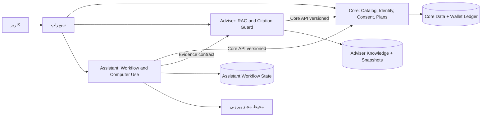
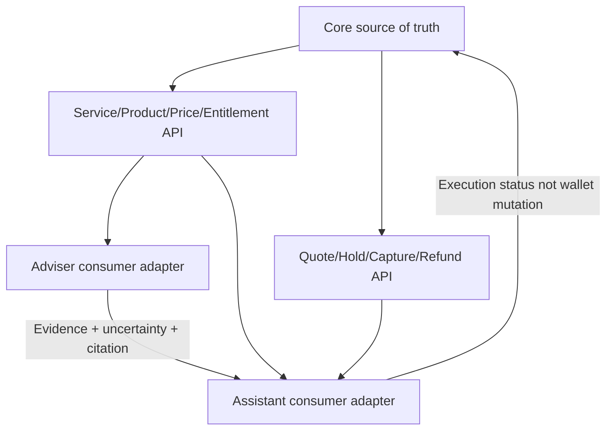
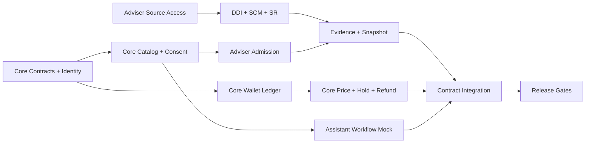
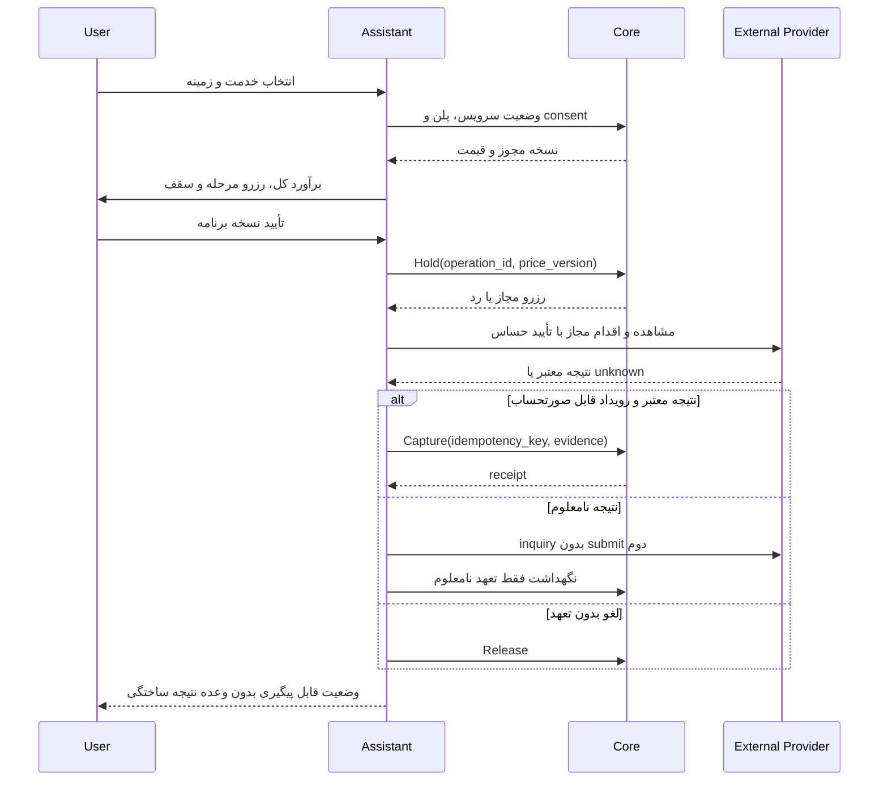
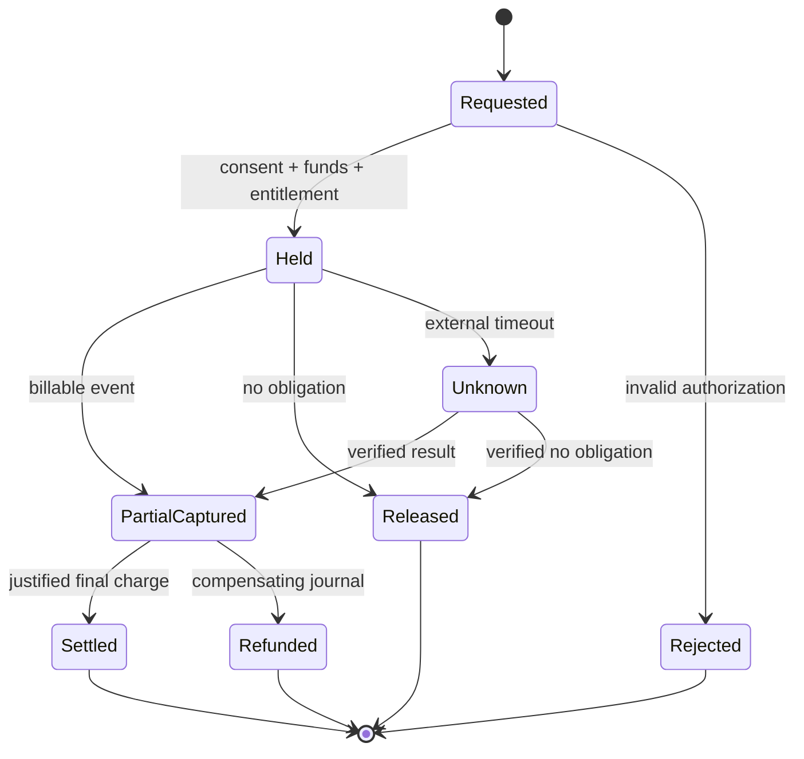
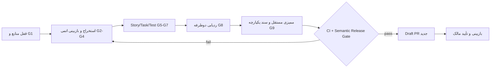

# برنامه پیاده‌سازی فاز دوم شهاب — بازسازی مستقل (پیش‌نویس قابل ممیزی)

**وضعیت: INCOMPLETE — این سند هنوز برنامه تأییدشده یا مجوز استقرار نیست.** این نسخه از دو مرجع قفل‌شده روی `main` استخراج شده و از سند PR شماره ۲۴۷ منشعب نشده است. مواردی که هنوز استخراج اتمی یا تأیید نشده‌اند نباید صرف حضور یک تسک، COVERED تلقی شوند.

**مراجع ثابت:** B = `docs/SHAHAB_PHASE_2_DEVELOPMENT_BLUEPRINT.md`، blob `9681c2bf6c3149317c3788516748084cfb6eac7c`؛ W = `docs/SHAHAB_DIGITAL_WALLET.md`، blob `1f3dc55f46b3a12b2eb33e647355e4a6a73dd37a`. ترتیب اعتبار: مصوبات متن جاری مرجع، ADR مصوب و پروتکل مخزن؛ تصمیم‌های باز بدون اختیار تغییر نمی‌کنند.

## فصل اول — مجموعه تسک‌های فاز دوم

### ۱.۱. مبنای کار، دامنه و قرارداد وضعیت

- سه مالک **Core** (هویت، سیاست، کاتالوگ، کیف پول و داده قطعی)، **Adviser** (RAG/مشاوره و نسخه شواهد) و **Assistant** (گردش‌کار اجرایی و Computer Use) هستند؛ تبادل از قرارداد نسخه‌دار و نه دسترسی مستقیم به داده خصوصی سرویس دیگر است.
- `User Story` هدف بازیگر، `Task` تحویل‌دادنی، `T-{task}` آزمون اختصاصی طراحی‌شده و `P2-B/W-...` شناسه حکم منبع است. آزمون‌ها تا اجرای واقعی وضعیت `NOT_RUN` دارند.
- «مصوب در منبع» با «پیاده‌سازی‌شده»، «آزموده‌شده» و «VERIFIED» چهار وضعیت متفاوت‌اند. ۲٬۸۰۶ خط غیرخالی مبنای متنی هستند، نه تعداد احکام.
- فیلدهای اجرایی لازم در زمان تبدیل تسک: owner، source/atom، story، deliverable، acceptance، negative test، hard/contract/soft dependency، گیت تصمیم و انتشار، شاخص مشاهده‌پذیری و trace. هیچ زمان و بودجه فرضی در این سند منظور نشده است.

### ۱.۲. User Storyهای استخراج‌شده و سناریوهای شکست

| Story | بازیگر | هدف | سناریوی اصلی | شکست یا استثنای قابل بازبینی | مرجع | تسک |
|---|---|---|---|---|---|---|
| C-US-03 | کاربر حقیقی | احراز شخص با OTP و شاهکار | موجب فراهم‌شدن سازوکار اعتبارسنجی شماره و کد ملی با وضعیت معتبر/نامعلوم، بدون فرض صحت از پیامک صرف | OTP موفق اما شماره به فرد دیگر تعلق دارد؛ فعال‌شدن حساب مردود است | W:168 | C-ID-01 |
| C-US-01 | شخص و سازمان | کیف اصلی شخص و سازمان | موجب فراهم‌شدن مدل مالکیت یکتای شخص/سازمان و ایجاد idempotent پس از احراز مناسب، با رابطه immutable مالک | دو کیف شخصی اصلی یا انتقال مالکیت سازمان به کارمند | W:136 | C-ACC-01 |
| C-US-02 | نماینده مجاز سازمان | فعال‌سازی مالی سازمان | موجب فراهم‌شدن فرایند قرارداد رسمی محضری، شواهد هویت، مالک واقعی، سمت و اختیار؛ حالت inactive/verified/active | سازمان بدون تأیید قرارداد بتواند کیف را شارژ کند | W:156 | C-ORG-01 |
| C-US-04 | کارمند و ادمین سازمان | عضویت چندسازمانی و دعوت | موجب فراهم‌شدن مدل مستقل Invitation/Membership با پذیرش صریح، revocation، حقوق رسید عضو سابق و جداسازی org | عضویت از بارگذاری صرف؛ نشت رسید org دیگر | W:180، W:196، W:208 | C-ORG-02 |
| C-US-05 | ادمین و نماینده سازمان | اختیارات و جانشینی ادمین سازمان | موجب فراهم‌شدن یک نوع نقش مدیریتی هم‌اختیار، audit actor و انتقال ادمین با re-auth؛ بستن پس تعهدات | ادمین سازمان B داده A را تغییر دهد؛ سوابق حذف شوند | W:220، W:244، W:256 | C-ORG-03 |
| C-US-06 | ادمین و کارمند | مجوز مصرف کارمند و دوره بودجه | موجب فراهم‌شدن Allowance مستقل از دارایی، محدود به org/member/period، carryover انتخابی و اتصال hold/refund به دوره اصلی | دو رزرو موازی سقف را رد کنند یا کیف شخصی شارژ شود | W:1151، W:268، W:284، W:296، W:308 | C-ALW-01 |
| C-US-07 | مشتری و مسئول مالی | دفترکل، منشأ و دقت مالی | موجب فراهم‌شدن دفترکل متوازن با credit lots، تفکیک بدهی مشتری/درآمد، محاسبات صحیح ریال و گردکردن تجمعی | double count سازمان+هدیه؛ debit با float یا حذف journal قدیمی | W:379، W:393، W:544، W:558 | C-FIN-01 |
| C-US-08 | کاربر و مدیر کمپین | کمپین هدیه و تخفیف | موجب فراهم‌شدن دو نوع مجزای gift lot و price discount؛ مخاطب/سرویس/مهلت/بودجه/سه سقف اختیاری با قفل رقابت | دو redemption یک سهمیه دو grant بسازند؛ discount cashout شود | W:485، W:699، W:713، W:727، W:741 | C-GFT-01 |
| C-US-20 | حسابدار و ادمین سازمان | صدور سند سازمانی پیش از شارژ | موجب فراهم‌شدن سند قابل دریافت قبل پرداخت با org_id/charge_request، ارتباط با وضعیت وصول و تصمیم حقوقی سند مالیاتی جدا | صدور سند به وصول موفق تلقی شود یا فروش دوبار صورتحساب شود | W:1495 | C-INV-01 |
| C-US-09 | مشتری شخصی و سازمانی | شارژ و وصول بانکی | موجب فراهم‌شدن charge request با مقصد immutable، تأیید واقعی وصول، ledger idempotent و سقف rolling 24h | دوباره‌شارژ با callback؛ جابه‌جایی مقصد پس تغییر سازمان | W:580، W:596، W:636، W:650، W:677 | C-CHG-01 |
| C-US-18 | مصرف‌کننده خدمت | قیمت‌گذاری داینامیک و نسخه نرخ | موجب فراهم‌شدن quote مبتنی بر پردازش واقعی مشاور و تعرفه دستیار+مشاوره ضریب ۰٫۵؛ price_version ثابت اجرا | کسر ۲۰٪ حاشیه به‌عنوان کارمزد یا نرخ ثابت پرامپت | W:1391، W:1405، W:1449 | C-PRC-01 |
| C-US-10 | مشتری و سرویس مصرف‌کننده | رزرو، افزایش و قطعی‌سازی | موجب فراهم‌شدن Hold/Capture/Release با operation_id، preserve origin، برآورد اولیه جدا از hold مرحله‌ای، سقف ۱٫۲ و billable event نسخه‌دار | کسر صرف کلیک؛ افزایش مرکب ۲۰٪؛ آزادسازی تعهد نامعلوم | W:773، W:787، W:801، W:815، W:831، W:845 | C-HLD-01 |
| C-US-11 | مالک کیف و سازمان | انتقال و برداشت واجد شرایط | موجب فراهم‌شدن transfer lot lineage، مجوز جهت‌ها و فهرست، بانک مقصد مالک و state machine برداشت با limit مستقل | انتقال round-trip حق برداشت جدید بسازد؛ شارژ شخصی ادمین به سازمان | W:863، W:877، W:893، W:905، W:919، W:933، W:949 | C-TFR-01 |
| C-US-12 | مشتری پرداخت‌کننده | استرداد و بازگشت منشأ | موجب فراهم‌شدن reversal مرتبط با ledger اصلی و سهم cash/gift، برگشت به همان wallet؛ سیاست expiry جبرانی فقط شکست منتسب به شهاب | استرداد سازمان به کیف کارمند یا تبدیل تخفیف به پول | W:1045، W:1065 | C-REF-01 |
| C-US-13 | مشتری | شارژ خودکار و پرداخت دوره‌ای | موجب فراهم‌شدن Consent نسخه‌دار، آستانه/مبلغ/سقف دوره، task idempotent و توقف فوری نوبت آینده پس لغو | خودشارژ در timeout یا پس revocation دوباره صادر شود | W:1091، W:1103، W:1115، W:1127، W:1139 | C-REC-01 |
| C-US-14 | کاربر و مدیر محصول | کاتالوگ خدمات و محصولات نسخه‌دار | موجب فراهم‌شدن شناسه پایدار حوزه/خدمت/بانک/محصول و Snapshot منتشرشده با وضعیت فعال/غیرفعال؛ قرارداد حوزه نقش | استناد به محصول منسوخ یا پاسخ تخصصی قبل انتخاب حوزه | B:1633، B:871 | C-CAT-01 |
| C-US-15 | مشترک | پلن، استحقاق و چرخه اشتراک | موجب فراهم‌شدن Entitlement نسخه‌دار، وضعیت Bron­ze/Silver/Gold، مصرف سهمیه و تعلیق Monitoring در downgrade | حذف تنظیمات پایش در انقضا؛ ادامه feedforward بدون حق | B:1014 | C-PLN-01 |
| C-US-16 | کاربر | مجوز قطعی و سیاست اقدام | موجب فراهم‌شدن Backend gate پلن/رضایت هدفمند/مجازبودن فنی‌حقوقی با scope، expiry و revocation | اتکا به تأیید onboarding برای پرداخت جدید | B:1147 | C-POL-01 |
| C-US-17 | متقاضی تسهیلات | توصیه‌گر قطعی مبتنی بر Snapshot | موجب فراهم‌شدن API هم‌زمان توصیه قطعی/دلیل/نسخه Snapshot با ورودی پرسشنامه کاننیکال | محاسبه مبلغ/اقساط با LLM یا ingestion داده draft | B:1631 | C-RCMD-01 |
| C-US-19 | مسئول مالی | تطبیق و تسویه تأمین‌کننده | موجب فراهم‌شدن ثبت بدهی به تأمین‌کننده، قرارداد زمان/تسویه و رسید بانکی، جدا از کسر کیف مشتری | تسویه خودکار روزانه برای همه؛ دوبار کسر مشتری | W:1481 | C-SET-01 |
| C-US-21 | مشتری و کارشناس مجاز | پشتیبانی، اختلاف و ردیابی مجاز | موجب فراهم‌شدن Case به تراکنش/مالک/وضعیت، دسترسی شبکه تراکنش با audit view/export و حداقل داده | نمایش تراکنش فرد دیگر یا وعده SLA مصوب نشده | W:1553، W:1565 | C-SUP-01 |
| C-US-22 | مالک انتشار و QA | گیت انتشار مالی و مانیتورینگ | موجب فراهم‌شدن قواعد انتشار ledger invariants، تست concurrency، دسترسی، refund و recovery؛ هشدارهای مهم | انتشار قابلیت مالی با آزمون طراحی‌شده ولی اجرا نشده | W:1619 | C-OPS-01 |
| A-US-01 | کاربر مشاور | پذیرش خدمت و سؤال در دامنه | موجب فراهم‌شدن Admission Server Gate و schema شواهد خدمت؛ تفکیک مبهم/خارج دامنه/غیرمجاز از ناکفایتی داده | پاسخ تخصصی در نشست حوزه اشتباه یا محاسبه نرخ با LLM | B:270، B:345، B:425 | A-ADM-01 |
| A-US-02 | کاربر مشاور | مسیریابی بازیابی ریسک‌محور | موجب فراهم‌شدن Router داخلی→Live Retrieval هدفمند→Fallback/Abstention با risk policy، بودجه و cache Snapshot-aware | منبع ثانویه stale جای سند رسمی؛ cache میان دو نسخه شواهد مشترک | B:275، B:310، B:315، B:350، B:445 | A-RET-01 |
| A-US-03 | پژوهشگر حقوقی | دسترسی مجاز و قرارداد منابع | موجب فراهم‌شدن Registry منبع و Adapterهای MCP/API/HTTP/Browser مشروط به مجوز؛ source result با provenance/error | API غیرمستقیم بدون مجوز یا دورزدن شرایط سایت | B:204، B:206، B:285، B:380، B:385، B:435 | A-SRC-01 |
| A-US-04 | کاربر با پرسش نیازمند سند | دریافت تقاضامحور و استخراج | موجب فراهم‌شدن DDI job با کشف هدفمند→بازیابی متن رسمی→استخراج فارسی و ساختار→provenance/version/chunks | اسکن کامل همه اسناد یا حذف تبصره/جدول در chunk | B:200 | A-DDI-01 |
| A-US-05 | مدیر دانش | پایش تغییرات و کشف رابطه | موجب فراهم‌شدن Source Discovery سبک، Catalog، RDE candidate→evidence review؛ اثر اصلاحیه در سطح بند | ثبت «بدون تغییر» بعد timeout یا نسخ همه بندهای سند | B:212، B:213، B:216، B:232، B:290، B:400 | A-SCM-01 |
| A-US-06 | مدیر دانش | بازاعتبارسنجی اسناد شناخته‌شده | موجب فراهم‌شدن DRS تطبیقی با current/stale/changed_pending/verification_failed و پرونده revalidation هدفمند | rollback مقرره منسوخ یا سند ناشناخته با SR کشف‌شده تلقی شود | B:245، B:246، B:340، B:440 | A-SR-01 |
| A-US-07 | توسعه‌دهنده Adviser | مخزن دانش نسخه‌دار و گراف‌پذیر | موجب فراهم‌شدن PostgreSQL-first با DocumentIdentity/Version/Provision/Relation/Evidence و valid/recorded time؛ index مشتق جدا | نسخ از شباهت عنوان یا ادغام واقعیت شخصی در کش عمومی | B:257، B:280، B:305، B:325، B:365، B:390، B:410 | A-STR-01 |
| A-US-08 | کاربر مشاور | کفایت شواهد و Citation Guard | موجب فراهم‌شدن claim-level coverage/uncertainty و citation با بند/نسخه/Hash/validity؛ تعارض با applicability | ارجاع URL عمومی به‌عنوان اثبات ادعای خاص | B:261، B:295، B:300، B:415، B:420، B:450 | A-EVD-01 |
| A-US-12 | مالک دانش | انتشار اتمیک Snapshot | موجب فراهم‌شدن ساخت نسخه candidate، تست relations/index و تعویض یک مرجع Snapshot معتبر؛ rollback سازگار | ترکیب سند جدید با ایندکس قدیمی در یک پاسخ | B:360، B:405 | A-PUB-01 |
| A-US-10 | کاربر و مالک حریم خصوصی | امنیت منابع و داده مشاور | موجب فراهم‌شدن تفکیک cache شخصی/عمومی، کنترل prompt injection اسناد، عدم درج متن حساس در trace | انتقال دستور داخل صفحه به اجرای ابزار | B:330، B:395، B:430 | A-SEC-01 |
| A-US-11 | اپراتور | Job، ظرفیت و بازیابی دانش | موجب فراهم‌شدن Job/event idempotent، Bulkhead درخواست زنده و worker، audit trace و بازسازی index از canonical | دو snapshot فعال بعد replay یا از دست‌رفتن دانش با حذف index | B:335، B:370، B:375، B:460 | A-OPS-01 |
| A-US-09 | ارزیاب RAG | ارزیابی رگرسیون فارسی و حقوقی | موجب فراهم‌شدن مجموعه آزمون نسخه‌دار RTL/اعداد/تاریخ/جدول/OCR/تبصره/نسخ/تعارض/امتناع و اتصال به release | فقط تست happy path یا امتیاز similarity بدون citation | B:320، B:455 | A-QA-01 |
| S-US-02 | مشتری | مجوز اقدام و حفاظت اسرار Assistant | موجب فراهم‌شدن گیت Backend در مرز هر اقدام حساس با consent scoped و final confirmation؛ OTP در کنترل امن کاربر و نه حافظه مدل | submit با approval عمومی، bypass CAPTCHA یا token مشترک | B:1653، B:1688، B:1689، B:1690، B:918 | S-SEC-01 |
| S-US-01 | مشتری در حال خدمت | گردش‌کار پایدار و نتیجه نامعلوم | موجب فراهم‌شدن workflow state در DB مالک Assistant، job version، توقف/ادامه، audit، inquiry قبل retry، idempotency خارجی | حافظه LLM مرجع وضعیت یا submit تکراری | B:1693، B:1694، B:916، B:918 | S-WFL-01 |
| S-US-05 | مشتری | ایزوله‌سازی محیط و نشست | موجب فراهم‌شدن Session/Device Orchestrator با تخصیص، TTL، پاک‌سازی، recovery و جداسازی مشتری و آزمون | اشتراک bank session یا test/prod credential | B:1534 | S-SES-01 |
| S-US-03 | مشتری | Computer Use مبتنی بر مشاهده زنده | موجب فراهم‌شدن observe→understand→policy gate→act→verify؛ کنترل دامنه و عنصر مبهم، توقف امن و بدون bypass | کلیک مختصات ثابت یا تکرار اقدام بعد timeout | B:1482، B:1500، B:1555، B:1691، B:1694 | S-CU-01 |
| S-US-04 | مشتری موبایل/وب | مسیر وب/اندروید/iOS با گیت مستقل | موجب فراهم‌شدن Adapter capability discovery، انتخاب وب و در صورت مجوز مسیر اپ؛ نصب صرفاً با اقدام مشتری، iOS feasibility جدا | فرض کنترل آزاد اپ دیگر یا نصب silent | B:1504، B:1522، B:1534 | S-PLT-01 |
| S-US-07 | اپراتور Assistant | پایش غیرمخرب تغییرات رابط | موجب فراهم‌شدن نقشه UI نسخه‌دار/fingerprint، تست ایزوله بدون پرداخت واقعی، قرنطینه تغییر مشکوک | پایش با حساب واقعی یا تکیه بر UI دیروز | B:1538، B:1692 | S-UI-01 |
| S-US-08 | متقاضی وام | مصرف نتیجه قطعی توصیه‌گر Core | موجب فراهم‌شدن Adapter مصرف هم‌زمان Core Recommendation/PriceVersion/Snapshot؛ در شکست fallback محدود و trace | توصیه بدون Snapshot یا محاسبه جدید LLM | B:1631 | S-REC-01 |
| S-US-09 | متقاضی ضمانت‌نامه | پرونده ضمانت‌نامه با شواهد معتبر | موجب فراهم‌شدن گردش‌کار انتخاب حوزه→گزینه معتبر CAT/RAG→انتخاب مشتری→مجوز→Computer Use→رسید؛ matcher اختیاری | پیشنهاد حدسی یا submit بدون تأیید نهایی | B:1639، B:1645، B:1647 | S-JRN-01 |
| S-US-06 | مشتری و اپراتور | Feedback و Feedforward دارای شواهد | موجب فراهم‌شدن event candidate→policy/entitlement/consent/evidence→dedup→alert؛ عدم اجازه اجرای عملیات از رویداد | پایش بی‌اجازه یا اعلان تکراری ناموجه | B:1684، B:944 | S-FF-01 |

### ۱.۳. Core — مالکیت داده پایه و عملیات مالی

| تسک | Story | ارجاع منبع | خروجی فنی اختصاصی | معیار پذیرش اصلی | مثال رفتار مردود | شناسه آزمون | پیش‌نیاز سخت | گیت تصمیم | وضعیت |
|---|---|---|---|---|---|---|---|---|---|
| C-ID-01 | C-US-03 | W:168 | سازوکار اعتبارسنجی شماره و کد ملی با وضعیت معتبر/نامعلوم، بدون فرض صحت از پیامک صرف | شماره تطبیق‌ناموفق یا شاهکار نامعلوم حساب احرازشده نسازد | OTP موفق اما شماره به فرد دیگر تعلق دارد؛ فعال‌شدن حساب مردود است | T-C-ID-01 | — | گیت دسترسی واقعی شاهکار | طراحی؛ اجرا نشده |
| C-ACC-01 | C-US-01 | W:136 | مدل مالکیت یکتای شخص/سازمان و ایجاد idempotent پس از احراز مناسب، با رابطه immutable مالک | برای یک شخص یا سازمان تأییدشده حداکثر یک کیف اصلی؛ تغییر ادمین مالکیت سازمان را تغییر ندهد | دو کیف شخصی اصلی یا انتقال مالکیت سازمان به کارمند | T-C-ACC-01 | C-ID-01 | گیت اسناد و حساب سازمان | طراحی؛ اجرا نشده |
| C-ORG-01 | C-US-02 | W:156 | فرایند قرارداد رسمی محضری، شواهد هویت، مالک واقعی، سمت و اختیار؛ حالت inactive/verified/active | بدون قرارداد تکمیل‌شده، charge و allowance سازمان ۰ بماند؛ نماینده فاقد اختیار رد شود | سازمان بدون تأیید قرارداد بتواند کیف را شارژ کند | T-C-ORG-01 | C-ACC-01 | گیت تأیید حقوقی اسناد | طراحی؛ اجرا نشده |
| C-ORG-02 | C-US-04 | W:180، W:196، W:208 | مدل مستقل Invitation/Membership با پذیرش صریح، revocation، حقوق رسید عضو سابق و جداسازی org | تا احراز+accept عضو فعال نشود؛ عضو سابق رسید خودش را ببیند و موجودی org را نبیند | عضویت از بارگذاری صرف؛ نشت رسید org دیگر | T-C-ORG-02 | C-ORG-01;C-ID-01 | قرارداد هویت و دسترسی | طراحی؛ اجرا نشده |
| C-ORG-03 | C-US-05 | W:220، W:244، W:256 | یک نوع نقش مدیریتی هم‌اختیار، audit actor و انتقال ادمین با re-auth؛ بستن پس تعهدات | دو ادمین مستقل مجاز؛ انتقال بدون re-auth و بستن با تعهد باز رد؛ تأییدکننده دوم اجباری نباشد | ادمین سازمان B داده A را تغییر دهد؛ سوابق حذف شوند | T-C-ORG-03 | C-ORG-01;C-ORG-02 | گیت مدارک بازیابی نمایندگی | طراحی؛ اجرا نشده |
| C-ALW-01 | C-US-06 | W:1151، W:268، W:284، W:296، W:308 | Allowance مستقل از دارایی، محدود به org/member/period، carryover انتخابی و اتصال hold/refund به دوره اصلی | حد مجاز مصرف=min(مانده آزاد سازمان، سقف آزاد عضو)؛ carryover پول نسازد؛ استرداد قدیمی دوره جدید را زیاد نکند | دو رزرو موازی سقف را رد کنند یا کیف شخصی شارژ شود | T-C-ALW-01 | C-ACC-01;C-ORG-02;C-FIN-01 | گیت تعریف دوره و سقف مصوب سازمان | طراحی؛ اجرا نشده |
| C-FIN-01 | C-US-07 | W:379، W:393، W:544، W:558 | دفترکل متوازن با credit lots، تفکیک بدهی مشتری/درآمد، محاسبات صحیح ریال و گردکردن تجمعی | شارژ بدون خدمت درآمد صفر؛ ۱۰٬۰۰۰ تومان=۱۰۰٬۰۰۰ ریال؛ debit تجمعی برابر گردکردن نیم‌ریال رو به بالا | double count سازمان+هدیه؛ debit با float یا حذف journal قدیمی | T-C-FIN-01 | C-ACC-01 | گیت مدل حسابداری هدیه و پوشش وجوه | طراحی؛ اجرا نشده |
| C-GFT-01 | C-US-08 | W:485، W:699، W:713، W:727، W:741 | دو نوع مجزای gift lot و price discount؛ مخاطب/سرویس/مهلت/بودجه/سه سقف اختیاری با قفل رقابت | تخفیف موجودی نسازد؛ درصد/مبلغ/دوره هم‌زمان رعایت؛ هدیه با expiry اصلی منتقل شود | دو redemption یک سهمیه دو grant بسازند؛ discount cashout شود | T-C-GFT-01 | C-FIN-01;C-CAT-01 | گیت reuse کد تخفیف پس لغو | طراحی؛ اجرا نشده |
| C-INV-01 | C-US-20 | W:1495 | سند قابل دریافت قبل پرداخت با org_id/charge_request، ارتباط با وضعیت وصول و تصمیم حقوقی سند مالیاتی جدا | هر دو روش درگاه و انتقال بانکی سند پیشینی داشته باشند؛ صرف صدور سند credit/revenue صفر | صدور سند به وصول موفق تلقی شود یا فروش دوبار صورتحساب شود | T-C-INV-01 | C-ACC-01;C-FIN-01 | گیت باز نوع حقوقی صورتحساب و ثبت مالیاتی | طراحی؛ اجرا نشده |
| C-CHG-01 | C-US-09 | W:580، W:596، W:636، W:650، W:677 | charge request با مقصد immutable، تأیید واقعی وصول، ledger idempotent و سقف rolling 24h | پیش وصول available_delta=0؛ callback/query/reconciliation یک credit؛ شخص ≤۲۰۰ میلیون و سازمان ≤۱ میلیارد تومان ۲۴ساعته | دوباره‌شارژ با callback؛ جابه‌جایی مقصد پس تغییر سازمان | T-C-CHG-01 | C-ACC-01;C-FIN-01;C-INV-01 | گیت ارائه‌دهنده بانکی و قوانین احراز حساب | طراحی؛ اجرا نشده |
| C-PRC-01 | C-US-18 | W:1391، W:1405، W:1449 | quote مبتنی بر پردازش واقعی مشاور و تعرفه دستیار+مشاوره ضریب ۰٫۵؛ price_version ثابت اجرا | افزایش نرخ وسط اجرا قیمت قدیمی را بازنویسی نکند؛ ۰٫۵ و نه ۱/۳؛ خروجی ناموفق ناشی شهاب هزینه نداشته باشد | کسر ۲۰٪ حاشیه به‌عنوان کارمزد یا نرخ ثابت پرامپت | T-C-PRC-01 | C-CAT-01;C-FIN-01 | گیت عدد تعرفه و معیار دقیق پردازش | طراحی؛ اجرا نشده |
| C-HLD-01 | C-US-10 | W:773، W:787، W:801، W:815، W:831، W:845 | Hold/Capture/Release با operation_id، preserve origin، برآورد اولیه جدا از hold مرحله‌ای، سقف ۱٫۲ و billable event نسخه‌دار | برآورد۱۰۰، رزرو۳۰ و سقف۱۲۰؛ هزینه۱۲۵ بدون تأیید جدید متوقف؛ unknown تعهد فقط همان بخش را نگه دارد | کسر صرف کلیک؛ افزایش مرکب ۲۰٪؛ آزادسازی تعهد نامعلوم | T-C-HLD-01 | C-FIN-01;C-PRC-01;C-POL-01 | گیت مدت/نرخ هر خدمت؛ قرارداد billable event | طراحی؛ اجرا نشده |
| C-TFR-01 | C-US-11 | W:863، W:877، W:893، W:905، W:919، W:933، W:949 | transfer lot lineage، مجوز جهت‌ها و فهرست، بانک مقصد مالک و state machine برداشت با limit مستقل | فرد→سازمان و سازمان→سازمان رد؛ received cashout false؛ بانک با owner unknown payout صفر | انتقال round-trip حق برداشت جدید بسازد؛ شارژ شخصی ادمین به سازمان | T-C-TFR-01 | C-FIN-01;C-ID-01;C-POL-01 | گیت اعداد سقف برداشت/انتقال و شریک بانکی | طراحی؛ اجرا نشده |
| C-REF-01 | C-US-12 | W:1045، W:1065 | reversal مرتبط با ledger اصلی و سهم cash/gift، برگشت به همان wallet؛ سیاست expiry جبرانی فقط شکست منتسب به شهاب | پرداخت ۷۰ نقد+۳۰ هدیه، استرداد۵۰ به ۳۵ نقد+۱۵ هدیه؛ لغو داوطلبانه هدیه را تمدید نکند | استرداد سازمان به کیف کارمند یا تبدیل تخفیف به پول | T-C-REF-01 | C-HLD-01;C-GFT-01 | گیت tie-break تخصیص ریال، تشخیص علت لغو | طراحی؛ اجرا نشده |
| C-REC-01 | C-US-13 | W:1091، W:1103، W:1115، W:1127، W:1139 | Consent نسخه‌دار، آستانه/مبلغ/سقف دوره، task idempotent و توقف فوری نوبت آینده پس لغو | بدون رضایت یا پشتیبانی قراردادی autopay inactive؛ unknown استعلام؛ پس failure قطعی تکرار فقط با مشتری | خودشارژ در timeout یا پس revocation دوباره صادر شود | T-C-REC-01 | C-CHG-01;C-POL-01 | گیت مجوز درگاه و پارامتر دوره | طراحی؛ اجرا نشده |
| C-CAT-01 | C-US-14 | B:1633، B:871 | شناسه پایدار حوزه/خدمت/بانک/محصول و Snapshot منتشرشده با وضعیت فعال/غیرفعال؛ قرارداد حوزه نقش | محصول draft به توصیه قطعی نرود؛ ورودی عمومی فقط حوزه پیشنهاد کند؛ تغییر نقش با کاربر | استناد به محصول منسوخ یا پاسخ تخصصی قبل انتخاب حوزه | T-C-CAT-01 | — | گیت اصالت و منبع داده محصول | طراحی؛ اجرا نشده |
| C-PLN-01 | C-US-15 | B:1014 | Entitlement نسخه‌دار، وضعیت Bron­ze/Silver/Gold، مصرف سهمیه و تعلیق Monitoring در downgrade | انقضای پلن پولی به برنزی؛ پایش خارج سهمیه suspend نه delete شود | حذف تنظیمات پایش در انقضا؛ ادامه feedforward بدون حق | T-C-PLN-01 | C-ID-01 | گیت اعداد سقف و قیمت اشتراک | طراحی؛ اجرا نشده |
| C-POL-01 | C-US-16 | B:1147 | Backend gate پلن/رضایت هدفمند/مجازبودن فنی‌حقوقی با scope، expiry و revocation | برای اقدام مؤثر فقدان هرکدام deny؛ لغو باعث توقف اقدام بعدی شود | اتکا به تأیید onboarding برای پرداخت جدید | T-C-POL-01 | C-ID-01;C-PLN-01 | گیت اثبات امکان قانونی عملیات | طراحی؛ اجرا نشده |
| C-RCMD-01 | C-US-17 | B:1631 | API هم‌زمان توصیه قطعی/دلیل/نسخه Snapshot با ورودی پرسشنامه کاننیکال | ورودی و نسخه یکسان خروجی یکسان؛ timeout بدون درصد ساختگی؛ پذیرش بانک تضمین نشود | محاسبه مبلغ/اقساط با LLM یا ingestion داده draft | T-C-RCMD-01 | C-CAT-01;C-POL-01 | گیت کیفیت ورودی و شروط محصول | طراحی؛ اجرا نشده |
| C-SET-01 | C-US-19 | W:1481 | ثبت بدهی به تأمین‌کننده، قرارداد زمان/تسویه و رسید بانکی، جدا از کسر کیف مشتری | پیش تسویه reconciliation مطابق قرارداد؛ پرداخت supplier wallet debit تازه نسازد | تسویه خودکار روزانه برای همه؛ دوبار کسر مشتری | T-C-SET-01 | C-FIN-01 | گیت قرارداد واقعی هر تأمین‌کننده | طراحی؛ اجرا نشده |
| C-SUP-01 | C-US-21 | W:1553، W:1565 | Case به تراکنش/مالک/وضعیت، دسترسی شبکه تراکنش با audit view/export و حداقل داده | کاربر فقط رسیدهای خودش؛ پرونده اختلاف state+actor؛ گزارش مشکوک برای غیرمجاز مخفی | نمایش تراکنش فرد دیگر یا وعده SLA مصوب نشده | T-C-SUP-01 | C-FIN-01;C-POL-01 | گیت ظرفیت و SLA اعلامی | طراحی؛ اجرا نشده |
| C-OPS-01 | C-US-22 | W:1619 | قواعد انتشار ledger invariants، تست concurrency، دسترسی، refund و recovery؛ هشدارهای مهم | اگر تراز/تکرار/مجوز تست fail باشد release مالی blocked؛ شکست CI مستند شود | انتشار قابلیت مالی با آزمون طراحی‌شده ولی اجرا نشده | T-C-OPS-01 | C-FIN-01;C-POL-01 | گیت مالی و کیفیت نسخه جاری | طراحی؛ اجرا نشده |

### ۱.۴. RAG / Adviser — مالکیت دانش و پاسخ مستند

| تسک | Story | ارجاع منبع | خروجی فنی اختصاصی | معیار پذیرش اصلی | مثال رفتار مردود | شناسه آزمون | پیش‌نیاز سخت | گیت تصمیم | وضعیت |
|---|---|---|---|---|---|---|---|---|---|
| A-ADM-01 | A-US-01 | B:270، B:345، B:425 | Admission Server Gate و schema شواهد خدمت؛ تفکیک مبهم/خارج دامنه/غیرمجاز از ناکفایتی داده | درخواست مستقل حوزه دیگر فقط هدایت شود؛ داده ناکافی به معنای نامجاز بودن نیست | پاسخ تخصصی در نشست حوزه اشتباه یا محاسبه نرخ با LLM | T-A-ADM-01 | C-CAT-01 | گیت schema خدمت و حوزه | طراحی؛ اجرا نشده |
| A-RET-01 | A-US-02 | B:275، B:310، B:315، B:350، B:445 | Router داخلی→Live Retrieval هدفمند→Fallback/Abstention با risk policy، بودجه و cache Snapshot-aware | internal کافی نیاز به live ندارد؛ stale/حساس با شواهد ناکافی پاسخ قطعی نگیرد؛ fallback هم‌صلاحیت باشد | منبع ثانویه stale جای سند رسمی؛ cache میان دو نسخه شواهد مشترک | T-A-RET-01 | A-STR-01;A-ADM-01 | آستانه‌های ریسک پس آزمون تعیین شوند | طراحی؛ اجرا نشده |
| A-SRC-01 | A-US-03 | B:204، B:206، B:285، B:380، B:385، B:435 | Registry منبع و Adapterهای MCP/API/HTTP/Browser مشروط به مجوز؛ source result با provenance/error | Unknown/Blocked source تولیدی فعال نشود؛ MCP بدون adapter مدرک بازیابی ندهد | API غیرمستقیم بدون مجوز یا دورزدن شرایط سایت | T-A-SRC-01 | — | گیت C01 و S1..S5 هر منبع | طراحی؛ اجرا نشده |
| A-DDI-01 | A-US-04 | B:200 | DDI job با کشف هدفمند→بازیابی متن رسمی→استخراج فارسی و ساختار→provenance/version/chunks | بدون تقاضا یا اثر معتبر خزش کامل انجام نشود؛ سند خام/مشتقات نسخه‌دار و قابل بازیابی بمانند | اسکن کامل همه اسناد یا حذف تبصره/جدول در chunk | T-A-DDI-01 | A-SRC-01;A-STR-01 | گیت کیفیت فارسی F05 و مجوز source | طراحی؛ اجرا نشده |
| A-SCM-01 | A-US-05 | B:212، B:213، B:216، B:232، B:290، B:400 | Source Discovery سبک، Catalog، RDE candidate→evidence review؛ اثر اصلاحیه در سطح بند | metadata کشف‌شده published نیست؛ similarity AMENDS/REPEALS نسازد؛ monitoring failure status unknown | ثبت «بدون تغییر» بعد timeout یا نسخ همه بندهای سند | T-A-SCM-01 | A-SRC-01;A-STR-01 | گیت رابطه حقوقی C05 | طراحی؛ اجرا نشده |
| A-SR-01 | A-US-06 | B:245، B:246، B:340، B:440 | DRS تطبیقی با current/stale/changed_pending/verification_failed و پرونده revalidation هدفمند | شکست بررسی current جعل نکند؛ نسخه candidate بدون Snapshot gate منتشر نشود | rollback مقرره منسوخ یا سند ناشناخته با SR کشف‌شده تلقی شود | T-A-SR-01 | A-SRC-01;A-STR-01;A-SCM-01 | گیت C01/C06/C07 | طراحی؛ اجرا نشده |
| A-STR-01 | A-US-07 | B:257، B:280، B:305، B:325، B:365، B:390، B:410 | PostgreSQL-first با DocumentIdentity/Version/Provision/Relation/Evidence و valid/recorded time؛ index مشتق جدا | URL جدید هویت سند را عوض نکند؛ Neo4j الزامی نباشد؛ دانش draft و published جدا باشد | نسخ از شباهت عنوان یا ادغام واقعیت شخصی در کش عمومی | T-A-STR-01 | — | گیت Schema/Lineage و حجم واقعی | طراحی؛ اجرا نشده |
| A-EVD-01 | A-US-08 | B:261، B:295، B:300، B:415، B:420، B:450 | claim-level coverage/uncertainty و citation با بند/نسخه/Hash/validity؛ تعارض با applicability | ادعای بی‌شاهد حذف/محدود شود؛ چند بازنشر بی‌اصالت کفایت نسازند | ارجاع URL عمومی به‌عنوان اثبات ادعای خاص | T-A-EVD-01 | A-RET-01;A-STR-01 | گیت کفایت C06 و اعتبار منبع C01 | طراحی؛ اجرا نشده |
| A-PUB-01 | A-US-12 | B:360، B:405 | ساخت نسخه candidate، تست relations/index و تعویض یک مرجع Snapshot معتبر؛ rollback سازگار | response در یک درخواست Snapshot واحد داشته باشد؛ rollback مقرره منسوخ را current نکند | ترکیب سند جدید با ایندکس قدیمی در یک پاسخ | T-A-PUB-01 | A-STR-01;A-EVD-01;A-SR-01 | گیت C07 و سازگاری قرارداد | طراحی؛ اجرا نشده |
| A-SEC-01 | A-US-10 | B:330، B:395، B:430 | تفکیک cache شخصی/عمومی، کنترل prompt injection اسناد، عدم درج متن حساس در trace | دستور مخرب PDF tool policy را تغییر ندهد؛ داده شخصی بین نشست‌ها نشت نکند | انتقال دستور داخل صفحه به اجرای ابزار | T-A-SEC-01 | A-SRC-01;A-STR-01 | گیت امنیت و منبع مجاز | طراحی؛ اجرا نشده |
| A-OPS-01 | A-US-11 | B:335، B:370، B:375، B:460 | Job/event idempotent، Bulkhead درخواست زنده و worker، audit trace و بازسازی index از canonical | retry job انتشار تکراری نسازد؛ ازدحام OCR پاسخ تعاملی را از کار نیندازد | دو snapshot فعال بعد replay یا از دست‌رفتن دانش با حذف index | T-A-OPS-01 | A-DDI-01;A-SCM-01;A-SR-01 | گیت بار، کیفیت و disaster recovery | طراحی؛ اجرا نشده |
| A-QA-01 | A-US-09 | B:320، B:455 | مجموعه آزمون نسخه‌دار RTL/اعداد/تاریخ/جدول/OCR/تبصره/نسخ/تعارض/امتناع و اتصال به release | مقرره منسوخ/شاهد ناقص خطای تست شود؛ رگرسیون پس اصلاح chunking قابل بازتولید باشد | فقط تست happy path یا امتیاز similarity بدون citation | T-A-QA-01 | A-EVD-01;A-PUB-01 | گیت داده آزمایش واقعی و C01..C07 | طراحی؛ اجرا نشده |

### ۱.۵. Assistant — مالکیت اجرای خدمت و Computer Use

| تسک | Story | ارجاع منبع | خروجی فنی اختصاصی | معیار پذیرش اصلی | مثال رفتار مردود | شناسه آزمون | پیش‌نیاز سخت | گیت تصمیم | وضعیت |
|---|---|---|---|---|---|---|---|---|---|
| S-SEC-01 | S-US-02 | B:1653، B:1688، B:1689، B:1690، B:918 | گیت Backend در مرز هر اقدام حساس با consent scoped و final confirmation؛ OTP در کنترل امن کاربر و نه حافظه مدل | تغییر مبلغ/گیرنده تأیید قبلی را باطل کند؛ OTP در log/prompt/storage نباشد | submit با approval عمومی، bypass CAPTCHA یا token مشترک | T-S-SEC-01 | C-POL-01;C-PLN-01 | گیت اختیار بانک/پلتفرم و مجوز مشتری | طراحی؛ اجرا نشده |
| S-WFL-01 | S-US-01 | B:1693، B:1694، B:916، B:918 | workflow state در DB مالک Assistant، job version، توقف/ادامه، audit، inquiry قبل retry، idempotency خارجی | پس restart پرونده ادامه یابد؛ timeout «موفق» نشود؛ دوباره submit بدون inquiry انجام نشود | حافظه LLM مرجع وضعیت یا submit تکراری | T-S-WFL-01 | S-SEC-01 | گیت قابلیت سرویس خارجی و Retry policy | طراحی؛ اجرا نشده |
| S-SES-01 | S-US-05 | B:1534 | Session/Device Orchestrator با تخصیص، TTL، پاک‌سازی، recovery و جداسازی مشتری و آزمون | cookie/OTP کاربر A در محیط B هرگز دیده نشود؛ نشست پاک‌شده دوباره استفاده نشود | اشتراک bank session یا test/prod credential | T-S-SES-01 | S-WFL-01;S-SEC-01 | گیت محل اجرا و سیاست سیستم‌عامل | طراحی؛ اجرا نشده |
| S-CU-01 | S-US-03 | B:1482، B:1500، B:1555، B:1691، B:1694 | observe→understand→policy gate→act→verify؛ کنترل دامنه و عنصر مبهم، توقف امن و بدون bypass | UI drift یا ابهام گیرنده هیچ submit ندهد؛ مسیر ذخیره‌شده بدون مشاهده زنده اجرا نشود | کلیک مختصات ثابت یا تکرار اقدام بعد timeout | T-S-CU-01 | S-WFL-01;S-SES-01;S-SEC-01 | گیت G-WEB و ابزار هنوز انتخاب نشده | طراحی؛ اجرا نشده |
| S-PLT-01 | S-US-04 | B:1504، B:1522، B:1534 | Adapter capability discovery، انتخاب وب و در صورت مجوز مسیر اپ؛ نصب صرفاً با اقدام مشتری، iOS feasibility جدا | در نبود اپ ولی وب معتبر، fallback وب؛ نصب پنهانی صفر؛ iOS غیرممکن disabled | فرض کنترل آزاد اپ دیگر یا نصب silent | T-S-PLT-01 | S-CU-01;S-SEC-01 | G-WEB سپس G-ANDROID سپس G-IOS | طراحی؛ اجرا نشده |
| S-UI-01 | S-US-07 | B:1538، B:1692 | نقشه UI نسخه‌دار/fingerprint، تست ایزوله بدون پرداخت واقعی، قرنطینه تغییر مشکوک | پایش شبانه real_payment=0؛ تغییر تاییدنشده به production نرود؛ اجرا همچنان live observe کند | پایش با حساب واقعی یا تکیه بر UI دیروز | T-S-UI-01 | S-CU-01;S-SES-01 | گیت دسترسی آزمون مجاز بانک | طراحی؛ اجرا نشده |
| S-REC-01 | S-US-08 | B:1631 | Adapter مصرف هم‌زمان Core Recommendation/PriceVersion/Snapshot؛ در شکست fallback محدود و trace | قطعی‌سازی و محاسبه مستقل Assistant صفر؛ timeout درصد تطابق ساختگی نسازد | توصیه بدون Snapshot یا محاسبه جدید LLM | T-S-REC-01 | C-RCMD-01;C-CAT-01 | گیت قرارداد نسخه‌دار Core | طراحی؛ اجرا نشده |
| S-JRN-01 | S-US-09 | B:1639، B:1645، B:1647 | گردش‌کار انتخاب حوزه→گزینه معتبر CAT/RAG→انتخاب مشتری→مجوز→Computer Use→رسید؛ matcher اختیاری | بدون matcher ادعای رتبه‌بندی قطعی صفر؛ کاربر بدون عبور اجباری از Adviser بتواند Assistant را انتخاب کند | پیشنهاد حدسی یا submit بدون تأیید نهایی | T-S-JRN-01 | S-WFL-01;C-CAT-01;A-EVD-01;S-CU-01 | سناریوی نمونه است، نه تصویب خدمت نخست | طراحی؛ اجرا نشده |
| S-FF-01 | S-US-06 | B:1684، B:944 | event candidate→policy/entitlement/consent/evidence→dedup→alert؛ عدم اجازه اجرای عملیات از رویداد | بدون consent/حق پلن هشدار شخصی صفر؛ event هرگز bank submit صادر نکند | پایش بی‌اجازه یا اعلان تکراری ناموجه | T-S-FF-01 | S-WFL-01;S-SEC-01;C-PLN-01 | گیت D01..D03 و پلن قابل استفاده | طراحی؛ اجرا نشده |

### ۱.۶. قراردادها و آزمون‌های بین‌سرویسی

**مالک تست‌های سرتاسری:** تیم یکپارچه‌سازی/QA؛ **مالک داده/سیاست/رویداد:** سرویس تولیدکننده همان قرارداد. این تسک‌ها موتور کاتالوگ، RAG، کیف پول یا Computer Use موازی نمی‌سازند. نوع قرارداد با producer و consumer مشخص می‌شود و پیش از integration باید نسخه، خطا، timeout، idempotency، permission scope، rollback و سناریوی ناسازگاری آن امضا شوند.

| شناسه | زنجیره | تولیدکننده/مالک داده | مصرف‌کننده/مالک رفتار | منشأ | آزمون قرارداد و E2E قابل رد | گیت |
|---|---|---|---|---|---|---|
| X-CTR-01 | سرویس و حوزه | Core: C-CAT-01/C-POL-01 | Adviser: A-ADM-01؛ Assistant: S-JRN-01 | B:871, B:270, B:1639 | consumer contract نسخه‌دار: inactive_service در هر دو مصرف‌کننده رد؛ تغییر حوزه بدون اقدام مشتری رد | گیت انتشار قابلیت حوزه |
| X-CTR-02 | محصول/مقرره | Core: C-CAT-01 | Adviser: A-EVD-01/A-PUB-01؛ Assistant: S-JRN-01 | B:261, B:405, B:1633, B:1645 | snapshot mismatch یا شواهد stale فقط حالت محدود، نه توصیه قطعی؛ فیلد provenance محفوظ | گیت شواهد C01..C07 |
| X-CTR-03 | پلن و رضایت | Core: C-PLN-01/C-POL-01 | Assistant: S-SEC-01/S-FF-01؛ Adviser: A-ADM-01 | B:1147, B:1688, B:1689 | بعد consent revoke هر دو مسیر اقدام مؤثر deny؛ دسترسی عمومی حقوقی جدا از داده شخصی | گیت حریم خصوصی |
| X-CTR-04 | هزینه و کیف پول | Core: C-PRC-01/C-HLD-01/C-REF-01 | Assistant: S-WFL-01/S-CU-01 | W:773, W:787, W:815, W:845 | با برآورد۱۰۰/hold۳۰ cap۱۲۰؛ timeout تنها تعهد نامعلوم محفوظ؛ هیچ ledger mutation در Assistant | گیت مالی |
| X-CTR-05 | توصیه وام | Core: C-RCMD-01/C-CAT-01 | Adviser: A-RET-01؛ Assistant: S-REC-01 | B:1631, B:1633 | API timeout بدون پیشنهاد ساختگی؛ نسخه کاتالوگ و قاعده در پاسخ؛ Adviser داده Core را مستقیم نخواند | گیت قرارداد API |
| X-E2E-01 | ضمانت‌نامه | Core: C-CAT-01/C-POL-01 | Adviser: A-EVD-01؛ Assistant: S-JRN-01/S-CU-01 | B:1637-1655 | بدون موتور matcher رتبه قطعی تولید نشود؛ submit نهایی بدون تأیید متصل به مبلغ/ذی‌نفع صفر؛ شماره پیگیری قابل بازسازی | گیت خدمت منتخب و مجوز بانک |
| X-E2E-02 | نتیجه نامعلوم و لغو | Core: C-HLD-01/C-REF-01 | Assistant: S-WFL-01/S-SEC-01 | W:801, W:815, B:918, B:1694 | پس cancel/timeout هزینه تازه صفر؛ hold تعهد unknown تا inquiry حفظ؛ retry external idempotent | گیت بازیابی |
| X-E2E-03 | پیش‌آگاهی | Core: C-PLN-01/C-POL-01 | Adviser: A-EVD-01؛ Assistant: S-FF-01 | B:942-970, B:1684 | رویداد بدون consent فقط candidate؛ alert duplicate حذف و هیچ پرداختی از هشدار مجاز نشود | گیت D02/D03 |

### ۱.۷. ملاک تکمیل واقعی هر تسک و قاعده تفکیک

برای تسک‌های مالک DB، migration/constraint و rollback جدا از BE endpoint، FE نمایش و QA شاهد عملیاتی بررسی می‌شوند؛ اما چهار زیرتسک صوری در کار فاقد FE یا DB ایجاد نمی‌شود. آزمون طراحی‌شده، صرفاً معیار بررسی است و نتیجه اجرایی محسوب نمی‌شود. برای هر `T-{task}` باید fixture، نسخه داده و قرارداد، ورودی، انتظار، رفتار نامعتبر نمونه، artifact اجرا و اثر مالی/امنیتی (در صورت ارتباط) ثبت شود.

## فصل دوم — معماری و مالکیت داده

در R1 مالکیت منطقی می‌تواند روی زیرساخت مشترک PostgreSQL باشد، اما پایگاه دانش Adviser و وضعیت گردش‌کار Assistant مالک معنایی مجزای خود دارند. Neo4j اجباری نیست؛ ابزار Computer Use و محل اجرای آن نیز تا آزمون امکان‌سنجی انتخاب قطعی نشده‌اند.

## فصل سوم — وابستگی و توالی اجرای قابل اثبات

وابستگی‌های سخت شناسه‌دار در جدول‌های فصل اول تعیین شده‌اند. تثبیت قرارداد و mock کافی می‌تواند اجرای موازی را آغاز کند، اما بهره‌برداری و E2E به سرویس واقعی نیاز دارد. وابستگی نرم به معنای ممنوعیت شروع نیست. وابستگی تصمیم باز تنها گیت اجرا/انتشار مربوط را مسدود می‌کند و مصوبه خلق نمی‌کند.

## فصل چهارم — فرایند حساس و وضعیت‌های مالی

در این نمودار، مقادیر گردش‌کار نمای شماتیک هستند؛ نام وضعیت‌های API و TTL عددی گیت طراحی مستقل دارند. «رزرو» هزینه قطعی یا درآمد نیست؛ «آزادسازی» استرداد مالیِ مبلغ قطعی نیست. رویداد بیرونی unknown باید تا تعیین تعهد محفوظ بماند.

## فصل پنجم — سیاست انتشار، گیت‌ها و بازگشت

- **مرحله مصوب اول:** Adviser/RAG و سوپراپ با Assistant غیرفعال برای مشتری؛ طراحی قراردادهای Assistant و تحقیق موازی مجاز است، انتشار خدمات اجرایی از آن نتیجه نمی‌شود.
- **مرحله دوم:** کاتالوگ محصول پویا، پس از گیت منبع/انتشار و هماهنگی با توصیه‌گر قطعی Core.
- **مرحله سوم:** یک خدمت Assistant پس انتخاب و گیت‌های F1..F5، ابتدا وب، سپس اندروید و iOS با گیت مستقل، به‌همراه دو سناریوی Feedback/Feedforward لازم. این ترتیب تعهد تاریخ/بودجه/توان پلتفرم نیست.
- **قواعد انتشار:** کنترل‌های امنیت، ریسک R1..R4، Go/No-Go، rollback سازگار Snapshot، قرارداد نسخه‌دار و آزمون‌های مالی متناسب هر انتشار؛ هیچ گیت فقط از روی نام تسک پاس نمی‌شود.

## فصل ششم — محدودیت‌ها، تصمیم‌های باز و تعارضات

| کد گیت | مرجع | تصمیم یا شاهد باز؛ آنچه نباید حدس زده شود | اثر بر اجرا |
|---|---|---|---|
| OPEN-PRICE | W:1391, W:1437؛ B:2154 | معیار دقیق سنجش پردازش و نرخ عددی خدمت | موتور نوع‌دار قابل طراحی است؛ قیمت عددی تولیدی بدون مصوبه مجاز نیست |
| OPEN-REFUND | W:1045-1057, W:1664 | tie-break در تساوی Largest Remainder؛ خود اصل روش مصوب است | تخصیص نهایی در حالت مساوی به قاعده نسخه‌دار نیاز دارد |
| OPEN-FISCAL | W:677-681, W:1495؛ B:1087 | الگوی مالیاتی/نوع سند و شریک بانکی ایران | ادعای ثبت مالیاتی خودکار ممنوع؛ فاکتور رسمی پیش‌پرداخت به رسید ساده تقلیل نیابد |
| OPEN-CASHOUT | W:933-937 | اعداد اولیه سقف برداشت و انتقال مستقل از سقف شارژ | محدودیت نوع‌دار طراحی می‌شود؛ مقدار غیرمصوب منتشر نمی‌شود |
| OPEN-PLATFORM | B:1500-1534 | ابزار و محل اجرای Computer Use و توان واقعی iOS | گیت وب/اندروید/iOS مستقل؛ نصب و کنترل فرض نشود |
| OPEN-RAG | B:257, B:520-526 | فناوری embedding/reranker/graph، آستانه‌های کیفیت و دسترسی تولیدی منبع | هیچ فناوری پیشنهادی prerequisite قطعی نمی‌شود |
| OPEN-RELEASE | B:1927-2259 | شواهد عملیاتی گیت‌ها، آستانه‌ها و بودجه انتشار | تصویب سیاست برابر Go نسخه واقعی نیست |
| OPEN-AUTOPAY | W:1091-1107 | قرارداد provider و جزئیات دوره و نرخ | هیچ برداشت خودکار بدون مجوز و پشتیبانی معتبر |

مورد واقعی تعارض فقط پس بررسی دو حکم معتبر و اثر اجرایی در دفتر تعارض به‌عنوان CONFLICT ثبت می‌شود. اختلاف ناشی از مثال، تاریخچه یا وضعیت تصمیم باز، به‌تنهایی تعارض مصوبه نیست. سندهای مرجع در این شاخه تغییر نمی‌کنند.

## فصل هفتم — ماتریس A: حکم مرجع به تسک و آزمون

این ردیف‌ها از متن عینی هر دو سند ساخته شده‌اند؛ آزمون و تحویل‌دادنی طراحی شده است، **نه اجرا و نه ممیزی کامل همه سطرها**. `DESIGN_PENDING` مانع ادعای COVERED است. شواهد متن مبنا و خروجی machine-readable در `SHAHAB_PHASE_2_REBUILD_ATOMIC_REQUIREMENTS.jsonl` نگهداری می‌شوند.

| اتم | خط منبع | عبارت عینی | وضعیت منبع | مالک/Story | Task | Test | قبولی | رفتار مردود | پوشش |
|---|---|---|---|---|---|---|---|---|---|
| P2-W-136-01 | W:136 | هر شخص یک کیف پول شخصی اصلی دارد | APPROVED_EXPLICIT | CORE/C-US-01 | C-ACC-01 | T-C-ACC-01 | ایجاد دوباره همان شناسه کیف را بازگرداند | دو کیف اصلی برای یک شخص | DESIGN_PENDING |
| P2-W-136-02 | W:136 | مالک آن سازمان است، نه کارمندی | APPROVED_EXPLICIT | CORE/C-US-01 | C-ACC-01 | T-C-ACC-01 | تعویض ادمین org_id مالک را عوض نکند | انتقال مالکیت به ادمین | DESIGN_PENDING |
| P2-W-156-01 | W:156 | قرارداد رسمی محضری | APPROVED_EXPLICIT | CORE/C-US-02 | C-ORG-01 | T-C-ORG-01 | قبل از تأیید قرارداد شارژ/تخصیص صفر | شارژ سازمان قبل از قرارداد | DESIGN_PENDING |
| P2-W-156-02 | W:156 | هویت سازمان، مالک واقعی، سمت و اختیار نماینده | APPROVED_EXPLICIT | CORE/C-US-02 | C-ORG-01 | T-C-ORG-01 | تمام مدارک لازم برای فعال‌سازی معتبر | نماینده فاقد اختیار فعال شود | DESIGN_PENDING |
| P2-W-168-01 | W:168 | OTP و تطبیق مالکیت شمارهٔ تلفن همراه با کد ملی | APPROVED_EXPLICIT | CORE/C-US-03 | C-ID-01 | T-C-ID-01 | دو کنترل باید موفق باشند | صرف OTP با شاهکار unknown | DESIGN_PENDING |
| P2-W-180-01 | W:180 | یک شخص می‌تواند عضو چند سازمان باشد | APPROVED_EXPLICIT | CORE/C-US-04 | C-ORG-02 | T-C-ORG-02 | عضویت هم‌زمان مستقل در orgA/orgB | نشت بودجه/رسید بین orgها | DESIGN_PENDING |
| P2-W-180-02 | W:180 | حذف عضویت، اجازهٔ شروع عملیات جدید | APPROVED_EXPLICIT | CORE/C-US-04 | C-ORG-02 | T-C-ORG-02 | بعد لغو، عملیات تازه آن org رد | شروع مجدد با توکن قدیمی | DESIGN_PENDING |
| P2-W-196-01 | W:196 | فرد پس از احراز هویت و پذیرش دعوت عضو فعال شود | APPROVED_EXPLICIT | CORE/C-US-04 | C-ORG-02 | T-C-ORG-02 | دعوت بارگذاری‌شده هنوز active نباشد | فعال شدن قبل پذیرش | DESIGN_PENDING |
| P2-W-208-01 | W:208 | مشاهدهٔ محدود رسید عملیات خودش باقی بماند | APPROVED_EXPLICIT | CORE/C-US-04 | C-ORG-02 | T-C-ORG-02 | عضو سابق فقط رسید خود ببیند | دیدن موجودی org یا رسید همکار | DESIGN_PENDING |
| P2-W-220-01 | W:220 | تنها نوع نقش مدیریتی سازمان | APPROVED_EXPLICIT | CORE/C-US-05 | C-ORG-03 | T-C-ORG-03 | ادمین بدون نقش دوم مدیریت کند | تحمیل تأییدکننده دوم | DESIGN_PENDING |
| P2-W-244-01 | W:244 | چند ادمین با اختیارات یکسان | APPROVED_EXPLICIT | CORE/C-US-05 | C-ORG-03 | T-C-ORG-03 | دو ادمین مستقل و audit actor جدا | تفاوت مجوز یا حذف actor | DESIGN_PENDING |
| P2-W-256-01 | W:256 | انتقال توسط ادمین فعلی با احراز مجدد | APPROVED_EXPLICIT | CORE/C-US-05 | C-ORG-03 | T-C-ORG-03 | بدون re-auth انتقال رد | انتقال در نشست منقضی | DESIGN_PENDING |
| P2-W-268-01 | W:268 | پول در کیف پول سازمان می‌ماند | APPROVED_EXPLICIT | CORE/C-US-06 | C-ALW-01 | T-C-ALW-01 | اعطای سقف مانده کیف شخصی را تغییر ندهد | ساخت اعتبار شخصی | DESIGN_PENDING |
| P2-W-268-02 | W:268 | هم موجودی آزاد سازمان و هم سقف باقیماندهٔ کارمند | APPROVED_EXPLICIT | CORE/C-US-06 | C-ALW-01 | T-C-ALW-01 | رزرو فقط تا min دو ظرفیت | کافی نبودن یکی نادیده گرفته شود | DESIGN_PENDING |
| P2-W-284-01 | W:284 | ماندهٔ مجوز مصرف به دورهٔ بعد منتقل شود یا نشود | APPROVED_EXPLICIT | CORE/C-US-06 | C-ALW-01 | T-C-ALW-01 | carryover فقط entitlement را تغییر دهد | تبدیل مجوز به پول | DESIGN_PENDING |
| P2-W-296-01 | W:296 | فقط ظرفیت دورهٔ اصلی به اندازهٔ استرداد احیا شود | APPROVED_EXPLICIT | CORE/C-US-06 | C-ALW-01 | T-C-ALW-01 | دوره جدید با refund قدیمی افزایش نیابد | افزایش دوره جاری | DESIGN_PENDING |
| P2-W-308-01 | W:308 | خودکار از کیف پول شخصی کسر | APPROVED_EXPLICIT | CORE/C-US-06 | C-ALW-01 | T-C-ALW-01 | کسری org بدون تأیید منبع تازه توقف کند | debit خودکار کیف شخصی | DESIGN_PENDING |
| P2-W-379-01 | W:379 | اعتبار مصرف‌نشده به‌خودی‌خود درآمد نیست | APPROVED_EXPLICIT | CORE/C-US-07 | C-FIN-01 | T-C-FIN-01 | شارژ بدون فروش revenue صفر بماند | شناسایی درآمد هنگام topup | DESIGN_PENDING |
| P2-W-393-01 | W:393 | سازمانی‌بودن یک بُعد مالکیت است | APPROVED_EXPLICIT | CORE/C-US-07 | C-FIN-01 | T-C-FIN-01 | org=100, cash=70,gift=30 جمع=100 | جمع مضاعف 200 | DESIGN_PENDING |
| P2-W-485-01 | W:485 | در فعالیت عادی تاریخ انقضا ندارند | APPROVED_EXPLICIT | CORE/C-US-08 | C-GFT-01 | T-C-GFT-01 | نقد با expire_at خالی بماند | انقضای نقد در فعالیت عادی | DESIGN_PENDING |
| P2-W-544-01 | W:544 | عدد صحیح به ریال | APPROVED_EXPLICIT | CORE/C-US-07 | C-FIN-01 | T-C-FIN-01 | ۱۰٬۰۰۰ تومان=۱۰۰٬۰۰۰ ریال صحیح | float یا ×۱ تبدیل | DESIGN_PENDING |
| P2-W-558-01 | W:558 | هزینهٔ تجمعی عملیات به نزدیک‌ترین ریال گرد شود | APPROVED_EXPLICIT | CORE/C-US-07 | C-FIN-01 | T-C-FIN-01 | جمع debit=round half-up تجمعی | گردکردن مستقل مرحله | DESIGN_PENDING |
| P2-W-580-01 | W:580 | شخص از درگاه بانکی استفاده می‌کند | APPROVED_EXPLICIT | CORE/C-US-09 | C-CHG-01 | T-C-CHG-01 | شخص gateway، سازمان gateway/transfer | واریز شخص با روش نامجاز | DESIGN_PENDING |
| P2-W-596-01 | W:596 | پس از تأیید معتبر وصول پول به حساب شهاب | APPROVED_EXPLICIT | CORE/C-US-09 | C-CHG-01 | T-C-CHG-01 | payment confirmed بدون receipt credit صفر | credit قبل وصول | DESIGN_PENDING |
| P2-W-636-01 | W:636 | هیچ‌کدام حق ایجاد شارژ دوم | APPROVED_EXPLICIT | CORE/C-US-09 | C-CHG-01 | T-C-CHG-01 | یک بانک receipt تنها یک credit | دو callback دو credit | DESIGN_PENDING |
| P2-W-650-01 | W:650 | سقف مجموع شارژ هر حساب شخصی ۲۰۰ میلیون تومان در ۲۴ ساعت شناور | APPROVED_EXPLICIT | CORE/C-US-09 | C-CHG-01 | T-C-CHG-01 | سقف confirmed+pending در پنجره ۲۴ساعته | race سقف ۲۰۰ میلیون | DESIGN_PENDING |
| P2-W-650-02 | W:650 | سقف مجموع شارژ هر حساب سازمانی ۱ میلیارد تومان در ۲۴ ساعت شناور | APPROVED_EXPLICIT | CORE/C-US-09 | C-CHG-01 | T-C-CHG-01 | سقف مشترک gateway/transfer | دو سقف جدا برای روش‌ها | DESIGN_PENDING |
| P2-W-677-01 | W:677 | فاکتور رسمی به نام همان سازمان صادر کند | APPROVED_EXPLICIT | CORE/C-US-09 | C-CHG-01 | T-C-CHG-01 | قبل از پرداخت سند مربوط به org وجود داشته باشد | پرداخت قبل سند | DESIGN_PENDING |
| P2-W-699-01 | W:699 | کد هدیه، اعتبار مشخص به کیف پول اضافه می‌کند | APPROVED_EXPLICIT | CORE/C-US-08 | C-GFT-01 | T-C-GFT-01 | gift lot افزایش بدهد، discount ندهد | discount به credit تبدیل شود | DESIGN_PENDING |
| P2-W-699-02 | W:699 | کد تخفیف قیمت خدمت یا سفارش مجاز را کاهش می‌دهد | APPROVED_EXPLICIT | CORE/C-US-08 | C-GFT-01 | T-C-GFT-01 | کاهش قیمت قبل از debit | افزایش مانده بابت discount | DESIGN_PENDING |
| P2-W-713-01 | W:713 | بودجهٔ کل کمپین | APPROVED_EXPLICIT | CORE/C-US-08 | C-GFT-01 | T-C-GFT-01 | دو مصرف هم‌زمان از یک سهمیه فقط یک grant | دو grant در یک budget | DESIGN_PENDING |
| P2-W-727-01 | W:727 | تمام محدودیت‌های فعال باید هم‌زمان رعایت شوند | APPROVED_EXPLICIT | CORE/C-US-08 | C-GFT-01 | T-C-GFT-01 | min سه limit اعمال شود | عبور با دو هدیه از percentage cap | DESIGN_PENDING |
| P2-W-741-01 | W:741 | مهلت فعال‌سازی، آخرین زمان دریافت هدیه با کد است | APPROVED_EXPLICIT | CORE/C-US-08 | C-GFT-01 | T-C-GFT-01 | پس از deadline فعال‌سازی رد | تداخل deadline با مصرف | DESIGN_PENDING |
| P2-W-773-01 | W:773 | رزرو، کنارگذاشتن موقت سهم مشخصی از اعتبار | APPROVED_EXPLICIT | CORE/C-US-10 | C-HLD-01 | T-C-HLD-01 | hold 100 از 500 available=400 و revenue=0 | رزرو درآمد ثبت کند | DESIGN_PENDING |
| P2-W-787-01 | W:787 | رزرو مرحله‌ای است | APPROVED_EXPLICIT | CORE/C-US-10 | C-HLD-01 | T-C-HLD-01 | برآورد 100/رزرو30 سقف=120 | سقف=36 | DESIGN_PENDING |
| P2-W-801-01 | W:801 | فقط سهم مرتبط با تعهد نامعلوم نگهداری | APPROVED_EXPLICIT | CORE/C-US-10 | C-HLD-01 | T-C-HLD-01 | پس بررسی تعهد20 از hold100 تنها20 محفوظ | نگه‌داشتن 100 بی‌دلیل | DESIGN_PENDING |
| P2-W-815-01 | W:815 | سقف افزایش خودکار برابر ۱۲۰ درصد برآورد کل اولیهٔ مورد تأیید | APPROVED_EXPLICIT | CORE/C-US-10 | C-HLD-01 | T-C-HLD-01 | cost112 مجاز و cost125 نیاز تأیید | ۲۰٪ زنجیره‌ای | DESIGN_PENDING |
| P2-W-831-01 | W:831 | پس از انقضا، رزرو تازه، افزایش سهم هدیه یا انتقال آن مجاز نیست | APPROVED_EXPLICIT | CORE/C-US-10 | C-HLD-01 | T-C-HLD-01 | هدیه منقضی فقط در hold قبلی قابل capture | hold تازه بعد expiry | DESIGN_PENDING |
| P2-W-845-01 | W:845 | پیشرفت داخلی، کلیک مرورگر یا گذشت زمان به‌تنهایی مجوز کسر نیست | APPROVED_EXPLICIT | CORE/C-US-10 | C-HLD-01 | T-C-HLD-01 | بدون billing event capture=0 | کسر صرف کلیک | DESIGN_PENDING |
| P2-W-863-01 | W:863 | فرد به سازمان و سازمان به سازمان مجاز نیستند | APPROVED_EXPLICIT | CORE/C-US-11 | C-TFR-01 | T-C-TFR-01 | دو جهت ممنوع در API رد | ایجاد credit به org مقصد | DESIGN_PENDING |
| P2-W-863-02 | W:863 | دریافتی برای گیرنده همواره غیرقابل‌برداشت است | APPROVED_EXPLICIT | CORE/C-US-11 | C-TFR-01 | T-C-TFR-01 | برگشت عادی به فرستنده cashout ندهد | برداشت از مبلغ دریافتی | DESIGN_PENDING |
| P2-W-877-01 | W:877 | هر جزء مبلغ، منشأ، شرایط و تاریخ انقضای خود را دارد | APPROVED_EXPLICIT | CORE/C-US-11 | C-TFR-01 | T-C-TFR-01 | lineage ۳ جزء مستقل حفظ شود | حذف expiry در انتقال | DESIGN_PENDING |
| P2-W-893-01 | W:893 | پنج روز مهلت قبلی، پس از دریافت نیز همان تاریخ پایان را دارد | APPROVED_EXPLICIT | CORE/C-US-11 | C-TFR-01 | T-C-TFR-01 | انتقال روز سوم تاریخ پایان روز پنجم | تمدید تا روز هشتم | DESIGN_PENDING |
| P2-W-905-01 | W:905 | نتیجهٔ منفی، نامعلوم یا خطای سرویس، تأیید مالکیت محسوب نشود | APPROVED_EXPLICIT | CORE/C-US-11 | C-TFR-01 | T-C-TFR-01 | unknown بانک payout=0 | برداشت در timeout | DESIGN_PENDING |
| P2-W-919-01 | W:919 | سازمان فقط به افراد فهرست خودش اعتبار منتقل کند | APPROVED_EXPLICIT | CORE/C-US-11 | C-TFR-01 | T-C-TFR-01 | recipient بیرون whitelist رد | جستجو bypass whitelist | DESIGN_PENDING |
| P2-W-933-01 | W:933 | درخواست‌های در انتظار ظرفیت مربوط را اشغال و شکست قطعی آن را آزاد کند | APPROVED_EXPLICIT | CORE/C-US-11 | C-TFR-01 | T-C-TFR-01 | pending ظرفیت rolling مصرف کند | دورزدن محدودیت هم‌زمان | DESIGN_PENDING |
| P2-W-949-01 | W:949 | اصل برداشت و کارمزد مرتبط از موجودی نقدی واجد برداشت تأمین شوند، نه هدیه | APPROVED_EXPLICIT | CORE/C-US-11 | C-TFR-01 | T-C-TFR-01 | gift-only cashout رد | مصرف هدیه برای کارمزد | DESIGN_PENDING |
| P2-W-1045-01 | W:1045 | به همان کیف پول پرداخت‌کننده و با اجزای واقعی پرداخت برگردد | APPROVED_EXPLICIT | CORE/C-US-12 | C-REF-01 | T-C-REF-01 | refund org به org با همان lot | بازگشت به کیف کارمند | DESIGN_PENDING |
| P2-W-1065-01 | W:1065 | در لغو داوطلبانهٔ مشتری، تمدید خودکار اعمال نشود | APPROVED_EXPLICIT | CORE/C-US-12 | C-REF-01 | T-C-REF-01 | لغو داوطلبانه gift expiry تمدید نکند | تمدید ۷روزه داوطلبانه | DESIGN_PENDING |
| P2-W-1091-01 | W:1091 | با مجوز صریح مشتری | APPROVED_EXPLICIT | CORE/C-US-13 | C-REC-01 | T-C-REC-01 | بدون consent autocharge disabled | پرداخت بدون مجوز | DESIGN_PENDING |
| P2-W-1103-01 | W:1103 | سقف مجموع دوره | APPROVED_EXPLICIT | CORE/C-US-13 | C-REC-01 | T-C-REC-01 | autocharge ceiling با pending | retry دورزننده سقف | DESIGN_PENDING |
| P2-W-1115-01 | W:1115 | افزایش خارج از مجوز به پذیرش تازه نیاز دارد | APPROVED_EXPLICIT | CORE/C-US-13 | C-REC-01 | T-C-REC-01 | پرداخت دوره‌ای بیش از سقف رد | افزایش بدون تأیید | DESIGN_PENDING |
| P2-W-1127-01 | W:1127 | برای نوبت‌های بعد فوری باشد | APPROVED_EXPLICIT | CORE/C-US-13 | C-REC-01 | T-C-REC-01 | لغو جلوی debit آینده بگیرد | حذف سوابق قطعی | DESIGN_PENDING |
| P2-W-1139-01 | W:1139 | نتیجهٔ نامعلوم ابتدا بررسی شود | APPROVED_EXPLICIT | CORE/C-US-13 | C-REC-01 | T-C-REC-01 | timeout به inquiry برود | تکرار کور عملیات مالی | DESIGN_PENDING |
| P2-W-1151-01 | W:1151 | بودجهٔ عضو فقط مجوز مصرف است | APPROVED_EXPLICIT | CORE/C-US-06 | C-ALW-01 | T-C-ALW-01 | اعتبار مجوز در wallet شخصی ذخیره نشود | دوبرابرشماری دارایی | DESIGN_PENDING |
| P2-B-200-01 | B:200 | پرسش کاربر که مخزن نتواند با شواهد کافی پاسخ دهد | APPROVED_EXPLICIT | ADVISER/A-US-04 | A-DDI-01 | T-A-DDI-01 | فقط نیاز ناکافی ingest هدفمند شروع کند | خزش تمام مقررات بدون نیاز | DESIGN_PENDING |
| P2-B-204-01 | B:204 | MCP **لایه رابط ابزار** است، نه موتور جست‌وجو | APPROVED_EXPLICIT | ADVISER/A-US-03 | A-SRC-01 | T-A-SRC-01 | adapter واقعی پشت MCP لازم باشد | فرض اتصال MCP به‌معنی داده واقعی | DESIGN_PENDING |
| P2-B-206-01 | B:206 | صرفاً پس از بررسی مجوز استفاده | APPROVED_EXPLICIT | ADVISER/A-US-03 | A-SRC-01 | T-A-SRC-01 | منبع فاقد usage rights فعال نشود | فراخوانی API خصوصی بدون مجوز | DESIGN_PENDING |
| P2-B-212-01 | B:212 | تناوب ثابت برای همه منابع یا عدد پیش‌فرض الزام‌آور نیست | APPROVED_EXPLICIT | ADVISER/A-US-05 | A-SCM-01 | T-A-SCM-01 | تناوب وابسته ریسک/اهمیت/هزینه ثبت شود | پایش اجباری همه منابع در ساعت ثابت | DESIGN_PENDING |
| P2-B-213-01 | B:213 | ثبت سرنخ در Catalog به معنی اصالت سند | APPROVED_EXPLICIT | ADVISER/A-US-05 | A-SCM-01 | T-A-SCM-01 | خبر فقط lead شود نه منبع حکم قطعی | توصیه حقوقی بر اساس خبر تأییدنشده | DESIGN_PENDING |
| P2-B-216-01 | B:216 | شکست پایش به معنی نبود تغییر نیست | APPROVED_EXPLICIT | ADVISER/A-US-05 | A-SCM-01 | T-A-SCM-01 | monitor failure وضعیت unknown و last_success حفظ کند | ثبت no_change در timeout | DESIGN_PENDING |
| P2-B-232-01 | B:232 | عنوان مشابه فقط `candidate_relation` ایجاد می‌کند | APPROVED_EXPLICIT | ADVISER/A-US-05 | A-SCM-01 | T-A-SCM-01 | similarity هرگز AMENDS/REPEALS قطعی نسازد | مبنا قراردادن عنوان مشابه برای نسخ | DESIGN_PENDING |
| P2-B-245-01 | B:245 | انتشار فقط از دروازه Snapshot سازگار C07 | APPROVED_EXPLICIT | ADVISER/A-US-06 | A-SR-01 | T-A-SR-01 | revalidation بدون snapshot validation انتشار نکند | به‌روزرسانی زنده از متن تأییدنشده | DESIGN_PENDING |
| P2-B-246-01 | B:246 | `current_as_checked`، `stale`، `changed_pending_validation` یا `verification_failed` | APPROVED_EXPLICIT | ADVISER/A-US-06 | A-SR-01 | T-A-SR-01 | چهار state مستقل با زمان و شواهد وجود داشته باشند | unknown به current ارتقا یابد | DESIGN_PENDING |
| P2-B-257-01 | B:257 | Neo4j الزامی نیست | APPROVED_EXPLICIT | ADVISER/A-US-07 | A-STR-01 | T-A-STR-01 | مدل PostgreSQL-first بدون Neo4j کار کند | گیت انتشار وابسته Neo4j بدون دلیل | DESIGN_PENDING |
| P2-B-261-01 | B:261 | Citation Guard مستقل از تولید متن | APPROVED_EXPLICIT | ADVISER/A-US-08 | A-EVD-01 | T-A-EVD-01 | ادعای بی‌شاهد جداگانه رد یا محدود شود | citation لینک مرتبط ولی بی‌پشتیبان | DESIGN_PENDING |
| P2-B-270-01 | B:270 | درخواست مستقل خارج از حوزه نشست، پاسخ تخصصی نمی‌گیرد | APPROVED_EXPLICIT | ADVISER/A-US-01 | A-ADM-01 | T-A-ADM-01 | خواست مستقل خارج حوزه فقط هدایت با تأیید کاربر بگیرد | پاسخ تخصصی بدون تغییر حوزه | DESIGN_PENDING |
| P2-B-275-01 | B:275 | ابتدا کفایت و اعتبار دانش داخلی | APPROVED_EXPLICIT | ADVISER/A-US-02 | A-RET-01 | T-A-RET-01 | با شواهد کافی internal answer و در ناکفایتی live هدفمند | live برای هر پرسش یا قطعیت از سند stale | DESIGN_PENDING |
| P2-B-280-01 | B:280 | PostgreSQL موجود مدل شود | APPROVED_EXPLICIT | ADVISER/A-US-07 | A-STR-01 | T-A-STR-01 | شناسه/روابط/تاریخچه در Postgres قابل بازیابی باشد | نبود schema نسخه‌دار بدون Neo4j | DESIGN_PENDING |
| P2-B-285-01 | B:285 | API مستقیم و API غیرمستقیم مجاز | APPROVED_EXPLICIT | ADVISER/A-US-03 | A-SRC-01 | T-A-SRC-01 | هر روش source-policy و adapter مجزا داشته باشد | استفاده از endpoint بی‌مجوز | DESIGN_PENDING |
| P2-B-290-01 | B:290 | محرک‌های مستقل با وضعیت سند و قواعد اعتبارسنجی/انتشار مشترک | APPROVED_EXPLICIT | ADVISER/A-US-05 | A-SCM-01 | T-A-SCM-01 | DDI/SR/SCM jobهای مجزا و publication gate مشترک | انتشار مستقیم از discovery | DESIGN_PENDING |
| P2-B-295-01 | B:295 | حل تعارض مرحله‌ای و شواهدمحور است | APPROVED_EXPLICIT | ADVISER/A-US-08 | A-EVD-01 | T-A-EVD-01 | تعارض تنها برای قلمرو/زمان یکسان و شواهد معتبر | تعارض‌خواندن تفاوت بانک | DESIGN_PENDING |
| P2-B-300-01 | B:300 | کفایت در سطح هر ادعای مؤثر | APPROVED_EXPLICIT | ADVISER/A-US-08 | A-EVD-01 | T-A-EVD-01 | هر claim جدا coverage و sufficiency داشته باشد | تقویت ادعای بی‌شاهد با کثرت بازنشر | DESIGN_PENDING |
| P2-B-305-01 | B:305 | زمان اعتبار حقوقی/اجرایی | APPROVED_EXPLICIT | ADVISER/A-US-07 | A-STR-01 | T-A-STR-01 | valid_time و recorded_time در query تاریخی مستقل | استفاده زمان ثبت به‌جای زمان اجرا | DESIGN_PENDING |
| P2-B-310-01 | B:310 | در شکست Live Retrieval | APPROVED_EXPLICIT | ADVISER/A-US-02 | A-RET-01 | T-A-RET-01 | timeout با fallback مجاز یا abstention محدود | ساخت پاسخ قطعی از کش نامعتبر | DESIGN_PENDING |
| P2-B-315-01 | B:315 | بودجه زمان، هزینه، تعداد منبع | APPROVED_EXPLICIT | ADVISER/A-US-02 | A-RET-01 | T-A-RET-01 | ردیابی بودجه و stop budget قبل retry بی‌پایان | جستجوی بدون سقف هزینه | DESIGN_PENDING |
| P2-B-320-01 | B:320 | داده آزمون شامل سناریوهای منفی و تغییر مقررات باشد | APPROVED_EXPLICIT | ADVISER/A-US-09 | A-QA-01 | T-A-QA-01 | آزمون تغییر/نسخ و ورودی فارسی منفی وجود داشته باشد | پذیرش فقط با تست happy path | DESIGN_PENDING |
| P2-B-325-01 | B:325 | وابستگی سند خام به نسخه استخراج | APPROVED_EXPLICIT | ADVISER/A-US-07 | A-STR-01 | T-A-STR-01 | revalidation مشتقات متاثر را هدف بگیرد و trace تاریخی بسازد | invalidate کل سیستم بدون lineage | DESIGN_PENDING |
| P2-B-330-01 | B:330 | دستورهای داخل صفحه/PDF نباید اختیار ابزار | APPROVED_EXPLICIT | ADVISER/A-US-10 | A-SEC-01 | T-A-SEC-01 | prompt injection در متن حقوقی نتواند tool policy عوض کند | اجرای دستور پنهان در PDF | DESIGN_PENDING |
| P2-B-335-01 | B:335 | شناسه ردیابی ساختاریافته وجود داشته باشد | APPROVED_EXPLICIT | ADVISER/A-US-11 | A-OPS-01 | T-A-OPS-01 | trace admission→answer با شناسه قابل اتصال | پاسخ بی‌اثر audit | DESIGN_PENDING |
| P2-B-340-01 | B:340 | داده مشکوک قرنطینه | APPROVED_EXPLICIT | ADVISER/A-US-06 | A-SR-01 | T-A-SR-01 | parse جدول/بند نامعتبر به published نرود | انتشار جدول شکسته OCR | DESIGN_PENDING |
| P2-B-345-01 | B:345 | برای هر خدمت، نیازهای شواهد و فیلدهای ضروری | APPROVED_EXPLICIT | ADVISER/A-US-01 | A-ADM-01 | T-A-ADM-01 | service evidence schema مانع پاسخ ناقص قطعی شود | اعطای نتیجه در فیلد ضروری خالی | DESIGN_PENDING |
| P2-B-350-01 | B:350 | کش دریافت، استخراج، بازیابی، شواهد و پاسخ | APPROVED_EXPLICIT | ADVISER/A-US-02 | A-RET-01 | T-A-RET-01 | کلید کش با snapshot/time/scope تفاوت کند | cache قدیمی پاسخ امروز شود | DESIGN_PENDING |
| P2-B-360-01 | B:360 | بازگشت فقط به ترکیب سازگار با کد | APPROVED_EXPLICIT | ADVISER/A-US-12 | A-PUB-01 | T-A-PUB-01 | rollback Snapshot حقوقی معتبر را حفظ کند | فعال‌شدن مقرره منسوخ با rollback نرم‌افزار | DESIGN_PENDING |
| P2-B-365-01 | B:365 | دانش معتبرِ منتشرشده، داده مشکوک/نامعتبر | APPROVED_EXPLICIT | ADVISER/A-US-07 | A-STR-01 | T-A-STR-01 | pending/reviewed/published از هم مستقل باشند | index دادن draft به پاسخ قطعی | DESIGN_PENDING |
| P2-B-370-01 | B:370 | درخواست‌های تعاملی و کارهای شبانه صف | APPROVED_EXPLICIT | ADVISER/A-US-11 | A-OPS-01 | T-A-OPS-01 | bulkhead صف باعث بقای ظرفیت query interactive شود | job پس‌زمینه همه worker را اشغال کند | DESIGN_PENDING |
| P2-B-375-01 | B:375 | Retry ایمن، قفل/نسخه‌سنجی | APPROVED_EXPLICIT | ADVISER/A-US-11 | A-OPS-01 | T-A-OPS-01 | replay یک ingestion یا publication تکراری نسازد | دو snapshot فعال با یک event | DESIGN_PENDING |
| P2-B-380-01 | B:380 | پذیرش منبع حقوقی چندمرحله‌ای است | APPROVED_EXPLICIT | ADVISER/A-US-03 | A-SRC-01 | T-A-SRC-01 | source discovered قبل auth/rights cited نشود | یک نتیجه web بدون اصالت حکم قطعی شود | DESIGN_PENDING |
| P2-B-385-01 | B:385 | چرخه منبع از چرخه سند | APPROVED_EXPLICIT | ADVISER/A-US-03 | A-SRC-01 | T-A-SRC-01 | source retired سابقه سند تاریخی را پاک نکند | حذف سند با غیرفعال‌سازی source | DESIGN_PENDING |
| P2-B-390-01 | B:390 | `DocumentIdentity` پایدار | APPROVED_EXPLICIT | ADVISER/A-US-07 | A-STR-01 | T-A-STR-01 | document_id مستقل URL و نسخه باشد | تولید هویت جدید با تغییر URL | DESIGN_PENDING |
| P2-B-395-01 | B:395 | دانش عمومی حقوقی/مالی از داده شخصی | APPROVED_EXPLICIT | ADVISER/A-US-10 | A-SEC-01 | T-A-SEC-01 | cache public user-specific leak ندهد | نمایش اطلاعات شخصی کاربر در cache دیگری | DESIGN_PENDING |
| P2-B-400-01 | B:400 | تغییر معنایی مقرره به اسناد وابسته | APPROVED_EXPLICIT | ADVISER/A-US-05 | A-SCM-01 | T-A-SCM-01 | اصلاح بند متاثر محصول/قاعده مرتبط را به review برگرداند | اعلام همه محصولات بدون ارزیابی بی‌اعتبار | DESIGN_PENDING |
| P2-B-405-01 | B:405 | Snapshot منطقیِ سازگار و شناسه‌دار | APPROVED_EXPLICIT | ADVISER/A-US-12 | A-PUB-01 | T-A-PUB-01 | active snapshot atomically set شود | استناد به سند جدید و index قدیم | DESIGN_PENDING |
| P2-B-410-01 | B:410 | شناسه پایدار بانک، طرح، محصول و نسخه | APPROVED_EXPLICIT | ADVISER/A-US-07 | A-STR-01 | T-A-STR-01 | alias نام بانک ID محصول را تغییر ندهد | merge دو محصول بدون شاهد | DESIGN_PENDING |
| P2-B-415-01 | B:415 | شمول بانک/محصول/موضوع | APPROVED_EXPLICIT | ADVISER/A-US-08 | A-EVD-01 | T-A-EVD-01 | تفاوت دامنه ابتدا بررسی و legal effect فقط با evidence | اعلام repeal از تاریخ جدیدتر | DESIGN_PENDING |
| P2-B-420-01 | B:420 | عدم قطعیت استخراج، هویت/اصالت، اعتبار حقوقی | APPROVED_EXPLICIT | ADVISER/A-US-08 | A-EVD-01 | T-A-EVD-01 | dimensionهای uncertainty مستقل ذخیره و نمایش شوند | تبدیل uncertainty به confidence یک‌بعدی | DESIGN_PENDING |
| P2-B-425-01 | B:425 | محاسبه اقساط، نرخ و سناریوهای مالی در ابزار قطعی | APPROVED_EXPLICIT | ADVISER/A-US-01 | A-ADM-01 | T-A-ADM-01 | LLM نرخ یا مبلغ بدون Core deterministic engine نسازد | محاسبه اقساط از متن مدل | DESIGN_PENDING |
| P2-B-430-01 | B:430 | داده تأییدشده کاربر، فرضیه‌های تأییدنشده | APPROVED_EXPLICIT | ADVISER/A-US-10 | A-SEC-01 | T-A-SEC-01 | اطلاعات user-confirmed از inferred در session جدا باشد | تبدیل فرضیه به واقعیت | DESIGN_PENDING |
| P2-B-435-01 | B:435 | مجوز قانونی و شرایط استفاده | APPROVED_EXPLICIT | ADVISER/A-US-03 | A-SRC-01 | T-A-SRC-01 | source rights قبل download و storage check شود | crawl سایت غیرمجاز | DESIGN_PENDING |
| P2-B-440-01 | B:440 | اعتبار اجرایی مقرره، آخرین زمان بررسی | APPROVED_EXPLICIT | ADVISER/A-US-06 | A-SR-01 | T-A-SR-01 | freshness/validity/last_check مستقل | آخرین بررسی به‌عنوان اعتبار حقوقی | DESIGN_PENDING |
| P2-B-445-01 | B:445 | فقط منبع هم‌صلاحیت و دارای پوشش/تازگی کافی | APPROVED_EXPLICIT | ADVISER/A-US-02 | A-RET-01 | T-A-RET-01 | fallback unauthorized یا stale پاسخ ندهد | تعویض به وبلاگ به‌جای قانون رسمی | DESIGN_PENDING |
| P2-B-450-01 | B:450 | هر ادعای مؤثر مالی/حقوقی را به بند/جدول دقیق | APPROVED_EXPLICIT | ADVISER/A-US-08 | A-EVD-01 | T-A-EVD-01 | citation بند نسخه hash و temporal match داشته باشد | لینک بی‌بند به‌عنوان evidence | DESIGN_PENDING |
| P2-B-455-01 | B:455 | خطاها و بازخوردهای کاربر/ارزیاب | APPROVED_EXPLICIT | ADVISER/A-US-09 | A-QA-01 | T-A-QA-01 | regression issue از ریشه chunking/ranking به تست تبدیل شود | release بدون regression بعد خطای مستند | DESIGN_PENDING |
| P2-B-460-01 | B:460 | ایندکس‌ها و Embeddingهای مشتق | APPROVED_EXPLICIT | ADVISER/A-US-11 | A-OPS-01 | T-A-OPS-01 | از canonical data ایندکس قابل بازسازی باشد | از دست‌رفتن دانش پس حذف ایندکس | DESIGN_PENDING |
| P2-B-916-11 | B:916 | ایجاد پرونده، ثبت وضعیت، توقف و ادامه | APPROVED_OR_BOUNDARY_CONDITIONAL | ASSISTANT/S-US-01 | S-WFL-01 | T-S-WFL-01 | پس restart همان پرونده از state persisted بازیابی شود | شروع پرونده تازه پس restart | DESIGN_PENDING |
| P2-B-916-12 | B:916 | PostgreSQL مرجع پایدار وضعیت و نتیجه عملیات سرویس مالک است | APPROVED_OR_BOUNDARY_CONDITIONAL | ASSISTANT/S-US-01 | S-WFL-01 | T-S-WFL-01 | وضعیت پرونده بدون حافظه LLM بازسازی شود | فقدان state پس قطع Worker | DESIGN_PENDING |
| P2-B-918-11 | B:918 | در مرز هر اقدام مؤثر | APPROVED_OR_BOUNDARY_CONDITIONAL | ASSISTANT/S-US-02 | S-SEC-01 | T-S-SEC-01 | قبل هر submit رضایت، مجوز و انتشار خدمت بازسنجی شود | اتکا به رضایت اولیه پس revoke | DESIGN_PENDING |
| P2-B-918-12 | B:918 | نتیجه نامعلوم اقدام بانکی پیش از هر Retry | APPROVED_OR_BOUNDARY_CONDITIONAL | ASSISTANT/S-US-01 | S-WFL-01 | T-S-WFL-01 | unknown قبل retry با شواهد external بررسی شود | submit دوباره بدون inquiry | DESIGN_PENDING |
| P2-B-918-13 | B:918 | مسیر Adviser صرفاً هماهنگی استدلال و بازیابی دارد | APPROVED_OR_BOUNDARY_CONDITIONAL | ASSISTANT/S-US-01 | S-WFL-01 | T-S-WFL-01 | هیچ فرمان بانکی از Adviser صادر نشود | اتصال chat Adviser به bank submit | DESIGN_PENDING |
| P2-B-944-11 | B:944 | رویدادهایی مانند پاسخ اعتبارسنجی | APPROVED_OR_BOUNDARY_CONDITIONAL | ASSISTANT/S-US-06 | S-FF-01 | T-S-FF-01 | event بدون مجوز فقط نامزد بررسی باشد | اجرای بانکی صرف event | DESIGN_PENDING |
| P2-B-1482-11 | B:1482 | مشاهده زنده صفحه قبل از عمل | APPROVED_OR_BOUNDARY_CONDITIONAL | ASSISTANT/S-US-03 | S-CU-01 | T-S-CU-01 | قبل هر action UI current state reobserve شود | کلیک صرف مختصات نقشه قدیمی | DESIGN_PENDING |
| P2-B-1482-12 | B:1482 | فقط پس از کنترل قرارداد، وضعیت جاری، مجوز و تأیید حساس | APPROVED_OR_BOUNDARY_CONDITIONAL | ASSISTANT/S-US-03 | S-CU-01 | T-S-CU-01 | invalid consent یا mismatch مقصد هیچ click/send ندهد | مدل LLM gate backend را دور بزند | DESIGN_PENDING |
| P2-B-1482-13 | B:1482 | ابتدا وضعیت واقعی استعلام/راستی‌آزمایی | APPROVED_OR_BOUNDARY_CONDITIONAL | ASSISTANT/S-US-03 | S-CU-01 | T-S-CU-01 | timeout submission بدون inquiry موفق گزارش نشود | تکرار ثبت درخواست مبهم | DESIGN_PENDING |
| P2-B-1500-11 | B:1500 | انتخاب ابزار تصویب نشده است | OPEN_DECISION | ASSISTANT/S-US-03 | S-CU-01 | T-S-CU-01 | Playwright/Appium انتخاب قطعی معماری نشود | قفل‌کردن ابزار پیشنهادی به‌عنوان مصوب | DESIGN_PENDING |
| P2-B-1504-11 | B:1504 | هیچ نصب پنهانی یا اعطای خودکار مجوز فرض نمی‌شود | APPROVED_OR_BOUNDARY_CONDITIONAL | ASSISTANT/S-US-04 | S-PLT-01 | T-S-PLT-01 | در نبود اپ درخواست نصب صریح و توقف تا تأیید | نصب silent یا مجوز خودکار | DESIGN_PENDING |
| P2-B-1504-12 | B:1504 | اگر نه و خدمت وب دارد، مسیر مرورگر انتخاب می‌شود | APPROVED_OR_BOUNDARY_CONDITIONAL | ASSISTANT/S-US-04 | S-PLT-01 | T-S-PLT-01 | وقتی اپ قابل‌اجرا نیست ولی وب مجاز است fallback به وب | اجبار نصب در حضور وب معتبر | DESIGN_PENDING |
| P2-B-1522-11 | B:1522 | iOS امکان فهرست‌کردن عمومی برنامه‌ها یا کنترل آزادانه رابط اپ دیگر را به اپ عادی نمی‌دهد | APPROVED_OR_BOUNDARY_CONDITIONAL | ASSISTANT/S-US-04 | S-PLT-01 | T-S-PLT-01 | feature unsupported در iOS disabled بماند | ادعای توان کنترل بین‌اپی آزاد | DESIGN_PENDING |
| P2-B-1534-11 | B:1534 | یک نشست بانکی هرگز نباید میان مشتریان مشترک شود | APPROVED_OR_BOUNDARY_CONDITIONAL | ASSISTANT/S-US-05 | S-SES-01 | T-S-SES-01 | دو کاربر session/device یکسان بانکی نگیرند | نشت cookie/OTP مشتری A به B | DESIGN_PENDING |
| P2-B-1534-12 | B:1534 | اجرای iOS در سرور لینوکسی با فرض شبیه‌سازی آزاد | APPROVED_OR_BOUNDARY_CONDITIONAL | ASSISTANT/S-US-04 | S-PLT-01 | T-S-PLT-01 | محدودیت iOS به‌عنوان گیت امکان‌سنجی ثبت شود | تعهد انتشار شبیه‌سازی بدون اثبات | DESIGN_PENDING |
| P2-B-1538-11 | B:1538 | حساب واقعی مشتری برای پیمایش شبانه استفاده نمی‌شود | APPROVED_OR_BOUNDARY_CONDITIONAL | ASSISTANT/S-US-07 | S-UI-01 | T-S-UI-01 | nightly scan تنها test account داشته باشد | scan با مشتری واقعی | DESIGN_PENDING |
| P2-B-1538-12 | B:1538 | ثبت درخواست واقعی، پرداخت یا تعهد ممنوع است | APPROVED_OR_BOUNDARY_CONDITIONAL | ASSISTANT/S-US-07 | S-UI-01 | T-S-UI-01 | scan تغییر UI در محیط آزمایشی real_payments=0 | ایجاد تراکنش بانکی واقعی با تست | DESIGN_PENDING |
| P2-B-1555-11 | B:1555 | پایش دوره‌ای جایگزین | APPROVED_OR_BOUNDARY_CONDITIONAL | ASSISTANT/S-US-03 | S-CU-01 | T-S-CU-01 | UI live قبل اقدام مستقل از fingerprint شبانه سنجیده شود | اجرای مسیر دیروز بدون مشاهده | DESIGN_PENDING |
| P2-B-1631-11 | B:1631 | محاسبه قطعی و کوتاه توصیه‌گر از API هم‌زمان Core فراخوانی می‌شود | APPROVED_OR_BOUNDARY_CONDITIONAL | ASSISTANT/S-US-08 | S-REC-01 | T-S-REC-01 | در صورت استفاده Assistant از recommendation فقط Core API نسخه‌دار و synchronous مصرف شود | محاسبه وام در LLM یا صف مستقل Assistant | DESIGN_PENDING |
| P2-B-1631-12 | B:1631 | شکست API یا Adviser باید با Timeout | APPROVED_OR_BOUNDARY_CONDITIONAL | ASSISTANT/S-US-08 | S-REC-01 | T-S-REC-01 | failure به trace و پیام محدود و retry کم‌تعداد برسد | درصد تطابق ساختگی در خطا | DESIGN_PENDING |
| P2-B-1639-11 | B:1639 | می‌تواند مستقیماً زبانه دستیار را انتخاب کند | APPROVED_OR_BOUNDARY_CONDITIONAL | ASSISTANT/S-US-09 | S-JRN-01 | T-S-JRN-01 | مسیر ضمانت‌نامه در انتشار Assistant نیازمند عبور اجباری از Adviser نباشد | اجبار چت مشاور قبل دستیار | DESIGN_PENDING |
| P2-B-1645-11 | B:1645 | منابع رسمی فعال می‌شود، نه جست‌وجوی بی‌قاعده | APPROVED_OR_BOUNDARY_CONDITIONAL | ASSISTANT/S-US-09 | S-JRN-01 | T-S-JRN-01 | در کمبود شواهد صرفاً Live Retrieval مجاز Adviser فعال شود | توصیه ضمانت‌نامه از صفحه نامعتبر | DESIGN_PENDING |
| P2-B-1647-11 | B:1647 | بدون موتور اختصاصی ادعای رتبه‌بندی قطعی ندارد | APPROVED_OR_BOUNDARY_CONDITIONAL | ASSISTANT/S-US-09 | S-JRN-01 | T-S-JRN-01 | کاتالوگ بدون matcher صرفاً گزینه با منشأ بدهد | درصد match ساختگی ضمانت‌نامه | DESIGN_PENDING |
| P2-B-1653-11 | B:1653 | پیش از ارسال نهایی یا ایجاد تعهد، تأیید صریح | APPROVED_OR_BOUNDARY_CONDITIONAL | ASSISTANT/S-US-02 | S-SEC-01 | T-S-SEC-01 | بدون approve روی مبلغ/مقصد/نسخه عمل مؤثر صفر | ثبت درخواست با رضایت کلی قبلی | DESIGN_PENDING |
| P2-B-1684-11 | B:1684 | این رویدادها تنها **نامزد بررسی** هستند | APPROVED_OR_BOUNDARY_CONDITIONAL | ASSISTANT/S-US-06 | S-FF-01 | T-S-FF-01 | رویداد بعد gate entitlement/consent/evidence تبدیل به اعلان شود | هشدار شخصی از event بدون consent | DESIGN_PENDING |
| P2-B-1684-12 | B:1684 | هیچ رویدادی به‌تنهایی مجوز اجرای اقدام حساس ایجاد نمی‌کند | APPROVED_OR_BOUNDARY_CONDITIONAL | ASSISTANT/S-US-06 | S-FF-01 | T-S-FF-01 | feedforward هرگز bank.submit صادر نکند | پرداخت خودکار در واکنش به هشدار | DESIGN_PENDING |
| P2-B-1688-11 | B:1688 | انتقال تاریخچه کامل یا دسترسی سراسری ایجنت‌ها ممنوع است | APPROVED_OR_BOUNDARY_CONDITIONAL | ASSISTANT/S-US-02 | S-SEC-01 | T-S-SEC-01 | cross-domain فقط فیلدهای ضروری با scope نسخه‌دار | انتقال کامل حافظه به حوزه دیگر | DESIGN_PENDING |
| P2-B-1689-11 | B:1689 | تأیید کلی اولیه کافی نیست | APPROVED_OR_BOUNDARY_CONDITIONAL | ASSISTANT/S-US-02 | S-SEC-01 | T-S-SEC-01 | پرداخت/امضا تأیید لحظه‌ای جدا از onboarding بخواهد | پرداخت صرف فعال بودن سرویس | DESIGN_PENDING |
| P2-B-1690-11 | B:1690 | رمز، OTP، توکن و اسرار احراز هویت به مدل | APPROVED_OR_BOUNDARY_CONDITIONAL | ASSISTANT/S-US-02 | S-SEC-01 | T-S-SEC-01 | secret در prompt/log/storage مدل و trace absent باشد | ذخیره OTP در حافظه گفتگو | DESIGN_PENDING |
| P2-B-1691-11 | B:1691 | CAPTCHA، محدودیت ضدربات، احراز هویت و سیاست ارائه‌دهنده نباید دور زده شوند | APPROVED_OR_BOUNDARY_CONDITIONAL | ASSISTANT/S-US-03 | S-CU-01 | T-S-CU-01 | عدم عبور از CAPTCHA به توقف/تعامل کاربر برسد | اجرای bypass ضدربات | DESIGN_PENDING |
| P2-B-1692-11 | B:1692 | محیط آزمون و حساب کشف محصولات از محیط و نشست واقعی مشتری جدا باشند | APPROVED_OR_BOUNDARY_CONDITIONAL | ASSISTANT/S-US-07 | S-UI-01 | T-S-UI-01 | test/prod token و cookie هرگز مشترک نشوند | انتقال نشست واقعی به test crawler | DESIGN_PENDING |
| P2-B-1693-11 | B:1693 | هر اقدام مؤثر دارای شناسه پرونده، علت، مجوز، زمان، نتیجه | APPROVED_OR_BOUNDARY_CONDITIONAL | ASSISTANT/S-US-01 | S-WFL-01 | T-S-WFL-01 | هر step audit بدون راز، با actor/time/result ذخیره شود | step موثر بدون audit | DESIGN_PENDING |
| P2-B-1694-11 | B:1694 | تغییر غیرمنتظره UI، ابهام درباره مقصد | APPROVED_OR_BOUNDARY_CONDITIONAL | ASSISTANT/S-US-03 | S-CU-01 | T-S-CU-01 | mismatch مبلغ/گیرنده به safe-stop برود | submit بعد UI drift | DESIGN_PENDING |
| P2-B-1694-12 | B:1694 | از ارسال تکراری درخواست بدون کلید تکرارناپذیری | APPROVED_OR_BOUNDARY_CONDITIONAL | ASSISTANT/S-US-01 | S-WFL-01 | T-S-WFL-01 | submit با operation key و بررسی نتیجه prior | duplicate submission after retry | DESIGN_PENDING |
| P2-B-871-01 | B:871 | ورودی عمومی فقط برای کشف و پیشنهاد حوزه است | APPROVED_OR_BOUNDARY_CONDITIONAL | CORE/C-US-14 | C-CAT-01 | T-C-CAT-01 | قبل انتخاب حوزه پاسخ تخصصی ممنوع | router عمومی پاسخ حوزه‌ای بدهد | DESIGN_PENDING |
| P2-B-871-02 | B:871 | نقش را انتخاب یا تغییر می‌دهد | APPROVED_OR_BOUNDARY_CONDITIONAL | CORE/C-US-14 | C-CAT-01 | T-C-CAT-01 | نقش فقط با اقدام کاربر تغییر کند | تغییر خودکار | DESIGN_PENDING |
| P2-B-1014-01 | B:1014 | مستقیماً به برنزی بازمی‌گردد | APPROVED_OR_BOUNDARY_CONDITIONAL | CORE/C-US-15 | C-PLN-01 | T-C-PLN-01 | اشتراک منقضی بی‌تمدید به برنزی برگردد | تنزل به پلن پولی ارزان‌تر | DESIGN_PENDING |
| P2-B-1014-02 | B:1014 | پایش‌های فاقد دسترسی یا مازاد بر سهمیه **معلق** می‌شوند | APPROVED_OR_BOUNDARY_CONDITIONAL | CORE/C-US-15 | C-PLN-01 | T-C-PLN-01 | داده پایش حفظ و فقط اجرا تعلیق شود | حذف تنظیمات در downgrade | DESIGN_PENDING |
| P2-B-1147-01 | B:1147 | دسترسی ناشی از پلن/خرید، مجوز معتبر مشتری و امکان قانونی/فنی | APPROVED_OR_BOUNDARY_CONDITIONAL | CORE/C-US-16 | C-POL-01 | T-C-POL-01 | سه گیت قبل هر action PASS | اجرا بدون consent | DESIGN_PENDING |
| P2-B-1631-03 | B:1631 | API هم‌زمان Core فراخوانی می‌شود | APPROVED_OR_BOUNDARY_CONDITIONAL | CORE/C-US-17 | C-RCMD-01 | T-C-RCMD-01 | خروجی توصیه‌گر نسخه‌دار و synchronous | محاسبه مستقل در LLM | DESIGN_PENDING |
| P2-B-1633-01 | B:1633 | Snapshot معتبر و منتشرشده کاتالوگ واحد محصولات مالی | APPROVED_OR_BOUNDARY_CONDITIONAL | CORE/C-US-14 | C-CAT-01 | T-C-CAT-01 | فقط Snapshot منتشرشده مصرف شود | محصول draft وارد پیشنهاد قطعی شود | DESIGN_PENDING |
| P2-W-1391-01 | W:1391 | ضریب همواره یک‌دوم | APPROVED_OR_BOUNDARY_CONDITIONAL | CORE/C-US-18 | C-PRC-01 | T-C-PRC-01 | هزینه مشاوره در دستیار ×۰٫۵ | ضریب یک‌سوم | DESIGN_PENDING |
| P2-W-1391-02 | W:1391 | هر پرامپت قیمت ثابت و یکسان ندارد | APPROVED_OR_BOUNDARY_CONDITIONAL | CORE/C-US-18 | C-PRC-01 | T-C-PRC-01 | قیمت تابع مقدار پردازش باشد | قیمت ثابت همه پرامپت‌ها | DESIGN_PENDING |
| P2-W-1405-01 | W:1405 | مبنای نرخ ثبت‌شده هنگام رزرو همان اجرا حفظ شود | APPROVED_OR_BOUNDARY_CONDITIONAL | CORE/C-US-18 | C-PRC-01 | T-C-PRC-01 | تغییر نرخ در اجرای جاری بی‌اثر | بازقیمت‌گذاری گذشته | DESIGN_PENDING |
| P2-W-1449-01 | W:1449 | پردازش داخلی بی‌نتیجه به علت خطای شهاب، به مشتری تحمیل نشود | APPROVED_OR_BOUNDARY_CONDITIONAL | CORE/C-US-18 | C-PRC-01 | T-C-PRC-01 | خروجی غیرقابل استفاده هزینه صفر | کسر پردازش داخلی ناموفق | DESIGN_PENDING |
| P2-W-1481-01 | W:1481 | تسویه پس از تطبیق مبالغ و طبق قرارداد هر تأمین‌کننده انجام شود | APPROVED_OR_BOUNDARY_CONDITIONAL | CORE/C-US-19 | C-SET-01 | T-C-SET-01 | payout بعد reconciliation و قرارداد | تسویه ثابت روزانه بدون قرارداد | DESIGN_PENDING |
| P2-W-1481-02 | W:1481 | پرداخت به تأمین‌کننده کسر دوباره از کیف پول مشتری ایجاد نکند | APPROVED_OR_BOUNDARY_CONDITIONAL | CORE/C-US-19 | C-SET-01 | T-C-SET-01 | supplier settlement کیف دوباره debit نکند | دوبار برداشت مشتری | DESIGN_PENDING |
| P2-W-1495-01 | W:1495 | فاکتور رسمی سازمانی پیش از پرداخت در هر دو مسیر درگاه و واریز بانکی | APPROVED_OR_BOUNDARY_CONDITIONAL | CORE/C-US-20 | C-INV-01 | T-C-INV-01 | در هر روش سند پیش پرداخت لازم | سند بعد وصول فقط | DESIGN_PENDING |
| P2-W-1495-02 | W:1495 | فاکتور به‌تنهایی وصول یا مصرف را اثبات نمی‌کند | APPROVED_OR_BOUNDARY_CONDITIONAL | CORE/C-US-20 | C-INV-01 | T-C-INV-01 | صدور سند credit و revenue صفر | افزایش موجودی با invoice | DESIGN_PENDING |
| P2-W-1553-01 | W:1553 | پرونده به تراکنش متصل و دارای وضعیت و مسئول باشد | APPROVED_OR_BOUNDARY_CONDITIONAL | CORE/C-US-21 | C-SUP-01 | T-C-SUP-01 | هر dispute owner/state/transaction داشته باشد | پرونده بی‌مسئول | DESIGN_PENDING |
| P2-W-1565-01 | W:1565 | دسترسی و گرفتن خروجی ثبت شوند | APPROVED_OR_BOUNDARY_CONDITIONAL | CORE/C-US-21 | C-SUP-01 | T-C-SUP-01 | audit برای view/export شبکه زنجیره | نشت گزارش حساس مشتری | DESIGN_PENDING |
| P2-W-1619-01 | W:1619 | قابلیت مالی فعال بدون کنترل صحت منتشر نشود | APPROVED_OR_BOUNDARY_CONDITIONAL | CORE/C-US-22 | C-OPS-01 | T-C-OPS-01 | گیت انتشار مالی fail-closed | انتشار بدون تست دفترکل | DESIGN_PENDING |

## فصل هشتم — ماتریس B: تسک به حکم و منبع

| تسک | مالک | Story | اتم‌های مرجع | خط‌های اصلی | تست | وضعیت |
|---|---|---|---|---|---|---|
| C-ID-01 | CORE | C-US-03 | P2-W-168-01 | W:168 | T-C-ID-01 | منبع عینی تطبیق‌شده؛ انطباق سرتاسری INCOMPLETE |
| C-ACC-01 | CORE | C-US-01 | P2-W-136-01، P2-W-136-02 | W:136 | T-C-ACC-01 | منبع عینی تطبیق‌شده؛ انطباق سرتاسری INCOMPLETE |
| C-ORG-01 | CORE | C-US-02 | P2-W-156-01، P2-W-156-02 | W:156 | T-C-ORG-01 | منبع عینی تطبیق‌شده؛ انطباق سرتاسری INCOMPLETE |
| C-ORG-02 | CORE | C-US-04 | P2-W-180-01، P2-W-180-02، P2-W-196-01، P2-W-208-01 | W:180، W:196، W:208 | T-C-ORG-02 | منبع عینی تطبیق‌شده؛ انطباق سرتاسری INCOMPLETE |
| C-ORG-03 | CORE | C-US-05 | P2-W-220-01، P2-W-244-01، P2-W-256-01 | W:220، W:244، W:256 | T-C-ORG-03 | منبع عینی تطبیق‌شده؛ انطباق سرتاسری INCOMPLETE |
| C-ALW-01 | CORE | C-US-06 | P2-W-268-01، P2-W-268-02، P2-W-284-01، P2-W-296-01، P2-W-308-01، P2-W-1151-01 | W:1151، W:268، W:284، W:296، W:308 | T-C-ALW-01 | منبع عینی تطبیق‌شده؛ انطباق سرتاسری INCOMPLETE |
| C-FIN-01 | CORE | C-US-07 | P2-W-379-01، P2-W-393-01، P2-W-544-01، P2-W-558-01 | W:379، W:393، W:544، W:558 | T-C-FIN-01 | منبع عینی تطبیق‌شده؛ انطباق سرتاسری INCOMPLETE |
| C-GFT-01 | CORE | C-US-08 | P2-W-485-01، P2-W-699-01، P2-W-699-02، P2-W-713-01، P2-W-727-01، P2-W-741-01 | W:485، W:699، W:713، W:727، W:741 | T-C-GFT-01 | منبع عینی تطبیق‌شده؛ انطباق سرتاسری INCOMPLETE |
| C-INV-01 | CORE | C-US-20 | P2-W-1495-01، P2-W-1495-02 | W:1495 | T-C-INV-01 | منبع عینی تطبیق‌شده؛ انطباق سرتاسری INCOMPLETE |
| C-CHG-01 | CORE | C-US-09 | P2-W-580-01، P2-W-596-01، P2-W-636-01، P2-W-650-01، P2-W-650-02، P2-W-677-01 | W:580، W:596، W:636، W:650، W:677 | T-C-CHG-01 | منبع عینی تطبیق‌شده؛ انطباق سرتاسری INCOMPLETE |
| C-PRC-01 | CORE | C-US-18 | P2-W-1391-01، P2-W-1391-02، P2-W-1405-01، P2-W-1449-01 | W:1391، W:1405، W:1449 | T-C-PRC-01 | منبع عینی تطبیق‌شده؛ انطباق سرتاسری INCOMPLETE |
| C-HLD-01 | CORE | C-US-10 | P2-W-773-01، P2-W-787-01، P2-W-801-01، P2-W-815-01، P2-W-831-01، P2-W-845-01 | W:773، W:787، W:801، W:815، W:831، W:845 | T-C-HLD-01 | منبع عینی تطبیق‌شده؛ انطباق سرتاسری INCOMPLETE |
| C-TFR-01 | CORE | C-US-11 | P2-W-863-01، P2-W-863-02، P2-W-877-01، P2-W-893-01، P2-W-905-01، P2-W-919-01، P2-W-933-01، P2-W-949-01 | W:863، W:877، W:893، W:905، W:919، W:933، W:949 | T-C-TFR-01 | منبع عینی تطبیق‌شده؛ انطباق سرتاسری INCOMPLETE |
| C-REF-01 | CORE | C-US-12 | P2-W-1045-01، P2-W-1065-01 | W:1045، W:1065 | T-C-REF-01 | منبع عینی تطبیق‌شده؛ انطباق سرتاسری INCOMPLETE |
| C-REC-01 | CORE | C-US-13 | P2-W-1091-01، P2-W-1103-01، P2-W-1115-01، P2-W-1127-01، P2-W-1139-01 | W:1091، W:1103، W:1115، W:1127، W:1139 | T-C-REC-01 | منبع عینی تطبیق‌شده؛ انطباق سرتاسری INCOMPLETE |
| C-CAT-01 | CORE | C-US-14 | P2-B-871-01، P2-B-871-02، P2-B-1633-01 | B:1633، B:871 | T-C-CAT-01 | منبع عینی تطبیق‌شده؛ انطباق سرتاسری INCOMPLETE |
| C-PLN-01 | CORE | C-US-15 | P2-B-1014-01، P2-B-1014-02 | B:1014 | T-C-PLN-01 | منبع عینی تطبیق‌شده؛ انطباق سرتاسری INCOMPLETE |
| C-POL-01 | CORE | C-US-16 | P2-B-1147-01 | B:1147 | T-C-POL-01 | منبع عینی تطبیق‌شده؛ انطباق سرتاسری INCOMPLETE |
| C-RCMD-01 | CORE | C-US-17 | P2-B-1631-03 | B:1631 | T-C-RCMD-01 | منبع عینی تطبیق‌شده؛ انطباق سرتاسری INCOMPLETE |
| C-SET-01 | CORE | C-US-19 | P2-W-1481-01، P2-W-1481-02 | W:1481 | T-C-SET-01 | منبع عینی تطبیق‌شده؛ انطباق سرتاسری INCOMPLETE |
| C-SUP-01 | CORE | C-US-21 | P2-W-1553-01، P2-W-1565-01 | W:1553، W:1565 | T-C-SUP-01 | منبع عینی تطبیق‌شده؛ انطباق سرتاسری INCOMPLETE |
| C-OPS-01 | CORE | C-US-22 | P2-W-1619-01 | W:1619 | T-C-OPS-01 | منبع عینی تطبیق‌شده؛ انطباق سرتاسری INCOMPLETE |
| A-ADM-01 | ADVISER | A-US-01 | P2-B-270-01، P2-B-345-01، P2-B-425-01 | B:270، B:345، B:425 | T-A-ADM-01 | منبع عینی تطبیق‌شده؛ انطباق سرتاسری INCOMPLETE |
| A-RET-01 | ADVISER | A-US-02 | P2-B-275-01، P2-B-310-01، P2-B-315-01، P2-B-350-01، P2-B-445-01 | B:275، B:310، B:315، B:350، B:445 | T-A-RET-01 | منبع عینی تطبیق‌شده؛ انطباق سرتاسری INCOMPLETE |
| A-SRC-01 | ADVISER | A-US-03 | P2-B-204-01، P2-B-206-01، P2-B-285-01، P2-B-380-01، P2-B-385-01، P2-B-435-01 | B:204، B:206، B:285، B:380، B:385، B:435 | T-A-SRC-01 | منبع عینی تطبیق‌شده؛ انطباق سرتاسری INCOMPLETE |
| A-DDI-01 | ADVISER | A-US-04 | P2-B-200-01 | B:200 | T-A-DDI-01 | منبع عینی تطبیق‌شده؛ انطباق سرتاسری INCOMPLETE |
| A-SCM-01 | ADVISER | A-US-05 | P2-B-212-01، P2-B-213-01، P2-B-216-01، P2-B-232-01، P2-B-290-01، P2-B-400-01 | B:212، B:213، B:216، B:232، B:290، B:400 | T-A-SCM-01 | منبع عینی تطبیق‌شده؛ انطباق سرتاسری INCOMPLETE |
| A-SR-01 | ADVISER | A-US-06 | P2-B-245-01، P2-B-246-01، P2-B-340-01، P2-B-440-01 | B:245، B:246، B:340، B:440 | T-A-SR-01 | منبع عینی تطبیق‌شده؛ انطباق سرتاسری INCOMPLETE |
| A-STR-01 | ADVISER | A-US-07 | P2-B-257-01، P2-B-280-01، P2-B-305-01، P2-B-325-01، P2-B-365-01، P2-B-390-01، P2-B-410-01 | B:257، B:280، B:305، B:325، B:365، B:390، B:410 | T-A-STR-01 | منبع عینی تطبیق‌شده؛ انطباق سرتاسری INCOMPLETE |
| A-EVD-01 | ADVISER | A-US-08 | P2-B-261-01، P2-B-295-01، P2-B-300-01، P2-B-415-01، P2-B-420-01، P2-B-450-01 | B:261، B:295، B:300، B:415، B:420، B:450 | T-A-EVD-01 | منبع عینی تطبیق‌شده؛ انطباق سرتاسری INCOMPLETE |
| A-PUB-01 | ADVISER | A-US-12 | P2-B-360-01، P2-B-405-01 | B:360، B:405 | T-A-PUB-01 | منبع عینی تطبیق‌شده؛ انطباق سرتاسری INCOMPLETE |
| A-SEC-01 | ADVISER | A-US-10 | P2-B-330-01، P2-B-395-01، P2-B-430-01 | B:330، B:395، B:430 | T-A-SEC-01 | منبع عینی تطبیق‌شده؛ انطباق سرتاسری INCOMPLETE |
| A-OPS-01 | ADVISER | A-US-11 | P2-B-335-01، P2-B-370-01، P2-B-375-01، P2-B-460-01 | B:335، B:370، B:375، B:460 | T-A-OPS-01 | منبع عینی تطبیق‌شده؛ انطباق سرتاسری INCOMPLETE |
| A-QA-01 | ADVISER | A-US-09 | P2-B-320-01، P2-B-455-01 | B:320، B:455 | T-A-QA-01 | منبع عینی تطبیق‌شده؛ انطباق سرتاسری INCOMPLETE |
| S-SEC-01 | ASSISTANT | S-US-02 | P2-B-918-11، P2-B-1653-11، P2-B-1688-11، P2-B-1689-11، P2-B-1690-11 | B:1653، B:1688، B:1689، B:1690، B:918 | T-S-SEC-01 | منبع عینی تطبیق‌شده؛ انطباق سرتاسری INCOMPLETE |
| S-WFL-01 | ASSISTANT | S-US-01 | P2-B-916-11، P2-B-916-12، P2-B-918-12، P2-B-918-13، P2-B-1693-11، P2-B-1694-12 | B:1693، B:1694، B:916، B:918 | T-S-WFL-01 | منبع عینی تطبیق‌شده؛ انطباق سرتاسری INCOMPLETE |
| S-SES-01 | ASSISTANT | S-US-05 | P2-B-1534-11 | B:1534 | T-S-SES-01 | منبع عینی تطبیق‌شده؛ انطباق سرتاسری INCOMPLETE |
| S-CU-01 | ASSISTANT | S-US-03 | P2-B-1482-11، P2-B-1482-12، P2-B-1482-13، P2-B-1500-11، P2-B-1555-11، P2-B-1691-11، P2-B-1694-11 | B:1482، B:1500، B:1555، B:1691، B:1694 | T-S-CU-01 | منبع عینی تطبیق‌شده؛ انطباق سرتاسری INCOMPLETE |
| S-PLT-01 | ASSISTANT | S-US-04 | P2-B-1504-11، P2-B-1504-12، P2-B-1522-11، P2-B-1534-12 | B:1504، B:1522، B:1534 | T-S-PLT-01 | منبع عینی تطبیق‌شده؛ انطباق سرتاسری INCOMPLETE |
| S-UI-01 | ASSISTANT | S-US-07 | P2-B-1538-11، P2-B-1538-12، P2-B-1692-11 | B:1538، B:1692 | T-S-UI-01 | منبع عینی تطبیق‌شده؛ انطباق سرتاسری INCOMPLETE |
| S-REC-01 | ASSISTANT | S-US-08 | P2-B-1631-11، P2-B-1631-12 | B:1631 | T-S-REC-01 | منبع عینی تطبیق‌شده؛ انطباق سرتاسری INCOMPLETE |
| S-JRN-01 | ASSISTANT | S-US-09 | P2-B-1639-11، P2-B-1645-11، P2-B-1647-11 | B:1639، B:1645، B:1647 | T-S-JRN-01 | منبع عینی تطبیق‌شده؛ انطباق سرتاسری INCOMPLETE |
| S-FF-01 | ASSISTANT | S-US-06 | P2-B-944-11، P2-B-1684-11، P2-B-1684-12 | B:1684، B:944 | T-S-FF-01 | منبع عینی تطبیق‌شده؛ انطباق سرتاسری INCOMPLETE |

## فصل نهم — گیت‌های ممیزی و گزارش وضعیت جاری

| شاخص | مقدار قابل اثبات | وضعیت |
|---|---|---|
| واحدهای خطی B + W | ۱٬۸۴۲ + ۹۶۴ = ۲٬۸۰۶ | G1 ثبت و منبع SHA-locked |
| شمار ۵٬۲۵۸ تاریخی | روش بازتولید موجود نیست | GAP / NOT REPRODUCED |
| گزاره‌های اولیه استخراج با عبارت دقیق | 156 | استخراج اولیه؛ تأیید کامل خیر |
| تسک‌های طراحی‌شده بر مبنای گزاره‌های اولیه | 43 | فقط specification |
| داستان‌های کاربر مبنا | 43 | فقط specification |
| تست‌های اجراشده قابلیت‌های جدید | ۰ در این سند | هیچ شاهد اجرایی ارائه نشده |
| خطوط با تأیید معنایی کامل | نامعلوم | ۲٬۸۰۶ واحد هنوز نیازمند G2 کامل |
| روابط و استثناهای باقیمانده | نامعلوم | گیت‌های G3/G7/G8 باز |
| برنامه رسمی جایگزین‌شده | خیر | این فایل موقت تا موفقیت G10 است |
| CI آخرین کامیت | باید مجدداً بررسی شود | این سند به‌تنهایی CI را پاس نمی‌کند |

**نقطه بازیابی:** بازبینی فردی تمام ۲٬۸۰۶ خط، کامل‌کردن استخراج مرکب/ضمنی و پوشش جدول‌ها/نمودارها؛ تفکیک بیشتر تسک‌های بزرگ به خروجی فنی اختصاصی؛ آزمون قرارداد و E2E با fixture و شواهد اجرا؛ کنترل G8 معکوس؛ اجرای CI این شاخه؛ تنها بعد از عبور گیت‌ها جابه‌جایی فایل موقت به مسیر رسمی و PR جدید. تا آن زمان وضعیت INCOMPLETE است.
