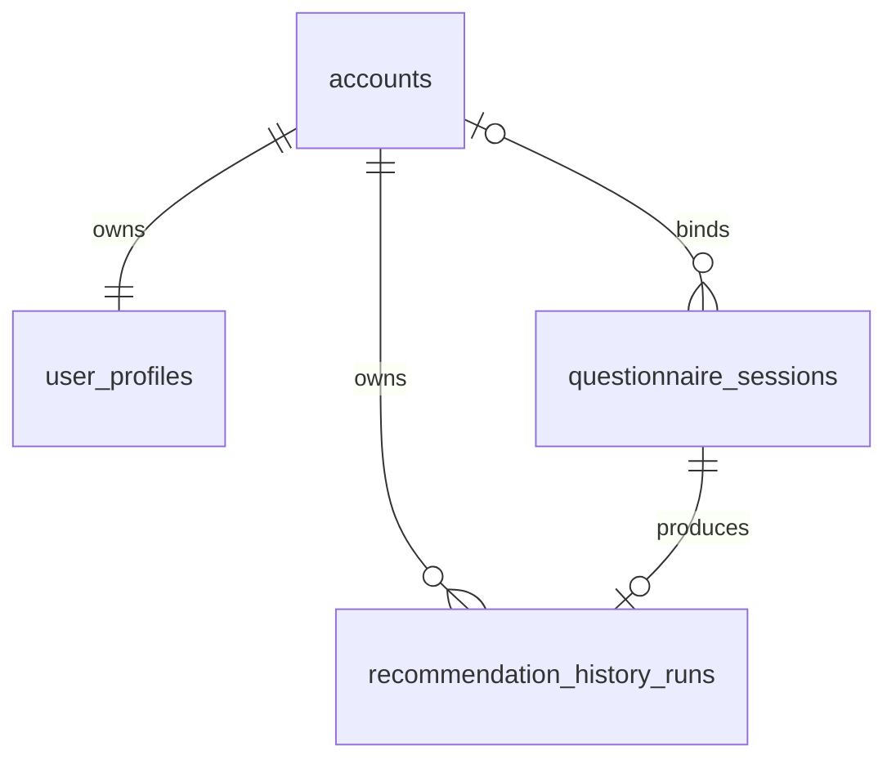
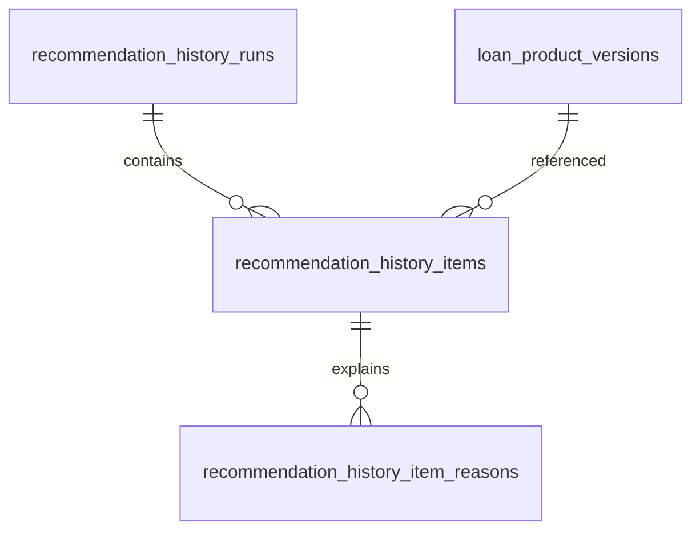
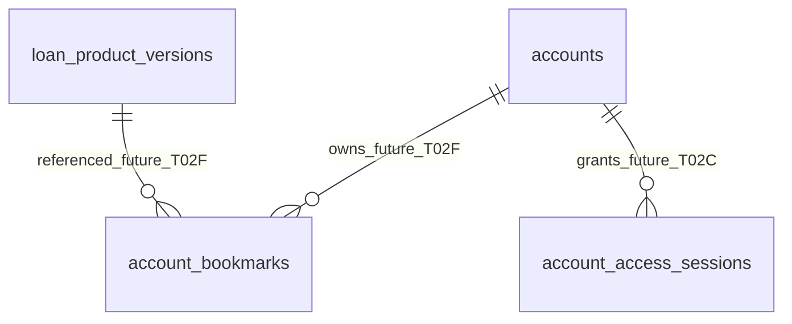

# قرارداد هویت و چرخهٔ عمر حساب — US-11.T02A.1

نسخه ۱؛ ۲۰۲۶-۱۰-۱۲؛ مبنا `2e63479ae5e1034a50e9386cc42e2c3846ed8c27`.
**وضعیت core identity: در US-11.T02A.2 پیاده‌سازی شده؛ سایر قابلیت‌ها آینده‌اند.**

accounts/profile PK، owner/session composite FK، adapter account-ID و دو migration
طبق [runbook](account-identity-migration-runbook.md) اجرا شده‌اند. شرح «فعلی» در
بخش‌های A.1 زیر وضعیت زمان طراحی است؛ ERD/dictionary اجرایی به‌روز شده‌اند.
A.2 همه AC01–AC16 را انجام نمی‌دهد: proof B، نشست durable/۱ساعت C، جریان D، purge E،
bookmark F، archive use case G و backup T05 همچنان جدا هستند.
تصمیم محصول PD01–PD08 مصوب است؛ اجرای مدل در T02A.2 و قابلیت‌های بعدی انجام می‌شود.
[ADR 0008](../adr/0008-account-identity-lifecycle.md) چرایی تصمیم،
[checkpoint](../progress/us-11-t02a1.md) شواهد و مرز تحویل را ثبت می‌کنند.

## ۱. مسئله و مدل فعلی

در [ORM فعلی](../../backend/app/infrastructure/db/models.py)، user_profiles.phone کلید
اصلی است؛ questionnaire_sessions.owner_phone و recommendation_history_runs.owner_phone
به آن FK دارند. [profile repository](../../backend/app/accounts/profile_repository.py)
برای phone موجود همان رکورد را reuse می‌کند. این مدل دو نسل مستقل حساب با phone
مشترک را نمی‌تواند نمایش دهد. bookmarks browser-local و account access حافظه‌ای‌اند.
این مشاهدات، state فعلی‌اند؛ هیچ جدول accounts یا status archive به‌صورت اجرایی
در این PR ساخته نشده است.

## ۲. تصمیم هویت و invariantها

- I01: account_id یک UUID تصادفی opaque و immutable، هویت **یک دوره حساب** است.
  از phone/name/UUID قابل‌حدس کسب‌وکاری مشتق نشود؛ داشتن UUID به‌تنهایی مجوز نیست.
- I02: phone canonical با normalizer موجود، string یازده‌رقمی ایرانی است و هرگز عدد
  ذخیره نشود. phone در طول همان account immutable؛ phone فقط شناسه ورود است.
- I03: status فقط active یا archived است؛ حداکثر یک active برای هر phone، چند
  archived با همان phone مجاز. archived هرگز active نمی‌شود؛ شماره دوباره account
  تازه می‌سازد، نه احیای account قبلی.
- I04: یک account دقیقاً یک profile دارد؛ داده شخصی در همان profile نگه داشته شود.
  phone فقط در accounts، نه کپی نهایی در profile/history/bookmark/session.
- I05: همه مالکیت‌ها با account_id سمت سرور هستند. Actor شامل account_id و phone
  خوانده‌شده از DB است؛ payload/cache/شماره ارسالی یا lookup active با phone نمی‌تواند
  token قدیمی را به account تازه انتقال دهد.
- I06: read/write کاربر تنها برای account active و نشست معتبر همان ID. archive در
  هر device بلافاصله deny است؛ cache مثبت status نباید اجازه دورزدن DB authority دهد.
- I07: profile تغییرپذیر و snapshot تاریخی immutable مستقل‌اند؛ مالک/history
  data_version/config_version/item/reason با archive یا profile update بازنویسی نشوند.
- I08: hide فقط hidden_at در همان history؛ visible و hidden تا همیشه retained.
  archive هیچ cascade DELETE روی profile/history/bookmarks ندارد. raw پاسخ ۳۰ دقیقه
  است و حتی archive/restore آن را از purge معاف نمی‌کند.
- I09: عملیات ایجاد account+profile و claim owner، transaction/idempotency و
  concurrency واقعی دارند. عدم قطعیت، conflict/rollback است، نه merge دو account.
- I10: authority داخلی اپراتور و عملیات audit مستقل‌اند؛ account status/OTP مشتری
  grant اپراتور ایجاد نمی‌کند. DB analytics هم مجوز خودکار دسترسی همه داده‌ها نیست.

## ۳. قرارداد رابطه‌ای هدف و 3NF

### accounts — تنها جدول اصلی جدید لازم برای هویت

| ستون هدف | نوع/nullable | invariant |
| --- | --- | --- |
| account_id | uuid PK NOT NULL | تولید یک‌بار؛ هویت immutable و مستقل نسل‌ها |
| phone | varchar(11) NOT NULL | canonical، حفظ صفر ابتدا، immutable؛ قالب `^09[0-9]{9}$` |
| status | varchar(16) NOT NULL | CHECK active/archived؛ default active |
| created_at | timestamptz NOT NULL | UTC؛ creation زمان واقعی/legacy provenance، نه تاریخ ساخت backfill |
| archived_at | timestamptz NULL | active ⇒ NULL؛ archived ⇒ non-NULL و >= created_at |

Constraint هدف: CHECK وضعیت/زمان بالا؛ **partial UNIQUE(phone) WHERE status='active'**.
این index، constraint واقعی DB موردنیاز A.2 است؛ check application به‌تنهایی کافی
نیست. UNIQUE(phone) سراسری، is_active دوم، generation_number یا archived-profile
table موازی افزوده نمی‌شود. status و timestamp دو fact همان account‌اند و consistency
آن‌ها کنترل می‌شود؛ archived_at جای owner مجزا یا کپی profile نیست.

### user_profiles — جدول موجود با کلید هدف جدید

| ستون | قرارداد هدف |
| --- | --- |
| account_id | uuid PK و FK accounts.account_id، NOT NULL، ON DELETE RESTRICT |
| first_name / last_name | همان varchar(60)/NOT NULL/default "" فعلی |
| income / job | همان varchar(40)/NOT NULL/default "" و allowlist فعلی |
| gender | همان varchar(10)/default ""، اختیاری، بدون نقش در scoring |
| avatar_data_url | همان Text nullable و raster/size validation فعلی |
| created_at / updated_at | timestamptz UTC؛ مقدار legacy حفظ؛ update فقط profile را تغییر دهد |

accounts و profile باید atomically ایجاد شوند؛ FK از child به parent وجود profile
برای هر account را به‌تنهایی تضمین نمی‌کند، پس invariant 1:1 با use case و آزمون
transaction برقرار شود. هیچ profile خودکار با نام/درآمد فرضی ساخته نشود؛ اولیه
phone در accounts و profile با فیلدهای خالی. در response موجود، phone از join
accounts تأمین شود؛ حذف column تکراری phone در مرحله contract، نه تغییر API/UI.

### پیوندهای موجود و آینده

| رابطه هدف | nullability/constraints و مالک اجرایی |
| --- | --- |
| questionnaire_sessions.owner_account_id → accounts | nullable تا bind ناشناس؛ FK RESTRICT. bind از NULL به یک account active فقط یک‌بار با proof معتبر، CAS و transaction. پس از bind owner immutable؛ B proof را اصلاح می‌کند. |
| recommendation_history_runs.owner_account_id → accounts | NOT NULL/FK RESTRICT؛ unique questionnaire_session_id فعلی حفظ. owner باید با owner همان session یکسان باشد. |
| session ↔ history consistency | UNIQUE(session_id, owner_account_id) و composite FK از history(session_id, owner_account_id) به همان pair؛ history owner غیرNULL، پس anonymous session قابل ثبت history نیست. این constraint پیشنهادی A.2 است؛ adapter نیز bind اتمیک را حفظ کند. |
| history items/reasons → run و loan_product_version | همان PK/FK و display_order/partition/facts فعلی، هیچ snapshot جدید/کپی raw answers. hide/archive owner/item/version را تغییر ندهد. |
| account_access_sessions → accounts | **رابطه آینده T02C**، store durable/shared با account_id immutable، token digest، issued/expires/revoked؛ هیچ جدول/session provider در A.1 اجرا نمی‌شود. credential/phone client مجوز نیست. |
| account_bookmarks → accounts و loan_product_versions | **جدول واسط آینده T02F**؛ کلید یکتای (account_id, loan_product_version_id)، بدون آرایه JSON در profile یا کپی کاتالوگ. مشخصات وام از نسخه معتبر موجود خوانده شود، snapshot client authority نیست. |

FKهای account نباید ON DELETE CASCADE داشته باشند. account هیچ public hard-delete
use case ندارد. raw answer child تنها طبق PD01 purge می‌شود؛ session metadata
حداقلیِ referenced by history برای lineage/idempotency باقی می‌ماند، unreferenced
expired metadata می‌تواند طبق طرح E حذف شود. انتخاب حذف session بدون جداسازی پاسخ،
drop FK یا cascade history برای حل F02 ممنوع است. هیچ raw answer در archive یا
history ذخیره نشود.

phone در چند row account، تکرار نادرست profile نیست: هر row یک دوره مستقل همان
شناسه ورود است. profile facts فقط تابع account_id؛ مالکیت‌ها relational FK؛ تاریخچه
factهای زمان تولید را به‌عنوان snapshot مصوب ADR-0011 نگه می‌دارد و از profile
فعلی مشتق نمی‌شود. هدف 3NF با استثنای immutable snapshot موجود حفظ می‌شود.

## ۴. ERD هدف — هنوز پیاده‌سازی نشده

این نمودارها برای contract review هستند؛ ERD اجرایی و مدل ORM فعلی جایگزین نمی‌شوند.

session می‌تواند anonymous owner NULL باشد؛ هر history یک session و یک account
لازم دارد؛ global unique session فقط یک history را اجازه می‌دهد. composite FK
بالا مانع owner mismatch است، حتی اگر application query اشتباه باشد.

## ۵. state machine و جریان‌های application

| عمل | قبل/شرط معتبر | بعد/اثر | رفتار ممنوع |
| --- | --- | --- | --- |
| first login | OTP/provider معتبر محیط، active phone موجود نیست | یک account active + profile خالی در transaction؛ سپس capability به همان ID | ایجاد account با request_code یا verify ناموفق، نصفه‌سازی profile/token |
| repeated login | active همان phone هست | همان ID/profile/history reuse، نشست تازه account-bound | overwrite profile با default یا ساخت active دوم |
| personal-info/profile update | active actor از نشست همان ID؛ phone read-only | آخرین ورودی مجاز فقط profile همان account؛ gender اختیاری | تغییر history/scores یا ارسال role/accountId از client برای authorization |
| recommendation/history save | session معتبر، proof واقعی، bind=NULL یا همان actor | bind اتمیک + snapshot once/session؛ conflict رد | attach به account دیگر، owner rename با phone مشترک، snapshot rewrite |
| hide history | active owner همان run | hidden_at؛ هیچ DELETE، deviceهای account آن را نبینند | hide دیگری، حذف DB یا دسترسی hidden با ID مستقیم |
| logout | نشست جاری همان actor | revoke همان credential، پاک‌سازی browser داده شهاب؛ DB retained | تمدید login یا پاک‌کردن کل localStorage سایر برنامه‌ها |
| archive account | command مجاز/contract آینده G | status archived+timestamp؛ revoke همه capabilityهای آن ID اتمیک؛ profile/history/bookmarks حفظ | ایجاد دکمه/endpoint حذف عمومی در A.1/A.2، reactivation، انتقال داده به active دیگر |
| login after archive | phone verified، active موجود نیست | ID تازه B و profile خالی؛ account A archived ثابت | lookup سوابق با phone و نمایش داده A برای B |
| raw expiry/restore | بیش از ۳۰ دقیقه از session؛ حتی hidden/archive | E/T05 purge raw؛ snapshot و status باقی؛ قبل از سرو restore reconciliation | تمدید خام با logout/archive یا احیای account/hidden row پس از restore |

نشست آینده C یک ساعت **absolute** از آخرین login موفق؛ expiresAt/remainingTime
server-owned، refresh/restore/پرسشنامه جدید تمدید نکند. capability issuance باید ID
resolved در transaction را نگه دارد؛ در هر درخواست status همان ID دوباره معتبر
باشد. stale token A حتی با phone B مشترک deny است؛ fail-open یا resolve-active-phone
برای credential قدیمی ممنوع. foreground/archive race با قفل/validation fresh
linearize شود؛ نتیجه باید منسجم با ترتیب commit باشد، نه نشت یک snapshot.

profile update atomic است و پاسخ خطای ذخیره نباید confirmed-cache یا نتیجه موفق
جعلی بسازد. نمایش فیلدهای profile بعد از نتیجه و بدون OTP جدید، D اجرا می‌کند؛
current API تا A.2 بر phone عمل می‌کند و در این PR تغییر نکرده.

## ۶. concurrency و مالکیت عملیات آینده

A.2 باید DB partial unique و transaction را پیاده کند، نه SELECT سپس INSERT
بدون constraint. دو verification هم‌زمان یک active نتیجه بدهند؛ unique conflict
با rollback/re-read **active** و reuse نتیجه همان نسل، نه انتخاب آخرین archived.
archive/login روی همان phone/account باید تحت ترتیب تراکنشی مشخص serialize شوند.
قفل پایدار یا isolation/retry طرح A.2 با تست دو connection انتخاب شود؛ این سند
الگوریتم قفل اجراشده ادعا نمی‌کند.

archive G، status و revocation durable را در یک transaction commit کند؛ اگر
session store/cache دیگری هست، status DB authority و invalidation fail-closed
باشد تا cache stale اجازه ندهد. write/hide/profile/save قبل از mutation active
owner را تازه بررسی و عملیات در حال رقابت با archive را با قفل همان account
هماهنگ کنند. credentials/ownerهای پرونده نسل قبلی هرگز به نسل تازه تغییر نکنند.

## ۷. نقشه migration/backfill برای A.2؛ دستور عملیاتی نیست

1. audit فقط‌خواندنی schema/revision/count/FK و canonical phone واقعی DB منتخب؛
   mismatch/orphan/duplicate ⇒ blocker، نه merge یا normalize حدسی.
2. expand accounts، UUID owner ستون‌های جدید و constraints/index سازگار؛ actual
   DB revision از head موجود تعیین شود، هیچ migration قدیمی بازنویسی نشود.
3. یک mapping پایدار phone موجود → account_id با active accounts ایجاد و profile
   created/updated/facts نگه داشته شود. UUID یک‌بار persisted؛ rerun ID جدید نسازد.
4. با همان mapping، profile/session/history FKها backfill؛ owner NULL ناشناس حفظ،
   hidden_at، snapshot item/reason و IDهای تاریخچه عیناً باقی. counts/checksums بدون
   چاپ PII و owner equality قبل از افزودن composite FK اثبات شوند.
5. writers را برای تغییر کلید/dual-write طبق runbook کنترل کن؛ mixed old/new writers
   نباید نسل یا owner را از phone حدس بزنند. bridge دقیقاً به mapping ثبت‌شده وصل
   باشد و تنها قبل از archive feature G مجاز؛ last-active-phone lookup bridge نیست.
6. adapter/API به account actor داخلی منتقل، public phone response unchanged؛
   read/write مطابق account_id، tokenهای legacy phone-only revoke/relogin یا یک‌بار
   bind به **همان mapping** پیش از G، هرگز با login نسل آینده دوباره resolve نشوند.
   method/path/body موجود جز تغییر ضروری نسخه‌دار و مستند عوض نشود.
7. contract پس از integrity/compatibility gate: profile PK account_id، remove legacy
   owner_phone/phone duplicate فقط در مرحله مستقل سازگار. G تا تکمیل این cutover،
   coverage همه owner consumers و legacy credential cleanup قابل فعال‌سازی نیست.
8. bookmarks فعلی browser منشأ قطعی account ندارند و در A.2 backfill DB ندارند؛
   سیاست انتقال F جدا، بدون silent upload/attach به login بعدی.

### rollback بدون data loss

تا قبل از ایجاد چند نسل برای phone، mapping/نسخه و counts اجازه downgrade lossless
طبق طرح آزموده A.2 بدهند. پس از archive+نسل تازه، schema phone-PK قدیمی ظرفیت
داده را ندارد؛ downgrade باید با guard روشن **رد شود** و داده retained بماند؛
roll-forward یا reader account-aware/restore مجاز در محیط جدا لازم است. merge دو
profile، DELETE archived برای سبزکردن downgrade یا بازگرداندن phone-only auth ممنوع.
این guard یک محدودیت سازگاری ثبت‌شده است، نه downgrade مخرب «عملی». A.1 فقط docs
است و rollback همین PR با revert docs بدون اثر DB انجام می‌شود.

## ۸. ماتریس پذیرش مستقل از اجرا

| ID | سناریو آینده | انتظار |
| --- | --- | --- |
| AC01 | login اول و retry | یک active ID+profile؛ no default overwrite |
| AC02 | دو login هم‌زمان | فقط یک active phone، partial unique و race دو اتصال PG |
| AC03 | archive A سپس login phone قبلی | A retained+archived، B UUID تازه با profile اولیه خالی |
| AC04 | token A در برابر B | read/update/hide/history/bookmark deny، حتی phone یکسان |
| AC05 | دو account/device | A deviceها داده مشترک، account دیگر هیچ دسترسی؛ browser cache authority نیست |
| AC06 | wrong session owner | CAS/composite FK reject؛ snapshot کامل قبلی حفظ |
| AC07 | anonymous session | owner NULL بماند تا claim معتبر؛ UUID تنها/proof ثابت مجوز نیست |
| AC08 | expiry raw با history/hidden/archive | پاسخ حذف، snapshot/lineage حفظ؛ FK blocker F02 رفع با real PG |
| AC09 | backfill repeat/restart | همان UUID mapping و counts/checksum؛ zero duplicate/orphan |
| AC10 | fixture legacy profile/history | name/income/job/avatar/time/hidden/items/reasons عیناً حفظ |
| AC11 | error وسط account/profile/create یا archive | rollback کامل؛ token یا نصفه‌record منتشر نشود |
| AC12 | logout/one-hour/restore | revoke، ۳۶۰۰ absolute، restore باقی‌مانده، بدون تمدید؛ C/D |
| AC13 | آخرین profile input و snapshot | profile تغییر، R1 ثابت و بدون rescore؛ D |
| AC14 | backup restore چند نسل | statuses/FKs حفظ؛ A فعال/سوابقش به B وصل نشود؛ expired raw purge؛ T05 |
| AC15 | downgrade بعد از چند نسل | controlled refusal بدون DELETE/merge؛ قبل از G lossless آزموده |
| AC16 | internal/customer roles | account/customer OTP هیچ operator grant ایجاد نکند |

A.1 با consistency/link/scope review و چهار CI پایان می‌یابد؛ ACها طرح آزمون
A.2/B–H هستند و **اجراشده گزارش نمی‌شوند**. schema واقعی هنوز phone-PK است؛
F01/F02 بازند، نشست یک‌ساعته و bookmark account DB و archive UI هنوز فعال نیستند.
