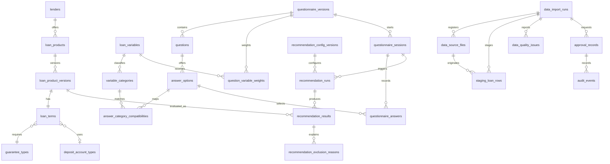
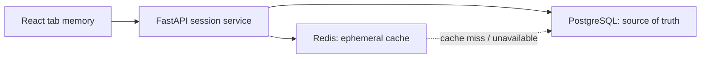
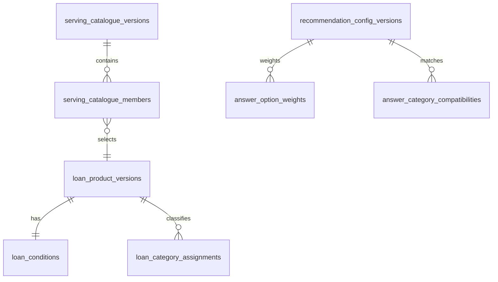
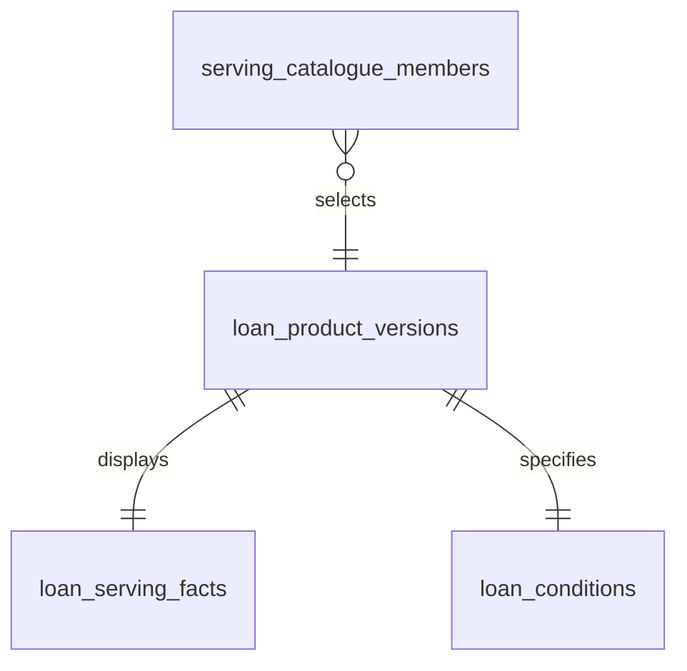
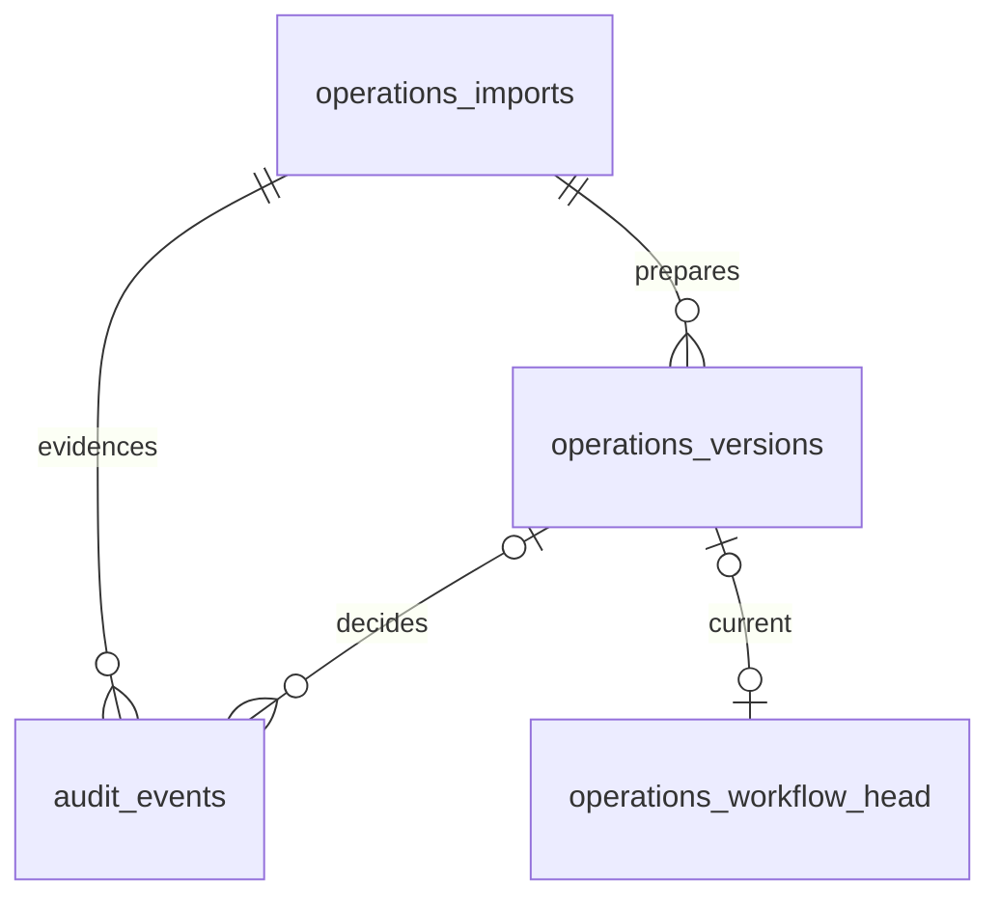
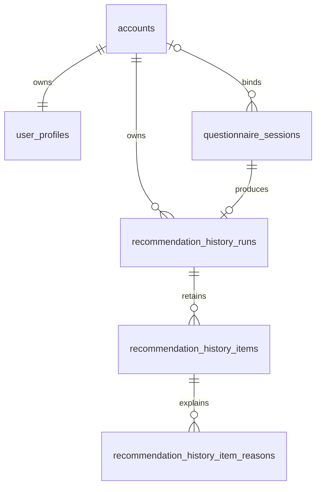
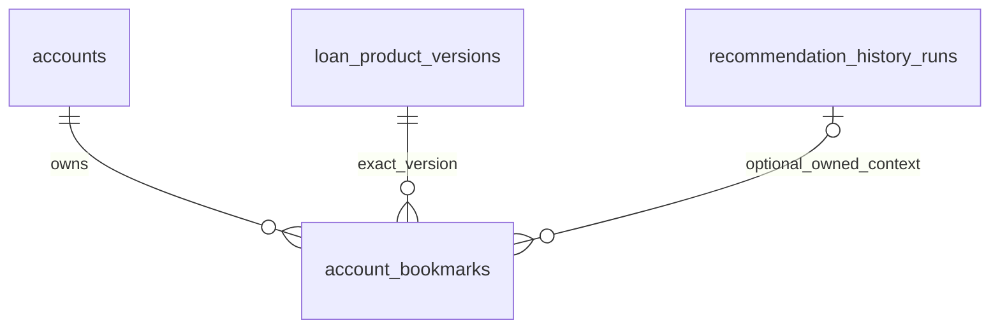

# ERD مفهومی شهاب — US-04.T01

> ممیزی US-12.T01، ۲۰۲۶-۱۰-۱۸: بخش آغازین این سند طراحی تاریخی US-04 است؛ افزوده‌های اجرایی پایین و [موجودی جاری دیتابیس](README.md) بر عبارت‌های قدیمی «هنوز schema/account وجود ندارد» مقدم‌اند. موجودی جدول‌های واقعی از ORM و migration خوانده می‌شود؛ این سند به‌تنهایی شاهد استقرار یا اجرای PostgreSQL نیست.

## وضعیت و مرز

این نمودار، **مدل مفهومیِ تأییدشده برای طراحی 3NF در `US-04.T02`** است، نه schema اجرایی. نام‌ها شناسه‌های `snake_case` پیشنهادی PostgreSQL هستند. تا پیش از migration واقعی، این نمودار با validator مستنداتی کنترل می‌شود؛ از `US-04.T03` به بعد باید با مدل/مهاجرت واقعی هم‌راستا و در CI اعتبارسنجی شود.

## session persistence و cache (implemented in `US-07.T06`)

`Redis` یک datastore رابطه‌ای نیست و بنابراین موجودیت مستقلی در ERD 3NF ندارد. منبع حقیقتِ پاسخ‌های معتبر و sessionهای هنوز‌منقضی‌نشده، دو جدول نرمال‌شدهٔ PostgreSQL یعنی `questionnaire_sessions` و `questionnaire_answers` است. Redis فقط cache قابل حذف و قابل بازسازی است؛ پاسخ‌ها یا شناسهٔ session نباید در key/log/metric آشکار شوند و خرابی/خالی‌شدن Redis نباید پاسخ معتبر را از بین ببرد.

هر migration که رابطه، constraint یا ستون این دو جدول را تغییر دهد، باید همین ERD، `physical-schema-3nf.md`، data dictionary و تست schema را در همان PR به‌روزرسانی کند. این یک gate اجباری برای `US-07.T06` و تغییرهای بعدی مدل داده است.

## bounded contextها و قواعد رابطه

| context | مالک | موجودیت‌ها | invariant مفهومی |
| --- | --- | --- | --- |
| کاتالوگ وام | تیم دادهٔ محصول | `lenders`, `loan_products`, `loan_product_versions`, `loan_terms`, `guarantee_types`, `deposit_account_types` | هویت `loan_products` پایدار است؛ هر شرایط قابل‌نمایش/امتیازدهی فقط در یک version immutable ثبت می‌شود. |
| پیکربندی توصیه‌گر | مالک محصول | `loan_variables`, `variable_categories`, `questionnaire_versions`, `questions`, `answer_options`, `recommendation_config_versions`, `question_variable_weights`, `answer_category_compatibilities` | شناسه‌های canonical پایدارند؛ وزن و compatibility همیشه به نسخهٔ config/source قابل‌ردیابی متصل‌اند. |
| جلسه و نتیجه | محصول و حریم خصوصی | `questionnaire_sessions`, `questionnaire_answers`, `recommendation_runs`, `recommendation_results`, `recommendation_exclusion_reasons` | PostgreSQL منبع حقیقت session/answer تا TTL است؛ Redis فقط cache موقت و قابل‌بازتولید؛ پاسخ خام به log منتقل نمی‌شود. |
| حکمرانی داده | عملیات داده | `data_import_runs`, `data_source_files`, `staging_loan_rows`, `data_quality_issues`, `approval_records`, `audit_events` | raw immutable است؛ فقط import approved به serving تبدیل می‌شود؛ هر تبدیل provenance دارد. |

## تصمیم‌های مدل‌سازی و امنیت

- همهٔ primary keyها `uuid` و همهٔ timestampها `timestamptz` در UTC خواهند بود؛ نوع/constraint واقعی در `US-04.T02` تعیین می‌شود.
- `loan_product_versions` منبع حقیقت شرایط وام است؛ از کپی نرخ، مبلغ یا متن شرایط در `recommendation_results` پرهیز می‌شود. نتیجه فقط snapshot توضیح‌پذیرِ version/config را نگه می‌دارد.
- مقادیر محوری typed هستند. stateهای `unknown`, `variable`, `neutral` و `ranking_excluded` به enum/state صریح تبدیل می‌شوند، نه `NULL` مبهم.
- `users` عمداً هنوز موجودیت اصلی نیست: نسخهٔ فعلی پرسشنامه با session ناشناس کار می‌کند. اگر login بعداً لازم شد، `users` و policy retention در داستان احراز هویت افزوده می‌شود، نه زودتر.
- `staging_loan_rows` تنها محل نگهداری مقادیر خام/فارسی ورودی است؛ core/serving برای query و integrity از روابط و typeهای نرمال استفاده می‌کند.

## تکامل و وابستگی

`US-04.T02` این مدل را به ستون، PK/FK، `NOT NULL`، `UNIQUE` و `CHECK`های 3NF تبدیل می‌کند. `US-04.T03` مدل ORM و repository port، و `US-04.T04` migration و آزمون PostgreSQL واقعی را می‌سازد. تغییر cardinality یا حذف موجودیت، ADR و migration سازگار/rollback جداگانه می‌خواهد.

## US-09.T05A persisted serving relations

`serving_catalogue_versions` یک active pointer یکتا دارد. membership تنها نسخه‌های منتشرشدهٔ تأییدشده را در transaction انتشار می‌گیرد. متن شروط روی همان loan version ذخیره می‌شود؛ وزن و ضریب به config version و سطر/ستون منبع پیوند دارند.

## US-09.T05B detail projection

این projection از همان نسخهٔ تأییدشدهٔ وام ساخته می‌شود؛ مقدار شرط خالی از نبود عضو در کاتالوگ متمایز است.

## Historical profile table — PR #85 / US-09.T072

user_profiles was introduced by migration d1a9e71b4c3f, independent of anonymous questionnaire/recommendation data. Canonical eleven-digit phone is the string primary key; one editable record per phone. A local/test verified server session selects that phone. There is no FK to questionnaires or loans, and this repair adds no schema changes.

## US-10.T03 implemented operations evidence

`audit_events` has a composite version/import FK, plus before/after version FKs.
`approval_records` is a view of approve events, not an independent table. Imports,
versions and events are append-only; singleton head is the mutable projection.
These implemented relations supersede only the earlier conceptual approval/audit
shape; unimplemented staging concepts are still conceptual. Historical JSONB
preparation/diff follows ADR 0006; customer serving relations remain unchanged.

## US-11.T02A.2 — مدل اجرایی حساب

پس از revision `aa11b02a2002`، phone فقط شناسه ورود در accounts است؛ profile PK
و ownerهای session/history به UUID مستقل هر دوره حساب اشاره می‌کنند. مدل قدیمی
PR #85 بالا تاریخی است. روابط فعلی زیر از ORM/migration واقعی‌اند؛ session durable
و bookmarks آینده C/F در این نمودار اجراشده نیستند.

account با phone canonical، status/archived_at و partial unique active phone؛
profile دقیقاً یک رکورد با PK/FK RESTRICT، invariant وجود profile با transaction
و آزمون برقرار است. anonymous owner NULL؛ history owner غیرNULL و composite FK
(session_id, owner_account_id) به session، unique global session؛ owner پس از bind
با trigger immutable است. FKهای حساب RESTRICT‌اند؛ archive/hide باعث حذف snapshot
نمی‌شود. [runbook](account-identity-migration-runbook.md) و
[قرارداد](account-identity-lifecycle.md) مرجع جزئیات؛ archive feature در G است.

## US-11.T02B — proof معتبر پرسشنامه

bb11b02b0001 فقط creator_proof_digest nullable به questionnaire_sessions می‌افزاید؛ روابط account/session/history و 3NF قبلی ثابت. digest fact سازنده، authority از DB نه Redis؛ legacy NULL و owner UUID حفظ. CHECK hex64 و trigger immutable؛ [قرارداد proof](../security/questionnaire-proof.md).

## US-11.T02C — نشست مشترک یک‌ساعته

C سه جدول اجرایی دارد: accounts ||--o{ account_access_sessions (RESTRICT)، OTP challenge پیش از account و quota events عملیاتی کوتاه‌عمر، بدون FK به business profile. [قرارداد](../security/account-session-lifecycle.md). owner/history/source روابط قبلی ثابت.

## US-11.T02E — پاسخ خام مستقل از snapshot

`questionnaire/infrastructure/retention.py` هر بار حداکثر۱۰۰ (حد سخت۱۰۰۰) نشست
expired را با ترتیب expiry/UUID و `FOR UPDATE SKIP LOCKED` انتخاب می‌کند. حذف
answers، EXPIRED کردن metadata مرتبط و حذف metadata غیرمرتبط در یک transaction
commit یا rollback می‌شوند. لینک history با هیچ فیلتر hidden/status کنار گذاشته
نمی‌شود: profile/account/run/item/reason/owner و data/config/loan/questionnaire
version حفظ می‌شوند؛ هیچ cascade، انتقال خام به archive/JSON یا تغییر scoring وجود ندارد.
metadata مرتبط شامل UUID، version FK، owner UUID، created/expires، state و digest
immutable (یا NULL legacy) برای FK/idempotency/evidence همراه history همیشگی
باقی می‌ماند؛ digest secret قابل بازیابی/پاسخ خام نیست و expiry/state هرگز اجازه
استفاده دوباره نمی‌دهند. metadata غیرمرتبط پس از expiry نیاز durable ندارد و حذف
می‌شود. قرارداد proof/owner و TTL۱۸۰۰ تمدید/تضعیف نمی‌شوند.

این موتور و CLI به‌تنهایی scheduler نیستند. F02 مسیر FK/runtime در E اصلاح می‌شود؛
بستن کامل operational retention همچنان نیازمند scheduler/monitor/restore-before-reopen
در T05 است. expiry denial یا batch خالی معادل حذف اثبات‌شده نیست.
[فرمان و حدود عملیاتی](../operations/raw-answer-retention.md) و
[شواهد E](../progress/us-11-t02e.md).

## US-11.T02F — نشان‌شده‌های حساب

PK(account_id,loan_product_version_id)، FKهای RESTRICT و composite FK(source_history_run_id,
account_id)→history(run_id,owner_account_id)؛ run+owner UNIQUE اضافه می‌شود تا مرجع
snapshot هرگز متعلق به نسل/حساب دیگر نباشد. created_at و removed_at UTC؛ هیچ JSON،
phone، نام وام یا score در association نیست. [قرارداد F](../security/account-bookmarks.md).
