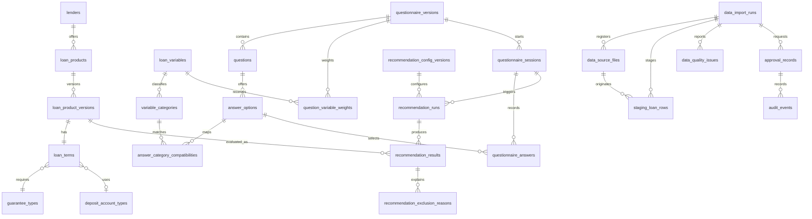

# ERD مفهومی شهاب — US-04.T01

## وضعیت و مرز

این نمودار، **مدل مفهومیِ تأییدشده برای طراحی 3NF در `US-04.T02`** است، نه schema اجرایی. نام‌ها شناسه‌های `snake_case` پیشنهادی PostgreSQL هستند. تا پیش از migration واقعی، این نمودار با validator مستنداتی کنترل می‌شود؛ از `US-04.T03` به بعد باید با مدل/مهاجرت واقعی هم‌راستا و در CI اعتبارسنجی شود.

## bounded contextها و قواعد رابطه

| context | مالک | موجودیت‌ها | invariant مفهومی |
| --- | --- | --- | --- |
| کاتالوگ وام | تیم دادهٔ محصول | `lenders`, `loan_products`, `loan_product_versions`, `loan_terms`, `guarantee_types`, `deposit_account_types` | هویت `loan_products` پایدار است؛ هر شرایط قابل‌نمایش/امتیازدهی فقط در یک version immutable ثبت می‌شود. |
| پیکربندی توصیه‌گر | مالک محصول | `loan_variables`, `variable_categories`, `questionnaire_versions`, `questions`, `answer_options`, `recommendation_config_versions`, `question_variable_weights`, `answer_category_compatibilities` | شناسه‌های canonical پایدارند؛ وزن و compatibility همیشه به نسخهٔ config/source قابل‌ردیابی متصل‌اند. |
| جلسه و نتیجه | محصول و حریم خصوصی | `questionnaire_sessions`, `questionnaire_answers`, `recommendation_runs`, `recommendation_results`, `recommendation_exclusion_reasons` | نتیجه به دقیق‌ترین `loan_product_version` و `recommendation_config_version` وصل است؛ پاسخ خام به log منتقل نمی‌شود. |
| حکمرانی داده | عملیات داده | `data_import_runs`, `data_source_files`, `staging_loan_rows`, `data_quality_issues`, `approval_records`, `audit_events` | raw immutable است؛ فقط import approved به serving تبدیل می‌شود؛ هر تبدیل provenance دارد. |

## تصمیم‌های مدل‌سازی و امنیت

- همهٔ primary keyها `uuid` و همهٔ timestampها `timestamptz` در UTC خواهند بود؛ نوع/constraint واقعی در `US-04.T02` تعیین می‌شود.
- `loan_product_versions` منبع حقیقت شرایط وام است؛ از کپی نرخ، مبلغ یا متن شرایط در `recommendation_results` پرهیز می‌شود. نتیجه فقط snapshot توضیح‌پذیرِ version/config را نگه می‌دارد.
- مقادیر محوری typed هستند. stateهای `unknown`, `variable`, `neutral` و `ranking_excluded` به enum/state صریح تبدیل می‌شوند، نه `NULL` مبهم.
- `users` عمداً هنوز موجودیت اصلی نیست: نسخهٔ فعلی پرسشنامه با session ناشناس کار می‌کند. اگر login بعداً لازم شد، `users` و policy retention در داستان احراز هویت افزوده می‌شود، نه زودتر.
- `staging_loan_rows` تنها محل نگهداری مقادیر خام/فارسی ورودی است؛ core/serving برای query و integrity از روابط و typeهای نرمال استفاده می‌کند.

## تکامل و وابستگی

`US-04.T02` این مدل را به ستون، PK/FK، `NOT NULL`، `UNIQUE` و `CHECK`های 3NF تبدیل می‌کند. `US-04.T03` مدل ORM و repository port، و `US-04.T04` migration و آزمون PostgreSQL واقعی را می‌سازد. تغییر cardinality یا حذف موجودیت، ADR و migration سازگار/rollback جداگانه می‌خواهد.
